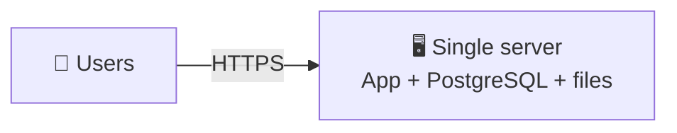
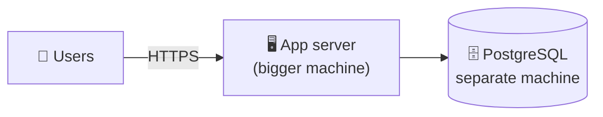
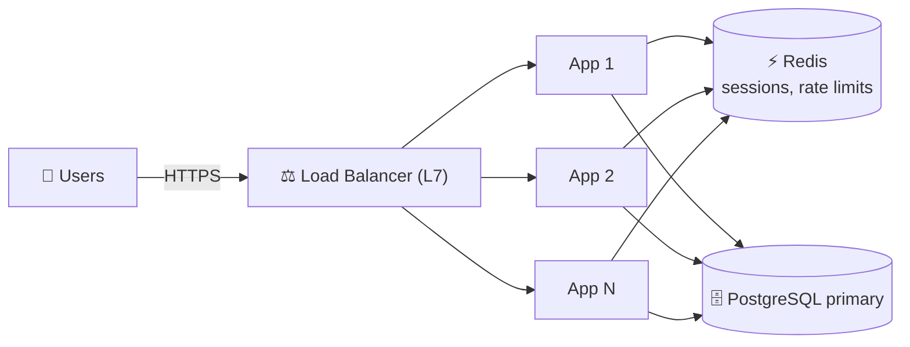
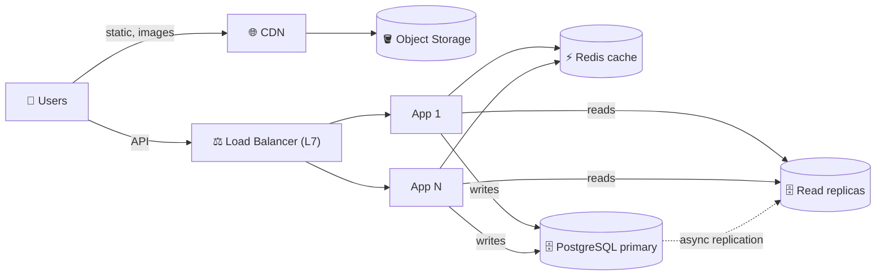
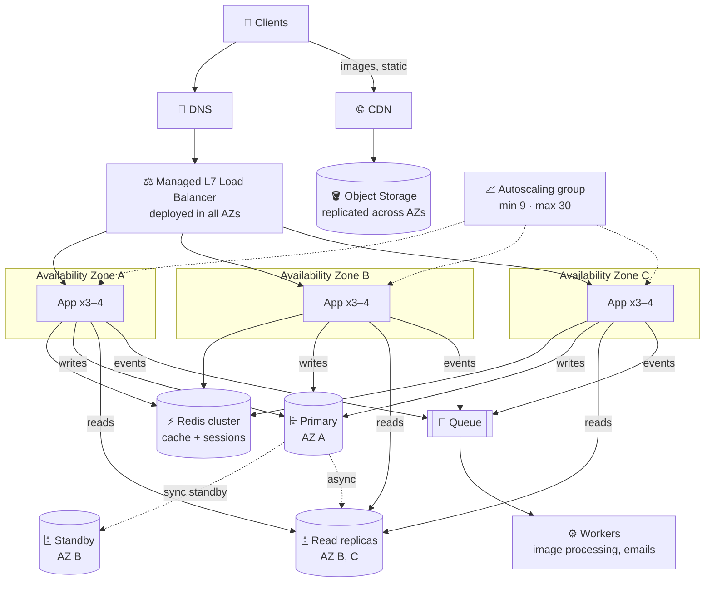
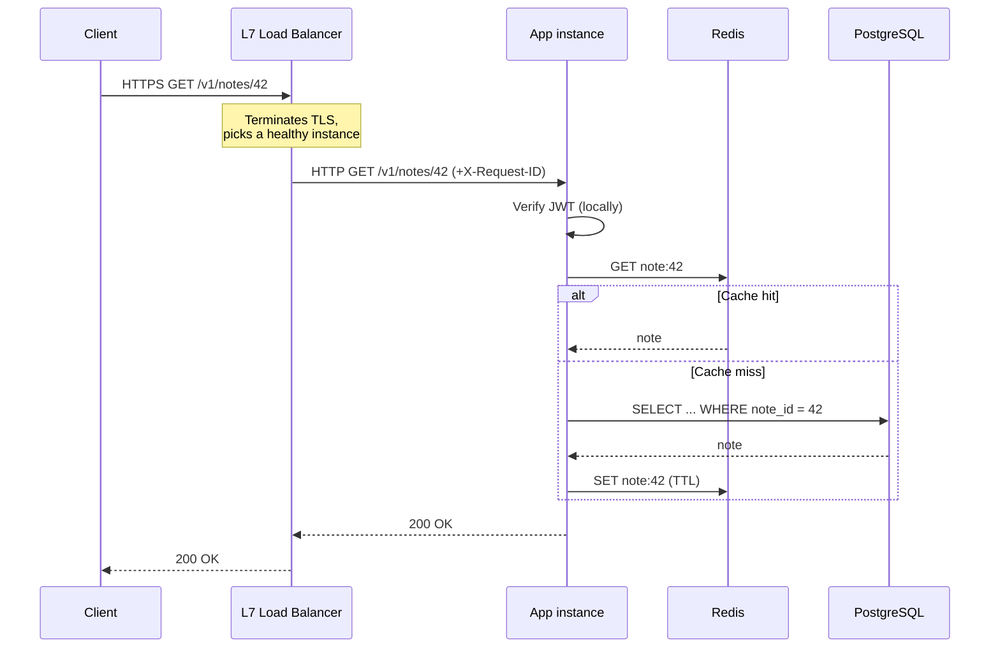

**English** | [Русский](INTERVIEW.ru.md) · Theory: [README.md](./README.md)

# 01. Scaling Basics: From 1,000 to 10 Million Users

> **Topic:** vertical vs horizontal scaling, stateless services, load balancing (L4 vs L7, algorithms)
> **Level:** Medium · **Interview time:** 45 min · **Study time:** ~4 h
> **Where it's asked:** everywhere. It's the foundation of almost every problem, and sometimes a standalone question: "How would you scale this service?"

---

## 🗺️ How to Read This Walkthrough

This is written as a transcript of a real interview. Legend:

| Icon | Meaning |
|:----:|:--------|
| 🎤 | Interviewer |
| 🗣️ | What I (the candidate) say out loud |
| ✏️ | What I draw on the whiteboard |
| ⏱️ | Time budget for the step |

Key points are highlighted with GitHub callouts: **TIP** — a good technique, **WARNING** — a trap, **IMPORTANT** — a Senior+ signal.

---

## 📑 Contents

1. [Problem Statement](#1-problem-statement)
2. [Clarifying Questions and Requirements](#2-clarifying-questions-and-requirements)
3. [Capacity Estimates](#3-capacity-estimates)
4. [API](#4-api)
5. [Data Model](#5-data-model)
6. [High-Level Design: Evolution by Stages](#6-high-level-design-evolution-by-stages)
7. [Deep Dive 1: Vertical vs Horizontal](#7-deep-dive-1-vertical-vs-horizontal)
8. [Deep Dive 2: Stateless Services](#8-deep-dive-2-stateless-services)
9. [Deep Dive 3: Load Balancing](#9-deep-dive-3-load-balancing)
10. [Deep Dive 4: Autoscaling](#10-deep-dive-4-autoscaling)
11. [Bottlenecks and Failure Scenarios](#11-bottlenecks-and-failure-scenarios)
12. [What Changes at 10x Scale](#12-what-changes-at-10x-scale)
13. [Interviewer Questions with Answers](#13-interviewer-questions-with-answers)
14. [Common Mistakes](#14-common-mistakes)
15. [Cheat Sheet and Self-Check](#15-cheat-sheet-and-self-check)

---

## 1. Problem Statement

> 🎤 "We have a note-taking web app: users create, read and edit short notes. Today there are 1,000 users, and everything runs on a single server. In two years we expect 10 million daily active users. How will the architecture evolve?"

**Time plan:**

| Step | ⏱️ |
|:-----|:--:|
| Requirements | 5 min |
| Estimates | 4 min |
| API and data model | 5 min |
| High-level design by stages | 12 min |
| Deep dives | 15 min |
| Failures and wrap-up | 4 min |

> [!TIP]
> In "scale this service" problems, show the **evolution** of the architecture rather than jumping to the final diagram. It proves you understand *why* each component appears, not just that you know the buzzwords.

---

## 2. Clarifying Questions and Requirements

⏱️ 5 min

🗣️ "Before drawing anything, let me clarify a few things."

| My question | Interviewer's answer | What it changes |
|:------------|:---------------------|:----------------|
| What's the read/write ratio? | About 10:1 | Read-heavy: cache and replicas matter |
| One region or global audience? | One region for now | No multi-region yet, but multi-AZ is required |
| Any media (images, files)? | Users can attach images | Need object storage and a CDN |
| Is strong consistency required? | Authors must see their own edits immediately | Need read-your-writes, not global strong consistency |
| Budget? | Reasonable, no overprovisioning | Autoscaling instead of permanent spare capacity |

### Functional requirements

1. User sign-up and login.
2. Create, edit and delete a note (text up to 10 KB + images).
3. View a single note and a paginated list of one's own notes.

**Out of scope:** search, collaborative editing, notifications, recommendations.

### Non-functional requirements

| Requirement | Target |
|:------------|:-------|
| Scale | 10M DAU in 2 years |
| Availability | 99.95% (~22 minutes of downtime per month) |
| Latency | p99 < 200 ms for reads, < 500 ms for writes |
| Durability | Notes are never lost |
| Consistency | Read-your-writes for the author, eventual for everyone else |
| Elasticity | Handle 3× peaks without manual intervention |

> [!IMPORTANT]
> **Senior+ signal:** say out loud which requirements *drive* the architecture. Here: read-heavy traffic (→ cache, replicas), 99.95% availability (→ no single point of failure, multiple AZs) and traffic peaks (→ autoscaling).

---

## 3. Capacity Estimates

⏱️ 4 min

✏️ Written in the corner of the whiteboard:

```
DAU                     = 10M
Reads per user/day      = 20   →  200M reads/day
Writes per user/day     = 2    →   20M writes/day

1 day ≈ 10^5 sec
Read QPS  (avg) = 200M / 10^5 ≈ 2,000   → peak ×3 ≈ 6,000
Write QPS (avg) =  20M / 10^5 ≈   200   → peak ×3 ≈   600

Storage: 20M writes × ~1 KB = 20 GB/day ≈ 7 TB/year (text only)
Images:  10% of notes × 200 KB = 400 GB/day → object storage
Bandwidth: 6,000 RPS × ~5 KB response ≈ 30 MB/s (excluding images)
```

🗣️ **Conclusions I state out loud:**

- **App servers.** One instance of a simple JSON API handles roughly ~1,000 RPS (to be confirmed by load testing). A ~6,600 RPS peak means ~7 instances. With N+2 headroom spread across 3 AZs, that's **~9–12 instances**. One machine won't do → we need horizontal scaling.
- **DB writes.** 600 writes/s at peak is easy for a single PostgreSQL primary. No need to shard writes **yet**.
- **DB reads.** 6,000 reads/s with a 90% cache hit rate becomes ~600 QPS to the database → 1–2 read replicas are enough.
- **Storage.** 7 TB/year — a single DB copes within the 2-year horizon, but this is the first candidate for sharding with further growth.

> [!TIP]
> Only compute what affects decisions. Every number should end with a conclusion: "so we need X" or "so X isn't needed yet".

---

## 4. API

⏱️ 3 min

```http
POST   /v1/auth/login                     → { access_token, refresh_token }

POST   /v1/notes                          → 201 { note_id }
       Headers: Authorization: Bearer <JWT>
                Idempotency-Key: <uuid>
       Body:    { title, body, image_ids[] }

GET    /v1/notes/{note_id}                → 200 { note }
PUT    /v1/notes/{note_id}                → 200 { note }   (If-Match: <version>)
DELETE /v1/notes/{note_id}                → 204

GET    /v1/users/me/notes?cursor=<c>&limit=20
                                          → 200 { notes[], next_cursor }

POST   /v1/uploads                        → 200 { upload_url, image_id }
       (pre-signed URL: the client uploads the image directly to object storage)
```

🗣️ Three decisions directly tied to scaling:

1. **JWT in the header instead of a server-side session.** Any app server can handle any request. This is the foundation of statelessness (details in [section 8](#8-deep-dive-2-stateless-services)).
2. **Idempotency-Key.** Retries through the load balancer won't create duplicate notes.
3. **Pre-signed URLs for images.** Heavy traffic bypasses the app servers and goes straight to storage.

Cursor pagination instead of `offset` keeps queries fast on large lists.

---

## 5. Data Model

⏱️ 2 min

```sql
users (
  user_id       BIGINT PRIMARY KEY,
  email         TEXT UNIQUE,
  password_hash TEXT,
  created_at    TIMESTAMPTZ
)

notes (
  note_id      BIGINT PRIMARY KEY,   -- Snowflake ID: unique and time-sortable
  user_id      BIGINT NOT NULL,      -- future shard key
  title        TEXT,
  body         TEXT,
  image_ids    TEXT[],
  version      INT,                  -- for optimistic locking (If-Match)
  created_at   TIMESTAMPTZ,
  updated_at   TIMESTAMPTZ
)
INDEX notes_by_user ON notes (user_id, note_id DESC)
```

🗣️ "I'm choosing PostgreSQL: the data is relational, write load is moderate, and we need transactions. All main queries go by `user_id`, so if we ever need to shard, the key is already obvious."

---

## 6. High-Level Design: Evolution by Stages

⏱️ 12 min

🗣️ "I'll show how the architecture grows with load. At each stage I'll name the problem that forces the next step."

### Stage 0. A single server (~1,000 users)

✏️



**Problems:** single point of failure; the app and DB compete for CPU and RAM; every deploy means downtime.

### Stage 1. Split app and DB, scale vertically (~10–50K)

✏️



🗣️ "The first step is vertical scaling: move the DB to its own machine and give both more CPU and RAM. It's cheap in effort, and the code doesn't change."

**Problems:** vertical growth has a ceiling, cost grows non-linearly, and it's still a single point of failure.

### Stage 2. Load balancer and horizontal scaling (~100K – 1M)

✏️



🗣️ "We add a load balancer and several identical app servers. For this to work, servers must be **stateless**: all state goes to a shared store (Redis, the DB, object storage)."

**Problems:** the database becomes the read bottleneck; images are still served through the app servers.

### Stage 3. Cache, replicas, CDN, object storage (~1–5M)

✏️



🗣️ "We offload the read-heavy traffic with a cache (cache-aside) and read replicas. Images go to object storage and are served via the CDN, so app servers handle only the API."

> [!WARNING]
> **Trap: replication lag.** A user saves a note, the next request hits a replica, and the edit isn't there yet. Fix: read the user's **own** data from the primary for N seconds after a write, or pass a version and compare it. That satisfies the read-your-writes requirement.

### Stage 4. Final design: multiple AZs, autoscaling, async processing (~10M DAU)

✏️



🗣️ "Final principles:
- No single point of failure: everything is duplicated across at least three AZs.
- The app tier is stateless and scales automatically.
- Writes go to one primary with a synchronous standby for failover without data loss; reads go through the cache and replicas.
- Anything heavy that isn't needed for the user's response goes to a queue and is handled by workers."

---

## 7. Deep Dive 1: Vertical vs Horizontal

> 🎤 "Why not just buy a bigger machine?"

| Criterion | Vertical (scale up) | Horizontal (scale out) |
|:----------|:--------------------|:-----------------------|
| Idea | More CPU, RAM and disk for one machine | More identical machines |
| Code changes | None | Requires stateless design or sharding |
| Ceiling | Hard (largest available machine) | Practically none |
| Cost | Non-linear on top-tier hardware | Roughly linear |
| Fault tolerance | Single point of failure | One node failing isn't critical |
| Downtime when scaling | Often requires a restart | Nodes added without downtime |
| Operational complexity | Low | Higher: LB, service discovery, distributed state |

🗣️ **My answer:** "It's not either/or. I scale the stateless app tier horizontally: it's cheap and gives fault tolerance right away. Stateful components, especially the primary DB, I scale vertically first, because scaling writes horizontally means sharding, which is expensive in complexity. Sharding makes sense only when the vertical headroom actually runs out."

> [!IMPORTANT]
> **Senior+ signal:** say that vertical scaling is a normal and often correct first step, especially for databases. A candidate who immediately shards a database at 600 write QPS is showing over-engineering.

---

## 8. Deep Dive 2: Stateless Services

> 🎤 "What does 'stateless' mean and why does it matter?"

🗣️ "A service is stateless if **any** request can be handled by **any** instance, and losing an instance doesn't lose user data. That doesn't mean there's no state. It means state is stored outside the process."

### Where to move state

| State inside the server | ❌ Problem | ✅ Where to move it |
|:------------------------|:-----------|:-------------------|
| HTTP session in memory | The next request hits another server — the user is "logged out" | JWT (stateless token) or sessions in Redis |
| Uploaded files on local disk | The file exists on one server only | Object storage (S3) |
| Local cache | Each instance has its own; invalidation doesn't work | Shared Redis/Memcached (local cache only for immutable data) |
| Rate-limit counters in memory | The limit effectively multiplies by the number of instances | Redis with atomic operations |
| In-memory locks (mutex) | Don't protect against other instances | Distributed locks or optimistic locking in the DB |
| In-process background jobs | Lost on restart or scale-in | Queue + workers |
| Cron on every instance | The job runs N times | Separate scheduler or leader election |

### JWT vs sessions in Redis

| | JWT | Redis session |
|:-|:----|:--------------|
| Load on storage | None, signature verified locally | A Redis call on every request |
| Revoking access (logout, ban) | Hard: needs short TTL + denylist | Easy: delete the key |
| Request size | Larger (token in header) | Small ID |

🗣️ "I'd use a short-lived access JWT (~15 min) plus a refresh token stored in the DB or Redis. Request checks don't need a storage round trip, but access can still be revoked."

> [!WARNING]
> **Sticky sessions** (the LB always sends a user to the same server) are a workaround, not a solution. Load is distributed unevenly, sessions are lost when a server dies, and scaling in breaks users. They're appropriate in rare cases, such as WebSocket connections or a local cache that's expensive to warm.

---

## 9. Deep Dive 3: Load Balancing

> 🎤 "Which load balancer would you use and how will it pick a server?"

### L4 vs L7

| | L4 (transport layer) | L7 (application layer) |
|:-|:---------------------|:-----------------------|
| What it sees | IP, port, TCP/UDP | HTTP: path, headers, cookies, method |
| Routing | By address and port only | By URL, headers, host, API version |
| TLS | Usually passes through | Usually terminates TLS |
| Speed and overhead | Very fast, minimal overhead | More expensive: HTTP parsing |
| Features | Simple connection distribution | Retries, rate limiting, compression, A/B, canary, WAF |
| Protocols | Any TCP/UDP (databases, games, MQTT) | HTTP/1.1, HTTP/2, gRPC, WebSocket |
| Examples | AWS NLB, LVS, MetalLB | AWS ALB, NGINX, Envoy, HAProxy (HTTP mode) |

🗣️ "For our HTTP API I'll use **L7**: we need path-based routing (`/v1/notes` and `/v1/uploads` can go to different services), TLS termination, HTTP health checks and canary deploys. At very large scale, there are often two layers: L4 in front (accepting huge numbers of connections) and an L7 fleet behind it."

### Request path through an L7 load balancer



### Load balancing algorithms

| Algorithm | How it works | When it fits | Downsides |
|:----------|:-------------|:-------------|:----------|
| Round Robin | In turn | Identical servers, similar requests | Ignores actual load |
| Weighted Round Robin | In turn with weights | Servers of different capacity, canary (5% of traffic) | Static weights |
| Least Connections | To the server with the fewest active connections | Requests of varying duration, WebSocket | LB must track state |
| Least Response Time | Considers connection count and latency | Heterogeneous backends | More complex, can oscillate |
| Power of Two Choices | Picks 2 random servers, chooses the less loaded | Large fleets, many LB instances | Practically none; great default |
| IP Hash | Hash of client IP → server | Client affinity without cookies | Skew behind NAT; breaks when server count changes |
| Consistent Hashing | Hash of a key on a ring | Caches and stateful services: minimal movement when nodes change | Needs virtual nodes to avoid skew |
| Random | Random | Simple cases | Skew at small numbers |

🗣️ "For a stateless API — **least connections** or **power of two choices**: both are resilient to slow requests and uneven load. For a key-based cache — **consistent hashing**."

### Health checks and LB reliability

- **Active health checks:** the LB hits `/healthz` every few seconds. After N failures, the instance is removed from rotation.
- **Passive:** the LB watches errors and timeouts on real traffic (outlier detection).
- **Two kinds of probes:** `liveness` (the process is alive) and `readiness` (ready to take traffic: warmed up, has DB access). Readiness shouldn't check *all* dependencies, or a Redis outage will take the whole fleet out.
- **Connection draining:** when an instance is removed, the LB stops sending new requests and lets in-flight ones finish. Without it, every deploy causes errors.

> 🎤 "Isn't the load balancer itself a single point of failure?"

🗣️ "It can be. Options:
- a managed LB (AWS ALB/NLB, GCP LB) — already distributed across AZs;
- an active-passive LB pair with a shared virtual IP (keepalived/VRRP);
- several LBs behind DNS with multiple A records, or behind an Anycast address."

---

## 10. Deep Dive 4: Autoscaling

> 🎤 "How will the system handle a peak 3× above average?"

| Setting | Value | Why |
|:--------|:------|:----|
| Metric | CPU ~60% or RPS per instance | Headroom before overload while new instances start |
| Minimum | 9 (3 per AZ) | Survive losing an entire AZ |
| Maximum | 30 | Protects against an unbounded bill from a bug or attack |
| Scale out | Fast (1–2 min) | The peak matters more than savings |
| Scale in | Slow (10–15 min cooldown) | Avoid flapping |
| Warm-up | Readiness only after warm-up | A cold instance shouldn't get full traffic |
| Predictive scaling | Scheduled before known peaks | Monday mornings, email campaigns, marketing events |

> [!WARNING]
> Autoscaling the app tier won't help if the bottleneck is the database. More instances → more DB connections → the database falls over faster. You need a **connection pooler** (PgBouncer) and a per-instance connection limit.

---

## 11. Bottlenecks and Failure Scenarios

⏱️ 3 min

| Scenario | What happens | How we protect |
|:---------|:-------------|:---------------|
| An app instance dies | Its requests fail | Health checks remove it; idempotent requests are retried; autoscaling brings up a replacement |
| An entire AZ goes down | Lose a third of capacity | 3+ instances per AZ; the two remaining AZs can handle the peak |
| The DB primary dies | Writes unavailable | Automatic failover to the synchronous standby (~30–60 s) |
| Redis goes down | All reads hit the DB → overload | Redis cluster with replicas; if unavailable, cap DB queries and degrade gracefully |
| Cache stampede | A popular key expires → thousands of DB queries at once | Request coalescing (single flight), randomized TTL (jitter), background refresh |
| A slow instance | Tail latency grows | Least connections / P2C, outlier detection, timeouts |
| Thundering herd after recovery | All clients retry at once | Exponential backoff with jitter, rate limiting at the LB |
| A bad release | Errors for everyone | Canary via weighted routing at L7 + automatic rollback |

---

## 12. What Changes at 10x Scale

> 🎤 "What if it's 100 million DAU instead of 10?"

🗣️ "Peak load grows to ~60,000 read RPS and ~6,000 write RPS, and storage to ~70 TB per year. What changes:
1. **Shard the DB by `user_id`.** Writes and storage no longer fit in one primary.
2. **Multi-region.** Users worldwide → GeoDNS or Anycast; a user's data lives in their 'home' region.
3. **Two-tier load balancing.** Global level (DNS/Anycast) → regional L4 → L7 fleet.
4. **Split into services.** Media upload, auth and notes scale independently.
5. **Multi-level caching.** An in-process local cache for the hottest immutable data + Redis."

---

## 13. Interviewer Questions with Answers

<details>
<summary><b>Why is an L4 load balancer faster than L7, and when does it matter?</b></summary>

L4 doesn't parse HTTP: it works with TCP connections and can forward packets at almost no cost. That matters when you need to accept millions of connections or balance non-HTTP protocols (databases, game servers, MQTT). For a typical API, L7's performance cost is negligible compared to the benefits of routing and observability.
</details>

<details>
<summary><b>Why is round robin bad for requests of varying duration?</b></summary>

Round robin splits requests evenly by count, not by load. If a server happens to get several heavy requests, it's overloaded, yet new requests keep arriving. Least connections and power of two choices account for current load.
</details>

<details>
<summary><b>How do you balance WebSocket connections?</b></summary>

Connections are long-lived, so what matters isn't request rate but the number of connections per server: least connections fits. When scaling out, new servers only get new connections, so you sometimes need gradual rebalancing (a server asks some clients to reconnect). During deploys, drain gracefully and signal clients to reconnect.
</details>

<details>
<summary><b>When is a stateful service justified?</b></summary>

When keeping state in memory is much cheaper than loading it every time: game sessions, collaborative document editing, WebSocket gateways, caches. Then requests are routed by key (consistent hashing), and fault tolerance comes from replicating state or periodically saving snapshots.
</details>

<details>
<summary><b>How many instances do you need for 99.95% availability across 3 AZs?</b></summary>

Start from the peak: ~7 instances are needed to handle peak load. If one AZ is lost, the remaining 2/3 of capacity must still handle the peak. So the total must be ≥ 7 × 3/2 ≈ 11, i.e. 4 per AZ. The autoscaling minimum off-peak can be lower, but not so low that losing an AZ takes the service down before it has time to scale.
</details>

<details>
<summary><b>How do you update the service without downtime?</b></summary>

Rolling update or blue-green behind the load balancer: new instances pass readiness, the LB starts sending them traffic, old ones are removed with connection draining. For risky changes, use a canary via weighted routing (1% → 10% → 100%) with automatic rollback on error and latency metrics. Database schema migrations are done in a backward-compatible way (expand → migrate → contract).
</details>

---

## 14. Common Mistakes

| ❌ Mistake | ✅ Do this instead |
|:----------|:------------------|
| Drawing a 15-component final diagram right away | Show the evolution and explain why each component appears |
| Sharding the DB at 600 write QPS | Vertical growth, replicas and cache first; shard when actually needed |
| Forgetting the load balancer is also a point of failure | Managed LB across AZs, an active-passive pair, or DNS/Anycast |
| Keeping sessions in app-server memory | JWT or sessions in an external Redis |
| Thinking stateless = "no state at all" | State exists, but lives outside the process |
| Saying "add a load balancer" with no details | Name the layer (L4/L7), the algorithm and health checks, with reasons |
| Scaling the app tier and forgetting DB connections | Connection pooling and limits |
| Forgetting replication lag | Read-your-writes: read own data from the primary after a write |

---

## 15. Cheat Sheet and Self-Check

### 30-second answer

> I scale the stateless app tier horizontally behind an L7 load balancer (least connections or P2C, health checks, connection draining). State moves out: sessions in JWT/Redis, files in S3, cache in Redis. The DB scales vertically first, then with read replicas and a cache; I shard only when I hit write or storage limits. Everything is duplicated across at least 3 AZs, and the app tier autoscales on CPU/RPS. The load balancer itself must be fault-tolerant.

### Self-check

- [ ] I can explain the difference between vertical and horizontal scaling and when to choose each
- [ ] I can name 5+ kinds of state that block horizontal scaling and where to move them
- [ ] I can compare L4 and L7 on 5+ criteria and pick the right layer for a given problem
- [ ] I know 6+ load balancing algorithms and when to use each
- [ ] I can explain health checks (liveness vs readiness) and connection draining
- [ ] I know 3 ways to make the load balancer itself fault-tolerant
- [ ] I can compute the required number of instances given peak load and AZ loss
- [ ] I can draw the architecture's evolution from 1 server to multi-AZ in 10 minutes without notes

### Further reading

- *Designing Data-Intensive Applications*, chapter 1 (Reliability, Scalability, Maintainability) and chapter 6 (Partitioning)
- *System Design Interview*, Vol. 1, chapter 1 "Scale from Zero to Millions of Users"
- The Twelve-Factor App, sections VI (Processes) and IX (Disposability)
- "The Power of Two Random Choices" (Mitzenmacher) — why P2C works so well
- NGINX / Envoy / HAProxy documentation on load balancing algorithms and health checks