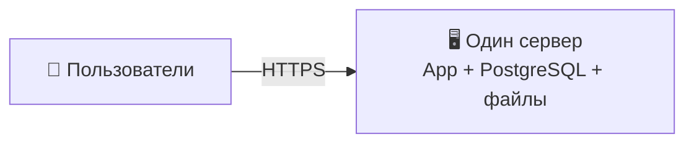
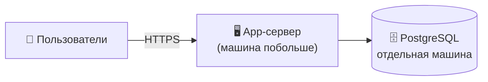
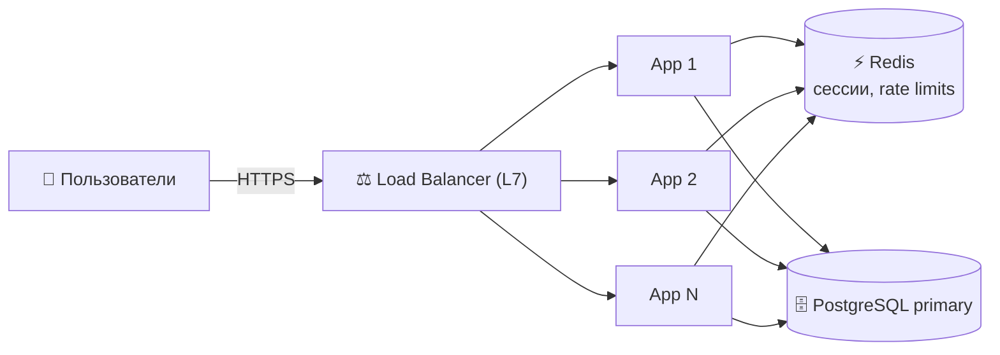
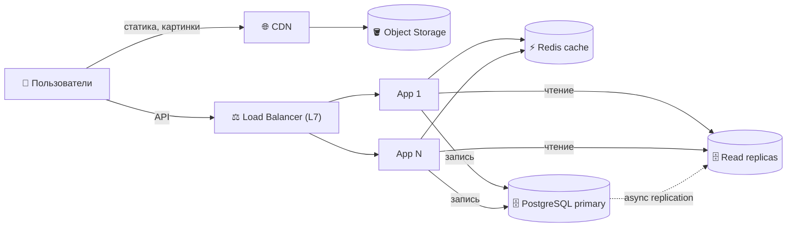
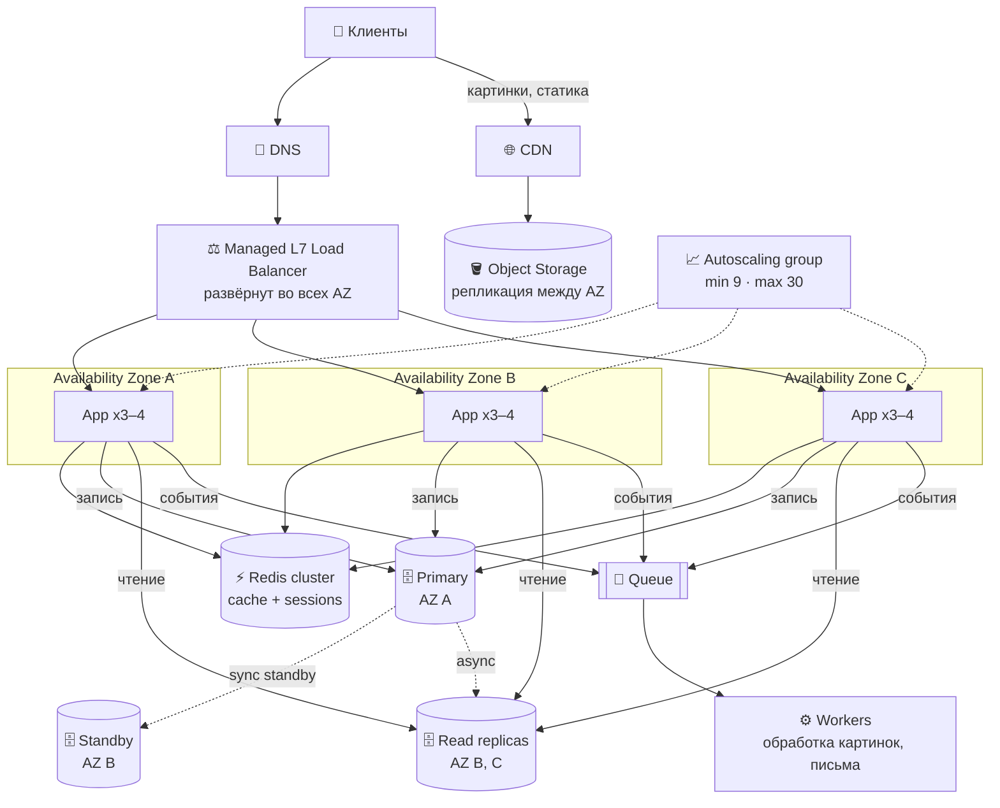
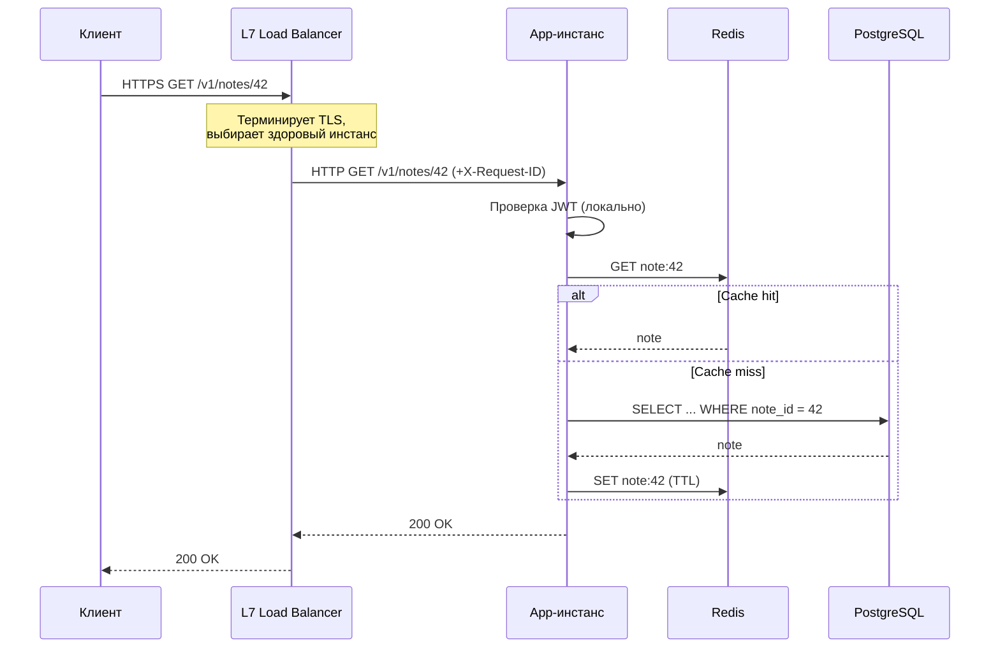

[English](INTERVIEW.md) | **Русский** · Теория: [README_RU.md](./README.ru.md)

# 01. Scaling Basics: от 1 000 до 10 млн пользователей

> **Тема:** вертикальное и горизонтальное масштабирование, stateless-сервисы, балансировка нагрузки (L4 vs L7, алгоритмы)
> **Уровень:** Medium · **Время на интервью:** 45 мин · **Время на разбор:** ~4 ч
> **Где спрашивают:** везде. Это фундамент почти любой задачи, а иногда и отдельный вопрос: «Как бы ты масштабировал этот сервис?»

---

## 🗺️ Как читать этот разбор

Разбор написан как запись реального интервью. Обозначения:

| Значок | Что значит |
|:------:|:-----------|
| 🎤 | Реплика интервьюера |
| 🗣️ | Что говорю вслух я (кандидат) |
| ✏️ | Что рисую на доске |
| ⏱️ | Сколько времени тратить на шаг |

Важные моменты выделены блоками GitHub: **TIP** — хороший приём, **WARNING** — ловушка, **IMPORTANT** — сигнал для уровня Senior+.

---

## 📑 Содержание

1. [Условие задачи](#1-условие-задачи)
2. [Уточняющие вопросы и требования](#2-уточняющие-вопросы-и-требования)
3. [Оценки нагрузки](#3-оценки-нагрузки)
4. [API](#4-api)
5. [Модель данных](#5-модель-данных)
6. [High-level дизайн: эволюция по этапам](#6-high-level-дизайн-эволюция-по-этапам)
7. [Deep dive 1: вертикальное vs горизонтальное](#7-deep-dive-1-вертикальное-vs-горизонтальное)
8. [Deep dive 2: stateless-сервисы](#8-deep-dive-2-stateless-сервисы)
9. [Deep dive 3: балансировка нагрузки](#9-deep-dive-3-балансировка-нагрузки)
10. [Deep dive 4: автоскейлинг](#10-deep-dive-4-автоскейлинг)
11. [Узкие места и сценарии сбоев](#11-узкие-места-и-сценарии-сбоев)
12. [Что изменится при росте в 10 раз](#12-что-изменится-при-росте-в-10-раз)
13. [Вопросы интервьюера с ответами](#13-вопросы-интервьюера-с-ответами)
14. [Типичные ошибки](#14-типичные-ошибки)
15. [Шпаргалка и самопроверка](#15-шпаргалка-и-самопроверка)

---

## 1. Условие задачи

> 🎤 «У нас есть веб-приложение для заметок: пользователи создают, читают и редактируют короткие заметки. Сейчас 1 000 пользователей, и всё работает на одном сервере. Через два года ждём 10 миллионов активных пользователей в день. Как будет меняться архитектура?»

**План по времени:**

| Шаг | ⏱️ |
|:----|:--:|
| Требования | 5 мин |
| Оценки | 4 мин |
| API и модель данных | 5 мин |
| High-level дизайн по этапам | 12 мин |
| Deep dives | 15 мин |
| Сбои и итоги | 4 мин |

> [!TIP]
> В задачах «масштабируй сервис» лучше всего показывать **эволюцию** архитектуры, а не сразу финальную схему. Так ты демонстрируешь, что понимаешь, *почему* появляется каждый компонент, а не просто знаешь модные слова.

---

## 2. Уточняющие вопросы и требования

⏱️ 5 мин

🗣️ «Прежде чем рисовать, уточню несколько вещей».

| Мой вопрос | Ответ интервьюера | Что это меняет |
|:-----------|:------------------|:---------------|
| Каково соотношение чтения и записи? | Примерно 10:1 | Read-heavy: в дизайне важны кэш и реплики |
| Аудитория в одном регионе или по всему миру? | Пока один регион | Multi-region не нужен, но multi-AZ обязателен |
| Есть ли медиа (картинки, файлы)? | Можно прикреплять картинки | Нужны объектное хранилище и CDN |
| Нужна ли строгая консистентность? | Автор должен сразу видеть свою правку | Нужен read-your-writes, но не глобальная строгая консистентность |
| Какой бюджет? | Разумный, без переплаты | Автоскейлинг вместо постоянного запаса мощности |

### Функциональные требования

1. Регистрация и вход пользователя.
2. Создание, редактирование и удаление заметки (текст до 10 КБ + картинки).
3. Просмотр одной заметки и списка своих заметок с пагинацией.

**Вне рамок:** поиск, совместное редактирование, уведомления, рекомендации.

### Нефункциональные требования

| Требование | Цель |
|:-----------|:-----|
| Масштаб | 10 млн DAU через 2 года |
| Доступность | 99,95% (около 22 минут простоя в месяц) |
| Latency | p99 < 200 мс на чтение, < 500 мс на запись |
| Надёжность хранения | Заметки не теряются никогда |
| Консистентность | Read-your-writes для автора, eventual для остальных |
| Эластичность | Пики в 3 раза выше среднего без ручного вмешательства |

> [!IMPORTANT]
> **Сигнал Senior+:** проговори, какие требования *управляют* архитектурой. Здесь это read-heavy нагрузка (→ кэш, реплики), доступность 99,95% (→ нет единой точки отказа, несколько AZ) и пиковые нагрузки (→ автоскейлинг).

---

## 3. Оценки нагрузки

⏱️ 4 мин

✏️ Пишу в углу доски:

```
DAU                    = 10M
Чтений на юзера/день   = 20   →  200M чтений/день
Записей на юзера/день  = 2    →   20M записей/день

1 день ≈ 10^5 сек
Read QPS  (средн.) = 200M / 10^5 ≈ 2 000   → пик ×3 ≈ 6 000
Write QPS (средн.) =  20M / 10^5 ≈   200   → пик ×3 ≈   600

Хранилище: 20M записей × ~1 КБ = 20 ГБ/день ≈ 7 ТБ/год (только текст)
Картинки:  10% заметок × 200 КБ = 400 ГБ/день → в объектное хранилище
Трафик:    6 000 RPS × ~5 КБ ответ ≈ 30 МБ/с (без картинок)
```

🗣️ **Выводы, которые я делаю вслух:**

- **App-серверы.** Один инстанс простого JSON API держит условно ~1 000 RPS (уточняется нагрузочным тестом). Пиковые ~6 600 RPS — это ~7 инстансов. С запасом N+2 и распределением по 3 AZ получается **~9–12 инстансов**. Одной машиной не обойтись → нужно горизонтальное масштабирование.
- **БД, запись.** 600 записей/с в пике один primary PostgreSQL выдержит спокойно. Шардировать запись пока **не нужно**.
- **БД, чтение.** 6 000 чтений/с при hit rate кэша 90% превращаются в ~600 QPS к базе → хватит 1–2 read-реплик.
- **Объём.** 7 ТБ в год — на горизонте 2 лет одна БД справится, но это первый кандидат на шардирование при дальнейшем росте.

> [!TIP]
> Считай только то, что влияет на решения. Каждая цифра должна заканчиваться выводом: «значит, нужно X» или «значит, X пока не нужно».

---

## 4. API

⏱️ 3 мин

```http
POST   /v1/auth/login                     → { access_token, refresh_token }

POST   /v1/notes                          → 201 { note_id }
       Headers: Authorization: Bearer <JWT>
                Idempotency-Key: <uuid>
       Body:    { title, body, image_ids[] }

GET    /v1/notes/{note_id}                → 200 { note }
PUT    /v1/notes/{note_id}                → 200 { note }   (If-Match: <version>)
DELETE /v1/notes/{note_id}                → 204

GET    /v1/users/me/notes?cursor=<c>&limit=20
                                          → 200 { notes[], next_cursor }

POST   /v1/uploads                        → 200 { upload_url, image_id }
       (pre-signed URL: клиент грузит картинку напрямую в объектное хранилище)
```

🗣️ Три решения, которые прямо связаны с масштабированием:

1. **JWT в заголовке, а не серверная сессия.** Любой app-сервер может обработать любой запрос. Это основа stateless (подробно в [разделе 8](#8-deep-dive-2-stateless-сервисы)).
2. **Idempotency-Key.** При ретраях через балансировщик не появятся дубли заметок.
3. **Pre-signed URL для картинок.** Тяжёлый трафик идёт мимо app-серверов, прямо в хранилище.

Cursor-пагинация вместо `offset` нужна, чтобы запросы не замедлялись на больших списках.

---

## 5. Модель данных

⏱️ 2 мин

```sql
users (
  user_id       BIGINT PRIMARY KEY,
  email         TEXT UNIQUE,
  password_hash TEXT,
  created_at    TIMESTAMPTZ
)

notes (
  note_id      BIGINT PRIMARY KEY,   -- Snowflake ID: уникальный и сортируемый по времени
  user_id      BIGINT NOT NULL,      -- будущий ключ шардирования
  title        TEXT,
  body         TEXT,
  image_ids    TEXT[],
  version      INT,                  -- для оптимистичной блокировки (If-Match)
  created_at   TIMESTAMPTZ,
  updated_at   TIMESTAMPTZ
)
INDEX notes_by_user ON notes (user_id, note_id DESC)
```

🗣️ «Беру PostgreSQL: данные реляционные, нагрузка на запись умеренная, нужны транзакции. Все основные запросы идут по `user_id`, поэтому, если понадобится шардирование, ключ уже очевиден».

---

## 6. High-level дизайн: эволюция по этапам

⏱️ 12 мин

🗣️ «Покажу, как архитектура растёт вместе с нагрузкой. На каждом этапе назову проблему, которая заставляет перейти к следующему».

### Этап 0. Один сервер (~1 000 пользователей)

✏️



**Проблемы:** единая точка отказа; приложение и БД конкурируют за CPU и RAM; любой деплой означает простой.

### Этап 1. Разделяем приложение и БД, растём вертикально (~10–50 тыс.)

✏️



🗣️ «Первый шаг — вертикальное масштабирование: выносим БД на отдельную машину и даём обеим больше CPU и RAM. Это дёшево по усилиям, код не меняется».

**Проблемы:** у вертикального роста есть потолок, стоимость растёт нелинейно, и это всё ещё единая точка отказа.

### Этап 2. Балансировщик и горизонтальное масштабирование (~100 тыс. – 1 млн)

✏️



🗣️ «Ставим балансировщик и несколько одинаковых app-серверов. Чтобы это работало, серверы должны быть **stateless**: любое состояние уходит в общее хранилище (Redis, БД, объектное хранилище)».

**Проблемы:** база становится узким местом по чтению; картинки по-прежнему отдаются через app-серверы.

### Этап 3. Кэш, реплики, CDN, объектное хранилище (~1–5 млн)

✏️



🗣️ «Read-heavy нагрузку снимаем кэшем (cache-aside) и read-репликами. Картинки уходят в объектное хранилище и раздаются через CDN, так что app-серверы обслуживают только API».

> [!WARNING]
> **Ловушка: лаг репликации.** Пользователь сохранил заметку, следующий запрос попал на реплику, а правки там ещё нет. Решение: читать **свои** данные с primary в течение N секунд после записи или передавать версию и сравнивать её. Так выполняется требование read-your-writes.

### Этап 4. Финальная схема: несколько AZ, автоскейлинг, асинхронность (~10 млн DAU)

✏️



🗣️ «Итоговые принципы:
- Нет единой точки отказа: всё продублировано минимум в трёх AZ.
- App-слой stateless и масштабируется автоматически.
- Запись идёт в один primary с синхронным standby для failover без потери данных; чтение — через кэш и реплики.
- Всё тяжёлое и необязательное для ответа пользователю уходит в очередь и выполняется воркерами».

---

## 7. Deep dive 1: вертикальное vs горизонтальное

> 🎤 «Почему бы просто не купить машину побольше?»

| Критерий | Вертикальное (scale up) | Горизонтальное (scale out) |
|:---------|:------------------------|:---------------------------|
| Суть | Больше CPU, RAM и диска у одной машины | Больше одинаковых машин |
| Изменения в коде | Не нужны | Нужен stateless-дизайн или шардирование |
| Потолок | Жёсткий (самая большая доступная машина) | Практически нет |
| Стоимость | Растёт нелинейно на топовом железе | Растёт примерно линейно |
| Отказоустойчивость | Единая точка отказа | Отказ одного узла не критичен |
| Простой при масштабировании | Часто нужен рестарт | Узлы добавляются без простоя |
| Сложность эксплуатации | Низкая | Выше: LB, service discovery, распределённое состояние |

🗣️ **Мой ответ:** «Это не выбор "или-или". Stateless app-слой я масштабирую горизонтально: это дёшево и сразу даёт отказоустойчивость. А stateful компоненты, особенно primary БД, сначала масштабирую вертикально, потому что горизонтальное масштабирование записи — это шардирование, и это дорого по сложности. Шардировать стоит, только когда вертикальный запас реально заканчивается».

> [!IMPORTANT]
> **Сигнал Senior+:** скажи, что вертикальное масштабирование — это нормальный и часто правильный первый шаг, особенно для БД. Кандидат, который сразу шардирует базу на 600 QPS записи, показывает over-engineering.

---

## 8. Deep dive 2: stateless-сервисы

> 🎤 «Что значит "stateless" и почему это важно?»

🗣️ «Сервис stateless, если **любой** запрос может обработать **любой** инстанс, и потеря инстанса не теряет данных пользователя. Это не значит, что состояния нет. Это значит, что оно хранится вне процесса».

### Куда выносить состояние

| Состояние внутри сервера | ❌ Проблема | ✅ Куда вынести |
|:-------------------------|:-----------|:---------------|
| HTTP-сессия в памяти | Следующий запрос попадёт на другой сервер — пользователь «разлогинен» | JWT (stateless токен) или сессии в Redis |
| Загруженные файлы на локальном диске | Файл есть только на одном сервере | Объектное хранилище (S3) |
| Локальный кэш | У каждого инстанса свой, инвалидация не работает | Общий Redis/Memcached (локальный кэш — только для неизменяемых данных) |
| Счётчики rate limit в памяти | Лимит фактически умножается на число инстансов | Redis с атомарными операциями |
| Блокировки в памяти (mutex) | Не защищают от других инстансов | Распределённые блокировки или оптимистичная блокировка в БД |
| Фоновые задачи в процессе | Пропадут при рестарте или скейлинге вниз | Очередь + воркеры |
| Cron на каждом инстансе | Задача выполнится N раз | Отдельный планировщик или leader election |

### JWT vs сессии в Redis

| | JWT | Сессия в Redis |
|:-|:----|:---------------|
| Нагрузка на хранилище | Нет, проверка подписи локально | Запрос в Redis на каждый вызов |
| Отзыв доступа (logout, бан) | Сложно: нужен короткий TTL + denylist | Просто: удалить ключ |
| Размер запроса | Больше (токен в заголовке) | Маленький ID |

🗣️ «Я бы взял короткоживущий access JWT (~15 мин) и refresh-токен, который хранится в БД или Redis. Так проверка запроса не требует похода в хранилище, но отозвать доступ всё ещё можно».

> [!WARNING]
> **Sticky sessions** (балансировщик всегда шлёт пользователя на тот же сервер) — это костыль, а не решение. Нагрузка распределяется неравномерно, при падении сервера сессии теряются, а скейлинг вниз ломает пользователей. Уместны в редких случаях, например для WebSocket-соединений или локального кэша с высокой стоимостью прогрева.

---

## 9. Deep dive 3: балансировка нагрузки

> 🎤 «Какой балансировщик поставишь и как он будет выбирать сервер?»

### L4 vs L7

| | L4 (транспортный уровень) | L7 (прикладной уровень) |
|:-|:--------------------------|:------------------------|
| Что видит | IP, порт, TCP/UDP | HTTP: путь, заголовки, cookies, метод |
| Маршрутизация | Только по адресу и порту | По URL, заголовкам, хосту, версии API |
| TLS | Обычно пропускает насквозь (passthrough) | Обычно терминирует TLS |
| Скорость и накладные расходы | Очень быстрый, минимальные затраты | Дороже: парсинг HTTP |
| Возможности | Простая раздача соединений | Ретраи, rate limiting, сжатие, A/B, canary, WAF |
| Протоколы | Любые TCP/UDP (БД, игры, MQTT) | HTTP/1.1, HTTP/2, gRPC, WebSocket |
| Примеры | AWS NLB, LVS, MetalLB | AWS ALB, NGINX, Envoy, HAProxy (в режиме HTTP) |

🗣️ «Для нашего HTTP API я беру **L7**: нужна маршрутизация по пути (`/v1/notes` и `/v1/uploads` могут идти в разные сервисы), терминация TLS, health checks по HTTP и canary-деплои. На очень большом масштабе часто делают два слоя: L4 впереди (принимает огромное число соединений) и флот L7 за ним».

### Путь запроса через L7-балансировщик



### Алгоритмы балансировки

| Алгоритм | Как работает | Когда подходит | Минусы |
|:---------|:-------------|:---------------|:-------|
| Round Robin | По очереди | Одинаковые серверы, похожие запросы | Не учитывает реальную нагрузку |
| Weighted Round Robin | По очереди с весами | Серверы разной мощности, canary (5% трафика) | Веса статичны |
| Least Connections | На сервер с наименьшим числом активных соединений | Запросы разной длительности, WebSocket | Нужен учёт состояния в LB |
| Least Response Time | Учитывает число соединений и задержку | Неоднородные бэкенды | Сложнее, может «раскачиваться» |
| Power of Two Choices | Берёт 2 случайных сервера, выбирает менее загруженный | Большие флоты, много LB-инстансов | Почти нет; отличный дефолт |
| IP Hash | Хэш IP клиента → сервер | Нужна привязка клиента без cookies | Неравномерность за NAT, ломается при изменении числа серверов |
| Consistent Hashing | Хэш ключа на кольце | Кэши и stateful-сервисы: минимум перемещений при изменении числа узлов | Нужны виртуальные узлы против перекоса |
| Random | Случайно | Простые случаи | Неравномерность на малых числах |

🗣️ «Для stateless API — **least connections** или **power of two choices**: они устойчивы к медленным запросам и неравномерной нагрузке. Для кэша по ключу — **consistent hashing**».

### Health checks и надёжность самого LB

- **Активные health checks:** LB раз в несколько секунд дёргает `/healthz`. После N неудач инстанс выводится из ротации.
- **Пассивные:** LB следит за ошибками и таймаутами реального трафика (outlier detection).
- **Два вида проверок:** `liveness` (процесс жив) и `readiness` (готов принимать трафик: прогрелся, есть доступ к БД). Readiness не должна проверять *все* зависимости, иначе падение Redis выключит весь флот.
- **Connection draining:** при выводе инстанса LB перестаёт слать новые запросы и даёт текущим завершиться. Без этого каждый деплой даёт ошибки.

> 🎤 «А балансировщик сам не единая точка отказа?»

🗣️ «Может быть. Варианты:
- managed LB (AWS ALB/NLB, GCP LB) — он уже распределён по AZ;
- пара LB в режиме active-passive с общим виртуальным IP (keepalived/VRRP);
- несколько LB за DNS с несколькими A-записями или за Anycast-адресом».

---

## 10. Deep dive 4: автоскейлинг

> 🎤 «Как система переживёт пик, который в 3 раза выше среднего?»

| Параметр | Значение | Почему |
|:---------|:---------|:-------|
| Метрика | CPU ~60% или RPS на инстанс | Запас до перегрузки, пока поднимаются новые инстансы |
| Минимум | 9 (по 3 на AZ) | Переживаем потерю целой AZ |
| Максимум | 30 | Защита от бесконечного роста счёта при баге или атаке |
| Scale out | Быстро (1–2 мин) | Пик важнее экономии |
| Scale in | Медленно (cooldown 10–15 мин) | Избегаем «пилы» (flapping) |
| Прогрев | Readiness только после прогрева | Холодный инстанс не должен получать полный трафик |
| Предиктивное масштабирование | По расписанию перед известными пиками | Утро понедельника, рассылки, маркетинговые акции |

> [!WARNING]
> Автоскейлинг app-слоя не спасёт, если узкое место в БД. Больше инстансов → больше соединений к базе → база падает быстрее. Нужен **connection pooler** (PgBouncer) и лимит соединений на инстанс.

---

## 11. Узкие места и сценарии сбоев

⏱️ 3 мин

| Сценарий | Что произойдёт | Как защищаемся |
|:---------|:---------------|:---------------|
| Упал app-инстанс | Его запросы получат ошибку | Health checks выводят его из ротации; ретраи идемпотентных запросов; автоскейлинг поднимает замену |
| Упала целая AZ | Минус треть мощности | По 3+ инстанса в каждой AZ; запаса двух оставшихся AZ хватает на пик |
| Упал primary БД | Запись недоступна | Автоматический failover на синхронный standby (~30–60 с) |
| Упал Redis | Все чтения идут в БД → перегрузка | Redis cluster с репликами; при недоступности — лимит на запросы в БД и деградация |
| Cache stampede | Популярный ключ протух → тысячи запросов в БД одновременно | Request coalescing (single flight), случайный TTL (jitter), фоновое обновление |
| Медленный инстанс | Хвостовая задержка растёт | Least connections / P2C, outlier detection, таймауты |
| Thundering herd после восстановления | Все клиенты ретраят одновременно | Exponential backoff с jitter, rate limiting на LB |
| Ошибка в новом релизе | Ошибки у всех | Canary через weighted routing на L7 + автоматический откат |

---

## 12. Что изменится при росте в 10 раз

> 🎤 «А если не 10, а 100 миллионов DAU?»

🗣️ «Пиковая нагрузка вырастет до ~60 000 RPS на чтение и ~6 000 на запись, объём — до ~70 ТБ в год. Что меняется:
1. **Шардирование БД по `user_id`.** Запись и объём перестают помещаться в один primary.
2. **Multi-region.** Пользователи по всему миру → GeoDNS или Anycast, данные пользователя живут в его «домашнем» регионе.
3. **Двухуровневая балансировка.** Глобальный уровень (DNS/Anycast) → региональный L4 → L7-флот.
4. **Разделение на сервисы.** Загрузка медиа, аутентификация и заметки масштабируются независимо.
5. **Многоуровневый кэш.** Локальный in-process кэш для самых горячих неизменяемых данных + Redis».

---

## 13. Вопросы интервьюера с ответами

<details>
<summary><b>Чем L4-балансировщик быстрее L7 и когда это важно?</b></summary>

L4 не разбирает HTTP: он работает с TCP-соединениями и может пересылать пакеты почти без затрат. Это важно, когда нужно принять миллионы соединений или балансировать не-HTTP протоколы (БД, игровые серверы, MQTT). Для обычного API потеря в производительности L7 незначительна по сравнению с пользой от маршрутизации и наблюдаемости.
</details>

<details>
<summary><b>Почему round robin плох для запросов разной длительности?</b></summary>

Round robin раздаёт запросы поровну по числу, а не по нагрузке. Если на один сервер случайно попали несколько тяжёлых запросов, он перегружен, а новые запросы продолжают на него приходить. Least connections и power of two choices учитывают текущую нагрузку.
</details>

<details>
<summary><b>Как балансировать WebSocket-соединения?</b></summary>

Соединения долгоживущие, поэтому важна не скорость запросов, а их число на сервер: подходит least connections. При скейлинге вверх новые серверы получают только новые соединения, поэтому иногда нужна плавная ребалансировка (сервер просит часть клиентов переподключиться). При деплое — graceful drain с сигналом клиентам переподключиться.
</details>

<details>
<summary><b>Когда stateful-сервис оправдан?</b></summary>

Когда держать состояние в памяти намного дешевле, чем каждый раз его загружать: игровые сессии, совместное редактирование документа, WebSocket-шлюзы, кэши. Тогда запросы маршрутизируют по ключу (consistent hashing), а для отказоустойчивости состояние реплицируют или периодически сохраняют снапшоты.
</details>

<details>
<summary><b>Сколько инстансов держать при доступности 99,95% в 3 AZ?</b></summary>

Считаем от пика: ~7 инстансов нужно для обработки пиковой нагрузки. При потере одной AZ должны остаться 2/3 мощности, которых хватает на пик. Значит, общее число ≥ 7 × 3/2 ≈ 11, то есть по 4 на AZ. Минимум автоскейлинга вне пика можно держать ниже, но так, чтобы потеря AZ не уронила сервис до того, как он успеет масштабироваться.
</details>

<details>
<summary><b>Как обновлять сервис без простоя?</b></summary>

Rolling update или blue-green за балансировщиком: новые инстансы проходят readiness, LB начинает слать им трафик, старые выводятся с connection draining. Для рискованных изменений — canary через weighted routing (1% → 10% → 100%) с автоматическим откатом по метрикам ошибок и latency. Миграции схемы БД делаются в обратно совместимом виде (expand → migrate → contract).
</details>

---

## 14. Типичные ошибки

| ❌ Ошибка | ✅ Как правильно |
|:---------|:----------------|
| Сразу рисовать финальную схему из 15 компонентов | Показать эволюцию и объяснить, зачем появляется каждый компонент |
| Шардировать БД при 600 QPS записи | Сначала вертикальный рост, реплики и кэш; шардирование — когда реально нужно |
| Забыть, что балансировщик — тоже точка отказа | Managed LB по нескольким AZ, active-passive пара или DNS/Anycast |
| Держать сессии в памяти app-сервера | JWT или сессии во внешнем Redis |
| Считать stateless = «без состояния вообще» | Состояние есть, но живёт вне процесса |
| Говорить «поставим балансировщик» без деталей | Назвать уровень (L4/L7), алгоритм и health checks с обоснованием |
| Масштабировать app-слой и забыть про соединения к БД | Connection pooling и лимиты |
| Забыть про лаг репликации | Read-your-writes: чтение своих данных с primary после записи |

---

## 15. Шпаргалка и самопроверка

### Ответ за 30 секунд

> Stateless app-слой масштабирую горизонтально за L7-балансировщиком (least connections или P2C, health checks, connection draining). Состояние выношу наружу: сессии в JWT/Redis, файлы в S3, кэш в Redis. БД сначала масштабирую вертикально, потом read-репликами и кэшем, шардирую только когда упрусь в запись или объём. Всё дублирую минимум в 3 AZ, app-слой автоскейлится по CPU/RPS. Балансировщик сам должен быть отказоустойчивым.

### Самопроверка

- [ ] Могу объяснить разницу между вертикальным и горизонтальным масштабированием и когда выбирать каждое
- [ ] Могу назвать 5+ видов состояния, которые мешают горизонтальному масштабированию, и куда их вынести
- [ ] Могу сравнить L4 и L7 по 5+ критериям и выбрать уровень для конкретной задачи
- [ ] Знаю 6+ алгоритмов балансировки и когда применять каждый
- [ ] Могу объяснить health checks (liveness vs readiness) и connection draining
- [ ] Знаю 3 способа сделать сам балансировщик отказоустойчивым
- [ ] Могу посчитать нужное число инстансов с учётом пика и потери AZ
- [ ] Могу нарисовать эволюцию архитектуры от 1 сервера до multi-AZ за 10 минут без подсказок

### Что почитать

- *Designing Data-Intensive Applications*, глава 1 (Reliability, Scalability, Maintainability) и глава 6 (Partitioning)
- *System Design Interview*, Vol. 1, глава 1 «Scale from Zero to Millions of Users»
- The Twelve-Factor App, разделы VI (Processes) и IX (Disposability)
- Статья «The Power of Two Random Choices» (Mitzenmacher) — почему P2C так хорошо работает
- Документация NGINX / Envoy / HAProxy по алгоритмам балансировки и health checks