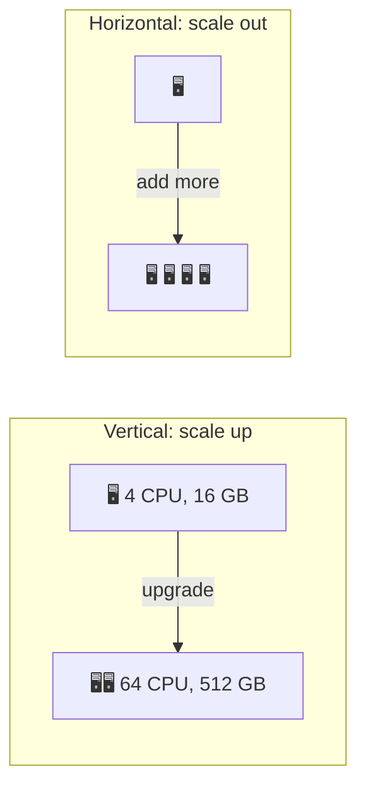
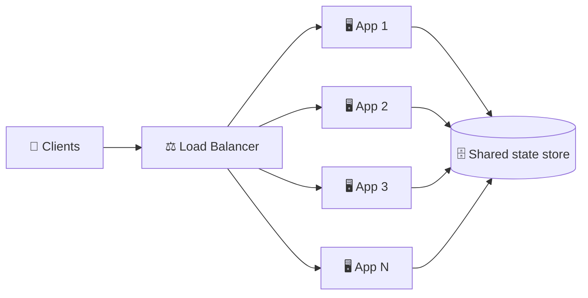
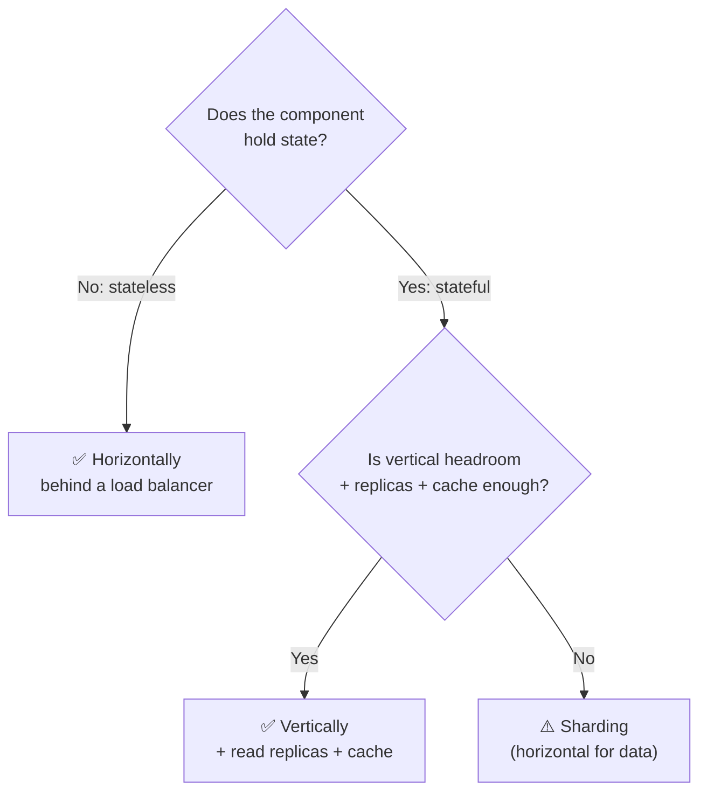
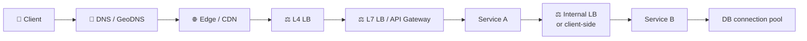
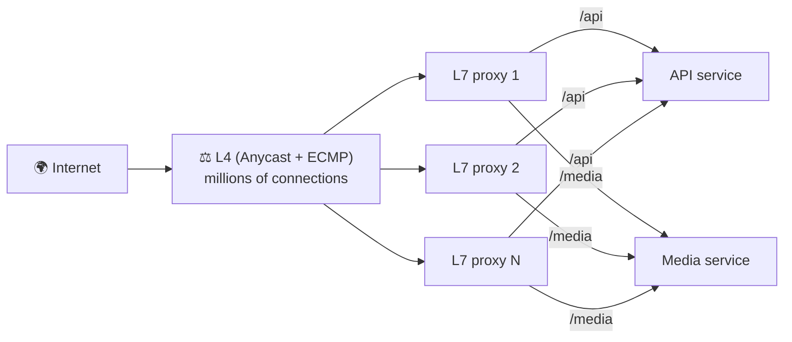
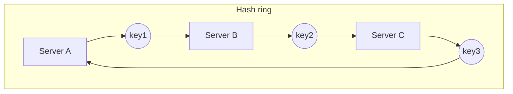
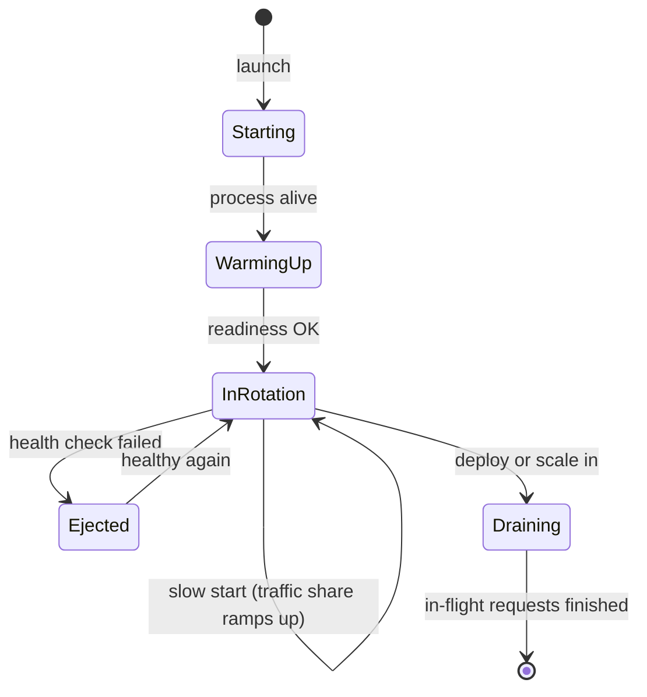

**English** | [Русский](README.ru.md)

# 01. Scaling Basics

> **Covers:** vertical vs horizontal scaling, stateless services, load balancing (L4 vs L7, algorithms)
> **Study time:** ~3–4 h · **Needed for:** almost every system design problem
> **Practice:** interview-style walkthrough — [INTERVIEW.md](./INTERVIEW.md)

---

## 📑 Contents

1. [What Is Scalability](#1-what-is-scalability)
2. [Vertical Scaling](#2-vertical-scaling)
3. [Horizontal Scaling](#3-horizontal-scaling)
4. [Vertical vs Horizontal: How to Choose](#4-vertical-vs-horizontal-how-to-choose)
5. [Stateless Services](#5-stateless-services)
6. [Load Balancing: Why and Where](#6-load-balancing-why-and-where)
7. [L4 vs L7](#7-l4-vs-l7)
8. [Load Balancing Algorithms](#8-load-balancing-algorithms)
9. [Health Checks and Server Lifecycle](#9-health-checks-and-server-lifecycle)
10. [Making the Load Balancer Itself Fault-Tolerant](#10-making-the-load-balancer-itself-fault-tolerant)
11. [Global Load Balancing: DNS and Anycast](#11-global-load-balancing-dns-and-anycast)
12. [Autoscaling](#12-autoscaling)
13. [How to Talk About This in an Interview](#13-how-to-talk-about-this-in-an-interview)
14. [Self-Check Questions](#14-self-check-questions)
15. [Glossary and Resources](#15-glossary-and-resources)

---

## 1. What Is Scalability

**Scalability** is a system's ability to handle growing load by adding resources, *without rewriting the architecture* and without degrading quality.

> [!NOTE]
> Scalability ≠ performance.
> **Performance** is how fast the system handles *one* request.
> **Scalability** is what happens to speed and stability when there are 10x or 100x more requests.
> A fast system can scale poorly, and vice versa.

### What exactly grows: load parameters

Before scaling, figure out *what* is growing:

| Parameter | Example |
|:----------|:--------|
| Requests per second (RPS/QPS) | 1,000 → 100,000 RPS |
| Read/write ratio | Read-heavy (social networks) vs write-heavy (logs, telemetry) |
| Data volume | 100 GB → 100 TB |
| Concurrent connections | Thousands of HTTP requests vs millions of WebSockets |
| Response size | 2 KB JSON vs 2 GB video |
| Skew | Hot keys, celebrities with millions of followers, traffic spikes |

Different parameters need different solutions. Growing RPS is solved by adding servers, growing data volume by sharding, growing connection counts by dedicated gateways.

### How to measure: latency and throughput

- **Throughput:** how many requests the system handles per second.
- **Latency:** how long a single request takes.

Latency is measured with **percentiles**, not the average:

| Metric | Meaning |
|:-------|:--------|
| p50 (median) | Half of requests are faster than this |
| p95 / p99 | 95% / 99% of requests are faster. Shows the "tail" |
| p99.9 | Matters for large services: the most active users make the most requests, so they hit the tail most often |

> [!TIP]
> The average hides problems. If p50 = 50 ms and p99 = 3 s, one in a hundred requests suffers, and with 10 requests per page, roughly one in ten page views will be slow.

### Two ways to scale



**Analogy:** a bakery's queue keeps growing. You can hire a baker who works twice as fast (vertical), or add three more ovens with regular bakers (horizontal).

---

## 2. Vertical Scaling

**Scale up:** give a single machine more resources — CPU, RAM, faster disks (NVMe), network.

### Pros

- **No code changes.** The application doesn't know the machine got bigger.
- **No distributed-systems problems.** No network hops between nodes, no consistency across replicas, all transactions are local.
- **Simple operations.** One server is easier to monitor, back up and debug.

### Cons

- **Hard ceiling.** Even the largest cloud machines are limited (hundreds of cores, single-digit to tens of TB of RAM). Beyond that, there's nowhere to grow.
- **Non-linear cost.** Top-tier hardware is disproportionately expensive: a machine twice as powerful often costs more than twice as much.
- **Single point of failure.** The server goes down — the service goes down.
- **Downtime on upgrade.** Changing machine type usually requires a restart.
- **Diminishing returns.** More cores don't speed up single-threaded code, and locks and memory contention limit the gains.

### When it's the right choice

- **Early-stage product:** one good machine often handles far more than you'd expect.
- **Stateful components, especially the primary DB.** Scaling writes horizontally means sharding, and sharding is very expensive in complexity. Exhaust the vertical headroom first.
- **Workloads that don't split well:** complex transactions, large in-memory computations.

> [!IMPORTANT]
> Many large systems run on a vertically scaled primary database (with read replicas) for years before sharding. Vertical scaling isn't "bad" — it's "the first tool for stateful parts".

---

## 3. Horizontal Scaling

**Scale out:** add more identical machines and distribute work across them.



### Pros

- **Practically no ceiling.** Need more capacity — add nodes.
- **Fault tolerance.** One node failing doesn't take the service down, as long as the others have headroom.
- **Linear cost and elasticity.** Commodity machines are cheap; add them at peak and remove them at night.
- **Zero-downtime updates.** Nodes are updated one at a time (rolling update).

### Cons and costs

- **You need a load balancer** — another component that must itself be fault-tolerant.
- **Services must be stateless** (see [section 5](#5-stateless-services)); otherwise a user's requests land on different machines and lose context.
- **Distributed-systems problems:** network failures, partial failures, data consistency, distributed locks.
- **Harder operations:** service discovery, monitoring many nodes, distributed tracing.

### Why 2N machines don't give exactly 2× throughput

**Amdahl's law:** if a fraction `p` of the work parallelizes and `(1 − p)` doesn't, the speedup on `N` nodes is at most:

```
Speedup = 1 / ((1 − p) + p / N)
```

If 95% of the work is parallel, even infinite nodes won't give more than 20× speedup. The serial part (a shared DB, a global lock, a coordinator) becomes the ceiling.

The **Universal Scalability Law** (Neil Gunther) adds a second effect — **coherency overhead** between nodes. Because of it, beyond a certain number of nodes throughput can actually *decrease*.

> [!TIP]
> Practical takeaway: what scales well horizontally is what **doesn't share state**. That's why stateless app servers scale almost linearly, while anything that hits one shared database is bounded by it.

---

## 4. Vertical vs Horizontal: How to Choose

| Criterion | Vertical | Horizontal |
|:----------|:---------|:-----------|
| Idea | More resources for one machine | More machines |
| Code changes | None | Requires stateless design or sharding |
| Ceiling | Hard | Practically none |
| Cost | Non-linear at the high end | Roughly linear |
| Fault tolerance | Single point of failure | Node failure isn't critical |
| Elasticity | Low, often with downtime | High, no downtime |
| Complexity | Low | High |
| Typical use | Primary DB, cache server, early stage | App servers, workers, web tier |

### Default rule



> [!NOTE]
> In practice you almost always use **both**: the stateless tier grows out, while databases grow up first, then out via replicas and sharding.

---

## 5. Stateless Services

### Definition

A service is **stateless** if:
1. **Any** instance can handle **any** request;
2. Losing an instance doesn't lose user data;
3. Instances are interchangeable: they can be added or killed at any time.

> [!IMPORTANT]
> Stateless does **not** mean "no state". State always exists (users, sessions, carts). Stateless means it lives **outside the process** — in a database, cache, object storage, or in the request itself (a token).

**Analogy:** in a bank, any free teller can serve any customer because all information is in a shared system, not in a particular employee's head. If a customer can only be served by "their" manager, that's stateful: the manager is on vacation — the customer waits.

### Why it's critical for scaling

| Without stateless | With stateless |
|:------------------|:---------------|
| User is tied to a server | The LB sends a request anywhere |
| Server dies → user loses their session | Server dies → request goes elsewhere, nobody notices |
| Scaling in breaks users | Nodes can be removed at any time |
| Load is distributed unevenly | Load is distributed evenly |
| Deploys break sessions | Rolling updates are invisible |

### State that gets in the way, and where to move it

| In-process state | Problem | Where to move it |
|:-----------------|:--------|:-----------------|
| HTTP session in memory | The next request hits another server | Token (JWT) or sessions in Redis |
| Files on local disk | The file exists on one server only | Object storage (S3, GCS) |
| Local cache of mutable data | Caches on different servers diverge | Shared Redis / Memcached |
| Counters (rate limits, likes) in memory | The limit multiplies by the number of servers | Redis with atomic operations (INCR) |
| In-memory locks | Don't protect against other servers | Optimistic locking in the DB or distributed locks |
| Background jobs in-process | Lost on restart | Queue + separate workers |
| Cron on every instance | Job runs N times | Dedicated scheduler or leader election |
| WebSocket connection | Bound to a specific server | Connection gateway + pub/sub for message delivery |

### Example: bad and good

```python
# ❌ Stateful: cart kept in process memory
carts = {}  # this dict lives inside one server

def add_to_cart(user_id, item):
    carts.setdefault(user_id, []).append(item)
    # The user's next request hits another server — the cart is empty.
    # Server restarts — all carts are lost.

# ✅ Stateless: cart in an external store
def add_to_cart(user_id, item):
    redis.rpush(f"cart:{user_id}", item)
    redis.expire(f"cart:{user_id}", 7 * 24 * 3600)
    # Every server sees the same cart. Any server can be killed at any time.
```

### Three ways to handle sessions

| Approach | How it works | Pros | Cons |
|:---------|:-------------|:-----|:-----|
| **Sticky sessions** | The LB always sends a user to the same server (by cookie or IP) | No code changes | Uneven load; server dies — sessions lost; hinders scaling in |
| **Centralized store** | Session in Redis, only the ID in a cookie | Easy to revoke (delete the key) | A Redis call on every request; Redis must be highly available |
| **Token (JWT)** | Session data is signed and stored in the token itself | Verified locally, no store needed | Hard to revoke before expiry; larger token |

> [!TIP]
> A popular combination: a short-lived access token (JWT, 5–15 minutes) + a long-lived refresh token kept in a store. Request checks are cheap, and you can revoke access without waiting a day.

### When stateful is justified

Keeping state in memory pays off when loading it every time is too expensive:
- game servers (match state changes 30–60 times per second);
- collaborative document editing (one "owner" of a document orders the edits);
- WebSocket connection gateways;
- distributed caches and databases.

In these cases, requests are routed to the right node **by key** (consistent hashing, see [section 8](#8-load-balancing-algorithms)), and fault tolerance comes from replication and snapshots.

---

## 6. Load Balancing: Why and Where

A **load balancer** (LB) distributes incoming requests across multiple servers.

### What it gives you

1. **Scaling:** load is split across N servers.
2. **Fault tolerance:** unhealthy servers are removed from rotation.
3. **A single entry point:** clients know one address, while the servers behind it change.
4. **Zero-downtime updates:** servers are taken out of rotation one at a time.
5. **Extra features** (especially at L7): TLS, caching, rate limiting, routing.

### Where load balancers sit



Load balancing happens at **several levels**:

| Level | What it balances | Examples |
|:------|:-----------------|:---------|
| Global | Between regions and data centers | GeoDNS, Anycast |
| Edge (ingress) | External traffic into the data center | AWS NLB/ALB, Google Maglev, Meta Katran |
| Service-to-service | Internal microservice calls | Internal LB, service mesh (Envoy, Istio), gRPC client-side LB |
| Database | Connections to the DB and replicas | PgBouncer, ProxySQL |

### Server-side vs client-side load balancing

| | Server-side (proxy) | Client-side |
|:-|:--------------------|:------------|
| How it works | Client sends a request to the LB, the LB picks a server | Client gets the server list (from service discovery) and picks itself |
| Pros | Simple clients; centralized control | No extra network hop; no separate bottleneck |
| Cons | Extra hop; the LB must be scaled | Logic in every client; harder to update |
| Where | External traffic | Internal calls (gRPC), often via a sidecar proxy in a service mesh |

---

## 7. L4 vs L7

The names come from the OSI model: **L4 is the transport layer** (TCP/UDP), **L7 is the application layer** (HTTP, gRPC).

### L4 load balancer

Sees only **IP addresses, ports and protocol**. It doesn't know what's inside the connection: HTTP, a database protocol, or game traffic.

```
Packet: [src 1.2.3.4:5555] → [dst 10.0.0.1:443]  [encrypted bytes...]
          ↑ L4 sees only this                       ↑ doesn't look here
```

- The decision is made **once per connection**: all packets of one TCP connection go to one server.
- Very fast: can run in the kernel (IPVS, eBPF/XDP) or in hardware.
- Operating modes:
    - **NAT:** the LB rewrites addresses in both directions; responses go back through it;
    - **DSR (Direct Server Return):** the request goes through the LB, but the server sends the response directly to the client. This offloads the LB heavily, because responses are usually much larger than requests.

### L7 load balancer

Works as a **reverse proxy**: it accepts the client connection, parses the HTTP request, and opens *its own* connection to the server.

```
GET /api/v2/orders/42 HTTP/1.1
Host: shop.example.com
Cookie: session=abc
Authorization: Bearer eyJ...
   ↑ L7 sees all of this and can route on it
```

- The decision is made **per request**. This matters for HTTP/2 and gRPC: many requests share one connection, and an L4 LB would send them all to one server.
- Capabilities:
    - routing by path, host, headers (`/api/*` → service A, `/images/*` → service B);
    - TLS termination;
    - retries, timeouts, circuit breaking;
    - canary and A/B: 5% of traffic to the new version;
    - rate limiting, authentication, WAF;
    - compression, caching, adding headers (`X-Request-ID`, `X-Forwarded-For`).

### Comparison

| | L4 | L7 |
|:-|:---|:---|
| What it sees | IP, port, protocol | HTTP: method, path, headers, cookies, body |
| Unit of balancing | Connection | Request |
| TLS | Passes through | Terminates (can re-encrypt to the backend) |
| Speed | Very high | Lower: HTTP parsing, two connections |
| Protocols | Any TCP/UDP | HTTP/1.1, HTTP/2, gRPC, WebSocket |
| Smart routing | No | Yes |
| Visibility (per-request logs, metrics) | Minimal | Full |
| Examples | AWS NLB, LVS/IPVS, Google Maglev, Meta Katran | AWS ALB, NGINX, Envoy, HAProxy (HTTP mode), Traefik |

### TLS handling options

| Mode | Where decryption happens | When |
|:-----|:-------------------------|:-----|
| **TLS termination** | At the LB; plain HTTP to the server | Most common: offloads servers, enables L7 features |
| **TLS passthrough** | At the server; the LB can't see content | End-to-end encryption requirements; L4 features only |
| **TLS re-encryption** | At the LB, then a new TLS connection to the server | Need L7 features and encryption inside the network (zero trust) |

### What to choose

- **L7** — the default for HTTP/gRPC APIs and the web.
- **L4** — for non-HTTP protocols (databases, MQTT, games, VoIP), for huge connection counts, and when TLS can't be decrypted.
- **Both layers** — typical for large systems: L4 at the edge accepts traffic and spreads it across a fleet of L7 proxies, which do the smart routing.



---

## 8. Load Balancing Algorithms

Algorithms are either **static** (ignore current load) or **dynamic** (take it into account).

### Static

**Round Robin.** Requests go in a circle: 1 → 2 → 3 → 1 → 2 → 3.
- ✅ Simple and predictable.
- ❌ Ignores that requests vary in cost and servers vary in capacity.

**Weighted Round Robin.** Same, with weights: a server with weight 3 gets 3× more requests.
- ✅ Servers of different capacity; canary deploys (new version weight 1, old weight 19 → 5% of traffic).
- ❌ Weights are static and don't react to actual load.

**Random.** A random server.
- ✅ No state needed; distribution is even at large numbers.
- ❌ Skew at small request counts.

**IP Hash / Source Hash.** `server = hash(client IP) mod N`.
- ✅ A client always hits the same server without cookies.
- ❌ Many clients behind one NAT → one server overloaded. When N changes, almost all clients move.

### Dynamic

**Least Connections.** The request goes to the server with the fewest active connections.
- ✅ Good for requests of varying duration and long-lived connections (WebSocket).
- ❌ The LB must track connections; with several LBs, each has its own view.

**Weighted Least Connections.** Considers both connections and capacity: picks the minimum of `connections / weight`.

**Least Response Time.** Considers connection count and average response latency.
- ✅ Routes around slow servers.
- ❌ Can oscillate: everyone rushes to the fast server, it slows down, everyone leaves it.

**Power of Two Choices (P2C).** Pick **two random** servers and send the request to the less loaded one.
- ✅ Almost as good as picking the best of all, but needs only two comparisons. Robust to stale load information and to having many LBs.
- ✅ Used by default in many modern proxies (for example, Envoy's least request).
- ❌ Practically none; a great default.

> [!TIP]
> **Why P2C is so good.** With random choice, the maximum load on the busiest server grows as `log N / log log N`. With best-of-two-random, it grows as `log log N`. That's an exponential improvement for the price of one extra comparison. Hence the title of Mitzenmacher's paper, "The Power of Two Choices".

### Consistent Hashing (for stateful services and caches)

The problem with plain hashing `hash(key) mod N`: when a server is added or removed, N changes, and **almost all keys** move. For a cache, that means the whole cache goes cold at once.

**Consistent hashing** places servers and keys on the same ring. A key belongs to the first server clockwise from it.



- When a server is added or removed, only about `1/N` of keys move — only the neighbors.
- **Virtual nodes:** each physical server is placed on the ring many times (e.g. 100–200 points). This evens out distribution and allows weights.
- **Variants:** rendezvous hashing (HRW), Maglev hashing (Google), jump consistent hash.
- **Where it's used:** distributed caches, sharded stores (Dynamo, Cassandra), L4 load balancers that must keep packets of one connection on one server even when the backend set changes.

> [!WARNING]
> Consistent hashing doesn't save you from **hot keys**: if one key gets 30% of the traffic, its server is overloaded regardless. Solutions: replicate the hot key across several nodes, a local cache in front of the shared one, key splitting (`key#1`, `key#2`, ...).

### Summary table

| Algorithm | Type | Best for | Main drawback |
|:----------|:-----|:---------|:--------------|
| Round Robin | Static | Identical servers and requests | Blind to load |
| Weighted RR | Static | Uneven servers, canary | Static weights |
| Random | Static | Simple cases, many LBs | Skew at small numbers |
| IP Hash | Static | Client affinity without cookies | NAT, reshuffle when N changes |
| Least Connections | Dynamic | Varying duration, WebSocket | Needs state tracking |
| Least Response Time | Dynamic | Heterogeneous servers | Oscillation |
| Power of Two Choices | Dynamic | Large fleets, default for APIs | Practically none |
| Consistent Hashing | Key-based | Caches and stateful services | Hot keys |

---

## 9. Health Checks and Server Lifecycle

The load balancer must know which servers are healthy.

### Types of checks

| Type | How it works | Pros and cons |
|:-----|:-------------|:--------------|
| **Active** | The LB polls `/healthz` every N seconds. After K failures the server is removed; after M successes it's returned | Detects problems even with no traffic; adds extra load |
| **Passive (outlier detection)** | The LB watches errors and timeouts on real traffic and temporarily ejects a misbehaving server | Reacts to real problems; needs traffic |

### Liveness vs readiness

| | Liveness | Readiness |
|:-|:---------|:----------|
| Question | "Is the process alive or stuck?" | "Can it take traffic right now?" |
| If it fails | Restart the process | Stop sending traffic, but don't restart |
| Example | Unresponsive due to a deadlock | Still warming its cache, running a migration, overloaded |

> [!WARNING]
> Don't include **all** dependencies in the readiness check. If Redis is down, every server becomes "not ready" at once, and the LB ejects the whole fleet. A partial degradation turns into a full outage. Readiness should check whether *this instance* can serve traffic, not the health of the whole system.

### Server lifecycle behind a load balancer



- **Slow start:** a new server gets traffic gradually, not its full share at once. Otherwise a cold cache and JIT compilation lead to timeouts.
- **Connection draining:** when a server is removed, the LB stops sending it new requests and waits for in-flight ones to finish (usually 30–300 s). Without it, every deploy causes an error spike.

---

## 10. Making the Load Balancer Itself Fault-Tolerant

A load balancer that solves the single-point-of-failure problem can itself become a single point of failure.

| Approach | How it works |
|:---------|:-------------|
| **Active-passive pair** | Two LBs share a virtual IP (VRRP, keepalived). The active one fails — the passive one takes over the IP within seconds |
| **Active-active + DNS** | Several LBs; the domain has several A records. Clients are spread across them |
| **Anycast + ECMP** | Many LBs announce the same IP. The network (routers with ECMP) spreads traffic among them; a failed LB simply stops announcing the address |
| **Managed LB** | Cloud LBs (AWS ALB/NLB, GCP Cloud LB) are already distributed across availability zones |

---

## 11. Global Load Balancing: DNS and Anycast

When a service runs in multiple regions, users need to be sent to the nearest healthy region.

| Approach | How it works | Pros | Cons |
|:---------|:-------------|:-----|:-----|
| **DNS round robin** | Multiple IPs in the DNS response | Simple | No health checks; DNS caching |
| **GeoDNS / latency-based DNS** | DNS returns the IP of the nearest region | Users go to a nearby region | Failover is slow because of TTLs and caching resolvers |
| **Anycast** | One IP announced from many locations; BGP routes packets to the nearest | Fast failover, DDoS protection | Hard to set up; route can change mid-connection |

> [!NOTE]
> DNS-based balancing depends on TTL, but many clients and resolvers cache answers longer than advertised. So DNS failover always takes minutes, not seconds. For fast cross-region failover, use Anycast or health-aware global load balancers.

---

## 12. Autoscaling

Horizontal scaling becomes truly useful when the number of servers changes **automatically**.

| Type | How it works | Example |
|:-----|:-------------|:--------|
| **Reactive (metric-based)** | Target metric value, e.g. CPU 60% | Load grew → instances added |
| **Scheduled** | Known peaks in advance | Every weekday at 8:30 add capacity |
| **Predictive** | Load forecast from history | Cloud predictive scaling |
| **Queue-based** | For workers: messages in queue / processing rate | Queue grows → more workers |

### Key settings

- **Metric:** CPU, RPS per instance, latency or queue length. The metric must reflect the real bottleneck.
- **Min / max:** the minimum survives losing an availability zone; the maximum protects against an unbounded bill during an attack or a bug.
- **Scale out fast, scale in slowly:** scale out in minutes, scale in with a cooldown to avoid flapping.
- **Startup time:** if an instance takes 5 minutes to start but a spike builds in 1 minute, reactive autoscaling won't keep up. You need headroom or predictive scaling.

> [!WARNING]
> Autoscaling the app tier can **take down the database**: more instances → more DB connections. You need a connection pooler (PgBouncer) and a per-instance connection limit. The bottleneck moves; it doesn't disappear.

---

## 13. How to Talk About This in an Interview

### 30-second answer

> "I scale the stateless app tier horizontally behind an L7 load balancer using least connections or power of two choices, with health checks and connection draining. I move state out of the process: sessions into JWT or Redis, files into object storage, cache into Redis, background jobs into a queue. Stateful parts, primarily the primary DB, I scale vertically first, plus read replicas and a cache, and shard only when I hit write or storage limits. The load balancer itself is redundant. Everything is spread across multiple availability zones, and the app tier autoscales."

### Phrases that show understanding

| Instead of | Say |
|:-----------|:----|
| "We'll add a load balancer" | "I'll use an L7 load balancer because we need path-based routing and TLS termination; least connections, since request durations vary" |
| "We'll make the service scalable" | "The service is stateless: sessions in Redis, files in S3, so it scales horizontally behind a load balancer" |
| "We'll add more servers" | "Estimated peak is 6,000 RPS, an instance handles ~1,000; to survive losing one of three AZs we need ~11 instances" |
| "We'll shard the database" | "A single primary handles 600 write QPS fine; vertical scaling and replicas first, sharding by user_id when we hit the limit" |

### Common mistakes

- Sharding the database at low load (over-engineering).
- Forgetting the load balancer is also a point of failure.
- Using sticky sessions as the primary solution.
- Thinking "stateless" means "no state".
- Scaling the app tier without thinking about DB connections.
- Saying "load balancer" without naming the layer (L4/L7) and algorithm.

---

## 14. Self-Check Questions

<details>
<summary><b>1. How is scalability different from performance?</b></summary>

Performance is how fast a single request is handled. Scalability is how the system behaves as load grows and whether you can handle that growth by adding resources. A fast system can scale poorly (for example, if everything goes through one lock).
</details>

<details>
<summary><b>2. Why is the primary DB usually scaled vertically, while app servers are scaled horizontally?</b></summary>

App servers are stateless: they can be cloned and don't share state. The primary DB holds state and provides transactions; scaling writes horizontally requires sharding, which is hard (cross-shard queries, resharding, distributed transactions). So you first use vertical headroom, read replicas and caching.
</details>

<details>
<summary><b>3. What breaks if sessions are kept in server memory and there are 5 servers behind the LB?</b></summary>

The user's next request has a ~80% chance of hitting another server that doesn't have the session, so the user appears logged out. When a server crashes or restarts, all its sessions are lost. Fixes: JWT, sessions in Redis, or (as a workaround) sticky sessions.
</details>

<details>
<summary><b>4. Why does an L4 load balancer distribute gRPC traffic poorly?</b></summary>

gRPC runs on HTTP/2, where many requests are multiplexed over one long-lived TCP connection. L4 balances connections, so all of a client's requests go to one server. L7 (or gRPC client-side balancing) distributes each request separately.
</details>

<details>
<summary><b>5. What is DSR and why use it?</b></summary>

Direct Server Return: the request goes through the L4 load balancer, but the server sends the response directly to the client, bypassing the LB. Responses are usually much larger than requests, so the load on the LB drops dramatically.
</details>

<details>
<summary><b>6. Why is power of two choices better than random selection?</b></summary>

With random selection, load imbalance grows as log N / log log N; with best-of-two-random, it grows as log log N. That's an exponential improvement for one extra comparison. It's also robust to stale load data, so it works well with many load balancers.
</details>

<details>
<summary><b>7. Why is consistent hashing better than hash(key) mod N?</b></summary>

With mod N, changing N moves almost every key. With consistent hashing, only about 1/N of keys move — just the neighbors on the ring. For a cache, that's the difference between "most of the cache survived" and "the whole cache is cold and the DB takes all the load".
</details>

<details>
<summary><b>8. Why shouldn't a readiness probe check every dependency?</b></summary>

If a shared dependency (like Redis) is down, every instance becomes not ready at once, the LB ejects the whole fleet, and a partial degradation becomes a full outage. Readiness should reflect whether a specific instance is ready.
</details>

<details>
<summary><b>9. How do you make the load balancer itself fault-tolerant?</b></summary>

An active-passive pair with a virtual IP (VRRP/keepalived), several LBs behind DNS, Anycast with ECMP, or a managed LB that's already spread across availability zones.
</details>

<details>
<summary><b>10. Why is DNS failover between regions slow?</b></summary>

DNS answers are cached by resolvers and clients for the TTL, and many cache longer than advertised. So some clients keep hitting the failed region for minutes. Anycast and global LBs with health checks fail over faster.
</details>

---

## 15. Glossary and Resources

### Glossary

| Term | Meaning |
|:-----|:--------|
| Scale up / scale out | Vertical / horizontal scaling |
| Stateless | Any instance can handle any request; state lives outside the process |
| Sticky sessions | Binding a client to a specific server at the load balancer |
| L4 / L7 | Load balancing at the transport (TCP/UDP) / application (HTTP) layer |
| Reverse proxy | A server that accepts client requests and forwards them to backends |
| TLS termination | Decrypting TLS at the load balancer |
| DSR | Direct Server Return: the response goes from server to client bypassing the LB |
| ECMP | Equal-Cost Multi-Path: a router spreads traffic across equal-cost routes |
| Anycast | One IP announced from many locations; traffic goes to the nearest |
| Health check | Checking whether a server is alive and ready |
| Connection draining | Gracefully removing a server: no new requests, in-flight ones finish |
| Slow start | Gradually increasing traffic to a new server |
| P2C | Power of Two Choices: pick the less loaded of two random servers |
| Consistent hashing | Hashing where changing the number of nodes moves a minimal number of keys |
| Hot key | A key that receives disproportionately high traffic |

### Resources

- *Designing Data-Intensive Applications*, Martin Kleppmann — chapter 1 (scalability, load parameters, percentiles)
- *System Design Interview*, Vol. 1, Alex Xu — chapter 1 "Scale from Zero to Millions of Users" and chapter 5 "Design Consistent Hashing"
- The Twelve-Factor App — sections VI (Processes) and IX (Disposability)
- Michael Mitzenmacher, *The Power of Two Choices in Randomized Load Balancing*
- Google, *Maglev: A Fast and Reliable Software Network Load Balancer* (NSDI 2016)
- Google SRE Book — chapters "Load Balancing at the Frontend" and "Load Balancing in the Datacenter"
- Envoy, NGINX and HAProxy documentation on load balancing algorithms and health checks