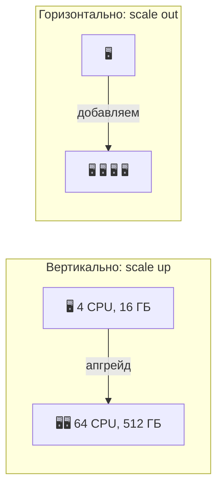
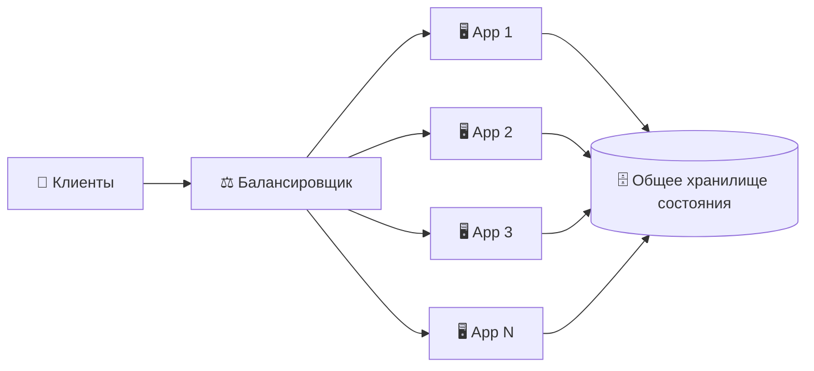
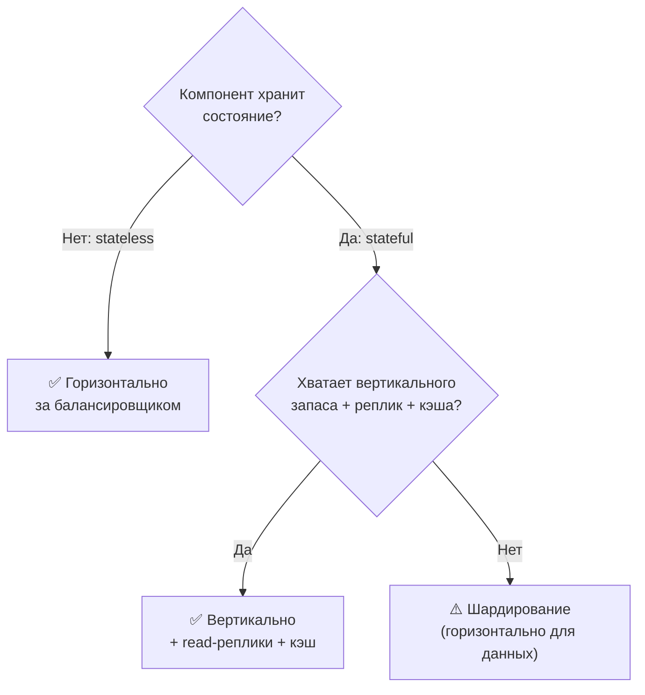
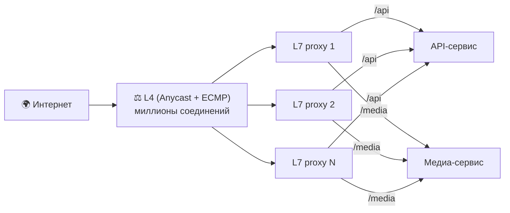
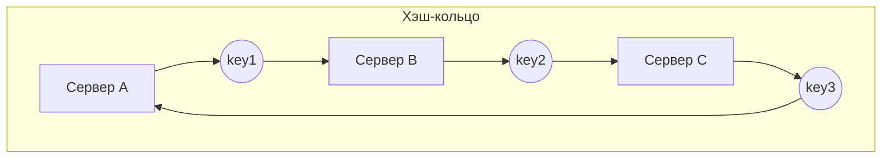
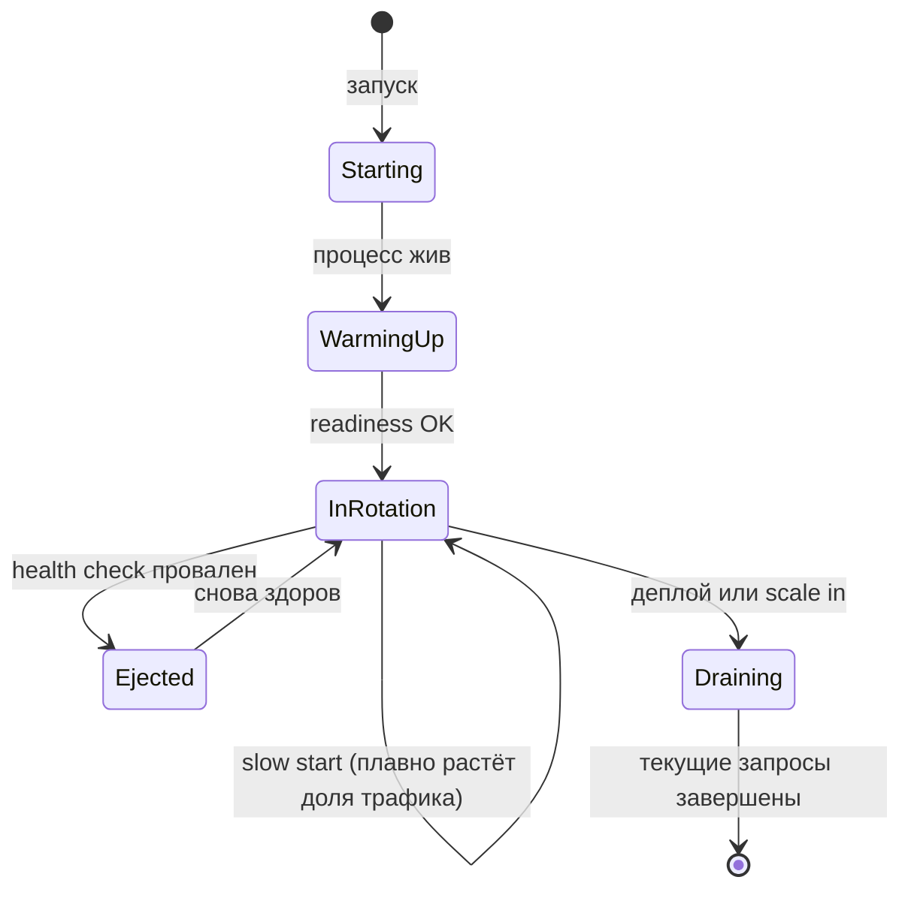

# 01. Основы масштабирования

> **Что внутри:** вертикальное и горизонтальное масштабирование, stateless-сервисы, балансировка нагрузки (L4 vs L7, алгоритмы)
> **Время на изучение:** ~3–4 ч · **Нужно для:** почти любой задачи system design
> **Практика:** разбор в формате интервью — [INTERVIEW.md](./INTERVIEW.md)

---

## 📑 Содержание

1. [Что такое масштабируемость](#1-что-такое-масштабируемость)
2. [Вертикальное масштабирование](#2-вертикальное-масштабирование)
3. [Горизонтальное масштабирование](#3-горизонтальное-масштабирование)
4. [Вертикальное vs горизонтальное: как выбирать](#4-вертикальное-vs-горизонтальное-как-выбирать)
5. [Stateless-сервисы](#5-stateless-сервисы)
6. [Балансировка нагрузки: зачем и где](#6-балансировка-нагрузки-зачем-и-где)
7. [L4 vs L7](#7-l4-vs-l7)
8. [Алгоритмы балансировки](#8-алгоритмы-балансировки)
9. [Health checks и жизненный цикл сервера](#9-health-checks-и-жизненный-цикл-сервера)
10. [Отказоустойчивость самого балансировщика](#10-отказоустойчивость-самого-балансировщика)
11. [Глобальная балансировка: DNS и Anycast](#11-глобальная-балансировка-dns-и-anycast)
12. [Автоскейлинг](#12-автоскейлинг)
13. [Как говорить об этом на интервью](#13-как-говорить-об-этом-на-интервью)
14. [Вопросы для самопроверки](#14-вопросы-для-самопроверки)
15. [Глоссарий и ресурсы](#15-глоссарий-и-ресурсы)

---

## 1. Что такое масштабируемость

**Масштабируемость** — это способность системы справляться с ростом нагрузки за счёт добавления ресурсов, *без переписывания архитектуры* и без деградации качества.

> [!NOTE]
> Масштабируемость ≠ производительность.
> **Производительность** — насколько быстро система обрабатывает *один* запрос.
> **Масштабируемость** — что происходит со скоростью и стабильностью, когда запросов становится в 10 или 100 раз больше.
> Быстрая система может плохо масштабироваться, и наоборот.

### Что именно растёт: параметры нагрузки

Прежде чем масштабировать, нужно понять, *что* растёт:

| Параметр | Пример |
|:---------|:-------|
| Запросы в секунду (RPS/QPS) | 1 000 → 100 000 RPS |
| Соотношение чтения и записи | Read-heavy (соцсети) vs write-heavy (логи, телеметрия) |
| Объём данных | 100 ГБ → 100 ТБ |
| Число одновременных соединений | Тысячи HTTP-запросов vs миллионы WebSocket |
| Размер ответа | JSON на 2 КБ vs видео на 2 ГБ |
| Неравномерность | Горячие ключи, знаменитости с миллионами подписчиков, пики |

Разные параметры требуют разных решений. Рост RPS решается добавлением серверов, рост объёма данных — шардированием, рост числа соединений — специальными шлюзами.

### Как измерять: latency и throughput

- **Throughput (пропускная способность):** сколько запросов система обрабатывает в секунду.
- **Latency (задержка):** сколько времени занимает один запрос.

Задержку меряют **перцентилями**, а не средним:

| Метрика | Смысл |
|:--------|:------|
| p50 (медиана) | Половина запросов быстрее этого значения |
| p95 / p99 | 95% / 99% запросов быстрее. Показывает «хвост» |
| p99.9 | Важно для крупных сервисов: у самых активных пользователей больше всего запросов, и они чаще попадают в хвост |

> [!TIP]
> Среднее скрывает проблемы. Если p50 = 50 мс, а p99 = 3 с, каждый сотый пользователь страдает, а при 10 запросах на страницу почти каждый десятый просмотр страницы будет медленным.

### Два способа масштабировать



**Аналогия:** у пекарни растёт очередь. Можно нанять пекаря, который работает вдвое быстрее (вертикально), а можно поставить ещё три печи с обычными пекарями (горизонтально).

---

## 2. Вертикальное масштабирование

**Scale up:** даём одной машине больше ресурсов — CPU, RAM, быстрые диски (NVMe), сеть.

### Плюсы

- **Не нужно менять код.** Приложение не знает, что машина стала мощнее.
- **Нет распределённых проблем.** Нет сетевых задержек между узлами, нет консистентности между репликами, все транзакции локальные.
- **Простая эксплуатация.** Один сервер проще мониторить, бэкапить и отлаживать.

### Минусы

- **Жёсткий потолок.** Даже самые большие машины в облаке ограничены (сотни ядер, единицы–десятки ТБ RAM). Дальше расти некуда.
- **Нелинейная стоимость.** Топовое железо стоит непропорционально дороже: машина в 2 раза мощнее часто стоит больше чем в 2 раза.
- **Единая точка отказа.** Сервер упал — сервис лёг.
- **Простой при апгрейде.** Смена типа машины обычно требует рестарта.
- **Отдача падает.** Добавление ядер не ускоряет однопоточный код, а блокировки и конкуренция за память ограничивают выигрыш.

### Когда это правильный выбор

- **Ранний этап продукта:** одна хорошая машина часто выдерживает намного больше, чем кажется.
- **Stateful-компоненты, особенно primary БД.** Горизонтальное масштабирование записи — это шардирование, и это очень дорого по сложности. Сначала выжимают вертикальный запас.
- **Задачи, которые плохо делятся:** сложные транзакции, большие in-memory вычисления.

> [!IMPORTANT]
> Многие крупные системы годами живут на вертикально масштабированной основной БД (с репликами для чтения), прежде чем шардироваться. Вертикальное масштабирование — это не «плохо», а «первый инструмент для stateful-частей».

---

## 3. Горизонтальное масштабирование

**Scale out:** добавляем больше одинаковых машин и распределяем между ними работу.



### Плюсы

- **Практически без потолка.** Нужно больше мощности — добавь узлы.
- **Отказоустойчивость.** Отказ одного узла не роняет сервис, если у остальных есть запас.
- **Линейная стоимость и эластичность.** Обычные машины дешёвые, их можно добавлять в пик и убирать ночью.
- **Обновления без простоя.** Узлы обновляются по очереди (rolling update).

### Минусы и цена

- **Нужен балансировщик** — ещё один компонент, который сам должен быть отказоустойчивым.
- **Сервисы должны быть stateless** (см. [раздел 5](#5-stateless-сервисы)), иначе запросы одного пользователя будут попадать на разные машины и терять контекст.
- **Распределённые проблемы:** сетевые сбои, частичные отказы, консистентность данных, распределённые блокировки.
- **Сложнее эксплуатация:** service discovery, мониторинг множества узлов, распределённые трейсы.

### Почему 2N машин не дают ровно 2× производительности

**Закон Амдала:** если доля работы `p` распараллеливается, а `(1 − p)` — нет, то ускорение на `N` узлах не больше чем:

```
Ускорение = 1 / ((1 − p) + p / N)
```

Если 95% работы параллельно, то даже на бесконечном числе узлов ускорение не превысит 20×. Последовательная часть (общая БД, глобальная блокировка, координатор) становится потолком.

**Universal Scalability Law** (Neil Gunther) добавляет второй эффект — **накладные расходы на согласование** между узлами (coherency). Из-за него после определённого числа узлов производительность может даже *падать*.

> [!TIP]
> Практический вывод: горизонтально масштабируется хорошо то, что **не делит общее состояние**. Поэтому stateless app-серверы масштабируются почти линейно, а всё, что ходит в одну общую БД, упирается в неё.

---

## 4. Вертикальное vs горизонтальное: как выбирать

| Критерий | Вертикальное | Горизонтальное |
|:---------|:-------------|:---------------|
| Суть | Больше ресурсов одной машине | Больше машин |
| Изменения в коде | Не нужны | Нужен stateless-дизайн или шардирование |
| Потолок | Жёсткий | Практически нет |
| Стоимость | Нелинейная на топовом железе | Примерно линейная |
| Отказоустойчивость | Единая точка отказа | Отказ узла не критичен |
| Эластичность | Низкая, часто с простоем | Высокая, без простоя |
| Сложность | Низкая | Высокая |
| Типичное применение | Primary БД, кэш-сервер, ранний этап | App-серверы, воркеры, веб-слой |

### Правило по умолчанию



> [!NOTE]
> На практике почти всегда используют **оба** способа: stateless-слой растёт вширь, а базы данных сначала вверх, потом вширь через реплики и шардирование.

---

## 5. Stateless-сервисы

### Определение

Сервис **stateless**, если:
1. **Любой** запрос может обработать **любой** экземпляр сервиса;
2. Потеря экземпляра не теряет данных пользователя;
3. Экземпляры взаимозаменяемы: их можно добавлять и убивать в любой момент.

> [!IMPORTANT]
> Stateless **не** значит «без состояния». Состояние есть всегда (пользователи, сессии, корзины). Stateless значит, что оно хранится **вне процесса** — в БД, кэше, объектном хранилище или в самом запросе (токен).

**Аналогия:** в банке любой свободный операционист может обслужить любого клиента, потому что вся информация в общей базе, а не в голове конкретного сотрудника. Если же клиент может решить вопрос только у «своего» менеджера, это stateful: менеджер в отпуске — клиент ждёт.

### Почему это критично для масштабирования

| Без stateless | Со stateless |
|:--------------|:-------------|
| Пользователь привязан к серверу | Балансировщик шлёт запрос куда угодно |
| Сервер упал → пользователь потерял сессию | Сервер упал → запрос уходит на другой, никто не заметил |
| Скейлинг вниз ломает пользователей | Узлы можно убирать в любой момент |
| Нагрузка распределяется неравномерно | Нагрузка распределяется ровно |
| Деплой рвёт сессии | Rolling update незаметен |

### Какое состояние мешает и куда его вынести

| Состояние внутри процесса | Проблема | Куда вынести |
|:--------------------------|:---------|:-------------|
| HTTP-сессия в памяти | Следующий запрос попадёт на другой сервер | Токен (JWT) или сессии в Redis |
| Файлы на локальном диске | Файл есть только на одном сервере | Объектное хранилище (S3, GCS) |
| Локальный кэш изменяемых данных | Кэши разных серверов расходятся | Общий Redis / Memcached |
| Счётчики (rate limit, лайки) в памяти | Лимит умножается на число серверов | Redis с атомарными операциями (INCR) |
| Блокировки в памяти | Не защищают от других серверов | Оптимистичная блокировка в БД или распределённые локи |
| Фоновые задачи в процессе | Пропадут при рестарте | Очередь + отдельные воркеры |
| Cron в каждом экземпляре | Задача выполнится N раз | Отдельный планировщик или выбор лидера |
| WebSocket-соединение | Привязано к конкретному серверу | Шлюз соединений + pub/sub для доставки сообщений |

### Пример: плохо и хорошо

```python
# ❌ Stateful: корзина в памяти процесса
carts = {}  # словарь живёт внутри одного сервера

def add_to_cart(user_id, item):
    carts.setdefault(user_id, []).append(item)
    # Следующий запрос пользователя попадёт на другой сервер — корзина пустая.
    # Рестарт сервера — все корзины потеряны.

# ✅ Stateless: корзина во внешнем хранилище
def add_to_cart(user_id, item):
    redis.rpush(f"cart:{user_id}", item)
    redis.expire(f"cart:{user_id}", 7 * 24 * 3600)
    # Любой сервер видит ту же корзину. Сервер можно убить в любой момент.
```

### Три способа работать с сессиями

| Способ | Как работает | Плюсы | Минусы |
|:-------|:-------------|:------|:-------|
| **Sticky sessions** | Балансировщик всегда шлёт пользователя на тот же сервер (по cookie или IP) | Ничего не нужно менять в коде | Неравномерная нагрузка; сервер упал — сессии потеряны; мешает скейлингу вниз |
| **Централизованное хранилище** | Сессия в Redis, в cookie только ID | Легко отозвать доступ (удалить ключ) | Поход в Redis на каждый запрос; Redis должен быть отказоустойчивым |
| **Токен (JWT)** | Данные сессии подписаны и лежат в самом токене | Проверка локально, без хранилища | Трудно отозвать до истечения; токен больше по размеру |

> [!TIP]
> Популярная комбинация: короткоживущий access-токен (JWT, 5–15 минут) + долгоживущий refresh-токен в хранилище. Проверка запросов дешёвая, а отозвать доступ можно, не дожидаясь суток.

### Когда stateful оправдан

Держать состояние в памяти выгодно, когда загружать его каждый раз слишком дорого:
- игровые серверы (состояние матча меняется 30–60 раз в секунду);
- совместное редактирование документа (один «владелец» документа упорядочивает правки);
- шлюзы WebSocket-соединений;
- распределённые кэши и базы данных.

В таких случаях запросы направляют на нужный узел **по ключу** (consistent hashing, см. [раздел 8](#8-алгоритмы-балансировки)), а отказоустойчивость дают репликация и снапшоты.

---

## 6. Балансировка нагрузки: зачем и где

**Балансировщик нагрузки** (load balancer, LB) распределяет входящие запросы между несколькими серверами.

### Что он даёт

1. **Масштабирование:** нагрузка делится между N серверами.
2. **Отказоустойчивость:** больные серверы исключаются из ротации.
3. **Единая точка входа:** клиенты знают один адрес, а серверы за ним меняются.
4. **Обновления без простоя:** серверы выводятся из ротации по одному.
5. **Дополнительные функции** (особенно на L7): TLS, кэширование, rate limiting, маршрутизация.

### Где стоят балансировщики


Балансировка происходит на **нескольких уровнях**:

| Уровень | Что балансирует | Примеры |
|:--------|:----------------|:--------|
| Глобальный | Между регионами и дата-центрами | GeoDNS, Anycast |
| Входной (edge) | Внешний трафик в дата-центр | AWS NLB/ALB, Google Maglev, Meta Katran |
| Между сервисами | Внутренние вызовы микросервисов | Внутренний LB, service mesh (Envoy, Istio), gRPC client-side LB |
| К базе данных | Соединения к БД и репликам | PgBouncer, ProxySQL |

### Server-side vs client-side балансировка

| | Server-side (прокси) | Client-side |
|:-|:---------------------|:------------|
| Как работает | Клиент шлёт запрос на LB, LB выбирает сервер | Клиент сам получает список серверов (из service discovery) и выбирает |
| Плюсы | Клиенты простые; централизованное управление | Нет лишнего сетевого хопа; нет отдельного узкого места |
| Минусы | Лишний хоп; LB нужно масштабировать | Логика в каждом клиенте; сложнее обновлять |
| Где | Внешний трафик | Внутренние вызовы (gRPC), часто через sidecar-прокси в service mesh |

---

## 7. L4 vs L7

Названия взяты из модели OSI: **L4 — транспортный уровень** (TCP/UDP), **L7 — прикладной уровень** (HTTP, gRPC).

### L4-балансировщик

Видит только **IP-адреса, порты и протокол**. Не знает, что внутри соединения: HTTP, база данных или игровой трафик.

```
Пакет: [src 1.2.3.4:5555] → [dst 10.0.0.1:443]  [зашифрованные байты...]
         ↑ L4 видит только это                      ↑ сюда не смотрит
```

- Решение принимается **один раз на соединение**: все пакеты одного TCP-соединения идут на один сервер.
- Очень быстрый: может работать на уровне ядра (IPVS, eBPF/XDP) или железа.
- Режимы работы:
    - **NAT:** LB подменяет адреса в обе стороны, ответы идут через него;
    - **DSR (Direct Server Return):** запрос идёт через LB, а ответ сервер отправляет клиенту напрямую. Это сильно разгружает LB, потому что ответы обычно намного больше запросов.

### L7-балансировщик

Работает как **reverse proxy**: принимает соединение от клиента, разбирает HTTP-запрос и открывает *своё* соединение к серверу.

```
GET /api/v2/orders/42 HTTP/1.1
Host: shop.example.com
Cookie: session=abc
Authorization: Bearer eyJ...
   ↑ L7 видит всё это и может по этому маршрутизировать
```

- Решение принимается **на каждый запрос**. Это важно для HTTP/2 и gRPC: много запросов идут в одном соединении, и L4 отправил бы их все на один сервер.
- Возможности:
    - маршрутизация по пути, хосту, заголовкам (`/api/*` → сервис A, `/images/*` → сервис B);
    - терминация TLS;
    - ретраи, таймауты, circuit breaking;
    - canary и A/B: 5% трафика на новую версию;
    - rate limiting, аутентификация, WAF;
    - сжатие, кэширование, добавление заголовков (`X-Request-ID`, `X-Forwarded-For`).

### Сравнение

| | L4 | L7 |
|:-|:---|:---|
| Что видит | IP, порт, протокол | HTTP: метод, путь, заголовки, cookies, тело |
| Единица балансировки | Соединение | Запрос |
| TLS | Пропускает насквозь | Терминирует (может перешифровать к серверу) |
| Скорость | Очень высокая | Ниже: разбор HTTP, два соединения |
| Протоколы | Любые TCP/UDP | HTTP/1.1, HTTP/2, gRPC, WebSocket |
| Умная маршрутизация | Нет | Да |
| Видимость (логи, метрики по запросам) | Минимальная | Полная |
| Примеры | AWS NLB, LVS/IPVS, Google Maglev, Meta Katran | AWS ALB, NGINX, Envoy, HAProxy (HTTP-режим), Traefik |

### Варианты работы с TLS

| Режим | Где расшифровка | Когда |
|:------|:----------------|:------|
| **TLS termination** | На LB, к серверу идёт HTTP | Самый частый вариант: снимает нагрузку с серверов, даёт L7-функции |
| **TLS passthrough** | На сервере, LB не видит содержимое | Требования end-to-end шифрования; только L4-функции |
| **TLS re-encryption** | На LB, затем новое TLS-соединение к серверу | Нужны L7-функции и шифрование внутри сети (zero trust) |

### Что выбрать

- **L7** — по умолчанию для HTTP/gRPC API и веба.
- **L4** — для не-HTTP протоколов (БД, MQTT, игры, VoIP), для огромного числа соединений и когда TLS нельзя расшифровывать.
- **Оба слоя** — типично для больших систем: L4 на входе принимает трафик и распределяет его по флоту L7-прокси, которые уже делают умную маршрутизацию.



---

## 8. Алгоритмы балансировки

Алгоритмы делятся на **статические** (не учитывают текущую нагрузку) и **динамические** (учитывают).

### Статические

**Round Robin.** Запросы отправляются по кругу: 1 → 2 → 3 → 1 → 2 → 3.
- ✅ Просто и предсказуемо.
- ❌ Не учитывает, что запросы бывают разной тяжести и серверы разной мощности.

**Weighted Round Robin.** То же, но с весами: сервер с весом 3 получает в 3 раза больше запросов.
- ✅ Серверы разной мощности; canary-деплой (новой версии вес 1, старой — 19, то есть 5% трафика).
- ❌ Веса статичны и не реагируют на реальную загрузку.

**Random.** Случайный сервер.
- ✅ Не нужно состояние; на больших числах распределение ровное.
- ❌ На малом числе запросов возможны перекосы.

**IP Hash / Source Hash.** `server = hash(IP клиента) mod N`.
- ✅ Один клиент всегда попадает на один сервер без cookies.
- ❌ Много клиентов за одним NAT → перегрузка одного сервера. При изменении N почти все клиенты переезжают.

### Динамические

**Least Connections.** Запрос отправляется на сервер с наименьшим числом активных соединений.
- ✅ Хорошо для запросов разной длительности и долгих соединений (WebSocket).
- ❌ LB должен знать число соединений; при нескольких LB у каждого своя картина.

**Weighted Least Connections.** Учитывает и соединения, и мощность: выбирается минимум `соединения / вес`.

**Least Response Time.** Учитывает число соединений и среднюю задержку ответа.
- ✅ Обходит медленные серверы.
- ❌ Может «раскачиваться»: все бросаются на быстрый сервер, он замедляется, все уходят с него.

**Power of Two Choices (P2C).** Выбираются **два случайных** сервера, и запрос отправляется на менее загруженный из них.
- ✅ Почти так же хорош, как выбор лучшего из всех, но требует сравнить только два. Устойчив к устаревшей информации и к тому, что LB много.
- ✅ Используется по умолчанию во многих современных прокси (например, в Envoy для least request).
- ❌ Практически нет; это отличный дефолт.

> [!TIP]
> **Почему P2C так хорош.** Если выбирать случайно, максимальная загрузка самого загруженного сервера растёт как `log N / log log N`. Если выбирать лучшее из двух случайных — как `log log N`. Это экспоненциальное улучшение ценой одного лишнего сравнения. Отсюда название статьи Mitzenmacher «The Power of Two Choices».

### Consistent Hashing (для stateful и кэшей)

Проблема обычного хэширования `hash(key) mod N`: при добавлении или удалении сервера меняется N, и **почти все ключи** переезжают. Для кэша это означает, что весь кэш одновременно становится пустым.

**Consistent hashing** размещает серверы и ключи на одном кольце. Ключ принадлежит первому серверу по часовой стрелке.



- При добавлении или удалении сервера переезжает только около `1/N` ключей — только соседние.
- **Виртуальные узлы:** каждый физический сервер размещается на кольце много раз (например, 100–200 точек). Это выравнивает распределение и позволяет задавать веса.
- **Варианты:** rendezvous hashing (HRW), Maglev hashing (Google), jump consistent hash.
- **Где используется:** распределённые кэши, шардированные хранилища (Dynamo, Cassandra), L4-балансировщики, которым нужно отправлять пакеты одного соединения на один сервер даже при изменении состава.

> [!WARNING]
> Consistent hashing не спасает от **горячих ключей**: если один ключ получает 30% трафика, его сервер перегружен в любом случае. Решения: реплицировать горячий ключ на несколько узлов, локальный кэш перед общим, разбиение ключа (`key#1`, `key#2`, ...).

### Итоговая таблица

| Алгоритм | Тип | Лучше всего для | Главный минус |
|:---------|:----|:----------------|:--------------|
| Round Robin | Статический | Одинаковые серверы и запросы | Не видит нагрузку |
| Weighted RR | Статический | Разные серверы, canary | Статичные веса |
| Random | Статический | Простые случаи, много LB | Перекосы на малых числах |
| IP Hash | Статический | Привязка клиента без cookies | NAT, переезд при изменении N |
| Least Connections | Динамический | Разная длительность, WebSocket | Нужен учёт состояния |
| Least Response Time | Динамический | Неоднородные серверы | Осцилляции |
| Power of Two Choices | Динамический | Большие флоты, дефолт для API | Почти нет |
| Consistent Hashing | По ключу | Кэши и stateful-сервисы | Горячие ключи |

---

## 9. Health checks и жизненный цикл сервера

Балансировщик должен знать, какие серверы здоровы.

### Виды проверок

| Вид | Как работает | Плюсы и минусы |
|:----|:-------------|:---------------|
| **Активные** | LB раз в N секунд опрашивает `/healthz`. После K неудач сервер исключается, после M успехов возвращается | Обнаруживает проблему даже без трафика; создаёт дополнительную нагрузку |
| **Пассивные (outlier detection)** | LB следит за ошибками и таймаутами реального трафика и временно исключает проблемный сервер | Реагирует на реальные проблемы; нужен трафик |

### Liveness vs readiness

| | Liveness | Readiness |
|:-|:---------|:----------|
| Вопрос | «Процесс жив или завис?» | «Готов ли принимать трафик прямо сейчас?» |
| Если не прошёл | Перезапустить процесс | Не слать трафик, но не перезапускать |
| Пример | Не отвечает из-за дедлока | Ещё прогревает кэш, выполняет миграцию, перегружен |

> [!WARNING]
> Не включай в readiness проверку **всех** зависимостей. Если Redis недоступен, все серверы одновременно станут «not ready», и балансировщик исключит весь флот. В итоге частичная деградация превратится в полный отказ. Readiness должна проверять, может ли *этот экземпляр* обслуживать трафик, а не здоровье всей системы.

### Жизненный цикл сервера за балансировщиком



- **Slow start:** новый сервер получает трафик постепенно, а не сразу полную долю. Иначе холодный кэш и JIT-компиляция приведут к таймаутам.
- **Connection draining:** при выводе сервера LB перестаёт слать ему новые запросы и ждёт завершения текущих (обычно 30–300 с). Без этого каждый деплой даёт всплеск ошибок.

---

## 10. Отказоустойчивость самого балансировщика

Балансировщик, который решает проблему единой точки отказа, сам может стать единой точкой отказа.

| Способ | Как работает |
|:-------|:-------------|
| **Active-passive пара** | Два LB с общим виртуальным IP (VRRP, keepalived). Активный упал — пассивный забирает IP за секунды |
| **Active-active + DNS** | Несколько LB, у домена несколько A-записей. Клиенты распределяются между ними |
| **Anycast + ECMP** | Много LB анонсируют один и тот же IP. Сеть (роутеры с ECMP) распределяет трафик между ними; упавший LB просто перестаёт анонсировать адрес |
| **Managed LB** | Облачные LB (AWS ALB/NLB, GCP Cloud LB) уже распределены по зонам доступности |

---

## 11. Глобальная балансировка: DNS и Anycast

Когда сервис работает в нескольких регионах, нужно направить пользователя в ближайший здоровый регион.

| Способ | Как работает | Плюсы | Минусы |
|:-------|:-------------|:------|:-------|
| **DNS round robin** | Несколько IP в DNS-ответе | Просто | Нет health checks; кэширование DNS |
| **GeoDNS / latency-based DNS** | DNS отвечает IP ближайшего региона | Пользователь идёт в ближний регион | Переключение при сбое медленное из-за TTL и кэширующих резолверов |
| **Anycast** | Один IP анонсируется из многих точек; BGP ведёт пакеты в ближайшую | Быстрое переключение, защита от DDoS | Сложно настроить; маршрут может поменяться посреди соединения |

> [!NOTE]
> DNS-балансировка зависит от TTL, но многие клиенты и резолверы кэшируют ответы дольше заявленного. Поэтому переключение через DNS всегда занимает минуты, а не секунды. Для быстрого failover между регионами используют Anycast или health-aware глобальные LB.

---

## 12. Автоскейлинг

Горизонтальное масштабирование становится по-настоящему полезным, когда число серверов меняется **автоматически**.

| Вид | Как работает | Пример |
|:----|:-------------|:-------|
| **Реактивный (по метрике)** | Целевое значение метрики, например CPU 60% | Нагрузка выросла → добавились инстансы |
| **По расписанию** | Заранее известные пики | Каждый будний день в 8:30 поднять мощность |
| **Предиктивный** | Прогноз нагрузки по истории | Облачные predictive scaling |
| **По длине очереди** | Для воркеров: сообщения в очереди / скорость обработки | Очередь растёт → больше воркеров |

### Ключевые настройки

- **Метрика:** CPU, RPS на инстанс, latency или длина очереди. Метрика должна отражать реальное узкое место.
- **Min / max:** минимум переживает потерю зоны доступности, максимум защищает от бесконечного счёта при атаке или баге.
- **Быстро вверх, медленно вниз:** scale out за минуты, scale in с cooldown, чтобы не было «пилы».
- **Время старта:** если инстанс поднимается 5 минут, а пик нарастает за 1 минуту, реактивный автоскейлинг не успеет. Нужен запас или предиктивное масштабирование.

> [!WARNING]
> Автоскейлинг app-слоя может **уронить базу данных**: больше инстансов → больше соединений к БД. Нужен пул соединений (PgBouncer) и лимит соединений на инстанс. Узкое место переезжает, а не исчезает.

---

## 13. Как говорить об этом на интервью

### Ответ за 30 секунд

> «Stateless app-слой масштабирую горизонтально за L7-балансировщиком с least connections или power of two choices, health checks и connection draining. Состояние выношу наружу: сессии в JWT или Redis, файлы в объектное хранилище, кэш в Redis, фоновые задачи в очередь. Stateful-части, в первую очередь primary БД, сначала масштабирую вертикально плюс read-реплики и кэш, шардирую, только когда упираюсь в запись или объём. Сам балансировщик тоже резервирую. Всё распределяю по нескольким зонам доступности, а app-слой автоскейлится».

### Фразы, которые показывают понимание

| Вместо | Говори |
|:-------|:-------|
| «Поставим балансировщик» | «Поставлю L7-балансировщик, потому что нужна маршрутизация по пути и TLS termination; алгоритм — least connections, так как запросы разной длительности» |
| «Сделаем сервис масштабируемым» | «Сервис stateless: сессии в Redis, файлы в S3, поэтому его можно масштабировать горизонтально за балансировщиком» |
| «Добавим ещё серверов» | «По оценке пик 6 000 RPS, инстанс держит ~1 000, с учётом потери одной из трёх AZ нужно ~11 инстансов» |
| «Шардируем базу» | «600 QPS записи один primary выдержит, сначала вертикальный рост и реплики, шардирование по user_id — когда упрёмся» |

### Типичные ошибки

- Сразу шардировать базу на маленькой нагрузке (over-engineering).
- Забыть, что балансировщик — тоже точка отказа.
- Использовать sticky sessions как основное решение.
- Считать, что «stateless» значит «без состояния».
- Масштабировать app-слой и не подумать о соединениях к БД.
- Говорить «балансировщик» без уровня (L4/L7) и алгоритма.

---

## 14. Вопросы для самопроверки

<details>
<summary><b>1. Чем масштабируемость отличается от производительности?</b></summary>

Производительность — как быстро обрабатывается один запрос. Масштабируемость — как система ведёт себя при росте нагрузки и можно ли справиться с ростом, добавляя ресурсы. Быстрая система может плохо масштабироваться (например, всё упирается в одну блокировку).
</details>

<details>
<summary><b>2. Почему primary БД обычно масштабируют вертикально, а app-серверы — горизонтально?</b></summary>

App-серверы stateless: их можно клонировать, и они не делят состояние. Primary БД хранит состояние и обеспечивает транзакции; горизонтальное масштабирование записи требует шардирования, а это сложно (кросс-шардовые запросы, решардинг, распределённые транзакции). Поэтому сначала выжимают вертикальный запас, реплики для чтения и кэш.
</details>

<details>
<summary><b>3. Что сломается, если хранить сессию в памяти сервера, а за балансировщиком 5 серверов?</b></summary>

Следующий запрос пользователя с вероятностью ~80% попадёт на другой сервер, где сессии нет, и пользователь окажется «разлогинен». При падении или рестарте сервера пропадут все его сессии. Решения: JWT, сессии в Redis или (как костыль) sticky sessions.
</details>

<details>
<summary><b>4. Почему L4-балансировщик плохо распределяет gRPC-трафик?</b></summary>

gRPC работает поверх HTTP/2, где много запросов мультиплексируется в одном долгоживущем TCP-соединении. L4 балансирует соединения, поэтому все запросы клиента уходят на один сервер. L7 (или client-side балансировка в gRPC) распределяет каждый запрос отдельно.
</details>

<details>
<summary><b>5. Что такое DSR и зачем он нужен?</b></summary>

Direct Server Return: запрос проходит через L4-балансировщик, а ответ сервер отправляет клиенту напрямую, минуя LB. Ответы обычно намного больше запросов, поэтому нагрузка на LB падает в разы.
</details>

<details>
<summary><b>6. Почему power of two choices лучше случайного выбора?</b></summary>

При случайном выборе перекос нагрузки растёт как log N / log log N, а при выборе лучшего из двух случайных — как log log N. Это экспоненциальное улучшение ценой одного сравнения. Метод также устойчив к устаревшим данным о нагрузке, поэтому хорошо работает, когда LB много.
</details>

<details>
<summary><b>7. Чем consistent hashing лучше hash(key) mod N?</b></summary>

При изменении N в схеме mod N переезжает почти каждый ключ. В consistent hashing переезжает около 1/N ключей — только соседние на кольце. Для кэша это разница между «кэш почти весь сохранился» и «кэш весь пустой, и БД получает всю нагрузку».
</details>

<details>
<summary><b>8. Почему readiness-проба не должна проверять все зависимости?</b></summary>

Если общая зависимость (например, Redis) недоступна, все экземпляры одновременно станут not ready, балансировщик исключит весь флот, и частичная деградация превратится в полный отказ. Readiness должна отражать готовность конкретного экземпляра.
</details>

<details>
<summary><b>9. Как сделать отказоустойчивым сам балансировщик?</b></summary>

Active-passive пара с виртуальным IP (VRRP/keepalived), несколько LB за DNS, Anycast с ECMP или managed LB, который уже распределён по зонам доступности.
</details>

<details>
<summary><b>10. Почему DNS-failover между регионами медленный?</b></summary>

Ответы DNS кэшируются резолверами и клиентами на время TTL, а многие кэшируют дольше заявленного. Поэтому часть клиентов продолжает ходить в упавший регион минуты. Быстрее работают Anycast и глобальные LB с health checks.
</details>

---

## 15. Глоссарий и ресурсы

### Глоссарий

| Термин | Значение |
|:-------|:---------|
| Scale up / scale out | Вертикальное / горизонтальное масштабирование |
| Stateless | Любой экземпляр может обработать любой запрос; состояние вне процесса |
| Sticky sessions | Привязка клиента к конкретному серверу на балансировщике |
| L4 / L7 | Балансировка на транспортном (TCP/UDP) / прикладном (HTTP) уровне |
| Reverse proxy | Сервер, принимающий запросы от клиентов и пересылающий их бэкендам |
| TLS termination | Расшифровка TLS на балансировщике |
| DSR | Direct Server Return: ответ идёт от сервера клиенту в обход LB |
| ECMP | Equal-Cost Multi-Path: роутер распределяет трафик между равноценными маршрутами |
| Anycast | Один IP анонсируется из многих точек, трафик идёт в ближайшую |
| Health check | Проверка, жив ли и готов ли сервер |
| Connection draining | Плавный вывод сервера: новых запросов нет, текущие завершаются |
| Slow start | Постепенное увеличение трафика на новый сервер |
| P2C | Power of Two Choices: выбор менее загруженного из двух случайных серверов |
| Consistent hashing | Хэширование, при котором изменение числа узлов перемещает минимум ключей |
| Hot key | Ключ, получающий непропорционально много трафика |

### Ресурсы

- *Designing Data-Intensive Applications*, Martin Kleppmann — глава 1 (масштабируемость, параметры нагрузки, перцентили)
- *System Design Interview*, Vol. 1, Alex Xu — глава 1 «Scale from Zero to Millions of Users» и глава 5 «Consistent Hashing»
- The Twelve-Factor App — разделы VI (Processes) и IX (Disposability)
- Michael Mitzenmacher, *The Power of Two Choices in Randomized Load Balancing*
- Google, *Maglev: A Fast and Reliable Software Network Load Balancer* (NSDI 2016)
- Google SRE Book — главы «Load Balancing at the Frontend» и «Load Balancing in the Datacenter»
- Документация Envoy, NGINX и HAProxy по алгоритмам балансировки и health checks