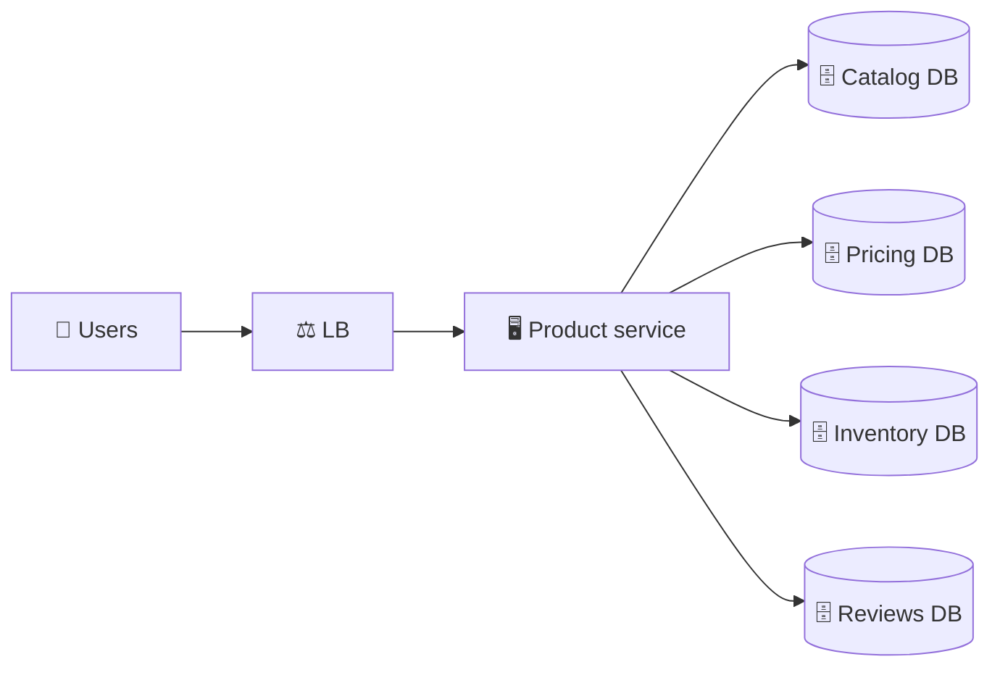
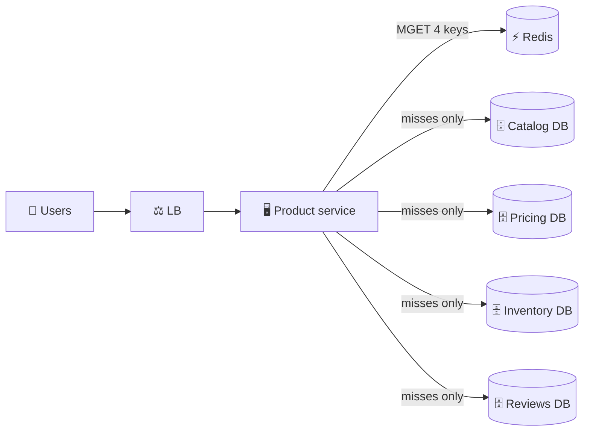
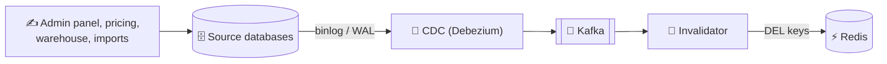
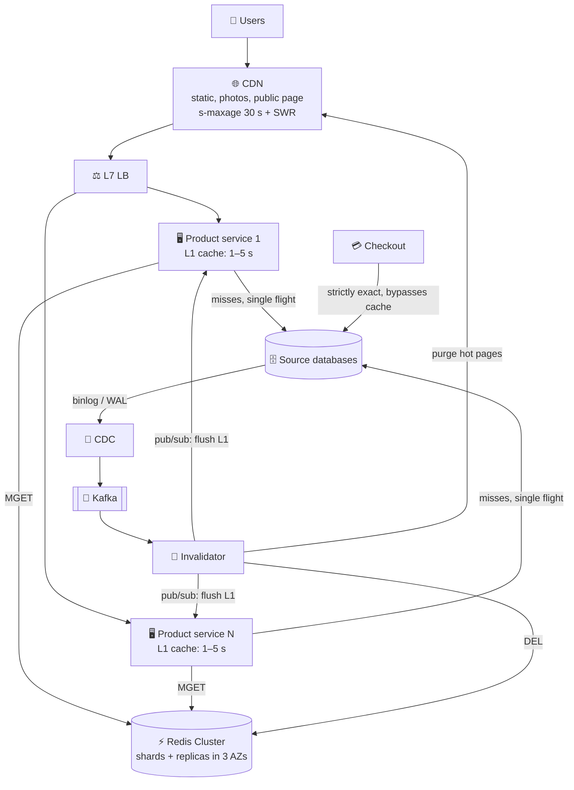
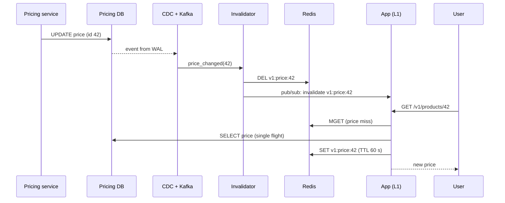
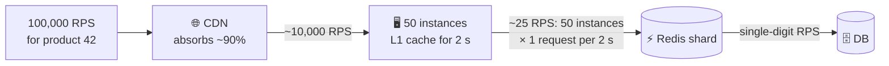

**English** | [Русский](INTERVIEW.ru.md) · Theory: [README.md](./README.md)

# 02. Caching: A Caching Layer for a Product Page

> **Topic:** cache-aside, TTL, eviction, invalidation, cache stampede, hot keys, multi-level caching
> **Level:** Medium–Hard · **Interview time:** 45 min · **Study time:** ~4 h
> **Where it's asked:** as a standalone question ("design a cache for…") and as a deep dive in almost any read-heavy problem

---

## 🗺️ How to Read This Walkthrough

| Icon | Meaning |
|:----:|:--------|
| 🎤 | Interviewer |
| 🗣️ | What I (the candidate) say out loud |
| ✏️ | What I draw on the whiteboard |
| ⏱️ | Time budget for the step |

Callouts: **TIP** — a good technique, **WARNING** — a trap, **IMPORTANT** — a Senior+ signal.

---

## 📑 Contents

1. [Problem Statement](#1-problem-statement)
2. [Clarifying Questions and Requirements](#2-clarifying-questions-and-requirements)
3. [Capacity Estimates](#3-capacity-estimates)
4. [API](#4-api)
5. [Data Model and Cache Keys](#5-data-model-and-cache-keys)
6. [High-Level Design: Evolution by Stages](#6-high-level-design-evolution-by-stages)
7. [Deep Dive 1: Pattern and TTL per Data Type](#7-deep-dive-1-pattern-and-ttl-per-data-type)
8. [Deep Dive 2: Invalidation](#8-deep-dive-2-invalidation)
9. [Deep Dive 3: Flash Sales, Hot Keys and Stampedes](#9-deep-dive-3-flash-sales-hot-keys-and-stampedes)
10. [Deep Dive 4: Sizing, Eviction and the Redis Cluster](#10-deep-dive-4-sizing-eviction-and-the-redis-cluster)
11. [Bottlenecks and Failure Scenarios](#11-bottlenecks-and-failure-scenarios)
12. [What Changes at 10x Scale](#12-what-changes-at-10x-scale)
13. [Interviewer Questions with Answers](#13-interviewer-questions-with-answers)
14. [Common Mistakes](#14-common-mistakes)
15. [Cheat Sheet and Self-Check](#15-cheat-sheet-and-self-check)

---

## 1. Problem Statement

> 🎤 "We run a large online store. The product page is assembled from several database queries and takes 400 ms, and during sales the database can't keep up. Design a caching layer for the product page."

**Time plan:**

| Step | ⏱️ |
|:-----|:--:|
| Requirements | 5 min |
| Estimates | 5 min |
| API, data, keys | 5 min |
| High-level design | 10 min |
| Deep dives | 15 min |
| Failures and wrap-up | 5 min |

> [!TIP]
> "Design a cache" is first and foremost a question about **data**: how stale each piece can be. Start by splitting the page into parts with different freshness requirements. It immediately shows maturity.

---

## 2. Clarifying Questions and Requirements

⏱️ 5 min

| My question | Interviewer's answer | What it changes |
|:------------|:---------------------|:----------------|
| What's on the product page? | Description and photos, price, availability, review summary, recommendations | Parts have different freshness needs → different TTLs and strategies |
| How fresh must price and availability be? | Price within a few seconds; at checkout — strictly exact | The page can be slightly stale; checkout reads the source of truth |
| Read/write ratio? | ~1000:1, products rarely change | The cache will get a very high hit rate |
| How many products, how is traffic distributed? | 100M products; a small share of popular ones gets most views | No need to cache everything; the working set matters |
| Who changes product data? | Admin panel, pricing service, warehouse system, bulk imports | App-level invalidation won't catch everything → need CDC |
| What happens during sales? | Traffic ×5, individual products get huge traffic | Hot keys and stampedes are the main risks |
| Is the page personalized? | Recommendations are personal; the rest is shared | Shared parts are cached for everyone; personal parts separately |

### Functional requirements

1. Serve the product page: description, photos, price, availability, review summary.
2. Price and availability changes appear on the page within a few seconds.
3. Checkout always sees the exact price and stock.

**Out of scope:** search, cart, the payment process itself, generating recommendations (assume a separate service).

### Non-functional requirements

| Requirement | Target |
|:------------|:-------|
| Latency | p99 < 100 ms for the product page (400 ms today) |
| DB load | Reduce by 20×+; the DB must survive a sale |
| Freshness | Description — minutes; price and availability — ≤ 5 s; checkout — strictly exact |
| Availability | 99.95%; a cache failure must not take the site down |
| Peaks | ×5 average; individual products at tens of thousands of requests per second |

> [!IMPORTANT]
> **Senior+ signal:** explicitly separate **display** (can be eventually consistent) from **transactions** (checkout reads the source of truth). This removes an impossible strong-consistency requirement from the cache.

---

## 3. Capacity Estimates

⏱️ 5 min

✏️

```
DAU                         = 50M
Product views per user      = 30/day  → 1.5B views/day

1 day ≈ 10^5 sec
Page QPS (avg)   = 1.5B / 10^5 ≈ 15,000
Page QPS (peak ×5) ≈ 75,000

Cache lookups per page: ~4 keys (product, price, stock, reviews)
Cache ops at peak ≈ 75,000 × 4 = 300,000 ops/s (fewer requests with MGET)

Catalog: 100M products × ~5 KB ≈ 500 GB
Hot set: ~10% of products drive ~90% of views → 10M × 5 KB ≈ 50 GB
With Redis overhead (~1.5×) ≈ 75 GB, with a replica ≈ 150 GB of memory
```

🗣️ **Conclusions:**

- **Without a cache**, the DB would get 75,000 page requests per second, each being several SQL queries. It won't hold.
- **At a 95% hit rate**, ~3,750 pages/s reach the DB; at **99%**, ~750. I aim for 99% on hot data.
- **No need to cache the whole catalog:** a ~50 GB hot set of useful data fits in a small Redis cluster.
- **Throughput:** one Redis node handles on the order of 100,000+ simple ops per second, so we need several shards. But the main risk isn't the average — it's **hot keys**: one product on sale can generate 50,000+ requests per second to **one** shard.

---

## 4. API

⏱️ 2 min

```http
GET /v1/products/{product_id}
→ 200 {
    product:  { id, title, description, images[], attributes },
    price:    { amount, currency, updated_at },
    stock:    { status: "in_stock" | "low" | "out_of_stock" },
    reviews:  { rating, count }
  }
Response headers: Cache-Control: public, s-maxage=30, stale-while-revalidate=60
                  ETag: "<version>"

GET /v1/products/{product_id}/recommendations?user_id=...   (personalized, separate)

# Internal API, used only by checkout
GET /internal/v1/products/{product_id}/price-and-stock?consistent=true
→ reads the source of truth, no cache
```

🗣️ Three decisions:

1. **Personal recommendations are a separate request.** The main page is the same for everyone, so it can be cached on the CDN.
2. **Availability is returned as a status**, not an exact count. "In stock" changes far less often than "1,437 left", and caches much better.
3. **Checkout uses a separate endpoint that bypasses the cache.** Strict accuracy only where it's needed.

---

## 5. Data Model and Cache Keys

⏱️ 3 min

**Sources of truth:**

| Data | Where it lives | Who changes it | How often |
|:-----|:---------------|:---------------|:----------|
| Description, photos, attributes | Catalog DB (PostgreSQL) | Admin panel, imports | Rarely |
| Price | Pricing DB | Pricing service | Sometimes; in bulk during sales |
| Stock | Inventory DB | Warehouse system, orders | Often |
| Review summary | Reviews DB (aggregate) | Recomputed every N minutes | Rarely |

**Cache keys:**

```
v1:product:{id}          → description, photos, attributes   TTL 1 h  ± jitter
v1:price:{id}            → price                             TTL 60 s ± jitter
v1:stock:{id}            → availability status               TTL 10 s ± jitter
v1:reviews:{id}          → rating and review count           TTL 15 min
v1:notfound:product:{id} → "no such product" marker          TTL 60 s
```

🗣️ "I split the page into independent keys with different TTLs instead of caching the whole page. Otherwise every stock change would invalidate the description, which changes once a month. The `v1` prefix lets me change the format without manually flushing the cache."

---

## 6. High-Level Design: Evolution by Stages

⏱️ 10 min

### Stage 0. Today: no cache

✏️



**Problems:** 4+ queries to different DBs per page, 400 ms, databases overloaded during sales.

### Stage 1. Cache-aside on top of Redis

✏️



🗣️ "One `MGET` for 4 keys; misses are loaded from the databases in parallel and cached. The hit rate is high, and cache latency drops to single-digit milliseconds."

**Problems:** price freshness relies only on TTL; changes from other systems aren't visible until expiry; hot keys during sales overload a single shard.

### Stage 2. Invalidation via CDC

✏️



🗣️ "Changes are read from the database logs, so we catch **every** write, including bulk imports and changes by other teams. The invalidator deletes the corresponding keys. TTL remains the safety net."

### Stage 3. Final design: CDN + L1 + Redis Cluster + CDC

✏️



🗣️ "The result is three cache layers:
- **CDN** absorbs most traffic for the public part of the page; `stale-while-revalidate` hides refreshes from users;
- **L1** in each instance, with a TTL of seconds, protects Redis from hot keys;
- **Redis Cluster** is the shared cache with replicas.

Invalidation flows from CDC into all three layers. Checkout always reads the source of truth."

---

## 7. Deep Dive 1: Pattern and TTL per Data Type

> 🎤 "Why cache-aside and not write-through?"

🗣️ "Writes come from many systems I don't control: the warehouse, imports, the pricing service. Write-through requires all writes to go through the cache, which isn't possible. Cache-aside + CDC invalidation works with any writer. Also, when the cache fails, cache-aside degrades gracefully: there are just more DB queries."

| Data | Pattern | TTL | Acceptable staleness | Why |
|:-----|:--------|:---:|:--------------------:|:----|
| Description, photos | Cache-aside + CDC | 1 h | Minutes | Rarely changes, large volume |
| Price | Cache-aside + CDC | 60 s | ≤ 5 s (CDC), 60 s worst case | Freshness matters, but checkout verifies anyway |
| Availability (status) | Cache-aside + CDC | 10 s | Seconds | Changes often, but the status is coarse |
| Review summary | Cache-aside or refresh-ahead | 15 min | Minutes | Recomputed in batches |
| View counter | Write-back (INCR in Redis, flush to DB every minute) | — | Minutes | Losing part of a counter is acceptable |
| "Product not found" | Negative caching | 60 s | — | Protects against ID enumeration |

> [!WARNING]
> Don't show users an exact stock count from the cache if decisions depend on it. Let the cache show a status, and **reserve stock at order time** through the source of truth with an atomic operation.

---

## 8. Deep Dive 2: Invalidation

> 🎤 "The pricing service changed a price. How does it reach the page?"



🗣️ "Typically tens to hundreds of milliseconds pass between the UPDATE and the key deletion. That fits the ≤ 5 s requirement."

> 🎤 "What races are possible here?"

🗣️ "The classic cache-aside race: a reader misses, reads the old price from a replica or the DB, meanwhile an update arrives and the key is deleted, and then the reader writes the old value into the cache. Protections:
1. **A version in the value.** The cache stores `{price, version}`, where version is the row version or LSN from the DB. The cache write is a Lua script: only if the version is newer than the current one.
2. **Don't populate the price cache from lagging replicas** — or account for the lag.
3. **A 60 s TTL** bounds how long the error can live in the worst case."

> [!IMPORTANT]
> **Senior+ signal:** say what happens when invalidation **fails** (Kafka lags, the invalidator is down). Answer: TTL bounds staleness; we monitor consumer lag; with large lag we can temporarily lower the price TTL.

---

## 9. Deep Dive 3: Flash Sales, Hot Keys and Stampedes

> 🎤 "A sale starts and one product gets 100,000 requests per second. What happens?"

🗣️ "Without protection, two problems:
1. **Hot key:** all requests for `v1:product:42` go to one Redis shard, which hits its CPU or network limit.
2. **Stampede:** when the key expires, thousands of requests hit the DB at once."

### Hot-key protection: multi-level caching

✏️



| Layer | What it does | Load after it |
|:------|:-------------|:--------------|
| CDN | Serves the public part of the page, `stale-while-revalidate` | Drops by an order of magnitude |
| L1 (in-process, TTL 1–5 s) | Each instance fetches the hot key from Redis once every few seconds | At most "instance count / TTL" requests per second |
| Redis | Shared cache | Single-digit requests per second per key |

If L1 isn't enough (e.g. the key itself changes often), additionally:
- **replicate the key:** `v1:product:42#1` … `#8` on different shards, read a random copy;
- **read from Redis replicas** for the hot shard.

### Stampede protection

| Mechanism | Where | How it works |
|:----------|:------|:-------------|
| **Single flight** | In each instance | Concurrent misses on one key wait for a single DB query |
| **Distributed lock** | Redis | `SET v1:lock:product:42 NX EX 5`: only the lock holder queries the DB; others serve the stale value or wait |
| **Stale-while-revalidate** | L1 and CDN | Serve the stale value, refresh in the background |
| **Refresh-ahead** | For products known to be on sale | A background process refreshes keys before expiry |
| **Warm-up** | Before the sale starts | The sale's product list is known → preload it into the cache |

> [!TIP]
> Sales are **planned**. A strong answer: "The sale's product list is known in advance. 10 minutes before the start, I warm the cache, enable refresh-ahead for those keys and temporarily scale out instances." This shows you think about operations, not just architecture.

---

## 10. Deep Dive 4: Sizing, Eviction and the Redis Cluster

> 🎤 "How big is the cluster, and what happens when memory runs out?"

🗣️ **Sizing:**
- hot set ≈ 50 GB of useful data, ≈ 75 GB with overhead;
- I take 6 shards with ~25 GB of memory each (headroom for growth and fragmentation), each shard with 1 replica in another AZ;
- throughput: 300,000 ops/s at peak / 6 shards ≈ 50,000 ops/s per shard — comfortable, and `MGET` reduces the request count.

🗣️ **Eviction:** `maxmemory-policy allkeys-lfu`. Traffic is heavily skewed and product popularity is stable during the day, so LFU keeps hot keys better than LRU. LRU is vulnerable to scans: for example, a crawler walking millions of rare products flushes out the popular ones.

> [!WARNING]
> In Redis Cluster, related keys (`v1:product:42`, `v1:price:42`, `v1:stock:42`) land on different shards, and a cross-slot `MGET` won't work. Options: a `{42}` hash tag in the keys (`v1:{42}:product`, `v1:{42}:price`) — then all of a product's keys are on one shard and `MGET` works; or parallel requests to several shards from the client.

| Setting | Decision |
|:--------|:---------|
| Topology | Redis Cluster, 6 masters + 6 replicas across 3 AZs |
| Eviction | `allkeys-lfu` |
| Persistence | Not needed for correctness; RDB snapshots for fast warm-up after an incident |
| Client timeouts | 10–20 ms; a slow cache is worse than no cache |
| Client | Connection pool, pipelining, `MGET` |

---

## 11. Bottlenecks and Failure Scenarios

⏱️ 4 min

| Scenario | What happens | How we protect |
|:---------|:-------------|:---------------|
| A Redis shard master dies | The shard's keys are unavailable for a few seconds | Automatic failover to a replica; meanwhile misses go to the DB with single flight |
| The whole Redis cluster dies | All load goes to the DB → avalanche | L1 and CDN keep serving hot data; circuit breaker on cache calls; rate limiting in front of the DB; degradation (no reviews or recommendations) |
| Mass expiry after warm-up | Avalanche | TTL jitter |
| Enumeration of non-existent IDs | Penetration: every request hits the DB | Negative caching, a Bloom filter of existing IDs, rate limiting |
| CDC/Kafka lags | Page prices go stale | TTL as a safety net; alert on consumer lag; temporarily lower price TTL |
| Race when populating the cache | Old price in the cache | Version in the value + conditional write (Lua); TTL |
| Hot key | One shard overloaded | L1, key replication, reading from replicas |
| Deploying a new value format | Old instances can't read new values | Version in the key prefix (`v2:`), gradual rollout |
| Slow Redis | Latency of the whole page rises | Short timeouts; on timeout, fall back to the DB with a limit |

---

## 12. What Changes at 10x Scale

> 🎤 "What about 500 million DAU worldwide?"

🗣️ "Peak is ~750,000 pages per second. What changes:
1. **Regional cache clusters** near users. Invalidations are fanned out to all regions via cross-region Kafka replication.
2. **The CDN becomes the main layer:** more content is served from the edge, including edge compute that assembles the page from cached parts.
3. **Separate clusters for different data:** the catalog (large, rarely changes) and prices/stock (small, frequently changing) are scaled and tuned independently.
4. **Automatic hot-key detection** and automatic promotion of hot keys to L1 and replication.
5. **Predictive warm-up** before local sales in each region."

---

## 13. Interviewer Questions with Answers

<details>
<summary><b>Why cache parts of the page rather than the whole page?</b></summary>

The parts change at different rates: the description changes once a month, availability every few seconds. A whole-page cache would have to be invalidated on every stock change, and the description's hit rate would drop. Separate keys let each part have its own TTL and be invalidated precisely. The whole page can be cached only at the CDN, with a short TTL and stale-while-revalidate.
</details>

<details>
<summary><b>Why not invalidate the cache directly in the pricing service after the UPDATE?</b></summary>

You can, but it only catches writes through that service. Bulk imports, migrations, other teams' changes and manual DB edits slip past. Also, if the key deletion fails (a network error between the write and the delete), nobody notices. CDC reads the database log and sees every change in commit order.
</details>

<details>
<summary><b>How do you guarantee a user won't buy at an old price?</b></summary>

Checkout doesn't use the cache: it reads the price from the source of truth and shows the user the total before payment. If the price differs from what was on the page, the user sees the current price and confirms it. The cache is responsible only for display.
</details>

<details>
<summary><b>Why doesn't the L1 cache break consistency?</b></summary>

It does, but within known bounds: L1 has a 1–5 second TTL and is additionally flushed via a pub/sub message on invalidation. Maximum staleness is a few seconds, which meets the requirements. For data where even that isn't acceptable, L1 isn't used.
</details>

<details>
<summary><b>LRU or LFU for this cache?</b></summary>

LFU: product popularity is heavily skewed and stable during the day. LRU gets flushed by scans — when a crawler or batch job walks millions of rare products, they evict the popular ones. LFU remembers frequency and keeps hot keys. For sales with a sudden shift in popularity, warm-up helps.
</details>

<details>
<summary><b>What if Redis responds slowly?</b></summary>

Short timeouts (10–20 ms): a slow cache is worse than no cache because it ties up threads and connections. On timeout, fall back to the DB through single flight with rate limiting. A circuit breaker: if errors pile up, temporarily skip the cache. In parallel, find the cause: a hot key, a big key, memory pressure, a slow command.
</details>

---

## 14. Common Mistakes

| ❌ Mistake | ✅ Do this instead |
|:----------|:------------------|
| Caching the whole page with a single TTL | Split it into parts with different freshness |
| Trying to make the cache strongly consistent | Display is eventual; transactions read the source of truth |
| Invalidating from only one service | CDC catches every change |
| Updating the key on write instead of deleting it | Delete the key; check the version when populating |
| The same TTL for every key | Jitter |
| Forgetting hot keys during a sale | CDN + L1 + key replication + warm-up |
| Not planning for a cache outage | Circuit breaker, rate limiting in front of the DB, degradation |
| `noeviction` or LRU without analyzing the workload | LFU for consistently skewed traffic |
| `MGET` across slots in Redis Cluster | Hash tags or parallel requests |

---

## 15. Cheat Sheet and Self-Check

### 30-second answer

> I split the page into parts with different freshness and cache each under its own key in Redis using cache-aside, with TTL and jitter. Invalidation comes via CDC from the database logs; TTL is the safety net. Three layers: a CDN with stale-while-revalidate for the public part, a local L1 for a few seconds for hot keys, and a Redis Cluster with replicas in 3 AZs and an LFU policy. Against stampedes — single flight, locks and warm-up before sales; against ID enumeration — negative caching. Checkout always reads the source of truth; the cache is responsible only for display.

### Self-check

- [ ] I can split the page into parts by freshness requirements and justify each TTL
- [ ] I can explain why cache-aside + CDC beats write-through when many systems write
- [ ] I can draw the cache-aside race and name 3 ways to prevent it
- [ ] I can compute cache size and shard count from the working set and QPS
- [ ] I can explain hot-key protection via CDN + L1 + replication and compute the load on Redis
- [ ] I know 4+ ways to prevent stampedes
- [ ] I can explain what happens when the whole cache fails and how to protect the DB
- [ ] I can explain where caching is not allowed (checkout) and why

### Further reading

- Theory for this topic: [README.md](./README.md)
- *Scaling Memcache at Facebook* (NSDI 2013)
- Vattani et al., *Optimal Probabilistic Cache Stampede Prevention* (VLDB 2015)
- Redis Cluster documentation: hash slots and hash tags
- Debezium documentation: CDC from PostgreSQL and MySQL