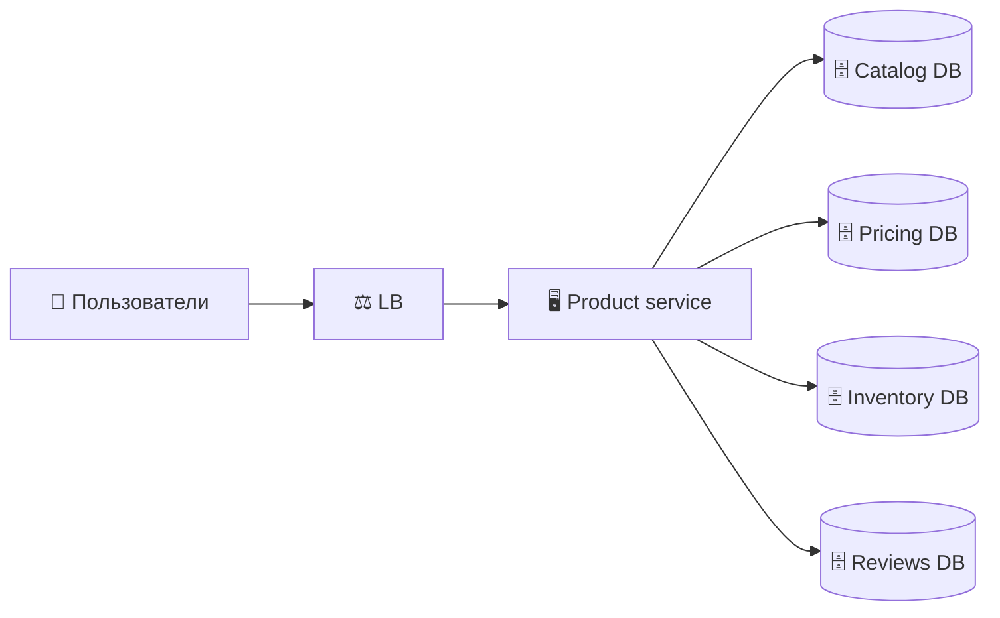
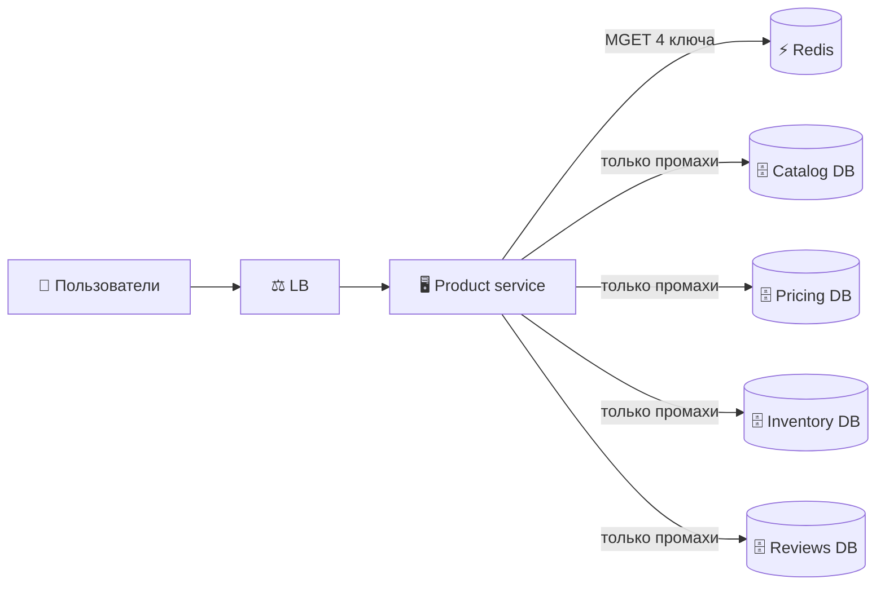
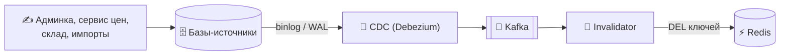
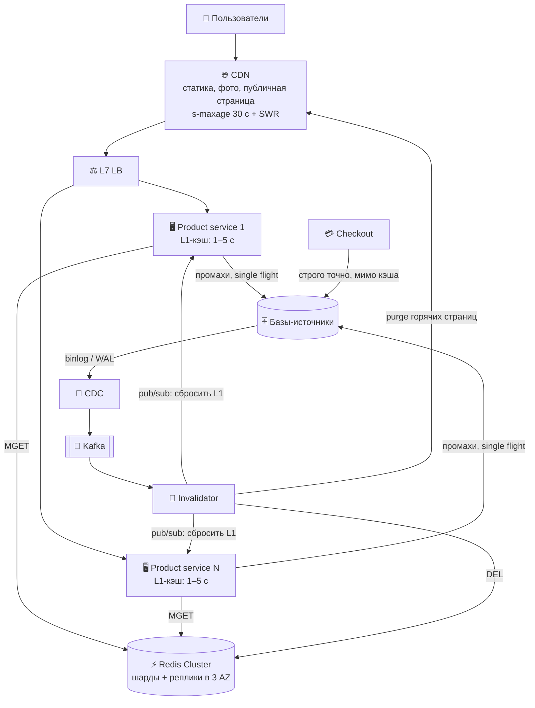
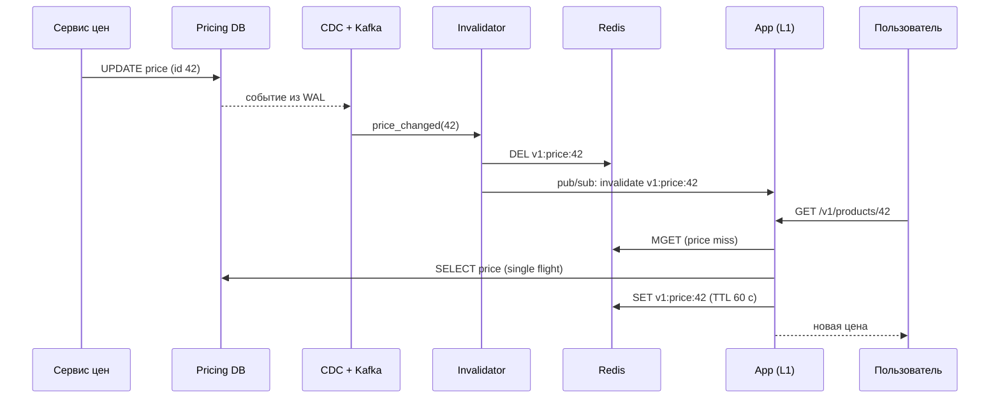
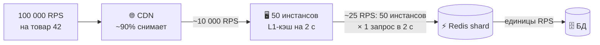

[English](INTERVIEW.md) | **Русский** · Теория: [README_RU.md](./README_RU.md)

# 02. Caching: кэширующий слой для страницы товара

> **Тема:** cache-aside, TTL, вытеснение, инвалидация, cache stampede, горячие ключи, многоуровневый кэш
> **Уровень:** Medium–Hard · **Время на интервью:** 45 мин · **Время на разбор:** ~4 ч
> **Где спрашивают:** как отдельный вопрос («спроектируй кэш для…») и как deep dive почти в любой read-heavy задаче

---

## 🗺️ Как читать этот разбор

| Значок | Что значит |
|:------:|:-----------|
| 🎤 | Реплика интервьюера |
| 🗣️ | Что говорю вслух я (кандидат) |
| ✏️ | Что рисую на доске |
| ⏱️ | Сколько времени тратить на шаг |

Блоки **TIP** — хороший приём, **WARNING** — ловушка, **IMPORTANT** — сигнал для уровня Senior+.

---

## 📑 Содержание

1. [Условие задачи](#1-условие-задачи)
2. [Уточняющие вопросы и требования](#2-уточняющие-вопросы-и-требования)
3. [Оценки нагрузки](#3-оценки-нагрузки)
4. [API](#4-api)
5. [Модель данных и ключи кэша](#5-модель-данных-и-ключи-кэша)
6. [High-level дизайн: эволюция по этапам](#6-high-level-дизайн-эволюция-по-этапам)
7. [Deep dive 1: выбор паттерна и TTL для каждого типа данных](#7-deep-dive-1-выбор-паттерна-и-ttl-для-каждого-типа-данных)
8. [Deep dive 2: инвалидация](#8-deep-dive-2-инвалидация)
9. [Deep dive 3: распродажа, горячие ключи и stampede](#9-deep-dive-3-распродажа-горячие-ключи-и-stampede)
10. [Deep dive 4: размер, вытеснение и кластер Redis](#10-deep-dive-4-размер-вытеснение-и-кластер-redis)
11. [Узкие места и сценарии сбоев](#11-узкие-места-и-сценарии-сбоев)
12. [Что изменится при росте в 10 раз](#12-что-изменится-при-росте-в-10-раз)
13. [Вопросы интервьюера с ответами](#13-вопросы-интервьюера-с-ответами)
14. [Типичные ошибки](#14-типичные-ошибки)
15. [Шпаргалка и самопроверка](#15-шпаргалка-и-самопроверка)

---

## 1. Условие задачи

> 🎤 «У нас крупный интернет-магазин. Страница товара сейчас собирается из нескольких запросов к базе и отвечает за 400 мс, а во время распродаж база не выдерживает. Спроектируй кэширующий слой для страницы товара».

**План по времени:**

| Шаг | ⏱️ |
|:----|:--:|
| Требования | 5 мин |
| Оценки | 5 мин |
| API, данные, ключи | 5 мин |
| High-level дизайн | 10 мин |
| Deep dives | 15 мин |
| Сбои и итоги | 5 мин |

> [!TIP]
> «Спроектируй кэш» — это прежде всего вопрос о **данных**: какие из них насколько могут устаревать. Начни с разбиения страницы на части с разными требованиями к свежести. Это сразу показывает зрелость.

---

## 2. Уточняющие вопросы и требования

⏱️ 5 мин

| Мой вопрос | Ответ интервьюера | Что это меняет |
|:-----------|:------------------|:---------------|
| Из чего состоит страница товара? | Описание и фото, цена, наличие, сводка отзывов, рекомендации | У частей разные требования к свежести → разные TTL и стратегии |
| Насколько свежими должны быть цена и наличие? | Цена — в течение нескольких секунд; при оформлении заказа — строго точная | Страница может быть чуть устаревшей, checkout читает источник правды |
| Соотношение чтения и записи? | ~1000:1, товары меняются редко | Кэш даст очень высокий hit rate |
| Сколько товаров и как распределён трафик? | 100 млн товаров, малая доля популярных получает большую часть просмотров | Не нужно кэшировать всё; важен working set |
| Кто меняет данные о товарах? | Админка, сервис цен, складская система, массовые импорты | Инвалидация из приложения не поймает всё → нужен CDC |
| Что происходит на распродажах? | Трафик ×5, отдельные товары получают огромный трафик | Горячие ключи и stampede — главные риски |
| Есть персонализация на странице? | Рекомендации персональные, остальное общее | Общие части кэшируются для всех, персональные отдельно |

### Функциональные требования

1. Отдать страницу товара: описание, фото, цена, наличие, сводка отзывов.
2. Изменения цены и наличия отражаются на странице в течение нескольких секунд.
3. Оформление заказа всегда видит точную цену и остаток.

**Вне рамок:** поиск, корзина, сам процесс оплаты, генерация рекомендаций (считаем, что это отдельный сервис).

### Нефункциональные требования

| Требование | Цель |
|:-----------|:-----|
| Latency | p99 < 100 мс на страницу товара (сейчас 400 мс) |
| Нагрузка на БД | Снизить в 20+ раз; БД должна пережить распродажу |
| Свежесть | Описание — минуты; цена и наличие — ≤ 5 с; checkout — строго точно |
| Доступность | 99,95%; падение кэша не должно ронять сайт |
| Пики | ×5 к среднему, отдельные товары — десятки тысяч запросов в секунду |

> [!IMPORTANT]
> **Сигнал Senior+:** явно отдели **отображение** (может быть eventually consistent) от **транзакций** (checkout читает источник правды). Это снимает с кэша невыполнимое требование строгой консистентности.

---

## 3. Оценки нагрузки

⏱️ 5 мин

✏️

```
DAU                         = 50M
Просмотров товаров на юзера = 30/день  → 1,5B просмотров/день

1 день ≈ 10^5 сек
QPS страницы (средн.)  = 1,5B / 10^5 ≈ 15 000
QPS страницы (пик ×5)  ≈ 75 000

Обращений к кэшу на страницу: ~4 ключа (товар, цена, наличие, отзывы)
Операций к кэшу в пике  ≈ 75 000 × 4 = 300 000 ops/s (с MGET — меньше запросов)

Каталог: 100M товаров × ~5 КБ ≈ 500 ГБ
Горячий набор: ~10% товаров дают ~90% просмотров → 10M × 5 КБ ≈ 50 ГБ
С накладными расходами Redis (~1,5×) ≈ 75 ГБ, с репликой ≈ 150 ГБ памяти
```

🗣️ **Выводы:**

- **Без кэша** база получила бы 75 000 запросов страниц в секунду, а каждая страница — это несколько SQL-запросов. Не выдержит.
- **При hit rate 95%** до БД дойдёт ~3 750 страниц/с, при **99%** — ~750. Целюсь в 99% для горячих данных.
- **Весь каталог кэшировать не нужно:** горячий набор ~50 ГБ полезных данных помещается в небольшой кластер Redis.
- **Пропускная способность:** один узел Redis держит порядка 100 000+ простых операций в секунду, значит, нужно несколько шардов. Но главный риск не в среднем, а в **горячих ключах**: один товар на распродаже может дать 50 000+ запросов в секунду на **один** шард.

---

## 4. API

⏱️ 2 мин

```http
GET /v1/products/{product_id}
→ 200 {
    product:  { id, title, description, images[], attributes },
    price:    { amount, currency, updated_at },
    stock:    { status: "in_stock" | "low" | "out_of_stock" },
    reviews:  { rating, count }
  }
Headers ответа: Cache-Control: public, s-maxage=30, stale-while-revalidate=60
                ETag: "<версия>"

GET /v1/products/{product_id}/recommendations?user_id=...   (персональное, отдельно)

# Внутренний API, используется только checkout
GET /internal/v1/products/{product_id}/price-and-stock?consistent=true
→ читает источник правды, кэш не используется
```

🗣️ Три решения:

1. **Персональные рекомендации — отдельным запросом.** Основная страница одинакова для всех, поэтому её можно кэшировать на CDN.
2. **Наличие отдаётся как статус**, а не точное число. «В наличии» меняется намного реже, чем «осталось 1 437 шт.», и кэшируется лучше.
3. **Checkout ходит в отдельный эндпоинт мимо кэша.** Строгая точность только там, где она нужна.

---

## 5. Модель данных и ключи кэша

⏱️ 3 мин

**Источники правды:**

| Данные | Где хранятся | Кто меняет | Как часто |
|:-------|:-------------|:-----------|:----------|
| Описание, фото, атрибуты | Catalog DB (PostgreSQL) | Админка, импорты | Редко |
| Цена | Pricing DB | Сервис цен | Иногда; на распродаже массово |
| Остатки | Inventory DB | Складская система, заказы | Часто |
| Сводка отзывов | Reviews DB (агрегат) | Пересчёт раз в N минут | Редко |

**Ключи кэша:**

```
v1:product:{id}        → описание, фото, атрибуты     TTL 1 ч  ± jitter
v1:price:{id}          → цена                          TTL 60 с ± jitter
v1:stock:{id}          → статус наличия                TTL 10 с ± jitter
v1:reviews:{id}        → рейтинг и число отзывов       TTL 15 мин
v1:notfound:product:{id} → маркер «товара нет»         TTL 60 с
```

🗣️ «Разбиваю страницу на независимые ключи с разными TTL, а не кэширую страницу целиком. Иначе любое изменение остатка инвалидировало бы и описание, которое меняется раз в месяц. Версия `v1` в префиксе позволяет сменить формат без сброса кэша вручную».

---

## 6. High-level дизайн: эволюция по этапам

⏱️ 10 мин

### Этап 0. Сейчас: без кэша

✏️



**Проблемы:** 4+ запроса в разные БД на каждую страницу, 400 мс, на распродаже базы перегружены.

### Этап 1. Cache-aside поверх Redis

✏️



🗣️ «Один `MGET` на 4 ключа, промахи догружаем из баз параллельно и кладём в кэш. Hit rate высокий, latency падает до единиц миллисекунд на кэш».

**Проблемы:** свежесть цен держится только на TTL; изменения из других систем не видны до истечения; горячие ключи на распродаже перегружают один шард.

### Этап 2. Инвалидация через CDC

✏️



🗣️ «Изменения читаются из лога баз, поэтому ловим **любые** записи, включая массовые импорты и правки других команд. Invalidator удаляет соответствующие ключи. TTL остаётся страховкой».

### Этап 3. Финальная схема: CDN + L1 + Redis Cluster + CDC

✏️



🗣️ «Итог — три уровня кэша:
- **CDN** снимает основную массу трафика для публичной части страницы, `stale-while-revalidate` прячет обновления от пользователя;
- **L1** в каждом инстансе с TTL в секунды защищает Redis от горячих ключей;
- **Redis Cluster** — общий кэш с репликами.

Инвалидация идёт из CDC во все три уровня. Checkout всегда читает источник правды».

---

## 7. Deep dive 1: выбор паттерна и TTL для каждого типа данных

> 🎤 «Почему cache-aside, а не write-through?»

🗣️ «Записи приходят из многих систем, которые я не контролирую: склад, импорты, сервис цен. Write-through требует, чтобы все записи шли через кэш, а это невозможно. Cache-aside + CDC-инвалидация работает с любым источником записи. Кроме того, при падении кэша cache-aside деградирует плавно: просто больше запросов в БД».

| Данные | Паттерн | TTL | Допустимая устарелость | Почему |
|:-------|:--------|:---:|:----------------------:|:-------|
| Описание, фото | Cache-aside + CDC | 1 ч | Минуты | Меняется редко, большой объём |
| Цена | Cache-aside + CDC | 60 с | ≤ 5 с (CDC), 60 с в худшем случае | Нужна свежесть, но checkout всё равно проверяет |
| Наличие (статус) | Cache-aside + CDC | 10 с | Секунды | Часто меняется, но статус грубый |
| Сводка отзывов | Cache-aside или refresh-ahead | 15 мин | Минуты | Пересчитывается пачками |
| Счётчик просмотров | Write-back (INCR в Redis, сброс в БД раз в минуту) | — | Минуты | Потеря части счётчика допустима |
| «Товар не найден» | Negative caching | 60 с | — | Защита от перебора ID |

> [!WARNING]
> Не показывай пользователю точное число остатков из кэша, если по нему принимаются решения. Пусть кэш показывает статус, а **резервирование товара при заказе** идёт через источник правды с атомарной операцией.

---

## 8. Deep dive 2: инвалидация

> 🎤 «Сервис цен поменял цену. Как она попадёт на страницу?»



🗣️ «Обычно от UPDATE до удаления ключа проходит от десятков до сотен миллисекунд. Это укладывается в требование ≤ 5 с».

> 🎤 «А какие гонки здесь возможны?»

🗣️ «Классическая гонка cache-aside: читатель промахнулся, прочитал старую цену из реплики или из БД, в это время пришло обновление и удаление ключа, а потом читатель записал в кэш старое значение. Защиты:
1. **Версия в значении.** В кэше хранится `{price, version}`, где version — версия строки или LSN из БД. Запись в кэш делается Lua-скриптом: только если версия новее текущей.
2. **Не читать с отстающих реплик** при заполнении кэша цен — или учитывать лаг.
3. **TTL 60 с** ограничивает время жизни ошибки в худшем случае».

> [!IMPORTANT]
> **Сигнал Senior+:** назови, что будет при **сбое** инвалидации (Kafka отстаёт, invalidator лежит). Ответ: TTL ограничивает устарелость; мониторим лаг консьюмера; при большом лаге можно временно уменьшить TTL цен.

---

## 9. Deep dive 3: распродажа, горячие ключи и stampede

> 🎤 «Начинается распродажа, один товар получает 100 000 запросов в секунду. Что произойдёт?»

🗣️ «Без защиты будет две проблемы:
1. **Горячий ключ:** все запросы к `v1:product:42` идут на один шард Redis, и он упирается в CPU или сеть.
2. **Stampede:** при истечении ключа тысячи запросов одновременно пойдут в БД».

### Защита от горячих ключей: многоуровневый кэш

✏️



| Уровень | Что делает | Нагрузка дальше |
|:--------|:-----------|:----------------|
| CDN | Отдаёт публичную часть страницы, `stale-while-revalidate` | Падает на порядок |
| L1 (in-process, TTL 1–5 с) | Каждый инстанс ходит в Redis за горячим ключом раз в несколько секунд | Не больше «число инстансов / TTL» запросов в секунду |
| Redis | Общий кэш | Единицы запросов в секунду на ключ |

Если L1 недостаточно (например, сам ключ часто меняется), дополнительно:
- **реплицировать ключ:** `v1:product:42#1` … `#8` на разных шардах, читать случайную копию;
- **читать с реплик Redis** для горячего шарда.

### Защита от stampede

| Механизм | Где | Как работает |
|:---------|:----|:-------------|
| **Single flight** | В каждом инстансе | Параллельные промахи по одному ключу ждут один запрос в БД |
| **Распределённый лок** | Redis | `SET v1:lock:product:42 NX EX 5`: в БД идёт только взявший лок, остальные отдают старое значение или ждут |
| **Stale-while-revalidate** | L1 и CDN | Отдаём устаревшее значение, обновляем в фоне |
| **Refresh-ahead** | Для заранее известных товаров распродажи | Фоновый процесс обновляет ключи до истечения |
| **Прогрев** | Перед стартом распродажи | Список товаров известен → загрузить в кэш заранее |

> [!TIP]
> Распродажи **планируются**. Сильный ответ: «Список товаров распродажи известен заранее. За 10 минут до старта прогреваю кэш, включаю refresh-ahead для этих ключей и временно увеличиваю число инстансов». Это показывает, что ты думаешь об эксплуатации, а не только об архитектуре.

---

## 10. Deep dive 4: размер, вытеснение и кластер Redis

> 🎤 «Какого размера кластер и что будет, когда память закончится?»

🗣️ **Размер:**
- горячий набор ≈ 50 ГБ полезных данных, с накладными расходами ≈ 75 ГБ;
- беру 6 шардов по ~25 ГБ памяти (запас на рост и фрагментацию), у каждого шарда 1 реплика в другой AZ;
- по пропускной способности: 300 000 ops/s в пике / 6 шардов ≈ 50 000 ops/s на шард — с запасом, а `MGET` сокращает число запросов.

🗣️ **Вытеснение:** `maxmemory-policy allkeys-lfu`. Трафик сильно перекошен и популярность товаров стабильна в течение дня, поэтому LFU удерживает горячие ключи лучше, чем LRU. LRU уязвим к «сканированию»: например, краулер обходит миллионы редких товаров и вымывает популярные.

> [!WARNING]
> Связанные ключи (`v1:product:42`, `v1:price:42`, `v1:stock:42`) в Redis Cluster попадут на разные шарды, и `MGET` между слотами не сработает. Варианты: hash tag `{42}` в ключах (`v1:{42}:product`, `v1:{42}:price`) — тогда все ключи товара на одном шарде и `MGET` работает; или параллельные запросы к нескольким шардам на клиенте.

| Параметр | Решение |
|:---------|:--------|
| Топология | Redis Cluster, 6 мастеров + 6 реплик в 3 AZ |
| Вытеснение | `allkeys-lfu` |
| Персистентность | Не нужна для корректности; RDB-снапшоты для быстрого прогрева после аварии |
| Таймауты клиента | 10–20 мс; медленный кэш хуже отсутствующего |
| Клиент | Пул соединений, pipelining, `MGET` |

---

## 11. Узкие места и сценарии сбоев

⏱️ 4 мин

| Сценарий | Что произойдёт | Как защищаемся |
|:---------|:---------------|:---------------|
| Упал мастер шарда Redis | Ключи шарда недоступны несколько секунд | Автоматический failover на реплику; на это время промахи идут в БД с single flight |
| Упал весь Redis-кластер | Вся нагрузка в БД → avalanche | L1 и CDN продолжают отдавать горячее; circuit breaker на вызовы кэша; rate limiting перед БД; деградация (без отзывов и рекомендаций) |
| Массовое истечение после прогрева | Avalanche | Jitter в TTL |
| Перебор несуществующих ID | Penetration: каждый запрос в БД | Negative caching, Bloom filter по существующим ID, rate limiting |
| CDC/Kafka отстаёт | Цены на странице устаревают | TTL как страховка; алерт на лаг консьюмера; временно уменьшить TTL цен |
| Гонка при заполнении кэша | Старая цена в кэше | Версия в значении + условная запись (Lua); TTL |
| Горячий ключ | Перегрузка одного шарда | L1, репликация ключа, чтение с реплик |
| Деплой нового формата значения | Старые инстансы не понимают новые значения | Версия в префиксе ключа (`v2:`), постепенный переход |
| Медленный Redis | Растёт latency всей страницы | Короткие таймауты, при таймауте — fallback в БД с ограничением |

---

## 12. Что изменится при росте в 10 раз

> 🎤 «А если 500 миллионов DAU по всему миру?»

🗣️ «Пик ~750 000 страниц в секунду. Что меняется:
1. **Региональные кэш-кластеры** рядом с пользователями. Инвалидация рассылается во все регионы через межрегиональную репликацию Kafka.
2. **CDN становится главным уровнем:** больше контента отдаётся с edge, в том числе через edge-вычисления, которые собирают страницу из кэшированных частей.
3. **Отдельные кластеры под разные данные:** каталог (большой, редко меняется) и цены и остатки (маленькие, часто меняются) масштабируются и настраиваются независимо.
4. **Автоматическое обнаружение горячих ключей** и их автоматическое продвижение в L1 и репликацию.
5. **Предсказание прогрева:** перед локальными распродажами в каждом регионе».

---

## 13. Вопросы интервьюера с ответами

<details>
<summary><b>Почему кэшировать части страницы, а не страницу целиком?</b></summary>

У частей разная частота изменений: описание меняется раз в месяц, наличие — каждые секунды. Кэш целой страницы пришлось бы инвалидировать при каждом изменении остатка, и hit rate для описания упал бы. Отдельные ключи позволяют задать каждому свой TTL и инвалидировать точечно. Целиком можно кэшировать только на CDN с коротким TTL и stale-while-revalidate.
</details>

<details>
<summary><b>Почему не инвалидировать кэш прямо в сервисе цен после UPDATE?</b></summary>

Можно, но это ловит только записи через этот сервис. Массовые импорты, миграции, правки других команд и ручные изменения в БД пройдут мимо. Кроме того, если удаление ключа не выполнится (сбой сети между записью и удалением), никто не узнает. CDC читает лог базы и видит все изменения в порядке коммитов.
</details>

<details>
<summary><b>Как гарантировать, что пользователь не купит товар по старой цене?</b></summary>

Checkout не использует кэш: он читает цену из источника правды и показывает пользователю итог перед оплатой. Если цена отличается от той, что была на странице, пользователь видит актуальную цену и подтверждает её. Кэш отвечает только за отображение.
</details>

<details>
<summary><b>Почему L1-кэш не ломает консистентность?</b></summary>

Ломает, но в известных пределах: L1 имеет TTL в 1–5 секунд и дополнительно сбрасывается сообщением через pub/sub при инвалидации. Максимальная устарелость — несколько секунд, что укладывается в требования. Для данных, где и это недопустимо, L1 не используется.
</details>

<details>
<summary><b>LRU или LFU для этого кэша?</b></summary>

LFU: популярность товаров сильно перекошена и стабильна в течение дня. LRU вымывается при сканировании — когда краулер или пакетная задача проходит по миллионам редких товаров, они вытесняют популярные. LFU помнит частоту и удерживает горячие ключи. Для распродаж с резкой сменой популярности помогает прогрев.
</details>

<details>
<summary><b>Что делать, если Redis отвечает медленно?</b></summary>

Короткие таймауты (10–20 мс): медленный кэш хуже отсутствующего, потому что занимает потоки и соединения. При таймауте — fallback в БД через single flight и с ограничением скорости. Circuit breaker: если ошибок много, временно не ходить в кэш. Параллельно — разбираться с причиной: горячий ключ, большой ключ, нехватка памяти, медленная команда.
</details>

---

## 14. Типичные ошибки

| ❌ Ошибка | ✅ Как правильно |
|:---------|:----------------|
| Кэшировать страницу целиком с одним TTL | Разбить на части с разной свежестью |
| Пытаться сделать кэш строго консистентным | Отображение — eventual, транзакции читают источник правды |
| Инвалидировать только из одного сервиса | CDC ловит все изменения |
| Обновлять ключ при записи вместо удаления | Удалять ключ; при заполнении — проверять версию |
| Одинаковый TTL для всех ключей | Jitter |
| Забыть про горячие ключи на распродаже | CDN + L1 + репликация ключа + прогрев |
| Не продумать падение кэша | Circuit breaker, rate limiting перед БД, деградация |
| `noeviction` или LRU без анализа нагрузки | LFU для стабильно перекошенного трафика |
| `MGET` по ключам на разных слотах Redis Cluster | Hash tags или параллельные запросы |

---

## 15. Шпаргалка и самопроверка

### Ответ за 30 секунд

> Разбиваю страницу на части с разной свежестью и кэширую каждую отдельным ключом в Redis по схеме cache-aside, с TTL и jitter. Инвалидация идёт через CDC из логов баз, TTL — страховка. Три уровня: CDN со stale-while-revalidate для публичной части, локальный L1 на секунды для горячих ключей, Redis Cluster с репликами в 3 AZ и политикой LFU. От stampede — single flight, локи и прогрев перед распродажей, от перебора ID — negative caching. Checkout всегда читает источник правды, а кэш отвечает только за отображение.

### Самопроверка

- [ ] Могу разбить страницу на части по требованиям к свежести и обосновать TTL каждой
- [ ] Могу объяснить, почему cache-aside + CDC лучше write-through, когда пишут много систем
- [ ] Могу нарисовать гонку cache-aside и назвать 3 способа защиты
- [ ] Могу посчитать размер кэша и число шардов по working set и QPS
- [ ] Могу объяснить защиту от горячего ключа через CDN + L1 + репликацию и посчитать нагрузку на Redis
- [ ] Знаю 4+ способа защиты от stampede
- [ ] Могу объяснить, что будет при падении всего кэша и как защитить БД
- [ ] Могу объяснить, где кэш недопустим (checkout) и почему

### Что почитать

- Теория по теме: [README_RU.md](./README_RU.md)
- *Scaling Memcache at Facebook* (NSDI 2013)
- Vattani et al., *Optimal Probabilistic Cache Stampede Prevention* (VLDB 2015)
- Документация Redis Cluster: hash slots и hash tags
- Документация Debezium: CDC из PostgreSQL и MySQL