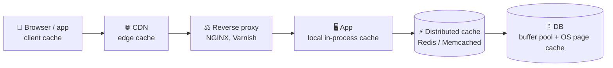
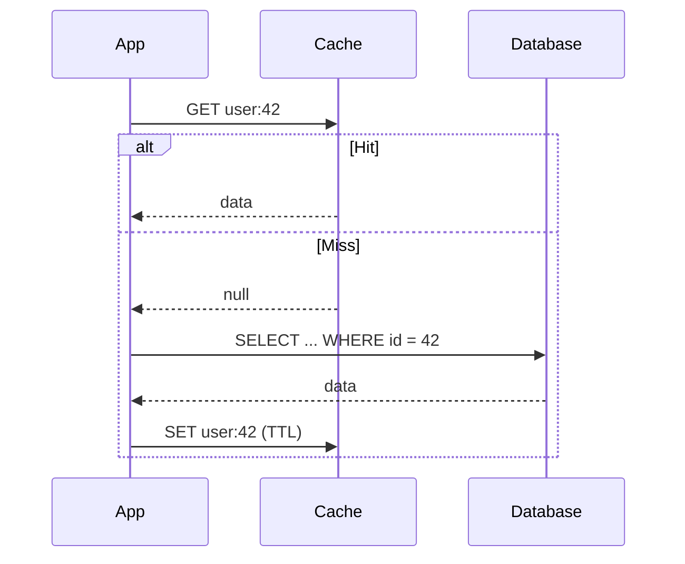
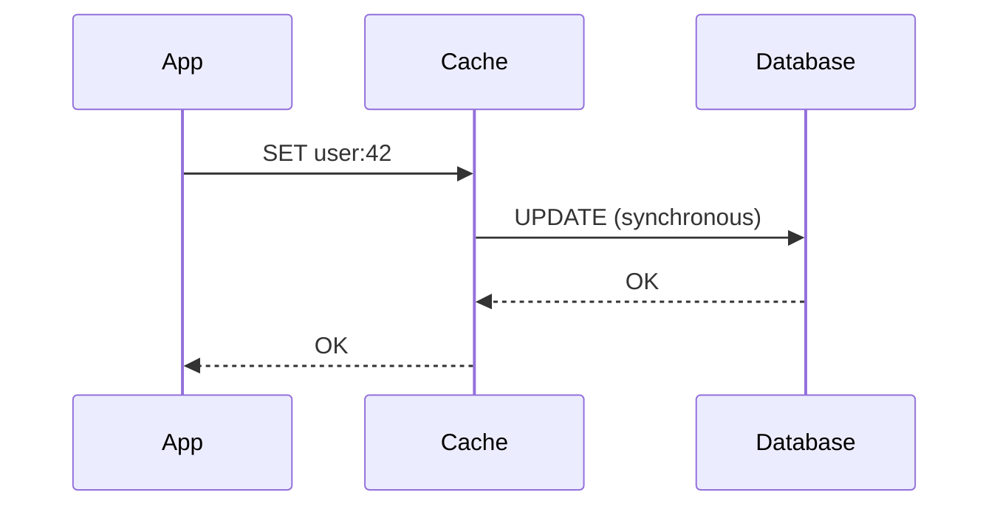
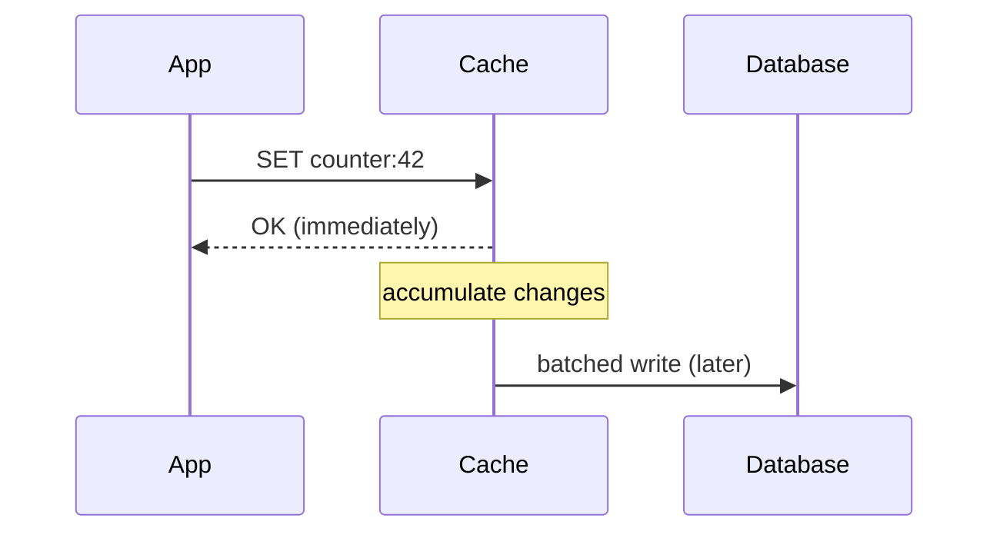
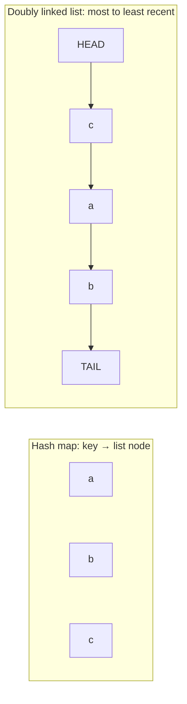
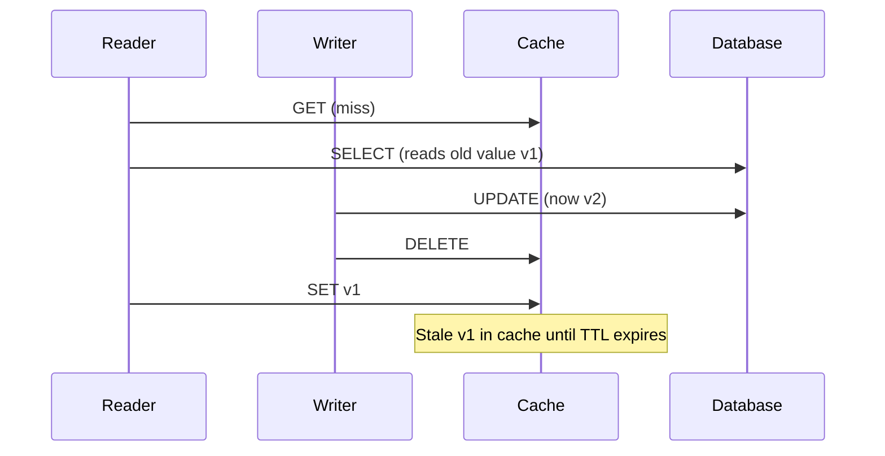
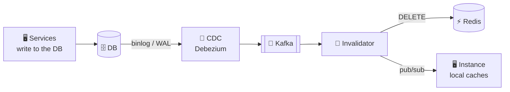
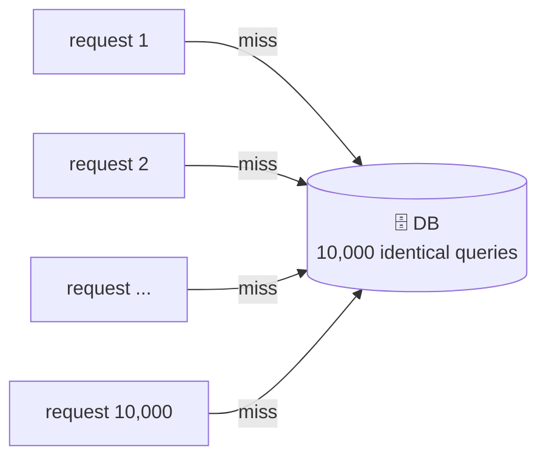

**English** | [Русский](README_RU.md)

# 02. Caching

> **Covers:** cache-aside, read-through, write-through, write-back, TTL, eviction (LRU/LFU), invalidation, cache stampede, hot keys
> **Study time:** ~4 h · **Needed for:** almost every read-heavy problem
> **Practice:** interview-style walkthrough — [INTERVIEW.md](./INTERVIEW.md)

---

## 📑 Contents

1. [What a Cache Is and Why You Need One](#1-what-a-cache-is-and-why-you-need-one)
2. [Hit Rate: The Key Metric](#2-hit-rate-the-key-metric)
3. [Where to Cache: Cache Layers](#3-where-to-cache-cache-layers)
4. [Read and Write Patterns](#4-read-and-write-patterns)
5. [TTL: Time to Live](#5-ttl-time-to-live)
6. [Eviction: LRU, LFU and Others](#6-eviction-lru-lfu-and-others)
7. [Invalidation](#7-invalidation)
8. [Common Problems: Stampede, Penetration, Avalanche, Hot Keys](#8-common-problems-stampede-penetration-avalanche-hot-keys)
9. [Distributed Cache: Redis and Memcached](#9-distributed-cache-redis-and-memcached)
10. [HTTP and CDN Caching](#10-http-and-cdn-caching)
11. [What to Cache and How to Design Keys](#11-what-to-cache-and-how-to-design-keys)
12. [Metrics and Operations](#12-metrics-and-operations)
13. [How to Talk About This in an Interview](#13-how-to-talk-about-this-in-an-interview)
14. [Self-Check Questions](#14-self-check-questions)
15. [Glossary and Resources](#15-glossary-and-resources)

---

## 1. What a Cache Is and Why You Need One

A **cache** is fast storage holding a copy of data that's expensive to get again: from a database, another service, or a computation.

A cache solves three problems:

| Goal | How the cache helps |
|:-----|:--------------------|
| **Lower latency** | Reading from RAM takes ~100 ns, from Redis over the network ~0.5 ms, from a DB on disk — milliseconds or more |
| **Lower load** | Every request served from cache never reaches the DB. The same hardware serves more traffic |
| **Lower cost** | An in-memory cache is cheaper than scaling the database or paying for repeated external API calls |

> [!IMPORTANT]
> A cache is a **copy**, not the source of truth. Its data may be stale or disappear at any moment. The system must stay correct (if slower) even when the cache is empty.

**Analogy:** a chef keeps the most-used spices right next to the stove (the cache) instead of walking to the storeroom (the DB) each time. Space by the stove is limited, so only the most frequently used items are there. And if a new batch arrives in the storeroom, the spices by the stove may be the old ones.

### When a cache helps and when it doesn't

| ✅ Helps | ❌ Barely useful |
|:--------|:----------------|
| Read-heavy load (far more reads than writes) | Write-heavy load, data constantly changes |
| Skewed access: a small part of the data gets most requests | Uniform access (each key is read once) |
| Expensive computations or slow sources | Data that must be strictly fresh on every read |
| Some staleness is acceptable | Each user sees unique data nobody else reads |

---

## 2. Hit Rate: The Key Metric

**Hit** — the data was found in the cache. **Miss** — it wasn't, so we went to the source.

```
Hit rate = hits / (hits + misses)
```

**Average latency:**

```
T = h × T_cache + (1 − h) × (T_cache + T_db)
```

Example: T_cache = 1 ms, T_db = 20 ms.

| Hit rate | Average latency | Share of requests reaching the DB |
|:--------:|:---------------:|:---------------------------------:|
| 80% | 5 ms | 20% |
| 90% | 3 ms | 10% |
| 99% | 1.2 ms | 1% |

> [!TIP]
> Going from 90% to 99% hit rate looks like "+9%", but database load drops **10×** (from 10% to 1% of requests). That's why in interviews you talk about the miss rate, not just the hit rate.

### What hit rate depends on

- **Access distribution.** Real traffic is usually close to a Zipf distribution: a small share of keys gets most requests. The stronger the skew, the higher the hit rate for the same cache size.
- **Cache size relative to the working set** (the data actually accessed).
- **TTL:** a short TTL means more misses.
- **Eviction policy:** how well it predicts what will be needed again.
- **Cold start:** an empty cache after a restart or deploy.

---

## 3. Where to Cache: Cache Layers

Caching is almost always multi-level. The closer to the user, the faster and the less control you have.



| Layer | What's cached | Latency | Pros | Cons |
|:------|:--------------|:-------:|:-----|:-----|
| Client (browser, mobile app) | Static assets, API responses | ~0 | Request never hits the network | Can't be forcibly cleared |
| CDN | Static assets, images, video, public API responses | 5–50 ms | Close to users, offloads huge traffic | Public data only; purges take time |
| Reverse proxy | Whole HTTP responses | <1 ms from proxy | Transparent to the app | Hard with personalized responses |
| Local in-process cache | Hot objects, configs, reference data | ~100 ns | Fastest, no network | Each instance has its own; hard to invalidate; uses app memory |
| Distributed cache | Objects, sessions, query results | ~0.5–1 ms | Shared by all instances, large capacity | Network hop, separate infrastructure |
| Inside the DB | Data pages, query plans | — | Automatic | Not controlled by the app |

> [!NOTE]
> A common setup in large systems: **L1** — a small local cache with a short TTL (seconds) for the hottest keys, **L2** — Redis for everything else. L1 offloads Redis and protects against hot keys.

---

## 4. Read and Write Patterns

### Cache-aside (lazy loading)

The most common pattern. The application manages the cache itself.

**Read:** check the cache → on a miss, read from the DB → put it in the cache → return.
**Write:** write to the DB → **delete** the key from the cache.



```python
def get_user(user_id):
    key = f"user:{user_id}"
    data = cache.get(key)
    if data is not None:
        return data                      # hit
    data = db.query_user(user_id)        # miss
    cache.set(key, data, ttl=300)
    return data

def update_user(user_id, fields):
    db.update_user(user_id, fields)      # 1. source of truth first
    cache.delete(f"user:{user_id}")      # 2. then delete, don't update
```

- ✅ Only data that's actually read gets cached. A cache outage doesn't break the system.
- ❌ The first request is always a miss. Staleness and races are possible (see [section 7](#7-invalidation)).

### Read-through

Like cache-aside, but loading from the DB is done by **the cache itself** (a library or cache service), and the application talks only to the cache.

- ✅ Loading logic lives in one place; simpler app code.
- ❌ Requires a library or cache that supports it (e.g. Caffeine `LoadingCache`, DAX for DynamoDB).

### Write-through

Writes go **through the cache**: the cache synchronously writes to the DB and updates itself.



- ✅ The cache is always fresh for written data. A read right after a write is a hit.
- ❌ Slower writes (two operations). The cache fills with data that may never be read. Usually paired with read-through.

### Write-back (write-behind)

Writes go to the cache, and to the DB **asynchronously**, later, often in batches.



- ✅ Very fast writes, smooths spikes, less DB load (many updates to one key become one write).
- ❌ **Risk of data loss** if the cache fails before flushing to the DB. Harder consistency.
- **Where it fits:** view and like counters, metrics, analytics — where losing some updates is acceptable.

### Write-around

Writes go **only to the DB**; the cache isn't touched (or the key is deleted). Data enters the cache on the next read.

- ✅ The cache isn't polluted with data that's written but rarely read (logs, archives).
- ❌ A read right after a write is a miss.

### Refresh-ahead

The cache refreshes popular keys **before** their TTL expires.

- ✅ Hot keys never expire, no miss spikes.
- ❌ Extra load if the prediction is wrong.

### Comparison

| Pattern | Who reads the DB | Write speed | Freshness | Data loss risk | Typical use |
|:--------|:-----------------|:-----------:|:---------:|:--------------:|:------------|
| Cache-aside | The app | Normal | Staleness possible | No | Default for most systems |
| Read-through | The cache | — | Same as cache-aside | No | When a library supports it |
| Write-through | The cache, synchronously | Slower | High | No | Data read right after writing |
| Write-back | The cache, asynchronously | Very fast | High in cache | **Yes** | Counters, metrics |
| Write-around | The app | Normal | High (cache holds nothing stale) | No | Data rarely read after writing |
| Refresh-ahead | The cache, proactively | — | High for hot keys | No | Hot keys with predictable access |

> [!TIP]
> The default interview answer is **cache-aside + delete the key on write + TTL as a safety net**. Mention other patterns when the problem has a specific trait: write-back for counters, refresh-ahead for hot keys.

---

## 5. TTL: Time to Live

**TTL (time to live)** — how long until a key is automatically removed.

### Choosing a TTL

| Data | Example TTL | Why |
|:-----|:-----------:|:----|
| Reference data, configs | Hours–a day | Rarely changes |
| User profile, product details | Minutes | Changes sometimes; invalidated on write |
| Prices, stock, feeds | Seconds | Freshness matters |
| Expensive computations (recommendations) | Hours | Recomputed offline |
| Sessions | Session lifetime | Security |

> [!IMPORTANT]
> TTL is a **safety net**, not the main freshness mechanism. Even with explicit invalidation, set a TTL: if a key deletion gets lost (a bug, a network failure), stale data still expires on its own.

### TTL with jitter

If many keys get the same TTL at the same time (e.g. after a cache warm-up), they expire **at the same time**, and all requests hit the DB at once (cache avalanche).

```python
ttl = 300 + random.randint(0, 60)   # 5–6 minutes instead of exactly 5
```

### Expiration types

- **Absolute TTL:** the key lives N seconds from when it was written.
- **Sliding TTL:** the TTL is extended on every read. Good for sessions.
- **Negative caching:** cache the **absence** of data ("no such user") with a short TTL. Protects against cache penetration (see [section 8](#8-common-problems-stampede-penetration-avalanche-hot-keys)).

---

## 6. Eviction: LRU, LFU and Others

Cache memory is limited. When it fills up, you must decide **what to remove**.

| Policy | What it removes | Pros | Cons |
|:-------|:----------------|:-----|:-----|
| **LRU** (Least Recently Used) | What hasn't been accessed for the longest time | Simple, works well for most workloads | One scan over lots of data flushes out hot keys |
| **LFU** (Least Frequently Used) | What has been accessed least often | Protects consistently popular keys | Formerly popular keys get "stuck"; counters need decay |
| **FIFO** | The oldest by insertion time | Very simple | Ignores popularity |
| **Random** | A random key | No overhead | Unpredictable |
| **TTL-based** | Keys closest to expiry | Logical for TTL'd data | Only for keys with a TTL |
| **ARC** | Adaptively balances recency and frequency | Good hit rate on mixed workloads | More complex |
| **W-TinyLFU** | LRU window + a frequency filter on admission | One of the best hit rates in practice (Caffeine) | More complex to implement |

### How an O(1) LRU works

A classic interview question: a hash map + a doubly linked list.



- **get:** find the node via the hash map, move it to the head of the list.
- **put:** add the node at the head; if full, remove the node at the tail (least recently used).
- All operations are O(1).

### Eviction in Redis

When Redis reaches `maxmemory`, it follows `maxmemory-policy`:

| Policy | Behavior |
|:-------|:---------|
| `noeviction` | Rejects writes (the default). **Not suitable** for a cache |
| `allkeys-lru` | Approximate LRU across all keys. A good cache default |
| `allkeys-lfu` | Approximate LFU across all keys. Good for stable hot keys |
| `volatile-lru` / `volatile-lfu` | Same, but only among keys with a TTL |
| `volatile-ttl` | Removes keys closest to expiry |
| `allkeys-random` / `volatile-random` | Random removal |

> [!NOTE]
> Redis implements LRU and LFU **approximately**: it samples a small number of keys and evicts the best candidate among them. This saves memory and is nearly as good as the exact algorithm.

---

## 7. Invalidation

> "There are only two hard things in Computer Science: cache invalidation and naming things." — Phil Karlton

**Invalidation** is removing or updating stale cache data after the source changes.

### Strategies

| Strategy | How it works | Freshness | Complexity |
|:---------|:-------------|:---------:|:----------:|
| **TTL only** | Wait for the key to expire | Stale for up to TTL | Minimal |
| **Delete on write** | After writing to the DB, the app deletes the key | High | Low |
| **Update on write** | After writing to the DB, the app writes the new value to the cache | High, but has races | Low, but risky |
| **Event-based (CDC)** | DB changes are read from the log (binlog/WAL) and turned into invalidations | High; works for any writer | Medium |
| **Versioned keys** | Version in the key: `user:42:v7`. New version → new key; the old one expires on its own | High | Medium |

### Why delete instead of update

Two concurrent writes:

```
Request A: UPDATE DB (price = 100)
Request B: UPDATE DB (price = 200)
Request B: SET cache = 200
Request A: SET cache = 100    ← cache says 100, DB says 200, until the TTL expires
```

With **delete**, order doesn't matter: both delete the key, and the next read loads the current value from the DB.

### Why the DB first, then the cache

If you delete the key first and then write to the DB, a concurrent read can load the **old** value into the cache between those two steps. So the order is: **update the DB first, then delete the key**.

### The remaining cache-aside race

Even the right order doesn't close every case:



It's rare (the DB read has to be slower than the write and delete), but at large scale it happens.

**Solutions:**

| Solution | How it works |
|:---------|:-------------|
| **Short TTL** | Bounds how long the error lives. The simplest |
| **Leases** (as in Facebook's Memcache) | On a miss, the cache gives the reader a token. Deleting the key invalidates the token, and a SET with a stale token is rejected |
| **Versions** | The value stores the version from the DB. A SET succeeds only if the version is newer than the current one (e.g. via a Lua script in Redis) |
| **Delayed double delete** | Delete the key immediately and again after a short delay (hundreds of ms). Crude, but closes most races |
| **CDC invalidation** | Invalidations come from the DB log in commit order, after the write is definitely applied |

### Event-based invalidation via CDC



- ✅ Catches **all** changes, even from other services, migrations and manual DB edits.
- ✅ Event order matches commit order.
- ❌ Delay: usually tens to hundreds of milliseconds. More components.

> [!IMPORTANT]
> **Senior+ signal:** say that a cache almost always gives **eventual consistency**. If an operation needs strict freshness (payments, stock deduction), it reads directly from the source of truth, and the cache is used only for display.

---

## 8. Common Problems: Stampede, Penetration, Avalanche, Hot Keys

### Cache stampede (thundering herd, dog-piling)

**What happens:** a popular key expires, and thousands of requests miss at the same time and all go to the DB for the same value.



| Solution | How it works |
|:---------|:-------------|
| **Request coalescing (single flight)** | Within an instance, only one request goes to the DB; the rest wait for its result |
| **Distributed lock** | Only the lock holder (`SET key:lock NX EX 5`) loads the value; others wait or get the stale value |
| **Stale-while-revalidate** | Serve the stale value and refresh it in the background with a single request |
| **Probabilistic early refresh (XFetch)** | Each request has a small chance of refreshing the key **before** expiry; the probability grows near the end of the TTL |
| **Refresh-ahead** | A background process refreshes hot keys in advance |

### Cache penetration

**What happens:** requests for **non-existent** keys (e.g. `user:-1`, or an attacker enumerating IDs). The cache always misses, and every request goes to the DB.

| Solution | How it works |
|:---------|:-------------|
| **Negative caching** | Cache "not found" with a short TTL |
| **Bloom filter** | Before the cache and DB, check whether the key can exist. "No" is exact; "maybe" has a small false-positive rate |
| **Input validation and rate limiting** | Reject obviously invalid IDs and enumeration |

### Cache avalanche

**What happens:** a **massive** miss — many keys expire at once (same TTL) or the whole cache cluster fails. The entire load hits the DB at once.

| Solution | How it works |
|:---------|:-------------|
| **TTL jitter** | Keys expire at different times |
| **Highly available cache** | Replicas, Redis Cluster or Sentinel, multiple AZs |
| **Protect the DB** | Rate limiting and a circuit breaker in front of the database; degrade under overload (partial response or fast failure) |
| **Cache warm-up** | After a restart or deploy, preload hot keys; ramp traffic up gradually |

### Hot keys

**What happens:** one key (a product on sale, a celebrity's post) gets a huge share of traffic. It lives on one Redis shard, and that shard hits its CPU or network limit while the others sit idle.

| Solution | How it works |
|:---------|:-------------|
| **Local L1 cache** | Each instance keeps the hot key for 1–5 seconds. Redis load drops by a factor of the instance count |
| **Key replication** | Store N copies: `product:42#1` … `product:42#N`, read a random one |
| **Read from replicas** | Spread reads of the hot shard across its replicas |
| **Detection** | `redis-cli --hotkeys` (with an LFU policy), per-key metrics, traffic sampling |

### Big keys

A multi-megabyte value (a huge JSON, a list with a million elements) blocks single-threaded Redis on reads and deletes, clogs the network and skews shard distribution.

**Fixes:** split into parts, store only the needed fields, compress, delete asynchronously (`UNLINK` instead of `DEL`).

### Summary table

| Problem | Cause | Main fix |
|:--------|:------|:---------|
| Stampede | One popular key expired | Single flight, lock, stale-while-revalidate |
| Penetration | Requests for non-existent keys | Negative caching, Bloom filter |
| Avalanche | Mass expiry or cache failure | Jitter, HA cache, DB protection |
| Hot key | Traffic skewed onto one key | L1 cache, key replication |
| Big key | Value too large | Splitting, compression, UNLINK |

---

## 9. Distributed Cache: Redis and Memcached

### Comparison

| | Redis | Memcached |
|:-|:------|:----------|
| Data types | Strings, hashes, lists, sets, sorted sets, streams, HyperLogLog, etc. | Strings (blobs) only |
| Threading | Command execution mostly single-threaded (I/O can be multi-threaded) | Multi-threaded |
| Persistence | Yes (RDB snapshots, AOF log) | No |
| Replication and HA | Replicas, Sentinel, Redis Cluster | Not built in; handled client-side |
| Sharding | Redis Cluster (16,384 hash slots) or client-side | Client-side (consistent hashing) |
| Atomic ops and scripting | INCR, transactions, Lua | Basic (incr, cas) |
| When to choose | Almost always by default: rich structures, HA | A simple, very large object cache with maximum simplicity |

> [!NOTE]
> There are also Redis-compatible alternatives (e.g. Valkey, KeyDB, Dragonfly) and managed services (AWS ElastiCache, GCP Memorystore). In an interview it's enough to say "a Redis-compatible cache" and explain why.

### Sharding

A single node is limited by memory and throughput. Data is split across nodes:

- **Redis Cluster:** the keyspace is split into 16,384 slots, `slot = CRC16(key) mod 16384`, and each master owns a range of slots. Hash tags (`{user:42}:profile`, `{user:42}:settings`) force related keys into the same slot.
- **Client-side sharding:** the client picks a node via consistent hashing (see [01-scaling-basics](../01-scaling-basics/README.md#8-load-balancing-algorithms)).

### Fault tolerance

- Each master has one or more **replicas** in other AZs.
- When a master fails, a replica is automatically promoted (Sentinel or Cluster).
- Redis replication is **asynchronous**: the latest writes can be lost on failover. For a cache, that's usually acceptable.

### Does a cache need persistence?

- By definition a cache can be rebuilt from the DB, so persistence is **not required**.
- But if the cache is large, warm-up takes hours, and the DB can't survive a cold start, snapshots (RDB) help recover quickly.

---

## 10. HTTP and CDN Caching

### The Cache-Control header

| Directive | Meaning |
|:----------|:--------|
| `max-age=N` | The response is fresh for N seconds (browser and CDN) |
| `s-maxage=N` | Freshness only for shared caches (CDN, proxies) |
| `public` | May be cached in shared caches |
| `private` | Only in the user's browser (personal data) |
| `no-cache` | May be stored, but must be revalidated with the server before use |
| `no-store` | Must not be stored at all (sensitive data) |
| `stale-while-revalidate=N` | For N seconds, a stale response may be served while it's refreshed in the background |
| `stale-if-error=N` | On a server error, a stale response may be served for N seconds |
| `immutable` | The response will never change (files with a hash in the name) |

### Conditional requests

The server returns an `ETag` (a version hash) or `Last-Modified`. On a repeat request, the client sends `If-None-Match` / `If-Modified-Since`. If nothing changed, the server responds **304 Not Modified** with no body. This saves bandwidth, but not the request itself.

### Versioned static assets (cache busting)

Static files are published with a hash in the name: `app.3f9a1c.js`, and served with `Cache-Control: public, max-age=31536000, immutable`. When the file changes, the name changes, and nothing needs to be purged.

### CDN

- **Pull CDN:** on the first request, the edge fetches the object from the origin and caches it. Simple; fits most cases.
- **Push CDN:** content is uploaded to the CDN in advance. For large, rarely changing files.
- **Purge / invalidation:** removing an object from edge nodes; takes seconds to minutes. That's why versioned URLs are more reliable than purges.
- **CDN cache key:** usually the URL + selected headers. Extra parameters (`utm_*`) in the key destroy the hit rate, so they're normalized away.

---

## 11. What to Cache and How to Design Keys

### What to cache

| Good candidates | Poor candidates |
|:----------------|:----------------|
| Frequently read, rarely changing objects | Data that must be strictly fresh on every read (balance during a charge) |
| Results of expensive queries and computations | Unique data nobody else will read |
| Responses from slow external APIs | Very frequently changing data with a low read/write ratio |
| Sessions, tokens, rate-limit counters | Sensitive data without encryption and access control |

### Key design

- **Namespace and version:** `v2:product:42`, `v2:user:42:profile`. Change the value format → change the version; old keys expire on their own.
- **Determinism:** for parameterized queries, normalize parameters (sort, lowercase), or the same query produces different keys.
- **Granularity:** caching a whole page is simpler, but any change invalidates all of it. Caching individual objects is harder, but invalidation is more precise.
- **Personal data:** include the user ID in the key so you never serve someone else's data.

### Estimating cache size

```
Cache size ≈ number of hot objects × average size × overhead (~1.5–2×)
```

Example: 10M hot objects × 2 KB × 1.5 ≈ 30 GB. With replicas, double the memory. That's a few medium-sized Redis nodes.

> [!TIP]
> You don't have to cache the entire dataset. If 20% of objects get 80–90% of requests, a cache sized for 20% of the data is enough for a high hit rate.

---

## 12. Metrics and Operations

| Metric | Why it matters |
|:-------|:---------------|
| Hit rate / miss rate | The main efficiency indicator; a drop signals a problem (deploy, key changes, memory shortage) |
| Eviction rate | High means the cache is too small for the working set |
| Latency (p99) | A rise means node overload, hot or big keys |
| Memory usage | Approaching maxmemory |
| Connections and CPU per node | Skew between nodes means a hot shard |
| DB load | Should stay stable; a rise means the cache isn't coping |

**Operational practices:**
- Timeouts on cache calls (single-digit to tens of ms). A slow cache is worse than no cache.
- A circuit breaker: if the cache is unavailable, go to the DB with a limit instead of failing requests.
- A connection pool to the cache, pipelining and `MGET` for batched reads.
- Warm up a new cluster before sending it traffic.

---

## 13. How to Talk About This in an Interview

### 30-second answer

> "I use cache-aside on top of Redis: read from the cache, and on a miss read from the DB and populate the cache. On writes, I update the DB first and then delete the key; TTL with jitter is the safety net. For the hottest keys I add a local L1 cache for a few seconds. I protect against stampedes with single flight or stale-while-revalidate, and against penetration with negative caching. The cache is eventually consistent, so critical operations (payments, stock deduction) read the source of truth directly. Redis is sharded with replicas across AZs; if the cache fails, the database is protected by rate limiting."

### Questions to ask when designing a cache

1. How stale can the data be? Seconds, minutes, hours?
2. What's the read/write ratio, and how skewed is access?
3. Who else writes to the source (other services, migrations)? Do we need CDC-based invalidation?
4. What happens if the cache disappears entirely? Will the DB survive?
5. How big is the working set?

### Common mistakes

- Updating the cache on write instead of deleting (races).
- Deleting the key before writing to the DB.
- Not setting a TTL "because we have invalidation".
- The same TTL for every key → avalanche.
- Treating the cache as the source of truth; building critical logic on it.
- Forgetting about stampedes on hot keys.
- Caching without estimating hit rate and working-set size.

---

## 14. Self-Check Questions

<details>
<summary><b>1. Why does going from 90% to 99% hit rate matter so much?</b></summary>

The miss rate drops from 10% to 1%, so DB load falls 10×, and average latency drops noticeably. The hit rate deceptively looks like "+9%".
</details>

<details>
<summary><b>2. How is cache-aside different from read-through?</b></summary>

In cache-aside, the application itself checks the cache, goes to the DB on a miss, and populates the cache. In read-through, the cache layer (a library or service) does this, and the application talks only to the cache. The behavior is similar; what differs is where the loading logic lives.
</details>

<details>
<summary><b>3. When is write-back justified, and when is it dangerous?</b></summary>

Justified for data with very many writes where losing some updates is acceptable: view counts, likes, metrics. Dangerous for money, orders and anything that can't be lost: if the cache fails before flushing to the DB, the data is gone.
</details>

<details>
<summary><b>4. Why is it better to delete the key on write than to update it?</b></summary>

With updates, two concurrent writers can write values into the cache in the reverse order from the DB, leaving a stale value. Deletion is idempotent: order doesn't matter, and the next read loads current data.
</details>

<details>
<summary><b>5. Why "DB first, then delete the key", and not the other way round?</b></summary>

If you delete the key first, a concurrent read can miss, read the old value from the DB (the write isn't applied yet) and put it in the cache. The old value then lives until the TTL expires.
</details>

<details>
<summary><b>6. How does an O(1) LRU cache work?</b></summary>

A hash map stores a reference to a node in a doubly linked list. On read, the node moves to the head of the list; on insert, the new node goes at the head, and when full, the tail is removed. All operations are O(1).
</details>

<details>
<summary><b>7. How is a stampede different from an avalanche?</b></summary>

A stampede is many requests missing on **one** hot key at once. An avalanche is **many** keys missing at once (a shared TTL or the whole cache failing). The fixes differ: single flight and stale-while-revalidate for stampedes; TTL jitter and a highly available cache for avalanches.
</details>

<details>
<summary><b>8. How do you protect against requests for non-existent keys?</b></summary>

Negative caching ("not found" with a short TTL), a Bloom filter in front of the cache and DB, input validation and rate limiting.
</details>

<details>
<summary><b>9. A product on sale gets 200,000 requests per second. What do you do?</b></summary>

It's a hot key: one Redis shard won't cope. Add a local L1 cache on each instance with a 1–5 second TTL, replicate the key across shards (`product:42#1..N`) or read from replicas, and serve the static part of the page via the CDN. For the stampede at expiry — single flight.
</details>

<details>
<summary><b>10. What happens if the entire Redis cluster goes down?</b></summary>

All load goes to the DB, which likely isn't sized for it. You need: replicas and automatic cache failover, timeouts and a circuit breaker on cache calls, rate limiting in front of the DB, graceful degradation (partial responses), and gradual warm-up after recovery.
</details>

---

## 15. Glossary and Resources

### Glossary

| Term | Meaning |
|:-----|:--------|
| Hit / miss | Data found / not found in the cache |
| Working set | The data actually accessed over a period |
| TTL | A key's time to live |
| Eviction | Removing keys when memory runs out |
| Invalidation | Removing stale cache data after the source changes |
| Cache-aside | The app reads from the DB on a miss and populates the cache |
| Write-through / write-back | Synchronous / asynchronous DB writes through the cache |
| Stampede | Many concurrent misses on one key |
| Penetration | Requests for non-existent keys passing through the cache |
| Avalanche | A mass simultaneous miss across many keys |
| Hot key | A key with disproportionately high traffic |
| Single flight | Collapsing identical concurrent requests into one |
| Negative caching | Caching the absence of data |
| CDC | Change Data Capture: a stream of changes from the DB log |
| Lease | A token required to write a value after a miss |

### Resources

- *Designing Data-Intensive Applications*, Martin Kleppmann — chapters on replication and derived data
- *System Design Interview*, Vol. 1, Alex Xu — chapter 1 (cache, CDN)
- *Scaling Memcache at Facebook* (NSDI 2013) — leases, invalidation, hot keys at huge scale
- Vattani et al., *Optimal Probabilistic Cache Stampede Prevention* (VLDB 2015) — the XFetch algorithm
- Einziger, Friedman, Manes, *TinyLFU: A Highly Efficient Cache Admission Policy* — the basis of W-TinyLFU in Caffeine
- RFC 9111 (HTTP Caching) and RFC 5861 (stale-while-revalidate, stale-if-error)
- Redis documentation: eviction policies, Redis Cluster, client-side caching
- AWS whitepaper "Database Caching Strategies Using Redis"