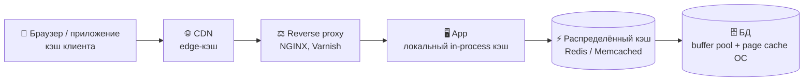
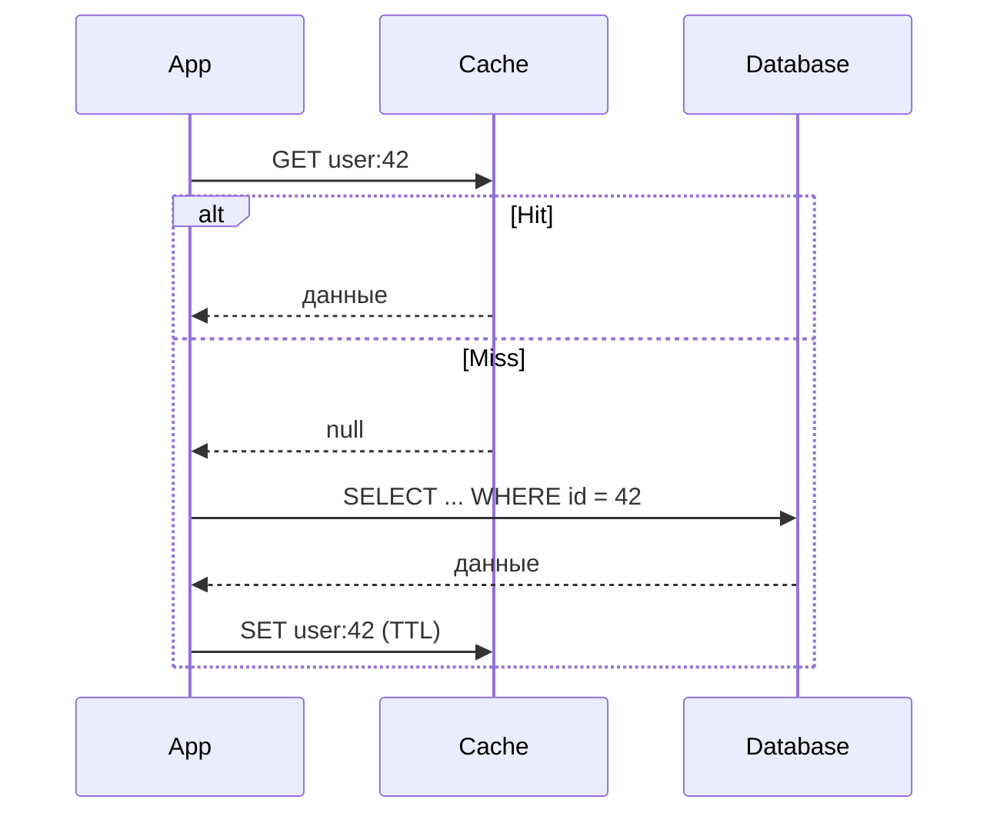
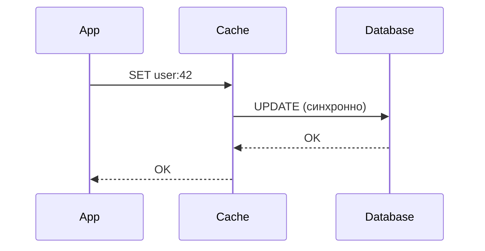
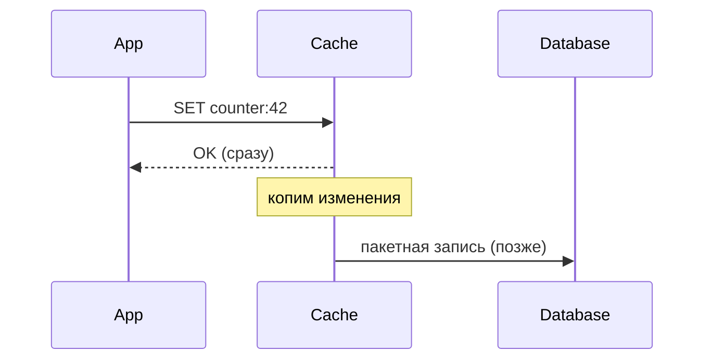
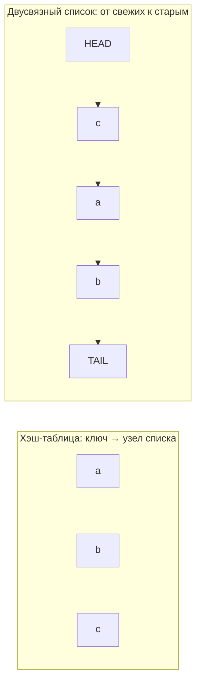
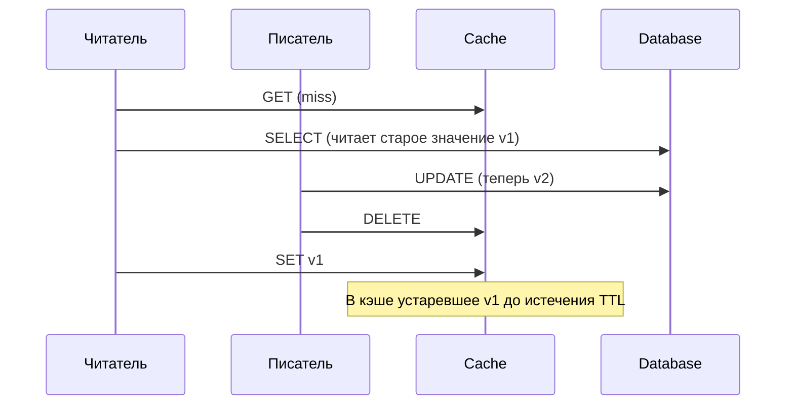
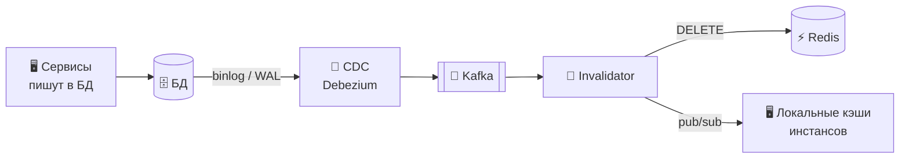
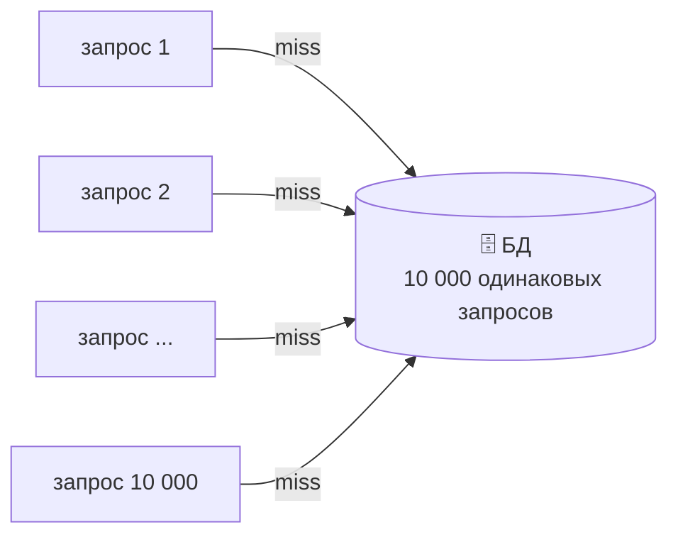

[English](README.md) | **Русский**

# 02. Кэширование

> **Что внутри:** cache-aside, read-through, write-through, write-back, TTL, вытеснение (LRU/LFU), инвалидация, cache stampede, горячие ключи
> **Время на изучение:** ~4 ч · **Нужно для:** почти любой read-heavy задачи
> **Практика:** разбор в формате интервью — [INTERVIEW_RU.md](./INTERVIEW.ru.md)

---

## 📑 Содержание

1. [Что такое кэш и зачем он нужен](#1-что-такое-кэш-и-зачем-он-нужен)
2. [Hit rate: главная метрика](#2-hit-rate-главная-метрика)
3. [Где кэшируют: уровни кэша](#3-где-кэшируют-уровни-кэша)
4. [Паттерны чтения и записи](#4-паттерны-чтения-и-записи)
5. [TTL: время жизни](#5-ttl-время-жизни)
6. [Вытеснение: LRU, LFU и другие](#6-вытеснение-lru-lfu-и-другие)
7. [Инвалидация](#7-инвалидация)
8. [Типичные проблемы: stampede, penetration, avalanche, горячие ключи](#8-типичные-проблемы-stampede-penetration-avalanche-горячие-ключи)
9. [Распределённый кэш: Redis и Memcached](#9-распределённый-кэш-redis-и-memcached)
10. [HTTP и CDN кэширование](#10-http-и-cdn-кэширование)
11. [Что кэшировать и как проектировать ключи](#11-что-кэшировать-и-как-проектировать-ключи)
12. [Метрики и эксплуатация](#12-метрики-и-эксплуатация)
13. [Как говорить об этом на интервью](#13-как-говорить-об-этом-на-интервью)
14. [Вопросы для самопроверки](#14-вопросы-для-самопроверки)
15. [Глоссарий и ресурсы](#15-глоссарий-и-ресурсы)

---

## 1. Что такое кэш и зачем он нужен

**Кэш** — это быстрое хранилище, где лежит копия данных, которые дорого получать заново: из базы, из другого сервиса, через вычисления.

Кэш решает три задачи:

| Задача | Как помогает кэш |
|:-------|:-----------------|
| **Снизить latency** | Чтение из RAM занимает ~100 нс, из Redis по сети ~0,5 мс, из БД с диска — миллисекунды и больше |
| **Снизить нагрузку** | Каждый попадающий в кэш запрос не доходит до БД. Это позволяет обслуживать больше трафика тем же «железом» |
| **Снизить стоимость** | RAM-кэш дешевле, чем масштабировать базу или платить за повторные вызовы внешних API |

> [!IMPORTANT]
> Кэш — это **копия**, а не источник правды. Данные в нём могут быть устаревшими или исчезнуть в любой момент. Система должна работать корректно (пусть медленнее), даже если кэш пустой.

**Аналогия:** повар держит самые нужные специи прямо у плиты (кэш), а не ходит каждый раз на склад (БД). На полке у плиты места мало, поэтому там лежит только то, что используется чаще всего. А если на складе привезли новую партию, специи у плиты могут оказаться старыми.

### Когда кэш помогает, а когда нет

| ✅ Помогает | ❌ Почти бесполезен |
|:-----------|:-------------------|
| Read-heavy нагрузка (чтений намного больше, чем записей) | Write-heavy нагрузка, данные постоянно меняются |
| Неравномерный доступ: небольшая часть данных получает большую часть запросов | Равномерный доступ ко всем данным (каждый ключ читают один раз) |
| Дорогие вычисления или медленные источники | Данные, которые обязаны быть строго актуальными в каждом чтении |
| Допустима небольшая устарелость | Каждый пользователь видит уникальные данные, которые больше никто не читает |

---

## 2. Hit rate: главная метрика

**Hit** — данные нашлись в кэше. **Miss** — не нашлись, пришлось идти в источник.

```
Hit rate = hits / (hits + misses)
```

**Средняя задержка:**

```
T = h × T_cache + (1 − h) × (T_cache + T_db)
```

Пример: T_cache = 1 мс, T_db = 20 мс.

| Hit rate | Средняя задержка | Доля запросов, доходящих до БД |
|:--------:|:----------------:|:------------------------------:|
| 80% | 5 мс | 20% |
| 90% | 3 мс | 10% |
| 99% | 1,2 мс | 1% |

> [!TIP]
> Рост hit rate с 90% до 99% выглядит как «+9%», но нагрузка на базу падает **в 10 раз** (с 10% до 1% запросов). Поэтому на интервью говорят о доле промахов (miss rate), а не только о hit rate.

### От чего зависит hit rate

- **Распределение доступа.** Реальный трафик обычно близок к распределению Ципфа: малая доля ключей получает большую часть запросов. Чем сильнее перекос, тем выше hit rate при том же размере кэша.
- **Размер кэша относительно working set** (набора данных, к которым реально обращаются).
- **TTL:** короткий TTL — больше промахов.
- **Политика вытеснения:** насколько хорошо она угадывает, что понадобится снова.
- **Холодный старт:** пустой кэш после рестарта или деплоя.

---

## 3. Где кэшируют: уровни кэша

Кэш почти всегда многоуровневый. Чем ближе к пользователю, тем быстрее и тем меньше контроля.



| Уровень | Что кэшируют | Задержка | Плюсы | Минусы |
|:--------|:-------------|:--------:|:------|:-------|
| Клиент (браузер, мобильное приложение) | Статика, ответы API | ~0 | Запрос вообще не уходит в сеть | Нельзя принудительно сбросить |
| CDN | Статика, картинки, видео, публичные API-ответы | 5–50 мс | Близко к пользователю, снимает огромный трафик | Только публичные данные; purge занимает время |
| Reverse proxy | Целые HTTP-ответы | <1 мс от прокси | Прозрачно для приложения | Сложно с персональными ответами |
| Локальный in-process кэш | Горячие объекты, конфиги, справочники | ~100 нс | Самый быстрый, без сети | У каждого инстанса свой; сложно инвалидировать; съедает память приложения |
| Распределённый кэш | Объекты, сессии, результаты запросов | ~0,5–1 мс | Общий для всех инстансов, большой объём | Сетевой hop, отдельная инфраструктура |
| Кэш внутри БД | Страницы данных, планы запросов | — | Работает автоматически | Не управляется приложением |

> [!NOTE]
> Частая связка в больших системах: **L1** — маленький локальный кэш с коротким TTL (секунды) для самых горячих ключей, **L2** — Redis для всего остального. L1 снимает нагрузку с Redis и спасает от горячих ключей.

---

## 4. Паттерны чтения и записи

### Cache-aside (lazy loading)

Самый распространённый паттерн. Приложение само управляет кэшем.

**Чтение:** проверить кэш → при промахе прочитать из БД → положить в кэш → вернуть.
**Запись:** записать в БД → **удалить** ключ из кэша.



```python
def get_user(user_id):
    key = f"user:{user_id}"
    data = cache.get(key)
    if data is not None:
        return data                      # hit
    data = db.query_user(user_id)        # miss
    cache.set(key, data, ttl=300)
    return data

def update_user(user_id, fields):
    db.update_user(user_id, fields)      # 1. сначала источник правды
    cache.delete(f"user:{user_id}")      # 2. потом удалить, а не обновить
```

- ✅ В кэше только то, что реально читают. Падение кэша не ломает систему.
- ❌ Первый запрос всегда промах. Возможна устарелость и гонки (см. [раздел 7](#7-инвалидация)).

### Read-through

То же, что cache-aside, но загрузку из БД делает **сам кэш** (библиотека или сервис кэша), а приложение общается только с кэшем.

- ✅ Логика загрузки в одном месте, проще код приложения.
- ❌ Нужна библиотека или кэш, который это умеет (например, Caffeine `LoadingCache`, DAX для DynamoDB).

### Write-through

Запись идёт **через кэш**: кэш синхронно пишет в БД и обновляет себя.



- ✅ Кэш всегда актуален для записанных данных. Чтение сразу после записи — hit.
- ❌ Запись медленнее (две операции). В кэш попадают данные, которые могут никогда не прочитать. Обычно используют вместе с read-through.

### Write-back (write-behind)

Запись идёт в кэш, а в БД **асинхронно**, позже, часто пачками.



- ✅ Очень быстрая запись, сглаживание пиков, меньше нагрузки на БД (много обновлений одного ключа превращаются в одну запись).
- ❌ **Риск потери данных**, если кэш упадёт до записи в БД. Сложнее консистентность.
- **Где уместно:** счётчики просмотров и лайков, метрики, аналитика — там, где потеря части обновлений допустима.

### Write-around

Запись идёт **только в БД**, кэш не трогается (или ключ удаляется). Данные попадут в кэш при следующем чтении.

- ✅ Кэш не засоряется данными, которые пишут, но редко читают (логи, архивы).
- ❌ Чтение сразу после записи — промах.

### Refresh-ahead

Кэш **заранее** обновляет популярные ключи до истечения TTL.

- ✅ Горячие ключи никогда не «протухают», нет пиков промахов.
- ❌ Лишняя нагрузка, если предсказание ошибочно.

### Сравнение

| Паттерн | Кто ходит в БД | Скорость записи | Свежесть | Риск потери данных | Типичное применение |
|:--------|:---------------|:---------------:|:--------:|:------------------:|:--------------------|
| Cache-aside | Приложение | Обычная | Возможна устарелость | Нет | Дефолт для большинства систем |
| Read-through | Кэш | — | Как cache-aside | Нет | Когда есть поддержка в библиотеке |
| Write-through | Кэш, синхронно | Медленнее | Высокая | Нет | Данные, которые читают сразу после записи |
| Write-back | Кэш, асинхронно | Очень быстрая | Высокая в кэше | **Да** | Счётчики, метрики |
| Write-around | Приложение | Обычная | Высокая (кэш не содержит старого) | Нет | Редко читаемые после записи данные |
| Refresh-ahead | Кэш, заранее | — | Высокая для горячих | Нет | Горячие ключи с предсказуемым доступом |

> [!TIP]
> На интервью дефолтный ответ — **cache-aside + удаление ключа при записи + TTL как страховка**. Другие паттерны называй, когда у задачи есть особенность: write-back для счётчиков, refresh-ahead для горячих ключей.

---

## 5. TTL: время жизни

**TTL (time to live)** — через сколько ключ автоматически удалится.

### Как выбирать TTL

| Данные | Пример TTL | Почему |
|:-------|:----------:|:-------|
| Справочники, конфиги | Часы–сутки | Меняются редко |
| Профиль пользователя, карточка товара | Минуты | Меняются иногда, инвалидация при записи |
| Цены, остатки, ленты | Секунды | Важна свежесть |
| Результаты дорогих вычислений (рекомендации) | Часы | Пересчитываются офлайн |
| Сессии | Срок жизни сессии | Безопасность |

> [!IMPORTANT]
> TTL — это **страховочная сетка**, а не основной механизм свежести. Даже при явной инвалидации ставь TTL: если удаление ключа где-то потеряется (баг, сбой сети), устаревшие данные всё равно исчезнут сами.

### TTL с jitter

Если много ключей получили одинаковый TTL одновременно (например, после прогрева кэша), они **одновременно** истекут, и все запросы разом пойдут в БД (cache avalanche).

```python
ttl = 300 + random.randint(0, 60)   # 5–6 минут вместо ровно 5
```

### Виды истечения

- **Абсолютный TTL:** ключ живёт N секунд с момента записи.
- **Скользящий (sliding):** TTL продлевается при каждом чтении. Подходит для сессий.
- **Negative caching:** кэшируем и **отсутствие** данных («такого пользователя нет») с коротким TTL. Защищает от cache penetration (см. [раздел 8](#8-типичные-проблемы-stampede-penetration-avalanche-горячие-ключи)).

---

## 6. Вытеснение: LRU, LFU и другие

Память кэша ограничена. Когда она заканчивается, нужно решить, **что удалить**.

| Политика | Что удаляет | Плюсы | Минусы |
|:---------|:------------|:------|:-------|
| **LRU** (Least Recently Used) | То, к чему дольше всего не обращались | Простая, хорошо работает на большинстве нагрузок | Одно сканирование большого объёма данных вымывает горячие ключи |
| **LFU** (Least Frequently Used) | То, к чему обращались реже всего | Защищает стабильно популярные ключи | Старые популярные ключи «застревают»; нужно затухание счётчиков |
| **FIFO** | Самое старое по времени добавления | Очень просто | Не учитывает популярность |
| **Random** | Случайный ключ | Без накладных расходов | Непредсказуемо |
| **TTL-based** | Ключи с ближайшим истечением | Логично для данных с TTL | Только для ключей с TTL |
| **ARC** | Адаптивно балансирует recency и frequency | Хороший hit rate на смешанных нагрузках | Сложнее |
| **W-TinyLFU** | Окно LRU + фильтр частоты на входе (admission) | Один из лучших hit rate на практике (Caffeine) | Сложнее в реализации |

### Как устроен LRU за O(1)

Классический вопрос на интервью: хэш-таблица + двусвязный список.



- **get:** найти узел через хэш-таблицу, переместить его в голову списка.
- **put:** добавить узел в голову; если места нет, удалить узел из хвоста (самый давно использованный).
- Все операции — O(1).

### Вытеснение в Redis

Redis при достижении `maxmemory` действует по `maxmemory-policy`:

| Политика | Поведение |
|:---------|:----------|
| `noeviction` | Отказывает в записи (по умолчанию). Для кэша **не подходит** |
| `allkeys-lru` | Приближённый LRU среди всех ключей. Хороший дефолт для кэша |
| `allkeys-lfu` | Приближённый LFU среди всех ключей. Хорош при стабильных горячих ключах |
| `volatile-lru` / `volatile-lfu` | То же, но только среди ключей с TTL |
| `volatile-ttl` | Удаляет ключи с ближайшим истечением |
| `allkeys-random` / `volatile-random` | Случайное удаление |

> [!NOTE]
> Redis реализует LRU и LFU **приближённо**: он берёт небольшую выборку ключей и удаляет лучшего кандидата из неё. Это экономит память и почти не уступает точному алгоритму.

---

## 7. Инвалидация

> «В информатике есть только две сложные вещи: инвалидация кэша и придумывание названий». — Фил Карлтон

**Инвалидация** — удаление или обновление устаревших данных в кэше после изменения источника.

### Стратегии

| Стратегия | Как работает | Свежесть | Сложность |
|:----------|:-------------|:--------:|:---------:|
| **Только TTL** | Ждём, пока ключ истечёт | Устарелость до TTL | Минимальная |
| **Удаление при записи** | После записи в БД приложение удаляет ключ | Высокая | Низкая |
| **Обновление при записи** | После записи в БД приложение пишет новое значение в кэш | Высокая, но есть гонки | Низкая, но опасно |
| **Событийная (CDC)** | Изменения в БД читаются из лога (binlog/WAL) и превращаются в инвалидации | Высокая, работает при любом источнике записи | Средняя |
| **Версионирование ключей** | Версия в ключе: `user:42:v7`. Новая версия → новый ключ, старый истечёт сам | Высокая | Средняя |

### Почему удалять, а не обновлять

Два параллельных запроса на запись:

```
Запрос A: UPDATE БД (цена = 100)
Запрос B: UPDATE БД (цена = 200)
Запрос B: SET cache = 200
Запрос A: SET cache = 100    ← в кэше 100, в БД 200, и так до истечения TTL
```

При **удалении** порядок не важен: оба удаляют ключ, а следующее чтение загрузит актуальное значение из БД.

### Почему сначала БД, потом кэш

Если сначала удалить ключ, а потом писать в БД, параллельное чтение может успеть загрузить **старое** значение в кэш между этими двумя шагами. Поэтому порядок: **сначала обновить БД, потом удалить ключ**.

### Оставшаяся гонка в cache-aside

Даже правильный порядок не закрывает все случаи:



Ситуация редкая (чтение из БД должно оказаться медленнее, чем запись и удаление), но на больших масштабах случается.

**Решения:**

| Решение | Как работает |
|:--------|:-------------|
| **Короткий TTL** | Ограничивает время жизни ошибки. Самое простое |
| **Leases** (как в Memcache у Facebook) | При промахе кэш выдаёт читателю токен. Удаление ключа аннулирует токен, и SET со старым токеном отклоняется |
| **Версии** | В значении хранится версия из БД. SET проходит, только если версия новее текущей (например, через Lua-скрипт в Redis) |
| **Отложенное повторное удаление** | Удалить ключ сразу и ещё раз через небольшую задержку (сотни мс). Грубо, но закрывает большинство гонок |
| **CDC-инвалидация** | Инвалидация идёт из лога БД в порядке коммитов, после того как запись точно применена |

### Событийная инвалидация через CDC



- ✅ Ловит **все** изменения, даже от других сервисов, миграций и ручных правок в БД.
- ✅ Порядок событий соответствует порядку коммитов.
- ❌ Задержка: обычно десятки–сотни миллисекунд. Больше компонентов.

> [!IMPORTANT]
> **Сигнал Senior+:** скажи, что кэш почти всегда даёт **eventual consistency**. Если для какой-то операции нужна строгая актуальность (оплата, списание остатков), она читает напрямую из источника правды, а кэш используется только для отображения.

---

## 8. Типичные проблемы: stampede, penetration, avalanche, горячие ключи

### Cache stampede (thundering herd, dog-piling)

**Что происходит:** популярный ключ истекает, и тысячи запросов одновременно получают промах и одновременно идут в БД за одним и тем же значением.



| Решение | Как работает |
|:--------|:-------------|
| **Request coalescing (single flight)** | В пределах инстанса только один запрос идёт в БД, остальные ждут его результат |
| **Распределённая блокировка** | Только тот, кто взял лок (`SET key:lock NX EX 5`), загружает значение; остальные ждут или получают старое значение |
| **Stale-while-revalidate** | Отдаём устаревшее значение, а обновляем его в фоне одним запросом |
| **Вероятностное раннее обновление (XFetch)** | Каждый запрос с небольшой вероятностью обновляет ключ **до** истечения; вероятность растёт ближе к концу TTL |
| **Refresh-ahead** | Горячие ключи обновляются заранее фоновым процессом |

### Cache penetration

**Что происходит:** запросы к **несуществующим** ключам (например, `user:-1` или перебор ID злоумышленником). Кэш всегда промахивается, и каждый запрос идёт в БД.

| Решение | Как работает |
|:--------|:-------------|
| **Negative caching** | Кэшировать «не найдено» с коротким TTL |
| **Bloom filter** | Перед походом в кэш и БД проверить, может ли ключ существовать. Ответ «нет» точный, «возможно» — с небольшой вероятностью ошибки |
| **Валидация входа и rate limiting** | Отсекать явно некорректные ID и перебор |

### Cache avalanche

**Что происходит:** **массовый** промах — одновременно истекает много ключей (одинаковый TTL) или падает весь кэш-кластер. Вся нагрузка разом обрушивается на БД.

| Решение | Как работает |
|:--------|:-------------|
| **Jitter в TTL** | Ключи истекают в разное время |
| **Отказоустойчивый кэш** | Реплики, Redis Cluster или Sentinel, несколько AZ |
| **Защита БД** | Rate limiting и circuit breaker перед базой; при перегрузке — деградация (отдать частичный ответ или ошибку быстро) |
| **Прогрев кэша** | После рестарта или деплоя загрузить горячие ключи заранее; включать трафик постепенно |

### Горячие ключи (hot keys)

**Что происходит:** один ключ (товар на распродаже, пост знаменитости) получает огромную долю трафика. Он живёт на одном шарде Redis, и этот шард упирается в CPU или сеть, хотя остальные простаивают.

| Решение | Как работает |
|:--------|:-------------|
| **Локальный L1-кэш** | Каждый инстанс держит горячий ключ у себя на 1–5 секунд. Нагрузка на Redis падает в число инстансов раз |
| **Репликация ключа** | Хранить N копий: `product:42#1` … `product:42#N`, читать случайную |
| **Чтение с реплик** | Распределять чтения горячего шарда по его репликам |
| **Обнаружение** | `redis-cli --hotkeys` (при политике LFU), метрики по ключам, сэмплирование трафика |

### Большие ключи (big keys)

Значение на мегабайты (огромный JSON, список на миллион элементов) блокирует однопоточный Redis при чтении и удалении, забивает сеть и мешает равномерному распределению по шардам.

**Решения:** разбивать на части, хранить только нужные поля, сжимать, удалять асинхронно (`UNLINK` вместо `DEL`).

### Сводная таблица

| Проблема | Причина | Главное решение |
|:---------|:--------|:----------------|
| Stampede | Истёк один популярный ключ | Single flight, лок, stale-while-revalidate |
| Penetration | Запросы к несуществующим ключам | Negative caching, Bloom filter |
| Avalanche | Массовое истечение или падение кэша | Jitter, HA-кэш, защита БД |
| Hot key | Перекос трафика на один ключ | L1-кэш, репликация ключа |
| Big key | Слишком большое значение | Разбиение, сжатие, UNLINK |

---

## 9. Распределённый кэш: Redis и Memcached

### Сравнение

| | Redis | Memcached |
|:-|:------|:----------|
| Типы данных | Строки, хэши, списки, множества, sorted sets, streams, HyperLogLog и др. | Только строки (blob) |
| Потоки | Выполнение команд в основном однопоточное (I/O может быть многопоточным) | Многопоточный |
| Персистентность | Есть (RDB-снапшоты, AOF-журнал) | Нет |
| Репликация и HA | Реплики, Sentinel, Redis Cluster | Нет встроенной, решается на клиенте |
| Шардирование | Redis Cluster (16 384 hash slots) или на клиенте | На клиенте (consistent hashing) |
| Атомарные операции и скрипты | INCR, транзакции, Lua | Базовые (incr, cas) |
| Когда выбирать | Почти всегда по умолчанию: богатые структуры, HA | Простой кэш больших объёмов объектов с максимальной простотой |

> [!NOTE]
> Существуют также Redis-совместимые альтернативы (например, Valkey, KeyDB, Dragonfly) и managed-сервисы (AWS ElastiCache, GCP Memorystore). На интервью достаточно сказать «Redis-совместимый кэш» и объяснить, почему.

### Шардирование

Один узел ограничен памятью и пропускной способностью. Данные делят между узлами:

- **Redis Cluster:** пространство ключей разбито на 16 384 слота, `slot = CRC16(key) mod 16384`, каждый мастер владеет диапазоном слотов. Hash tags (`{user:42}:profile`, `{user:42}:settings`) заставляют связанные ключи попасть в один слот.
- **Клиентское шардирование:** клиент сам выбирает узел через consistent hashing (подробнее в [01-scaling-basics](../01_Scaling%20basics/README.ru.md#8-алгоритмы-балансировки)).

### Отказоустойчивость

- У каждого мастера одна или несколько **реплик** в других AZ.
- При падении мастера реплика автоматически становится мастером (Sentinel или Cluster).
- Репликация в Redis **асинхронная**: при failover последние записи могут потеряться. Для кэша это обычно допустимо.

### Персистентность кэша: нужна ли

- Кэш по определению можно восстановить из БД, поэтому персистентность **не обязательна**.
- Но если кэш большой и прогрев занимает часы, а БД не выдержит нагрузку холодного старта, снапшоты (RDB) помогают быстро подняться.

---

## 10. HTTP и CDN кэширование

### Заголовок Cache-Control

| Директива | Значение |
|:----------|:---------|
| `max-age=N` | Ответ свежий N секунд (для браузера и CDN) |
| `s-maxage=N` | Время свежести только для общих кэшей (CDN, прокси) |
| `public` | Можно кэшировать в общих кэшах |
| `private` | Только в браузере пользователя (персональные данные) |
| `no-cache` | Можно хранить, но перед использованием нужно проверить у сервера |
| `no-store` | Нельзя хранить вообще (чувствительные данные) |
| `stale-while-revalidate=N` | N секунд можно отдавать устаревший ответ, обновляя его в фоне |
| `stale-if-error=N` | При ошибке сервера можно отдавать устаревший ответ N секунд |
| `immutable` | Ответ никогда не изменится (файлы с хэшем в имени) |

### Условные запросы

Сервер отдаёт `ETag` (хэш версии) или `Last-Modified`. Клиент при повторном запросе шлёт `If-None-Match` / `If-Modified-Since`. Если данные не изменились, сервер отвечает **304 Not Modified** без тела. Это экономит трафик, но не сам запрос.

### Версионирование статики (cache busting)

Статика публикуется с хэшем в имени: `app.3f9a1c.js`, а отдаётся с `Cache-Control: public, max-age=31536000, immutable`. При изменении файла меняется имя, и кэш не нужно сбрасывать.

### CDN

- **Pull CDN:** при первом запросе edge забирает объект с origin и кэширует. Просто, подходит для большинства.
- **Push CDN:** контент заранее загружается на CDN. Для больших редко меняющихся файлов.
- **Purge / invalidation:** удаление объекта с edge-узлов; занимает от секунд до минут. Поэтому версионирование URL надёжнее, чем purge.
- **Ключ кэша CDN:** обычно URL + выбранные заголовки. Лишние параметры (`utm_*`) в ключе убивают hit rate, поэтому их нормализуют.

---

## 11. Что кэшировать и как проектировать ключи

### Что кэшировать

| Хорошие кандидаты | Плохие кандидаты |
|:------------------|:-----------------|
| Часто читаемые, редко меняющиеся объекты | Данные, где нужна строгая актуальность в каждом чтении (баланс счёта при списании) |
| Результаты дорогих запросов и вычислений | Уникальные данные, которые больше никто не прочитает |
| Ответы медленных внешних API | Очень часто меняющиеся данные с низким соотношением чтений к записям |
| Сессии, токены, rate limit счётчики | Чувствительные данные без шифрования и контроля доступа |

### Проектирование ключей

- **Пространство имён и версия:** `v2:product:42`, `v2:user:42:profile`. Смена формата значения → смена версии, старые ключи истекут сами.
- **Детерминированность:** для запросов с параметрами нормализуй их (сортировка, нижний регистр), иначе один и тот же запрос даст разные ключи.
- **Гранулярность:** кэшировать целую страницу проще, но любое изменение инвалидирует её целиком. Кэшировать отдельные объекты сложнее, но инвалидация точнее.
- **Персональные данные:** ID пользователя в ключе, чтобы не отдать чужие данные.

### Оценка размера кэша

```
Размер кэша ≈ число горячих объектов × средний размер × накладные расходы (~1,5–2×)
```

Пример: 10 млн горячих объектов × 2 КБ × 1,5 ≈ 30 ГБ. С репликами в 2 раза больше памяти. Это несколько узлов Redis среднего размера.

> [!TIP]
> Не обязательно кэшировать весь датасет. Если 20% объектов дают 80–90% запросов, кэша на 20% данных хватит для высокого hit rate.

---

## 12. Метрики и эксплуатация

| Метрика | Почему важна |
|:--------|:-------------|
| Hit rate / miss rate | Главный показатель эффективности; падение — сигнал о проблеме (деплой, смена ключей, нехватка памяти) |
| Eviction rate | Высокий — кэш мал для working set |
| Latency (p99) | Рост — перегрузка узла, горячие или большие ключи |
| Использование памяти | Приближение к maxmemory |
| Число соединений и CPU по узлам | Перекос между узлами — горячий шард |
| Нагрузка на БД | Должна оставаться стабильной; рост — кэш не справляется |

**Эксплуатационные практики:**
- Таймауты на вызовы кэша (единицы–десятки мс). Медленный кэш хуже отсутствующего.
- Circuit breaker: если кэш недоступен, идти в БД с ограничением, а не валить запросы.
- Пул соединений к кэшу, pipelining и `MGET` для пакетных чтений.
- Прогрев перед включением трафика на новый кластер.

---

## 13. Как говорить об этом на интервью

### Ответ за 30 секунд

> «Использую cache-aside поверх Redis: читаем из кэша, при промахе — из БД с записью в кэш. При записи сначала обновляю БД, потом удаляю ключ; TTL с jitter как страховка. Для самых горячих ключей добавляю локальный L1-кэш на несколько секунд. От stampede защищаюсь через single flight или stale-while-revalidate, от penetration — negative caching. Кэш даёт eventual consistency, поэтому критичные операции (оплата, списание остатков) читают источник правды напрямую. Redis шардирован, с репликами в нескольких AZ; если кэш падает, база защищена rate limiting».

### Вопросы, которые стоит задать при проектировании кэша

1. Насколько данные могут быть устаревшими? Секунды, минуты, часы?
2. Какое соотношение чтения и записи и насколько перекошен доступ?
3. Кто ещё пишет в источник (другие сервисы, миграции)? Нужна ли CDC-инвалидация?
4. Что будет, если кэш полностью пропадёт? Выдержит ли БД?
5. Какой размер working set?

### Типичные ошибки

- Обновлять кэш при записи вместо удаления (гонки).
- Удалять ключ до записи в БД.
- Не ставить TTL «потому что есть инвалидация».
- Одинаковый TTL для всех ключей → avalanche.
- Считать кэш источником правды; строить на нём критичную логику.
- Забыть про stampede на горячих ключах.
- Кэшировать без оценки hit rate и размера working set.

---

## 14. Вопросы для самопроверки

<details>
<summary><b>1. Почему рост hit rate с 90% до 99% так важен?</b></summary>

Доля промахов падает с 10% до 1%, то есть нагрузка на БД уменьшается в 10 раз, а средняя задержка заметно снижается. Hit rate обманчиво выглядит как «+9%».
</details>

<details>
<summary><b>2. Чем cache-aside отличается от read-through?</b></summary>

В cache-aside приложение само проверяет кэш, ходит в БД при промахе и кладёт значение в кэш. В read-through это делает слой кэша (библиотека или сервис), а приложение работает только с кэшем. Поведение похожее, отличается, где живёт логика загрузки.
</details>

<details>
<summary><b>3. Когда write-back оправдан, а когда опасен?</b></summary>

Оправдан для данных, где потеря части обновлений допустима и записей очень много: счётчики просмотров, лайков, метрики. Опасен для денег, заказов и всего, что нельзя потерять: если кэш упадёт до сброса в БД, данные пропадут.
</details>

<details>
<summary><b>4. Почему при записи ключ лучше удалять, чем обновлять?</b></summary>

При обновлении два параллельных писателя могут записать значения в кэш в обратном порядке относительно БД, и в кэше останется устаревшее значение. Удаление идемпотентно: порядок не важен, следующее чтение загрузит актуальные данные.
</details>

<details>
<summary><b>5. Почему порядок «сначала БД, потом удалить ключ», а не наоборот?</b></summary>

Если сначала удалить ключ, параллельное чтение может получить промах, прочитать из БД старое значение (запись ещё не применена) и положить его в кэш. Тогда старое значение проживёт до истечения TTL.
</details>

<details>
<summary><b>6. Как работает LRU-кэш за O(1)?</b></summary>

Хэш-таблица хранит ссылку на узел двусвязного списка. При чтении узел переносится в голову списка, при вставке новый узел добавляется в голову, а при переполнении удаляется хвост. Все операции — O(1).
</details>

<details>
<summary><b>7. Чем stampede отличается от avalanche?</b></summary>

Stampede — много запросов одновременно промахиваются по **одному** горячему ключу. Avalanche — одновременно промахиваются **многие** ключи (общий TTL или падение всего кэша). Решения разные: для stampede — single flight и stale-while-revalidate, для avalanche — jitter в TTL и отказоустойчивый кэш.
</details>

<details>
<summary><b>8. Как защититься от запросов к несуществующим ключам?</b></summary>

Negative caching (кэшировать «не найдено» с коротким TTL), Bloom filter перед кэшем и БД, валидация входных данных и rate limiting.
</details>

<details>
<summary><b>9. Один товар на распродаже получает 200 000 запросов в секунду. Что делать?</b></summary>

Это горячий ключ: один шард Redis не выдержит. Добавить локальный L1-кэш на каждом инстансе с TTL 1–5 секунд, реплицировать ключ на несколько шардов (`product:42#1..N`) или читать с реплик, отдавать статичную часть страницы через CDN. Для stampede при истечении — single flight.
</details>

<details>
<summary><b>10. Что будет, если весь Redis-кластер упадёт?</b></summary>

Вся нагрузка пойдёт в БД, которая, скорее всего, не рассчитана на неё. Нужны: реплики и автоматический failover кэша, таймауты и circuit breaker на вызовы кэша, rate limiting перед БД, деградация (частичные ответы), постепенный прогрев после восстановления.
</details>

---

## 15. Глоссарий и ресурсы

### Глоссарий

| Термин | Значение |
|:-------|:---------|
| Hit / miss | Данные найдены / не найдены в кэше |
| Working set | Данные, к которым реально обращаются за период |
| TTL | Время жизни ключа |
| Eviction | Вытеснение ключей при нехватке памяти |
| Invalidation | Удаление устаревших данных из кэша после изменения источника |
| Cache-aside | Приложение само читает из БД при промахе и кладёт в кэш |
| Write-through / write-back | Синхронная / асинхронная запись в БД через кэш |
| Stampede | Много одновременных промахов по одному ключу |
| Penetration | Запросы к несуществующим ключам, проходящие сквозь кэш |
| Avalanche | Массовый одновременный промах многих ключей |
| Hot key | Ключ с непропорционально большим трафиком |
| Single flight | Объединение одинаковых параллельных запросов в один |
| Negative caching | Кэширование отсутствия данных |
| CDC | Change Data Capture: поток изменений из лога БД |
| Lease | Токен, без которого нельзя записать значение после промаха |

### Ресурсы

- *Designing Data-Intensive Applications*, Martin Kleppmann — главы о репликации и производных данных
- *System Design Interview*, Vol. 1, Alex Xu — глава 1 (кэш, CDN)
- *Scaling Memcache at Facebook* (NSDI 2013) — leases, инвалидация, горячие ключи на огромном масштабе
- Vattani et al., *Optimal Probabilistic Cache Stampede Prevention* (VLDB 2015) — алгоритм XFetch
- Einziger, Friedman, Manes, *TinyLFU: A Highly Efficient Cache Admission Policy* — основа W-TinyLFU в Caffeine
- RFC 9111 (HTTP Caching) и RFC 5861 (stale-while-revalidate, stale-if-error)
- Документация Redis: eviction policies, Redis Cluster, client-side caching
- AWS whitepaper «Database Caching Strategies Using Redis»