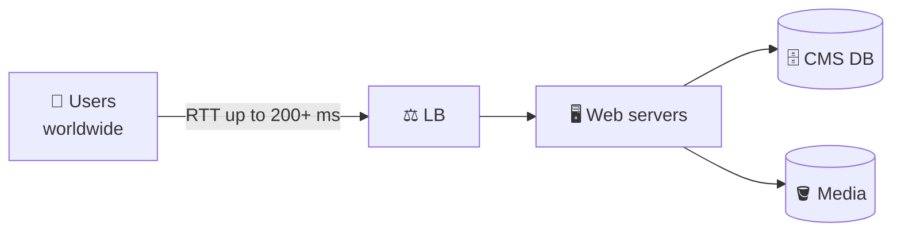
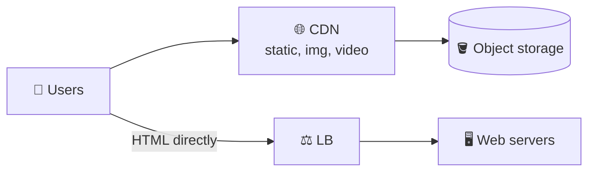
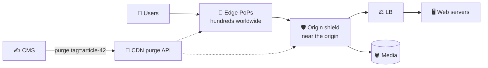
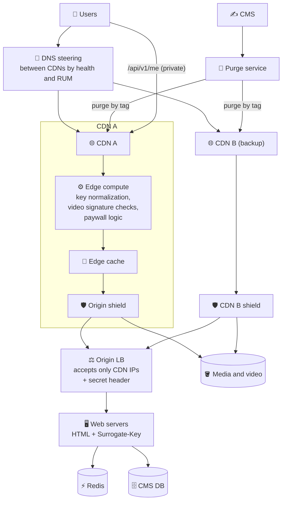
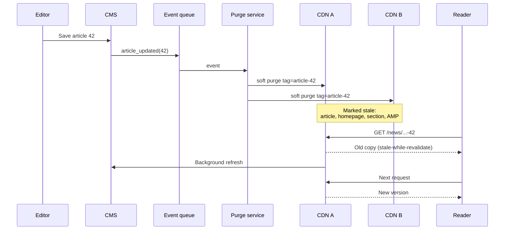
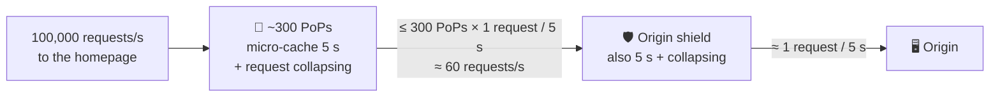
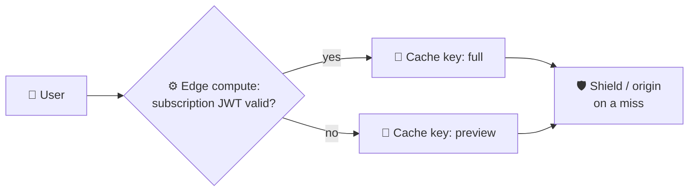

**English** | [Русский](INTERVIEW.ru.md) · Theory: [README.md](./README.md)

# 03. CDN: Content Delivery for a Global Media Site

> **Topic:** pull CDN, origin shield, cache keys, TTL, purge by tag, micro-caching, personalization at the edge, video, signed URLs, multi-CDN
> **Level:** Medium–Hard · **Interview time:** 45 min · **Study time:** ~4 h
> **Where it's asked:** as a standalone question and as a deep dive in problems about video, images, news and e-commerce

---

## 🗺️ How to Read This Walkthrough

| Icon | Meaning |
|:----:|:--------|
| 🎤 | Interviewer |
| 🗣️ | What I (the candidate) say out loud |
| ✏️ | What I draw on the whiteboard |
| ⏱️ | Time budget for the step |

Callouts: **TIP** — a good technique, **WARNING** — a trap, **IMPORTANT** — a Senior+ signal.

---

## 📑 Contents

1. [Problem Statement](#1-problem-statement)
2. [Clarifying Questions and Requirements](#2-clarifying-questions-and-requirements)
3. [Capacity Estimates](#3-capacity-estimates)
4. [URLs and API](#4-urls-and-api)
5. [Caching Policy by Content Type](#5-caching-policy-by-content-type)
6. [High-Level Design: Evolution by Stages](#6-high-level-design-evolution-by-stages)
7. [Deep Dive 1: Cache Key and Hit Ratio](#7-deep-dive-1-cache-key-and-hit-ratio)
8. [Deep Dive 2: Article Updates and Purging](#8-deep-dive-2-article-updates-and-purging)
9. [Deep Dive 3: Breaking News and Traffic Spikes](#9-deep-dive-3-breaking-news-and-traffic-spikes)
10. [Deep Dive 4: Personalization and Paid Content](#10-deep-dive-4-personalization-and-paid-content)
11. [Bottlenecks and Failure Scenarios](#11-bottlenecks-and-failure-scenarios)
12. [What Changes at 10x Scale](#12-what-changes-at-10x-scale)
13. [Interviewer Questions with Answers](#13-interviewer-questions-with-answers)
14. [Common Mistakes](#14-common-mistakes)
15. [Cheat Sheet and Self-Check](#15-cheat-sheet-and-self-check)

---

## 1. Problem Statement

> 🎤 "We run a global news site: articles, photos, video. Users are all over the world, and there's a subscription with paid content. During major events, traffic grows 10× within minutes. Design the content delivery."

**Time plan:**

| Step | ⏱️ |
|:-----|:--:|
| Requirements | 5 min |
| Estimates | 5 min |
| URLs and caching policy | 5 min |
| High-level design | 10 min |
| Deep dives | 15 min |
| Failures and wrap-up | 5 min |

> [!TIP]
> In CDN problems, the interviewer isn't interested in "we'll use Cloudflare" but in the **policy**: what's cached, for how long, by which key, and how it's updated. Split the content into types right away.

---

## 2. Clarifying Questions and Requirements

⏱️ 5 min

| My question | Interviewer's answer | What it changes |
|:------------|:---------------------|:----------------|
| What content types? | Article HTML, homepage and sections, photos, video (recorded and occasionally live), JS/CSS | Different TTLs and strategies per type |
| How fast must article corrections reach readers? | Within ~10 seconds | Need a fast purge, not just TTL |
| Is there personalization? | User name in the header, recommendations, paywall for subscribers | Must separate shared from personal |
| Where's the audience? | Worldwide, mostly Europe and the US | Many PoPs, origin in one region + shield |
| What about paid video? | Subscribers only; links must not be shareable | Signed URLs |
| How critical is availability? | The site must work even when the origin has problems | `stale-if-error`, possibly multi-CDN |

### Functional requirements

1. Serve articles, the homepage, sections, photos and video to users worldwide.
2. Corrections and new articles are visible to readers within ~10 s.
3. Personal elements (name, recommendations) and a paywall for subscribers.
4. Paid video is available to subscribers only.

**Out of scope:** the CMS and authoring process, video transcoding, the recommendation engine.

### Non-functional requirements

| Requirement | Target |
|:------------|:-------|
| Latency | TTFB < 100 ms for 95% of users worldwide |
| Spikes | ×10 within minutes without the origin falling over |
| Origin offload | ≥ 95% of traffic by bytes served by the CDN |
| Freshness | Corrections visible ≤ 10 s; the homepage may lag by seconds |
| Availability | The site is readable even when the origin is down |
| Security | Paid content is inaccessible without a subscription; personal data never leaks through the cache |

---

## 3. Capacity Estimates

⏱️ 5 min

✏️

```
DAU                      = 100M
Page views per user      = 10/day   → 1B page views/day
1 day ≈ 10^5 sec         → ~10,000 pages/s average, peak ×10 ≈ 100,000 pages/s

Requests per page        ≈ 50 (HTML, images, JS, CSS, fonts)
                         → ~500,000 requests/s average, ~5M requests/s at peak

Page weight              ≈ 2 MB
Page traffic             ≈ 1B × 2 MB = 2 PB/day ≈ 23 GB/s ≈ 185 Gbit/s average

Video                    = 10M views × 50 MB = 500 TB/day ≈ 46 Gbit/s
```

🗣️ **Conclusions:**

- **Without a CDN this is impossible:** hundreds of gigabits per second of egress and millions of requests per second at peak can't be served from one origin, and it would be very expensive.
- **At a 98% byte hit ratio**, the origin serves ~2% of traffic: ~4–5 Gbit/s on average. That's realistic.
- **The main risk is HTML:** it can't be cached for long, and during events the homepage and the event article take the brunt of the spike.

---

## 4. URLs and API

⏱️ 3 min

```http
# HTML
GET https://www.news.example/                       homepage
GET https://www.news.example/politics               section
GET https://www.news.example/news/{slug}-{id}       article

# Personal data — separate from HTML
GET https://www.news.example/api/v1/me              name, subscription status (private)
GET https://www.news.example/api/v1/me/recommendations

# Static assets with a hash in the name
GET https://static.news.example/app.3f9a1c.js

# Images: a fixed set of sizes and formats
GET https://img.news.example/{image_id}/{w}x{h}.{webp|avif|jpg}

# Video (HLS)
GET https://video.news.example/{video_id}/master.m3u8
GET https://video.news.example/{video_id}/720p/seg_00042.m4s

# Paid video: a signed URL
GET https://video.news.example/{video_id}/master.m3u8?exp=1767225600&sig=...
```

🗣️ Decisions:

1. **Personal data isn't embedded in the HTML.** Article HTML is the same for everyone and cacheable; the name and recommendations are fetched separately.
2. **Separate domains** for static assets, images and video: different cache rules, and no main-domain cookies in requests (fewer headers, simpler cache key).
3. **Images come only in fixed sizes.** Arbitrary `?w=...` would let anyone flood the cache and compute with millions of variants.

---

## 5. Caching Policy by Content Type

⏱️ 3 min

| Content | Cache-Control from origin | Cache key | How it's updated |
|:--------|:--------------------------|:----------|:-----------------|
| JS, CSS, fonts | `public, max-age=31536000, immutable` | Path | New hash in the name |
| Images | `public, max-age=2592000` | Path (size and format in the path) | New `image_id` on replacement |
| Article HTML | `public, max-age=0, s-maxage=300, stale-while-revalidate=60, stale-if-error=86400` + `Surrogate-Key: article-{id} section-{s}` | Path, no utm; device class if markup differs | Purge by tag |
| Homepage, sections | `public, max-age=0, s-maxage=5, stale-while-revalidate=30, stale-if-error=86400` + `Surrogate-Key: homepage` | Path + region (if the homepage is regional) | Micro-caching + purge by tag |
| `/api/v1/me*` | `private, no-store` | — | Not cached |
| Video segments | `public, max-age=31536000, immutable` | Path (without `sig` and `exp`) | Never change |
| VOD manifest | `public, max-age=86400` | Path (without `sig` and `exp`) | — |
| Live manifest | `public, max-age=2` | Path | Updated every few seconds |

> [!IMPORTANT]
> **Senior+ signal:** for HTML, `max-age=0` (the browser always revalidates with the CDN) while `s-maxage` controls the CDN. A CDN purge then takes effect for every user immediately. If browsers cached HTML for minutes, a fix to an article wouldn't reach people who had already opened it.

---

## 6. High-Level Design: Evolution by Stages

⏱️ 10 min

### Stage 0. Origin only

✏️



**Problems:** high latency for distant users, all traffic (hundreds of Gbit/s) leaves the origin, a ×10 spike takes the service down.

### Stage 1. CDN for static assets and media

✏️



🗣️ "The simplest and most profitable step: static assets, images and video through a pull CDN on top of object storage. That's >90% of bytes."

**Problems:** HTML still goes to the origin, and that's exactly what falls over during events.

### Stage 2. HTML through the CDN: micro-caching, purge by tag, origin shield

✏️



🗣️ "HTML also goes through the CDN with a short `s-maxage`. On publish or edit, the CMS triggers a purge by tag. The origin shield collects misses from hundreds of PoPs, so the origin gets at best one request per object."

### Stage 3. Final design

✏️



🗣️ "Final principles:
- **Everything** goes through the CDN, including HTML and uncacheable APIs: even without caching we gain from TLS termination near the user.
- Shared HTML is cached; personal content is fetched separately and not cached.
- The purge service fans out tag-based invalidations to every CDN.
- The origin is closed to direct access.
- Edge compute verifies video signatures and normalizes keys without going to the origin."

---

## 7. Deep Dive 1: Cache Key and Hit Ratio

> 🎤 "The HTML hit ratio is only 40%. What would you check?"

🗣️ "First of all — the cache key. Typical causes:

| Cause | How it shows up | Fix |
|:------|:----------------|:----|
| utm tags and click IDs in URLs | Every social media link is a new key | Strip `utm_*`, `fbclid`, `gclid` from the key |
| Cookies in the key or `Vary: Cookie` | Each user has their own copy | Remove cookies from the key for public HTML |
| `Vary: User-Agent` | Thousands of variants | Normalize to `mobile` / `desktop` at the edge |
| Parameter order | `?page=2&sort=new` vs `?sort=new&page=2` | Sort parameters |
| `Set-Cookie` in the response | The CDN won't cache the response | Don't set cookies on public responses |
| TTL too short | Frequent misses | Longer `s-maxage` + purge by tag |
| No origin shield | Each PoP misses independently | Enable the shield |

I'd start with CDN logs: which keys differ for the same article."

> [!WARNING]
> When stripping parameters from the key, make sure the origin **also** ignores them. If the response depends on a parameter that isn't in the key, different users get the wrong responses. It's the same mechanism as cache poisoning.

---

## 8. Deep Dive 2: Article Updates and Purging

> 🎤 "An editor fixed a typo in an article headline. How does that reach readers within 10 seconds?"

🗣️ "The headline appears in several places: the article page, the homepage, a section, the AMP version, RSS. A purge by URL would require knowing all of those URLs. So I use **purge by tag**:
- the origin adds a `Surrogate-Key` to every HTML response listing all articles on the page: the homepage gets `homepage article-41 article-42 ...`, the article gets `article-42 section-politics`;
- when the article is saved, the CMS publishes an event, and the purge service calls a purge by tag `article-42` on every CDN."



🗣️ "Why a **soft purge**: after purging the homepage, the next request from every PoP would immediately hit the origin. During an event the homepage is edited every few minutes, which would cause constant waves of misses. A soft purge marks the object stale; the first request gets the old copy, and the refresh happens in the background as a single request through the shield."

> [!TIP]
> The purge service must **retry** failed CDN API calls and use a queue. A lost purge means the typo lives until `s-maxage` expires. That's why `s-maxage` for articles is minutes, not hours: it's the safety net.

---

## 9. Deep Dive 3: Breaking News and Traffic Spikes

> 🎤 "A major event happens. Within 2 minutes traffic grows 10×, and everyone opens the homepage and one article. What happens?"

🗣️ "Let me go layer by layer and see how many requests reach the origin.

✏️



- **Micro-caching** (`s-maxage=5`): the homepage is refreshed at most once every 5 seconds per PoP.
- **Request collapsing**: if thousands of requests arrive at a PoP at once and the object is missing, one request goes upstream.
- **Origin shield**: collects requests from all PoPs, so the origin gets about one request every 5 seconds, regardless of the number of users.
- **stale-while-revalidate**: users don't wait for the refresh; they get a copy immediately.

So origin load for **shared** pages is practically independent of the number of readers."

> 🎤 "So what will fall over?"

🗣️ "The uncacheable part: `/api/v1/me` and recommendations. Their load grows in proportion to users. Protection:
- personal data comes from small, fast requests backed by a service-side cache (Redis);
- under overload, **degrade**: the page works without the personal block (the client hides it on error or timeout);
- rate limiting at the edge;
- autoscaling the API."

> [!IMPORTANT]
> **Senior+ signal:** name what does **not** scale through the CDN (personal requests, writes, logins) and how the system degrades. The homepage must open even when personalization is unavailable.

---

## 10. Deep Dive 4: Personalization and Paid Content

> 🎤 "How do you show the user's name and put articles behind a paywall without killing the cache?"

### Personalization

| Option | How | Choice |
|:-------|:----|:-------|
| Render the name into HTML at the origin | HTML becomes personal; caching impossible | ❌ |
| Client-side fetch | HTML is shared; JS requests `/api/v1/me` | ✅ The main option |
| Edge compute | Edge code inserts the name from a signed cookie into cached HTML | ✅ When fast rendering without "flicker" matters |

### Article paywall

🗣️ "I keep **two** versions of the article in the cache: full and preview. Edge compute checks the signed subscription cookie (a JWT) and picks the cache key variant: `article-42:full` or `article-42:preview`. The signature is verified at the edge without going to the origin."



### Paid video

- The player gets a **signed URL** for the manifest from the API, with a short expiry (`exp`) and a signature (`sig`) bound to the user.
- The edge checks the signature and expiry for the manifest and segments (often via a signed cookie, so each segment doesn't need its own signature).
- `exp` and `sig` are **not part of the cache key**: all subscribers share the same cached segments.

> [!WARNING]
> If `sig` stays in the cache key, every user gets their own copy of every segment, and the video hit ratio drops to nearly zero. Verify the signature, then strip it from the key.

---

## 11. Bottlenecks and Failure Scenarios

⏱️ 4 min

| Scenario | What happens | How we protect |
|:---------|:-------------|:---------------|
| Origin unavailable | Misses and refreshes fail | `stale-if-error` for a day: readers see the latest page versions |
| Global CDN provider outage | Site unavailable | Multi-CDN, DNS steering with health checks, a short TTL on the DNS record |
| A PoP fails | Users in that region lose their nearest node | Anycast or the CDN's DNS reroute to a neighboring PoP |
| A lost purge | The typo is visible until `s-maxage` expires | Queue and retries in the purge service, `s-maxage` in minutes |
| An accidental full purge | Avalanche of misses on the origin | Require confirmation for full purges; soft purge; shield; request collapsing |
| A personal response gets cached | Data leaks to other users | `private, no-store` on `/api/v1/me`; the CDN doesn't cache responses with `Set-Cookie`; header tests |
| Cache poisoning via a header | A malicious response is served to everyone | Never use headers outside the key in responses; strip extra headers at the edge |
| Direct attack on the origin | The CDN is bypassed | The origin accepts only CDN IPs + a secret header |
| Image size enumeration | The cache fills up, resize load spikes | Only a fixed set of sizes |

---

## 12. What Changes at 10x Scale

> 🎤 "What if traffic grows 10× and video becomes the main product?"

🗣️ "Egress will be measured in terabits per second. What changes:
1. **An in-house CDN or caching servers inside ISPs** for video (like Netflix Open Connect): at that volume, it's cheaper than a rented CDN.
2. **Preloading popular video** into nodes during off-peak hours (push).
3. **Multi-CDN with routing based on real user measurements** (RUM) per region and ISP.
4. **More logic at the edge**: assembling pages from fragments, A/B tests, recommendations from edge key-value stores.
5. **Multiple origin regions** with content replication, so each region's shield goes to the nearest origin."

---

## 13. Interviewer Questions with Answers

<details>
<summary><b>Why route uncacheable requests like /api/v1/me through the CDN?</b></summary>

The TLS handshake and TCP end at the nearest edge rather than a distant origin. The edge keeps persistent connections to the origin and routes traffic over an optimized network. It's also a single entry point for WAF, DDoS protection and rate limiting.
</details>

<details>
<summary><b>Why not set s-maxage for articles to a day, given we have purging?</b></summary>

A purge can get lost (an API failure, a bug in the purge service), and then the error lives for a day. Minutes are a sensible compromise: purging gives freshness in seconds, while the TTL bounds the damage from a lost purge. With `stale-while-revalidate`, a short TTL costs users almost no latency.
</details>

<details>
<summary><b>How is homepage micro-caching different from just a short TTL?</b></summary>

It essentially is a very short TTL, but combined with request collapsing, an origin shield and stale-while-revalidate. Together they make origin load almost constant: one request every few seconds, regardless of the number of readers.
</details>

<details>
<summary><b>How do you make sure a personal response is never cached?</b></summary>

Several layers of defense: personal data only on dedicated paths (`/api/v1/me`) with `Cache-Control: private, no-store`; a CDN rule "don't cache responses with Set-Cookie or this path"; automated header tests in CI; monitoring for CDN responses with `Age > 0` on personal paths.
</details>

<details>
<summary><b>What if one CDN provider goes down globally?</b></summary>

Multi-CDN: DNS steering with health checks switches traffic to the second provider. The second CDN must be "warm", i.e. already serving part of the traffic; otherwise its cache is empty and the origin gets an avalanche of misses. A DNS record with a short TTL speeds up the switch.
</details>

<details>
<summary><b>Why separate domains for images and static assets?</b></summary>

Requests to them don't carry main-domain cookies, so there are fewer headers and a simpler cache key. Each domain can have its own CDN configuration. With HTTP/2 and HTTP/3, splitting domains for parallelism is no longer needed, but the other reasons remain.
</details>

---

## 14. Common Mistakes

| ❌ Mistake | ✅ Do this instead |
|:----------|:------------------|
| "We'll add a CDN" with no policy | A table: content → Cache-Control → key → update method |
| `max-age` on HTML in the browser | `max-age=0, s-maxage=...` and purge at the CDN |
| Purge by URL for an article shown on many pages | Purge by tag (surrogate keys) |
| Hard purge of the homepage on every edit | Soft purge + stale-while-revalidate |
| The user's name in shared HTML | Client-side fetch or edge compute |
| The video signature in the cache key | Verify the signature and strip it from the key |
| The origin open to direct access | Only CDN IPs + a secret header |
| A single CDN with no fallback | Multi-CDN with a warm backup, or at least `stale-if-error` |
| Arbitrary image sizes via parameters | A fixed set of sizes |

---

## 15. Cheat Sheet and Self-Check

### 30-second answer

> All traffic goes through a pull CDN with an origin shield. Static assets get a hash in the name and a one-year TTL; images come in fixed sizes with edge conversion; video is HLS segments with a long TTL and signed URLs for paid content, with the signature excluded from the key. HTML gets `max-age=0, s-maxage` in minutes and a soft purge by tag on edits; the homepage gets 5 s micro-caching with request collapsing. Personal content is fetched separately and never cached; the paywall picks a variant at the edge based on a JWT. The origin is closed to direct access, `stale-if-error` keeps the site up when the origin fails, and multi-CDN covers a provider outage.

### Self-check

- [ ] I can write a caching policy table for 6+ content types
- [ ] I can explain why HTML uses `max-age=0, s-maxage=N`
- [ ] I can name 5+ causes of a low hit ratio and how to fix them
- [ ] I can explain purge by tag and why a soft purge beats a hard one
- [ ] I can compute how many requests reach the origin during a spike with micro-caching and a shield
- [ ] I can explain personalization without losing cacheability (client or edge)
- [ ] I can explain signed URLs for video and why the signature isn't in the key
- [ ] I can name 3 ways to protect the origin and 2 attacks on caches

### Further reading

- Theory for this topic: [README.md](./README.md)
- Fastly documentation on surrogate keys and soft purge
- Cloudflare documentation on cache keys, tiered cache and Workers
- AWS CloudFront documentation on signed URLs and origin shield
- James Kettle, *Practical Web Cache Poisoning*