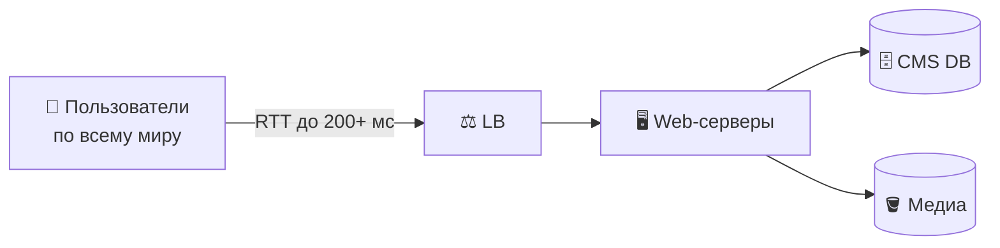
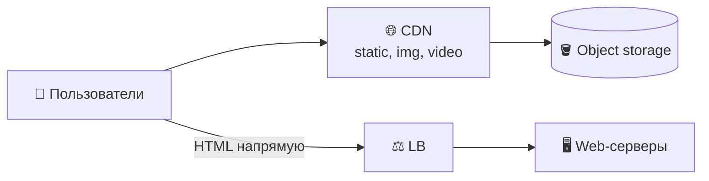
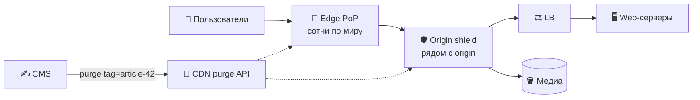
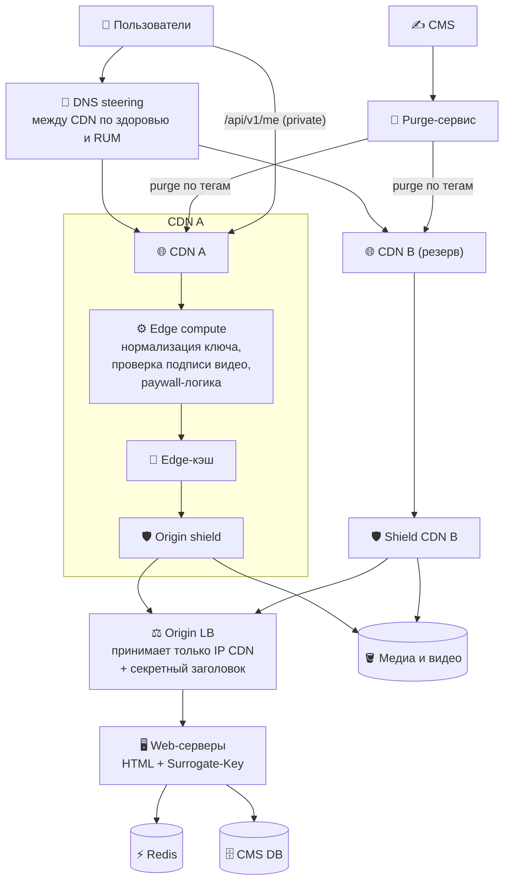
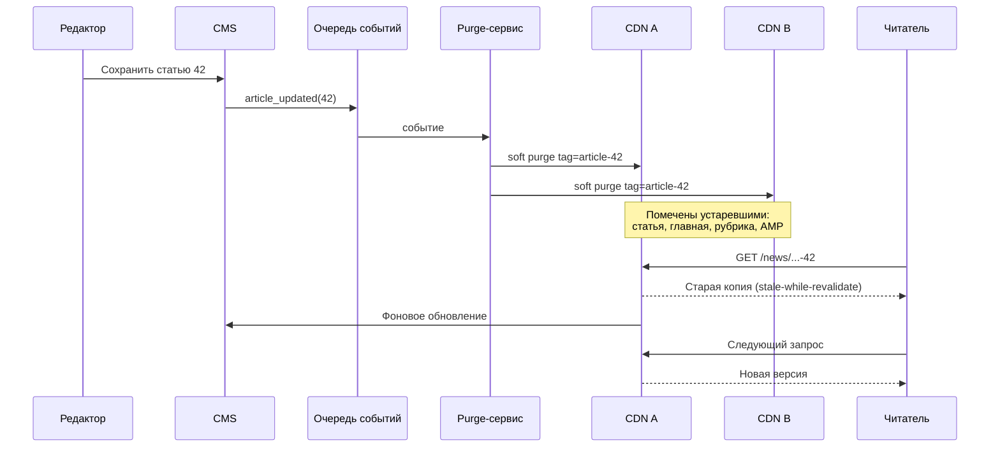
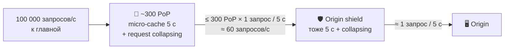
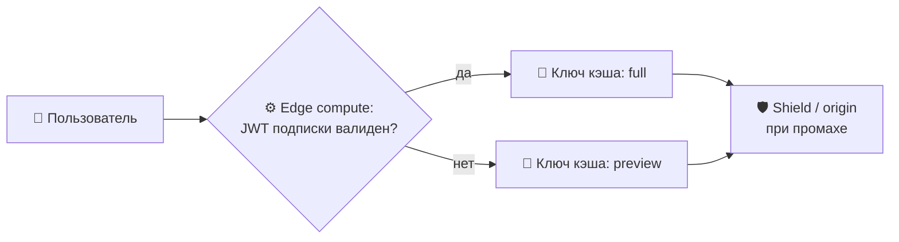

[English](INTERVIEW.md) | **Русский** · Теория: [README_RU.md](./README_RU.md)

# 03. CDN: доставка контента для глобального медиа-сайта

> **Тема:** pull CDN, origin shield, ключи кэша, TTL, purge по тегам, micro-caching, персонализация на edge, видео, signed URLs, multi-CDN
> **Уровень:** Medium–Hard · **Время на интервью:** 45 мин · **Время на разбор:** ~4 ч
> **Где спрашивают:** как отдельный вопрос и как deep dive в задачах про видео, картинки, новости, e-commerce

---

## 🗺️ Как читать этот разбор

| Значок | Что значит |
|:------:|:-----------|
| 🎤 | Реплика интервьюера |
| 🗣️ | Что говорю вслух я (кандидат) |
| ✏️ | Что рисую на доске |
| ⏱️ | Сколько времени тратить на шаг |

Блоки **TIP** — хороший приём, **WARNING** — ловушка, **IMPORTANT** — сигнал для уровня Senior+.

---

## 📑 Содержание

1. [Условие задачи](#1-условие-задачи)
2. [Уточняющие вопросы и требования](#2-уточняющие-вопросы-и-требования)
3. [Оценки нагрузки](#3-оценки-нагрузки)
4. [URL и API](#4-url-и-api)
5. [Политика кэширования по типам контента](#5-политика-кэширования-по-типам-контента)
6. [High-level дизайн: эволюция по этапам](#6-high-level-дизайн-эволюция-по-этапам)
7. [Deep dive 1: ключ кэша и hit ratio](#7-deep-dive-1-ключ-кэша-и-hit-ratio)
8. [Deep dive 2: обновление статей и purge](#8-deep-dive-2-обновление-статей-и-purge)
9. [Deep dive 3: срочная новость и всплеск трафика](#9-deep-dive-3-срочная-новость-и-всплеск-трафика)
10. [Deep dive 4: персонализация и платный контент](#10-deep-dive-4-персонализация-и-платный-контент)
11. [Узкие места и сценарии сбоев](#11-узкие-места-и-сценарии-сбоев)
12. [Что изменится при росте в 10 раз](#12-что-изменится-при-росте-в-10-раз)
13. [Вопросы интервьюера с ответами](#13-вопросы-интервьюера-с-ответами)
14. [Типичные ошибки](#14-типичные-ошибки)
15. [Шпаргалка и самопроверка](#15-шпаргалка-и-самопроверка)

---

## 1. Условие задачи

> 🎤 «У нас глобальный новостной сайт: статьи, фото, видео. Пользователи по всему миру, есть подписка с платным контентом. Во время крупных событий трафик вырастает в 10 раз за минуты. Спроектируй доставку контента».

**План по времени:**

| Шаг | ⏱️ |
|:----|:--:|
| Требования | 5 мин |
| Оценки | 5 мин |
| URL и политика кэширования | 5 мин |
| High-level дизайн | 10 мин |
| Deep dives | 15 мин |
| Сбои и итоги | 5 мин |

> [!TIP]
> В задачах про CDN интервьюера интересует не «поставим Cloudflare», а **политика**: что кэшируется, на сколько, по какому ключу и как обновляется. Сразу раздели контент на типы.

---

## 2. Уточняющие вопросы и требования

⏱️ 5 мин

| Мой вопрос | Ответ интервьюера | Что это меняет |
|:-----------|:------------------|:---------------|
| Какие типы контента? | HTML статей, главная и рубрики, фото, видео (записи и иногда live), JS/CSS | Разные TTL и стратегии для каждого типа |
| Как быстро исправления статьи должны дойти до читателей? | В течение ~10 секунд | Нужен быстрый purge, а не только TTL |
| Есть ли персонализация? | Имя пользователя в шапке, рекомендации, paywall для подписчиков | Нужно отделить общее от персонального |
| Где аудитория? | Весь мир, больше всего Европа и США | Много PoP, origin в одном регионе + shield |
| Что с платным видео? | Только для подписчиков, ссылки нельзя пересылать | Signed URLs |
| Насколько критична доступность? | Сайт должен работать даже при проблемах с origin | `stale-if-error`, возможно multi-CDN |

### Функциональные требования

1. Отдавать статьи, главную, рубрики, фото, видео пользователям по всему миру.
2. Исправления и новые статьи видны читателям в течение ~10 с.
3. Персональные элементы (имя, рекомендации) и paywall для подписчиков.
4. Платное видео доступно только подписчикам.

**Вне рамок:** CMS и процесс написания статей, транскодирование видео, рекомендательный движок.

### Нефункциональные требования

| Требование | Цель |
|:-----------|:-----|
| Latency | TTFB < 100 мс для 95% пользователей по миру |
| Всплески | ×10 за минуты без падения origin |
| Origin offload | ≥ 95% трафика по байтам отдаётся CDN |
| Свежесть | Исправления видны ≤ 10 с; главная может отставать на секунды |
| Доступность | Сайт читается даже при недоступном origin |
| Безопасность | Платный контент недоступен без подписки; персональные данные не утекают через кэш |

---

## 3. Оценки нагрузки

⏱️ 5 мин

✏️

```
DAU                      = 100M
Просмотров страниц/юзер  = 10/день   → 1B просмотров/день
1 день ≈ 10^5 сек        → ~10 000 страниц/с в среднем, пик ×10 ≈ 100 000 страниц/с

Запросов на страницу     ≈ 50 (HTML, картинки, JS, CSS, шрифты)
                         → ~500 000 запросов/с в среднем, ~5M запросов/с в пике

Вес страницы             ≈ 2 МБ
Трафик страниц           ≈ 1B × 2 МБ = 2 ПБ/день ≈ 23 ГБ/с ≈ 185 Гбит/с в среднем

Видео                    = 10M просмотров × 50 МБ = 500 ТБ/день ≈ 46 Гбит/с
```

🗣️ **Выводы:**

- **Без CDN это невозможно:** сотни гигабит в секунду исходящего трафика и миллионы запросов в секунду в пике с одного origin не отдать, и это было бы очень дорого.
- **При byte hit ratio 98%** origin отдаёт ~2% трафика: ~4–5 Гбит/с в среднем. Это уже реально.
- **Главный риск — HTML:** его нельзя кэшировать надолго, а во время событий именно главная и статья о событии получают основной всплеск.

---

## 4. URL и API

⏱️ 3 мин

```http
# HTML
GET https://www.news.example/                       главная
GET https://www.news.example/politics               рубрика
GET https://www.news.example/news/{slug}-{id}       статья

# Персональные данные — отдельно от HTML
GET https://www.news.example/api/v1/me              имя, статус подписки (private)
GET https://www.news.example/api/v1/me/recommendations

# Статика с хэшем в имени
GET https://static.news.example/app.3f9a1c.js

# Картинки: фиксированный набор размеров и форматов
GET https://img.news.example/{image_id}/{w}x{h}.{webp|avif|jpg}

# Видео (HLS)
GET https://video.news.example/{video_id}/master.m3u8
GET https://video.news.example/{video_id}/720p/seg_00042.m4s

# Платное видео: подписанный URL
GET https://video.news.example/{video_id}/master.m3u8?exp=1767225600&sig=...
```

🗣️ Решения:

1. **Персональные данные не встроены в HTML.** HTML статьи одинаков для всех и кэшируется; имя и рекомендации догружаются отдельно.
2. **Отдельные домены** для статики, картинок и видео: разные правила кэша, без cookie основного домена в запросах (меньше заголовков, проще ключ кэша).
3. **Картинки — только фиксированные размеры.** Произвольные `?w=...` позволили бы забить кэш и вычисления миллионами вариантов.

---

## 5. Политика кэширования по типам контента

⏱️ 3 мин

| Контент | Cache-Control от origin | Ключ кэша | Обновление |
|:--------|:------------------------|:----------|:-----------|
| JS, CSS, шрифты | `public, max-age=31536000, immutable` | Путь | Новый хэш в имени |
| Картинки | `public, max-age=2592000` | Путь (размер и формат в пути) | Новый `image_id` при замене |
| HTML статьи | `public, max-age=0, s-maxage=300, stale-while-revalidate=60, stale-if-error=86400` + `Surrogate-Key: article-{id} section-{s}` | Путь, без utm; класс устройства, если вёрстка различается | Purge по тегу |
| Главная, рубрики | `public, max-age=0, s-maxage=5, stale-while-revalidate=30, stale-if-error=86400` + `Surrogate-Key: homepage` | Путь + регион (если главная региональная) | Micro-caching + purge по тегу |
| `/api/v1/me*` | `private, no-store` | — | Не кэшируется |
| Видео-сегменты | `public, max-age=31536000, immutable` | Путь (без `sig` и `exp`) | Не меняются |
| Манифест VOD | `public, max-age=86400` | Путь (без `sig` и `exp`) | — |
| Манифест live | `public, max-age=2` | Путь | Обновляется каждые несколько секунд |

> [!IMPORTANT]
> **Сигнал Senior+:** для HTML `max-age=0` (браузер всегда перепроверяет у CDN), а `s-maxage` управляет CDN. Тогда purge на CDN сразу действует на всех пользователей. Если бы браузер кэшировал HTML на минуты, исправление ошибки в статье не дошло бы до тех, кто её уже открыл.

---

## 6. High-level дизайн: эволюция по этапам

⏱️ 10 мин

### Этап 0. Только origin

✏️



**Проблемы:** большая задержка для далёких пользователей, весь трафик (сотни Гбит/с) идёт с origin, всплеск ×10 кладёт сервис.

### Этап 1. CDN для статики и медиа

✏️



🗣️ «Самое простое и выгодное — статика, картинки и видео через pull CDN поверх объектного хранилища. Это >90% байтов».

**Проблемы:** HTML всё ещё идёт на origin, и именно он падает во время событий.

### Этап 2. HTML через CDN: micro-caching, purge по тегам, origin shield

✏️



🗣️ «HTML тоже идёт через CDN с коротким `s-maxage`. При публикации или правке CMS вызывает purge по тегу. Origin shield собирает промахи сотен PoP, и origin получает в лучшем случае один запрос на объект».

### Этап 3. Финальная схема

✏️



🗣️ «Итоговые принципы:
- **Всё** идёт через CDN, включая HTML и некэшируемые API: даже без кэша выигрываем на терминации TLS рядом с пользователем.
- Общий HTML кэшируется, персональное догружается отдельно и не кэшируется.
- Purge-сервис рассылает инвалидацию по тегам во все CDN.
- Origin закрыт для прямого доступа.
- Edge compute проверяет подписи видео и нормализует ключи без похода на origin».

---

## 7. Deep dive 1: ключ кэша и hit ratio

> 🎤 «Hit ratio для HTML всего 40%. Что будешь проверять?»

🗣️ «В первую очередь — ключ кэша. Типичные причины:

| Причина | Как проявляется | Исправление |
|:--------|:----------------|:------------|
| utm-метки и click ID в URL | Каждая ссылка из соцсетей — новый ключ | Вырезать `utm_*`, `fbclid`, `gclid` из ключа |
| Cookie в ключе или `Vary: Cookie` | У каждого пользователя своя копия | Убрать cookie из ключа для публичного HTML |
| `Vary: User-Agent` | Тысячи вариантов | Нормализовать в `mobile` / `desktop` на edge |
| Разный порядок параметров | `?page=2&sort=new` и `?sort=new&page=2` | Сортировать параметры |
| `Set-Cookie` в ответе | CDN не кэширует ответ | Не ставить cookie в публичных ответах |
| Слишком короткий TTL | Частые промахи | Длиннее `s-maxage` + purge по тегам |
| Нет origin shield | Каждый PoP промахивается отдельно | Включить shield |

Сначала смотрю логи CDN: какие ключи для одной и той же статьи различаются».

> [!WARNING]
> Убирая параметры из ключа, убедись, что origin **тоже** их игнорирует. Если ответ зависит от параметра, которого нет в ключе, разные пользователи получат неправильные ответы. Это та же механика, что у cache poisoning.

---

## 8. Deep dive 2: обновление статей и purge

> 🎤 «Редактор исправил ошибку в заголовке статьи. Как это дойдёт до читателей за 10 секунд?»

🗣️ «Заголовок статьи показывается в нескольких местах: на странице статьи, на главной, в рубрике, в AMP-версии, в RSS. Purge по URL потребовал бы знать все эти URL. Поэтому использую **purge по тегам**:
- origin добавляет к каждому HTML-ответу `Surrogate-Key` со всеми статьями на странице: главная получает `homepage article-41 article-42 ...`, статья — `article-42 section-politics`;
- при сохранении статьи CMS публикует событие, purge-сервис вызывает purge по тегу `article-42` во всех CDN».



🗣️ «Почему **soft purge**: после purge главной следующий запрос из каждого PoP сразу пошёл бы на origin. Во время события главную правят каждые несколько минут, и это превращалось бы в постоянные волны промахов. Soft purge помечает объект устаревшим, первый запрос получает старую копию, а обновление идёт в фоне одним запросом через shield».

> [!TIP]
> Purge-сервис должен **повторять** запросы при ошибках API CDN и иметь очередь. Потерянный purge означает, что ошибка в статье проживёт до истечения `s-maxage`. Поэтому `s-maxage` для статей — минуты, а не часы: это страховка.

---

## 9. Deep dive 3: срочная новость и всплеск трафика

> 🎤 «Происходит крупное событие. За 2 минуты трафик вырос в 10 раз, все открывают главную и одну статью. Что произойдёт?»

🗣️ «Разберу по уровням, сколько запросов дойдёт до origin.

✏️



- **Micro-caching** (`s-maxage=5`): главная обновляется не чаще раза в 5 секунд в каждом PoP.
- **Request collapsing**: если в PoP одновременно пришли тысячи запросов, а объекта нет, наверх уходит один запрос.
- **Origin shield**: собирает запросы всех PoP, и origin получает около одного запроса в 5 секунд, независимо от числа пользователей.
- **stale-while-revalidate**: пользователи не ждут обновления, им сразу отдаётся копия.

То есть нагрузка на origin для **общих** страниц практически не зависит от числа читателей».

> 🎤 «А что тогда упадёт?»

🗣️ «Некэшируемая часть: `/api/v1/me` и рекомендации. Её нагрузка растёт пропорционально пользователям. Защита:
- персональные данные — это мелкие быстрые запросы с кэшем на стороне сервиса (Redis);
- при перегрузке **деградация**: страница работает без персонального блока (клиент скрывает его при ошибке или таймауте);
- rate limiting на edge;
- автоскейлинг API».

> [!IMPORTANT]
> **Сигнал Senior+:** назови, что **не** масштабируется через CDN (персональные запросы, запись, логины), и как система деградирует. Главная страница должна открываться даже тогда, когда персонализация недоступна.

---

## 10. Deep dive 4: персонализация и платный контент

> 🎤 «Как показывать имя пользователя и закрывать статьи paywall'ом, не убивая кэш?»

### Персонализация

| Вариант | Как | Выбор |
|:--------|:----|:------|
| Рендерить имя в HTML на origin | HTML становится персональным, кэш невозможен | ❌ |
| Клиентская догрузка | HTML общий, JS запрашивает `/api/v1/me` | ✅ Основной вариант |
| Edge compute | Код на edge вставляет имя из подписанного cookie в кэшированный HTML | ✅ Если важна скорость отображения без «мигания» |

### Paywall для статей

🗣️ «В кэше храню **две** версии статьи: полную и превью. Edge compute проверяет подписанный cookie подписки (JWT) и выбирает вариант ключа кэша: `article-42:full` или `article-42:preview`. Подпись проверяется на edge, без похода на origin».



### Платное видео

- Плеер получает от API **подписанный URL** манифеста с коротким сроком действия (`exp`) и подписью (`sig`), привязанной к пользователю.
- Edge проверяет подпись и срок для манифеста и сегментов (часто через signed cookie, чтобы не подписывать каждый сегмент).
- `exp` и `sig` **не входят в ключ кэша**: все подписчики используют одни и те же кэшированные сегменты.

> [!WARNING]
> Если оставить `sig` в ключе кэша, у каждого пользователя будет своя копия каждого сегмента, и hit ratio для видео станет почти нулевым. Подпись проверяется, а затем вырезается из ключа.

---

## 11. Узкие места и сценарии сбоев

⏱️ 4 мин

| Сценарий | Что произойдёт | Как защищаемся |
|:---------|:---------------|:---------------|
| Origin недоступен | Промахи и обновления не работают | `stale-if-error` на сутки: читатели видят последние версии страниц |
| Глобальный сбой провайдера CDN | Сайт недоступен | Multi-CDN, DNS steering по health checks, низкий TTL у DNS-записи |
| PoP вышел из строя | Пользователи региона теряют ближайший узел | Anycast или DNS CDN перенаправляют в соседний PoP |
| Потерянный purge | Ошибка в статье видна до истечения `s-maxage` | Очередь и ретраи в purge-сервисе, `s-maxage` в минутах |
| Полный purge по ошибке | Лавина промахов на origin | Запрет полного purge без подтверждения; soft purge; shield; request collapsing |
| Персональный ответ попал в кэш | Утечка данных другим пользователям | `private, no-store` на `/api/v1/me`; CDN не кэширует ответы с `Set-Cookie`; тесты на заголовки |
| Cache poisoning через заголовок | Вредный ответ отдаётся всем | Не использовать в ответах заголовки вне ключа; вырезать лишние заголовки на edge |
| Прямая атака на origin | CDN обходят | Origin принимает только IP CDN + секретный заголовок |
| Перебор размеров картинок | Забивается кэш, нагрузка на ресайз | Только фиксированный набор размеров |

---

## 12. Что изменится при росте в 10 раз

> 🎤 «А если трафик вырастет в 10 раз, а видео станет основным продуктом?»

🗣️ «Исходящий трафик будет измеряться терабитами в секунду. Что меняется:
1. **Собственная CDN или кэширующие серверы у интернет-провайдеров** для видео (как Netflix Open Connect): при таком объёме это дешевле арендованной CDN.
2. **Предзагрузка популярного видео** в узлы в часы низкой нагрузки (push).
3. **Multi-CDN с маршрутизацией по реальным замерам пользователей** (RUM) для каждого региона и провайдера.
4. **Больше логики на edge**: сборка страниц из фрагментов, A/B-тесты, рекомендации из edge key-value хранилищ.
5. **Несколько origin-регионов** с репликацией контента, чтобы shield в каждом регионе ходил в ближайший origin».

---

## 13. Вопросы интервьюера с ответами

<details>
<summary><b>Зачем пускать через CDN некэшируемые запросы, например /api/v1/me?</b></summary>

TLS-хендшейк и TCP заканчиваются на ближайшем edge, а не на далёком origin. Edge держит постоянные соединения к origin и ведёт трафик по оптимизированной сети. Плюс единая точка входа для WAF, DDoS-защиты и rate limiting.
</details>

<details>
<summary><b>Почему не поставить s-maxage для статей на сутки, раз есть purge?</b></summary>

Purge может потеряться (сбой API, баг в purge-сервисе), и тогда ошибка проживёт сутки. Минуты — разумный компромисс: purge даёт свежесть за секунды, а TTL ограничивает ущерб от потерянного purge. С `stale-while-revalidate` короткий TTL почти не стоит пользователям задержки.
</details>

<details>
<summary><b>Чем micro-caching главной отличается от простого короткого TTL?</b></summary>

По сути это и есть очень короткий TTL, но в сочетании с request collapsing, origin shield и stale-while-revalidate. Вместе они делают нагрузку на origin почти постоянной: один запрос в несколько секунд, независимо от числа читателей.
</details>

<details>
<summary><b>Как убедиться, что персональный ответ никогда не закэшируется?</b></summary>

Несколько уровней защиты: персональные данные только на отдельных путях (`/api/v1/me`), там `Cache-Control: private, no-store`; правило CDN «не кэшировать ответы с Set-Cookie и этот путь»; автоматические тесты на заголовки в CI; мониторинг ответов CDN с `Age > 0` на персональных путях.
</details>

<details>
<summary><b>Что делать, если один CDN-провайдер лёг глобально?</b></summary>

Multi-CDN: DNS steering с health checks переключает трафик на второго провайдера. Важно, чтобы второй CDN был «тёплым», то есть уже получал часть трафика, иначе его кэш пуст и origin получит лавину промахов. DNS-запись с коротким TTL ускоряет переключение.
</details>

<details>
<summary><b>Почему отдельные домены для картинок и статики?</b></summary>

Запросы к ним не несут cookie основного домена, поэтому меньше заголовков и проще ключ кэша. Для каждого домена удобно задать свою конфигурацию CDN. При HTTP/2 и HTTP/3 разделение по доменам ради параллелизма уже не нужно, но остальные причины остаются.
</details>

---

## 14. Типичные ошибки

| ❌ Ошибка | ✅ Как правильно |
|:---------|:----------------|
| «Поставим CDN» без политики | Таблица: контент → Cache-Control → ключ → способ обновления |
| `max-age` на HTML в браузере | `max-age=0, s-maxage=...` и purge на CDN |
| Purge по URL для статьи на многих страницах | Purge по тегам (surrogate keys) |
| Hard purge главной при каждой правке | Soft purge + stale-while-revalidate |
| Имя пользователя в общем HTML | Догрузка на клиенте или edge compute |
| Подпись видео в ключе кэша | Проверить подпись и вырезать из ключа |
| Origin открыт напрямую | Только IP CDN + секретный заголовок |
| Один CDN без запасного плана | Multi-CDN с тёплым резервом или хотя бы `stale-if-error` |
| Произвольные размеры картинок через параметры | Фиксированный набор размеров |

---

## 15. Шпаргалка и самопроверка

### Ответ за 30 секунд

> Весь трафик идёт через pull CDN с origin shield. Статика — хэш в имени и TTL на год; картинки — фиксированные размеры с конвертацией на edge; видео — HLS-сегменты с долгим TTL и signed URLs для платного, подпись не в ключе. HTML — `max-age=0, s-maxage` в минутах, purge по тегам (soft) при правках; главная — micro-caching на 5 с с request collapsing. Персональное догружается отдельно и не кэшируется; paywall выбирает вариант на edge по JWT. Origin закрыт для прямого доступа, `stale-if-error` держит сайт при падении origin, multi-CDN — при падении провайдера.

### Самопроверка

- [ ] Могу составить таблицу политики кэширования для 6+ типов контента
- [ ] Могу объяснить, почему для HTML `max-age=0, s-maxage=N`
- [ ] Могу назвать 5+ причин низкого hit ratio и как их исправить
- [ ] Могу объяснить purge по тегам и почему soft purge лучше hard
- [ ] Могу посчитать, сколько запросов дойдёт до origin при всплеске с micro-caching и shield
- [ ] Могу объяснить персонализацию без потери кэша (клиент или edge)
- [ ] Могу объяснить signed URLs для видео и почему подпись не входит в ключ
- [ ] Могу назвать 3 способа защитить origin и 2 атаки на кэш

### Что почитать

- Теория по теме: [README_RU.md](./README_RU.md)
- Документация Fastly по surrogate keys и soft purge
- Документация Cloudflare по cache keys, tiered cache и Workers
- Документация AWS CloudFront по signed URLs и origin shield
- James Kettle, *Practical Web Cache Poisoning*