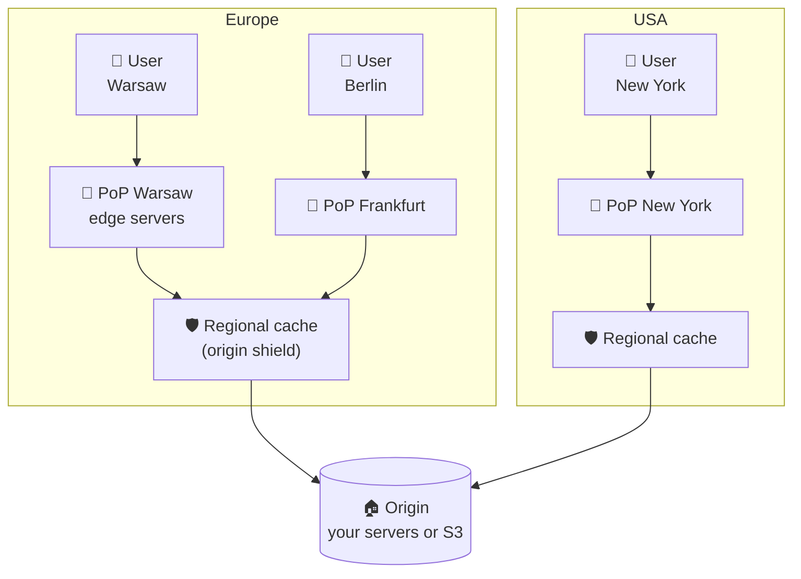
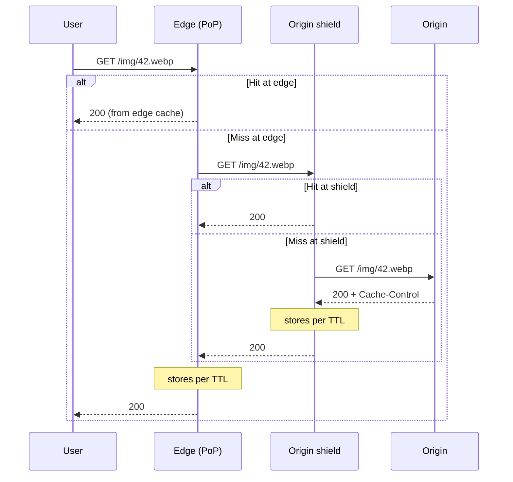
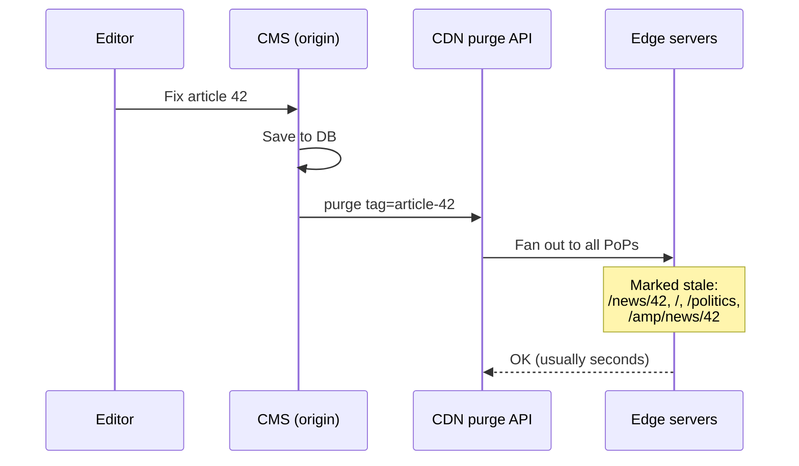
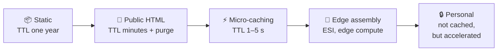

**English** | [Русский](README_RU.md)

# 03. CDN

> **Covers:** how a CDN works, push vs pull, cache keys, TTL and headers, purging, edge caching of dynamic content, security, multi-CDN
> **Study time:** ~3–4 h · **Needed for:** any problem with static assets, media, video or a global audience
> **Practice:** interview-style walkthrough — [INTERVIEW.md](./INTERVIEW.md)
> **Related topics:** [02-caching](../02-caching/README.md), [01-scaling-basics](../01-scaling-basics/README.md)

---

## 📑 Contents

1. [What a CDN Is and Why You Need One](#1-what-a-cdn-is-and-why-you-need-one)
2. [How a CDN Is Built](#2-how-a-cdn-is-built)
3. [How Users Reach the Nearest Node](#3-how-users-reach-the-nearest-node)
4. [Pull vs Push](#4-pull-vs-push)
5. [Request Path: Hit, Miss and Origin Shield](#5-request-path-hit-miss-and-origin-shield)
6. [The Cache Key](#6-the-cache-key)
7. [TTL and Cache-Control Headers](#7-ttl-and-cache-control-headers)
8. [Purging and Invalidation](#8-purging-and-invalidation)
9. [Dynamic Content at the Edge](#9-dynamic-content-at-the-edge)
10. [Media and Video](#10-media-and-video)
11. [Security](#11-security)
12. [Multi-CDN, Cost and Metrics](#12-multi-cdn-cost-and-metrics)
13. [How to Talk About This in an Interview](#13-how-to-talk-about-this-in-an-interview)
14. [Self-Check Questions](#14-self-check-questions)
15. [Glossary and Resources](#15-glossary-and-resources)

---

## 1. What a CDN Is and Why You Need One

A **CDN (Content Delivery Network)** is a network of servers around the world that store copies of content and serve users from the nearest location, instead of every request going to your server (the origin).

**Analogy:** instead of one big warehouse in the capital, a retail chain has small warehouses in every city. Popular goods sit close to the buyer; rare items still require a trip to the central warehouse.

### What a CDN gives you

| Benefit | Why |
|:--------|:----|
| **Lower latency** | The speed of light is finite: a Warsaw–New York round trip is about 90 ms. Each TCP and TLS handshake costs 1–2 round trips. An edge 10 ms from the user saves hundreds of milliseconds |
| **Less origin load** | At a 95% byte hit ratio, the origin serves only 5% of traffic |
| **Cheaper bandwidth** | Cloud egress is expensive; a CDN is usually cheaper and reduces the volume leaving the origin |
| **Protection** | The CDN absorbs DDoS attacks, filters requests (WAF) and hides the origin's address |
| **Availability** | When the origin is down, the CDN can serve stale content (`stale-if-error`) |
| **Optimizations** | HTTP/2 and HTTP/3, compression (gzip, Brotli), on-the-fly image conversion and resizing |

### Why latency matters so much

```
Without a CDN (user in Warsaw, origin in New York, RTT ≈ 90 ms):
  TCP handshake         1 RTT  =  90 ms
  TLS 1.3 handshake     1 RTT  =  90 ms
  HTTP request/response 1 RTT  =  90 ms
  Total                       ≈ 270 ms (excluding server processing time)

With a CDN (edge in Frankfurt, RTT ≈ 15 ms):
  TCP + TLS + HTTP      3 RTT  ≈  45 ms on a cache hit
```

> [!NOTE]
> Even on a miss, a CDN helps: the edge keeps open, warm connections to the origin and often routes traffic over its own fast network. The user pays for handshakes only to the nearest edge.

---

## 2. How a CDN Is Built



| Component | What it is |
|:----------|:-----------|
| **Origin** | The content source: your servers, load balancer or object storage |
| **PoP (Point of Presence)** | A CDN site in a specific city: dozens to hundreds of servers |
| **Edge server** | A server in a PoP that accepts user requests and holds the cache (RAM + SSD) |
| **Regional cache / origin shield** | An intermediate tier between the edges and the origin. Collects misses from many PoPs so the origin gets fewer requests |
| **Control plane** | Configuration, purges, certificates, analytics |

### Tiered caching

Without an intermediate tier, each of hundreds of PoPs goes to the origin on its own when it misses. One new file can trigger hundreds of origin requests. With an origin shield, misses from different PoPs are collected in one place, and the origin gets **one** request.

> [!TIP]
> In an interview it's worth saying: "I'll enable an origin shield in a region close to the origin." It shows you understand the multiple-miss problem with many PoPs.

---

## 3. How Users Reach the Nearest Node

| Approach | How it works | Pros | Cons |
|:---------|:-------------|:-----|:-----|
| **DNS-based routing** | Your domain is a CNAME to the CDN. The CDN's DNS returns the IP of the nearest PoP based on the resolver's location, load and PoP health | Flexible control, load-aware | Locates the resolver, not the user (partly solved by EDNS Client Subnet); switching depends on DNS TTL |
| **Anycast** | The same IP is announced from every PoP; BGP routes packets to the "nearest" by network topology | Fast failover, natural DDoS protection | Less control over PoP selection; the route can change mid-connection |

Many large CDNs use Anycast, and some combine it with DNS-based routing.

---

## 4. Pull vs Push

| | Pull CDN | Push CDN |
|:-|:---------|:---------|
| How content gets there | The edge fetches the object from the origin on the first request | You upload content to the CDN in advance |
| First request | A miss, goes to the origin | Immediately a hit |
| What's stored | Only what's actually requested | Everything you uploaded |
| Control | Via TTL and headers | You decide when to upload and delete |
| Origin load | Yes, on misses | Almost none |
| Fits | Websites, APIs, images — most cases | Large, known-in-advance files: software updates, games, video before a premiere |

> [!NOTE]
> "Push" is often implemented like this: the origin is object storage (S3), you upload files there, and the CDN works in pull mode on top of it. For known hot files you additionally **prefetch / warm up** — request them through the CDN before release.

---

## 5. Request Path: Hit, Miss and Origin Shield



### Request collapsing

If thousands of users request a **new** object at once that isn't cached yet, the edge doesn't send thousands of requests to the origin. It sends **one**, and the rest wait for its response. This is the CDN version of single flight from the [caching](../02-caching/README.md#8-common-problems-stampede-penetration-avalanche-hot-keys) topic.

### What happens to an expired object

When the TTL expires, the edge doesn't necessarily download the object again. It sends a **conditional request** (`If-None-Match` with the ETag). If the object hasn't changed, the origin responds `304 Not Modified` with no body, and the edge extends the copy's lifetime. This is cheap in bandwidth.

---

## 6. The Cache Key

The **cache key** determines which requests are considered "the same" and get the same cached response.

By default the key is usually: **scheme + host + path + query string**.

### What kills the hit ratio

| Problem | Example | Fix |
|:--------|:--------|:----|
| Extra query parameters | `?utm_source=fb`, `?fbclid=...` — every click is a new key | Exclude marketing parameters from the key |
| Parameter order | `?a=1&b=2` vs `?b=2&a=1` | Sort parameters during normalization |
| Case | `/Image.PNG` vs `/image.png` | Normalize case if the origin doesn't distinguish it |
| `Vary: User-Agent` | Thousands of User-Agent strings → thousands of copies | Normalize to a device class (`mobile` / `desktop`) |
| `Vary: Cookie` | Each user has their own cookies → caching effectively off | Don't cache responses with personal cookies, or strip cookies from the key |
| Random client parameters | `?_=1700000000` to "bust the cache" | Strip from the key or disallow |

### The Vary header

`Vary` tells the cache: "the response depends on this request header; store separate copies".

| Value | Good or bad |
|:------|:------------|
| `Vary: Accept-Encoding` | ✅ Fine: only a few variants (br, gzip, none) |
| `Vary: Accept` | ⚠️ For choosing an image format (WebP/AVIF), better to normalize the value |
| `Vary: Accept-Language` | ⚠️ Normalize to the list of supported languages |
| `Vary: User-Agent` | ❌ Nearly destroys the hit ratio |
| `Vary: Cookie` | ❌ Nearly destroys the hit ratio |

> [!WARNING]
> The opposite problem is more dangerous: if a response **depends** on a header or cookie that is **not** part of the key, the CDN will serve one user a response intended for another. That's how personal data leaks and cache poisoning attacks happen (see [section 11](#11-security)).

---

## 7. TTL and Cache-Control Headers

### Who sets the TTL

1. **The origin via response headers** — the preferred way: rules live next to the code.
2. **Rules in the CDN configuration** — override headers for paths (e.g. `/static/*` — one year).
3. **The CDN default** — if nothing is set.

### Headers

| Header | For whom | Example |
|:-------|:---------|:--------|
| `Cache-Control: max-age=N` | Browser and CDN | `max-age=60` |
| `Cache-Control: s-maxage=N` | Shared caches only (CDN, proxies); takes precedence over `max-age` | `max-age=0, s-maxage=300` — the browser always revalidates, the CDN keeps it 5 minutes |
| `CDN-Cache-Control` | CDN only (RFC 9213) | Separate CDN control that doesn't affect browsers or proxies |
| `Surrogate-Control` | CDN only (supported by some providers) | Same idea, older variant |
| `stale-while-revalidate=N` | May serve stale for N seconds while refreshing in the background | The user doesn't wait for the refresh |
| `stale-if-error=N` | On an origin error, may serve stale for N seconds | The site keeps working when the origin is down |
| `private` | Browser only; the CDN doesn't cache | Personal pages |
| `no-store` | Nobody caches | Sensitive data |

### Typical policy by content type

| Content | Headers | Why |
|:--------|:--------|:----|
| JS, CSS, fonts with a hash in the name | `public, max-age=31536000, immutable` | The name changes when the file changes |
| Images by ID | `public, max-age=86400` | Rarely change; on replacement — new ID or purge |
| Public HTML page | `public, max-age=0, s-maxage=60, stale-while-revalidate=300` | The browser always revalidates; the CDN keeps it a minute and refreshes in the background |
| Public API response | `public, s-maxage=5, stale-while-revalidate=30` | Micro-caching |
| Personal page / API | `private, no-cache` or `no-store` | Must not end up in a shared cache |

> [!TIP]
> **Versioned URLs** (`app.3f9a1c.js`) are more reliable than any purge: a new version is a new URL, and the old one doesn't need deleting. That's why static assets get a one-year TTL.

---

## 8. Purging and Invalidation

A **purge** forcibly removes (or marks stale) an object in the CDN cache before its TTL expires.

### Types of purge

| Type | How it works | When to use |
|:-----|:-------------|:------------|
| **By URL** | Remove a specific address | One page or image changed |
| **By prefix / wildcard** | Remove everything under `/news/2026/*` | Bulk section changes; not supported everywhere and may be slower |
| **By tag (surrogate keys / cache tags)** | The origin tags responses (`Surrogate-Key: article-42 author-7`); a purge by tag removes every object with it | One change affects many URLs: an article appears on the homepage, in a section, in an AMP version |
| **Full purge** | Remove everything | Emergencies only. Causes an avalanche of misses on the origin |
| **Soft purge** | Mark the object stale rather than delete it | The next request gets the stale copy while the object refreshes in the background. No origin load spike |

### Example: purge by tag



```http
HTTP/1.1 200 OK
Cache-Control: public, s-maxage=300, stale-while-revalidate=60
Surrogate-Key: article-42 section-politics author-7 homepage
```

### Things to remember

- **Purges aren't instant:** propagation across all PoPs takes from a fraction of a second to minutes, depending on the provider.
- **Purges don't touch browsers:** if a browser cached a response via `max-age`, a CDN purge won't affect it. That's why HTML often uses `max-age=0, s-maxage=...`.
- **Limits and cost:** providers limit purge rate and count.
- **Full purges are dangerous:** every PoP goes to the origin at once (cache avalanche).

> [!IMPORTANT]
> **Senior+ signal:** the order of preference — **versioned URLs** for static assets, **purge by tag** (preferably soft) for HTML and APIs, **short TTL + stale-while-revalidate** as a safety net. A full purge is an emergency tool only.

---

## 9. Dynamic Content at the Edge

CDNs originally cached only static assets. Today the line is blurred, and almost any traffic can be accelerated at the edge.

### The spectrum



### 1. Micro-caching

Caching "dynamic" responses for **1–5 seconds**. It sounds useless, but at 10,000 requests per second to one page, the origin gets **one** request per second from each caching node instead of 10,000.

- ✅ Massive load reduction during spikes (a news homepage during a major event).
- ❌ Data is a few seconds stale — acceptable for most public pages.

### 2. Splitting the page into shared and personal parts

Most "personal" pages are 90% the same for everyone. Options:

| Approach | How it works | Pros and cons |
|:---------|:-------------|:--------------|
| **Client-side fetch** | The CDN serves the shared page; the browser fetches personal data (name, cart) with a separate request | ✅ Simple; the page is cacheable. ❌ An extra request, UI "flicker" |
| **ESI (Edge Side Includes)** | The HTML has include tags; the edge assembles the page from fragments with different TTLs | ✅ Assembly close to the user. ❌ Dated technology, limited support |
| **Edge compute** | Your code runs in the PoP (e.g. Cloudflare Workers, AWS Lambda@Edge / CloudFront Functions, Fastly Compute) | ✅ Flexible: page assembly, personalization, A/B, token checks. ❌ Time and memory limits, harder debugging, vendor lock-in |

### 3. What you can do with edge compute

- Verify JWTs and reject unauthorized requests before they reach the origin.
- A/B tests: pick a variant and rewrite the URL.
- Normalize the cache key, redirects, geo-blocking.
- Assemble responses from several cached parts.
- Store small data in edge key-value stores (configs, feature flags).

### 4. Acceleration without caching (dynamic site acceleration)

Even when a response can't be cached (payments, account pages), a CDN helps:
- the TLS handshake ends at the nearest edge;
- the edge keeps persistent connections to the origin (no handshake per request);
- traffic travels over the provider's optimized network rather than a random internet path.

> [!WARNING]
> The main danger when caching dynamic content is **caching a personal response** — for example, a page with a user's name or a response with `Set-Cookie`. Then everyone else gets someone else's data or session. Rule: responses with `Set-Cookie` and personal data are `private` or `no-store`, and the CDN is configured not to cache them by default.

---

## 10. Media and Video

### Images

- **Transformation at the edge:** resizing and conversion to WebP/AVIF based on URL parameters (`/img/42?w=400&fmt=avif`). The origin stores a single original.
- **Limit the variants:** allow only a fixed set of sizes, or an attacker can request millions of variants and flood the cache and compute.

### Video (VOD and live)

Video is split into **segments** of 2–6 seconds in several qualities (HLS or DASH). The player downloads a manifest (the list of segments) and the segments themselves, choosing quality based on network speed (adaptive bitrate).

| Object | TTL | Why |
|:-------|:---:|:----|
| VOD segments | Long (days–a year) | Never change |
| VOD manifest | Long | Doesn't change |
| Live segments | Long | Don't change once created |
| Live manifest | 1–2 s | Updated with every new segment |

- **Range requests:** large files (installers, long videos) are served in parts; the CDN caches by chunks.
- **The long tail:** popular videos cache well, millions of rare ones don't. For those, tiered caching and large SSDs in regional nodes matter.
- **The biggest players build their own CDNs:** for example, Netflix Open Connect places caching servers directly inside ISPs and preloads popular content there during off-peak hours (essentially push).

---

## 11. Security

| Threat or task | Solution |
|:---------------|:---------|
| **DDoS** | The CDN's huge aggregate capacity and Anycast spread an attack across many PoPs; rate limiting at the edge |
| **Application attacks** | WAF at the edge (SQL injection, bots) |
| **Direct requests to the origin bypassing the CDN** | Allow only CDN IPs at the origin; a secret header from the CDN to the origin; mTLS or a private connection |
| **Private content** (paid videos, documents) | **Signed URLs / signed cookies**: the URL contains an expiry and a signature (`?expires=...&sig=...`); the edge verifies the signature without contacting the origin |
| **Hotlinking** (other sites using your images) | Referer checks or signed URLs |
| **Cache poisoning** | An attacker sends a request with a header that affects the response but isn't part of the key (e.g. `X-Forwarded-Host`). The poisoned response is cached and served to everyone. Defense: never use headers outside the key in the response; normalize and strip extra headers at the edge |
| **Cache deception** | An attacker tricks the CDN into caching a personal page, e.g. `/account/profile.css`, if the origin ignores ".css" and returns the profile while the CDN caches anything ending in `.css`. Defense: cache based on the origin's `Cache-Control`, not the extension; the origin should return 404 for non-existent paths |
| **TLS** | Certificates at the edge (often automatic), HTTPS between the CDN and the origin too |

---

## 12. Multi-CDN, Cost and Metrics

### Multi-CDN

Large companies use several providers at once.

| Why | How |
|:----|:----|
| Fault tolerance: every provider has global outages | DNS steering between CDNs based on health |
| Performance: different providers are better in different regions | Routing based on real user measurements (RUM) |
| Price and negotiating leverage | Distributing traffic by cost |

**The cost:** different configurations, different purge APIs, different cache-key logic. You need an abstraction layer, and purges must be fanned out to every CDN.

### Cost

- The main expense is **egress bandwidth** (per GB), often with volume discounts.
- Plus: requests, purges, edge compute, WAF.
- The main lever for savings is **origin offload**: every percentage point of byte hit ratio reduces expensive cloud egress.

### Metrics

| Metric | What it shows |
|:-------|:--------------|
| **Cache hit ratio (by requests)** | Share of requests served from cache |
| **Byte hit ratio** | Share of **bytes** from cache. Usually more important for cost: one miss on a video weighs more than a thousand misses on small files |
| **Origin offload** | How much the CDN offloads the origin in traffic and requests |
| **TTFB by region and PoP** | Time to first byte; shows problem regions |
| **5xx errors at the edge and the origin** | Separates CDN problems from origin problems |
| **Purge propagation time** | How quickly changes reach users |

---

## 13. How to Talk About This in an Interview

### 30-second answer

> "I put a pull CDN with an origin shield in front of the origin. Static assets get a hash in the name and a one-year TTL; public HTML gets `s-maxage` in minutes with `stale-while-revalidate` and purge by tag on changes; public APIs get micro-caching for seconds. I don't cache personal responses, but they're still accelerated through TLS termination at the edge. I normalize the cache key — strip utm parameters and extra headers. The origin only accepts traffic from the CDN, private content goes through signed URLs, and `stale-if-error` keeps the site up when the origin is down."

### Where to mention a CDN in typical problems

| Problem | What the CDN provides |
|:--------|:----------------------|
| YouTube / Netflix | Video segments, ABR, tiered caching, the long tail |
| Instagram, any images | Resizing and format at the edge, long TTL |
| News site | Homepage micro-caching, purge by tag |
| E-commerce | Static assets and public product pages; checkout bypasses the cache |
| Software and game updates | Push / prefetch, range requests |
| Any global API | TLS termination at the edge, DDoS protection, WAF |

### Common mistakes

- Saying "we'll add a CDN" without a TTL, key and invalidation policy.
- Caching HTML in the browser with `max-age` — impossible to fix later.
- Relying on a full purge for every change.
- Forgetting personal responses and `Set-Cookie` — a data leak.
- `Vary: User-Agent` or cookies in the key — hit ratio near zero.
- Leaving the origin open to direct access.

---

## 14. Self-Check Questions

<details>
<summary><b>1. Why does a CDN speed up even uncacheable requests?</b></summary>

The TLS handshake and TCP connection end at the nearest edge (short RTT), and the edge keeps persistent warm connections to the origin and often routes traffic over its own optimized network. The user pays for handshakes only up to the edge.
</details>

<details>
<summary><b>2. Why do you need an origin shield?</b></summary>

Without it, every PoP goes to the origin on its own when it misses, and one new object can trigger hundreds of requests. The shield is an intermediate cache that collects misses from many PoPs, so the origin gets one request. This raises the hit ratio and reduces origin load.
</details>

<details>
<summary><b>3. Pull or push for a site with user-uploaded images?</b></summary>

Pull: content appears constantly, nobody knows in advance what will be viewed, and only what's actually requested should be cached. Push (or prefetch) fits large, known-in-advance files, such as a game patch before release.
</details>

<details>
<summary><b>4. Why is `Vary: User-Agent` bad for a CDN?</b></summary>

There are thousands of User-Agent strings, and a separate copy of the response is stored for each. The hit ratio drops to nearly zero. Normalize User-Agent into a small set of classes (mobile/desktop) and use that in the key.
</details>

<details>
<summary><b>5. Why `max-age=0, s-maxage=60` for HTML?</b></summary>

The CDN keeps the page for 60 seconds, and it can be cleared with a purge. The browser always revalidates with the CDN, so a fix made via purge reaches users immediately. If the browser cached HTML via `max-age`, a page already cached by a user couldn't be changed.
</details>

<details>
<summary><b>6. What is purge by tag and when do you need it?</b></summary>

The origin tags responses with a header (e.g. `Surrogate-Key: article-42`). A purge by tag removes every object with that tag, no matter how many URLs contain it. You need it when one change (an article) appears on many pages: the article itself, the homepage, a section, the AMP version.
</details>

<details>
<summary><b>7. Why is a soft purge better than a regular one?</b></summary>

A soft purge marks the object stale but doesn't delete it. The next request gets the old copy while a fresh one loads in the background. The origin doesn't get a spike of misses, and users don't wait.
</details>

<details>
<summary><b>8. What is micro-caching and why does it work?</b></summary>

Caching dynamic responses for 1–5 seconds. With thousands of requests per second to one page, the origin gets just one request every few seconds from each node. Data is only seconds stale, which is usually acceptable for public pages.
</details>

<details>
<summary><b>9. How do you serve paid video through a CDN so the link can't simply be shared?</b></summary>

Signed URLs or signed cookies: the link contains an expiry and a cryptographic signature (sometimes bound to the user or IP). The edge verifies the signature itself, without contacting the origin. The expiry is short, so a shared link quickly stops working.
</details>

<details>
<summary><b>10. How is cache poisoning different from cache deception?</b></summary>

Cache poisoning: the attacker gets a **malicious** response into the cache (via a header that affects the response but isn't in the key), and every user receives it. Cache deception: the attacker tricks the CDN into caching **someone else's personal** response, then reads it from the cache.
</details>

---

## 15. Glossary and Resources

### Glossary

| Term | Meaning |
|:-----|:--------|
| Origin | The original server or storage for content |
| PoP | Point of Presence: a CDN site in a specific city |
| Edge | A CDN server that serves users |
| Origin shield | An intermediate cache between the edges and the origin |
| Pull / push CDN | The edge fetches content itself / content is uploaded in advance |
| Cache key | The set of request attributes that identifies a cached copy |
| Vary | A header listing which request headers the response depends on |
| Purge | Forcibly removing an object from the CDN cache |
| Surrogate key / cache tag | A response label for group purges |
| Soft purge | Marking an object stale instead of deleting it |
| Micro-caching | Caching dynamic responses for seconds |
| Request collapsing | Merging concurrent misses into one origin request |
| ESI | Edge Side Includes: assembling a page from fragments at the edge |
| Edge compute | Running code in a CDN PoP |
| Signed URL | A URL with an expiry and a signature for accessing private content |
| Byte hit ratio | Share of bytes served from cache |
| Origin offload | Share of traffic the CDN takes off the origin |

### Resources

- Nygren, Sitaraman, Sun, *The Akamai Network: A Platform for High-Performance Internet Applications* (2010)
- Dilley et al., *Globally Distributed Content Delivery* (IEEE Internet Computing, 2002)
- RFC 9111 (HTTP Caching), RFC 5861 (stale-while-revalidate, stale-if-error), RFC 9213 (Targeted HTTP Cache Control, `CDN-Cache-Control`)
- James Kettle, *Practical Web Cache Poisoning* (PortSwigger Research, 2018)
- Omer Gil, *Web Cache Deception Attack* (2017)
- Cloudflare, Fastly, Akamai and AWS CloudFront documentation: cache keys, purging, edge compute
- Netflix Tech Blog: Open Connect