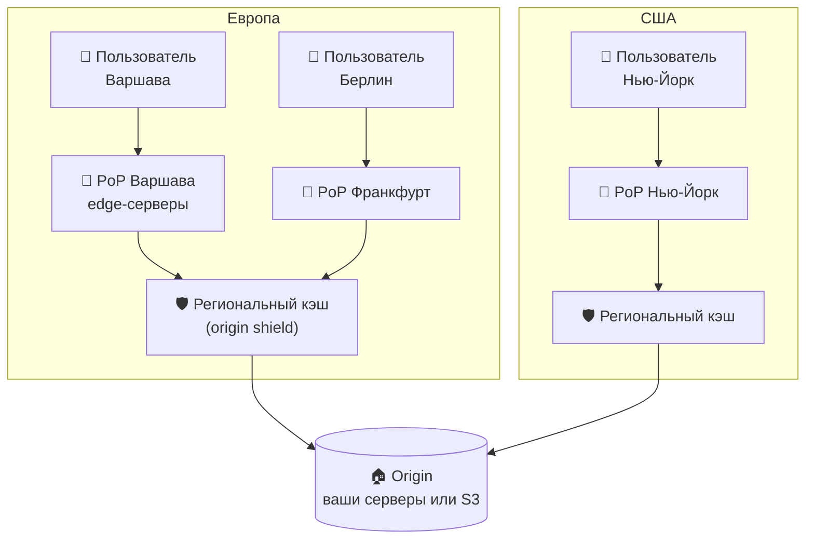
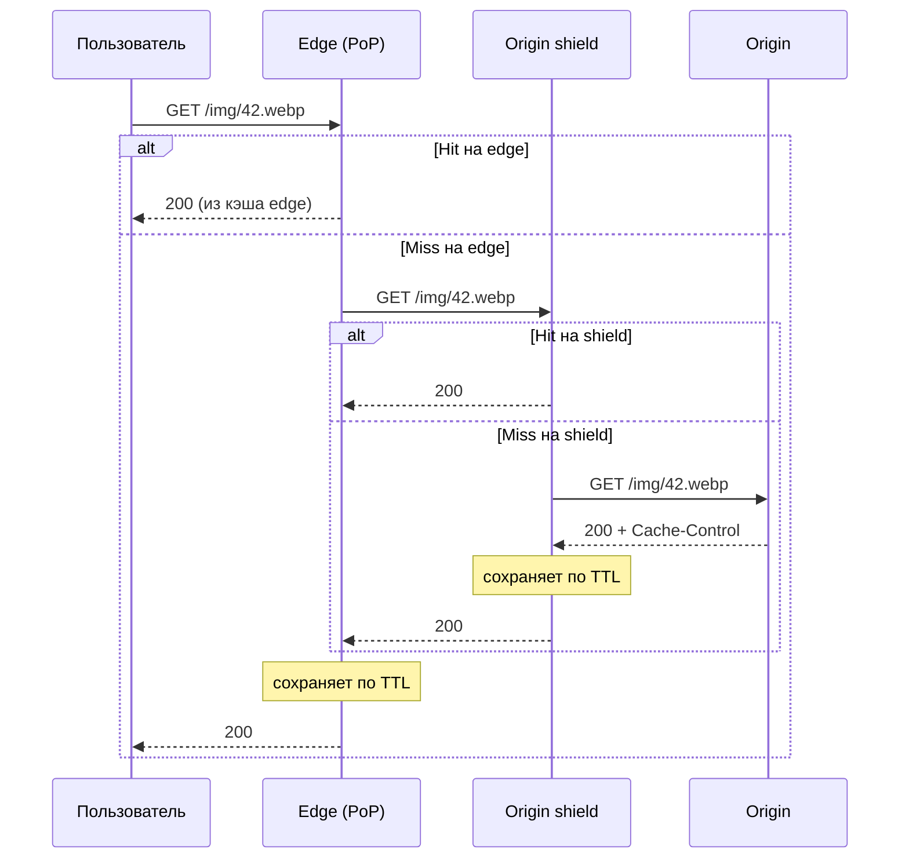
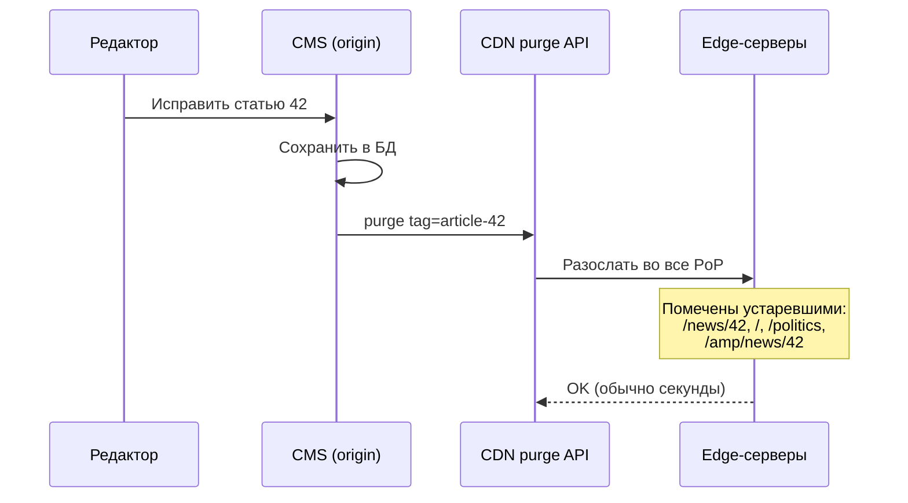
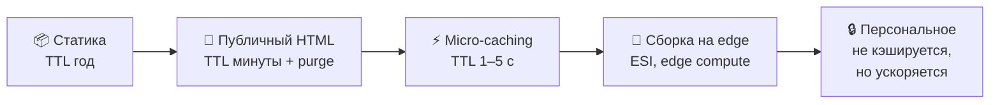

[English](README.md) | **Русский**

# 03. CDN

> **Что внутри:** как устроена CDN, push vs pull, ключи кэша, TTL и заголовки, purge, кэширование динамического контента на edge, безопасность, multi-CDN
> **Время на изучение:** ~3–4 ч · **Нужно для:** любой задачи со статикой, медиа, видео или глобальной аудиторией
> **Практика:** разбор в формате интервью — [INTERVIEW_RU.md](./INTERVIEW_RU.md)
> **Связанные темы:** [02-caching](../02-caching/README_RU.md), [01-scaling-basics](../01-scaling-basics/README_RU.md)

---

## 📑 Содержание

1. [Что такое CDN и зачем она нужна](#1-что-такое-cdn-и-зачем-она-нужна)
2. [Как устроена CDN](#2-как-устроена-cdn)
3. [Как пользователь попадает на ближайший узел](#3-как-пользователь-попадает-на-ближайший-узел)
4. [Pull vs push](#4-pull-vs-push)
5. [Путь запроса: hit, miss и origin shield](#5-путь-запроса-hit-miss-и-origin-shield)
6. [Ключ кэша](#6-ключ-кэша)
7. [TTL и заголовки управления кэшем](#7-ttl-и-заголовки-управления-кэшем)
8. [Purge и инвалидация](#8-purge-и-инвалидация)
9. [Динамический контент на edge](#9-динамический-контент-на-edge)
10. [Медиа и видео](#10-медиа-и-видео)
11. [Безопасность](#11-безопасность)
12. [Multi-CDN, стоимость и метрики](#12-multi-cdn-стоимость-и-метрики)
13. [Как говорить об этом на интервью](#13-как-говорить-об-этом-на-интервью)
14. [Вопросы для самопроверки](#14-вопросы-для-самопроверки)
15. [Глоссарий и ресурсы](#15-глоссарий-и-ресурсы)

---

## 1. Что такое CDN и зачем она нужна

**CDN (Content Delivery Network)** — это сеть серверов по всему миру, которые хранят копии контента и отдают его пользователям из ближайшей точки, вместо того чтобы каждый запрос шёл на ваш сервер (origin).

**Аналогия:** вместо одного большого склада в столице у сети магазинов есть небольшие склады в каждом городе. Популярные товары лежат рядом с покупателем, а за редкими приходится ездить на центральный склад.

### Что даёт CDN

| Выгода | Почему |
|:-------|:-------|
| **Меньше latency** | Скорость света ограничена: round trip Варшава — Нью-Йорк около 90 мс. Каждый TCP- и TLS-хендшейк стоит 1–2 round trip'а. Edge в 10 мс от пользователя экономит сотни миллисекунд |
| **Меньше нагрузки на origin** | При byte hit ratio 95% origin отдаёт только 5% трафика |
| **Дешевле трафик** | Исходящий трафик из облака дорогой; CDN обычно дешевле и снижает объём, уходящий с origin |
| **Защита** | CDN поглощает DDoS-атаки, фильтрует запросы (WAF), скрывает адрес origin |
| **Доступность** | При недоступности origin CDN может отдавать устаревший контент (`stale-if-error`) |
| **Оптимизации** | HTTP/2 и HTTP/3, сжатие (gzip, Brotli), конвертация и ресайз картинок на лету |

### Почему latency так важна

```
Без CDN (пользователь в Варшаве, origin в Нью-Йорке, RTT ≈ 90 мс):
  TCP handshake         1 RTT  =  90 мс
  TLS 1.3 handshake     1 RTT  =  90 мс
  HTTP запрос/ответ     1 RTT  =  90 мс
  Итого                       ≈ 270 мс (без учёта времени работы сервера)

С CDN (edge во Франкфурте, RTT ≈ 15 мс):
  TCP + TLS + HTTP      3 RTT  ≈  45 мс при cache hit
```

> [!NOTE]
> Даже при промахе CDN помогает: edge держит уже открытые и «прогретые» соединения к origin и часто ведёт трафик по собственной быстрой сети. Пользователь платит хендшейками только до ближайшего edge.

---

## 2. Как устроена CDN



| Компонент | Что это |
|:----------|:--------|
| **Origin** | Источник контента: ваши серверы, балансировщик или объектное хранилище |
| **PoP (Point of Presence)** | Площадка CDN в конкретном городе: десятки–сотни серверов |
| **Edge-сервер** | Сервер в PoP, который принимает запросы пользователей и хранит кэш (RAM + SSD) |
| **Региональный кэш / origin shield** | Промежуточный уровень между edge и origin. Собирает промахи многих PoP, чтобы origin получал меньше запросов |
| **Control plane** | Конфигурация, purge, сертификаты, аналитика |

### Многоуровневый кэш (tiered caching)

Без промежуточного уровня каждый из сотен PoP при промахе идёт на origin сам. Один новый файл может вызвать сотни запросов к origin. С origin shield промахи разных PoP собираются в одном месте, и origin получает **один** запрос.

> [!TIP]
> На интервью полезно сказать: «Включу origin shield в регионе рядом с origin». Это показывает, что ты понимаешь проблему множественных промахов при большом числе PoP.

---

## 3. Как пользователь попадает на ближайший узел

| Способ | Как работает | Плюсы | Минусы |
|:-------|:-------------|:------|:-------|
| **DNS-маршрутизация** | Домен — это CNAME на CDN. DNS CDN отвечает IP ближайшего PoP с учётом расположения резолвера, нагрузки и здоровья PoP | Гибкое управление, учёт нагрузки | Определяет местоположение резолвера, а не пользователя (частично решает EDNS Client Subnet); переключение зависит от TTL DNS |
| **Anycast** | Один и тот же IP анонсируется из всех PoP; BGP ведёт пакеты в «ближайший» по сетевой топологии | Быстрое переключение при отказе, естественная защита от DDoS | Меньше контроля над выбором PoP; маршрут может смениться посреди соединения |

Многие крупные CDN используют Anycast, некоторые комбинируют его с DNS-маршрутизацией.

---

## 4. Pull vs push

| | Pull CDN | Push CDN |
|:-|:---------|:---------|
| Как попадает контент | Edge сам забирает объект с origin при первом запросе | Вы заранее загружаете контент в CDN |
| Первый запрос | Промах, идёт на origin | Сразу hit |
| Что хранится | Только то, что реально запрашивают | Всё, что загрузили |
| Управление | Через TTL и заголовки | Вы сами решаете, когда загрузить и удалить |
| Нагрузка на origin | Есть, при промахах | Почти нет |
| Подходит для | Сайтов, API, картинок — большинства задач | Больших, заранее известных файлов: обновления ПО, игры, видео перед премьерой |

> [!NOTE]
> «Push» часто реализуется так: origin — это объектное хранилище (S3), вы загружаете файлы туда, а CDN работает в pull-режиме поверх него. Для заранее известных горячих файлов дополнительно делают **prefetch / warm-up** — запрашивают их через CDN до релиза.

---

## 5. Путь запроса: hit, miss и origin shield



### Request collapsing

Если тысячи пользователей одновременно запрашивают **новый** объект, которого ещё нет в кэше, edge не отправляет тысячи запросов на origin. Он отправляет **один**, а остальные запросы ждут его ответа. Это CDN-версия single flight из темы [кэширования](../02-caching/README_RU.md#8-типичные-проблемы-stampede-penetration-avalanche-горячие-ключи).

### Что происходит с устаревшим объектом

Когда TTL истёк, edge не обязательно скачивает объект заново. Он отправляет **условный запрос** (`If-None-Match` с ETag). Если объект не изменился, origin отвечает `304 Not Modified` без тела, и edge продлевает срок жизни копии. Это дёшево по трафику.

---

## 6. Ключ кэша

**Ключ кэша** определяет, какие запросы считаются «одинаковыми» и получат один и тот же кэшированный ответ.

По умолчанию ключ обычно состоит из: **схема + host + путь + query string**.

### Что убивает hit ratio

| Проблема | Пример | Решение |
|:---------|:-------|:--------|
| Лишние query-параметры | `?utm_source=fb`, `?fbclid=...` — каждый клик даёт новый ключ | Исключить маркетинговые параметры из ключа |
| Разный порядок параметров | `?a=1&b=2` и `?b=2&a=1` | Сортировать параметры при нормализации |
| Регистр | `/Image.PNG` и `/image.png` | Нормализовать регистр, если origin его не различает |
| `Vary: User-Agent` | Тысячи разных строк User-Agent → тысячи копий | Нормализовать в класс устройства (`mobile` / `desktop`) |
| `Vary: Cookie` | У каждого пользователя свои cookie → кэш фактически отключён | Не кэшировать ответы с персональными cookie или вырезать cookie из ключа |
| Случайные параметры от клиента | `?_=1700000000` для «обхода кэша» | Убрать из ключа или запретить |

### Заголовок Vary

`Vary` говорит кэшу: «ответ зависит от этого заголовка запроса, храни отдельные копии».

| Значение | Хорошо или плохо |
|:---------|:-----------------|
| `Vary: Accept-Encoding` | ✅ Нормально: всего несколько вариантов (br, gzip, без сжатия) |
| `Vary: Accept` | ⚠️ Для выбора формата картинки (WebP/AVIF) лучше нормализовать значение |
| `Vary: Accept-Language` | ⚠️ Нормализовать до списка поддерживаемых языков |
| `Vary: User-Agent` | ❌ Почти уничтожает hit ratio |
| `Vary: Cookie` | ❌ Почти уничтожает hit ratio |

> [!WARNING]
> Обратная проблема опаснее: если ответ **зависит** от заголовка или cookie, но этот заголовок **не входит** в ключ, CDN отдаст одному пользователю ответ, предназначенный другому. Так случаются утечки персональных данных и атаки cache poisoning (см. [раздел 11](#11-безопасность)).

---

## 7. TTL и заголовки управления кэшем

### Кто задаёт TTL

1. **Origin через заголовки ответа** — предпочтительный способ: правила живут рядом с кодом.
2. **Правила в конфигурации CDN** — переопределяют заголовки для путей (например, `/static/*` — год).
3. **Значение по умолчанию CDN** — если ничего не задано.

### Заголовки

| Заголовок | Для кого | Пример |
|:----------|:---------|:-------|
| `Cache-Control: max-age=N` | Браузер и CDN | `max-age=60` |
| `Cache-Control: s-maxage=N` | Только общие кэши (CDN, прокси); имеет приоритет над `max-age` | `max-age=0, s-maxage=300` — браузер всегда перепроверяет, CDN держит 5 минут |
| `CDN-Cache-Control` | Только CDN (RFC 9213) | Отдельное управление CDN, не влияющее на браузер и прокси |
| `Surrogate-Control` | Только CDN (поддерживают некоторые провайдеры) | Аналогичная идея, более старый вариант |
| `stale-while-revalidate=N` | Можно N секунд отдавать устаревшее, обновляя в фоне | Пользователь не ждёт обновления |
| `stale-if-error=N` | При ошибке origin можно N секунд отдавать устаревшее | Сайт работает при падении origin |
| `private` | Только браузер, CDN не кэширует | Персональные страницы |
| `no-store` | Никто не кэширует | Чувствительные данные |

### Типичная политика по типам контента

| Контент | Заголовки | Почему |
|:--------|:----------|:-------|
| JS, CSS, шрифты с хэшем в имени | `public, max-age=31536000, immutable` | Имя меняется при изменении файла |
| Картинки по ID | `public, max-age=86400` | Меняются редко; при замене — новый ID или purge |
| Публичная HTML-страница | `public, max-age=0, s-maxage=60, stale-while-revalidate=300` | Браузер всегда перепроверяет, CDN держит минуту и обновляет в фоне |
| Публичный API-ответ | `public, s-maxage=5, stale-while-revalidate=30` | Micro-caching |
| Персональная страница / API | `private, no-cache` или `no-store` | Не должна попасть в общий кэш |

> [!TIP]
> **Версионирование URL** (`app.3f9a1c.js`) надёжнее любого purge: новая версия — новый URL, старую не нужно удалять. Поэтому для статики ставят TTL на год.

---

## 8. Purge и инвалидация

**Purge** — принудительное удаление (или пометка устаревшим) объекта в кэше CDN до истечения TTL.

### Виды purge

| Вид | Как работает | Когда использовать |
|:----|:-------------|:-------------------|
| **По URL** | Удалить конкретный адрес | Изменилась одна страница или картинка |
| **По префиксу / wildcard** | Удалить всё под `/news/2026/*` | Массовые изменения раздела; поддерживается не везде и может быть медленнее |
| **По тегам (surrogate keys / cache tags)** | Origin помечает ответы тегами (`Surrogate-Key: article-42 author-7`), purge по тегу удаляет все объекты с ним | Одно изменение затрагивает много URL: статья показывается на главной, в рубрике, в AMP-версии |
| **Полный purge** | Удалить всё | Аварийный случай. Вызывает лавину промахов на origin |
| **Soft purge** | Пометить объект устаревшим, а не удалить | Следующий запрос получает устаревшую копию, пока объект обновляется в фоне. Origin не получает всплеск нагрузки |

### Пример: purge по тегам



```http
HTTP/1.1 200 OK
Cache-Control: public, s-maxage=300, stale-while-revalidate=60
Surrogate-Key: article-42 section-politics author-7 homepage
```

### О чём помнить

- **Purge не мгновенный:** распространение по всем PoP занимает от долей секунды до минут, в зависимости от провайдера.
- **Purge не трогает браузеры:** если браузер закэшировал ответ по `max-age`, purge CDN на него не повлияет. Поэтому для HTML часто `max-age=0, s-maxage=...`.
- **Лимиты и стоимость:** у провайдеров есть ограничения на частоту и число purge.
- **Полный purge опасен:** все PoP одновременно пойдут на origin (cache avalanche).

> [!IMPORTANT]
> **Сигнал Senior+:** порядок предпочтений — **версионированные URL** для статики, **purge по тегам** (лучше soft) для HTML и API, **короткий TTL + stale-while-revalidate** как страховка. Полный purge — только аварийный инструмент.

---

## 9. Динамический контент на edge

Изначально CDN кэшировали только статику. Сейчас граница размыта, и на edge можно ускорять почти любой трафик.

### Спектр вариантов



### 1. Micro-caching

Кэширование «динамических» ответов на **1–5 секунд**. Звучит бесполезно, но при 10 000 запросах в секунду к одной странице origin получит **один** запрос в секунду с каждого кэширующего узла вместо 10 000.

- ✅ Огромное снижение нагрузки при всплесках (главная страница новостного сайта во время важного события).
- ❌ Данные устаревают на несколько секунд — для большинства публичных страниц это допустимо.

### 2. Разделение страницы на общую и персональную части

Большинство «персональных» страниц на 90% одинаковы для всех. Варианты:

| Подход | Как работает | Плюсы и минусы |
|:-------|:-------------|:---------------|
| **Клиентская догрузка** | CDN отдаёт общую страницу, браузер отдельным запросом получает персональные данные (имя, корзина) | ✅ Просто, страница кэшируется. ❌ Дополнительный запрос, «мигание» интерфейса |
| **ESI (Edge Side Includes)** | В HTML есть теги-вставки; edge собирает страницу из фрагментов с разными TTL | ✅ Сборка рядом с пользователем. ❌ Устаревшая технология, поддержка ограничена |
| **Edge compute** | Ваш код выполняется в PoP (например, Cloudflare Workers, AWS Lambda@Edge / CloudFront Functions, Fastly Compute) | ✅ Гибко: сборка страниц, персонализация, A/B, проверка токенов. ❌ Ограничения по времени и памяти, сложность отладки, привязка к провайдеру |

### 3. Что можно делать в edge compute

- Проверять JWT и отсекать неавторизованные запросы до origin.
- A/B-тесты: выбирать вариант и переписывать URL.
- Нормализовать ключ кэша, редиректы, геоблокировку.
- Собирать ответы из нескольких кэшированных частей.
- Хранить небольшие данные в edge key-value хранилищах (конфиги, feature flags).

### 4. Ускорение без кэширования (dynamic site acceleration)

Даже когда ответ нельзя кэшировать (оплата, личный кабинет), CDN помогает:
- TLS-хендшейк заканчивается на ближайшем edge;
- edge держит постоянные соединения к origin (без хендшейков на каждый запрос);
- трафик идёт по оптимизированной сети провайдера, а не по случайному маршруту в интернете.

> [!WARNING]
> Главная опасность при кэшировании динамики — **закэшировать персональный ответ**. Например, страницу с именем пользователя или ответ с `Set-Cookie`. Тогда все остальные получат чужие данные или чужую сессию. Правило: ответы с `Set-Cookie` и персональными данными — `private` или `no-store`, а CDN настроена не кэшировать их по умолчанию.

---

## 10. Медиа и видео

### Картинки

- **Трансформация на edge:** ресайз и конвертация в WebP/AVIF по параметрам URL (`/img/42?w=400&fmt=avif`). Origin хранит один оригинал.
- **Ограничить варианты:** разрешить только фиксированный набор размеров, иначе злоумышленник может запросить миллионы вариантов и забить кэш и вычисления.

### Видео (VOD и live)

Видео разбивается на **сегменты** по 2–6 секунд в нескольких качествах (HLS или DASH). Плеер скачивает манифест (список сегментов) и сами сегменты, выбирая качество по скорости сети (adaptive bitrate).

| Объект | TTL | Почему |
|:-------|:---:|:-------|
| Сегменты VOD | Долго (дни–год) | Никогда не меняются |
| Манифест VOD | Долго | Не меняется |
| Сегменты live | Долго | После создания не меняются |
| Манифест live | 1–2 с | Обновляется с каждым новым сегментом |

- **Range-запросы:** большие файлы (дистрибутивы, длинные видео) отдаются частями; CDN кэширует по кускам.
- **Длинный хвост:** популярные видео отлично кэшируются, а миллионы редких — плохо. Для них важен многоуровневый кэш и большие SSD-диски в региональных узлах.
- **Свои CDN у крупнейших игроков:** например, Netflix Open Connect ставит кэширующие серверы прямо у интернет-провайдеров и заранее заливает туда популярный контент в часы низкой нагрузки (по сути push).

---

## 11. Безопасность

| Угроза или задача | Решение |
|:------------------|:--------|
| **DDoS** | Огромная суммарная пропускная способность CDN и Anycast распределяют атаку по многим PoP; rate limiting на edge |
| **Атаки на приложение** | WAF на edge (SQL-инъекции, боты) |
| **Прямые запросы на origin в обход CDN** | Разрешить на origin только IP CDN; секретный заголовок от CDN к origin; mTLS или приватное соединение |
| **Приватный контент** (платные видео, документы) | **Signed URLs / signed cookies**: URL содержит срок действия и подпись (`?expires=...&sig=...`), edge проверяет подпись без обращения к origin |
| **Hotlinking** (чужие сайты используют ваши картинки) | Проверка Referer или подписанные URL |
| **Cache poisoning** | Злоумышленник отправляет запрос с заголовком, который влияет на ответ, но не входит в ключ (например, `X-Forwarded-Host`). Отравленный ответ кэшируется и отдаётся всем. Защита: не использовать в ответе заголовки, не входящие в ключ; нормализовать и вырезать лишние заголовки на edge |
| **Cache deception** | Злоумышленник заставляет CDN закэшировать персональную страницу, например `/account/profile.css`, если origin игнорирует «.css» и отдаёт профиль, а CDN кэширует всё, что кончается на `.css`. Защита: кэшировать по `Cache-Control` от origin, а не по расширению; origin должен отвечать 404 на несуществующие пути |
| **TLS** | Сертификаты на edge (часто автоматически), HTTPS и между CDN и origin |

---

## 12. Multi-CDN, стоимость и метрики

### Multi-CDN

Крупные компании используют несколько провайдеров одновременно.

| Зачем | Как |
|:------|:----|
| Отказоустойчивость: у любого провайдера бывают глобальные сбои | DNS-маршрутизация между CDN по здоровью |
| Производительность: в разных регионах лучше разные провайдеры | Маршрутизация по реальным замерам пользователей (RUM) |
| Цена и переговорная позиция | Распределение трафика по стоимости |

**Цена:** разные конфигурации, разные API purge, разная логика ключей кэша. Нужен слой абстракции, а purge — рассылать во все CDN.

### Стоимость

- Основная статья расходов — **исходящий трафик** (за ГБ), часто с объёмными скидками.
- Дополнительно: запросы, purge, edge compute, WAF.
- Главный рычаг экономии — **origin offload**: каждый процент byte hit ratio уменьшает дорогой исходящий трафик облака.

### Метрики

| Метрика | Что показывает |
|:--------|:---------------|
| **Cache hit ratio (по запросам)** | Доля запросов, обслуженных из кэша |
| **Byte hit ratio** | Доля **байтов** из кэша. Обычно важнее для стоимости: один промах на видео весит больше тысячи промахов на мелких файлах |
| **Origin offload** | Насколько CDN разгружает origin по трафику и запросам |
| **TTFB по регионам и PoP** | Задержка до первого байта; показывает проблемные регионы |
| **Ошибки 5xx на edge и на origin** | Разделяет проблемы CDN и проблемы origin |
| **Время распространения purge** | Насколько быстро изменения доходят до пользователей |

---

## 13. Как говорить об этом на интервью

### Ответ за 30 секунд

> «Ставлю pull CDN перед origin с origin shield. Статика — с хэшем в имени и TTL на год, публичный HTML — `s-maxage` на минуты со `stale-while-revalidate` и purge по тегам при изменениях, публичные API — micro-caching на секунды. Персональные ответы не кэширую, но они всё равно ускоряются за счёт терминации TLS на edge. Нормализую ключ кэша — убираю utm и лишние заголовки. Origin принимает трафик только от CDN, приватный контент — через signed URLs. `stale-if-error` держит сайт при падении origin».

### Где упоминать CDN в типичных задачах

| Задача | Что CDN даёт |
|:-------|:-------------|
| YouTube / Netflix | Сегменты видео, ABR, многоуровневый кэш, длинный хвост |
| Instagram, любые картинки | Ресайз и формат на edge, долгий TTL |
| Новостной сайт | Micro-caching главной, purge по тегам |
| E-commerce | Статика и публичные страницы товаров; checkout мимо кэша |
| Обновления ПО и игр | Push / prefetch, range-запросы |
| Любой глобальный API | Терминация TLS на edge, DDoS-защита, WAF |

### Типичные ошибки

- Говорить «поставим CDN» без политики TTL, ключей и инвалидации.
- Кэшировать HTML с `max-age` в браузере — потом невозможно исправить.
- Полагаться на полный purge при каждом изменении.
- Забыть про персональные ответы и `Set-Cookie` — утечка данных.
- `Vary: User-Agent` или cookie в ключе — hit ratio близок к нулю.
- Оставить origin открытым для прямого доступа.

---

## 14. Вопросы для самопроверки

<details>
<summary><b>1. Почему CDN ускоряет даже некэшируемые запросы?</b></summary>

TLS-хендшейк и TCP-соединение заканчиваются на ближайшем edge (короткий RTT), а edge держит постоянные прогретые соединения к origin и часто ведёт трафик по своей оптимизированной сети. Пользователь платит хендшейками только до edge.
</details>

<details>
<summary><b>2. Зачем нужен origin shield?</b></summary>

Без него каждый PoP при промахе идёт на origin сам, и один новый объект может вызвать сотни запросов. Shield — промежуточный кэш, который собирает промахи многих PoP, и origin получает один запрос. Это повышает hit ratio и снижает нагрузку на origin.
</details>

<details>
<summary><b>3. Pull или push для сайта с картинками пользователей?</b></summary>

Pull: контент появляется постоянно, заранее неизвестно, что будут смотреть, а кэшировать нужно только реально запрашиваемое. Push (или prefetch) уместен для больших заранее известных файлов, например патча игры перед релизом.
</details>

<details>
<summary><b>4. Почему `Vary: User-Agent` плох для CDN?</b></summary>

Строк User-Agent тысячи, и для каждой хранится отдельная копия ответа. Hit ratio падает почти до нуля. Нужно нормализовать User-Agent в небольшой набор классов (mobile/desktop) и использовать его в ключе.
</details>

<details>
<summary><b>5. Зачем `max-age=0, s-maxage=60` для HTML?</b></summary>

CDN держит страницу 60 секунд и её можно сбросить через purge. Браузер же всегда перепроверяет страницу у CDN, поэтому исправление, сделанное через purge, сразу дойдёт до пользователей. Если бы браузер кэшировал HTML по `max-age`, изменить уже закэшированную у пользователя страницу было бы невозможно.
</details>

<details>
<summary><b>6. Что такое purge по тегам и когда он нужен?</b></summary>

Origin помечает ответы тегами в заголовке (например, `Surrogate-Key: article-42`). Purge по тегу удаляет все объекты с ним, сколько бы URL их ни содержало. Нужен, когда одно изменение (статья) отображается на многих страницах: сама статья, главная, рубрика, AMP-версия.
</details>

<details>
<summary><b>7. Чем soft purge лучше обычного?</b></summary>

Soft purge помечает объект устаревшим, но не удаляет. Следующий запрос получает старую копию, пока свежая загружается в фоне. Origin не получает всплеск промахов, а пользователи не ждут.
</details>

<details>
<summary><b>8. Что такое micro-caching и почему он работает?</b></summary>

Кэширование динамических ответов на 1–5 секунд. При тысячах запросов в секунду к одной странице origin получает лишь один запрос раз в несколько секунд с каждого узла. Данные устаревают всего на секунды, что для публичных страниц обычно допустимо.
</details>

<details>
<summary><b>9. Как отдавать платное видео через CDN, чтобы ссылку нельзя было просто переслать?</b></summary>

Signed URLs или signed cookies: ссылка содержит срок действия и криптографическую подпись (иногда с привязкой к пользователю или IP). Edge проверяет подпись сам, без похода на origin. Срок действия короткий, поэтому пересланная ссылка быстро перестаёт работать.
</details>

<details>
<summary><b>10. Чем cache poisoning отличается от cache deception?</b></summary>

Cache poisoning: злоумышленник добивается, чтобы в кэш попал **вредный** ответ (через заголовок, влияющий на ответ, но не входящий в ключ), и его получают все пользователи. Cache deception: злоумышленник обманом заставляет CDN закэшировать **чужой персональный** ответ, а потом читает его из кэша.
</details>

---

## 15. Глоссарий и ресурсы

### Глоссарий

| Термин | Значение |
|:-------|:---------|
| Origin | Исходный сервер или хранилище контента |
| PoP | Point of Presence: площадка CDN в конкретном городе |
| Edge | Сервер CDN, обслуживающий пользователей |
| Origin shield | Промежуточный кэш между edge и origin |
| Pull / push CDN | Edge забирает контент сам / контент загружается заранее |
| Cache key | Набор параметров запроса, определяющий копию в кэше |
| Vary | Заголовок, указывающий, от каких заголовков запроса зависит ответ |
| Purge | Принудительное удаление объекта из кэша CDN |
| Surrogate key / cache tag | Метка ответа для группового purge |
| Soft purge | Пометка объекта устаревшим вместо удаления |
| Micro-caching | Кэширование динамических ответов на секунды |
| Request collapsing | Объединение одновременных промахов в один запрос к origin |
| ESI | Edge Side Includes: сборка страницы из фрагментов на edge |
| Edge compute | Выполнение кода в PoP CDN |
| Signed URL | URL со сроком действия и подписью для доступа к приватному контенту |
| Byte hit ratio | Доля байтов, отданных из кэша |
| Origin offload | Доля трафика, которую CDN снимает с origin |

### Ресурсы

- Nygren, Sitaraman, Sun, *The Akamai Network: A Platform for High-Performance Internet Applications* (2010)
- Dilley et al., *Globally Distributed Content Delivery* (IEEE Internet Computing, 2002)
- RFC 9111 (HTTP Caching), RFC 5861 (stale-while-revalidate, stale-if-error), RFC 9213 (Targeted HTTP Cache Control, `CDN-Cache-Control`)
- James Kettle, *Practical Web Cache Poisoning* (PortSwigger Research, 2018)
- Omer Gil, *Web Cache Deception Attack* (2017)
- Документация Cloudflare, Fastly, Akamai и AWS CloudFront: ключи кэша, purge, edge compute
- Netflix Tech Blog: Open Connect