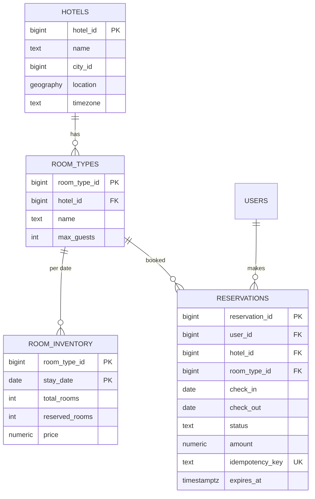
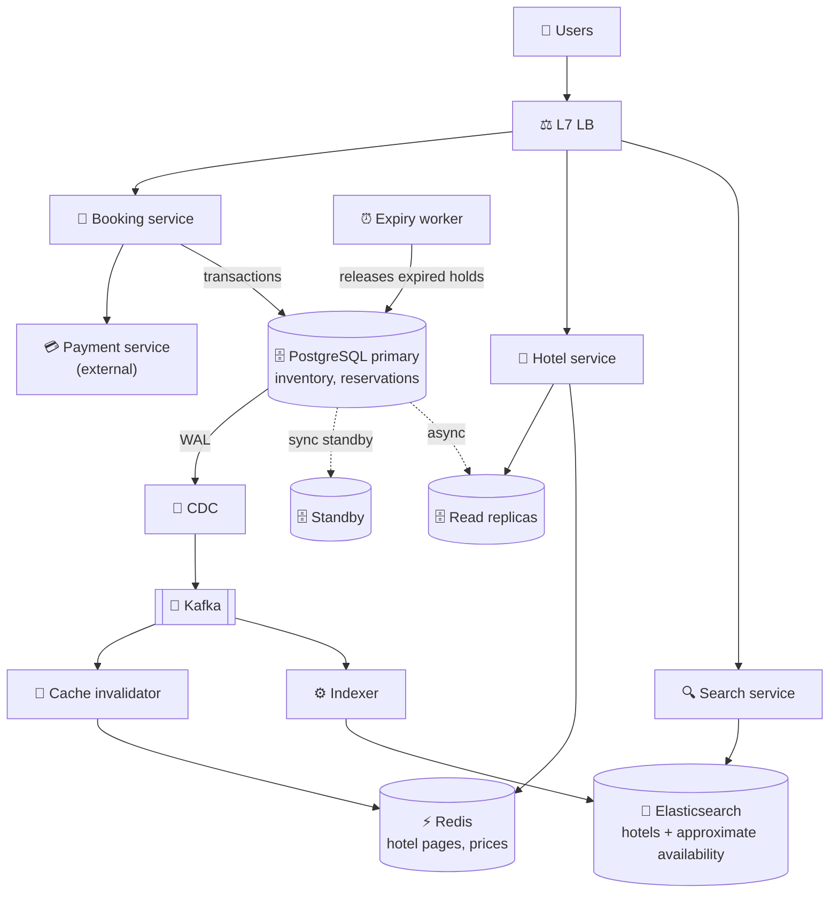
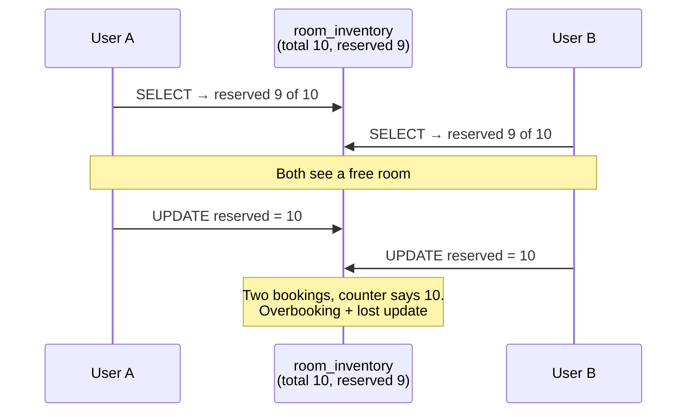
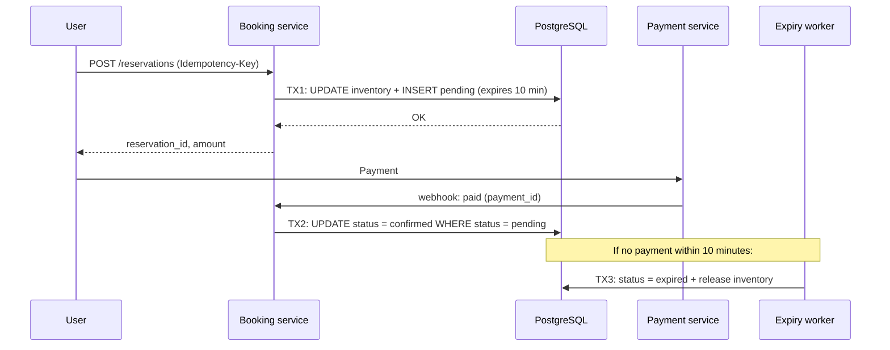

**English** | [Русский](INTERVIEW.ru.md) · Theory: [README.md](./README.md)

# 04. Databases: Storage for a Hotel Booking System

> **Topic:** choosing a database, data model, indexes, transactions, isolation levels, preventing double booking, deadlocks, polyglot persistence
> **Level:** Medium–Hard · **Interview time:** 45 min · **Study time:** ~5 h
> **Where it's asked:** as a standalone question ("design the schema and storage for…") and as a deep dive in Ticketmaster, Booking, payments and e-commerce problems

---

## 🗺️ How to Read This Walkthrough

| Icon | Meaning |
|:----:|:--------|
| 🎤 | Interviewer |
| 🗣️ | What I (the candidate) say out loud |
| ✏️ | What I draw on the whiteboard |
| ⏱️ | Time budget for the step |

Callouts: **TIP** — a good technique, **WARNING** — a trap, **IMPORTANT** — a Senior+ signal.

---

## 📑 Contents

1. [Problem Statement](#1-problem-statement)
2. [Clarifying Questions and Requirements](#2-clarifying-questions-and-requirements)
3. [Capacity Estimates](#3-capacity-estimates)
4. [API](#4-api)
5. [Choosing the Storage](#5-choosing-the-storage)
6. [Data Model and Indexes](#6-data-model-and-indexes)
7. [High-Level Design](#7-high-level-design)
8. [Deep Dive 1: Preventing Double Booking](#8-deep-dive-1-preventing-double-booking)
9. [Deep Dive 2: Isolation Levels and Write Skew](#9-deep-dive-2-isolation-levels-and-write-skew)
10. [Deep Dive 3: Payment, Holds and Idempotency](#10-deep-dive-3-payment-holds-and-idempotency)
11. [Deep Dive 4: Search and the Growing Inventory Table](#11-deep-dive-4-search-and-the-growing-inventory-table)
12. [Bottlenecks and Failure Scenarios](#12-bottlenecks-and-failure-scenarios)
13. [What Changes at 10x Scale](#13-what-changes-at-10x-scale)
14. [Interviewer Questions with Answers](#14-interviewer-questions-with-answers)
15. [Common Mistakes](#15-common-mistakes)
16. [Cheat Sheet and Self-Check](#16-cheat-sheet-and-self-check)

---

## 1. Problem Statement

> 🎤 "Design the storage for a hotel booking system like Booking.com. Users search for hotels, view rooms and book them for dates. Most importantly — never sell more rooms than exist."

**Time plan:**

| Step | ⏱️ |
|:-----|:--:|
| Requirements | 5 min |
| Estimates | 4 min |
| API and storage choice | 5 min |
| Data model and indexes | 8 min |
| High-level design | 5 min |
| Deep dives | 15 min |
| Failures and wrap-up | 3 min |

> [!TIP]
> The key phrase in the prompt is "never sell more". It signals that the core of the interview is **transactions and concurrency**. Say so out loud and budget your time so there's enough for the correctness deep dive.

---

## 2. Clarifying Questions and Requirements

⏱️ 5 min

| My question | Interviewer's answer | What it changes |
|:------------|:---------------------|:----------------|
| Is a specific room booked, or a room type? | A room type ("standard double"); the hotel assigns the actual room at check-in | We store inventory per (room type, date), not per room |
| Is overbooking acceptable? | No | Strict check at booking time |
| How does payment work? | Through an external payment service; can take seconds | Can't hold a DB transaction during payment → a hold |
| How accurate must availability in search be? | Search can lag slightly; at booking time — strictly exact | Search is a separate store; the check happens in the source of truth |
| How many hotels and bookings? | 500K hotels, ~2M bookings per day | Moderate writes; reads (search) are the main load |
| How far ahead can you book? | Up to a year | Inventory for 365 days ahead |
| Do hotels change prices and room counts? | Yes, via a management panel | Inventory updates must be safe relative to bookings |

### Functional requirements

1. Search hotels by city, dates and number of guests.
2. View a hotel and its available room types with prices.
3. Book a room type for a date range with payment.
4. Cancel a booking and view one's bookings.
5. Hotels manage room counts and prices.

**Out of scope:** reviews, loyalty program, recommendations, in-house payment processing (we use an external service).

### Non-functional requirements

| Requirement | Target |
|:------------|:-------|
| Correctness | **Zero** overbooking; zero double charges |
| Latency | Search p99 < 300 ms; booking p99 < 1 s (excluding payment) |
| Availability | 99.95% for search; for booking, correctness beats availability |
| Durability | Confirmed bookings are never lost |
| Scale | 500K hotels, 2M bookings per day, 100M searches per day |

> [!IMPORTANT]
> **Senior+ signal:** say explicitly that search and booking have **different** requirements. Search is AP: better to show slightly stale data than an error. Booking is CP: better to refuse than to oversell.

---

## 3. Capacity Estimates

⏱️ 4 min

✏️

```
Hotels                 = 500K
Room types per hotel   ≈ 10      → 5M room types
Days ahead             = 365     → 5M × 365 ≈ 1.8B inventory rows
Inventory row size     ≈ 50 B    → ~90 GB (+ indexes ≈ 150 GB)

Bookings               = 2M/day  → ~25 writes/s average, peak ×10 ≈ 250/s
Each booking           ≈ 3 nights → ~3 inventory rows per transaction
Reservations table     = 2M × 365 ≈ 730M rows/year × ~500 B ≈ 365 GB/year

Searches               = 100M/day → ~1,200 QPS, peak ≈ 5,000 QPS
Hotel page views       ≈ 30M/day  → ~350 QPS
```

🗣️ **Conclusions:**

- **Writes are small:** 250 transactions per second at peak — a single PostgreSQL primary handles that with lots of headroom.
- **The main load is search**, and it fits a relational database poorly (geo, date and amenity filters, ranking). It should move to a search index.
- **The inventory table is big** (almost 2 billion rows), but it's always accessed by `(room_type_id, date)` — an ideal case for a composite primary key and partitioning by date.
- **Contention is local but intense:** a popular hotel during holidays gets many concurrent attempts to book the same dates. Hence the main risk is races.

---

## 4. API

⏱️ 2 min

```http
GET  /v1/search?city_id=...&check_in=2026-12-30&check_out=2027-01-02&guests=2&cursor=...
GET  /v1/hotels/{hotel_id}?check_in=...&check_out=...

POST /v1/reservations
     Headers: Idempotency-Key: <uuid>
     Body:    { room_type_id, check_in, check_out, guests }
     → 201 { reservation_id, status: "pending", expires_at, amount }

POST /v1/reservations/{id}/confirm          (after successful payment)
POST /v1/reservations/{id}/cancel
GET  /v1/users/me/reservations?cursor=...

PUT  /v1/admin/room-types/{id}/inventory    (the hotel changes its room count)
```

🗣️ "`Idempotency-Key` is mandatory: if the client retries after a timeout, it gets the same booking, not a second one. Booking is two-phase: first `pending` with a room hold, then confirmation after payment."

---

## 5. Choosing the Storage

⏱️ 3 min

> 🎤 "Which database would you pick and why?"

🗣️ "For bookings and inventory — **PostgreSQL**:
- we need an atomic transaction that changes several inventory rows (one per night) and creates a booking — all or nothing;
- we need DB constraints (`CHECK`, `UNIQUE`) as the last line of defense for invariants;
- writes are moderate (hundreds per second); one primary is enough;
- the data is relational: hotel → room types → inventory → bookings.

Alongside:
- **Elasticsearch** for search: geo, filters, ranking; fed via CDC; may lag slightly;
- **Redis** to cache hotel pages and prices."

| Option | Why it's not the primary store |
|:-------|:-------------------------------|
| Cassandra | No transactions across multiple rows; lightweight transactions (Paxos) are expensive and work within a single partition |
| DynamoDB | Workable: conditional writes and `TransactWriteItems` (up to 100 items) can atomically update per-night inventory. But reporting and ad-hoc queries are harder; a good option at global scale or if you want a managed service |
| MongoDB | Has multi-document transactions, but the relational model is more natural here |
| Spanner / CockroachDB | Great for global writes from many regions; overkill at our scale |

> [!TIP]
> A strong move is to name an alternative that **would also** work (DynamoDB with conditional writes) and explain why you didn't pick it. It shows the choice is deliberate, not habitual.

---

## 6. Data Model and Indexes

⏱️ 8 min

✏️



```sql
CREATE TABLE room_inventory (
  room_type_id   BIGINT  NOT NULL,
  stay_date      DATE    NOT NULL,
  total_rooms    INT     NOT NULL,
  reserved_rooms INT     NOT NULL DEFAULT 0,
  price          NUMERIC(10,2) NOT NULL,
  PRIMARY KEY (room_type_id, stay_date),
  CHECK (reserved_rooms >= 0 AND reserved_rooms <= total_rooms)   -- last line of defense
) PARTITION BY RANGE (stay_date);

CREATE TABLE reservations (
  reservation_id  BIGINT PRIMARY KEY,           -- Snowflake ID
  user_id         BIGINT NOT NULL,
  hotel_id        BIGINT NOT NULL,              -- denormalized from room_types for constraints and sharding
  room_type_id    BIGINT NOT NULL,
  check_in        DATE   NOT NULL,
  check_out       DATE   NOT NULL,
  status          TEXT   NOT NULL,              -- pending | confirmed | cancelled | expired
  amount          NUMERIC(10,2) NOT NULL,
  idempotency_key TEXT   NOT NULL UNIQUE,
  expires_at      TIMESTAMPTZ,
  created_at      TIMESTAMPTZ NOT NULL DEFAULT now(),
  CHECK (check_out > check_in)
);
```

### Indexes for the main queries

| Query | Index | Why |
|:------|:------|:----|
| Room type inventory for a date range | PK `(room_type_id, stay_date)` | Equality + range → leftmost prefix rule, one range scan |
| "My bookings", newest first | `(user_id, created_at DESC)` | Equality + sort, keyset pagination |
| Bookings for a hotel on a date (for the hotel) | `(room_type_id, check_in)` | Equality + range |
| A retry with the same key | `UNIQUE (idempotency_key)` | Duplicates impossible at the DB level |
| Finding expired holds | Partial `(expires_at) WHERE status = 'pending'` | Indexes only a small subset of rows |

🗣️ "Inventory is denormalized by date: instead of computing 'how many bookings overlap this date' every time, we keep a ready `reserved_rooms` counter for each night. An availability check is a few primary-key reads, not an aggregation over bookings."

---

## 7. High-Level Design

⏱️ 5 min

✏️



🗣️ "The key idea is **separating the paths**:
- **search** reads Elasticsearch, which is fed from CDC and may lag by seconds;
- the **hotel page** is read from the cache and replicas;
- **booking** always goes to the primary in a transaction — the only place real availability is checked.

If search showed a free room that's already taken, the user gets a refusal at the booking step. That's normal and honest."

---

## 8. Deep Dive 1: Preventing Double Booking

> 🎤 "Two users try to book the last room for the same dates at the same time. What happens?"

### ❌ The naive approach: read, check in code, write

```python
rows = db.query("SELECT stay_date, total_rooms, reserved_rooms FROM room_inventory "
                "WHERE room_type_id = %s AND stay_date >= %s AND stay_date < %s", ...)
if all(r.reserved_rooms < r.total_rooms for r in rows):
    for r in rows:
        db.execute("UPDATE room_inventory SET reserved_rooms = %s WHERE ...",
                   r.reserved_rooms + 1)
```



🗣️ "This is a classic lost update. At Read Committed (the PostgreSQL default) it isn't detected."

### ✅ Option 1: an atomic conditional update (my choice)

```sql
BEGIN;

UPDATE room_inventory
SET    reserved_rooms = reserved_rooms + 1
WHERE  room_type_id = $1
  AND  stay_date >= $2 AND stay_date < $3     -- every night of the stay
  AND  reserved_rooms < total_rooms;
-- If fewer rows were updated than there are nights → ROLLBACK, "sold out"

INSERT INTO reservations (..., status, expires_at, idempotency_key)
VALUES (..., 'pending', now() + interval '10 minutes', $key);

COMMIT;
```

🗣️ "Why this is safe even at Read Committed:
- the UPDATE takes a **row lock**. The second transaction waits until the first commits;
- then PostgreSQL **re-evaluates the `WHERE` condition** on the new row version: `reserved_rooms < total_rooms` is now false, and the row isn't updated;
- the application sees fewer rows updated than nights and rolls back;
- `CHECK (reserved_rooms <= total_rooms)` is the last defense if there's a bug in the code."

### Other options

| Option | How | When |
|:-------|:----|:-----|
| `SELECT ... FOR UPDATE`, then UPDATE | Lock the inventory rows, check in code, update | When the check logic is complex (different prices, hotel rules) |
| Optimistic locking | A `version` column, UPDATE with `WHERE version = $v` | Rare conflicts; here, during holidays, conflicts are frequent — many retries |
| `SERIALIZABLE` | The database detects the conflict itself | Works, but needs retries and has higher overhead |
| A distributed lock in Redis | A lock on `(room_type_id, dates)` | ❌ An extra dependency; the database must ensure correctness anyway |

> [!WARNING]
> **Deadlocks.** Booking A for Jan 1–3 and booking B for Jan 2–4 lock overlapping rows. If A locks the 1st, B locks the 3rd, and then each waits for the other's row, you get a deadlock. Fix: lock rows **in the same order** — by ascending date. A single ranged UPDATE usually walks the index in key order, but with `FOR UPDATE` add `ORDER BY stay_date` explicitly. Plus retry on deadlock errors.

---

## 9. Deep Dive 2: Isolation Levels and Write Skew

> 🎤 "Fine, but are there invariants in this system that an atomic single-row UPDATE won't protect?"

🗣️ "Yes. Example: the rule 'a user can't have two overlapping active bookings at the same hotel' (protection against accidental duplicates and abuse).

A naive check:

```sql
-- Transactions A and B at the same time:
SELECT count(*) FROM reservations
WHERE user_id = 7 AND hotel_id = 3 AND status IN ('pending','confirmed')
  AND check_in < $new_check_out AND check_out > $new_check_in;
-- both see 0 → both insert a new row
```

This is **write skew** (more precisely, a phantom): the transactions read the same condition and insert **different** rows. Row locks don't help — there's nothing to lock, the rows don't exist yet. Snapshot isolation (Repeatable Read in PostgreSQL) misses it too."

**Fixes:**

| Fix | How |
|:----|:----|
| **Exclusion constraint** (PostgreSQL) | `EXCLUDE USING gist (user_id WITH =, hotel_id WITH =, daterange(check_in, check_out) WITH &&) WHERE (status IN ('pending','confirmed'))` — the database itself refuses an overlapping range (GiST equality on BIGINT requires the `btree_gist` extension) |
| **Materializing the conflict** | Both transactions first `SELECT ... FOR UPDATE` the user's row in `users` — they serialize on that row |
| **SERIALIZABLE** | SSI in PostgreSQL detects the conflict; one transaction gets an error and retries |

🗣️ "I pick the **exclusion constraint**: the invariant is expressed declaratively in the database, works at any isolation level, and doesn't depend on every service's code being written correctly."

> [!IMPORTANT]
> **Senior+ signal:** name the anomaly (lost update, write skew, phantom), explain why a given isolation level doesn't catch it, and pick the simplest mechanism. Order of preference: **DB constraint → atomic conditional UPDATE → explicit lock → SERIALIZABLE**.

### Summary table for this system

| Operation | Anomaly risk | Mechanism | Isolation level |
|:----------|:-------------|:----------|:----------------|
| Decrementing inventory | Lost update | Atomic conditional UPDATE + CHECK | Read Committed |
| No overlapping bookings per user | Write skew / phantom | EXCLUDE constraint | Read Committed |
| Client retry | Duplicate | UNIQUE idempotency_key | Read Committed |
| Hotel reduces total_rooms | Dropping below what's already booked | `UPDATE ... SET total_rooms = $n WHERE reserved_rooms <= $n` + CHECK | Read Committed |
| Hotel report | Inconsistent numbers | Read from a snapshot | Repeatable Read on a replica |

---

## 10. Deep Dive 3: Payment, Holds and Idempotency

> 🎤 "Payment takes up to 30 seconds and sometimes fails. How does that fit with the transaction?"

🗣️ "You can't keep a transaction open during an external call: inventory row locks would be held for tens of seconds, and every other booking of that room would wait. So booking is two-phase."



🗣️ Important details:
- **Confirmation is conditional:** `UPDATE reservations SET status = 'confirmed' WHERE id = $1 AND status = 'pending'`. If the worker already released the hold, confirmation fails, and the money must be refunded (or the room re-reserved).
- **Release is conditional too:** the worker moves to `expired` only rows with status `pending` and `expires_at < now()`, and decrements `reserved_rooms` in the same transaction. The race "payment arrives at the moment of expiry" is resolved by whoever changes the status first.
- **Idempotency:**
    - `UNIQUE (idempotency_key)` on booking creation: a retry returns the booking already created;
    - the payment webhook is processed by `payment_id` (a processed-events table with a unique key), because payment providers resend webhooks.
- **Outbox:** the "booking confirmed" event (for emails, the hotel, analytics) is written to an outbox table in the same transaction TX2 and published to Kafka by a separate process. That way the event is never lost and never sent without a commit.

> [!WARNING]
> Don't mix the application's and the database's `now()` for `expires_at`. Compare times in one place (the database); otherwise clock drift between servers leads to premature or late releases.

---

## 11. Deep Dive 4: Search and the Growing Inventory Table

> 🎤 "How does search learn about availability? And what do you do with a 2-billion-row table?"

### Search

🗣️ "In Elasticsearch I store one document per hotel with nested availability per room type and date (or the minimum price per date). Updates come via CDC from `room_inventory`:
- inventory changes are grouped by hotel and applied in batches every few seconds;
- search shows 'probably available', and the exact check happens only at booking;
- if the indexer falls far behind, search keeps working, just less accurately."

### The inventory table

| Problem | Fix |
|:--------|:----|
| 1.8B rows, growing daily | **Partition by `stay_date`** (monthly): queries for specific dates touch 1–2 partitions |
| Past dates aren't needed for booking | Old partitions are detached and archived to object storage — no heavy `DELETE` |
| Rows for future dates must be created | A daily job adds a new day for every room type (or a month's partition is created in advance) |
| The reservations table grows by ~365 GB per year | Partition by `created_at`, archive old completed bookings |
| Index bloat | A compact `(room_type_id, stay_date)` primary key; Snowflake IDs instead of UUID v4 for bookings |

> [!TIP]
> Partitioning within a single database (PostgreSQL declarative partitioning) isn't sharding. It solves table size and maintenance, but doesn't scale writes. At our write volume, that's enough.

---

## 12. Bottlenecks and Failure Scenarios

| Scenario | What happens | How we protect |
|:---------|:-------------|:---------------|
| Thousands of bookings for one hotel during holidays | Queues on the same row locks, latency rises | Short transactions (just UPDATE + INSERT); locks in date order; limiting concurrent attempts per room type in the app; early refusal if search shows 0 |
| Primary dies | Booking unavailable for ~30–60 s | Synchronous standby, automatic failover; clients retry with the same Idempotency-Key |
| Data loss on failover | A confirmed booking disappears | Synchronous replication to the standby: COMMIT only after the write lands on two nodes |
| Deadlock | One transaction is rolled back | Lock ordering by date; automatic retry |
| Payment webhook arrives twice | Double confirmation | Idempotent processing by `payment_id` |
| Payment succeeds after the hold expired | Money charged, no booking | Conditional confirmation; on failure — try to re-reserve the room, otherwise automatic refund |
| Search indexer lags | Search shows taken rooms | Lag monitoring; honest refusal at the booking step |
| Connection pool exhausted | Errors across all services | PgBouncer, per-instance connection limits, short transactions |
| Hotel reduces rooms below what's booked | Invariant violated | Conditional UPDATE + CHECK; the hotel sees an error |

---

## 13. What Changes at 10x Scale

> 🎤 "20 million bookings a day and users worldwide?"

🗣️ "~2,500 transactions per second at peak — one primary can still cope, but with further growth:
1. **Shard by `hotel_id`.** All of a hotel's inventory and bookings live on one shard, so the booking transaction stays **local**, with no distributed transactions.
2. **"My bookings" by `user_id`** requires scatter-gather once sharded by hotel. The fix is a separate denormalized table (or Cassandra) `user_reservations` keyed by `user_id`, fed via outbox/CDC.
3. **Multi-region:** hotels are served in a 'home' region (writes go there), while reads and search are local. Or Spanner/CockroachDB if writes from any region are required.
4. **Hot hotels:** a per-room-type request queue for bookings, to avoid hundreds of waiting locks."

---

## 14. Interviewer Questions with Answers

<details>
<summary><b>Why store inventory instead of computing occupancy from the reservations table?</b></summary>

Then an availability check is an aggregation over all overlapping bookings on every request, and race protection requires locking "what doesn't exist yet" (phantoms). A per-night counter turns the check into a few primary-key reads, and the protection into an atomic conditional UPDATE that locks existing rows.
</details>

<details>
<summary><b>Why does the atomic UPDATE work at Read Committed?</b></summary>

The UPDATE takes a row lock, so a concurrent transaction waits. After the first commits, PostgreSQL re-reads the latest row version and re-evaluates the WHERE condition. If `reserved_rooms < total_rooms` no longer holds, the row isn't updated. The protection rests on the lock and the re-check, not on the isolation level.
</details>

<details>
<summary><b>Why not use a distributed lock in Redis?</b></summary>

A Redis lock isn't part of the database transaction: a process can "sleep" (a GC pause) past the lock's expiry and still write. Correctness would additionally require fencing tokens. The database already knows how to lock rows within a transaction — it's simpler and more reliable to use that.
</details>

<details>
<summary><b>What if you need to book a specific room rather than a type?</b></summary>

Then the invariant "one room — one booking per night" is conveniently expressed with an exclusion constraint on `(room_id, daterange)` in the reservations table, or with `room_nights (room_id, date)` rows and a UNIQUE constraint. Picking a specific room uses `SELECT ... FOR UPDATE SKIP LOCKED`, so concurrent transactions take different free rooms without waiting on each other.
</details>

<details>
<summary><b>When should you move to SERIALIZABLE?</b></summary>

When there are many complex invariants touching many rows, and expressing each one through constraints and explicit locks becomes risky. The cost is serialization errors under load and mandatory retries. For a narrow, hot operation like decrementing inventory, an atomic UPDATE is more efficient.
</details>

<details>
<summary><b>Why doesn't search read inventory directly from PostgreSQL?</b></summary>

Search is thousands of requests per second with geo, date, price and amenity filters, plus ranking. Such queries fit a relational database poorly and would load the primary where booking transactions run. A search index with slight lag serves this more cheaply, and the exact check happens at booking anyway.
</details>

---

## 15. Common Mistakes

| ❌ Mistake | ✅ Do this instead |
|:----------|:------------------|
| "Let's use NoSQL, it scales" | Analyze access patterns: atomic multi-row transactions are needed → PostgreSQL |
| SELECT → check in code → UPDATE | An atomic conditional UPDATE or `FOR UPDATE` |
| "I'll set SERIALIZABLE and be done" with no retries | Retries are mandatory; targeted mechanisms are better |
| A transaction open during payment | A `pending` hold → payment → conditional confirmation |
| No idempotency on creation and webhooks | UNIQUE idempotency_key, webhook processing by payment_id |
| Checking booking overlaps with a SELECT | An EXCLUDE constraint or materializing the conflict |
| Locks in arbitrary order | Always by ascending date |
| Search on the primary | Elasticsearch via CDC, the check at booking |
| Deleting old rows with DELETE | Partition by date and detach partitions |

---

## 16. Cheat Sheet and Self-Check

### 30-second answer

> The source of truth is PostgreSQL: inventory is a counter per (room type, night) with a CHECK, and bookings are a separate table with a UNIQUE idempotency_key. Booking is a short transaction: an atomic conditional UPDATE over every night (`reserved < total`) + INSERT pending; if fewer rows are updated than nights — rollback. An EXCLUDE constraint forbids overlapping bookings per user. Payment happens outside the transaction: a pending hold with expiry, conditional confirmation, and a worker that releases expired holds. Search is Elasticsearch via CDC with slight lag. The inventory table is partitioned by date; at larger scale, shard by hotel_id so transactions stay local.

### Self-check

- [ ] I can explain why PostgreSQL beats Cassandra here and name a workable NoSQL alternative
- [ ] I can design tables and indexes for the 4 main queries
- [ ] I can draw the lost update in naive booking
- [ ] I can explain why an atomic conditional UPDATE is safe at Read Committed
- [ ] I can show write skew in the overlap check and 3 ways to prevent it
- [ ] I can explain two-phase booking with a hold and the expiry race
- [ ] I can explain how to avoid deadlocks when booking multiple nights
- [ ] I can explain why to shard by hotel_id rather than user_id

### Further reading

- Theory for this topic: [README.md](./README.md)
- *Designing Data-Intensive Applications*, chapter 7 — the on-call doctors example and write skew
- PostgreSQL documentation: Transaction Isolation, Exclusion Constraints, Table Partitioning
- *System Design Interview*, Vol. 2, Alex Xu — chapter "Hotel Reservation System"