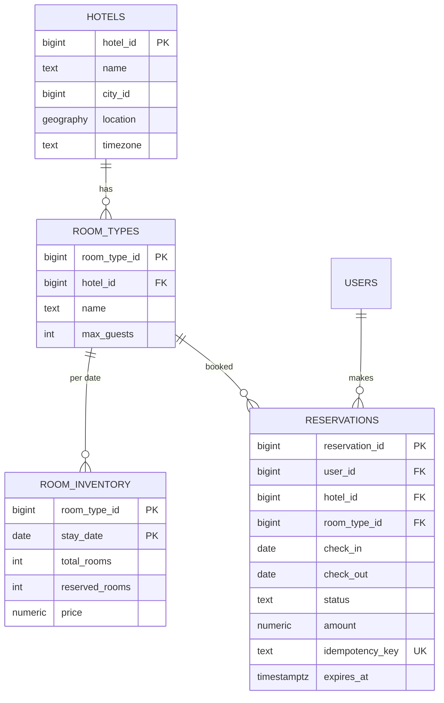
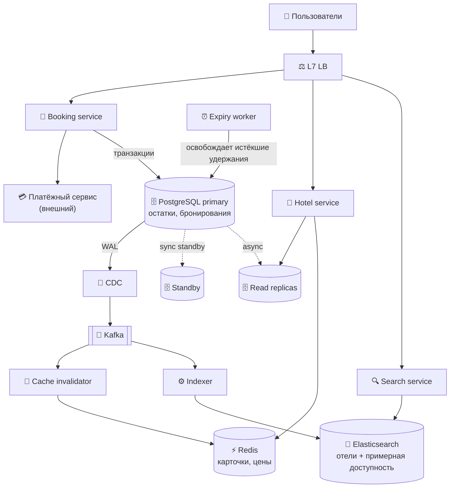
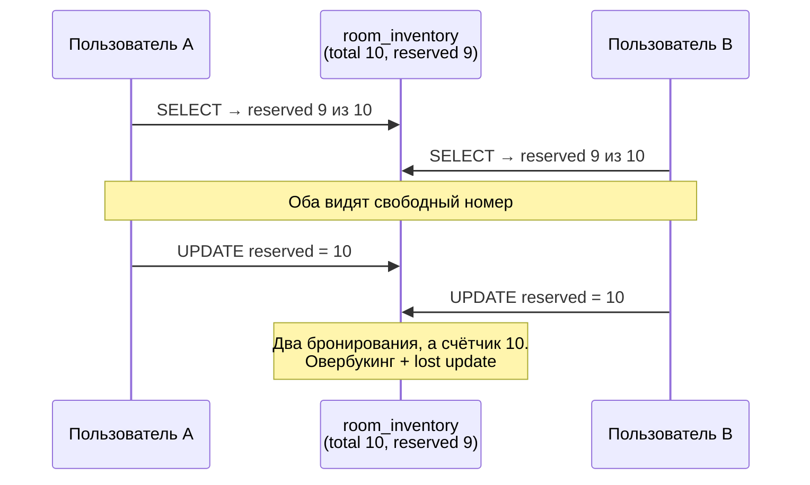
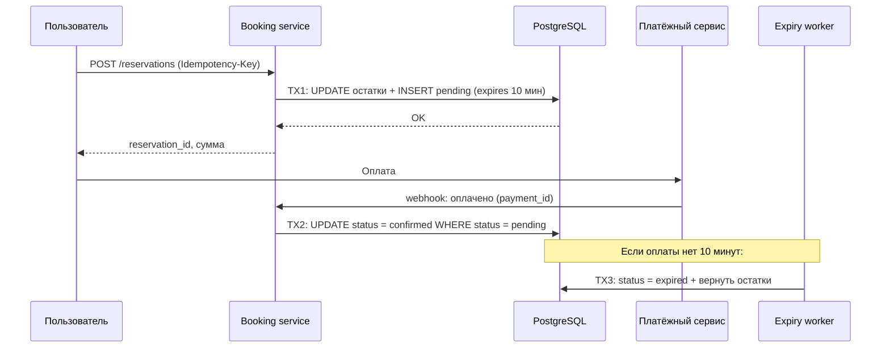

[English](INTERVIEW.md) | **Русский** · Теория: [README_RU.md](./README_RU.md)

# 04. Databases: хранилище для системы бронирования отелей

> **Тема:** выбор базы, модель данных, индексы, транзакции, уровни изоляции, защита от двойного бронирования, взаимоблокировки, polyglot persistence
> **Уровень:** Medium–Hard · **Время на интервью:** 45 мин · **Время на разбор:** ~5 ч
> **Где спрашивают:** как отдельный вопрос («спроектируй схему и хранилище для…») и как deep dive в задачах Ticketmaster, Booking, платежи, e-commerce

---

## 🗺️ Как читать этот разбор

| Значок | Что значит |
|:------:|:-----------|
| 🎤 | Реплика интервьюера |
| 🗣️ | Что говорю вслух я (кандидат) |
| ✏️ | Что рисую на доске |
| ⏱️ | Сколько времени тратить на шаг |

Блоки **TIP** — хороший приём, **WARNING** — ловушка, **IMPORTANT** — сигнал для уровня Senior+.

---

## 📑 Содержание

1. [Условие задачи](#1-условие-задачи)
2. [Уточняющие вопросы и требования](#2-уточняющие-вопросы-и-требования)
3. [Оценки нагрузки](#3-оценки-нагрузки)
4. [API](#4-api)
5. [Выбор хранилища](#5-выбор-хранилища)
6. [Модель данных и индексы](#6-модель-данных-и-индексы)
7. [High-level дизайн](#7-high-level-дизайн)
8. [Deep dive 1: защита от двойного бронирования](#8-deep-dive-1-защита-от-двойного-бронирования)
9. [Deep dive 2: уровни изоляции и write skew](#9-deep-dive-2-уровни-изоляции-и-write-skew)
10. [Deep dive 3: оплата, удержание и идемпотентность](#10-deep-dive-3-оплата-удержание-и-идемпотентность)
11. [Deep dive 4: поиск и рост таблицы остатков](#11-deep-dive-4-поиск-и-рост-таблицы-остатков)
12. [Узкие места и сценарии сбоев](#12-узкие-места-и-сценарии-сбоев)
13. [Что изменится при росте в 10 раз](#13-что-изменится-при-росте-в-10-раз)
14. [Вопросы интервьюера с ответами](#14-вопросы-интервьюера-с-ответами)
15. [Типичные ошибки](#15-типичные-ошибки)
16. [Шпаргалка и самопроверка](#16-шпаргалка-и-самопроверка)

---

## 1. Условие задачи

> 🎤 «Спроектируй хранилище для системы бронирования отелей вроде Booking.com. Пользователи ищут отели, смотрят номера и бронируют их на даты. Главное — ни в коем случае не продать больше номеров, чем есть».

**План по времени:**

| Шаг | ⏱️ |
|:----|:--:|
| Требования | 5 мин |
| Оценки | 4 мин |
| API и выбор хранилища | 5 мин |
| Модель данных и индексы | 8 мин |
| High-level дизайн | 5 мин |
| Deep dives | 15 мин |
| Сбои и итоги | 3 мин |

> [!TIP]
> Ключевое слово в условии — «ни в коем случае не продать больше». Это сигнал, что главная часть интервью — **транзакции и конкурентный доступ**. Скажи это вслух и распредели время так, чтобы на deep dive по корректности его хватило.

---

## 2. Уточняющие вопросы и требования

⏱️ 5 мин

| Мой вопрос | Ответ интервьюера | Что это меняет |
|:-----------|:------------------|:---------------|
| Бронируется конкретный номер или тип номера? | Тип номера («двухместный стандарт»), конкретный номер выдаёт отель при заезде | Храним остатки по (тип номера, дата), а не по каждому номеру |
| Допустим ли овербукинг? | Нет | Строгая проверка при бронировании |
| Как происходит оплата? | Через внешний платёжный сервис, может занимать секунды | Нельзя держать транзакцию БД во время оплаты → удержание (hold) |
| Насколько точным должен быть поиск по наличию? | Поиск может немного отставать; при бронировании — строго точно | Поиск — отдельное хранилище, проверка — в источнике правды |
| Сколько отелей и бронирований? | 500 тыс. отелей, ~2 млн бронирований в день | Запись умеренная, чтение (поиск) — основная нагрузка |
| На сколько вперёд можно бронировать? | До года | Остатки на 365 дней вперёд |
| Отели меняют цены и число номеров? | Да, через панель управления | Обновления остатков должны быть безопасны относительно бронирований |

### Функциональные требования

1. Поиск отелей по городу, датам и числу гостей.
2. Просмотр отеля и доступных типов номеров с ценами.
3. Бронирование типа номера на диапазон дат с оплатой.
4. Отмена бронирования и просмотр своих бронирований.
5. Отель управляет числом номеров и ценами.

**Вне рамок:** отзывы, программа лояльности, рекомендации, обработка платежей внутри (используем внешний сервис).

### Нефункциональные требования

| Требование | Цель |
|:-----------|:-----|
| Корректность | **Ноль** овербукинга; ни одного двойного списания |
| Latency | Поиск p99 < 300 мс; бронирование p99 < 1 с (без учёта оплаты) |
| Доступность | 99,95% для поиска; для бронирования корректность важнее доступности |
| Надёжность | Подтверждённые бронирования не теряются |
| Масштаб | 500 тыс. отелей, 2 млн бронирований в день, 100 млн поисков в день |

> [!IMPORTANT]
> **Сигнал Senior+:** явно скажи, что поиск и бронирование имеют **разные** требования. Поиск — AP: лучше показать слегка устаревшие данные, чем ошибку. Бронирование — CP: лучше отказать, чем продать лишнее.

---

## 3. Оценки нагрузки

⏱️ 4 мин

✏️

```
Отелей                 = 500K
Типов номеров на отель ≈ 10      → 5M типов номеров
Дат вперёд             = 365     → 5M × 365 ≈ 1,8B строк остатков
Размер строки остатка  ≈ 50 Б    → ~90 ГБ (+ индексы ≈ 150 ГБ)

Бронирования           = 2M/день → ~25 записей/с в среднем, пик ×10 ≈ 250/с
Каждое бронирование    ≈ 3 ночи  → ~3 строки остатков на транзакцию
Таблица бронирований   = 2M × 365 ≈ 730M строк/год × ~500 Б ≈ 365 ГБ/год

Поиски                 = 100M/день → ~1 200 QPS, пик ≈ 5 000 QPS
Просмотр отеля         ≈ 30M/день  → ~350 QPS
```

🗣️ **Выводы:**

- **Запись маленькая:** 250 транзакций в секунду в пике — один primary PostgreSQL справится с большим запасом.
- **Главная нагрузка — поиск**, и он плохо ложится на реляционную базу (фильтры по гео, датам, удобствам, ранжирование). Его нужно вынести в поисковый индекс.
- **Таблица остатков большая** (почти 2 млрд строк), но доступ к ней всегда по `(room_type_id, date)` — идеальный случай для составного первичного ключа и партиционирования по дате.
- **Конкуренция высока локально:** популярный отель в праздники получает много одновременных попыток забронировать одни и те же даты. Отсюда главный риск — гонки.

---

## 4. API

⏱️ 2 мин

```http
GET  /v1/search?city_id=...&check_in=2026-12-30&check_out=2027-01-02&guests=2&cursor=...
GET  /v1/hotels/{hotel_id}?check_in=...&check_out=...

POST /v1/reservations
     Headers: Idempotency-Key: <uuid>
     Body:    { room_type_id, check_in, check_out, guests }
     → 201 { reservation_id, status: "pending", expires_at, amount }

POST /v1/reservations/{id}/confirm          (после успешной оплаты)
POST /v1/reservations/{id}/cancel
GET  /v1/users/me/reservations?cursor=...

PUT  /v1/admin/room-types/{id}/inventory    (отель меняет число номеров)
```

🗣️ «`Idempotency-Key` обязателен: если клиент повторит запрос после таймаута, он получит ту же бронь, а не вторую. Бронирование двухфазное: сначала `pending` с удержанием номера, потом подтверждение после оплаты».

---

## 5. Выбор хранилища

⏱️ 3 мин

> 🎤 «Какую базу выберешь и почему?»

🗣️ «Для бронирований и остатков — **PostgreSQL**:
- нужна атомарная транзакция, которая меняет несколько строк остатков (по одной на каждую ночь) и создаёт бронирование — всё или ничего;
- нужны ограничения в базе (`CHECK`, `UNIQUE`) как последняя защита инвариантов;
- запись умеренная (сотни в секунду), одного primary хватает;
- данные связанные: отель → типы номеров → остатки → бронирования.

Рядом:
- **Elasticsearch** для поиска: гео, фильтры, ранжирование; наполняется через CDC; может немного отставать;
- **Redis** для кэша карточек отелей и цен».

| Вариант | Почему не основной |
|:--------|:-------------------|
| Cassandra | Нет транзакций между несколькими строками; lightweight transactions (Paxos) дорогие и работают в пределах одной партиции |
| DynamoDB | Можно: условные записи и `TransactWriteItems` (до 100 элементов) позволяют атомарно обновить остатки по ночам. Но сложнее отчёты и произвольные запросы; хороший вариант при глобальном масштабе и желании managed-сервиса |
| MongoDB | Многодокументные транзакции есть, но реляционная модель здесь естественнее |
| Spanner / CockroachDB | Отличный вариант при глобальной записи из многих регионов; на нашем масштабе избыточен |

> [!TIP]
> Сильный ход — назвать альтернативу, которая **тоже** сработала бы (DynamoDB с условными записями), и объяснить, почему выбран не он. Это показывает, что выбор осознанный, а не по привычке.

---

## 6. Модель данных и индексы

⏱️ 8 мин

✏️



```sql
CREATE TABLE room_inventory (
  room_type_id   BIGINT  NOT NULL,
  stay_date      DATE    NOT NULL,
  total_rooms    INT     NOT NULL,
  reserved_rooms INT     NOT NULL DEFAULT 0,
  price          NUMERIC(10,2) NOT NULL,
  PRIMARY KEY (room_type_id, stay_date),
  CHECK (reserved_rooms >= 0 AND reserved_rooms <= total_rooms)   -- последняя линия защиты
) PARTITION BY RANGE (stay_date);

CREATE TABLE reservations (
  reservation_id  BIGINT PRIMARY KEY,           -- Snowflake ID
  user_id         BIGINT NOT NULL,
  hotel_id        BIGINT NOT NULL,              -- денормализовано из room_types для ограничений и шардирования
  room_type_id    BIGINT NOT NULL,
  check_in        DATE   NOT NULL,
  check_out       DATE   NOT NULL,
  status          TEXT   NOT NULL,              -- pending | confirmed | cancelled | expired
  amount          NUMERIC(10,2) NOT NULL,
  idempotency_key TEXT   NOT NULL UNIQUE,
  expires_at      TIMESTAMPTZ,
  created_at      TIMESTAMPTZ NOT NULL DEFAULT now(),
  CHECK (check_out > check_in)
);
```

### Индексы под главные запросы

| Запрос | Индекс | Почему |
|:-------|:-------|:-------|
| Остатки типа номера на диапазон дат | PK `(room_type_id, stay_date)` | Равенство + диапазон → правило левого префикса, одно сканирование диапазона |
| «Мои бронирования», новые сверху | `(user_id, created_at DESC)` | Равенство + сортировка, keyset-пагинация |
| Бронирования отеля на дату (для отеля) | `(room_type_id, check_in)` | Равенство + диапазон |
| Повторный запрос с тем же ключом | `UNIQUE (idempotency_key)` | Дубликат невозможен на уровне базы |
| Поиск истёкших удержаний | Частичный `(expires_at) WHERE status = 'pending'` | Индекс только по небольшой части строк |

🗣️ «Остатки денормализованы по датам: вместо того чтобы считать «сколько бронирований пересекается с датой» каждый раз, храним готовый счётчик `reserved_rooms` на каждую ночь. Проверка доступности — чтение нескольких строк по первичному ключу, а не агрегация по бронированиям».

---

## 7. High-level дизайн

⏱️ 5 мин

✏️



🗣️ «Ключевая идея — **разделение путей**:
- **поиск** читает Elasticsearch, который наполняется из CDC и может отставать на секунды;
- **карточка отеля** читается из кэша и реплик;
- **бронирование** всегда идёт в primary в транзакции — это единственное место, где проверяется реальная доступность.

Если поиск показал свободный номер, а он уже занят, пользователь получит отказ на шаге бронирования. Это нормально и честно».

---

## 8. Deep dive 1: защита от двойного бронирования

> 🎤 «Два пользователя одновременно бронируют последний номер на одни и те же даты. Что произойдёт?»

### ❌ Наивный подход: прочитать, проверить в коде, записать

```python
rows = db.query("SELECT stay_date, total_rooms, reserved_rooms FROM room_inventory "
                "WHERE room_type_id = %s AND stay_date >= %s AND stay_date < %s", ...)
if all(r.reserved_rooms < r.total_rooms for r in rows):
    for r in rows:
        db.execute("UPDATE room_inventory SET reserved_rooms = %s WHERE ...",
                   r.reserved_rooms + 1)
```



🗣️ «Это классический lost update. На уровне Read Committed (дефолт PostgreSQL) он не обнаруживается».

### ✅ Вариант 1: атомарное условное обновление (мой выбор)

```sql
BEGIN;

UPDATE room_inventory
SET    reserved_rooms = reserved_rooms + 1
WHERE  room_type_id = $1
  AND  stay_date >= $2 AND stay_date < $3     -- все ночи бронирования
  AND  reserved_rooms < total_rooms;
-- Если обновлено строк меньше, чем ночей → ROLLBACK, «нет мест»

INSERT INTO reservations (..., status, expires_at, idempotency_key)
VALUES (..., 'pending', now() + interval '10 minutes', $key);

COMMIT;
```

🗣️ «Почему это безопасно даже на Read Committed:
- UPDATE берёт **блокировку строки**. Вторая транзакция ждёт, пока первая закоммитится;
- после этого PostgreSQL **перепроверяет условие** `WHERE` на новой версии строки: `reserved_rooms < total_rooms` уже ложно, и строка не обновляется;
- приложение видит, что обновлено меньше строк, чем ночей, и откатывает транзакцию;
- `CHECK (reserved_rooms <= total_rooms)` — последняя защита, если в коде будет ошибка».

### Другие варианты

| Вариант | Как | Когда |
|:--------|:----|:------|
| `SELECT ... FOR UPDATE`, потом UPDATE | Заблокировать строки остатков, проверить в коде, обновить | Если логика проверки сложная (разные цены, правила отеля) |
| Оптимистичная блокировка | Колонка `version`, UPDATE с `WHERE version = $v` | Редкие конфликты; здесь в праздники конфликты частые — много ретраев |
| `SERIALIZABLE` | База сама обнаружит конфликт | Работает, но нужны ретраи и выше накладные расходы |
| Распределённый лок в Redis | Лок на `(room_type_id, даты)` | ❌ Лишняя зависимость; корректность всё равно должна обеспечивать база |

> [!WARNING]
> **Взаимоблокировки.** Бронирование A на 1–3 января и бронирование B на 2–4 января блокируют пересекающиеся строки. Если A заблокирует 1-е, B — 3-е, а потом каждый будет ждать строку другого, получится deadlock. Решение: блокировать строки **в одном порядке** — по возрастанию даты. Одиночный UPDATE с диапазоном обычно идёт по индексу в порядке ключа, но при `FOR UPDATE` добавляй `ORDER BY stay_date` явно. Плюс ретрай при ошибке deadlock.

---

## 9. Deep dive 2: уровни изоляции и write skew

> 🎤 «Хорошо, а есть ли в системе инварианты, которые атомарный UPDATE одной строки не защитит?»

🗣️ «Да. Пример: правило «у одного пользователя не может быть двух пересекающихся активных бронирований в одном отеле» (защита от случайных дублей и злоупотреблений).

Наивная проверка:

```sql
-- Транзакция A и B одновременно:
SELECT count(*) FROM reservations
WHERE user_id = 7 AND hotel_id = 3 AND status IN ('pending','confirmed')
  AND check_in < $new_check_out AND check_out > $new_check_in;
-- обе видят 0 → обе вставляют новую строку
```

Это **write skew** (точнее, фантом): транзакции читают одно и то же условие и вставляют **разные** строки. Блокировки строк не помогают — блокировать нечего, строк ещё нет. Snapshot isolation (Repeatable Read в PostgreSQL) это тоже пропустит».

**Решения:**

| Решение | Как |
|:--------|:----|
| **Ограничение исключения** (PostgreSQL) | `EXCLUDE USING gist (user_id WITH =, hotel_id WITH =, daterange(check_in, check_out) WITH &&) WHERE (status IN ('pending','confirmed'))` — база сама не даст вставить пересекающийся диапазон (для `=` по BIGINT в GiST нужно расширение `btree_gist`) |
| **Материализация конфликта** | Обе транзакции сначала делают `SELECT ... FOR UPDATE` строки пользователя в `users` — они сериализуются на этой строке |
| **SERIALIZABLE** | SSI в PostgreSQL обнаружит конфликт, одна транзакция получит ошибку и повторится |

🗣️ «Выбираю **ограничение исключения**: инвариант выражен декларативно в базе, работает на любом уровне изоляции, не зависит от того, правильно ли написан код в каждом сервисе».

> [!IMPORTANT]
> **Сигнал Senior+:** назови аномалию по имени (lost update, write skew, фантом), объясни, почему конкретный уровень изоляции её не ловит, и выбери самый простой механизм. Порядок предпочтений: **ограничение в БД → атомарный условный UPDATE → явная блокировка → SERIALIZABLE**.

### Сводная таблица для этой системы

| Операция | Аномалия-риск | Механизм | Уровень изоляции |
|:---------|:--------------|:---------|:-----------------|
| Списание остатков | Lost update | Атомарный условный UPDATE + CHECK | Read Committed |
| Нет пересекающихся броней у пользователя | Write skew / фантом | EXCLUDE constraint | Read Committed |
| Повторный запрос клиента | Дубликат | UNIQUE idempotency_key | Read Committed |
| Отель уменьшает total_rooms | Уменьшение ниже уже забронированного | `UPDATE ... SET total_rooms = $n WHERE reserved_rooms <= $n` + CHECK | Read Committed |
| Отчёт для отеля | Несогласованные цифры | Чтение со снимка | Repeatable Read на реплике |

---

## 10. Deep dive 3: оплата, удержание и идемпотентность

> 🎤 «Оплата занимает до 30 секунд и иногда падает. Как это сочетается с транзакцией?»

🗣️ «Нельзя держать транзакцию открытой во время внешнего вызова: блокировки строк остатков держались бы десятки секунд, и все остальные бронирования того же номера ждали бы. Поэтому бронирование двухфазное».



🗣️ Важные детали:
- **Подтверждение условное:** `UPDATE reservations SET status = 'confirmed' WHERE id = $1 AND status = 'pending'`. Если worker уже освободил бронь, подтверждение не пройдёт, и деньги нужно вернуть (или попытаться заново занять номер).
- **Освобождение тоже условное:** worker переводит в `expired` только строки со статусом `pending` и `expires_at < now()`, и в той же транзакции уменьшает `reserved_rooms`. Гонка «оплата пришла в момент истечения» разрешается тем, кто первым изменил статус.
- **Идемпотентность:**
    - `UNIQUE (idempotency_key)` на создание брони: повторный запрос возвращает уже созданную бронь;
    - webhook оплаты обрабатывается по `payment_id` (таблица обработанных событий с уникальным ключом), потому что платёжные сервисы присылают webhook повторно.
- **Outbox:** событие «бронь подтверждена» (для писем, отеля, аналитики) записывается в таблицу outbox в той же транзакции TX2 и публикуется в Kafka отдельным процессом. Так событие не потеряется и не уйдёт без коммита.

> [!WARNING]
> Не используй `now()` приложения и базы вперемешку для `expires_at`. Сравнивай время в одном месте (в базе), иначе расхождение часов между серверами приведёт к преждевременному или слишком позднему освобождению.

---

## 11. Deep dive 4: поиск и рост таблицы остатков

> 🎤 «Как поиск узнаёт о доступности? И что делать с таблицей на 2 миллиарда строк?»

### Поиск

🗣️ «В Elasticsearch храню документ на отель с вложенной доступностью по типам номеров и датам (или минимальной ценой по датам). Обновления приходят через CDC из `room_inventory`:
- изменения остатков группируются по отелю и применяются пачками раз в несколько секунд;
- поиск показывает «скорее всего доступно», а точная проверка — только при бронировании;
- при большом отставании индексатора поиск продолжает работать, просто менее точно».

### Таблица остатков

| Проблема | Решение |
|:---------|:--------|
| 1,8 млрд строк, растёт каждый день | **Партиционирование по `stay_date`** (по месяцам): запросы на конкретные даты затрагивают 1–2 партиции |
| Прошлые даты не нужны для бронирования | Старые партиции отсоединяются и архивируются в объектное хранилище — без тяжёлого `DELETE` |
| Нужно создавать строки на будущие даты | Ежедневная задача добавляет новый день для всех типов номеров (или партиция на месяц вперёд создаётся заранее) |
| Таблица бронирований растёт на ~365 ГБ в год | Партиционирование по `created_at`, архивирование завершённых старых бронирований |
| Индексы раздуваются | Первичный ключ `(room_type_id, stay_date)` компактный; Snowflake ID вместо UUID v4 для бронирований |

> [!TIP]
> Партиционирование внутри одной базы (PostgreSQL declarative partitioning) — это не шардирование. Оно решает проблему размера таблиц и обслуживания, но не масштабирует запись. На нашем масштабе записи этого достаточно.

---

## 12. Узкие места и сценарии сбоев

| Сценарий | Что произойдёт | Как защищаемся |
|:---------|:---------------|:---------------|
| Тысячи броней одного отеля в праздники | Очередь на блокировках одних строк, рост latency | Короткие транзакции (только UPDATE + INSERT); блокировки в порядке дат; ограничение параллельных попыток на тип номера в приложении; ранний отказ, если поиск показывает 0 |
| Primary упал | Бронирование недоступно ~30–60 с | Синхронный standby, автоматический failover; клиенты ретраят с тем же Idempotency-Key |
| Потеря данных при failover | Подтверждённая бронь пропала | Синхронная репликация на standby: COMMIT только после записи на двух узлах |
| Deadlock | Одна транзакция откатывается | Порядок блокировок по дате; автоматический ретрай |
| Webhook оплаты пришёл дважды | Двойное подтверждение | Идемпотентная обработка по `payment_id` |
| Оплата прошла после истечения удержания | Деньги списаны, брони нет | Условное подтверждение; при неудаче — попытка повторно занять номер, иначе автоматический возврат |
| Индексатор поиска отстаёт | Поиск показывает занятые номера | Мониторинг лага; честный отказ на шаге бронирования |
| Пул соединений исчерпан | Ошибки у всех сервисов | PgBouncer, лимиты соединений на инстанс, короткие транзакции |
| Отель уменьшил число номеров ниже забронированного | Нарушение инварианта | Условный UPDATE + CHECK; отель видит ошибку |

---

## 13. Что изменится при росте в 10 раз

> 🎤 «20 миллионов бронирований в день и пользователи по всему миру?»

🗣️ «~2 500 транзакций в секунду в пике — один primary ещё справится, но при дальнейшем росте:
1. **Шардирование по `hotel_id`.** Все остатки и бронирования отеля живут на одном шарде, поэтому транзакция бронирования остаётся **локальной**, без распределённых транзакций.
2. **«Мои бронирования» по `user_id`** при шардировании по отелю требуют scatter-gather. Решение — отдельная денормализованная таблица (или Cassandra) `user_reservations`, ключ `user_id`, наполняется через outbox/CDC.
3. **Мульти-регион:** отели обслуживаются в «домашнем» регионе (запись туда), чтение и поиск — локально. Или Spanner/CockroachDB, если нужна запись в любой регион.
4. **Горячие отели:** очередь запросов на бронирование по типу номера, чтобы не держать сотни ожидающих блокировок».

---

## 14. Вопросы интервьюера с ответами

<details>
<summary><b>Почему не хранить остатки, а считать занятость по таблице бронирований?</b></summary>

Тогда проверка доступности — это агрегация по всем пересекающимся бронированиям при каждом запросе, а защита от гонок требует блокировать «то, чего ещё нет» (фантомы). Счётчик на каждую ночь превращает проверку в чтение нескольких строк по первичному ключу, а защиту — в атомарный условный UPDATE с блокировкой существующих строк.
</details>

<details>
<summary><b>Почему атомарный UPDATE работает на Read Committed?</b></summary>

UPDATE берёт блокировку строки, поэтому параллельная транзакция ждёт. После коммита первой PostgreSQL перечитывает последнюю версию строки и заново проверяет условие WHERE. Если `reserved_rooms < total_rooms` больше не выполняется, строка не обновляется. Защита держится на блокировке и перепроверке, а не на уровне изоляции.
</details>

<details>
<summary><b>Почему не использовать распределённый лок в Redis?</b></summary>

Лок в Redis не является частью транзакции базы: процесс может «уснуть» (GC-пауза) после истечения лока и всё равно записать. Корректность пришлось бы дополнительно обеспечивать fencing-токенами. База уже умеет блокировать строки внутри транзакции — проще и надёжнее использовать это.
</details>

<details>
<summary><b>Что выбрать, если нужно бронировать конкретный номер, а не тип?</b></summary>

Тогда инвариант «один номер — одна бронь на ночь» удобно выразить ограничением исключения по `(room_id, daterange)` в таблице бронирований или строками `room_nights (room_id, date)` с UNIQUE. Выбор конкретного номера — `SELECT ... FOR UPDATE SKIP LOCKED`, чтобы параллельные транзакции брали разные свободные номера, не ожидая друг друга.
</details>

<details>
<summary><b>Когда стоит перейти на SERIALIZABLE?</b></summary>

Когда инвариантов много, они сложные и затрагивают много строк, и выражать каждый через ограничения и явные блокировки становится рискованно. Цена — ошибки сериализации под нагрузкой и обязательные ретраи. Для узкой и горячей операции вроде списания остатков атомарный UPDATE эффективнее.
</details>

<details>
<summary><b>Почему поиск не читает остатки прямо из PostgreSQL?</b></summary>

Поиск — тысячи запросов в секунду с фильтрами по гео, датам, цене и удобствам, плюс ранжирование. Такие запросы плохо ложатся на реляционную базу и создавали бы нагрузку на primary, где идут транзакции бронирования. Поисковый индекс с небольшим отставанием обслуживает это дешевле, а точная проверка всё равно идёт при бронировании.
</details>

---

## 15. Типичные ошибки

| ❌ Ошибка | ✅ Как правильно |
|:---------|:----------------|
| «Возьмём NoSQL, он масштабируется» | Анализ паттернов: нужны атомарные транзакции по нескольким строкам → PostgreSQL |
| SELECT → проверка в коде → UPDATE | Атомарный условный UPDATE или `FOR UPDATE` |
| «Поставлю SERIALIZABLE, и всё» без ретраев | Ретраи обязательны; лучше точечные механизмы |
| Транзакция открыта во время оплаты | Удержание `pending` → оплата → условное подтверждение |
| Нет идемпотентности на создание и webhook | UNIQUE idempotency_key, обработка webhook по payment_id |
| Проверка пересечений броней SELECT-ом | EXCLUDE constraint или материализация конфликта |
| Блокировки в произвольном порядке | Всегда по возрастанию даты |
| Поиск по primary | Elasticsearch через CDC, проверка при бронировании |
| Удаление старых строк DELETE-ом | Партиционирование по дате и отсоединение партиций |

---

## 16. Шпаргалка и самопроверка

### Ответ за 30 секунд

> Источник правды — PostgreSQL: остатки хранятся как счётчик на (тип номера, ночь) с CHECK, бронирования — отдельной таблицей с UNIQUE idempotency_key. Бронирование — короткая транзакция: атомарный условный UPDATE всех ночей (`reserved < total`) + INSERT pending; если обновлено меньше строк, чем ночей, — откат. Пересечения броней пользователя запрещает EXCLUDE constraint. Оплата — вне транзакции: pending с истечением, условное подтверждение, worker освобождает истёкшие. Поиск — Elasticsearch через CDC с небольшим отставанием. Таблица остатков партиционирована по дате; при росте — шардирование по hotel_id, чтобы транзакции оставались локальными.

### Самопроверка

- [ ] Могу объяснить, почему PostgreSQL здесь лучше Cassandra, и назвать рабочую NoSQL-альтернативу
- [ ] Могу спроектировать таблицы и индексы под 4 главных запроса
- [ ] Могу нарисовать lost update при наивном бронировании
- [ ] Могу объяснить, почему атомарный условный UPDATE безопасен на Read Committed
- [ ] Могу показать write skew на проверке пересечений и 3 способа защиты
- [ ] Могу объяснить двухфазное бронирование с удержанием и гонку с истечением
- [ ] Могу объяснить, как избежать deadlock при бронировании нескольких ночей
- [ ] Могу объяснить, почему шардировать по hotel_id, а не по user_id

### Что почитать

- Теория по теме: [README_RU.md](./README_RU.md)
- *Designing Data-Intensive Applications*, глава 7 — пример с дежурными врачами и write skew
- Документация PostgreSQL: Transaction Isolation, Exclusion Constraints, Table Partitioning
- *System Design Interview*, Vol. 2, Alex Xu — глава «Hotel Reservation System»