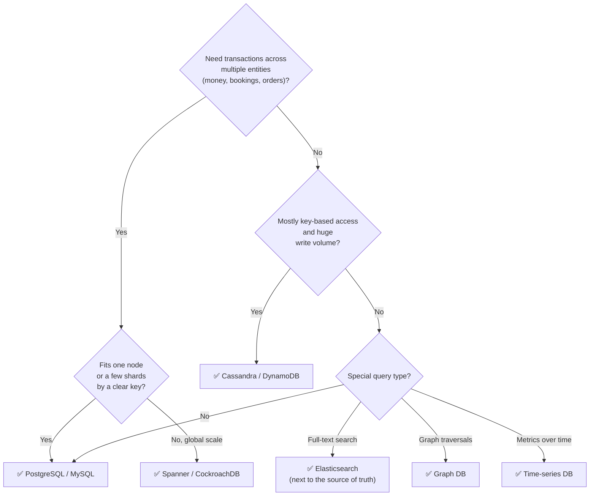
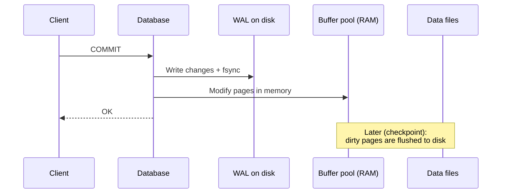
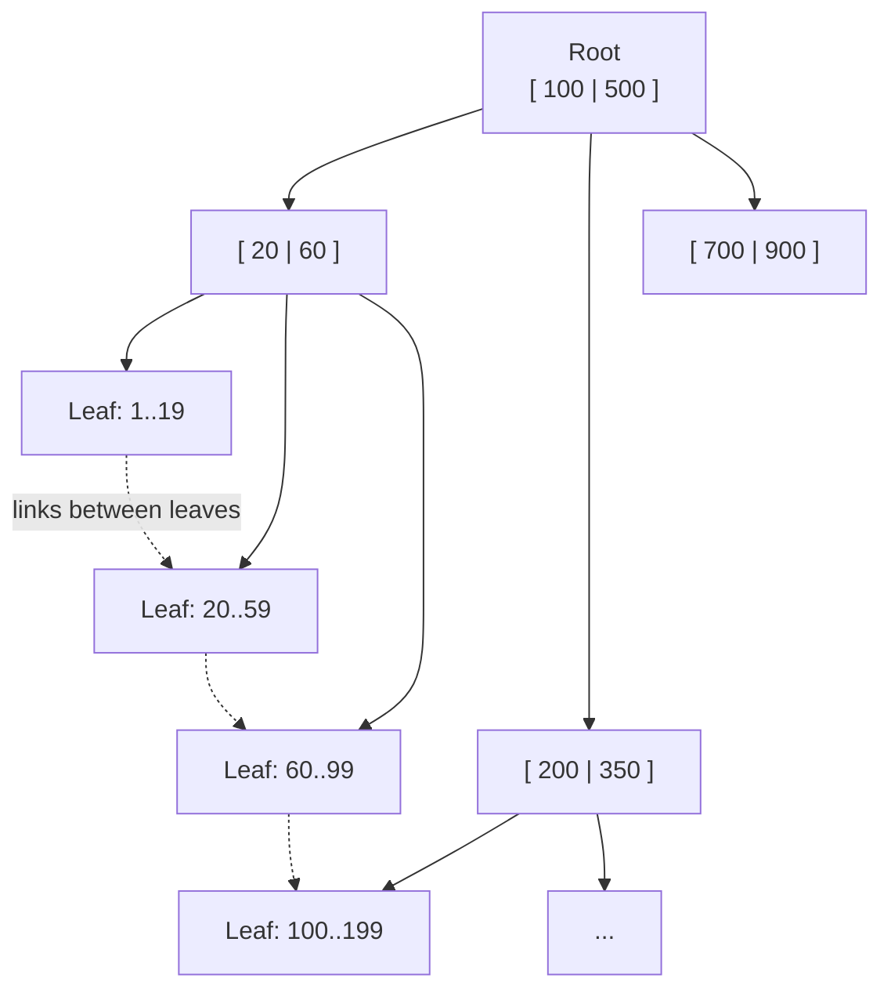
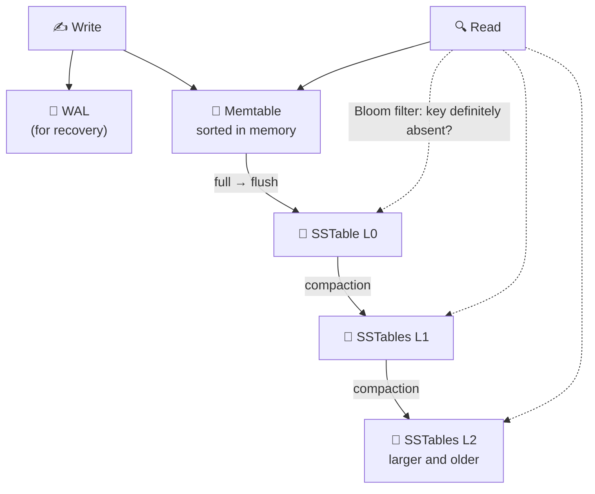
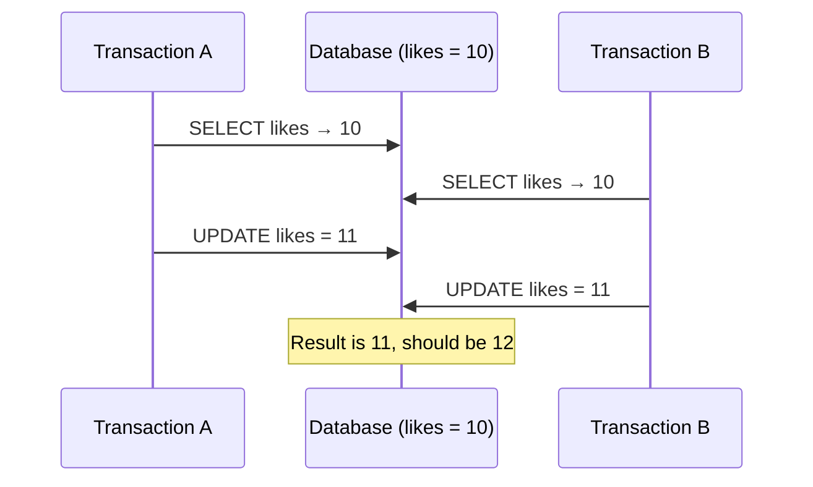
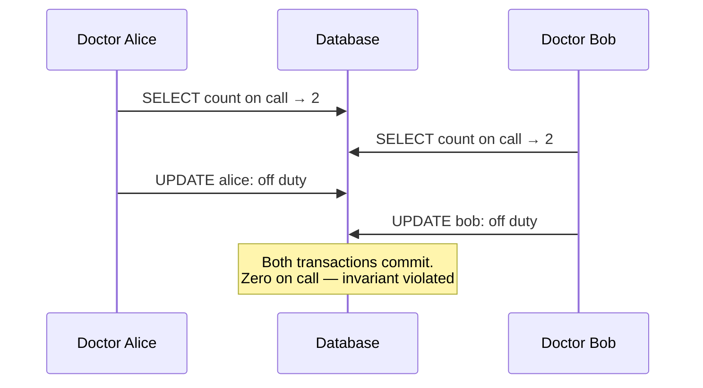

**English** | [Русский](README_RU.md)

# 04. Databases

> **Covers:** data models, SQL vs NoSQL, how storage works, indexes (B-tree vs LSM-tree), transactions and ACID, isolation levels and anomalies, concurrency control
> **Study time:** ~5–6 h · **Needed for:** every problem — every design has storage
> **Practice:** interview-style walkthrough — [INTERVIEW.md](./INTERVIEW.md)
> **Related topics:** [01-scaling-basics](../01-scaling-basics/README.md), [02-caching](../02-caching/README.md). Replication, partitioning and consistency models are covered in upcoming topics.

---

## 📑 Contents

1. [What Matters About Databases for System Design](#1-what-matters-about-databases-for-system-design)
2. [Data Models](#2-data-models)
3. [SQL vs NoSQL](#3-sql-vs-nosql)
4. [How a Database Stores Data: Pages, WAL, Buffer Pool](#4-how-a-database-stores-data-pages-wal-buffer-pool)
5. [Indexes and B-trees](#5-indexes-and-b-trees)
6. [LSM-trees](#6-lsm-trees)
7. [B-tree vs LSM-tree](#7-b-tree-vs-lsm-tree)
8. [Transactions and ACID](#8-transactions-and-acid)
9. [Concurrency Anomalies](#9-concurrency-anomalies)
10. [Isolation Levels](#10-isolation-levels)
11. [Concurrency Control: Locks, MVCC, Optimistic Approach](#11-concurrency-control-locks-mvcc-optimistic-approach)
12. [Practical Patterns](#12-practical-patterns)
13. [Which Database for Typical Problems](#13-which-database-for-typical-problems)
14. [How to Talk About This in an Interview](#14-how-to-talk-about-this-in-an-interview)
15. [Self-Check Questions](#15-self-check-questions)
16. [Glossary and Resources](#16-glossary-and-resources)

---

## 1. What Matters About Databases for System Design

The database shows up in every interview problem, and interviewers usually check three things:

1. **Storage choice:** why this data model and this DBMS fit the access patterns.
2. **Data model and indexes:** how fast the main queries run.
3. **Correctness under concurrency:** what happens when two requests change the same data at the same time.

> [!TIP]
> Choosing a database doesn't start with a product name but with **access patterns**: which queries are most frequent, how many reads and writes, whether transactions across multiple records are needed, how much data there is. The product name is a conclusion from that analysis.

---

## 2. Data Models

| Model | How it stores | Examples | Strengths | Weaknesses |
|:------|:--------------|:---------|:----------|:-----------|
| **Relational** | Tables, rows, relationships via keys | PostgreSQL, MySQL, Oracle, SQL Server | Transactions, JOINs, flexible queries, strict schema, maturity | Scaling writes horizontally is harder |
| **Key-value** | Key → value (blob) | Redis, DynamoDB, RocksDB | Very fast reads and writes by key, simple scaling | Queries by key only |
| **Document** | JSON-like documents | MongoDB, Couchbase, Firestore | Flexible schema, nested data read in one query | Relationships between documents and JOINs are awkward |
| **Wide-column** | Rows with dynamic columns, partitioned by key | Cassandra, ScyllaDB, HBase, Bigtable | Huge write volumes, linear scaling | Queries only by pre-designed keys; limited transactions |
| **Graph** | Vertices and edges | Neo4j, Amazon Neptune | Multi-hop relationship traversal | Narrow niche, harder to scale |
| **Time-series** | Timestamped metrics | TimescaleDB, InfluxDB, Prometheus | Compression, time aggregations, retention | Narrow purpose |
| **Search** | Inverted index | Elasticsearch, OpenSearch | Full-text search, facets, ranking | Not a source of truth; eventual consistency |
| **Vector** | Embeddings + ANN index | pgvector, Pinecone, Milvus | Similarity search (RAG, recommendations) | Approximate search, a young field |
| **NewSQL / distributed SQL** | SQL + sharding and consensus | Google Spanner, CockroachDB, YugabyteDB, TiDB | SQL and transactions at horizontal scale | Higher write latency, harder operations |

### Normalization and denormalization

| | Normalization | Denormalization |
|:-|:--------------|:----------------|
| Idea | Each fact is stored once; relationships via keys | Data is copied to where it's read |
| Pros | No contradictions, easier updates | Fast reads without JOINs |
| Cons | JOINs on read | Copies must be kept in sync |
| When | Default in relational databases | Read-heavy load, NoSQL, caches, search indexes |

---

## 3. SQL vs NoSQL

| Criterion | Relational (SQL) | NoSQL (generally) |
|:----------|:-----------------|:------------------|
| Schema | Strict, migrations | Flexible or none |
| Queries | Arbitrary, JOINs, aggregations | Usually by key or pre-designed indexes |
| Transactions | Full ACID across any rows | Often within a single key or document; many now support more |
| Write scaling | Vertical, then manual sharding or NewSQL | Horizontal out of the box |
| Consistency | Strong on a single node | Often tunable or eventual |
| When to choose | Related data, money, orders, complex queries, the default | Huge write scale, simple access patterns, flexible schema |

### Myths

- **"NoSQL is faster than SQL."** It's faster for simple key lookups at huge scale. A single PostgreSQL node with the right indexes serves tens of thousands of queries per second.
- **"NoSQL can't do transactions."** MongoDB supports multi-document transactions, DynamoDB supports transactions of up to 100 items, and Spanner and CockroachDB provide distributed ACID transactions.
- **"SQL doesn't scale."** It does: replicas, partitioning, sharding (Vitess, Citus) and NewSQL. It's just harder.
- **"Postgres has no flexible schema."** It has `JSONB` with indexes.

### How to choose



> [!IMPORTANT]
> **Senior+ signal:** "I'll start with PostgreSQL as the source of truth until there's a concrete reason for something else. If an access pattern needs a different store (search, a huge event volume), I'll add it alongside and feed it via CDC." Using several stores for different jobs is called **polyglot persistence**.

---

## 4. How a Database Stores Data: Pages, WAL, Buffer Pool

### Pages

Data on disk is stored in fixed-size **pages** (8 KB in PostgreSQL, 16 KB in InnoDB). Disks are read and written in whole pages, so what matters is how many pages a query needs to read.

### Buffer pool

A portion of RAM where hot pages are cached. If the working set fits in the buffer pool, most reads never touch the disk.

### WAL (write-ahead log)

Before changing pages, the database **first** writes a record of the change to a sequential log and flushes it to disk (fsync). Only then is the transaction considered committed.



- **Why:** sequential writes to a log are much faster than random page writes. After a crash, the database recovers by replaying the WAL.
- **Bonus:** the WAL is used for replication and CDC (Debezium reads exactly this).

---

## 5. Indexes and B-trees

An **index** is an additional data structure that lets you find rows without scanning the whole table. It's like the index at the back of a book.

### B-tree (B+tree)

The main index type in almost every relational database.



- A balanced tree where each node is a page holding hundreds of keys (**high fanout**).
- Lookup is O(log n): even for billions of rows the tree is 3–4 levels deep, i.e. 3–4 page reads.
- Leaves are linked, so **range queries** (`BETWEEN`, `>`, `ORDER BY`) are efficient.
- Inserting into a full page causes a **page split**.

### Clustered and secondary indexes

| | Clustered | Secondary |
|:-|:----------|:----------|
| What's in the leaves | The rows themselves | Key + pointer to the row (or the primary key value) |
| How many per table | One | Any number |
| Example | InnoDB: the table is stored as a B-tree by primary key | Any additional index |

> [!NOTE]
> In InnoDB, a secondary index stores the **primary key value**, so a lookup through it walks two trees. A long primary key (e.g. a string UUID) bloats every secondary index. A random UUID v4 as the primary key also causes page splits all over the tree; time-ordered IDs (Snowflake, UUID v7) are appended at the end.

### Composite index and the leftmost prefix rule

The index `(user_id, created_at)` is sorted first by `user_id`, then by `created_at`.

| Query | Uses the index? |
|:------|:----------------|
| `WHERE user_id = 42` | ✅ |
| `WHERE user_id = 42 AND created_at > '2026-01-01'` | ✅ |
| `WHERE user_id = 42 ORDER BY created_at DESC LIMIT 20` | ✅ And the sort is free |
| `WHERE created_at > '2026-01-01'` | ❌ No leftmost column |
| `WHERE user_id IN (1,2,3) ORDER BY created_at` | ⚠️ Partially: the sort has to be done separately |

**Column order:** equality columns first, then the range or sort column.

### Covering index

If the index contains **all** the columns a query needs, the database doesn't touch the table at all (index-only scan).

```sql
-- Query: a user's latest 20 orders, only id and amount
CREATE INDEX idx_orders_user ON orders (user_id, created_at DESC) INCLUDE (id, amount);
```

### Other index types

| Type | What for | Example |
|:-----|:---------|:--------|
| **Hash** | Exact equality only | Key lookups in key-value stores |
| **GIN (inverted)** | Searching inside arrays, JSONB, full text | `WHERE tags @> '{sale}'` in PostgreSQL |
| **GiST / R-tree** | Geodata, ranges, overlaps | "Hotels within 5 km", date range overlap |
| **BRIN** | Huge tables with natural ordering (time) | Logs, events by date |
| **Partial** | An index over only some rows | `WHERE status = 'active'` |
| **Expression** | An index on an expression | `lower(email)` |
| **Bitmap** | Low-cardinality columns in analytics | Data warehouses |

### The cost of indexes

- **Slower writes:** every insert and update modifies all of the table's indexes (write amplification).
- **Space** on disk and in the buffer pool.
- **An index may not be used:** low selectivity (`WHERE gender = 'F'`), a function on the column without an expression index, type mismatches, `LIKE '%abc'`.

> [!TIP]
> In an interview, name the indexes for the main queries on each main table: "The most frequent query is a user's latest orders, so an index on `(user_id, created_at DESC)`." In practice, verify with `EXPLAIN ANALYZE`.

---

## 6. LSM-trees

An **LSM-tree (Log-Structured Merge-tree)** is optimized for writes. It's used in Cassandra, ScyllaDB, HBase, Bigtable, RocksDB and LevelDB.



**Write path:**
1. Write to the WAL (sequentially) and to the **memtable** — a sorted in-memory structure.
2. When the memtable fills up, it's flushed to disk as an immutable sorted file — an **SSTable**.
3. Background **compaction** merges SSTables, dropping overwritten values and deleted keys (tombstones).

**Read path:**
1. Check the memtable.
2. Check SSTables from newest to oldest. Each file's **Bloom filter** quickly answers "this key is definitely not here", avoiding unnecessary file reads.

### Compaction strategies

| Strategy | How it works | Good for |
|:---------|:-------------|:---------|
| **Size-tiered** | Merges files of similar size | Write-heavy workloads; needs more temporary disk space |
| **Leveled** | Fixed-size levels with no key overlap within a level | Reads and space efficiency; more write amplification |
| **Time-window** | Files grouped by time | Time-series with TTL |

---

## 7. B-tree vs LSM-tree

| | B-tree | LSM-tree |
|:-|:-------|:---------|
| Writes | Pages modified in place (random I/O) | Sequential writes to a log and memtable |
| Write speed | Good | Very high |
| Point reads | Predictable: 3–4 pages | May check several files (Bloom filters help) |
| Range queries | Excellent | Good, but merges multiple files |
| Write amplification | A whole page per change + WAL | Repeated rewrites during compaction |
| Space amplification | Page fragmentation | Stale versions until compaction |
| Latency predictability | High | Possible spikes from compaction |
| Examples | PostgreSQL, MySQL InnoDB, Oracle, SQL Server | Cassandra, ScyllaDB, HBase, RocksDB, Bigtable |
| When to choose | Balanced or read-heavy load, transactions | Write-heavy: logs, events, metrics, messages |

> [!NOTE]
> The line is blurred: RocksDB (LSM) is used as the storage engine inside many systems, including MyRocks for MySQL and CockroachDB (via Pebble, which is RocksDB-compatible). In an interview what matters is understanding the trade-off, not the names.

---

## 8. Transactions and ACID

A **transaction** is a group of operations executed as a single unit.

| Letter | Meaning | What it guarantees | How it's implemented |
|:------:|:--------|:-------------------|:---------------------|
| **A** | Atomicity | All operations or none. On error — rollback | WAL and undo log |
| **C** | Consistency | Data stays in a valid state: constraints, foreign keys, CHECK | DB constraints + application logic |
| **I** | Isolation | Concurrent transactions don't interfere (how much depends on the isolation level) | Locks, MVCC |
| **D** | Durability | After COMMIT, data survives a crash | WAL + fsync, replication |

> [!WARNING]
> The "C" in ACID and the "C" in CAP are **different things**. In ACID it means preserving data invariants; in CAP it means linearizability (everyone sees the same latest value). Mixing them up is a common interview mistake.

### The classic example

```sql
BEGIN;
UPDATE accounts SET balance = balance - 100 WHERE id = 1;
UPDATE accounts SET balance = balance + 100 WHERE id = 2;
COMMIT;
-- If the server crashes between the UPDATEs, neither change is saved (atomicity)
```

### BASE

Many distributed NoSQL systems are described as **BASE**: Basically Available, Soft state, Eventually consistent. It's not the opposite of ACID but a different set of trade-offs: availability and scale over immediate consistency.

---

## 9. Concurrency Anomalies

When transactions run concurrently without enough isolation, anomalies occur.

| Anomaly | What happens |
|:--------|:-------------|
| **Dirty read** | A transaction reads data another transaction hasn't committed yet (and may roll back) |
| **Dirty write** | A transaction overwrites another's uncommitted data |
| **Non-repeatable read** | Re-reading the same row within one transaction returns a different value |
| **Phantom read** | Re-running a query with a condition returns a different **set** of rows because someone inserted or deleted rows |
| **Lost update** | Two transactions read a value, both modify it based on what they read, and one change is lost |
| **Write skew** | Two transactions read the same data, make decisions and write to **different** rows, together violating an invariant |

### Lost update



**Fixes:** an atomic update `UPDATE ... SET likes = likes + 1`, `SELECT ... FOR UPDATE`, optimistic locking by version, or an isolation level that detects the conflict.

### Write skew

Rule: at least **one** doctor must be on call at night in the hospital. Two are on call right now.



The transactions write to **different** rows, so row locks and snapshot isolation don't notice. **Fixes:** the `SERIALIZABLE` level, explicitly locking every row the decision is based on (`SELECT ... FOR UPDATE`), or materializing the conflict (a separate "lock" row both transactions must update).

---

## 10. Isolation Levels

| Level | Dirty read | Non-repeatable read | Phantom | Lost update | Write skew |
|:------|:----------:|:-------------------:|:-------:|:-----------:|:----------:|
| Read Uncommitted | ⚠️ possible | ⚠️ | ⚠️ | ⚠️ | ⚠️ |
| Read Committed | ✅ no | ⚠️ | ⚠️ | ⚠️ | ⚠️ |
| Repeatable Read | ✅ | ✅ | ⚠️ depends on DBMS | ⚠️ depends on DBMS | ⚠️ |
| Snapshot Isolation | ✅ | ✅ | ✅ for reads | ✅ usually detected | ⚠️ |
| Serializable | ✅ | ✅ | ✅ | ✅ | ✅ |

### How it looks in popular databases

| DBMS | Default level | Specifics |
|:-----|:--------------|:----------|
| PostgreSQL | Read Committed | Repeatable Read is implemented as snapshot isolation and detects lost updates (serialization error). Serializable is SSI (Serializable Snapshot Isolation): it also detects write skew; on conflict one transaction gets an error and must retry |
| MySQL InnoDB | Repeatable Read | Plain SELECTs read a snapshot; locking reads (`FOR UPDATE`) use next-key locks against phantoms. Lost updates with "read then write" without locking are possible |
| Oracle | Read Committed | "Serializable" is actually snapshot isolation |

> [!IMPORTANT]
> **Senior+ signal:** isolation level names mean different things in different databases. Don't rely on the name — say which **anomaly** you need to prevent and by which mechanism: an atomic update, `FOR UPDATE`, a DB constraint, a version check, or `SERIALIZABLE` with retries.

### The cost of isolation

The higher the level, the more locking or conflict-driven rollbacks, and the lower the throughput under concurrent load. With `SERIALIZABLE`, the application **must** be able to retry transactions on serialization errors.

---

## 11. Concurrency Control: Locks, MVCC, Optimistic Approach

### MVCC (Multi-Version Concurrency Control)

The database keeps **multiple versions** of a row. Each transaction sees a snapshot of the data as of its start (or the start of the statement). Readers don't block writers, and writers don't block readers.

- Used in PostgreSQL, MySQL InnoDB, Oracle and many others.
- The cost: old versions must be cleaned up (`VACUUM` in PostgreSQL, purge in InnoDB). Long-running transactions block cleanup and bloat tables.

### Pessimistic locking

Lock the rows up front so nobody can change them until the transaction ends.

```sql
BEGIN;
SELECT balance FROM accounts WHERE id = 1 FOR UPDATE;   -- row is locked
-- checks in the application
UPDATE accounts SET balance = balance - 100 WHERE id = 1;
COMMIT;
```

- ✅ Simple and reliable under high contention on the same rows.
- ❌ Waiting on locks, risk of deadlocks.

### Optimistic locking

Don't lock; on write, check that the data hasn't changed.

```sql
-- Read: id = 42, version = 7
UPDATE products SET price = 120, version = 8
WHERE id = 42 AND version = 7;
-- 0 rows updated → someone got there first; re-read and retry
```

- ✅ No locks, good when conflicts are rare.
- ❌ Many retries when conflicts are frequent.

### Atomic conditional updates

Often the best option: the check and the change in **one** statement.

```sql
UPDATE inventory SET reserved = reserved + 1
WHERE item_id = 42 AND reserved < total;
-- 1 row updated → success, 0 → sold out
```

### Deadlocks

Transaction A locked row 1 and waits for row 2; transaction B locked row 2 and waits for row 1. The database detects the cycle and rolls back one of them.

**Prevention:** always lock rows in the **same order** (e.g. by ascending ID), keep transactions short, retry rolled-back transactions.

### Comparison

| Approach | When to use |
|:---------|:------------|
| Atomic conditional update | Counters, stock, limits — the default |
| DB constraints (UNIQUE, CHECK, EXCLUDE) | Invariants that can be expressed declaratively |
| Optimistic locking | Rare conflicts, long edits (forms, documents) |
| Pessimistic (`FOR UPDATE`) | Frequent conflicts on the same rows, complex logic between read and write |
| `SERIALIZABLE` | Complex invariants across many rows (write skew), when it's simpler to let the DB handle it |

---

## 12. Practical Patterns

### Pagination: offset vs keyset

```sql
-- ❌ OFFSET: the database reads and discards 100,000 rows
SELECT * FROM posts ORDER BY created_at DESC LIMIT 20 OFFSET 100000;

-- ✅ Keyset (cursor): continue from the last value, uses the index
SELECT * FROM posts
WHERE (created_at, id) < ('2026-03-01 10:00', 98765)
ORDER BY created_at DESC, id DESC
LIMIT 20;
```

### The N+1 problem

Code loads a list of 100 orders and then makes 100 separate queries for users in a loop. Fix: a JOIN, `WHERE id IN (...)`, or batching in the ORM.

### Connection pooling

Each PostgreSQL connection is a separate process with its own memory. Thousands of connections from autoscaling instances take the database down. Fix: an application-side pool and/or a proxy pool (PgBouncer, RDS Proxy).

### Zero-downtime schema migrations

The **expand → migrate → contract** principle:
1. Add the new column (nullable) without removing the old one.
2. Write to both; backfill old data in batches.
3. Switch reads to the new column.
4. Drop the old one.

Create indexes on large tables without blocking writes (`CREATE INDEX CONCURRENTLY` in PostgreSQL).

### Don't hold a transaction open during external calls

```
❌ BEGIN → reserve → HTTP call to payments (2 s) → COMMIT
✅ BEGIN → reserve with status pending → COMMIT → HTTP call → BEGIN → confirm → COMMIT
```

Long transactions hold locks, block MVCC cleanup and exhaust the connection pool.

---

## 13. Which Database for Typical Problems

| Problem | Source of truth | Alongside | Why |
|:--------|:----------------|:----------|:----|
| Payments, wallet, ledger | PostgreSQL / MySQL (or Spanner globally) | — | Strict transactions and invariants |
| Booking (hotels, tickets) | PostgreSQL | Elasticsearch for search, Redis | Transactions against double booking |
| E-commerce catalog and orders | PostgreSQL | Elasticsearch, Redis | Orders are transactional; the catalog is searched |
| Chat, messages | Cassandra / ScyllaDB | Redis for presence | Huge write volume, access by (chat_id, time) |
| News feed | Cassandra or Redis for feeds | PostgreSQL for users and the graph | Reading precomputed feeds by user_id |
| Metrics, telemetry | Time-series DB | Object storage for archives | Compression and time aggregations |
| URL shortener | DynamoDB / Cassandra / PostgreSQL | Redis | Simple key access |
| Social graph | Sharded MySQL (like TAO) or a graph DB | Cache | Depends on traversal depth |
| Text search | Source of truth + Elasticsearch | — | A search index isn't a source of truth |
| Sessions, rate limits | Redis | — | TTL and atomic in-memory operations |

---

## 14. How to Talk About This in an Interview

### 30-second answer

> "I start choosing a database from access patterns. By default, PostgreSQL as the source of truth: transactions, constraints, flexible queries. I design composite indexes for the main queries using the leftmost prefix rule. For write-heavy, key-accessed data I use an LSM store like Cassandra. I protect concurrent changes with atomic conditional updates and DB constraints, and for complex invariants — `SELECT FOR UPDATE` or `SERIALIZABLE` with retries. Transactions are short, with no external calls inside."

### Questions to ask yourself

1. What are the 2–3 most frequent queries? Which indexes do they need?
2. What's the read/write ratio and data volume in 2–3 years?
3. Which invariants must never be violated (no double booking, balance ≥ 0)?
4. What happens if two requests change the same data at once?
5. Where's the source of truth, and where's derived data (cache, search)?

### Common mistakes

- Choosing NoSQL "because it scales" without analyzing access patterns.
- Not naming indexes for the main queries.
- "Read, check in code, write" without race protection.
- Confusing the C in ACID with the C in CAP.
- Assuming Repeatable Read means the same thing in every database.
- Holding a transaction open during HTTP calls.
- Using OFFSET for deep pagination.

---

## 15. Self-Check Questions

<details>
<summary><b>1. Why does a B-tree over a billion rows need only 3–4 page reads?</b></summary>

Each node is a page holding hundreds of keys (high fanout). With a fanout of ~500, three levels cover 500³ ≈ 125M entries, and four cover tens of billions. The upper levels are almost always in the buffer pool, so actual disk reads are even fewer.
</details>

<details>
<summary><b>2. Why doesn't an index on (a, b) help the query WHERE b = 5?</b></summary>

The index is sorted by a first, then by b within each a. Values with b = 5 are scattered across the whole index, so they can only be found with a full scan. That's the leftmost prefix rule.
</details>

<details>
<summary><b>3. How does an LSM-tree beat a B-tree on writes, and what does it pay?</b></summary>

LSM writes are sequential (log + memtable), with no random page modifications, so they're very fast. It pays with more complex reads (several files, needing Bloom filters), background compaction that consumes I/O and can cause latency spikes, and temporary storage of stale versions.
</details>

<details>
<summary><b>4. Why do you need a WAL?</b></summary>

For atomicity and durability: changes are first written sequentially to the log and flushed to disk, and only then is the transaction considered committed. After a crash, the database recovers by replaying the log. Sequential writes are faster than random page writes. The same log is used for replication and CDC.
</details>

<details>
<summary><b>5. How is a lost update different from write skew?</b></summary>

A lost update is two transactions modifying **the same** row based on a value they read, with one change lost. Write skew is transactions reading shared data but writing to **different** rows, together violating an invariant. Row locks and snapshot isolation catch lost updates; write skew is caught only by serializable, explicit locks on every row read, or materializing the conflict.
</details>

<details>
<summary><b>6. How do you safely decrement stock without races?</b></summary>

With an atomic conditional update: `UPDATE inventory SET stock = stock - 1 WHERE id = 42 AND stock > 0`, then check the number of rows updated. Alternatives: `SELECT ... FOR UPDATE` then UPDATE, optimistic locking by version, and a `CHECK (stock >= 0)` constraint as the last line of defense.
</details>

<details>
<summary><b>7. What happens under SERIALIZABLE in PostgreSQL when two transactions conflict?</b></summary>

One of them gets a serialization error at commit (or earlier) and is rolled back. The application must retry that transaction. That's why code using serializable must have retry logic.
</details>

<details>
<summary><b>8. Why is OFFSET pagination slow on deep pages?</b></summary>

The database must read and discard every row before the offset: for OFFSET 100,000 — a hundred thousand rows. Keyset pagination continues from the last value via the index and reads only the needed 20 rows, regardless of depth.
</details>

<details>
<summary><b>9. How do you avoid deadlocks when updating multiple rows?</b></summary>

Always lock rows in the same order (e.g. by ascending ID or date), keep transactions short, and retry transactions rolled back due to deadlock.
</details>

<details>
<summary><b>10. When should you choose Cassandra over PostgreSQL?</b></summary>

When write volume is huge (hundreds of thousands of writes per second or more), access goes through known keys (e.g. chat messages by chat_id and time), you need linear horizontal scaling and multi-region, and transactions across different keys aren't required.
</details>

---

## 16. Glossary and Resources

### Glossary

| Term | Meaning |
|:-----|:--------|
| Page | The unit of storage and I/O on disk (8–16 KB) |
| Buffer pool | The database's in-memory page cache |
| WAL | Write-ahead log: a log of changes written before the data is modified |
| B-tree | A balanced tree for indexes with fast lookups and ranges |
| LSM-tree | A write-optimized structure: memtable + SSTables + compaction |
| SSTable | An immutable sorted file on disk in an LSM |
| Compaction | Background merging of SSTables |
| Bloom filter | A probabilistic structure: "definitely not" or "maybe" |
| Clustered index | An index whose leaves store the rows themselves |
| Covering index | An index containing all the columns a query needs |
| ACID | Atomicity, Consistency, Isolation, Durability |
| MVCC | Keeping multiple row versions for isolation without read locks |
| Snapshot isolation | Each transaction sees a snapshot of data as of its start |
| SSI | Serializable Snapshot Isolation: serializability on top of snapshots |
| Write skew | An anomaly: transactions write different rows and together violate an invariant |
| Optimistic locking | Checking a version on write instead of locking |
| Polyglot persistence | Using different stores for different jobs |

### Resources

- *Designing Data-Intensive Applications*, Martin Kleppmann — chapters 2 (data models), 3 (storage and indexes), 7 (transactions)
- *Database Internals*, Alex Petrov — B-trees, LSM, storage
- Markus Winand, *Use The Index, Luke* (use-the-index-luke.com) — indexes in practice
- Berenson et al., *A Critique of ANSI SQL Isolation Levels* (1995)
- O'Neil et al., *The Log-Structured Merge-Tree (LSM-Tree)* (1996)
- Chang et al., *Bigtable: A Distributed Storage System for Structured Data* (OSDI 2006)
- PostgreSQL documentation: Transaction Isolation, Explicit Locking, Indexes
- Jepsen (jepsen.io) — analyses of real distributed database guarantees