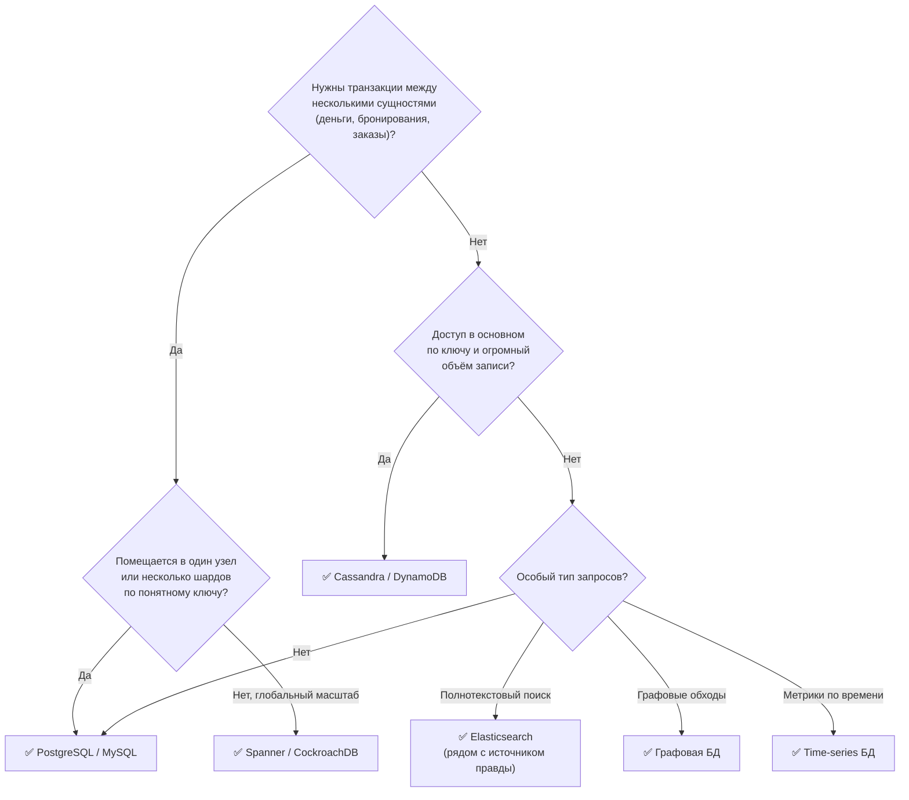
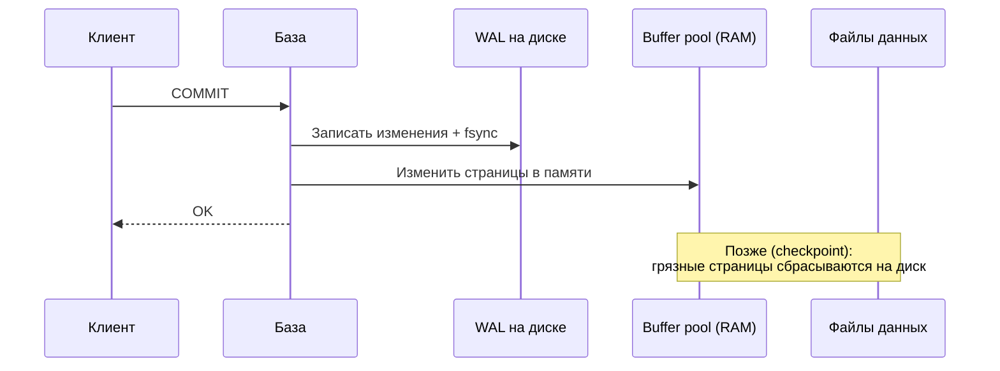
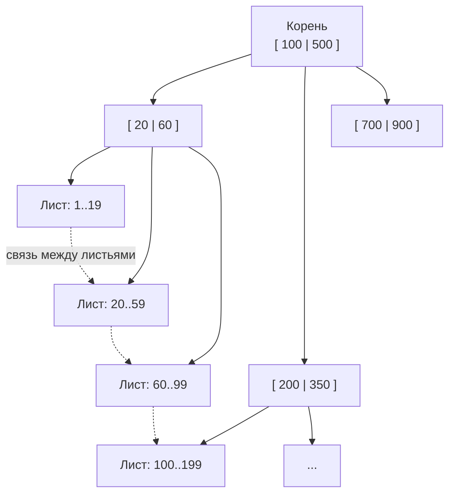
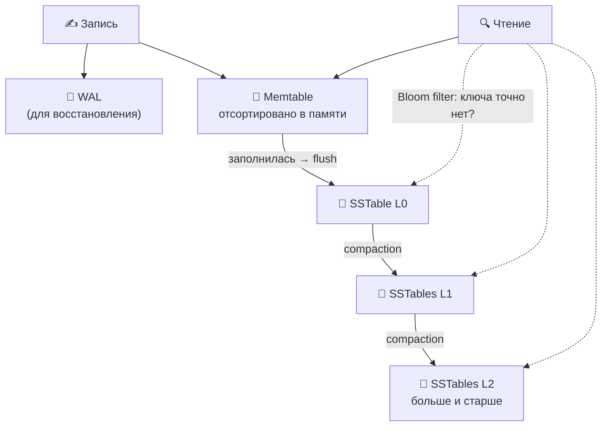
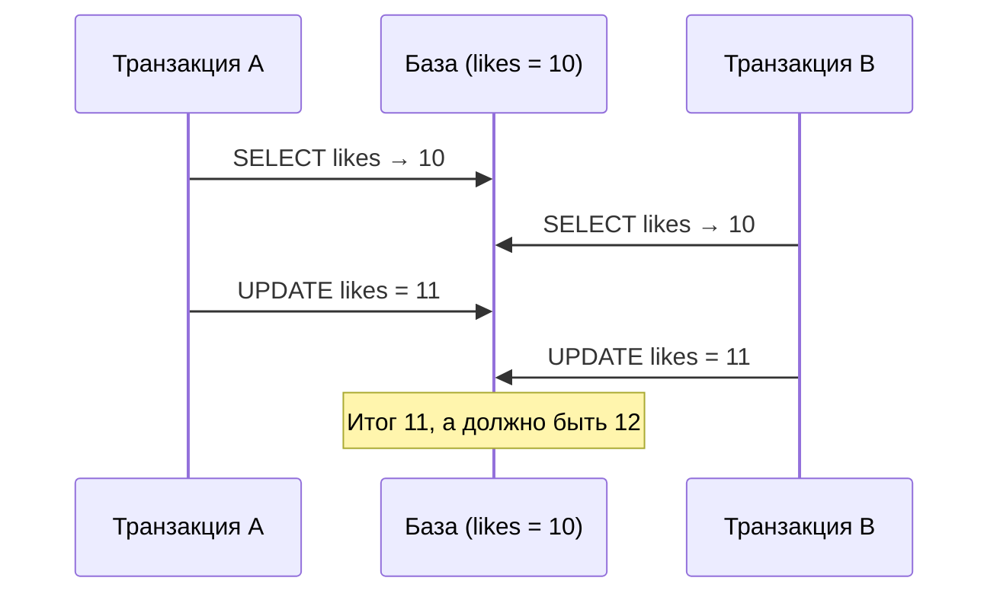
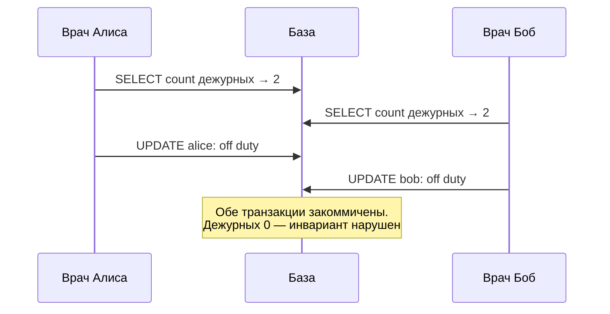

[English](README.md) | **Русский**

# 04. Базы данных

> **Что внутри:** модели данных, SQL vs NoSQL, как устроено хранение, индексы (B-tree vs LSM-tree), транзакции и ACID, уровни изоляции и аномалии, управление конкурентным доступом
> **Время на изучение:** ~5–6 ч · **Нужно для:** любой задачи — в каждом дизайне есть хранилище
> **Практика:** разбор в формате интервью — [INTERVIEW_RU.md](./INTERVIEW.ru.md)
> **Связанные темы:** [01-scaling-basics](../01_Scaling%20basics/README.ru.md), [02-caching](../02_Caching/README.ru.md). Репликация, партиционирование и модели консистентности — в следующих темах.

---

## 📑 Содержание

1. [Что важно знать о базах для system design](#1-что-важно-знать-о-базах-для-system-design)
2. [Модели данных](#2-модели-данных)
3. [SQL vs NoSQL](#3-sql-vs-nosql)
4. [Как база хранит данные: страницы, WAL, buffer pool](#4-как-база-хранит-данные-страницы-wal-buffer-pool)
5. [Индексы и B-tree](#5-индексы-и-b-tree)
6. [LSM-tree](#6-lsm-tree)
7. [B-tree vs LSM-tree](#7-b-tree-vs-lsm-tree)
8. [Транзакции и ACID](#8-транзакции-и-acid)
9. [Аномалии конкурентного доступа](#9-аномалии-конкурентного-доступа)
10. [Уровни изоляции](#10-уровни-изоляции)
11. [Управление конкурентным доступом: блокировки, MVCC, оптимистичный подход](#11-управление-конкурентным-доступом-блокировки-mvcc-оптимистичный-подход)
12. [Практические паттерны](#12-практические-паттерны)
13. [Какую базу выбрать для типичных задач](#13-какую-базу-выбрать-для-типичных-задач)
14. [Как говорить об этом на интервью](#14-как-говорить-об-этом-на-интервью)
15. [Вопросы для самопроверки](#15-вопросы-для-самопроверки)
16. [Глоссарий и ресурсы](#16-глоссарий-и-ресурсы)

---

## 1. Что важно знать о базах для system design

На интервью база данных появляется в каждой задаче, и обычно проверяют три вещи:

1. **Выбор хранилища:** почему эта модель данных и эта СУБД подходят под паттерны доступа.
2. **Модель данных и индексы:** как быстро выполняются главные запросы.
3. **Корректность при конкурентном доступе:** что будет, если два запроса одновременно меняют одни и те же данные.

> [!TIP]
> Выбор базы начинается не с названия СУБД, а с **паттернов доступа**: какие запросы самые частые, сколько чтений и записей, нужны ли транзакции между несколькими записями, какой объём данных. Название базы — вывод из этого анализа.

---

## 2. Модели данных

| Модель | Как хранит | Примеры | Сильные стороны | Слабые стороны |
|:-------|:-----------|:--------|:----------------|:---------------|
| **Реляционная** | Таблицы, строки, связи через ключи | PostgreSQL, MySQL, Oracle, SQL Server | Транзакции, JOIN, гибкие запросы, строгая схема, зрелость | Горизонтальное масштабирование записи сложнее |
| **Key-value** | Ключ → значение (blob) | Redis, DynamoDB, RocksDB | Очень быстрые чтение и запись по ключу, простое масштабирование | Запросы только по ключу |
| **Документная** | JSON-подобные документы | MongoDB, Couchbase, Firestore | Гибкая схема, вложенные данные читаются одним запросом | Связи между документами и JOIN неудобны |
| **Wide-column** | Строки с динамическими колонками, партиции по ключу | Cassandra, ScyllaDB, HBase, Bigtable | Огромные объёмы записи, линейное масштабирование | Запросы только по заранее спроектированным ключам; ограниченные транзакции |
| **Графовая** | Вершины и рёбра | Neo4j, Amazon Neptune | Обход связей на много уровней | Узкая ниша, сложнее масштабировать |
| **Time-series** | Метрики с временными метками | TimescaleDB, InfluxDB, Prometheus | Сжатие, агрегации по времени, retention | Узкое назначение |
| **Поисковая** | Инвертированный индекс | Elasticsearch, OpenSearch | Полнотекстовый поиск, фасеты, ранжирование | Не источник правды; eventual consistency |
| **Векторная** | Эмбеддинги + ANN-индекс | pgvector, Pinecone, Milvus | Поиск похожих объектов (RAG, рекомендации) | Приблизительный поиск, новая область |
| **NewSQL / распределённый SQL** | SQL + шардирование и консенсус | Google Spanner, CockroachDB, YugabyteDB, TiDB | SQL и транзакции при горизонтальном масштабе | Выше задержка записи, сложнее эксплуатация |

### Нормализация и денормализация

| | Нормализация | Денормализация |
|:-|:-------------|:---------------|
| Суть | Каждый факт хранится один раз, связи через ключи | Данные копируются туда, где их читают |
| Плюсы | Нет противоречий, проще обновлять | Быстрое чтение без JOIN |
| Минусы | JOIN при чтении | Нужно синхронизировать копии |
| Когда | По умолчанию в реляционных базах | Read-heavy нагрузка, NoSQL, кэши, поисковые индексы |

---

## 3. SQL vs NoSQL

| Критерий | Реляционные (SQL) | NoSQL (обобщённо) |
|:---------|:------------------|:------------------|
| Схема | Строгая, миграции | Гибкая или отсутствует |
| Запросы | Произвольные, JOIN, агрегации | Обычно по ключу или заранее спроектированным индексам |
| Транзакции | Полноценные ACID между любыми строками | Часто в пределах одного ключа или документа; многие уже поддерживают и больше |
| Масштабирование записи | Вертикально, далее шардирование вручную или NewSQL | Горизонтальное «из коробки» |
| Консистентность | Строгая на одном узле | Часто настраиваемая или eventual |
| Когда выбирать | Связанные данные, деньги, заказы, сложные запросы, по умолчанию | Огромный масштаб записи, простые паттерны доступа, гибкая схема |

### Мифы

- **«NoSQL быстрее SQL».** Быстрее при простых запросах по ключу на огромном масштабе. Один узел PostgreSQL с правильными индексами обслуживает десятки тысяч запросов в секунду.
- **«NoSQL не умеет транзакции».** MongoDB поддерживает многодокументные транзакции, DynamoDB — транзакции до 100 элементов, Spanner и CockroachDB — распределённые ACID-транзакции.
- **«SQL не масштабируется».** Масштабируется: реплики, партиционирование, шардирование (Vitess, Citus) и NewSQL. Просто это сложнее.
- **«В Postgres нет гибкой схемы».** Есть `JSONB` с индексами.

### Как выбирать



> [!IMPORTANT]
> **Сигнал Senior+:** «Начну с PostgreSQL как источника правды, пока нет конкретной причины для другого. Если паттерн доступа требует другого хранилища (поиск, огромный объём событий), добавлю его рядом и буду наполнять через CDC». Использование нескольких хранилищ под разные задачи называется **polyglot persistence**.

---

## 4. Как база хранит данные: страницы, WAL, buffer pool

### Страницы

Данные на диске хранятся **страницами** фиксированного размера (8 КБ в PostgreSQL, 16 КБ в InnoDB). Диск читается и пишется страницами целиком, поэтому важно, сколько страниц нужно прочитать для запроса.

### Buffer pool

Часть оперативной памяти, где кэшируются горячие страницы. Если рабочий набор помещается в buffer pool, большинство чтений не трогает диск.

### WAL (write-ahead log)

Перед изменением страниц база **сначала** пишет запись об изменении в последовательный журнал и сбрасывает его на диск (fsync). Только после этого транзакция считается зафиксированной.



- **Зачем:** последовательная запись в журнал намного быстрее случайной записи страниц. При сбое база восстанавливается, проигрывая WAL.
- **Дополнительно:** WAL используется для репликации и CDC (Debezium читает именно его).

---

## 5. Индексы и B-tree

**Индекс** — дополнительная структура данных, которая позволяет найти строки без полного сканирования таблицы. Это как предметный указатель в конце книги.

### B-tree (B+tree)

Основной тип индекса почти во всех реляционных базах.



- Сбалансированное дерево, каждый узел — страница с сотнями ключей (**высокий fanout**).
- Поиск — O(log n): даже для миллиардов строк дерево имеет высоту 3–4, то есть 3–4 чтения страниц.
- Листья связаны между собой, поэтому **диапазонные запросы** (`BETWEEN`, `>`, `ORDER BY`) эффективны.
- Вставка в заполненную страницу вызывает **разделение страницы** (page split).

### Кластерный и вторичный индекс

| | Кластерный (clustered) | Вторичный (secondary) |
|:-|:-----------------------|:----------------------|
| Что в листьях | Сами строки | Ключ + указатель на строку (или значение первичного ключа) |
| Сколько на таблицу | Один | Сколько угодно |
| Пример | InnoDB: таблица хранится как B-tree по первичному ключу | Любой дополнительный индекс |

> [!NOTE]
> В InnoDB вторичный индекс хранит значение **первичного ключа**, поэтому поиск по нему — это два прохода по деревьям. Длинный первичный ключ (например, строковый UUID) раздувает все вторичные индексы. Случайный UUID v4 как первичный ключ ещё и вызывает разделение страниц по всему дереву; упорядоченные по времени ID (Snowflake, UUID v7) вставляются в конец.

### Составной индекс и правило левого префикса

Индекс `(user_id, created_at)` отсортирован сначала по `user_id`, затем по `created_at`.

| Запрос | Использует индекс? |
|:-------|:-------------------|
| `WHERE user_id = 42` | ✅ |
| `WHERE user_id = 42 AND created_at > '2026-01-01'` | ✅ |
| `WHERE user_id = 42 ORDER BY created_at DESC LIMIT 20` | ✅ И сортировка бесплатна |
| `WHERE created_at > '2026-01-01'` | ❌ Нет левого столбца |
| `WHERE user_id IN (1,2,3) ORDER BY created_at` | ⚠️ Частично: сортировку придётся делать отдельно |

**Порядок колонок:** сначала колонки с условием равенства, потом диапазон или сортировка.

### Покрывающий индекс

Если индекс содержит **все** колонки, нужные запросу, база вообще не обращается к таблице (index-only scan).

```sql
-- Запрос: последние 20 заказов пользователя, только id и сумма
CREATE INDEX idx_orders_user ON orders (user_id, created_at DESC) INCLUDE (id, amount);
```

### Другие типы индексов

| Тип | Для чего | Пример |
|:----|:---------|:-------|
| **Hash** | Только точное равенство | Поиск по ключу в key-value хранилищах |
| **GIN (инвертированный)** | Поиск внутри массивов, JSONB, полнотекстовый | `WHERE tags @> '{sale}'` в PostgreSQL |
| **GiST / R-tree** | Геоданные, диапазоны, пересечения | «Отели в радиусе 5 км», пересечение дат |
| **BRIN** | Огромные таблицы с естественной сортировкой (время) | Логи, события по дате |
| **Частичный (partial)** | Индекс только по части строк | `WHERE status = 'active'` |
| **Функциональный** | Индекс по выражению | `lower(email)` |
| **Bitmap** | Колонки с малым числом значений в аналитике | Хранилища данных |

### Цена индексов

- **Медленнее запись:** каждая вставка и обновление меняет все индексы таблицы (write amplification).
- **Место** на диске и в buffer pool.
- **Индекс может не использоваться:** низкая селективность (`WHERE gender = 'F'`), функция над колонкой без функционального индекса, несоответствие типов, `LIKE '%abc'`.

> [!TIP]
> На интервью для каждой главной таблицы называй индексы под главные запросы: «Самый частый запрос — последние заказы пользователя, поэтому индекс `(user_id, created_at DESC)`». Проверка на практике — `EXPLAIN ANALYZE`.

---

## 6. LSM-tree

**LSM-tree (Log-Structured Merge-tree)** оптимизирован для записи. Используется в Cassandra, ScyllaDB, HBase, Bigtable, RocksDB, LevelDB.



**Путь записи:**
1. Запись в WAL (последовательно) и в **memtable** — отсортированную структуру в памяти.
2. Когда memtable заполняется, она сбрасывается на диск как неизменяемый отсортированный файл — **SSTable**.
3. Фоновая **compaction** сливает SSTable, удаляет перезаписанные значения и удалённые ключи (tombstones).

**Путь чтения:**
1. Проверить memtable.
2. Проверить SSTable от новых к старым. **Bloom filter** у каждого файла быстро отвечает «ключа здесь точно нет», чтобы не читать лишние файлы.

### Стратегии compaction

| Стратегия | Как работает | Хорошо для |
|:----------|:-------------|:-----------|
| **Size-tiered** | Сливает файлы похожего размера | Нагрузки с большим объёмом записи; больше временного места на диске |
| **Leveled** | Уровни фиксированного размера, без пересечений ключей внутри уровня | Чтение и экономия места; больше write amplification |
| **Time-window** | Файлы группируются по времени | Time-series с TTL |

---

## 7. B-tree vs LSM-tree

| | B-tree | LSM-tree |
|:-|:-------|:---------|
| Запись | Изменение страниц на месте (случайный I/O) | Последовательная запись в журнал и memtable |
| Скорость записи | Хорошая | Очень высокая |
| Чтение по ключу | Предсказуемое: 3–4 страницы | Может проверять несколько файлов (спасают Bloom filters) |
| Диапазонные запросы | Отлично | Хорошо, но с слиянием нескольких файлов |
| Write amplification | Страница целиком на каждое изменение + WAL | Многократная перезапись при compaction |
| Space amplification | Фрагментация страниц | Устаревшие версии до compaction |
| Предсказуемость latency | Высокая | Возможны всплески из-за compaction |
| Примеры | PostgreSQL, MySQL InnoDB, Oracle, SQL Server | Cassandra, ScyllaDB, HBase, RocksDB, Bigtable |
| Когда выбирать | Сбалансированная или read-heavy нагрузка, транзакции | Write-heavy: логи, события, метрики, сообщения |

> [!NOTE]
> Граница размыта: RocksDB (LSM) используется как движок хранения внутри многих систем, включая MyRocks для MySQL и CockroachDB (через Pebble, совместимый с RocksDB). На интервью важно понимать компромисс, а не названия.

---

## 8. Транзакции и ACID

**Транзакция** — группа операций, которая выполняется как единое целое.

| Буква | Значение | Что гарантирует | Как реализуется |
|:-----:|:---------|:----------------|:----------------|
| **A** | Atomicity (атомарность) | Либо все операции, либо ни одной. При ошибке — откат | WAL и undo-журнал |
| **C** | Consistency (согласованность) | Данные остаются в допустимом состоянии: ограничения, внешние ключи, CHECK | Ограничения в БД + логика приложения |
| **I** | Isolation (изоляция) | Параллельные транзакции не мешают друг другу (насколько — зависит от уровня изоляции) | Блокировки, MVCC |
| **D** | Durability (надёжность) | После COMMIT данные не потеряются при сбое | WAL + fsync, репликация |

> [!WARNING]
> «C» в ACID и «C» в CAP — **разные вещи**. В ACID это соблюдение инвариантов данных, в CAP — линеаризуемость (все видят одно и то же последнее значение). Путать их на интервью — частая ошибка.

### Классический пример

```sql
BEGIN;
UPDATE accounts SET balance = balance - 100 WHERE id = 1;
UPDATE accounts SET balance = balance + 100 WHERE id = 2;
COMMIT;
-- Если сервер упадёт между UPDATE, ни одно изменение не сохранится (атомарность)
```

### BASE

Многие распределённые NoSQL-системы описывают как **BASE**: Basically Available, Soft state, Eventually consistent. Это не противоположность ACID, а другой набор компромиссов: доступность и масштаб важнее немедленной консистентности.

---

## 9. Аномалии конкурентного доступа

Когда транзакции выполняются одновременно, без достаточной изоляции возникают аномалии.

| Аномалия | Что происходит |
|:---------|:---------------|
| **Dirty read** | Транзакция читает данные, которые другая ещё не закоммитила (и может откатить) |
| **Dirty write** | Транзакция перезаписывает незакоммиченные данные другой |
| **Non-repeatable read** | Повторное чтение той же строки в одной транзакции даёт другое значение |
| **Phantom read** | Повторный запрос с условием возвращает другой **набор** строк, потому что кто-то вставил или удалил строки |
| **Lost update** | Две транзакции читают значение, обе меняют его на основе прочитанного, одно изменение теряется |
| **Write skew** | Две транзакции читают одни данные, принимают решения и пишут в **разные** строки, вместе нарушая инвариант |

### Lost update



**Решения:** атомарное обновление `UPDATE ... SET likes = likes + 1`, `SELECT ... FOR UPDATE`, оптимистичная блокировка по версии или уровень изоляции, который обнаруживает конфликт.

### Write skew

Правило: в больнице ночью должен дежурить **хотя бы один** врач. Сейчас дежурят двое.



Транзакции пишут в **разные** строки, поэтому блокировки строк и snapshot isolation этого не замечают. **Решения:** уровень `SERIALIZABLE`, явная блокировка всех строк, на которых основано решение (`SELECT ... FOR UPDATE`), или материализация конфликта (отдельная строка-«замок», которую обе транзакции обязаны обновить).

---

## 10. Уровни изоляции

| Уровень | Dirty read | Non-repeatable read | Phantom | Lost update | Write skew |
|:--------|:----------:|:-------------------:|:-------:|:-----------:|:----------:|
| Read Uncommitted | ⚠️ возможно | ⚠️ | ⚠️ | ⚠️ | ⚠️ |
| Read Committed | ✅ нет | ⚠️ | ⚠️ | ⚠️ | ⚠️ |
| Repeatable Read | ✅ | ✅ | ⚠️ зависит от СУБД | ⚠️ зависит от СУБД | ⚠️ |
| Snapshot Isolation | ✅ | ✅ | ✅ для чтений | ✅ обычно обнаруживается | ⚠️ |
| Serializable | ✅ | ✅ | ✅ | ✅ | ✅ |

### Как это выглядит в популярных СУБД

| СУБД | Уровень по умолчанию | Особенности |
|:-----|:---------------------|:------------|
| PostgreSQL | Read Committed | Repeatable Read реализован как snapshot isolation и обнаруживает lost update (ошибка сериализации). Serializable — SSI (Serializable Snapshot Isolation): обнаруживает и write skew, при конфликте одна транзакция получает ошибку и должна повториться |
| MySQL InnoDB | Repeatable Read | Обычные SELECT читают снимок; блокирующие чтения (`FOR UPDATE`) используют next-key locks против фантомов. Lost update при «прочитать и записать» без блокировки возможен |
| Oracle | Read Committed | «Serializable» на деле snapshot isolation |

> [!IMPORTANT]
> **Сигнал Senior+:** названия уровней в разных СУБД означают разное. Не полагайся на название — говори, какую **аномалию** нужно предотвратить и каким механизмом: атомарное обновление, `FOR UPDATE`, ограничение в БД, версия или `SERIALIZABLE` с ретраями.

### Цена изоляции

Чем выше уровень, тем больше блокировок или откатов из-за конфликтов и тем ниже пропускная способность под конкурентной нагрузкой. При `SERIALIZABLE` приложение **обязано** уметь повторять транзакции при ошибке сериализации.

---

## 11. Управление конкурентным доступом: блокировки, MVCC, оптимистичный подход

### MVCC (Multi-Version Concurrency Control)

База хранит **несколько версий** строки. Каждая транзакция видит снимок данных на момент своего начала (или начала запроса). Читатели не блокируют писателей, писатели не блокируют читателей.

- Используется в PostgreSQL, MySQL InnoDB, Oracle и многих других.
- Цена: старые версии нужно чистить (`VACUUM` в PostgreSQL, purge в InnoDB). Долгие транзакции мешают очистке и раздувают таблицы.

### Пессимистичная блокировка

Заблокировать строки заранее, чтобы никто не изменил их до конца транзакции.

```sql
BEGIN;
SELECT balance FROM accounts WHERE id = 1 FOR UPDATE;   -- строка заблокирована
-- проверки в приложении
UPDATE accounts SET balance = balance - 100 WHERE id = 1;
COMMIT;
```

- ✅ Просто и надёжно при высокой конкуренции за одни и те же строки.
- ❌ Ожидание блокировок, риск взаимоблокировок (deadlock).

### Оптимистичная блокировка

Не блокировать, а при записи проверить, что данные не изменились.

```sql
-- Прочитали: id = 42, version = 7
UPDATE products SET price = 120, version = 8
WHERE id = 42 AND version = 7;
-- Изменено 0 строк → кто-то успел раньше, перечитать и повторить
```

- ✅ Нет блокировок, хорошо при редких конфликтах.
- ❌ При частых конфликтах много повторов.

### Атомарные условные обновления

Часто лучший вариант: проверка и изменение в **одном** запросе.

```sql
UPDATE inventory SET reserved = reserved + 1
WHERE item_id = 42 AND reserved < total;
-- Изменена 1 строка → успех, 0 → нет мест
```

### Взаимоблокировки (deadlocks)

Транзакция A заблокировала строку 1 и ждёт строку 2, транзакция B заблокировала строку 2 и ждёт строку 1. База обнаруживает цикл и откатывает одну из них.

**Профилактика:** блокировать строки всегда в **одном порядке** (например, по возрастанию ID), делать транзакции короткими, повторять откаченные транзакции.

### Сравнение

| Подход | Когда использовать |
|:-------|:-------------------|
| Атомарное условное обновление | Счётчики, остатки, лимиты — по умолчанию |
| Ограничения БД (UNIQUE, CHECK, EXCLUDE) | Инварианты, которые можно выразить декларативно |
| Оптимистичная блокировка | Редкие конфликты, долгое редактирование (формы, документы) |
| Пессимистичная (`FOR UPDATE`) | Частые конфликты на одних строках, сложная логика между чтением и записью |
| `SERIALIZABLE` | Сложные инварианты между многими строками (write skew), когда проще доверить базе |

---

## 12. Практические паттерны

### Пагинация: offset vs keyset

```sql
-- ❌ OFFSET: база читает и отбрасывает 100 000 строк
SELECT * FROM posts ORDER BY created_at DESC LIMIT 20 OFFSET 100000;

-- ✅ Keyset (cursor): продолжаем с последнего значения, работает по индексу
SELECT * FROM posts
WHERE (created_at, id) < ('2026-03-01 10:00', 98765)
ORDER BY created_at DESC, id DESC
LIMIT 20;
```

### Проблема N+1

Код загружает список из 100 заказов, а потом в цикле делает 100 отдельных запросов за пользователями. Решение: JOIN, `WHERE id IN (...)` или батчинг в ORM.

### Пул соединений

Каждое соединение с PostgreSQL — отдельный процесс с памятью. Тысячи соединений от автоскейлящихся инстансов кладут базу. Решение: пул на стороне приложения и/или прокси-пул (PgBouncer, RDS Proxy).

### Миграции схемы без простоя

Принцип **expand → migrate → contract**:
1. Добавить новую колонку (nullable), не удаляя старую.
2. Писать в обе, перенести старые данные пачками.
3. Переключить чтение на новую колонку.
4. Удалить старую.

Индексы на больших таблицах создавать без блокировки записи (`CREATE INDEX CONCURRENTLY` в PostgreSQL).

### Не держать транзакцию открытой во время внешних вызовов

```
❌ BEGIN → резерв → HTTP-вызов платёжки (2 с) → COMMIT
✅ BEGIN → резерв со статусом pending → COMMIT → HTTP-вызов → BEGIN → подтвердить → COMMIT
```

Долгие транзакции держат блокировки, мешают очистке MVCC и исчерпывают пул соединений.

---

## 13. Какую базу выбрать для типичных задач

| Задача | Источник правды | Рядом | Почему |
|:-------|:----------------|:------|:-------|
| Платежи, кошелёк, ledger | PostgreSQL / MySQL (или Spanner глобально) | — | Строгие транзакции и инварианты |
| Бронирование (отели, билеты) | PostgreSQL | Elasticsearch для поиска, Redis | Транзакции против двойного бронирования |
| E-commerce каталог и заказы | PostgreSQL | Elasticsearch, Redis | Заказы транзакционные, каталог ищется |
| Чат, сообщения | Cassandra / ScyllaDB | Redis для присутствия | Огромный объём записи, доступ по (chat_id, time) |
| Лента новостей | Cassandra или Redis для лент | PostgreSQL для пользователей и графа | Чтение готовых лент по user_id |
| Метрики, телеметрия | Time-series БД | Объектное хранилище для архива | Сжатие и агрегации по времени |
| URL shortener | DynamoDB / Cassandra / PostgreSQL | Redis | Простой доступ по ключу |
| Социальный граф | Шардированный MySQL (как TAO) или графовая БД | Кэш | Зависит от глубины обходов |
| Поиск по тексту | Источник правды + Elasticsearch | — | Поисковый индекс не источник правды |
| Сессии, rate limits | Redis | — | TTL и атомарные операции в памяти |

---

## 14. Как говорить об этом на интервью

### Ответ за 30 секунд

> «Выбор базы начинаю с паттернов доступа. По умолчанию PostgreSQL как источник правды: транзакции, ограничения, гибкие запросы. Под главные запросы проектирую составные индексы по правилу левого префикса. Для write-heavy данных с доступом по ключу беру LSM-хранилище вроде Cassandra. Конкурентные изменения защищаю атомарными условными обновлениями и ограничениями в БД, для сложных инвариантов — `SELECT FOR UPDATE` или `SERIALIZABLE` с ретраями. Транзакции короткие, без внешних вызовов внутри».

### Вопросы, которые стоит задать себе

1. Какие 2–3 запроса самые частые? Какие индексы под них нужны?
2. Каково соотношение чтения и записи и объём данных через 2–3 года?
3. Какие инварианты нельзя нарушить (нет двойного бронирования, баланс ≥ 0)?
4. Что будет, если два запроса одновременно меняют одни и те же данные?
5. Где источник правды, а где производные данные (кэш, поиск)?

### Типичные ошибки

- Выбирать NoSQL «потому что масштабируется» без анализа паттернов доступа.
- Не называть индексы для главных запросов.
- «Прочитать, проверить в коде, записать» без защиты от гонок.
- Путать C в ACID и C в CAP.
- Считать, что Repeatable Read во всех базах означает одно и то же.
- Держать транзакцию открытой во время HTTP-вызовов.
- Использовать OFFSET для глубокой пагинации.

---

## 15. Вопросы для самопроверки

<details>
<summary><b>1. Почему B-tree на миллиард строк требует всего 3–4 чтения страниц?</b></summary>

Каждый узел — страница с сотнями ключей (высокий fanout). При fanout ~500 три уровня покрывают 500³ ≈ 125 млн записей, четыре — десятки миллиардов. Верхние уровни почти всегда в buffer pool, поэтому реальных дисковых чтений ещё меньше.
</details>

<details>
<summary><b>2. Почему индекс (a, b) не помогает запросу WHERE b = 5?</b></summary>

Индекс отсортирован сначала по a, затем по b внутри каждого a. Значения b = 5 разбросаны по всему индексу, поэтому найти их можно только полным просмотром. Это правило левого префикса.
</details>

<details>
<summary><b>3. Чем LSM-tree выигрывает у B-tree на записи и чем платит?</b></summary>

Запись в LSM — последовательная (журнал + memtable), без случайного изменения страниц, поэтому очень быстрая. Платит более сложным чтением (несколько файлов, нужны Bloom filters), фоновой compaction, которая потребляет I/O и может давать всплески задержки, и временным хранением устаревших версий.
</details>

<details>
<summary><b>4. Зачем нужен WAL?</b></summary>

Для атомарности и надёжности: изменения сначала последовательно пишутся в журнал и сбрасываются на диск, и только потом транзакция считается зафиксированной. При сбое база восстанавливается, проигрывая журнал. Последовательная запись быстрее случайной записи страниц. Тот же журнал используется для репликации и CDC.
</details>

<details>
<summary><b>5. Чем lost update отличается от write skew?</b></summary>

Lost update — две транзакции изменяют **одну и ту же** строку на основе прочитанного значения, и одно изменение теряется. Write skew — транзакции читают общие данные, но пишут в **разные** строки, и вместе нарушают инвариант. Lost update ловят блокировки строк и snapshot isolation; write skew — только serializable, явные блокировки всех прочитанных строк или материализация конфликта.
</details>

<details>
<summary><b>6. Как безопасно списать остаток товара без гонок?</b></summary>

Атомарным условным обновлением: `UPDATE inventory SET stock = stock - 1 WHERE id = 42 AND stock > 0` и проверить число изменённых строк. Альтернативы: `SELECT ... FOR UPDATE` и затем UPDATE, оптимистичная блокировка по версии, ограничение `CHECK (stock >= 0)` как последняя защита.
</details>

<details>
<summary><b>7. Что произойдёт при SERIALIZABLE в PostgreSQL, если две транзакции конфликтуют?</b></summary>

Одна из них получит ошибку сериализации при коммите (или раньше) и будет откатана. Приложение должно повторить такую транзакцию. Поэтому код, использующий serializable, обязан иметь логику ретраев.
</details>

<details>
<summary><b>8. Почему OFFSET-пагинация медленная на глубоких страницах?</b></summary>

База должна прочитать и отбросить все строки до смещения: для OFFSET 100 000 — сто тысяч строк. Keyset-пагинация продолжает с последнего значения по индексу и читает только нужные 20 строк, независимо от глубины.
</details>

<details>
<summary><b>9. Как избежать взаимоблокировок при обновлении нескольких строк?</b></summary>

Всегда блокировать строки в одном и том же порядке (например, по возрастанию ID или даты), делать транзакции короткими и повторять транзакции, откаченные из-за deadlock.
</details>

<details>
<summary><b>10. Когда выбрать Cassandra вместо PostgreSQL?</b></summary>

Когда объём записи огромный (сотни тысяч записей в секунду и больше), доступ идёт по заранее известным ключам (например, сообщения чата по chat_id и времени), нужна линейная горизонтальная масштабируемость и мульти-региональность, а транзакции между разными ключами не требуются.
</details>

---

## 16. Глоссарий и ресурсы

### Глоссарий

| Термин | Значение |
|:-------|:---------|
| Страница | Единица хранения и чтения данных на диске (8–16 КБ) |
| Buffer pool | Кэш страниц в памяти базы |
| WAL | Write-ahead log: журнал изменений, записываемый до изменения данных |
| B-tree | Сбалансированное дерево для индексов с быстрым поиском и диапазонами |
| LSM-tree | Структура, оптимизированная для записи: memtable + SSTables + compaction |
| SSTable | Неизменяемый отсортированный файл на диске в LSM |
| Compaction | Фоновое слияние SSTables |
| Bloom filter | Вероятностная структура: «точно нет» или «возможно есть» |
| Кластерный индекс | Индекс, в листьях которого хранятся сами строки |
| Покрывающий индекс | Индекс, содержащий все колонки запроса |
| ACID | Atomicity, Consistency, Isolation, Durability |
| MVCC | Хранение нескольких версий строк для изоляции без блокировок чтения |
| Snapshot isolation | Каждая транзакция видит снимок данных на момент начала |
| SSI | Serializable Snapshot Isolation: сериализуемость поверх снимков |
| Write skew | Аномалия: транзакции пишут разные строки и вместе нарушают инвариант |
| Optimistic locking | Проверка версии при записи вместо блокировки |
| Polyglot persistence | Использование разных хранилищ под разные задачи |

### Ресурсы

- *Designing Data-Intensive Applications*, Martin Kleppmann — главы 2 (модели данных), 3 (хранение и индексы), 7 (транзакции)
- *Database Internals*, Alex Petrov — B-tree, LSM, хранение
- Markus Winand, *Use The Index, Luke* (use-the-index-luke.com) — индексы на практике
- Berenson et al., *A Critique of ANSI SQL Isolation Levels* (1995)
- O'Neil et al., *The Log-Structured Merge-Tree (LSM-Tree)* (1996)
- Chang et al., *Bigtable: A Distributed Storage System for Structured Data* (OSDI 2006)
- Документация PostgreSQL: Transaction Isolation, Explicit Locking, Indexes
- Jepsen (jepsen.io) — анализ реальных гарантий распределённых баз