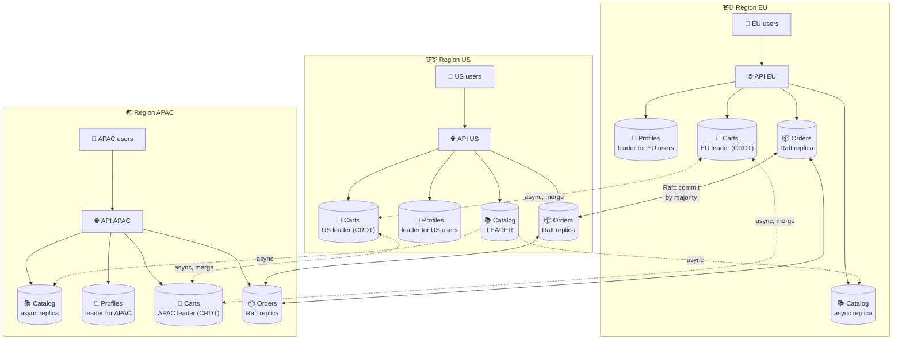
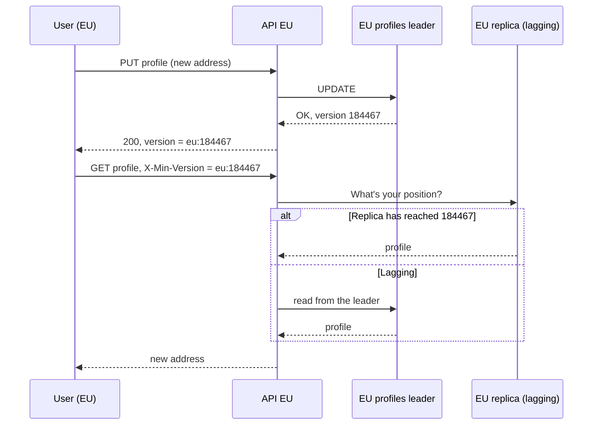

**English** | [Русский](INTERVIEW_RU.md) · Theory: [README.md](./README.md)

# 05. Replication: Data for a Global Online Store Across Three Regions

> **Topic:** choosing a replication model per data type, synchronous and asynchronous replication, RPO/RTO, read-your-writes, multi-leader and CRDTs, consensus across regions, failover
> **Level:** Hard · **Interview time:** 45 min · **Study time:** ~5 h
> **Where it's asked:** as a standalone question ("how do you make a service available across regions") and as a deep dive in payments, e-commerce, social and chat problems

---

## 🗺️ How to Read This Walkthrough

| Icon | Meaning |
|:----:|:--------|
| 🎤 | Interviewer |
| 🗣️ | What I (the candidate) say out loud |
| ✏️ | What I draw on the whiteboard |
| ⏱️ | Time budget for the step |

Callouts: **TIP** — a good technique, **WARNING** — a trap, **IMPORTANT** — a Senior+ signal.

---

## 📑 Contents

1. [Problem Statement](#1-problem-statement)
2. [Clarifying Questions and Requirements](#2-clarifying-questions-and-requirements)
3. [Load and Latency Estimates](#3-load-and-latency-estimates)
4. [Data Classes and Replication Choices](#4-data-classes-and-replication-choices)
5. [API](#5-api)
6. [High-Level Design](#6-high-level-design)
7. [Deep Dive 1: The Catalog and Replica Lag](#7-deep-dive-1-the-catalog-and-replica-lag)
8. [Deep Dive 2: Profiles and Read-Your-Writes](#8-deep-dive-2-profiles-and-read-your-writes)
9. [Deep Dive 3: An Active-Active Cart](#9-deep-dive-3-an-active-active-cart)
10. [Deep Dive 4: Orders With No Loss on Region Failure](#10-deep-dive-4-orders-with-no-loss-on-region-failure)
11. [Deep Dive 5: Region Failure and Failover](#11-deep-dive-5-region-failure-and-failover)
12. [Bottlenecks and Failure Scenarios](#12-bottlenecks-and-failure-scenarios)
13. [What Changes at 10x Scale](#13-what-changes-at-10x-scale)
14. [Interviewer Questions with Answers](#14-interviewer-questions-with-answers)
15. [Common Mistakes](#15-common-mistakes)
16. [Cheat Sheet and Self-Check](#16-cheat-sheet-and-self-check)

---

## 1. Problem Statement

> 🎤 "Our online store operates in Europe, the US and Asia. Today the whole database lives in a single US region: Europeans and Asians complain about slowness, and last year's region outage took the entire business down for 6 hours. Design how to replicate data across regions."

**Time plan:**

| Step | ⏱️ |
|:-----|:--:|
| Requirements | 5 min |
| Estimates and latency | 4 min |
| Data classes | 6 min |
| High-level design | 7 min |
| Deep dives | 18 min |
| Failures and wrap-up | 5 min |

> [!TIP]
> The key move in replication problems is **not choosing one model for the whole system**. Split the data into classes with different RPO, freshness and conflict requirements, and choose per class. It shows your level immediately.

---

## 2. Clarifying Questions and Requirements

⏱️ 5 min

| My question | Interviewer's answer | What it changes |
|:------------|:---------------------|:----------------|
| What's the most important data? | Orders and payments. Losing a confirmed order is unacceptable | Orders need RPO = 0 even on region loss |
| What else is there? | Catalog, profiles, carts, reviews, view counters | Different classes with different requirements |
| How often do users "travel" between regions? | Rarely, but it happens | A home region per user is possible, but migration is needed |
| How fresh must the catalog be? | Prices and descriptions within a minute | Asynchronous replicas work |
| During a cross-region partition, what matters more: staying up or preventing divergence? | Browsing and the cart must always work; an order can be refused for a minute but never lost | Cart is AP, orders are CP |
| Data residency requirements (GDPR)? | EU users' personal data should stay in the EU | Profiles by home region |
| Target RPO and RTO on region loss? | Orders: RPO 0, RTO minutes. Everything else: RPO up to a minute | Determines replication modes |

### Functional requirements

1. Browse the catalog, search, product pages in every region.
2. User profile: addresses, settings.
3. Cart: add and remove items, sync across devices.
4. Checkout and payment.
5. View counters and "popularity".

**Out of scope:** search and recommendations, warehouse and logistics, the payment provider's internals.

### Non-functional requirements

| Requirement | Target |
|:------------|:-------|
| Latency | Reads p99 < 100 ms in any region; add-to-cart < 100 ms |
| Availability | The site and cart work when an entire region is lost |
| Orders | RPO = 0 on region loss; RTO < 5 min; checkout p99 < 1 s |
| Other data | RPO ≤ 1 min on region loss |
| Freshness | Own changes visible immediately (read-your-writes); catalog within a minute |
| Residency | EU users' personal data stays in the EU |

---

## 3. Load and Latency Estimates

⏱️ 4 min

✏️

```
DAU                 = 200M: EU 40%, US 40%, APAC 20%
Reads (peak)        ≈ 200,000 QPS (catalog, product pages)
Cart writes         ≈ 20,000/s at peak
Orders              ≈ 5M/day → ~60/s average, peak ×20 ≈ 1,200/s (sales)
Profiles            ≈ 1,000 updates/s

Cross-region latency (RTT):
  within a region, across AZs    ~1–2 ms
  EU ↔ US                        ~80–100 ms
  US ↔ APAC                      ~150 ms
  EU ↔ APAC                      ~200+ ms
```

🗣️ **Conclusions:**

- **Reads** must be served locally in each region; otherwise Europeans pay 100+ ms for every request → replicas in every region.
- **Cart:** 20,000 writes per second with a < 100 ms requirement — writes must be **local**, with no cross-region round trip.
- **Orders:** RPO = 0 on region loss means the write must reach at least two regions **before** replying to the client. That's an unavoidable +80–100 ms on checkout. Acceptable for an order (p99 < 1 s), not for the cart.

> [!IMPORTANT]
> **Senior+ signal:** show that physics can't be cheated. "RPO = 0 on region loss" and "writes faster than a cross-region RTT" are incompatible for the same data. So strong guarantees go only to the data that needs them.

---

## 4. Data Classes and Replication Choices

⏱️ 6 min

| Data | Write volume | Requirements | Replication model | RPO on region loss |
|:-----|:-------------|:-------------|:------------------|:------------------:|
| **Catalog** (products, prices) | Low | Fresh within a minute, readable everywhere | Single-leader in one region + async replicas in every region | Seconds (lag) |
| **Profiles** | Low | Read-your-writes, EU data in the EU | Single-leader **per user** in their home region (geo-partitioning) + async replicas | ≤ 1 min |
| **Cart** | High | Always available, low write latency everywhere | Multi-leader (active-active), merged via a CRDT (OR-Set) | Seconds; conflicts are merged |
| **Orders and payments** | Medium | RPO = 0, no divergence | Consensus (Raft/Paxos) with replicas in three regions | **0** |
| **View counters** | Very high | Approximate | Local writes + a CRDT counter (G-Counter), async aggregation | Small loss acceptable |
| **Sessions** | Medium | Loss tolerable (re-login) | Local Redis, async replication | Doesn't matter |

🗣️ "Each row is a trade-off between write latency, availability and consistency. I use the most expensive model (consensus across regions) only for orders, where the cost of data loss is highest."

---

## 5. API

⏱️ 2 min

```http
GET  /v1/products/{id}                     ← local replica

PUT  /v1/users/me/profile
     → 200 { profile, version: "eu:184467" }        ← write position (LSN/version)
GET  /v1/users/me/profile
     Headers: X-Min-Version: eu:184467               ← no older than this version

POST   /v1/cart/items      { product_id, qty }       ← local cart leader
DELETE /v1/cart/items/{product_id}
GET    /v1/cart

POST /v1/orders
     Headers: Idempotency-Key: <uuid>
     Body:    { cart_snapshot_id, address_id, payment_method_id }
     → 201 { order_id, status }                      ← consensus write
```

🗣️ "A profile update returns the write's **version**. The client passes it on subsequent reads, and the server guarantees the response is no older than that version. That's read-your-writes that also works from replicas."

---

## 6. High-Level Design

⏱️ 7 min

✏️



🗣️ "Within each region, every store is additionally replicated across three AZs (a synchronous replica in a neighboring AZ for RPO = 0 on node loss). The diagram shows only the cross-region part:
- **catalog** — one leader, async copies everywhere;
- **profiles** — each user has a home region holding the leader for their data;
- **carts** — written locally; regions exchange changes and merge them;
- **orders** — consensus: a write is acknowledged once two of three regions have it."

---

## 7. Deep Dive 1: The Catalog and Replica Lag

> 🎤 "A manager changed a price. A user in Asia first sees the new price, refreshes — and sees the old one. Why, and what do you do?"

🗣️ "That's a **monotonic reads** violation: the first request hit a replica that had applied the change, the second a lagging one. There are several read replicas with different lag within the region.

Fixes:
1. **Replica pinning:** a user's requests go to the same replica (hash of `user_id` or session). Successive reads never go back in time.
2. **Exclude lagging replicas:** replicas with lag above a threshold (e.g. 5 s) are removed from the read pool.
3. **A cache on top of replicas** with CDC-based invalidation (see [02-caching](../02-caching/README.md)) — so users see differing replicas much less often."

> [!WARNING]
> **The price in the cart and at checkout** must not come from a catalog replica. The order service checks the current price in the source of truth, and if it changed, shows the user the new total before payment. Replicas are for display only.

### Catalog leader failover

- The catalog leader in US has a synchronous replica in a neighboring AZ: node loss → failover within the region with no loss (Patroni + etcd, fencing the old leader).
- Losing the **whole** US region → a new catalog leader is appointed in EU **manually or per runbook**, with RPO = lag (seconds). That's acceptable for the catalog: managers will redo the last few seconds of price edits.

---

## 8. Deep Dive 2: Profiles and Read-Your-Writes

> 🎤 "Why aren't profiles in one region like the catalog?"

🗣️ "Two reasons:
1. **Write latency:** a European changing their address shouldn't wait for a round trip to the US.
2. **Residency:** EU users' data must be stored in the EU.

So **geo-partitioning**: each user has a home region (by place of registration) holding the leader of their data. Other regions hold async replicas so the profile opens quickly when the user travels. For EU users, replicas outside the EU can be skipped or limited to non-personal fields."

### Read-your-writes



🗣️ "The version is stored both on the client and on the server in the user's session — so read-your-writes also works from another device. A simpler alternative: always read your own profile from the leader. For profiles that's cheap — the load is small."

> 🎤 "An EU user flies to the US and changes their address there?"

🗣️ "The request arrives at API US, but the write is **proxied** to the home region EU: +100 ms on a profile write — acceptable for a rare operation. If the user moves permanently, their data is **migrated**: copied to the new region, then leadership is switched, and the old copy is removed."

---

## 9. Deep Dive 3: An Active-Active Cart

> 🎤 "The cart is written in every region. A user adds an item from a phone in EU, and a second later removes another item from a laptop that lands in US. What happens?"

🗣️ "That's a multi-leader conflict. Resolution options:

| Strategy | Result | Fits? |
|:---------|:-------|:-----:|
| LWW on the whole cart's modification time | One operation silently disappears; with clock skew — even the "newer" one | ❌ |
| Keep both versions and ask the user | Correct, but terrible UX | ❌ |
| **OR-Set (CRDT)** for the set of items | Both operations apply; the result is identical in every region | ✅ |

A cart is a set of `(product, quantity)`. An **OR-Set** (observed-remove set):
- each add gets a unique tag (`product_42` + `tag: eu-1001`);
- a remove deletes **only the tags the removing replica has seen**;
- so concurrent "add" and "remove another item" merge with no loss, and if the same item is concurrently added and removed — **the add wins** (add-wins)."

✏️

```
EU: add(headphones, tag a1)         → {book:t0, headphones:a1}
US: remove(book) — saw tag t0       → {}  (removes only t0)
Merge: {headphones:a1}               ✅ nothing lost, both actions applied
```

> [!NOTE]
> This is the very story from the Amazon Dynamo paper: a removed item could "come back" in the cart when versions were merged. Amazon deliberately chose "better an extra item in the cart than a lost one" — the user will see it at checkout and remove it. An add-wins OR-Set gives the same semantics, formally.

### Item quantity

Quantity is a counter: concurrent "+1"s in two regions must yield "+2". Use a **PN-Counter** per item, or more simply — store operations (`add 1`, `set 3`) with versions and apply a deterministic rule.

### Technologies

- Redis Enterprise Active-Active (CRDTs), Riak, Cassandra with a careful data model, or your own implementation on top of DynamoDB Global Tables (which themselves use LWW — so the CRDT logic must live at the item level, not the whole cart).

> [!WARNING]
> DynamoDB Global Tables and many multi-region databases resolve conflicts with **item-level LWW**. If the cart is stored as a single item, concurrent changes from different regions get lost. Design the data model so each change is a separate item (`cart_id#product_id#tag`).

---

## 10. Deep Dive 4: Orders With No Loss on Region Failure

> 🎤 "Why not handle orders like profiles — a leader in the home region with async replicas?"

🗣️ "With async replication, an order acknowledged a second before the region dies might not have reached another region. RPO > 0 violates the requirement. We need writes that are acknowledged only after the data is **in two regions**.

Options:

| Option | RPO on region loss | Write latency | Complexity |
|:-------|:------------------:|:-------------:|:-----------|
| Leader + a synchronous replica in another region | 0 | +1 RTT (~100 ms) | If the sync replica fails, writes stall or degrade to async |
| **Consensus with replicas in 3 regions** (CockroachDB, Spanner, YugabyteDB) | 0 | Round trip to the nearest majority | Automatic failover without split brain |
| Multi-leader | > 0, conflicts | Local | ❌ Not for orders and money |

I pick a **consensus database**: each order partition is replicated by a Raft group of 3 replicas in three regions. A write is committed once **2 of 3** accept it."

### Latency math

```
Raft group leader in EU, replicas in US and APAC:
  EU → US   ~90 ms
  EU → APAC ~200 ms
  Majority = leader + nearest replica → ~90 ms per commit

For a European order: ~90 ms + processing ≈ 150–200 ms    ✅ (requirement < 1 s)
```

🗣️ "Optimization: **place leaders** of order partitions near users. European orders use partitions with leaders in EU, American orders in US. Then most commits cost one RTT to the nearest other region."

> 🎤 "What if two of the three replicas are unavailable?"

🗣️ "Order writes for that partition **stop** — there's no majority. That's a deliberate CP choice: better to refuse an order for a minute than to accept it and lose it. The user sees 'try again in a minute', and the cart is preserved. Losing two regions at once is extremely rare."

> [!IMPORTANT]
> **Senior+ signal:** explain why consensus can't produce split brain: a new leader is elected by majority vote, and any two majorities of three overlap. An isolated region without a majority can neither elect a leader nor commit a write.

---

## 11. Deep Dive 5: Region Failure and Failover

> 🎤 "The US region is completely down. Walk through all the data."

| Data | What happens | RPO | RTO |
|:-----|:-------------|:---:|:---:|
| Catalog (leader was in US) | Reads continue from EU and APAC replicas. Catalog writes stop until a new leader is appointed in EU (per runbook) | Seconds | Minutes (human decision) |
| US users' profiles | Reads from async replicas in EU/APAC; writes temporarily unavailable, or an EU replica is promoted as the new leader | ≤ lag | Minutes |
| EU and APAC profiles | Unaffected | 0 | 0 |
| Carts | Work in EU and APAC unchanged. US users move to the nearest region via DNS/Anycast | Changes from the last seconds in US — until recovery | ~0 |
| Orders | Raft groups led from US elect a new leader in EU or APAC within seconds. Every acknowledged order exists in at least one other region | **0** | Seconds |
| Sessions | US users may need to log in again | Doesn't matter | ~0 |

### Why not fail everything over automatically

🗣️ "Automatic failover of **orders** is safe thanks to consensus. Automatic cross-region failover of **asynchronous** leaders (catalog, profiles) is dangerous: a brief network partition can produce two leaders and diverging data. That's exactly what happened at GitHub in 2018: 43 seconds of lost connectivity between sites led to nearly a day of degradation. So for async data — cross-region failover by an on-call decision, with fencing of the old leader."

### When the region comes back

1. Region US returns as a **follower** for the catalog and profiles and catches up from the log.
2. Writes the old leader accepted but didn't ship are **not applied blindly** — they're exported for reconciliation.
3. Carts merge automatically (CRDT).
4. Order Raft replicas catch up with the leader automatically.
5. Leadership returns to US per plan, at a quiet time.

---

## 12. Bottlenecks and Failure Scenarios

| Scenario | What happens | How we protect |
|:---------|:-------------|:---------------|
| A 1-minute network partition between EU and US | Async replicas lag; carts diverge | Carts merge after recovery; async leaders are **not** failed over automatically; orders keep working while a majority exists |
| A catalog replica's lag grows to minutes | Users see old prices | Alert; remove the replica from the pool; the order price is checked at the source |
| Failover to a lagging replica | Loss of the latest writes | A synchronous replica within the region; promote only the freshest; fence the old leader |
| Split brain of an async leader | Two leaders accept writes | Leader election via etcd/consensus; fencing tokens; manual cross-region failover |
| Clock skew between regions | LWW loses newer changes | No LWW for important data; CRDTs and versions instead of time |
| A `DELETE` without WHERE on the leader | Deletion instantly on every replica | PITR, a 1-hour delayed replica, access controls |
| A slow replica in a Raft group | A commit waits for the nearest majority | A slow replica doesn't slow writes while the other two are healthy |
| Loss of two regions | Orders unavailable for writes | A deliberate CP choice; the cart and catalog work from the remaining region |

---

## 13. What Changes at 10x Scale

> 🎤 "What if there are six regions and 10× more orders?"

🗣️ "What changes:
1. **Geo-partitioning for orders:** Raft groups are placed so the majority sits in regions 'adjacent' to the user (e.g. EU-West + EU-Central + US-East for Europeans). Commits are faster, and losing one region loses no data.
2. **More partitions** for orders, with leaders spread evenly across regions.
3. **Catalog:** hierarchical replication (leader → regional hubs → local replicas), so the leader isn't burdened with dozens of followers.
4. **Carts:** more regions participate in CRDT merges; compact garbage collection for removed tags (tombstones) is needed.
5. **Automated drills:** regularly disabling a region in production (chaos engineering), so runbooks are proven."

---

## 14. Interviewer Questions with Answers

<details>
<summary><b>Why not put the whole system on a consensus database — wouldn't that be simpler?</b></summary>

Every write would then cost at least one cross-region round trip (~100 ms). That doesn't work for 20,000 cart adds per second with a < 100 ms requirement. Also, when a majority is lost, writes stop, but the cart must always work. Consensus is for the data where the cost of loss is highest.
</details>

<details>
<summary><b>Why isn't the cart single-leader in a home region, like the profile?</b></summary>

It could be, and that's simpler. But carts are written far more often than profiles, and users on multiple devices or traveling would land in a foreign region and pay 100–200 ms per action. Above all, if the home region were unavailable, the cart would stop working. The "cart always works" requirement and operations that merge naturally make it a good candidate for multi-leader with CRDTs.
</details>

<details>
<summary><b>How do you guarantee an order is created from the current cart?</b></summary>

At checkout the cart is "frozen": a snapshot is created (`cart_snapshot_id`), the user sees the total with current prices from the source of truth and confirms it. The order is created from the snapshot, not from the "live" cart that may have changed in another region.
</details>

<details>
<summary><b>What is a fencing token and why do you need one?</b></summary>

A monotonically increasing number issued with leadership (e.g. the term in Raft or a version in etcd). Storage accepts a write only if its token is no lower than the last one seen. An old leader "waking up" after a pause or partition arrives with an old token, and its writes are rejected.
</details>

<details>
<summary><b>How does LOCAL_QUORUM in Cassandra differ from QUORUM?</b></summary>

LOCAL_QUORUM requires a majority of replicas only in the local data center, so writes don't wait for cross-region round trips. QUORUM counts a majority across all data centers, which includes cross-region latency. LOCAL_QUORUM is faster, but on region loss the latest writes may not have reached other regions.
</details>

<details>
<summary><b>How do you know async replicas aren't lagging too far behind?</b></summary>

Monitor the log position difference and the write-to-apply time per replica, with alerts and an SLO on lag. For an end-to-end check — a heartbeat row the leader updates every second, whose age is checked on replicas.
</details>

---

## 15. Common Mistakes

| ❌ Mistake | ✅ Do this instead |
|:----------|:------------------|
| One replication model for the whole system | Data classes with different RPO, freshness and conflict needs |
| "Let's replicate synchronously across regions" for everything | Synchronous only where RPO = 0 is required; remember the +100 ms |
| Reading your own changes from an async replica | Read-your-writes: a write version or a leader read |
| LWW for the cart or orders | CRDTs for the cart; consensus for orders |
| Automatic cross-region failover of an async leader | Manual failover with fencing; automatic only with consensus |
| Storing the cart as one item in a multi-region DB with LWW | Each change is a separate item |
| Taking the order price from a catalog replica | Check the source of truth at checkout |
| Treating replication as a backup | PITR and a delayed replica |

---

## 16. Cheat Sheet and Self-Check

### 30-second answer

> I split the data into classes. Catalog — single-leader with async replicas in every region and replica pinning for monotonic reads. Profiles — geo-partitioning: the leader in the user's home region, read-your-writes via a write version. Cart — active-active with an OR-Set CRDT, written locally and merged without loss. Orders — a consensus database with replicas in three regions: majority commit, RPO = 0, no split brain, ~90 ms per write. Within regions — a synchronous replica in a neighboring AZ. Cross-region failover of async data follows a runbook with fencing, not automation. Plus PITR, because replication copies mistakes.

### Self-check

- [ ] I can split data into classes and choose a replication model for each
- [ ] I can compute write latency for consensus across three regions
- [ ] I can explain why RPO = 0 on region loss is incompatible with local writes
- [ ] I can draw read-your-writes via a write version
- [ ] I can explain monotonic reads and replica pinning
- [ ] I can show how an OR-Set merges concurrent cart changes
- [ ] I can walk through a region loss for every data class with RPO and RTO
- [ ] I can explain why automatic cross-region failover of an async leader is dangerous

### Further reading

- Theory for this topic: [README.md](./README.md)
- DeCandia et al., *Dynamo: Amazon's Highly Available Key-value Store* — the cart story
- GitHub Engineering, *October 21 post-incident analysis*
- CockroachDB documentation: Multi-Region Capabilities; Spanner documentation: Replication
- Shapiro et al., *Conflict-free Replicated Data Types*