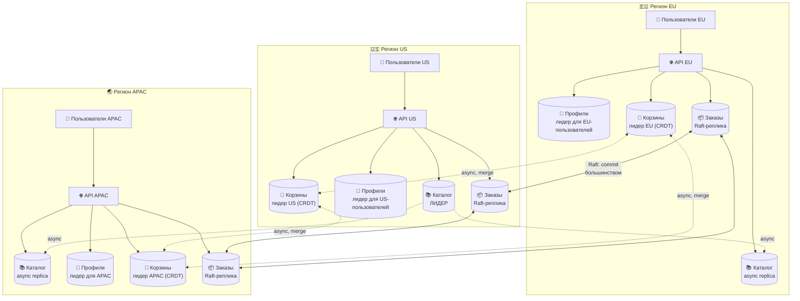
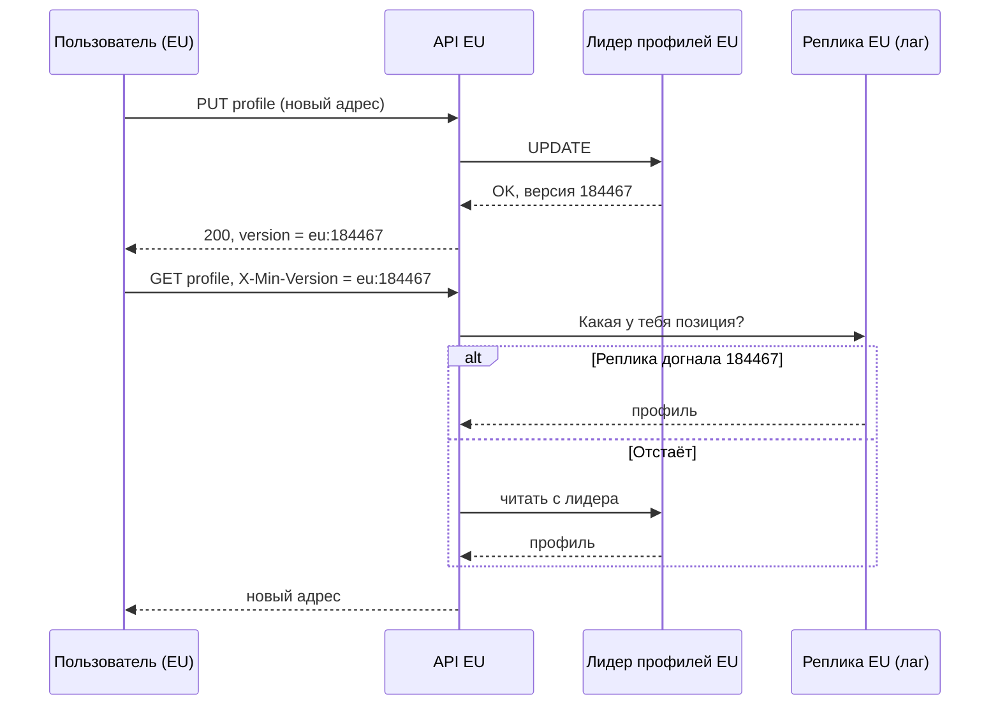

[English](INTERVIEW.md) | **Русский** · Теория: [README_RU.md](./README_RU.md)

# 05. Replication: данные глобального интернет-магазина в трёх регионах

> **Тема:** выбор модели репликации под разные типы данных, синхронная и асинхронная репликация, RPO/RTO, read-your-writes, multi-leader и CRDT, консенсус между регионами, failover
> **Уровень:** Hard · **Время на интервью:** 45 мин · **Время на разбор:** ~5 ч
> **Где спрашивают:** как отдельный вопрос («как сделать сервис доступным в нескольких регионах») и как deep dive в задачах про платежи, e-commerce, соцсети, чаты

---

## 🗺️ Как читать этот разбор

| Значок | Что значит |
|:------:|:-----------|
| 🎤 | Реплика интервьюера |
| 🗣️ | Что говорю вслух я (кандидат) |
| ✏️ | Что рисую на доске |
| ⏱️ | Сколько времени тратить на шаг |

Блоки **TIP** — хороший приём, **WARNING** — ловушка, **IMPORTANT** — сигнал для уровня Senior+.

---

## 📑 Содержание

1. [Условие задачи](#1-условие-задачи)
2. [Уточняющие вопросы и требования](#2-уточняющие-вопросы-и-требования)
3. [Оценки нагрузки и задержек](#3-оценки-нагрузки-и-задержек)
4. [Классы данных и выбор репликации](#4-классы-данных-и-выбор-репликации)
5. [API](#5-api)
6. [High-level дизайн](#6-high-level-дизайн)
7. [Deep dive 1: каталог и лаг реплик](#7-deep-dive-1-каталог-и-лаг-реплик)
8. [Deep dive 2: профиль и read-your-writes](#8-deep-dive-2-профиль-и-read-your-writes)
9. [Deep dive 3: корзина в режиме active-active](#9-deep-dive-3-корзина-в-режиме-active-active)
10. [Deep dive 4: заказы без потерь при падении региона](#10-deep-dive-4-заказы-без-потерь-при-падении-региона)
11. [Deep dive 5: падение региона и failover](#11-deep-dive-5-падение-региона-и-failover)
12. [Узкие места и сценарии сбоев](#12-узкие-места-и-сценарии-сбоев)
13. [Что изменится при росте в 10 раз](#13-что-изменится-при-росте-в-10-раз)
14. [Вопросы интервьюера с ответами](#14-вопросы-интервьюера-с-ответами)
15. [Типичные ошибки](#15-типичные-ошибки)
16. [Шпаргалка и самопроверка](#16-шпаргалка-и-самопроверка)

---

## 1. Условие задачи

> 🎤 «Наш интернет-магазин работает в Европе, США и Азии. Сейчас вся база живёт в одном регионе в США: европейцы и азиаты жалуются на медленную работу, а прошлогодний сбой региона положил весь бизнес на 6 часов. Спроектируй, как реплицировать данные между регионами».

**План по времени:**

| Шаг | ⏱️ |
|:----|:--:|
| Требования | 5 мин |
| Оценки и задержки | 4 мин |
| Классы данных | 6 мин |
| High-level дизайн | 7 мин |
| Deep dives | 18 мин |
| Сбои и итоги | 5 мин |

> [!TIP]
> Главный ход в задачах про репликацию — **не выбирать одну модель на всю систему**. Раздели данные на классы с разными требованиями к RPO, свежести и конфликтам, и для каждого выбери своё. Это сразу показывает уровень.

---

## 2. Уточняющие вопросы и требования

⏱️ 5 мин

| Мой вопрос | Ответ интервьюера | Что это меняет |
|:-----------|:------------------|:---------------|
| Какие данные самые важные? | Заказы и платежи. Потерять подтверждённый заказ недопустимо | Заказам нужен RPO = 0 даже при потере региона |
| Что ещё есть? | Каталог, профили, корзины, отзывы, счётчики просмотров | Разные классы с разными требованиями |
| Как часто пользователи «путешествуют» между регионами? | Редко, но бывает | Домашний регион на пользователя возможен, но нужен переезд |
| Насколько свежим должен быть каталог? | Цены и описания — в пределах минуты | Асинхронные реплики подходят |
| Что важнее при разрыве связи между регионами: работать или не допускать расхождений? | Просмотр и корзина должны работать всегда; заказ можно на минуту отклонить, но нельзя потерять | Корзина — AP, заказы — CP |
| Требования к хранению данных в регионе (GDPR)? | Персональные данные европейцев желательно хранить в ЕС | Профили — по домашнему региону |
| Целевые RPO и RTO при потере региона? | Заказы: RPO 0, RTO минуты. Остальное: RPO до минуты | Определяет режимы репликации |

### Функциональные требования

1. Просмотр каталога, поиск, карточки товаров во всех регионах.
2. Профиль пользователя: адреса, настройки.
3. Корзина: добавление и удаление товаров, синхронизация между устройствами.
4. Оформление заказа и оплата.
5. Счётчики просмотров и «популярности».

**Вне рамок:** поиск и рекомендации, склад и логистика, внутренняя кухня платёжного провайдера.

### Нефункциональные требования

| Требование | Цель |
|:-----------|:-----|
| Latency | Чтение p99 < 100 мс в любом регионе; добавление в корзину < 100 мс |
| Доступность | Сайт и корзина работают при потере целого региона |
| Заказы | RPO = 0 при потере региона; RTO < 5 мин; оформление заказа p99 < 1 с |
| Остальные данные | RPO ≤ 1 мин при потере региона |
| Свежесть | Свои изменения видны сразу (read-your-writes); каталог — до минуты |
| Резидентность | Персональные данные пользователей ЕС — в ЕС |

---

## 3. Оценки нагрузки и задержек

⏱️ 4 мин

✏️

```
DAU                 = 200M: EU 40%, US 40%, APAC 20%
Чтения (пик)        ≈ 200 000 QPS (каталог, карточки)
Записи в корзину    ≈ 20 000/с в пике
Заказы              ≈ 5M/день → ~60/с в среднем, пик ×20 ≈ 1 200/с (распродажи)
Профили             ≈ 1 000 обновлений/с

Задержки (RTT) между регионами:
  внутри региона, между AZ       ~1–2 мс
  EU ↔ US                        ~80–100 мс
  US ↔ APAC                      ~150 мс
  EU ↔ APAC                      ~200+ мс
```

🗣️ **Выводы:**

- **Чтения** должны обслуживаться локально в каждом регионе, иначе европейцы платят 100+ мс за каждый запрос → реплики в каждом регионе.
- **Корзина:** 20 000 записей в секунду с требованием < 100 мс — запись должна идти **локально**, без межрегионального round trip.
- **Заказы:** RPO = 0 при потере региона означает, что запись должна оказаться минимум в двух регионах **до** ответа клиенту. Это неизбежно +80–100 мс к оформлению заказа. Для заказа (p99 < 1 с) это приемлемо, для корзины — нет.

> [!IMPORTANT]
> **Сигнал Senior+:** покажи, что физику не обойти. «RPO = 0 при потере региона» и «запись быстрее межрегионального RTT» несовместимы для одних и тех же данных. Поэтому строгие гарантии даём только тем данным, которым они нужны.

---

## 4. Классы данных и выбор репликации

⏱️ 6 мин

| Данные | Объём записи | Требования | Модель репликации | RPO при потере региона |
|:-------|:-------------|:-----------|:------------------|:----------------------:|
| **Каталог** (товары, цены) | Низкий | Свежесть до минуты, чтение везде | Single-leader в одном регионе + асинхронные реплики во всех регионах | Секунды (лаг) |
| **Профили** | Низкий | Read-your-writes, данные ЕС в ЕС | Single-leader **на пользователя** в его домашнем регионе (geo-partitioning) + асинхронные реплики | ≤ 1 мин |
| **Корзина** | Высокий | Всегда доступна, низкая задержка записи везде | Multi-leader (active-active), слияние через CRDT (OR-Set) | Секунды; конфликты сливаются |
| **Заказы и платежи** | Средний | RPO = 0, без расхождений | Консенсус (Raft/Paxos) с репликами в трёх регионах | **0** |
| **Счётчики просмотров** | Очень высокий | Примерная точность | Локальная запись + CRDT-счётчик (G-Counter), асинхронная агрегация | Допустима небольшая потеря |
| **Сессии** | Средний | Потеря терпима (перелогин) | Локальный Redis, асинхронная репликация | Не важно |

🗣️ «Каждая строка — это компромисс между задержкой записи, доступностью и консистентностью. Самую дорогую модель (консенсус между регионами) использую только для заказов, где цена потери данных максимальна».

---

## 5. API

⏱️ 2 мин

```http
GET  /v1/products/{id}                     ← локальная реплика

PUT  /v1/users/me/profile
     → 200 { profile, version: "eu:184467" }        ← позиция записи (LSN/версия)
GET  /v1/users/me/profile
     Headers: X-Min-Version: eu:184467               ← не старше этой версии

POST   /v1/cart/items      { product_id, qty }       ← локальный лидер корзины
DELETE /v1/cart/items/{product_id}
GET    /v1/cart

POST /v1/orders
     Headers: Idempotency-Key: <uuid>
     Body:    { cart_snapshot_id, address_id, payment_method_id }
     → 201 { order_id, status }                      ← консенсусная запись
```

🗣️ «Ответ на изменение профиля возвращает **версию** записи. Клиент передаёт её в следующих чтениях, и сервер гарантирует, что ответ не старше этой версии. Это реализация read-your-writes, которая работает и с реплик».

---

## 6. High-level дизайн

⏱️ 7 мин

✏️



🗣️ «Внутри каждого региона все хранилища дополнительно реплицированы между тремя AZ (синхронная реплика в соседней AZ для RPO = 0 при потере узла). На схеме показана только межрегиональная часть:
- **каталог** — один лидер, асинхронные копии везде;
- **профили** — у каждого пользователя свой домашний регион с лидером его данных;
- **корзины** — пишутся локально, регионы обмениваются изменениями и сливают их;
- **заказы** — консенсус: запись подтверждается, когда её приняли два региона из трёх».

---

## 7. Deep dive 1: каталог и лаг реплик

> 🎤 «Менеджер поменял цену. Пользователь в Азии сначала видит новую цену, обновляет страницу — и видит старую. Почему и что делать?»

🗣️ «Это нарушение **monotonic reads**: первый запрос попал на реплику, которая уже применила изменение, второй — на отстающую. Внутри региона несколько read-реплик с разным лагом.

Решения:
1. **Привязка к реплике:** запросы пользователя идут на одну и ту же реплику (хэш `user_id` или сессии). Последовательные чтения не откатываются.
2. **Исключать отстающие реплики:** реплики с лагом больше порога (например, 5 с) выводятся из пула чтения.
3. **Кэш поверх реплик** с инвалидацией через CDC (см. [02-caching](../02-caching/README_RU.md)) — тогда разные реплики вообще реже видны пользователю».

> [!WARNING]
> **Цена в корзине и при оформлении заказа** не должна браться из реплики каталога. Сервис заказов проверяет актуальную цену в источнике правды и, если она изменилась, показывает пользователю новую сумму перед оплатой. Реплика — только для отображения.

### Failover лидера каталога

- Лидер каталога в US с синхронной репликой в соседней AZ: потеря узла → failover внутри региона без потерь (Patroni + etcd, fencing старого лидера).
- Потеря **всего** региона US → новый лидер каталога назначается в EU **вручную или по плану**, с RPO = лаг (секунды). Для каталога это приемлемо: правки цен за последние секунды менеджеры повторят.

---

## 8. Deep dive 2: профиль и read-your-writes

> 🎤 «Почему профили не в одном регионе, как каталог?»

🗣️ «По двум причинам:
1. **Задержка записи:** европеец, меняющий адрес, не должен ждать round trip в США.
2. **Резидентность:** данные пользователей ЕС должны храниться в ЕС.

Поэтому **geo-partitioning**: у каждого пользователя есть домашний регион (по месту регистрации), там живёт лидер его данных. В других регионах — асинхронные реплики, чтобы профиль быстро открывался, если пользователь в поездке. Для пользователей ЕС реплики за пределами ЕС можно не держать или хранить только неперсональные поля».

### Read-your-writes



🗣️ «Версия хранится и в клиенте, и на сервере в сессии пользователя — чтобы read-your-writes работал и с другого устройства. Альтернатива попроще: читать собственный профиль всегда с лидера. Для профиля это дёшево — нагрузка небольшая».

> 🎤 «Пользователь из ЕС улетел в США и меняет адрес там?»

🗣️ «Запрос приходит в API US, но запись **проксируется** в домашний регион EU: +100 мс на запись профиля — приемлемо, это редкая операция. Если пользователь переехал насовсем, его данные **мигрируют**: копируются в новый регион, затем лидер переключается, и старая копия удаляется».

---

## 9. Deep dive 3: корзина в режиме active-active

> 🎤 «Корзина пишется в каждом регионе. Пользователь добавил товар с телефона в EU, а через секунду удалил другой товар с ноутбука, который попал в US. Что будет?»

🗣️ «Это конфликт multi-leader. Варианты разрешения:

| Стратегия | Результат | Подходит? |
|:----------|:----------|:---------:|
| LWW по времени изменения корзины целиком | Одна из операций тихо пропадёт; при расхождении часов — даже «новая» | ❌ |
| Хранить обе версии и спросить пользователя | Корректно, но ужасный UX | ❌ |
| **OR-Set (CRDT)** для множества товаров | Обе операции применяются, результат одинаков во всех регионах | ✅ |

Корзина — это множество `(товар, количество)`. **OR-Set** (observed-remove set):
- каждое добавление получает уникальный тег (`product_42` + `tag: eu-1001`);
- удаление удаляет **только те теги, которые видела** удаляющая реплика;
- поэтому параллельные «добавить» и «удалить» другого товара сливаются без потерь, а если один и тот же товар параллельно добавлен и удалён — **добавление побеждает** (add-wins)».

✏️

```
EU: add(наушники, tag a1)           → {книга:t0, наушники:a1}
US: remove(книга) — видел tag t0    → {}  (удаляет только t0)
Слияние: {наушники:a1}               ✅ ничего не потерялось, оба действия учтены
```

> [!NOTE]
> Это та самая история из статьи про Amazon Dynamo: удалённый товар мог «воскреснуть» в корзине при слиянии версий. Amazon сознательно выбрал «лучше лишний товар в корзине, чем потерянный» — пользователь увидит его при оформлении и уберёт. OR-Set с add-wins даёт ту же семантику, но формально.

### Количество товара

Количество — это счётчик: параллельные «+1» в двух регионах должны дать «+2». Для этого **PN-Counter** на каждый товар, или проще — хранить операции (`add 1`, `set 3`) с версиями и применять детерминированное правило.

### Технологии

- Redis Enterprise Active-Active (CRDT), Riak, Cassandra с аккуратной моделью данных, или собственная реализация поверх DynamoDB Global Tables (которые сами по себе используют LWW — поэтому CRDT-логику нужно хранить на уровне элементов, а не всей корзины).

> [!WARNING]
> DynamoDB Global Tables и многие multi-region базы разрешают конфликты через **LWW на уровне элемента**. Если хранить корзину одним элементом, параллельные изменения из разных регионов будут теряться. Модель данных нужно проектировать так, чтобы каждое изменение было отдельным элементом (`cart_id#product_id#tag`).

---

## 10. Deep dive 4: заказы без потерь при падении региона

> 🎤 «Почему не сделать заказы так же, как профили — лидер в домашнем регионе и асинхронные реплики?»

🗣️ «При асинхронной репликации заказ, подтверждённый за секунду до падения региона, может не успеть уйти в другой регион. RPO > 0 — нарушение требования. Нужна запись, которая подтверждается только после того, как данные оказались **в двух регионах**.

Варианты:

| Вариант | RPO при потере региона | Задержка записи | Сложность |
|:--------|:----------------------:|:---------------:|:----------|
| Лидер + синхронная реплика в другом регионе | 0 | +1 RTT (~100 мс) | При падении синхронной реплики запись встаёт или деградирует до асинхронной |
| **Консенсус, реплики в 3 регионах** (CockroachDB, Spanner, YugabyteDB) | 0 | Round trip до ближайшего большинства | Автоматический failover без split brain |
| Multi-leader | > 0, конфликты | Локальная | ❌ Для заказов и денег — нет |

Выбираю **консенсусную базу**: каждая партиция заказов реплицируется Raft-группой из 3 реплик в трёх регионах. Запись подтверждена, когда её приняли **2 из 3**».

### Расчёт задержки

```
Лидер Raft-группы в EU, реплики в US и APAC:
  EU → US   ~90 мс
  EU → APAC ~200 мс
  Большинство = лидер + ближайшая реплика → ~90 мс на коммит

Для европейского заказа: ~90 мс + обработка ≈ 150–200 мс    ✅ (требование < 1 с)
```

🗣️ «Оптимизация: **размещать лидеров** партиций заказов рядом с пользователями. Заказы европейцев — партиции с лидером в EU, американцев — в US. Тогда для большинства заказов коммит стоит один RTT до ближайшего другого региона».

> 🎤 «А если две реплики из трёх недоступны?»

🗣️ «Запись заказов в этой партиции **останавливается** — большинства нет. Это сознательный выбор CP: лучше на минуту отклонить заказ, чем принять его и потерять. Пользователь видит «попробуйте через минуту», корзина при этом сохраняется. Одновременная потеря двух регионов — крайне редкое событие».

> [!IMPORTANT]
> **Сигнал Senior+:** объясни, почему консенсус не даёт split brain: новый лидер выбирается голосами большинства, а два большинства из трёх всегда пересекаются. Изолированный регион без большинства не может ни выбрать лидера, ни закоммитить запись.

---

## 11. Deep dive 5: падение региона и failover

> 🎤 «Регион US полностью недоступен. Пройдись по всем данным».

| Данные | Что происходит | RPO | RTO |
|:-------|:---------------|:---:|:---:|
| Каталог (лидер был в US) | Чтение продолжается с реплик EU и APAC. Запись каталога остановлена до назначения нового лидера в EU (по runbook) | Секунды | Минуты (решение человека) |
| Профили US-пользователей | Чтение с асинхронных реплик в EU/APAC; запись временно недоступна или переводится на реплику EU как новый лидер | ≤ лаг | Минуты |
| Профили EU и APAC | Не затронуты | 0 | 0 |
| Корзины | Работают в EU и APAC без изменений. Пользователи US через DNS/Anycast переходят в ближайший регион | Изменения последних секунд в US — до восстановления | ~0 |
| Заказы | Raft-группы с лидером в US выбирают нового лидера в EU или APAC за секунды. Подтверждённые заказы есть минимум ещё в одном регионе | **0** | Секунды |
| Сессии | Пользователи US, возможно, перелогинятся | Не важно | ~0 |

### Почему не переключать всё автоматически

🗣️ «Автоматический failover **заказов** безопасен благодаря консенсусу. Автоматический failover **асинхронных** лидеров (каталог, профили) между регионами опасен: при кратковременном сетевом разрыве можно получить два лидера и расхождение данных. Это ровно то, что случилось у GitHub в 2018 году: 43 секунды без связи между площадками привели почти к суткам деградации. Поэтому для асинхронных данных — failover между регионами по решению дежурного, с fencing старого лидера».

### Возвращение региона

1. Регион US возвращается как **фолловер** для каталога и профилей, догоняет по журналу.
2. Записи, которые старый лидер успел принять, но не передал, **не применяются вслепую** — они выгружаются для сверки.
3. Корзины сливаются автоматически (CRDT).
4. Raft-реплики заказов догоняют лидера автоматически.
5. Лидерство возвращается в US по плану, в спокойное время.

---

## 12. Узкие места и сценарии сбоев

| Сценарий | Что произойдёт | Как защищаемся |
|:---------|:---------------|:---------------|
| Сетевой разрыв между EU и US на 1 минуту | Асинхронные реплики отстают; корзины расходятся | Корзины сливаются после восстановления; асинхронные лидеры **не** переключаются автоматически; заказы работают, пока есть большинство |
| Лаг реплики каталога растёт до минут | Пользователи видят старые цены | Алерт; исключение реплики из пула; цена при заказе проверяется в источнике |
| Failover на отстающую реплику | Потеря последних записей | Синхронная реплика внутри региона; promote только самой свежей; fencing старого лидера |
| Split brain асинхронного лидера | Два лидера принимают записи | Выбор лидера через etcd/консенсус; fencing-токены; ручной межрегиональный failover |
| Расхождение часов между регионами | LWW теряет новые изменения | Не использовать LWW для важных данных; CRDT и версии вместо времени |
| `DELETE` без WHERE на лидере | Удаление мгновенно на всех репликах | PITR, отложенная реплика на 1 час, права доступа |
| Медленная реплика Raft-группы | Коммит ждёт ближайшее большинство | Медленная реплика не тормозит запись, пока остальные две в норме |
| Потеря двух регионов | Заказы недоступны для записи | Осознанный CP-выбор; корзина и каталог работают из оставшегося региона |

---

## 13. Что изменится при росте в 10 раз

> 🎤 «А если регионов станет шесть, а заказов в 10 раз больше?»

🗣️ «Что меняется:
1. **Geo-partitioning для заказов:** Raft-группы размещаются так, чтобы большинство было в «соседних» регионах пользователя (например, EU-West + EU-Central + US-East для европейцев). Коммит быстрее, а потеря одного региона не теряет данные.
2. **Больше партиций** для заказов, лидеры равномерно распределены по регионам.
3. **Каталог:** иерархическая репликация (лидер → региональные хабы → локальные реплики), чтобы не нагружать лидера десятками фолловеров.
4. **Корзины:** число регионов в CRDT-слиянии растёт, нужна компактная сборка мусора для удалённых тегов (tombstones).
5. **Автоматизированные учения:** регулярное отключение региона в продакшене (chaos engineering), чтобы runbook'и были проверены».

---

## 14. Вопросы интервьюера с ответами

<details>
<summary><b>Почему не сделать всю систему на консенсусной базе — проще же?</b></summary>

Каждая запись тогда стоит минимум один межрегиональный round trip (~100 мс). Для 20 000 добавлений в корзину в секунду с требованием < 100 мс это не подходит. Плюс при потере большинства запись останавливается, а корзина должна работать всегда. Консенсус — для данных, где цена потери максимальна.
</details>

<details>
<summary><b>Почему корзина не single-leader в домашнем регионе, как профиль?</b></summary>

Можно, и это проще. Но корзина пишется намного чаще профиля, а пользователи с нескольких устройств и в поездках попадали бы в чужой регион и платили 100–200 мс за каждое действие. Главное — при недоступности домашнего региона корзина перестала бы работать. Требование «корзина работает всегда» и операции, которые естественно сливаются, делают её хорошим кандидатом для multi-leader с CRDT.
</details>

<details>
<summary><b>Как гарантировать, что заказ создаётся из актуальной корзины?</b></summary>

При оформлении заказа корзина «замораживается»: создаётся снимок (`cart_snapshot_id`), пользователь видит итог с актуальными ценами из источника правды и подтверждает его. Заказ создаётся из снимка, а не из «живой» корзины, которая могла измениться в другом регионе.
</details>

<details>
<summary><b>Что такое fencing-токен и зачем он нужен?</b></summary>

Монотонно растущий номер, который выдаётся вместе с лидерством (например, term в Raft или версия в etcd). Хранилище принимает запись, только если её токен не меньше последнего виденного. Старый лидер, «проснувшийся» после паузы или разрыва сети, приходит со старым токеном, и его записи отклоняются.
</details>

<details>
<summary><b>Чем LOCAL_QUORUM в Cassandra отличается от QUORUM?</b></summary>

LOCAL_QUORUM требует большинства реплик только в локальном дата-центре, поэтому запись не ждёт межрегиональных round trip. QUORUM считает большинство по всем дата-центрам, что включает межрегиональные задержки. LOCAL_QUORUM быстрее, но при потере региона последние записи могут не успеть уйти в другие регионы.
</details>

<details>
<summary><b>Как понять, что асинхронные реплики не отстают слишком сильно?</b></summary>

Мониторить разницу позиций журнала и время от записи до применения по каждой реплике, ставить алерты и SLO на лаг. Для проверки «от начала до конца» — heartbeat-строка, которую лидер обновляет каждую секунду, а на репликах проверяется её возраст.
</details>

---

## 15. Типичные ошибки

| ❌ Ошибка | ✅ Как правильно |
|:---------|:----------------|
| Одна модель репликации на всю систему | Классы данных с разными RPO, свежестью и конфликтами |
| «Сделаем синхронную репликацию между регионами» для всего | Синхронно только то, что требует RPO = 0; помнить про +100 мс |
| Читать свои изменения с асинхронной реплики | Read-your-writes: версия записи или чтение с лидера |
| LWW для корзины или заказов | CRDT для корзины; консенсус для заказов |
| Автоматический межрегиональный failover асинхронного лидера | Ручной failover с fencing; автоматический — только с консенсусом |
| Хранить корзину одним элементом в multi-region БД с LWW | Каждое изменение — отдельный элемент |
| Брать цену для заказа из реплики каталога | Проверять в источнике правды при оформлении |
| Считать репликацию бэкапом | PITR и отложенная реплика |

---

## 16. Шпаргалка и самопроверка

### Ответ за 30 секунд

> Разделяю данные на классы. Каталог — single-leader с асинхронными репликами во всех регионах и привязкой пользователя к реплике для monotonic reads. Профили — geo-partitioning: лидер в домашнем регионе пользователя, read-your-writes через версию записи. Корзина — active-active с OR-Set CRDT, пишется локально и сливается без потерь. Заказы — консенсусная база с репликами в трёх регионах: коммит большинством, RPO = 0, без split brain, ~90 мс на запись. Внутри регионов — синхронная реплика в соседней AZ. Межрегиональный failover асинхронных данных — по runbook с fencing, а не автоматически. Плюс PITR, потому что репликация копирует ошибки.

### Самопроверка

- [ ] Могу разделить данные на классы и выбрать модель репликации для каждого
- [ ] Могу посчитать задержку записи при консенсусе в трёх регионах
- [ ] Могу объяснить, почему RPO = 0 при потере региона несовместим с локальной записью
- [ ] Могу нарисовать read-your-writes через версию записи
- [ ] Могу объяснить monotonic reads и привязку к реплике
- [ ] Могу показать, как OR-Set сливает параллельные изменения корзины
- [ ] Могу пройти сценарий потери региона по всем классам данных с RPO и RTO
- [ ] Могу объяснить, почему автоматический межрегиональный failover асинхронного лидера опасен

### Что почитать

- Теория по теме: [README_RU.md](./README_RU.md)
- DeCandia et al., *Dynamo: Amazon's Highly Available Key-value Store* — история с корзиной
- GitHub Engineering, *October 21 post-incident analysis*
- Документация CockroachDB: Multi-Region Capabilities; документация Spanner: Replication
- Shapiro et al., *Conflict-free Replicated Data Types*