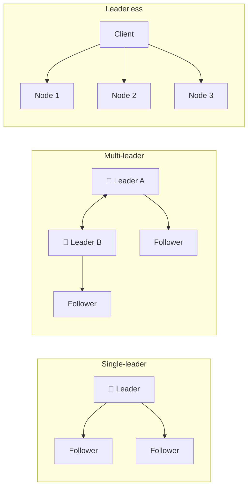
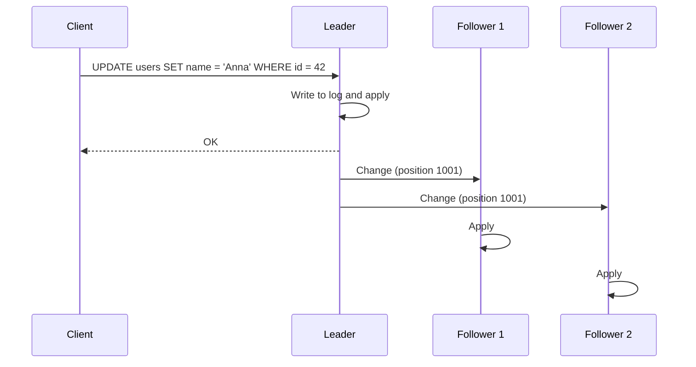
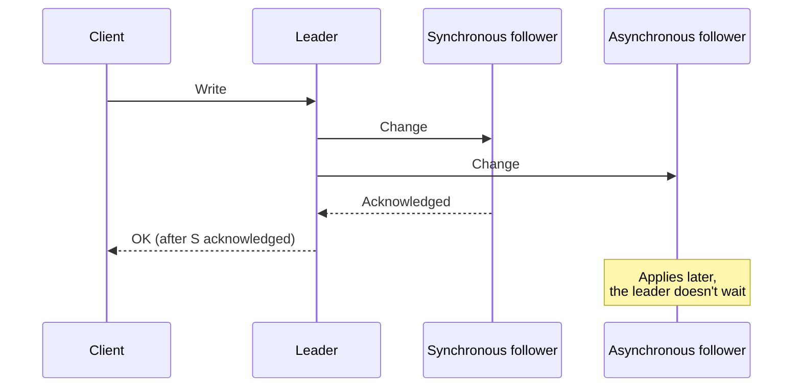
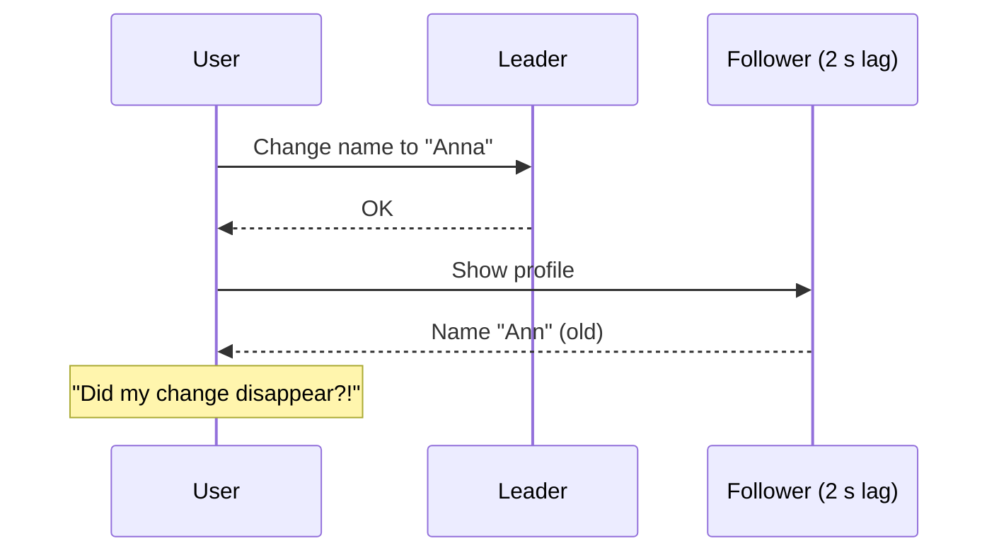
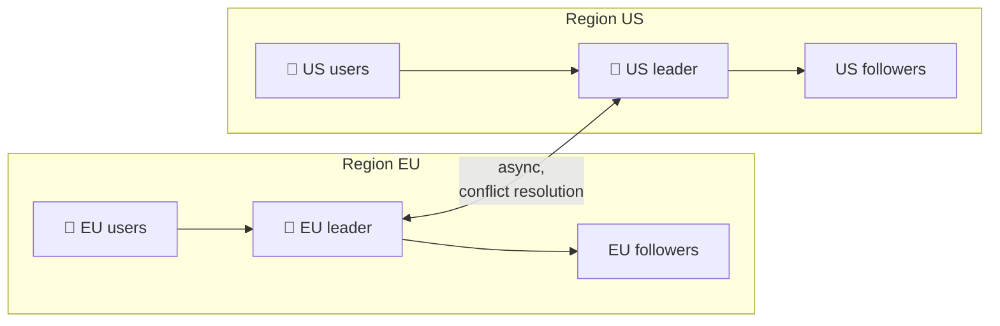
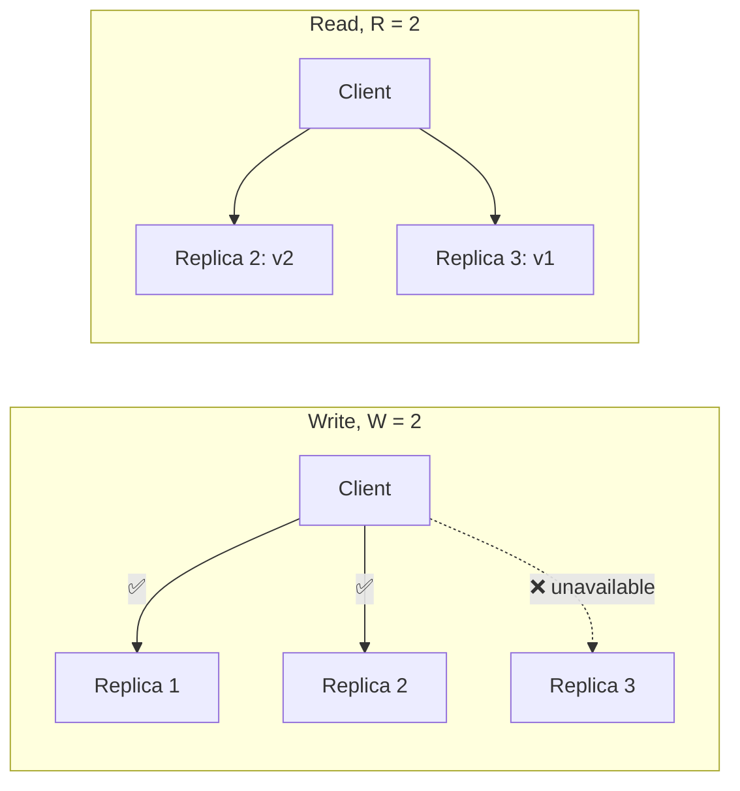

**English** | [Русский](README.ru.md)

# 05. Replication

> **Covers:** leader-follower, multi-leader, leaderless, synchronous and asynchronous replication, failover, replication lag and read guarantees (read-your-writes, monotonic reads), conflicts and their resolution, quorums
> **Study time:** ~4–5 h · **Needed for:** any problem with availability, durability or multi-region requirements
> **Practice:** interview-style walkthrough — [INTERVIEW.md](./INTERVIEW.md)
> **Related topics:** [04-databases](../04_Databases/README.md), [02-caching](../02_Caching/README.md). Partitioning, consistency models and consensus are covered in upcoming topics.

---

## 📑 Contents

1. [What Replication Is and Why You Need It](#1-what-replication-is-and-why-you-need-it)
2. [Leader-Follower (Single-Leader)](#2-leader-follower-single-leader)
3. [Synchronous, Asynchronous and Semi-Synchronous Replication](#3-synchronous-asynchronous-and-semi-synchronous-replication)
4. [How Changes Are Shipped: The Replication Log](#4-how-changes-are-shipped-the-replication-log)
5. [Failover: When the Leader Dies](#5-failover-when-the-leader-dies)
6. [Replication Lag and Read Guarantees](#6-replication-lag-and-read-guarantees)
7. [Multi-Leader](#7-multi-leader)
8. [Conflict Resolution](#8-conflict-resolution)
9. [Leaderless and Quorums](#9-leaderless-and-quorums)
10. [Consensus-Based Replication](#10-consensus-based-replication)
11. [Comparing Approaches and Real Systems](#11-comparing-approaches-and-real-systems)
12. [Multi-Region and Operations](#12-multi-region-and-operations)
13. [How to Talk About This in an Interview](#13-how-to-talk-about-this-in-an-interview)
14. [Self-Check Questions](#14-self-check-questions)
15. [Glossary and Resources](#15-glossary-and-resources)

---

## 1. What Replication Is and Why You Need It

**Replication** means keeping copies of the same data on several networked nodes (replicas).

| Why | How it helps |
|:----|:-------------|
| **Availability** | A node fails — others keep serving requests |
| **Durability** | Data survives the loss of a disk, server, zone or region |
| **Read scaling** | Reads are spread across replicas |
| **Lower latency** | A replica in the user's region responds faster |

> [!NOTE]
> Don't confuse:
> - **Replication** — the same data on several nodes;
> - **Partitioning (sharding)** — different parts of the data on different nodes;
> - **Backup** — a point-in-time copy for recovering from mistakes.
>
> Real systems combine them: every shard is replicated, and everything is backed up as well.

All the difficulty of replication lies in **changes**. Copying immutable data is easy; the hard part is getting changes to every copy correctly, quickly and in the right order when networks and nodes are unreliable.

### Three approaches



---

## 2. Leader-Follower (Single-Leader)

The most common approach: PostgreSQL, MySQL, MongoDB, Redis, Kafka (per partition).

1. One replica is the **leader** (primary, master). All **writes** go to it only.
2. The leader writes changes to its log and sends them to **followers** (replicas, secondaries).
3. Followers apply the changes in the same order.
4. **Reads** can be served by the leader or by followers.



| Pros | Cons |
|:-----|:-----|
| Simple model: one write order, no conflicts | Writes are limited by a single leader's capacity |
| Easy to scale reads | The leader is a write point of failure; failover is needed |
| Well understood and supported almost everywhere | With multiple regions, writes from a far region cross the ocean |

### Adding a new follower

You can't just copy the files of a running database — they change during the copy.
1. Take a **consistent snapshot** of the leader tied to a log position (LSN in PostgreSQL, GTID/binlog position in MySQL).
2. Copy the snapshot to the new node.
3. The follower requests all changes **after** that position from the leader and catches up.
4. Once caught up, it starts serving reads.

---

## 3. Synchronous, Asynchronous and Semi-Synchronous Replication

The key question: **when does the leader tell the client "OK"** — before or after the change reaches replicas?



| Mode | When the client gets OK | Data loss if the leader fails | Write latency | Write availability |
|:-----|:------------------------|:-----------------------------:|:-------------:|:------------------:|
| **Asynchronous** | Right after the write on the leader | Possible (whatever hadn't shipped) | Minimal | High |
| **Synchronous (all replicas)** | When every replica acknowledges | None | Maximum (the slowest replica) | Low: any failed replica halts writes |
| **Semi-synchronous** | When at least one (or K) replicas acknowledge | None, unless the leader and the sync replica fail together | Medium | Good |
| **Quorum** | When a majority acknowledges | None while only a minority is lost | Set by the median replica | Good |

> [!IMPORTANT]
> In practice "synchronous replication" almost always means **semi-synchronous or quorum**: one or more replicas are synchronous, the rest asynchronous. For example, in PostgreSQL `synchronous_standby_names = 'ANY 1 (replica_a, replica_b)'` — a commit waits for an acknowledgment from either of the two. In MySQL — semi-synchronous replication.

### RPO and RTO

| Metric | Meaning | Determined by |
|:-------|:--------|:--------------|
| **RPO** (Recovery Point Objective) | How much data you can lose (in seconds of writes) | Replication mode: async → RPO = lag; sync → RPO = 0 |
| **RTO** (Recovery Time Objective) | How long the service can be down | Failure detection and failover speed |

### The cost of synchronous writes across regions

```
Synchronous replica in another AZ of the same region:   +1–2 ms per write
Synchronous replica in another region (EU ↔ US):        +80–100 ms per write
```

Hence the typical setup: synchronous within a region (across AZs), asynchronous to other regions.

---

## 4. How Changes Are Shipped: The Replication Log

| Method | What's shipped | Pros | Cons | Where |
|:-------|:---------------|:-----|:-----|:------|
| **Statement-based** | SQL statements | Compact | Non-deterministic functions (`NOW()`, `RAND()`), auto-increment and triggers produce different results on replicas | Old MySQL mode |
| **Physical (WAL shipping)** | Byte-level page changes | Exact and fast | Tied to version and storage format; can't replicate a subset of tables; harder zero-downtime upgrades | PostgreSQL streaming replication |
| **Logical (row-based)** | Row changes: "a row with these values was inserted" | Independent of storage format; works across versions; the basis of CDC | Larger volume for bulk changes | MySQL row-based binlog, PostgreSQL logical replication |
| **Trigger-based / in the app** | Whatever the code decides | Flexible: filtering, transformation | Slow, error-prone | Special cases |

> [!TIP]
> Logical replication is the foundation of **CDC** (Change Data Capture): Debezium reads the logical change stream and publishes it to Kafka. That's how search indexes, caches and analytics are fed (see [02-caching](../02_Caching/README.md#7-invalidation)).

---

## 5. Failover: When the Leader Dies

### Steps

1. **Detection:** the leader doesn't respond longer than a timeout (usually tens of seconds).
2. **Choosing a new leader:** usually the replica with the freshest data; chosen via consensus or an external coordinator (Patroni + etcd, Orchestrator, Sentinel, a managed service).
3. **Reconfiguration:** clients and the other replicas switch to the new leader. The old leader, if it comes back, must become a follower.

### What can go wrong

| Problem | What happens | Defense |
|:--------|:-------------|:--------|
| **Lost writes** | With async replication the new leader didn't receive the old leader's last writes. They're lost or conflict when the old leader returns | Semi-synchronous replication; promote the freshest replica; discard the old leader's unreplicated writes on return |
| **Split brain** | Two nodes believe they're the leader and both accept writes | Leader election by majority; **fencing**: isolate the old leader (STONITH — "shoot the other node in the head"), revoke access, fencing tokens |
| **Wrong timeout** | Too short — false failovers on brief load spikes or network blips. Too long — long outages | Tune from real metrics; multiple independent health checks |
| **Desync with external systems** | The new leader issues IDs the old one already issued and that ended up in a cache or another system | Globally unique IDs (Snowflake, UUID) instead of local counters |
| **Cascade** | Failing over to a far region with high latency overloads the system | Failover drills; spare capacity in the standby region |

> [!WARNING]
> **A real example.** On October 21, 2018, GitHub lost connectivity between a US East Coast data center and a network hub for 43 seconds. Automated failover moved MySQL leaders to the West Coast. When connectivity returned, each data center had writes the other didn't, and East Coast requests crossing the continent sharply increased latency. Restoring consistency took about a day of degraded service. Lesson: automatic cross-region failover is dangerous; sometimes waiting is better than switching.

---

## 6. Replication Lag and Read Guarantees

With asynchronous replication, followers lag behind the leader. Usually by milliseconds, but under load or network trouble — by seconds or minutes. This is **eventual consistency**: if writes stop, replicas eventually converge.

Lag causes three typical anomalies.

### Read-your-writes

A user updates their profile, refreshes the page — and sees the old data, because the read went to a lagging replica.



**Fixes:**
- Read data the user can modify **themselves** (their own profile) from the leader.
- Read from the leader for N seconds after the user's last write.
- The client remembers the **log position** (LSN, timestamp) of its last write; reads go to a replica that has caught up to that position, or wait, or go to the leader.
- If the user works across devices, store that position on the server, not in one browser.

### Monotonic reads

A user refreshes twice: the first request hits a fresh replica, the second a lagging one. A comment they just saw "disappears".

**Fix:** pin the user to one replica (e.g. by hashing `user_id`). If that replica fails, switch, accepting a single violation.

### Consistent prefix reads

An observer sees the answer before the question: two causally related changes landed in different partitions, and one lags more.

**Fix:** write causally related records to the same partition, or track causal dependencies (more in the consistency models topic).

### Summary table

| Guarantee | Anomaly without it | Typical fix |
|:----------|:-------------------|:------------|
| Read-your-writes | I don't see my own change | Read from the leader after writing; log position in the session |
| Monotonic reads | Data "goes back in time" | Pin the user to one replica |
| Consistent prefix | Effect visible before cause | Related writes in the same partition |

> [!TIP]
> In an interview, say up front **which** data tolerates lag and which doesn't. "The like counter can lag by seconds, but users must see their own settings immediately" — that's a mature answer about replication.

### Monitoring lag

- The difference in log positions (bytes or LSN) and the time from write to apply.
- Alerts on growing lag; automatically remove badly lagging replicas from the read pool.
- Causes of growth: heavy queries on the replica, long transactions, bulk changes on the leader, network, insufficient replica I/O.

---

## 7. Multi-Leader

Several nodes accept writes, and each forwards its changes to the others.

### When it's used

| Scenario | Why multi-leader |
|:---------|:-----------------|
| **Multiple data centers** | Writes go to the local leader without cross-region latency; a region keeps working when cut off from others |
| **Offline clients** | Each device (calendar, notes) is effectively a "leader"; changes sync when the network returns |
| **Collaborative editing** | Each user edits their own copy of a document; changes are merged (Google Docs, Figma) |



| Pros | Cons |
|:-----|:-----|
| Low write latency in every region | **Write conflicts**: the same data changed in two places at once |
| A region keeps working when the link is down | Complex: auto-increments, triggers and uniqueness constraints break |
| | Integrity constraints across regions aren't guaranteed |

### Topologies

| Topology | Description | Problem |
|:---------|:------------|:--------|
| Ring | Each forwards to the next | One failed node breaks the chain |
| Star | Through a central node | The center is a point of failure |
| All-to-all | Each forwards to every other | Changes can arrive out of order: an update before an insert. Needs version vectors |

---

## 8. Conflict Resolution

**A conflict:** two replicas accepted different changes to the same data without knowing about each other.

### Strategies

| Strategy | How it works | Pros | Cons |
|:---------|:-------------|:-----|:-----|
| **Conflict avoidance** | Each record (user, document) is pinned to one "home" leader | No conflicts in normal operation | Still possible when a user moves or a region fails |
| **Last Write Wins (LWW)** | The write with the larger timestamp wins | Simple, always converges | **Silently loses data**; depends on clock sync |
| **Merging values** | Combine: e.g. the sets of items in a cart | Lossless for suitable types | Not for all data; deleted items can "come back" |
| **CRDTs** | Data types that converge automatically regardless of order | Mathematical convergence guarantee | Only for specific structures; overhead |
| **Keep all versions (siblings)** | Store conflicting versions and hand them to the app or user | Nothing is lost | Complexity moves to the application |
| **Custom logic** | Code decides on write or read | Flexible | Easy to get wrong |

### Why LWW is dangerous

```
EU replica: 10:00:00.100  cart = [book]               (EU clock is 200 ms fast)
US replica: 10:00:00.050  cart = [book, headphones]
LWW picks EU by timestamp → "headphones" silently vanish
```

Clocks on different servers are never perfectly in sync (NTP gives accuracy on the order of milliseconds, sometimes worse). LWW only fits when losing concurrent writes is acceptable (e.g. a cache or "last login time").

### CRDTs: the main types

| CRDT | What it does | Example use |
|:-----|:-------------|:------------|
| **G-Counter** | A grow-only counter: each replica has its own component | Views |
| **PN-Counter** | Two G-Counters: increments and decrements | Likes with unlike |
| **G-Set / 2P-Set** | Add-only set / set with one-time removal | Tags |
| **OR-Set** (observed-remove) | A set where an add after a remove wins | Cart, participant list |
| **LWW-Register** | A value with the latest timestamp | Simple fields |
| **Sequence CRDT** (RGA, Yjs, Automerge) | An ordered list of characters | Collaborative text editing |

### Detecting conflicts: version vectors

Each replica keeps a counter of its own changes. A vector `{EU: 3, US: 5}` describes which changes have been seen.
- If one vector is "greater than or equal" to the other in every component, one version is newer — no conflict.
- If each is greater in some component (`{EU: 4, US: 5}` vs `{EU: 3, US: 6}`), the changes are **concurrent** — a conflict.

---

## 9. Leaderless and Quorums

In the style of Amazon Dynamo: Cassandra, ScyllaDB, Riak, and DynamoDB internally. There's no leader: the client (or a coordinator) sends a write **to several replicas at once**.

### Quorums

- **N** — the number of replicas for each key.
- **W** — how many replicas must acknowledge a write.
- **R** — how many replicas are queried on a read.

If **W + R > N**, the sets of replicas for writes and reads overlap in at least one replica, and a read will see the latest acknowledged write (under normal conditions).



The read got `v2` and `v1`, picked the newer `v2` by version, and also fixed replica 3 (**read repair**).

| Configuration (N = 3) | Behavior |
|:----------------------|:---------|
| W = 3, R = 1 | Fast reads; writes fail if any replica is down |
| W = 1, R = 3 | Fast writes; reads fail if any replica is down |
| **W = 2, R = 2** | The typical balance: tolerates one failed replica for both writes and reads |
| W = 1, R = 1 | Maximum availability and speed, but stale reads are possible |

### How replicas catch up

| Mechanism | How it works |
|:----------|:-------------|
| **Read repair** | A read finds a stale replica — write the fresh version to it |
| **Anti-entropy** | A background process compares replicas via **Merkle trees** and ships the differences |
| **Hinted handoff** | If the target replica is down, another node temporarily accepts the write (a "hint") and hands it over when the replica returns |
| **Sloppy quorum** | The quorum is formed from any available nodes, not just the key's "home" replicas. Higher availability, but W + R > N no longer guarantees a fresh read |

### Tunable consistency in Cassandra

| Level | Meaning |
|:------|:--------|
| `ONE` | One replica is enough |
| `QUORUM` | A majority of replicas across all data centers |
| `LOCAL_QUORUM` | A majority in the local data center (no cross-region latency) |
| `EACH_QUORUM` | A majority in every data center |
| `ALL` | Every replica |

> [!WARNING]
> Quorums do **not** give linearizability by themselves. Concurrent writes, partially failed writes (W wasn't reached but the value stayed on some replicas), sloppy quorums and clock-based LWW can produce surprising results. If you need strong consistency (uniqueness, inventory), you need consensus or lightweight transactions.

---

## 10. Consensus-Based Replication

Modern systems often combine single-leader with **consensus** (Raft, Paxos):
- the leader is elected by a majority vote;
- a write is committed once a **majority** of replicas acknowledge it;
- when the leader fails, only a replica that has every committed write can become the new leader.

This solves the main problems of classic failover: no loss of acknowledged writes and no split brain (two leaders can't both win a majority in the same term).

| Where it's used | How |
|:----------------|:----|
| etcd, ZooKeeper, Consul | Metadata, configuration, leader election |
| CockroachDB, TiKV, YugabyteDB | Raft per data partition (range) |
| Google Spanner | Paxos per partition + TrueTime |
| Kafka (KRaft) | Raft for cluster metadata |
| MongoDB | A Raft-based election protocol; `writeConcern: majority` |

**The cost:** a write waits for a majority. With replicas in three regions, every write takes at least one round trip to the nearest majority (tens of milliseconds or more). Consensus is covered in depth in a separate topic.

---

## 11. Comparing Approaches and Real Systems

| | Single-leader | Multi-leader | Leaderless | Consensus (Raft/Paxos) |
|:-|:--------------|:-------------|:-----------|:-----------------------|
| Where writes go | One leader | Any leader | Several replicas at once | The leader, committed by majority |
| Write conflicts | No | Yes | Yes (concurrent writes) | No |
| Write latency | Low (async) | Low locally | Tunable (W) | Round trip to a majority |
| Write availability on failure | Needs failover | High | High | While a majority is reachable |
| Data loss risk | On async failover | With LWW | With LWW, sloppy quorum | None for committed writes |
| Consistency | Strong on the leader, eventual on replicas | Eventual | Tunable, not linearizable | Linearizable writes |
| Examples | PostgreSQL, MySQL, Redis | MySQL group replication (multi-primary), CouchDB, active-active Redis (CRDT) | Cassandra, ScyllaDB, Riak | etcd, CockroachDB, Spanner |

### How popular systems are configured

| System | Model | Key settings |
|:-------|:------|:-------------|
| PostgreSQL | Single-leader, physical or logical | `synchronous_commit`, `synchronous_standby_names`; Patroni for failover |
| MySQL | Single-leader (binlog, GTID) | Semi-sync replication; Orchestrator / MySQL Router |
| MongoDB | Replica set with a Raft-like election protocol | `writeConcern` (`w: 1` / `w: "majority"`), `readConcern`, `readPreference` |
| Redis | Single-leader, asynchronous | Sentinel or Cluster for failover; `WAIT` for synchronous acknowledgment |
| Kafka | A leader per partition, ISR (in-sync replicas) | `acks=all`, `min.insync.replicas=2`, `replication.factor=3` |
| Cassandra | Leaderless | `replication_factor`, consistency level per query |

> [!TIP]
> Kafka is a common question: `replication.factor=3`, `min.insync.replicas=2`, a producer with `acks=all`. A write is acknowledged once every replica in the ISR has it, and there are at least two. Losing one broker neither loses acknowledged messages nor stops writes.

---

## 12. Multi-Region and Operations

### Multi-region patterns

| Pattern | How it works | When |
|:--------|:-------------|:-----|
| **Active-passive** | The leader is in one region, async replicas in another. On disaster — manual or automatic failover | Simple; RPO = lag, RTO = minutes |
| **Read locally, write globally** | Read replicas in every region; all writes go to the leader's region | Read-heavy systems |
| **Home region (geo-partitioning)** | Each user or object is pinned to a region, with its leader there | Users mostly operate from one region; data residency requirements (GDPR) |
| **Active-active (multi-leader)** | Writes in any region, conflict resolution | Low-latency writes everywhere; data that tolerates merging |
| **Consensus across regions** | A majority of replicas in different regions | RPO = 0 on region loss; tens of ms of write latency is acceptable |

### Replication is not a backup

Replication **instantly copies mistakes**: a `DROP TABLE` or a bug that corrupts data lands on every replica right away.

| Defense | What it gives you |
|:--------|:------------------|
| Regular snapshots + WAL archive | Recovery to any point in time (PITR) |
| **A delayed replica** | A replica that applies changes with a delay (e.g. 1 hour): you can stop it before it applies the mistake |
| Restore testing | A backup nobody has restored from isn't a backup |

### Operations checklist

- Per-replica lag monitoring and alerts.
- Regular failover drills (including cross-region).
- Globally unique IDs instead of auto-increment.
- Connection pools that learn about the new leader quickly.
- Spare capacity: after losing a node or region, the rest must handle the load.

---

## 13. How to Talk About This in an Interview

### 30-second answer

> "By default, single-leader: one synchronous replica in another AZ for RPO = 0 on node loss, asynchronous replicas for reads and in other regions. For data users change themselves, I guarantee read-your-writes: reads from the leader after a write or by log position; elsewhere I accept lag. Failover goes through consensus (Patroni + etcd) with fencing to prevent split brain. If writes are needed in several regions — either a home region per user, or multi-leader with CRDTs for data that can be merged. For RPO = 0 on region loss — a consensus database with a majority across three regions. And separately — backups and PITR, because replication copies mistakes."

### Questions to ask

1. What RPO and RTO does each type of data need?
2. Which data must users see immediately after changing it?
3. Where are users, and where do writes come from?
4. Can concurrent changes be merged automatically (cart, counters), or is a single order required (money, inventory)?
5. During a network partition between regions, what matters more: accepting writes or preventing divergence?

### Common mistakes

- Saying "add replicas" without a mode (sync or async) and RPO.
- Reading something the user just changed from a replica.
- Automatic failover without split-brain protection.
- LWW for data that must not be lost.
- Assuming W + R > N gives strong consistency.
- Treating replication as a backup.

---

## 14. Self-Check Questions

<details>
<summary><b>1. How is replication different from partitioning?</b></summary>

Replication is the same data on several nodes (for availability, durability and read scaling). Partitioning is different parts of the data on different nodes (for scaling volume and writes). They're usually combined: each partition is replicated.
</details>

<details>
<summary><b>2. Why is fully synchronous replication to every replica rarely used?</b></summary>

Any slow or failed replica halts all writes, and latency is set by the slowest replica. That's why semi-synchronous (one or a few synchronous replicas) or quorum schemes are used.
</details>

<details>
<summary><b>3. What can be lost with asynchronous replication during failover?</b></summary>

Writes the leader acknowledged to clients but hadn't yet shipped to the follower that became the new leader. When the old leader returns, those writes are either discarded or conflict with new ones. RPO equals the replication lag at the moment of failure.
</details>

<details>
<summary><b>4. What is split brain and how do you avoid it?</b></summary>

Two nodes both believe they're the leader and accept writes, so data diverges. Defenses: leader election by majority (consensus), fencing (isolating the old leader, STONITH, fencing tokens checked by storage on write), revoking the old leader's access.
</details>

<details>
<summary><b>5. How do you guarantee read-your-writes when reading from replicas?</b></summary>

Read data the user can modify from the leader; or read from the leader for N seconds after a write; or store the log position of the last write and read from a replica that has reached it. For multiple devices, store the position centrally.
</details>

<details>
<summary><b>6. How do monotonic reads differ from read-your-writes?</b></summary>

Read-your-writes — the user sees **their own** changes. Monotonic reads — the user doesn't see data "go back in time" across successive reads (including others' changes). The fix for monotonic reads is pinning the user to one replica.
</details>

<details>
<summary><b>7. Why is Last Write Wins dangerous?</b></summary>

With concurrent writes it silently discards all but one, choosing the "latest" by clocks that are never perfectly synchronized across servers. A write that actually happened later can lose because another server's clock runs fast.
</details>

<details>
<summary><b>8. N = 3, W = 2, R = 2. How many failures does the system tolerate?</b></summary>

One unavailable replica — for both writes and reads: W = 2 and R = 2 can still be reached from the remaining two. Since W + R = 4 > 3, a read overlaps the latest write in at least one replica.
</details>

<details>
<summary><b>9. What are hinted handoff and sloppy quorum?</b></summary>

If a key's home replicas are unavailable, another node temporarily accepts the write and remembers a hint about whom to forward it to; when the replica returns, the write is handed over (hinted handoff). A quorum formed from such temporary nodes is a sloppy quorum. It improves write availability, but a quorum read of the home replicas may not see that write.
</details>

<details>
<summary><b>10. Why doesn't replication replace backups?</b></summary>

Replication copies every change, including mistaken ones: a dropped table or corrupted data immediately appears on every replica. To recover from such mistakes you need snapshots with a log archive (PITR) or a delayed replica.
</details>

---

## 15. Glossary and Resources

### Glossary

| Term | Meaning |
|:-----|:--------|
| Leader / follower | The replica that accepts writes / a replica that applies the leader's changes |
| Synchronous / asynchronous replication | The leader waits / doesn't wait for replicas before replying to the client |
| Semi-synchronous replication | Waiting for at least one (K) replicas |
| Replication lag | How far a replica is behind the leader |
| Failover | Switching to a new leader when the old one fails |
| Split brain | Two nodes both believe they're the leader |
| Fencing | Isolating the old leader so it can't write |
| RPO / RTO | Acceptable data loss / acceptable downtime |
| Read-your-writes | Users always see their own changes |
| Monotonic reads | Successive reads never "go back in time" |
| Multi-leader | Several nodes accept writes |
| LWW | Last Write Wins: the write with the larger timestamp wins |
| CRDT | Data structures that converge automatically regardless of change order |
| Version vector | Per-replica change counters used to detect conflicts |
| Leaderless | Writes go to several replicas at once, with no leader |
| Quorum (W, R, N) | The number of acknowledgments for writes and reads out of N replicas |
| Read repair / anti-entropy | Fixing stale replicas on read / via background comparison |
| Hinted handoff | Another node temporarily holds a write until the replica returns |
| ISR | In-sync replicas in Kafka |
| PITR | Point-in-time recovery |

### Resources

- *Designing Data-Intensive Applications*, Martin Kleppmann — chapter 5 "Replication"
- DeCandia et al., *Dynamo: Amazon's Highly Available Key-value Store* (SOSP 2007)
- Terry et al., *Session Guarantees for Weakly Consistent Replicated Data* (1994) — read-your-writes, monotonic reads
- Shapiro et al., *Conflict-free Replicated Data Types* (2011)
- Ongaro, Ousterhout, *In Search of an Understandable Consensus Algorithm (Raft)* (2014)
- GitHub Engineering, *October 21 post-incident analysis* (2018)
- PostgreSQL documentation: High Availability, Load Balancing, and Replication
- Kafka documentation: Replication; Cassandra documentation: Tunable Consistency