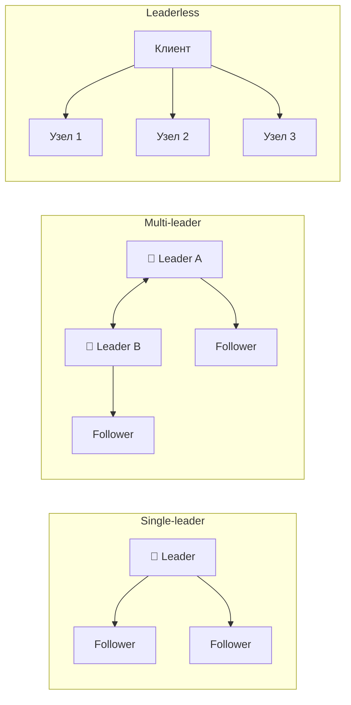
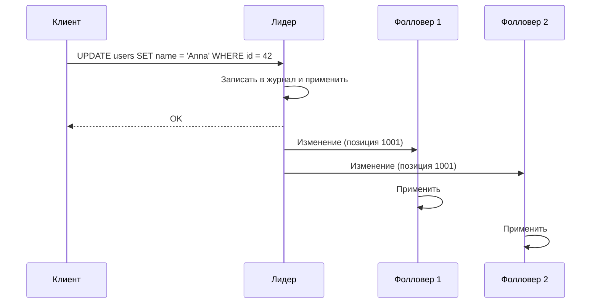
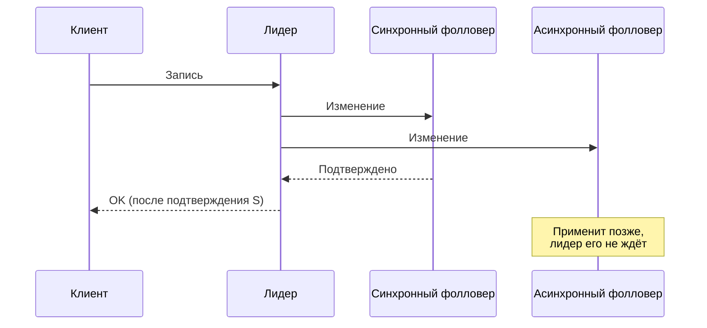
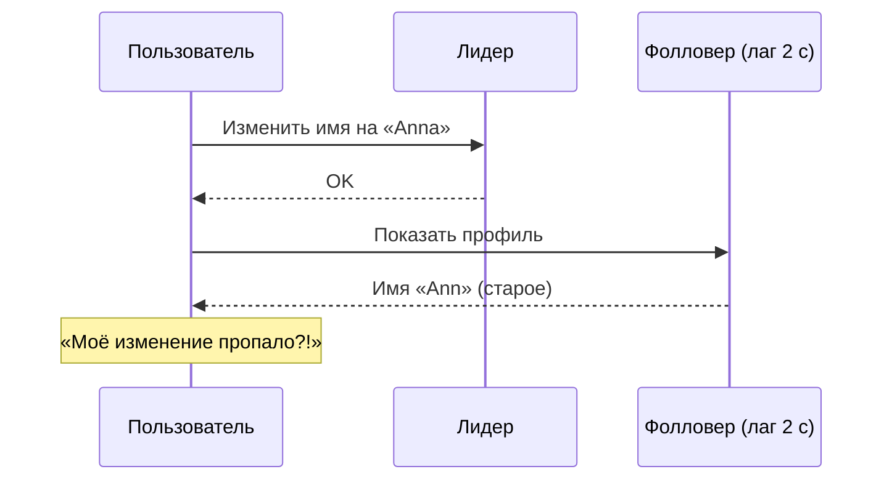
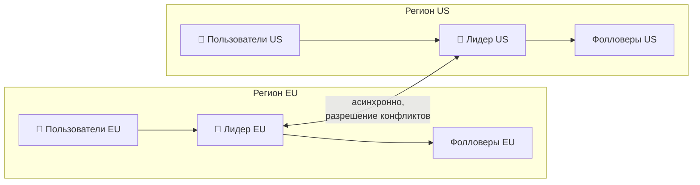
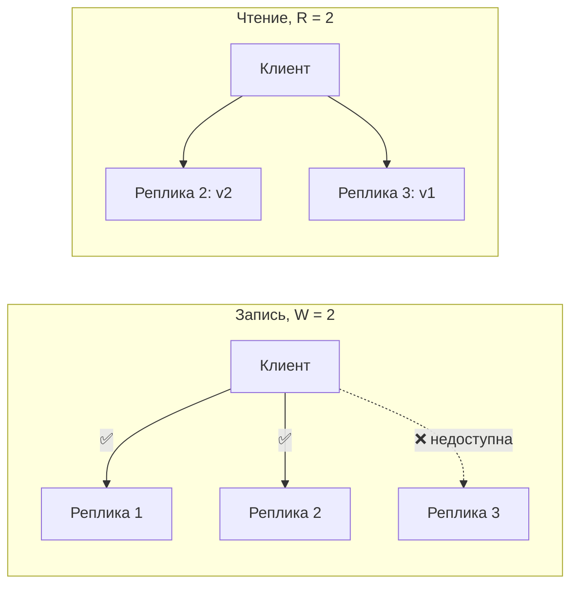

[English](README.md) | **Русский**

# 05. Репликация

> **Что внутри:** leader-follower, multi-leader, leaderless, синхронная и асинхронная репликация, failover, лаг репликации и гарантии чтения (read-your-writes, monotonic reads), конфликты и их разрешение, кворумы
> **Время на изучение:** ~4–5 ч · **Нужно для:** любой задачи с требованиями к доступности, надёжности или нескольким регионам
> **Практика:** разбор в формате интервью — [INTERVIEW_RU.md](./INTERVIEW.ru.md)
> **Связанные темы:** [04-databases](../04_Databases/README.ru.md), [02-caching](../02_Caching/README.ru.md). Партиционирование, модели консистентности и консенсус — в следующих темах.

---

## 📑 Содержание

1. [Что такое репликация и зачем она нужна](#1-что-такое-репликация-и-зачем-она-нужна)
2. [Leader-follower (single-leader)](#2-leader-follower-single-leader)
3. [Синхронная, асинхронная и полусинхронная репликация](#3-синхронная-асинхронная-и-полусинхронная-репликация)
4. [Как передаются изменения: журнал репликации](#4-как-передаются-изменения-журнал-репликации)
5. [Failover: когда лидер падает](#5-failover-когда-лидер-падает)
6. [Лаг репликации и гарантии чтения](#6-лаг-репликации-и-гарантии-чтения)
7. [Multi-leader](#7-multi-leader)
8. [Разрешение конфликтов](#8-разрешение-конфликтов)
9. [Leaderless и кворумы](#9-leaderless-и-кворумы)
10. [Репликация на основе консенсуса](#10-репликация-на-основе-консенсуса)
11. [Сравнение подходов и реальные системы](#11-сравнение-подходов-и-реальные-системы)
12. [Мульти-регион и эксплуатация](#12-мульти-регион-и-эксплуатация)
13. [Как говорить об этом на интервью](#13-как-говорить-об-этом-на-интервью)
14. [Вопросы для самопроверки](#14-вопросы-для-самопроверки)
15. [Глоссарий и ресурсы](#15-глоссарий-и-ресурсы)

---

## 1. Что такое репликация и зачем она нужна

**Репликация** — хранение копий одних и тех же данных на нескольких узлах (репликах), связанных по сети.

| Зачем | Как помогает |
|:------|:-------------|
| **Доступность** | Узел упал — другие продолжают обслуживать запросы |
| **Надёжность хранения** | Данные переживают потерю диска, сервера, зоны или региона |
| **Масштабирование чтения** | Чтения распределяются по репликам |
| **Меньше задержка** | Реплика в регионе пользователя отвечает быстрее |

> [!NOTE]
> Не путай:
> - **Репликация** — одни и те же данные на нескольких узлах;
> - **Партиционирование (шардирование)** — разные части данных на разных узлах;
> - **Бэкап** — копия на момент времени для восстановления после ошибок.
>
> В реальных системах их комбинируют: каждый шард реплицирован, и всё это ещё и бэкапится.

Вся сложность репликации — в **изменениях**. Скопировать неизменяемые данные легко; трудно сделать так, чтобы изменения дошли до всех копий корректно, быстро и в правильном порядке, когда сеть и узлы ненадёжны.

### Три подхода



---

## 2. Leader-follower (single-leader)

Самый распространённый подход: PostgreSQL, MySQL, MongoDB, Redis, Kafka (на уровне партиции).

1. Одна реплика — **лидер** (primary, master). Все **записи** идут только в неё.
2. Лидер пишет изменения в свой журнал и отправляет их **фолловерам** (replicas, secondaries).
3. Фолловеры применяют изменения в том же порядке.
4. **Чтения** можно обслуживать с лидера или с фолловеров.



| Плюсы | Минусы |
|:------|:-------|
| Простая модель: один порядок записей, нет конфликтов | Запись ограничена мощностью одного лидера |
| Легко масштабировать чтение | Лидер — точка отказа для записи, нужен failover |
| Хорошо понятна и поддерживается почти везде | При нескольких регионах запись из дальнего региона идёт через океан |

### Как добавить нового фолловера

Нельзя просто скопировать файлы работающей базы — они меняются во время копирования.
1. Сделать **консистентный снимок** лидера, привязанный к позиции в журнале (LSN в PostgreSQL, GTID/binlog position в MySQL).
2. Скопировать снимок на новый узел.
3. Фолловер запрашивает у лидера все изменения **после** этой позиции и догоняет.
4. Когда догнал — начинает обслуживать чтения.

---

## 3. Синхронная, асинхронная и полусинхронная репликация

Главный вопрос: **когда лидер отвечает клиенту «OK»** — до или после того, как изменение дошло до реплик?



| Режим | Когда клиент получает OK | Потеря данных при падении лидера | Задержка записи | Доступность записи |
|:------|:-------------------------|:--------------------------------:|:---------------:|:------------------:|
| **Асинхронный** | Сразу после записи на лидере | Возможна (то, что не успело уйти) | Минимальная | Высокая |
| **Синхронный (все реплики)** | Когда все реплики подтвердили | Нет | Максимальная (самая медленная реплика) | Низкая: любая упавшая реплика останавливает запись |
| **Полусинхронный** | Когда подтвердила хотя бы одна (или K) реплик | Нет, если не упали лидер и синхронная реплика одновременно | Средняя | Хорошая |
| **Кворумный** | Когда подтвердило большинство | Нет при потере меньшинства | Определяется медианной репликой | Хорошая |

> [!IMPORTANT]
> На практике «синхронная репликация» почти всегда означает **полусинхронную или кворумную**: одна или несколько реплик синхронные, остальные асинхронные. Например, в PostgreSQL `synchronous_standby_names = 'ANY 1 (replica_a, replica_b)'` — коммит ждёт подтверждения от любой одной из двух. В MySQL — semi-synchronous replication.

### RPO и RTO

| Метрика | Значение | Чем определяется |
|:--------|:---------|:-----------------|
| **RPO** (Recovery Point Objective) | Сколько данных можно потерять (в секундах записей) | Режим репликации: асинхронная → RPO = лаг; синхронная → RPO = 0 |
| **RTO** (Recovery Time Objective) | Сколько сервис может быть недоступен | Скорость обнаружения сбоя и failover |

### Стоимость синхронной записи между регионами

```
Синхронная реплика в другой AZ того же региона:   +1–2 мс к каждой записи
Синхронная реплика в другом регионе (EU ↔ US):    +80–100 мс к каждой записи
```

Поэтому типичная конфигурация: синхронно внутри региона (между AZ), асинхронно — в другие регионы.

---

## 4. Как передаются изменения: журнал репликации

| Способ | Что передаётся | Плюсы | Минусы | Где |
|:-------|:---------------|:------|:-------|:----|
| **Statement-based** | SQL-команды | Компактно | Недетерминированные функции (`NOW()`, `RAND()`), автоинкремент, триггеры дают разный результат на репликах | Старый режим MySQL |
| **Физическая (WAL shipping)** | Байтовые изменения страниц | Точно и быстро | Привязана к версии и формату хранения; нельзя реплицировать часть таблиц; сложнее апгрейд без простоя | PostgreSQL streaming replication |
| **Логическая (row-based)** | Изменения строк: «вставлена строка с такими значениями» | Независима от формата хранения; можно между версиями; основа CDC | Больше объём для массовых изменений | MySQL row-based binlog, PostgreSQL logical replication |
| **Триггерная / в приложении** | То, что решит код | Гибко: фильтрация, трансформация | Медленно, легко ошибиться | Специальные случаи |

> [!TIP]
> Логическая репликация — основа **CDC** (Change Data Capture): Debezium читает логический поток изменений и публикует их в Kafka. Так наполняют поисковые индексы, кэши и аналитику (см. [02-caching](../02_Caching/README.ru.md#7-инвалидация)).

---

## 5. Failover: когда лидер падает

### Шаги

1. **Обнаружение:** лидер не отвечает дольше таймаута (обычно десятки секунд).
2. **Выбор нового лидера:** обычно реплика с самыми свежими данными; выбор через консенсус или внешний координатор (Patroni + etcd, Orchestrator, Sentinel, managed-сервис).
3. **Переконфигурация:** клиенты и остальные реплики переключаются на нового лидера. Старый лидер, если вернётся, должен стать фолловером.

### Что может пойти не так

| Проблема | Что происходит | Защита |
|:---------|:---------------|:-------|
| **Потеря записей** | При асинхронной репликации новый лидер не получил последние записи старого. Они теряются или конфликтуют, когда старый лидер вернётся | Полусинхронная репликация; выбирать самую свежую реплику; не принимать записи старого лидера после возвращения |
| **Split brain** | Два узла одновременно считают себя лидером и принимают записи | Выбор лидера большинством голосов; **fencing**: старый лидер изолируется (STONITH — «выстрелить в другой узел»), отзыв доступа, fencing-токены |
| **Неправильный таймаут** | Короткий — ложные failover при кратковременной нагрузке или сетевом сбое. Длинный — долгий простой | Подбор по реальным метрикам; несколько независимых проверок |
| **Рассинхронизация с внешними системами** | Новый лидер выдаёт ID, которые старый уже выдал и которые попали в кэш или другую систему | Глобально уникальные ID (Snowflake, UUID) вместо локальных счётчиков |
| **Каскад** | Failover в другой регион с большой задержкой перегружает систему | Учения по failover; ёмкость с запасом в резервном регионе |

> [!WARNING]
> **Реальный пример.** 21 октября 2018 года у GitHub связь между дата-центром на Восточном побережье США и сетевым узлом пропала на 43 секунды. Система автоматического failover перевела лидеров MySQL на Западное побережье. Когда связь восстановилась, в обоих дата-центрах оказались записи, которых не было в другом, а запросы с Восточного побережья через континент сильно увеличили задержку. Восстановление согласованности заняло около суток деградации. Вывод: автоматический failover между регионами — опасная операция; иногда правильнее ждать, чем переключаться.

---

## 6. Лаг репликации и гарантии чтения

При асинхронной репликации фолловеры отстают от лидера. Обычно на миллисекунды, но под нагрузкой или при проблемах сети — на секунды и минуты. Это **eventual consistency**: если записи прекратятся, реплики со временем сойдутся.

Лаг создаёт три типичные аномалии.

### Read-your-writes (чтение своих записей)

Пользователь обновил профиль, обновил страницу — и видит старые данные, потому что чтение ушло на отстающую реплику.



**Решения:**
- Читать данные, которые пользователь **сам** может изменить (свой профиль), с лидера.
- Читать с лидера в течение N секунд после последней записи пользователя.
- Клиент запоминает **позицию в журнале** (LSN, timestamp) своей последней записи; чтение идёт на реплику, которая уже догнала эту позицию, или ждёт, или уходит на лидера.
- Если пользователь работает с нескольких устройств — позицию нужно хранить на сервере, а не в одном браузере.

### Monotonic reads (монотонное чтение)

Пользователь обновил страницу дважды: первый запрос попал на свежую реплику, второй — на отстающую. Комментарий, который он только что видел, «исчез».

**Решение:** привязать пользователя к одной реплике (например, по хэшу `user_id`). Если реплика упала — переключить, допуская одно нарушение.

### Consistent prefix reads (согласованный префикс)

Наблюдатель видит ответ раньше вопроса: два связанных изменения попали в разные партиции, и одна из них отстаёт сильнее.

**Решение:** причинно связанные записи писать в одну партицию; или отслеживать причинные зависимости (подробнее в теме о моделях консистентности).

### Сводная таблица

| Гарантия | Аномалия без неё | Типичное решение |
|:---------|:-----------------|:-----------------|
| Read-your-writes | Не вижу своё изменение | Чтение с лидера после записи; позиция журнала в сессии |
| Monotonic reads | Данные «откатываются назад» | Привязка пользователя к одной реплике |
| Consistent prefix | Следствие видно раньше причины | Связанные записи в одной партиции |

> [!TIP]
> На интервью полезно заранее сказать, **какие** данные терпят лаг, а какие нет. «Счётчик лайков может отставать на секунды, а свои настройки пользователь должен видеть сразу» — это и есть зрелый ответ про репликацию.

### Мониторинг лага

- Разница позиций в журнале (байты или LSN) и время от записи до применения.
- Алерт на рост лага; автоматическое исключение сильно отставших реплик из пула чтения.
- Причины роста: тяжёлые запросы на реплике, долгие транзакции, массовые изменения на лидере, сеть, недостаток I/O на реплике.

---

## 7. Multi-leader

Несколько узлов принимают записи, и каждый передаёт изменения остальным.

### Когда используют

| Сценарий | Почему multi-leader |
|:---------|:--------------------|
| **Несколько дата-центров** | Запись идёт в локальный лидер без межрегиональной задержки; регион работает при потере связи с другими |
| **Офлайн-клиенты** | Каждое устройство (календарь, заметки) — по сути «лидер», изменения синхронизируются при появлении сети |
| **Совместное редактирование** | Каждый пользователь меняет свою копию документа, изменения сливаются (Google Docs, Figma) |



| Плюсы | Минусы |
|:------|:-------|
| Низкая задержка записи в каждом регионе | **Конфликты записи**: одни данные изменены в двух местах одновременно |
| Регион продолжает работать при разрыве связи | Сложно: автоинкременты, триггеры, ограничения уникальности ломаются |
| | Ограничения целостности между регионами не гарантируются |

### Топологии

| Топология | Описание | Проблема |
|:----------|:---------|:---------|
| Кольцо | Каждый передаёт следующему | Один упавший узел рвёт цепочку |
| Звезда | Через центральный узел | Центр — точка отказа |
| Все со всеми | Каждый передаёт каждому | Изменения могут прийти в разном порядке: обновление раньше вставки. Нужны version vectors |

---

## 8. Разрешение конфликтов

**Конфликт:** две реплики приняли разные изменения одних и тех же данных, не зная друг о друге.

### Стратегии

| Стратегия | Как работает | Плюсы | Минусы |
|:----------|:-------------|:------|:-------|
| **Избегание конфликтов** | Каждая запись (пользователь, документ) закреплена за одним «домашним» лидером | Конфликтов нет в нормальном режиме | При переезде пользователя или сбое региона всё равно возможны |
| **Last Write Wins (LWW)** | Побеждает запись с бо́льшим timestamp | Просто, всегда сходится | **Тихо теряет данные**; зависит от синхронизации часов |
| **Слияние значений** | Объединить: например, множества товаров в корзине | Без потерь для подходящих типов | Не для всех данных; удалённое может «воскреснуть» |
| **CRDT** | Типы данных, которые сходятся автоматически при любом порядке применения | Математическая гарантия сходимости | Только для определённых структур; накладные расходы |
| **Хранить все версии (siblings)** | Сохранить конфликтующие версии и отдать приложению или пользователю | Ничего не теряется | Сложность переносится на приложение |
| **Кастомная логика** | Код решает при записи или чтении | Гибко | Легко ошибиться |

### Почему LWW опасен

```
Реплика EU: 10:00:00.100  корзина = [книга]          (часы EU спешат на 200 мс)
Реплика US: 10:00:00.050  корзина = [книга, наушники]
LWW выбирает EU по времени → «наушники» тихо пропали
```

Часы на разных серверах никогда не синхронизированы идеально (NTP даёт точность порядка миллисекунд, иногда хуже). LWW подходит, только если потеря одновременных записей допустима (например, кэш или «последнее время входа»).

### CRDT: основные типы

| CRDT | Что делает | Пример применения |
|:-----|:-----------|:------------------|
| **G-Counter** | Счётчик, который только растёт: у каждой реплики своё слагаемое | Просмотры |
| **PN-Counter** | Два G-Counter: плюсы и минусы | Лайки с отменой |
| **G-Set / 2P-Set** | Множество только с добавлением / с однократным удалением | Теги |
| **OR-Set** (observed-remove) | Множество, где добавление после удаления побеждает | Корзина, список участников |
| **LWW-Register** | Значение с последней меткой времени | Простые поля |
| **Sequence CRDT** (RGA, Yjs, Automerge) | Упорядоченный список символов | Совместное редактирование текста |

### Как узнать, что конфликт есть: version vectors

Каждая реплика ведёт счётчик своих изменений. Вектор `{EU: 3, US: 5}` описывает, какие изменения учтены.
- Если один вектор «больше или равен» другому по всем компонентам — одна версия новее, конфликта нет.
- Если каждый больше в какой-то компоненте (`{EU: 4, US: 5}` и `{EU: 3, US: 6}`) — изменения **параллельные**, это конфликт.

---

## 9. Leaderless и кворумы

В стиле Amazon Dynamo: Cassandra, ScyllaDB, Riak, а также DynamoDB внутри. Лидера нет: клиент (или координатор) отправляет запись **сразу на несколько реплик**.

### Кворумы

- **N** — число реплик каждого ключа.
- **W** — сколько реплик должны подтвердить запись.
- **R** — сколько реплик опрашивается при чтении.

Если **W + R > N**, множества реплик записи и чтения пересекаются хотя бы в одной реплике, и чтение увидит последнюю подтверждённую запись (в нормальных условиях).



Чтение получило `v2` и `v1`, выбрало более новую `v2` по версии и заодно исправило реплику 3 (**read repair**).

| Конфигурация (N = 3) | Поведение |
|:---------------------|:----------|
| W = 3, R = 1 | Быстрое чтение, запись падает при отказе любой реплики |
| W = 1, R = 3 | Быстрая запись, чтение падает при отказе любой реплики |
| **W = 2, R = 2** | Типичный баланс: переживает отказ одной реплики и для записи, и для чтения |
| W = 1, R = 1 | Максимальная доступность и скорость, но можно прочитать старое |

### Как реплики догоняют

| Механизм | Как работает |
|:---------|:-------------|
| **Read repair** | При чтении обнаружили устаревшую реплику — записать ей свежую версию |
| **Anti-entropy** | Фоновый процесс сравнивает данные реплик через **деревья Меркла** и досылает различия |
| **Hinted handoff** | Если целевая реплика недоступна, запись временно принимает другой узел («подсказка») и передаёт её, когда реплика вернётся |
| **Sloppy quorum** | Кворум собирается из любых доступных узлов, а не только «своих» реплик ключа. Выше доступность, но W + R > N уже не гарантирует свежего чтения |

### Настраиваемая консистентность в Cassandra

| Уровень | Смысл |
|:--------|:------|
| `ONE` | Достаточно одной реплики |
| `QUORUM` | Большинство реплик во всех дата-центрах |
| `LOCAL_QUORUM` | Большинство в локальном дата-центре (без межрегиональной задержки) |
| `EACH_QUORUM` | Большинство в каждом дата-центре |
| `ALL` | Все реплики |

> [!WARNING]
> Кворумы **не дают** линеаризуемости сами по себе. Конкурентные записи, частично выполненные записи (W не набрался, но на части реплик значение осталось), sloppy quorum и LWW по часам могут дать неожиданные результаты. Если нужна строгая консистентность (уникальность, остатки), нужны консенсус или lightweight transactions.

---

## 10. Репликация на основе консенсуса

Современные системы часто совмещают single-leader с **консенсусом** (Raft, Paxos):
- лидер выбирается голосованием большинства;
- запись считается зафиксированной, когда её подтвердило **большинство** реплик;
- при падении лидера новым становится только реплика со всеми зафиксированными записями.

Это решает главные проблемы классического failover: нет потери подтверждённых записей и нет split brain (два лидера не могут одновременно получить большинство в одном term).

| Где используется | Как |
|:-----------------|:----|
| etcd, ZooKeeper, Consul | Метаданные, конфигурация, выбор лидера |
| CockroachDB, TiKV, YugabyteDB | Raft на каждую партицию (range) данных |
| Google Spanner | Paxos на каждую партицию + TrueTime |
| Kafka (KRaft) | Raft для метаданных кластера |
| MongoDB | Протокол выбора на основе Raft; `writeConcern: majority` |

**Цена:** запись ждёт большинство. Если реплики в трёх регионах, каждая запись — это минимум round trip до ближайшего большинства (десятки миллисекунд и больше). Подробно консенсус разбирается в отдельной теме.

---

## 11. Сравнение подходов и реальные системы

| | Single-leader | Multi-leader | Leaderless | Консенсус (Raft/Paxos) |
|:-|:--------------|:-------------|:-----------|:-----------------------|
| Куда идёт запись | Один лидер | Любой лидер | Несколько реплик сразу | Лидер, фиксация большинством |
| Конфликты записи | Нет | Да | Да (параллельные записи) | Нет |
| Задержка записи | Низкая (асинхр.) | Низкая локально | Настраиваемая (W) | Round trip до большинства |
| Доступность записи при сбое | Нужен failover | Высокая | Высокая | Пока доступно большинство |
| Риск потери данных | При асинхронном failover | При LWW | При LWW, sloppy quorum | Нет для зафиксированных |
| Консистентность | Строгая на лидере, eventual на репликах | Eventual | Настраиваемая, не линеаризуемая | Линеаризуемая запись |
| Примеры | PostgreSQL, MySQL, Redis | MySQL group replication (multi-primary), CouchDB, Active-active Redis (CRDT) | Cassandra, ScyllaDB, Riak | etcd, CockroachDB, Spanner |

### Как это настроено в популярных системах

| Система | Модель | Ключевые настройки |
|:--------|:-------|:-------------------|
| PostgreSQL | Single-leader, физическая или логическая | `synchronous_commit`, `synchronous_standby_names`; Patroni для failover |
| MySQL | Single-leader (binlog, GTID) | Semi-sync replication; Orchestrator / MySQL Router |
| MongoDB | Replica set, выбор лидера по Raft-подобному протоколу | `writeConcern` (`w: 1` / `w: "majority"`), `readConcern`, `readPreference` |
| Redis | Single-leader, асинхронная | Sentinel или Cluster для failover; `WAIT` для синхронного подтверждения |
| Kafka | Лидер на партицию, ISR (in-sync replicas) | `acks=all`, `min.insync.replicas=2`, `replication.factor=3` |
| Cassandra | Leaderless | `replication_factor`, consistency level на каждый запрос |

> [!TIP]
> Kafka — частый вопрос: `replication.factor=3`, `min.insync.replicas=2`, продюсер с `acks=all`. Запись подтверждается, когда её получили все реплики из ISR, а их минимум две. Потеря одного брокера не теряет подтверждённые сообщения и не останавливает запись.

---

## 12. Мульти-регион и эксплуатация

### Паттерны для нескольких регионов

| Паттерн | Как работает | Когда |
|:--------|:-------------|:------|
| **Active-passive** | Лидер в одном регионе, асинхронные реплики в другом. При аварии — ручной или автоматический failover | Просто; RPO = лаг, RTO = минуты |
| **Чтение локально, запись глобально** | Реплики в каждом регионе для чтения, все записи — в регион лидера | Read-heavy системы |
| **Домашний регион (geo-partitioning)** | Каждый пользователь или объект закреплён за регионом, его лидер — там | Пользователи в основном работают из одного региона; данные с требованиями резидентности (GDPR) |
| **Active-active (multi-leader)** | Запись в любом регионе, разрешение конфликтов | Нужна запись везде с низкой задержкой; данные допускают слияние |
| **Консенсус между регионами** | Большинство реплик в разных регионах | RPO = 0 при потере региона; приемлема задержка записи в десятки мс |

### Репликация не заменяет бэкапы

Репликация **мгновенно копирует ошибки**: `DROP TABLE` или баг, который портит данные, сразу окажутся на всех репликах.

| Защита | Что даёт |
|:-------|:---------|
| Регулярные снимки + архив WAL | Восстановление на любой момент времени (PITR) |
| **Отложенная реплика** | Реплика, которая применяет изменения с задержкой (например, 1 час): можно остановить её до применения ошибки |
| Проверка восстановления | Бэкап, из которого никто не пробовал восстановиться, — не бэкап |

### Чеклист эксплуатации

- Мониторинг лага по каждой реплике и алерты.
- Регулярные учения по failover (в том числе между регионами).
- Глобально уникальные ID вместо автоинкремента.
- Пулы соединений, которые быстро узнают о новом лидере.
- Запас ёмкости: после потери узла или региона оставшиеся должны выдержать нагрузку.

---

## 13. Как говорить об этом на интервью

### Ответ за 30 секунд

> «По умолчанию — single-leader: одна синхронная реплика в другой AZ для RPO = 0 при потере узла, асинхронные реплики для чтения и в других регионах. Для данных, которые пользователь сам меняет, обеспечиваю read-your-writes: чтение с лидера после записи или по позиции журнала; для остального допускаю лаг. Failover — через консенсус (Patroni + etcd) с fencing, чтобы не было split brain. Если нужна запись в нескольких регионах — либо домашний регион на пользователя, либо multi-leader с CRDT для данных, которые можно сливать. Для RPO = 0 при потере региона — консенсусная база с большинством в трёх регионах. И отдельно — бэкапы и PITR, потому что репликация копирует ошибки».

### Вопросы, которые стоит задать

1. Какой RPO и RTO нужен для каждого типа данных?
2. Какие данные пользователь должен видеть сразу после изменения?
3. Где пользователи и откуда идут записи?
4. Можно ли автоматически сливать одновременные изменения (корзина, счётчики) или нужен один порядок (деньги, остатки)?
5. Что важнее при разрыве сети между регионами: принимать записи или не допускать расхождений?

### Типичные ошибки

- Говорить «добавим реплики» без режима (синхронный или асинхронный) и RPO.
- Читать с реплик то, что пользователь только что изменил.
- Автоматический failover без защиты от split brain.
- LWW для данных, которые нельзя терять.
- Считать, что W + R > N даёт строгую консистентность.
- Считать репликацию заменой бэкапов.

---

## 14. Вопросы для самопроверки

<details>
<summary><b>1. Чем репликация отличается от партиционирования?</b></summary>

Репликация — одни и те же данные на нескольких узлах (для доступности, надёжности и масштабирования чтения). Партиционирование — разные части данных на разных узлах (для масштабирования объёма и записи). Обычно их совмещают: каждая партиция реплицируется.
</details>

<details>
<summary><b>2. Почему полностью синхронная репликация на все реплики редко используется?</b></summary>

Любая медленная или упавшая реплика останавливает все записи, а задержка определяется самой медленной репликой. Поэтому используют полусинхронную (одна или несколько синхронных реплик) или кворумную схему.
</details>

<details>
<summary><b>3. Что может потеряться при асинхронной репликации во время failover?</b></summary>

Записи, которые лидер подтвердил клиенту, но не успел передать фолловеру, ставшему новым лидером. Когда старый лидер вернётся, эти записи либо отбрасываются, либо конфликтуют с новыми. RPO равен лагу репликации в момент сбоя.
</details>

<details>
<summary><b>4. Что такое split brain и как его избежать?</b></summary>

Два узла одновременно считают себя лидером и принимают записи, данные расходятся. Защита: выбор лидера большинством (консенсус), fencing (изоляция старого лидера, STONITH, fencing-токены, которые хранилище проверяет при записи), отзыв доступа старого лидера.
</details>

<details>
<summary><b>5. Как обеспечить read-your-writes при чтении с реплик?</b></summary>

Читать данные, которые пользователь может изменить, с лидера; или читать с лидера N секунд после записи; или сохранять позицию журнала последней записи и читать с реплики, которая её достигла. Для нескольких устройств позицию нужно хранить централизованно.
</details>

<details>
<summary><b>6. Чем monotonic reads отличается от read-your-writes?</b></summary>

Read-your-writes — пользователь видит **свои** изменения. Monotonic reads — пользователь не видит, как данные «откатываются назад» при последовательных чтениях (в том числе чужие изменения). Решение для monotonic reads — привязка пользователя к одной реплике.
</details>

<details>
<summary><b>7. Почему Last Write Wins опасен?</b></summary>

При одновременных записях он тихо отбрасывает все, кроме одной, и выбирает «последнюю» по часам, которые на разных серверах не синхронизированы идеально. Запись, сделанная позже в реальности, может проиграть из-за спешащих часов другого сервера.
</details>

<details>
<summary><b>8. N = 3, W = 2, R = 2. Сколько отказов переживёт система?</b></summary>

Одну недоступную реплику — и для записи, и для чтения: W = 2 и R = 2 всё ещё набираются из двух оставшихся. Так как W + R = 4 > 3, чтение пересекается с последней записью хотя бы в одной реплике.
</details>

<details>
<summary><b>9. Что такое hinted handoff и sloppy quorum?</b></summary>

Если «свои» реплики ключа недоступны, запись временно принимает другой узел и запоминает подсказку, кому её передать; когда реплика вернётся, запись передаётся ей (hinted handoff). Кворум, собранный из таких временных узлов, — sloppy quorum. Это повышает доступность записи, но чтение с кворумом «своих» реплик может не увидеть эту запись.
</details>

<details>
<summary><b>10. Почему репликация не заменяет бэкапы?</b></summary>

Репликация копирует все изменения, включая ошибочные: удалённая таблица или испорченные данные сразу появятся на всех репликах. Для восстановления после таких ошибок нужны снимки с архивом журнала (PITR) или отложенная реплика.
</details>

---

## 15. Глоссарий и ресурсы

### Глоссарий

| Термин | Значение |
|:-------|:---------|
| Лидер / фолловер | Реплика, принимающая записи / реплика, применяющая изменения лидера |
| Синхронная / асинхронная репликация | Лидер ждёт / не ждёт подтверждения реплик перед ответом клиенту |
| Полусинхронная репликация | Ждём подтверждения хотя бы одной (K) реплик |
| Лаг репликации | Насколько реплика отстаёт от лидера |
| Failover | Переключение на нового лидера при отказе старого |
| Split brain | Два узла одновременно считают себя лидером |
| Fencing | Изоляция старого лидера, чтобы он не мог писать |
| RPO / RTO | Допустимая потеря данных / допустимое время простоя |
| Read-your-writes | Пользователь всегда видит свои изменения |
| Monotonic reads | Последовательные чтения не «откатываются назад» |
| Multi-leader | Несколько узлов принимают записи |
| LWW | Last Write Wins: побеждает запись с бо́льшим timestamp |
| CRDT | Структуры данных, сходящиеся автоматически при любом порядке изменений |
| Version vector | Вектор счётчиков изменений по репликам для обнаружения конфликтов |
| Leaderless | Запись сразу на несколько реплик без лидера |
| Кворум (W, R, N) | Число подтверждений для записи и чтения из N реплик |
| Read repair / anti-entropy | Исправление устаревших реплик при чтении / фоновой сверкой |
| Hinted handoff | Временное хранение записи другим узлом до возвращения реплики |
| ISR | In-sync replicas в Kafka |
| PITR | Point-in-time recovery: восстановление на момент времени |

### Ресурсы

- *Designing Data-Intensive Applications*, Martin Kleppmann — глава 5 «Replication»
- DeCandia et al., *Dynamo: Amazon's Highly Available Key-value Store* (SOSP 2007)
- Terry et al., *Session Guarantees for Weakly Consistent Replicated Data* (1994) — read-your-writes, monotonic reads
- Shapiro et al., *Conflict-free Replicated Data Types* (2011)
- Ongaro, Ousterhout, *In Search of an Understandable Consensus Algorithm (Raft)* (2014)
- GitHub Engineering, *October 21 post-incident analysis* (2018)
- Документация PostgreSQL: High Availability, Load Balancing, and Replication
- Документация Kafka: Replication; документация Cassandra: Tunable Consistency