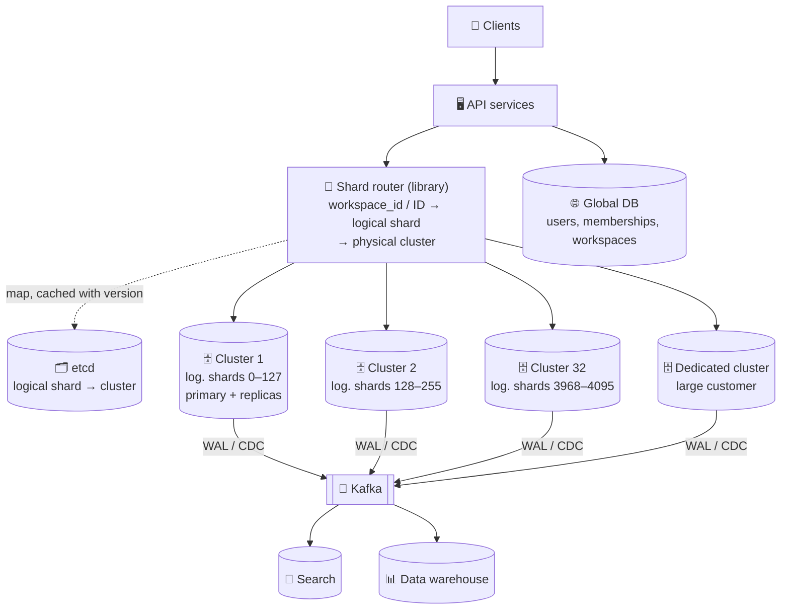
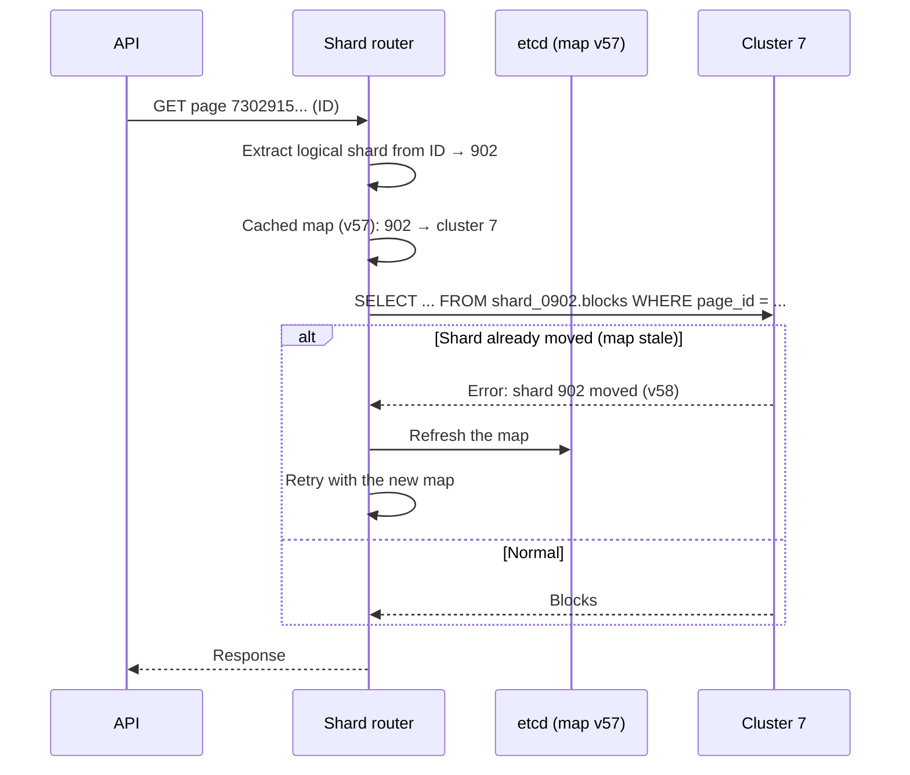
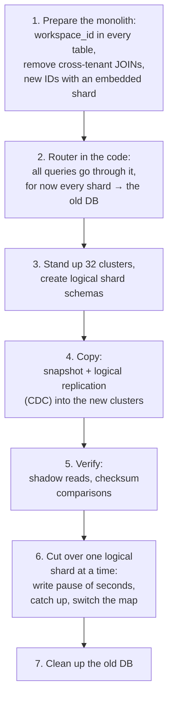
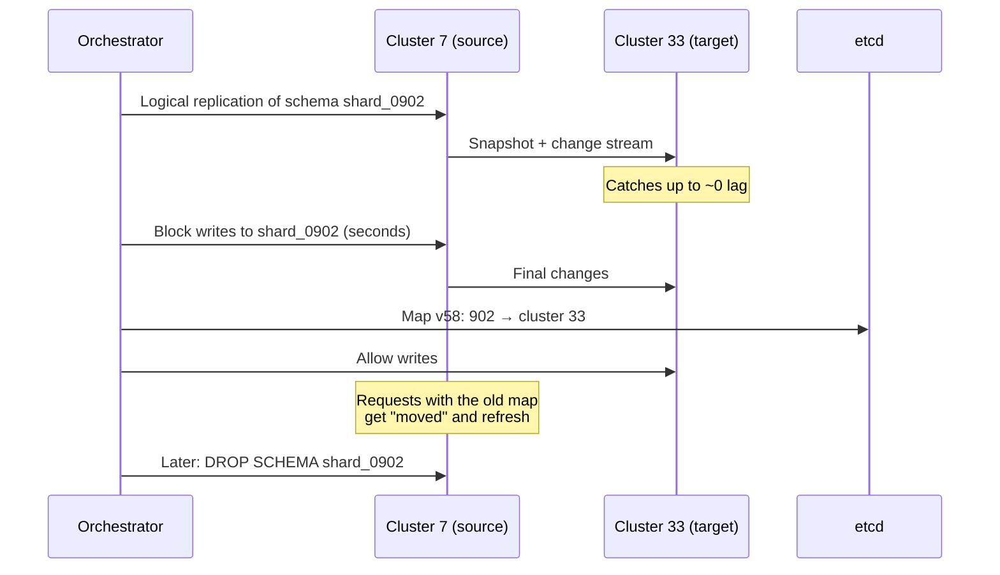

**English** | [Русский](INTERVIEW.ru.md) · Theory: [README.md](./README.md)

# 06. Partitioning: Sharding a Multi-Tenant SaaS Database

> **Topic:** choosing a shard key, logical and physical shards, routing, IDs with an embedded shard, hot tenants, global uniqueness, cross-shard queries, zero-downtime migration
> **Level:** Hard · **Interview time:** 45 min · **Study time:** ~5 h
> **Where it's asked:** "Our database is hitting the ceiling — how would you shard it?" and as a deep dive in Slack, Notion, Jira, Shopify and any B2B platform problem

---

## 🗺️ How to Read This Walkthrough

| Icon | Meaning |
|:----:|:--------|
| 🎤 | Interviewer |
| 🗣️ | What I (the candidate) say out loud |
| ✏️ | What I draw on the whiteboard |
| ⏱️ | Time budget for the step |

Callouts: **TIP** — a good technique, **WARNING** — a trap, **IMPORTANT** — a Senior+ signal.

---

## 📑 Contents

1. [Problem Statement](#1-problem-statement)
2. [Clarifying Questions and Requirements](#2-clarifying-questions-and-requirements)
3. [Capacity Estimates](#3-capacity-estimates)
4. [Access Patterns and Key Choice](#4-access-patterns-and-key-choice)
5. [Data Model and IDs](#5-data-model-and-ids)
6. [High-Level Design](#6-high-level-design)
7. [Deep Dive 1: Logical Shards and Routing](#7-deep-dive-1-logical-shards-and-routing)
8. [Deep Dive 2: A Hot Tenant](#8-deep-dive-2-a-hot-tenant)
9. [Deep Dive 3: Global Data and Cross-Shard Queries](#9-deep-dive-3-global-data-and-cross-shard-queries)
10. [Deep Dive 4: Zero-Downtime Migration](#10-deep-dive-4-zero-downtime-migration)
11. [Deep Dive 5: Rebalancing](#11-deep-dive-5-rebalancing)
12. [Bottlenecks and Failure Scenarios](#12-bottlenecks-and-failure-scenarios)
13. [What Changes at 10x Scale](#13-what-changes-at-10x-scale)
14. [Interviewer Questions with Answers](#14-interviewer-questions-with-answers)
15. [Common Mistakes](#15-common-mistakes)
16. [Cheat Sheet and Self-Check](#16-cheat-sheet-and-self-check)

---

## 1. Problem Statement

> 🎤 "We have a Notion-like collaboration SaaS: workspaces, pages, blocks, comments. Everything lives in one huge PostgreSQL. The primary's CPU is at 90% at peak, VACUUM can't keep up, a backup takes a day, and data grows by a terabyte a month. How would you shard it?"

**Time plan:**

| Step | ⏱️ |
|:-----|:--:|
| Requirements | 5 min |
| Estimates | 4 min |
| Access patterns and key | 6 min |
| Data, IDs, high-level | 8 min |
| Deep dives | 18 min |
| Failures and wrap-up | 4 min |

> [!TIP]
> Before sharding, show that simpler tools are exhausted: "Read replicas exist, there's a cache, vertical headroom is gone, and the problem is writes and volume, not reads." Otherwise the interviewer will ask why you're sharding at all.

---

## 2. Clarifying Questions and Requirements

⏱️ 5 min

| My question | Interviewer's answer | What it changes |
|:------------|:---------------------|:----------------|
| What's hitting the ceiling: reads or writes? | Writes and volume. Read replicas already exist | Replicas won't help → sharding is needed |
| What are the most frequent queries? | Open a page (its blocks), list a workspace's pages, edit blocks | Almost everything is within one workspace |
| Are there operations across workspaces? | A user belongs to several workspaces; a page can be shared with a guest from another | Global user and membership data is needed |
| How large can a workspace get? | Most are small, but enterprise customers have millions of pages | Hot tenants |
| Is downtime acceptable during migration? | No. At most a write pause of seconds for some customers | Migrate in parts with short cutovers |
| Can we switch to another DBMS? | The team knows PostgreSQL well and wants to stay on it | Application-level sharding (or Citus) |
| Analytics across all customers? | Yes, internal reports | Not on production shards → a data warehouse |

### Functional requirements

1. Every current feature keeps working: pages, blocks, comments, permissions, workspace search.
2. A user sees the list of their workspaces and can switch between them.
3. Guest access to pages in another workspace.

### Non-functional requirements

| Requirement | Target |
|:------------|:-------|
| Scalability | 10× growth without changing the sharding scheme |
| Migration | Zero downtime; rollback possible at every step |
| Latency | No worse than today: page-open p99 < 200 ms |
| Isolation | A large customer must not slow down the others |
| Operations | Backing up and restoring a shard takes hours, not a day |

---

## 3. Capacity Estimates

⏱️ 4 min

✏️

```
Workspaces             = 10M (of which ~1,000 large enterprise)
Users                  = 100M
Blocks                 = 50B × ~400 B ≈ 20 TB, growing ~1 TB/month
Writes (peak)          ≈ 100,000 block changes/s
Reads (peak)           ≈ 500,000 requests/s (mostly via cache and replicas)

Target per physical shard:
  ≤ 1–2 TB of data (backup and restore in hours)
  ≤ ~5,000–10,000 writes/s with headroom
→ today we need ≥ 20 physical shards,
  in 2–3 years with ×3–5 growth — about 100
```

🗣️ **Conclusions:**
- **We need dozens of physical databases today and hundreds in the future.** The scheme must allow adding databases without recomputing keys.
- **The distribution is very uneven:** 1,000 large customers may hold a significant share of the data. Hashing evenly by tenant doesn't guarantee even load.

---

## 4. Access Patterns and Key Choice

⏱️ 6 min

### The main queries

| Query | Frequency | Filtered by |
|:------|:----------|:------------|
| Load a page's blocks | Very high | `page_id` (within a workspace) |
| Edit a block | Very high | `block_id` (within a workspace) |
| List a workspace's pages | High | `workspace_id` |
| Page permissions | Very high | `page_id`, `user_id` |
| My workspaces | Medium | `user_id` |
| Workspace search | Medium | `workspace_id` + text |
| Analytics across all customers | Low | Everything |

### Key candidates

| Key | Main queries in one shard? | Transactions in one shard? | Evenness | Verdict |
|:----|:--------------------------:|:--------------------------:|:--------:|:-------:|
| `hash(block_id)` | ❌ A page is scattered across every shard | ❌ | ✅ | ❌ |
| `page_id` | ✅ The whole page | ⚠️ Moving blocks between pages is cross-shard | ✅ | ⚠️ |
| `user_id` | ❌ Shared pages belong to many users | ❌ | ✅ | ❌ |
| **`workspace_id`** | ✅ Almost everything | ✅ Almost everything | ⚠️ Large tenants | ✅ |

🗣️ "I pick **`workspace_id`**. Almost every query and transaction lives within one workspace: permissions, pages, blocks, comments. It's the natural tenant isolation boundary. The cost is unevenness from large customers and the 'my workspaces' query, which needs global data. I'll address both separately."

> [!IMPORTANT]
> **Senior+ signal:** for multi-tenant systems the key is almost always `tenant_id`, because it provides **isolation**: one customer's problems don't affect the rest, and a customer's data can be moved, exported or deleted as a whole (important for GDPR and enterprise contracts).

---

## 5. Data Model and IDs

⏱️ 4 min

### Tables on the shards

```sql
-- On every shard (in the logical shard's schema)
CREATE TABLE pages (
  page_id       BIGINT PRIMARY KEY,
  workspace_id  BIGINT NOT NULL,
  parent_id     BIGINT,
  title         TEXT,
  created_at    TIMESTAMPTZ
);
CREATE INDEX ON pages (workspace_id, parent_id);

CREATE TABLE blocks (
  block_id      BIGINT PRIMARY KEY,
  workspace_id  BIGINT NOT NULL,   -- in every table, even if derivable via page
  page_id       BIGINT NOT NULL,
  type          TEXT,
  content       JSONB,
  version       INT,
  updated_at    TIMESTAMPTZ
);
CREATE INDEX ON blocks (page_id);
```

🗣️ "`workspace_id` is stored **in every** table, even when it could be derived through relationships. That way any row is unambiguously routable, and migrating or moving a tenant is just selecting by `workspace_id` from every table."

### Global tables (a separate small database)

```sql
users        (user_id PK, email UNIQUE, name, ...)
memberships  (user_id, workspace_id, role, PRIMARY KEY (user_id, workspace_id))
workspaces   (workspace_id PK, name, logical_shard, plan, ...)
```

### IDs with an embedded logical shard

✏️

```
64-bit ID:
┌──────────────────────────────┬─────────────────────┬────────────┐
│ 41 bits: ms since company    │ 12 bits: logical    │ 10 bits:   │
│ epoch                        │ shard (0–4095)      │ counter    │
└──────────────────────────────┴─────────────────────┴────────────┘
```

🗣️ "Every `page_id` or `block_id` contains the logical shard number. A link like `/page/{page_id}` routes straight to the right shard with no directory lookup. IDs are time-sorted, so inserts go to the end of the B-tree index."

---

## 6. High-Level Design

⏱️ 4 min

✏️



🗣️ "The key parts:
- **4096 logical shards**, fixed forever: `logical_shard = hash(workspace_id) % 4096`;
- **32 physical PostgreSQL clusters** (primary + replicas), each holding 128 logical shards as separate schemas;
- the **map** "logical shard → cluster" lives in etcd, and the router caches it with a version;
- a **global database** for users, memberships and workspace metadata — small enough that replication is all it needs;
- **CDC** from every shard into search and the data warehouse, so cross-tenant analytics never touches production."

---

## 7. Deep Dive 1: Logical Shards and Routing

> 🎤 "Why not just `hash(workspace_id) % 32`?"

🗣️ "Because moving to 33 servers would move about 97% of the data. With **logical shards**:
- `hash(workspace_id) % 4096` never changes — a tenant has one logical shard forever;
- growth means moving some logical shards to a new physical cluster;
- adding a 33rd cluster moves ~1/33 of the data — exactly its share.

Why 4096: headroom to grow to hundreds of clusters (with 10+ logical shards per cluster for flexible balancing), while staying a manageable number of objects."

### How a logical shard is laid out in PostgreSQL

| Option | How | Pros | Cons |
|:-------|:----|:-----|:-----|
| **A schema per logical shard** | `shard_0042.pages`, `shard_0042.blocks` | Moving a shard = moving a schema; isolation | Thousands of schemas load the PostgreSQL catalog |
| A `logical_shard` column in shared tables | One table, filtered by the column | Easier on the catalog | Moving a shard = selecting rows from huge tables |
| A database per logical shard | A separate DB | Maximum isolation | Too many objects and connections |

🗣️ "I pick **a schema per logical shard**: moving is logical replication of one schema, and cleanup after the move is `DROP SCHEMA`, with no heavy `DELETE`."

### Routing



🗣️ "The router is a **library** inside the services, not a separate proxy: no extra hop. Each cluster knows which logical shards it currently serves and rejects requests for others — that protects against a stale map."

---

## 8. Deep Dive 2: A Hot Tenant

> 🎤 "One enterprise customer has grown to 3 TB and 20,000 writes per second. Its logical shard shares a cluster with a hundred others. What do you do?"

🗣️ "This is exactly the unevenness hashing doesn't solve. Levels of response:

| Level | Fix | When |
|:------|:----|:-----|
| 1 | Move the customer's logical shard to a **less loaded** cluster | The customer grew but still fits in a cluster |
| 2 | **A dedicated cluster:** only this logical shard (its neighbors in the logical shard — small workspaces — move along, which is fine) | The customer takes most of a cluster |
| 3 | **A per-tenant override:** `workspace_id → dedicated shard` in the directory, bypassing the hash | The customer must be separated from its logical-shard neighbors |
| 4 | **A second level of sharding within the tenant:** by `page_id` or by team (teamspace) | The customer doesn't fit in one cluster |

For 3 TB and 20,000 writes/s — level 2 or 3. It's a directory approach for exceptions: 99.9% of tenants route by hash, and a handful of the largest through an explicit directory entry."

> [!WARNING]
> Level 4 greatly complicates the system: cross-shard operations appear inside a single customer (moving a page between sections, workspace-wide permissions). Postpone it until a dedicated cluster on the biggest hardware is genuinely exhausted.

### Isolating "noisy neighbors"

- Per-tenant request and write limits (rate limiting by `workspace_id`).
- Heavy operations (import, export, bulk changes) go through throttled queues.
- Monitor load **per tenant**, not just per cluster, to see who's growing.

---

## 9. Deep Dive 3: Global Data and Cross-Shard Queries

> 🎤 "How do you show a user their workspaces if they're on different shards? And how do you guarantee unique emails?"

### The global database

🗣️ "Data that **doesn't belong** to a single tenant moves to a separate global database:

| Table | Why it's global |
|:------|:----------------|
| `users` | A user exists outside any workspace; email is globally unique |
| `memberships` | Links a user to many workspaces |
| `workspaces` | Metadata: name, plan, logical shard or dedicated cluster |

'My workspaces' is one query to the global database by `user_id`. The volume is small (hundreds of millions of narrow rows), and the load is mostly reads → one primary with replicas and a cache will last a long time. If it stops being enough, `users` gets sharded by `user_id`, with an `email → user_id` table sharded by email for uniqueness."

### Map of cross-shard operations

| Operation | Solution |
|:----------|:---------|
| My workspaces | The global `memberships` table |
| Guest access to a page in another workspace | Permissions live in the page **owner's** shard; the guest reads the page by routing on `page_id` (shard in the ID) |
| Moving a page to another workspace | A rare operation → an async job: copy to the new shard, switch, delete in the old one (a saga with idempotent steps) |
| Search | An Elasticsearch index with routing by `workspace_id` |
| Analytics across all customers | CDC → data warehouse; never run on shards |
| Deleting a user account (GDPR) | A job walks the shards listed in the user's `memberships` |

> [!TIP]
> A good rule: **every query on the hot path must hit one shard**. Anything needing several shards either moves to another store (global database, search, DWH) or becomes an async job.

---

## 10. Deep Dive 4: Zero-Downtime Migration

> 🎤 "We have 20 TB in one database and can't afford a minute of downtime. How do we move?"

✏️



### Step details

| Step | What matters |
|:-----|:-------------|
| 1. Preparation | The longest part. Find every query without `workspace_id`, cross-tenant JOINs, auto-increments. Rewrite them **before** the migration |
| 2. Router | All queries pass through one point. Enabled gradually, behind a feature flag |
| 4. Copy | Snapshot + change stream from the WAL. The new clusters lag by seconds |
| 5. Verify | Shadow reads: the old DB's response goes to the user, the new one is compared, and differences are logged |
| 6. Cutover | For one logical shard: block writes (seconds), wait for zero lag, switch the map in etcd, unblock. Start with internal and small tenants |
| Rollback | Reverse replication from the new DB to the old one until the final step — the map can be switched back |

🗣️ "Cutover goes **one logical shard at a time**, not all at once. The write pause affects 1/4096 of customers for a few seconds, and any problem shows up at small scale. Notion described a similar approach in its write-up on sharding PostgreSQL."

> [!IMPORTANT]
> **Senior+ signal:** name where the risk is. The most dangerous part isn't copying but **cutover** and **code that still talks to the old database, bypassing the router**. Defense: for cut-over shards, the old database becomes read-only, and any write attempts show up in logs.

---

## 11. Deep Dive 5: Rebalancing

> 🎤 "A year from now there'll be a 33rd cluster. How do you move logical shards onto it?"



🗣️ Rules:
- **One logical shard at a time** per source cluster, with copy speed throttled so production isn't affected.
- **Outside peak hours.**
- **Which shards to move** is chosen by a planner from metrics (volume, writes, CPU per logical shard), not by number.
- **Manual approval** of the plan — automatic movement combined with automatic failure detection can trigger a cascade.

---

## 12. Bottlenecks and Failure Scenarios

| Scenario | What happens | How we protect |
|:---------|:-------------|:---------------|
| One cluster's primary fails | Writes unavailable for ~1/32 of customers for 30–60 s | A synchronous replica in another AZ, automatic failover (Patroni); other clusters unaffected |
| etcd unavailable | Routers can't refresh the map | Routers keep working with the cached map; shard moves pause |
| A router with a stale map | A request hits the old cluster | The cluster rejects requests for shards it doesn't own; the router refreshes the map |
| A hot tenant | A cluster is overloaded, neighbors suffer | Per-tenant limits; move to a dedicated cluster |
| Global DB unavailable | Can't log in or switch workspaces | Replicas and a cache; already-open pages keep working (shards are independent) |
| Failure during a shard move | Data partially copied | The source stays primary until the map switches; the move can be restarted |
| Code writes to the old DB bypassing the router | Writes lost after cutover | Old schemas are read-only after cutover; alerts on write attempts |
| Scatter-gather in code (by mistake) | Slow query, load on every cluster | The router forbids cross-shard queries on the hot path; query reviews |

---

## 13. What Changes at 10x Scale

> 🎤 "200 TB and a million writes per second?"

🗣️ "The scheme is designed for it:
1. **More physical clusters** (~300): we move logical shards, keys don't change. 4096 logical shards are enough for ~400 clusters at 10 shards each.
2. **The largest tenants** on dedicated clusters, the very biggest with sharding inside the tenant.
3. **The global database** is sharded by `user_id`, with email uniqueness via a table keyed by email.
4. **Automation:** a rebalancing planner, automatic cluster provisioning, restore testing for every shard.
5. **An alternative:** moving to distributed SQL (Citus, CockroachDB, YugabyteDB), which splits and moves ranges itself. But with a logical-shard scheme already in place, it isn't required."

---

## 14. Interviewer Questions with Answers

<details>
<summary><b>Why not use Citus or CockroachDB instead of application-level sharding?</b></summary>

It's a reasonable alternative: Citus is a PostgreSQL extension with a distribution column and co-location; CockroachDB is distributed SQL with automatic splitting. The trade-off: less application code, but a new complex system to operate, different latency characteristics, and migrating existing extensions and queries. Application-level sharding gives full control and uses the team's existing PostgreSQL expertise. In an interview, what matters is naming both options and justifying the choice.
</details>

<details>
<summary><b>Why 4096 logical shards and not a million?</b></summary>

Each logical shard is a schema with tables and indexes, an object to monitor and a unit of movement. A million schemas would overload the PostgreSQL catalog and tooling. 4096 gives headroom for hundreds of clusters with flexible balancing and stays manageable.
</details>

<details>
<summary><b>What if you need a transaction across two workspaces?</b></summary>

First check whether it really needs to be atomic. Usually such operations (moving a page, copying a template) can be done as a saga: idempotent steps with compensations, with operation state stored in a jobs table. We avoid distributed transactions (2PC) across shards: they're slow and block if the coordinator fails.
</details>

<details>
<summary><b>How does search work across shards?</b></summary>

Changes from every shard flow via CDC into Elasticsearch. The index uses routing by `workspace_id`, so searching within a workspace hits one shard of the search cluster. Search lags by seconds — acceptable.
</details>

<details>
<summary><b>How do you back up and restore a single customer's data?</b></summary>

Each cluster is backed up independently (snapshots + WAL archive), so restoring a cluster takes hours, not a day. To restore one workspace: restore the cluster into a temporary environment at the right point in time and export the rows with its `workspace_id` — possible because `workspace_id` is in every table.
</details>

<details>
<summary><b>Why is the router a library and not a separate proxy?</b></summary>

A library adds no network hop and no separate point of failure. A proxy (like vtgate in Vitess) is more convenient with many languages and services and when centralized control is needed. The choice depends on the number of services and languages; in an interview, name the trade-off.
</details>

---

## 15. Common Mistakes

| ❌ Mistake | ✅ Do this instead |
|:----------|:------------------|
| `hash(workspace_id) % number_of_servers` | A fixed number of logical shards + a map onto physical ones |
| A key on `block_id` or `user_id` | A tenant key: main queries and transactions in one shard |
| `workspace_id` only in "root" tables | `workspace_id` in every table |
| Auto-increment IDs after sharding | IDs with an embedded logical shard |
| Ignoring large customers | Dedicated clusters via directory overrides |
| Global data on one of the shards | A separate global database |
| Analytics across every shard in production | CDC into a data warehouse |
| A "big bang" migration in one night | Cutover one logical shard at a time with rollback |
| Unrestricted automatic rebalancing | One shard at a time, with throttling and approval |

---

## 16. Cheat Sheet and Self-Check

### 30-second answer

> The key is `workspace_id`: almost every query and transaction stays within a tenant, and it provides isolation. 4096 logical shards (`hash % 4096`, forever) on 32 physical PostgreSQL clusters, the map in etcd, a router library, and IDs with an embedded logical shard. Users, memberships and workspace metadata live in a separate global database. Large customers get dedicated clusters via directory overrides. Search and analytics go through CDC. Migration: prepare the code, add the router, copy a snapshot + CDC, shadow reads, cut over one logical shard at a time with a seconds-long pause and rollback. Rebalancing moves logical shards one at a time with throttling.

### Self-check

- [ ] I can compare 4 key candidates on main queries, transactions and evenness
- [ ] I can explain why logical shards beat `hash % N`
- [ ] I can design an ID with an embedded shard and explain why
- [ ] I can propose 4 levels of response for a hot tenant
- [ ] I can list the global data and how to serve cross-shard operations
- [ ] I can walk through a zero-downtime migration plan and where its risk lies
- [ ] I can draw a logical shard moving between clusters
- [ ] I can name alternatives (Citus, Vitess, CockroachDB) and their trade-offs

### Further reading

- Theory for this topic: [README.md](./README.md)
- Notion, *Herding elephants: lessons learned from sharding Postgres at Notion*
- Instagram Engineering, *Sharding & IDs at Instagram*
- Citus documentation: multi-tenant applications
- Vitess documentation: resharding