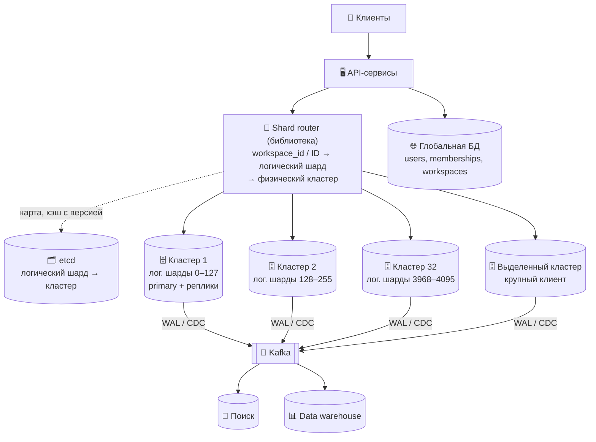
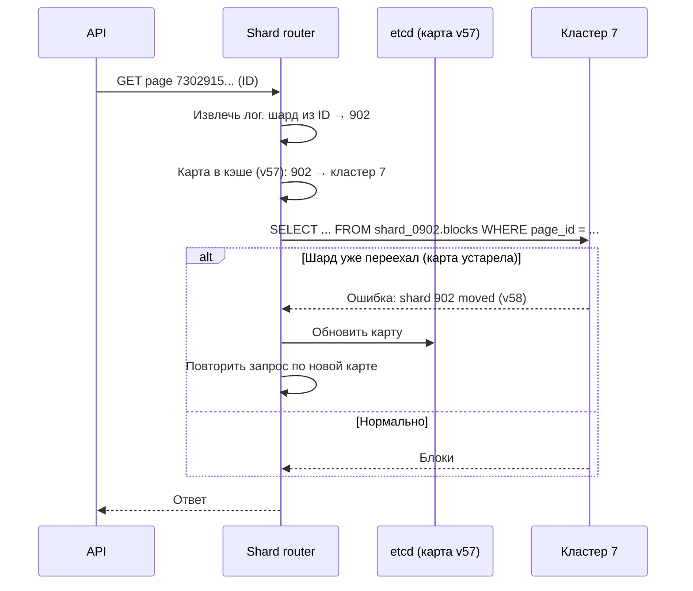
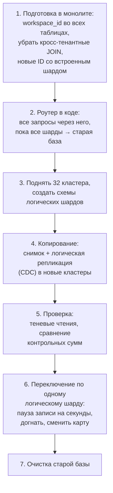
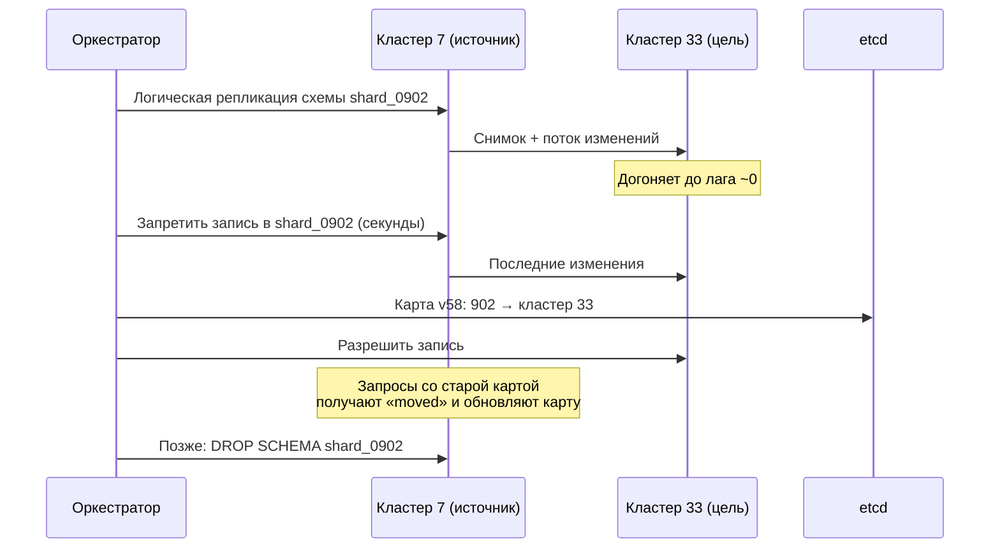

[English](INTERVIEW.md) | **Русский** · Теория: [README_RU.md](./README.ru.md)

# 06. Partitioning: шардирование базы multi-tenant SaaS

> **Тема:** выбор ключа шардирования, логические и физические шарды, маршрутизация, ID со встроенным шардом, горячие тенанты, глобальная уникальность, кросс-шардовые запросы, миграция без простоя
> **Уровень:** Hard · **Время на интервью:** 45 мин · **Время на разбор:** ~5 ч
> **Где спрашивают:** «Наша база упирается в потолок — как шардировать?» и как deep dive в задачах про Slack, Notion, Jira, Shopify, любые B2B-платформы

---

## 🗺️ Как читать этот разбор

| Значок | Что значит |
|:------:|:-----------|
| 🎤 | Реплика интервьюера |
| 🗣️ | Что говорю вслух я (кандидат) |
| ✏️ | Что рисую на доске |
| ⏱️ | Сколько времени тратить на шаг |

Блоки **TIP** — хороший приём, **WARNING** — ловушка, **IMPORTANT** — сигнал для уровня Senior+.

---

## 📑 Содержание

1. [Условие задачи](#1-условие-задачи)
2. [Уточняющие вопросы и требования](#2-уточняющие-вопросы-и-требования)
3. [Оценки нагрузки](#3-оценки-нагрузки)
4. [Паттерны доступа и выбор ключа](#4-паттерны-доступа-и-выбор-ключа)
5. [Модель данных и ID](#5-модель-данных-и-id)
6. [High-level дизайн](#6-high-level-дизайн)
7. [Deep dive 1: логические шарды и маршрутизация](#7-deep-dive-1-логические-шарды-и-маршрутизация)
8. [Deep dive 2: горячий тенант](#8-deep-dive-2-горячий-тенант)
9. [Deep dive 3: глобальные данные и кросс-шардовые запросы](#9-deep-dive-3-глобальные-данные-и-кросс-шардовые-запросы)
10. [Deep dive 4: миграция без простоя](#10-deep-dive-4-миграция-без-простоя)
11. [Deep dive 5: ребалансировка](#11-deep-dive-5-ребалансировка)
12. [Узкие места и сценарии сбоев](#12-узкие-места-и-сценарии-сбоев)
13. [Что изменится при росте в 10 раз](#13-что-изменится-при-росте-в-10-раз)
14. [Вопросы интервьюера с ответами](#14-вопросы-интервьюера-с-ответами)
15. [Типичные ошибки](#15-типичные-ошибки)
16. [Шпаргалка и самопроверка](#16-шпаргалка-и-самопроверка)

---

## 1. Условие задачи

> 🎤 «У нас SaaS для совместной работы, похожий на Notion: рабочие пространства (workspaces), страницы, блоки, комментарии. Всё лежит в одном огромном PostgreSQL. CPU primary под 90% в пике, VACUUM не успевает, бэкап идёт сутки, и данные растут на терабайт в месяц. Как шардировать?»

**План по времени:**

| Шаг | ⏱️ |
|:----|:--:|
| Требования | 5 мин |
| Оценки | 4 мин |
| Паттерны доступа и ключ | 6 мин |
| Данные, ID, high-level | 8 мин |
| Deep dives | 18 мин |
| Сбои и итоги | 4 мин |

> [!TIP]
> Прежде чем шардировать, покажи, что более простые средства исчерпаны: «Read-реплики уже есть, кэш есть, вертикальный запас кончился, и проблема в записи и объёме, а не в чтении». Иначе интервьюер спросит, зачем вообще шардировать.

---

## 2. Уточняющие вопросы и требования

⏱️ 5 мин

| Мой вопрос | Ответ интервьюера | Что это меняет |
|:-----------|:------------------|:---------------|
| Что упирается в потолок: чтение или запись? | Запись и объём. Реплики для чтения уже есть | Реплики не помогут → нужно шардирование |
| Какие запросы самые частые? | Открыть страницу (блоки страницы), список страниц workspace, редактирование блоков | Почти всё в пределах одного workspace |
| Бывают ли операции между workspace? | Пользователь состоит в нескольких workspace; страницу можно расшарить гостю из другого | Нужны глобальные данные о пользователях и членстве |
| Насколько крупные бывают workspace? | Большинство маленькие, но есть корпоративные клиенты с миллионами страниц | Горячие тенанты |
| Допустим ли простой при миграции? | Нет. Максимум — пауза записи на секунды для части клиентов | Миграция по частям с короткими переключениями |
| Можно ли перейти на другую СУБД? | Команда хорошо знает PostgreSQL, хотим остаться на нём | Шардирование на уровне приложения (или Citus) |
| Аналитика по всем клиентам? | Да, внутренние отчёты | Не на продакшен-шардах → хранилище данных |

### Функциональные требования

1. Все текущие функции продолжают работать: страницы, блоки, комментарии, права доступа, поиск по workspace.
2. Пользователь видит список своих workspace и может переключаться между ними.
3. Гостевой доступ к страницам другого workspace.

### Нефункциональные требования

| Требование | Цель |
|:-----------|:-----|
| Масштабируемость | Рост в 10 раз без смены схемы шардирования |
| Миграция | Без простоя; откат возможен на каждом шаге |
| Latency | Не хуже текущей: p99 открытия страницы < 200 мс |
| Изоляция | Крупный клиент не должен замедлять остальных |
| Эксплуатация | Бэкап и восстановление одного шарда — часы, а не сутки |

---

## 3. Оценки нагрузки

⏱️ 4 мин

✏️

```
Workspace              = 10M (из них ~1 000 крупных корпоративных)
Пользователи           = 100M
Блоков                 = 50B × ~400 Б ≈ 20 ТБ, рост ~1 ТБ/месяц
Запись (пик)           ≈ 100 000 изменений блоков/с
Чтение (пик)           ≈ 500 000 запросов/с (в основном через кэш и реплики)

Цель для одного физического шарда:
  ≤ 1–2 ТБ данных (бэкап и восстановление за часы)
  ≤ ~5 000–10 000 записей/с с запасом
→ на сегодня нужно ≥ 20 физических шардов,
  через 2–3 года при росте ×3–5 — около 100
```

🗣️ **Выводы:**
- **Нужно десятки физических баз сегодня и сотни в будущем.** Схема должна позволять добавлять базы без пересчёта ключей.
- **Распределение очень неравномерное:** 1 000 крупных клиентов могут занимать значительную долю данных. Равномерное хэширование по тенанту не гарантирует равномерной нагрузки.

---

## 4. Паттерны доступа и выбор ключа

⏱️ 6 мин

### Главные запросы

| Запрос | Частота | Чем фильтруется |
|:-------|:--------|:----------------|
| Загрузить блоки страницы | Очень высокая | `page_id` (внутри workspace) |
| Изменить блок | Очень высокая | `block_id` (внутри workspace) |
| Список страниц workspace | Высокая | `workspace_id` |
| Права доступа к странице | Очень высокая | `page_id`, `user_id` |
| Мои workspace | Средняя | `user_id` |
| Поиск по workspace | Средняя | `workspace_id` + текст |
| Аналитика по всем клиентам | Низкая | Всё |

### Кандидаты в ключ

| Ключ | Главные запросы в одном шарде? | Транзакции в одном шарде? | Равномерность | Вердикт |
|:-----|:------------------------------:|:-------------------------:|:-------------:|:-------:|
| `hash(block_id)` | ❌ Страница размазана по всем шардам | ❌ | ✅ | ❌ |
| `page_id` | ✅ Страница целиком | ⚠️ Перемещение блоков между страницами — кросс-шард | ✅ | ⚠️ |
| `user_id` | ❌ Совместные страницы принадлежат многим | ❌ | ✅ | ❌ |
| **`workspace_id`** | ✅ Почти всё | ✅ Почти всё | ⚠️ Крупные тенанты | ✅ |

🗣️ «Выбираю **`workspace_id`**. Почти все запросы и транзакции живут внутри одного workspace: права, страницы, блоки, комментарии. Это естественная граница изоляции тенантов. Цена — неравномерность из-за крупных клиентов и запрос «мои workspace», которому нужны глобальные данные. Оба решу отдельно».

> [!IMPORTANT]
> **Сигнал Senior+:** для multi-tenant систем ключ почти всегда `tenant_id`, потому что он даёт **изоляцию**: проблемы одного клиента не затрагивают остальных, а данные клиента можно перенести, выгрузить или удалить целиком (важно для GDPR и enterprise-контрактов).

---

## 5. Модель данных и ID

⏱️ 4 мин

### Таблицы на шардах

```sql
-- На каждом шарде (в схеме логического шарда)
CREATE TABLE pages (
  page_id       BIGINT PRIMARY KEY,
  workspace_id  BIGINT NOT NULL,
  parent_id     BIGINT,
  title         TEXT,
  created_at    TIMESTAMPTZ
);
CREATE INDEX ON pages (workspace_id, parent_id);

CREATE TABLE blocks (
  block_id      BIGINT PRIMARY KEY,
  workspace_id  BIGINT NOT NULL,   -- в каждой таблице, даже если можно вывести через page
  page_id       BIGINT NOT NULL,
  type          TEXT,
  content       JSONB,
  version       INT,
  updated_at    TIMESTAMPTZ
);
CREATE INDEX ON blocks (page_id);
```

🗣️ «`workspace_id` хранится **в каждой** таблице, даже если его можно вывести через связи. Так любая строка однозначно маршрутизируется, а миграция и перенос тенанта — это просто выборка по `workspace_id` из всех таблиц».

### Глобальные таблицы (отдельная небольшая база)

```sql
users        (user_id PK, email UNIQUE, name, ...)
memberships  (user_id, workspace_id, role, PRIMARY KEY (user_id, workspace_id))
workspaces   (workspace_id PK, name, logical_shard, plan, ...)
```

### ID со встроенным логическим шардом

✏️

```
64-битный ID:
┌──────────────────────────────┬─────────────────────┬────────────┐
│ 41 бит: мс с эпохи компании  │ 12 бит: логический  │ 10 бит:    │
│                              │ шард (0–4095)       │ счётчик    │
└──────────────────────────────┴─────────────────────┴────────────┘
```

🗣️ «Любой `page_id` или `block_id` содержит номер логического шарда. Ссылка вида `/page/{page_id}` сразу маршрутизируется в нужный шард без поиска в справочнике. ID сортируются по времени, поэтому вставки идут в конец B-tree индекса».

---

## 6. High-level дизайн

⏱️ 4 мин

✏️



🗣️ «Ключевые части:
- **4096 логических шардов**, фиксированных навсегда: `logical_shard = hash(workspace_id) % 4096`;
- **32 физических кластера** PostgreSQL (primary + реплики), каждый держит 128 логических шардов как отдельные схемы;
- **карта** «логический шард → кластер» хранится в etcd, роутер кэширует её с версией;
- **глобальная база** для пользователей, членства и метаданных workspace — небольшая, её достаточно реплицировать;
- **CDC** из всех шардов в поиск и хранилище данных, чтобы кросс-тенантная аналитика не нагружала продакшен».

---

## 7. Deep dive 1: логические шарды и маршрутизация

> 🎤 «Почему не просто `hash(workspace_id) % 32`?»

🗣️ «Потому что при переходе на 33 сервера переехало бы около 97% данных. С **логическими шардами**:
- `hash(workspace_id) % 4096` не меняется никогда — у тенанта навсегда один логический шард;
- рост — это перенос части логических шардов на новый физический кластер;
- при добавлении 33-го кластера переезжает ~1/33 данных — ровно то, что ему положено.

Почему 4096: с запасом на рост до сотен кластеров (по 10+ логических шардов на кластер для гибкой балансировки), и при этом не слишком много объектов для управления».

### Как устроен логический шард в PostgreSQL

| Вариант | Как | Плюсы | Минусы |
|:--------|:----|:------|:-------|
| **Схема на логический шард** | `shard_0042.pages`, `shard_0042.blocks` | Перенос шарда = перенос схемы; изоляция | Тысячи схем — нагрузка на каталог PostgreSQL |
| Колонка `logical_shard` в общих таблицах | Одна таблица, фильтр по колонке | Проще для каталога | Перенос шарда = выборка строк из огромных таблиц |
| База на логический шард | Отдельная БД | Максимальная изоляция | Слишком много объектов и соединений |

🗣️ «Беру **схему на логический шард**: перенос — это логическая репликация одной схемы, и удаление после переноса — `DROP SCHEMA`, без тяжёлого `DELETE`».

### Маршрутизация



🗣️ «Роутер — **библиотека** внутри сервисов, а не отдельный прокси: нет лишнего hop. Каждый кластер знает, какие логические шарды он сейчас обслуживает, и отклоняет запросы к чужим — это защищает от устаревшей карты».

---

## 8. Deep dive 2: горячий тенант

> 🎤 «Один корпоративный клиент вырос до 3 ТБ и 20 000 записей в секунду. Его логический шард делит кластер с сотней других. Что делать?»

🗣️ «Это ровно та неравномерность, которую хэш не решает. Уровни решений:

| Уровень | Решение | Когда |
|:--------|:--------|:------|
| 1 | Перенести логический шард клиента на **менее загруженный** кластер | Клиент вырос, но помещается в кластер |
| 2 | **Выделенный кластер:** только этот логический шард (соседи по логическому шарду — маленькие workspace — переезжают вместе, это нормально) | Клиент занимает большую часть кластера |
| 3 | **Отдельное отображение для тенанта:** `workspace_id → выделенный шард` в справочнике, мимо хэша | Нужно отделить клиента от соседей по логическому шарду |
| 4 | **Второй уровень шардирования внутри тенанта:** по `page_id` или по команде (teamspace) | Клиент не помещается в один кластер |

Для 3 ТБ и 20 000 записей/с — уровень 2 или 3. Это directory-подход для исключений: 99,9% тенантов маршрутизируются хэшем, а горстка крупнейших — через явную запись в справочнике».

> [!WARNING]
> Уровень 4 сильно усложняет систему: внутри одного клиента появляются кросс-шардовые операции (перемещение страницы между разделами, права на уровне всего workspace). Откладывай его, пока выделенный кластер на самом большом железе реально не исчерпан.

### Изоляция «шумных соседей»

- Лимиты запросов и записей на тенанта (rate limiting по `workspace_id`).
- Тяжёлые операции (импорт, экспорт, массовые изменения) — через очереди с ограничением скорости.
- Мониторинг нагрузки **по тенантам**, а не только по кластерам, чтобы видеть, кто растёт.

---

## 9. Deep dive 3: глобальные данные и кросс-шардовые запросы

> 🎤 «Как показать пользователю список его workspace, если они на разных шардах? И как гарантировать уникальность email?»

### Глобальная база

🗣️ «Данные, которые **не принадлежат** одному тенанту, вынесены в отдельную глобальную базу:

| Таблица | Почему глобальная |
|:--------|:------------------|
| `users` | Пользователь существует вне workspace; email уникален глобально |
| `memberships` | Связь пользователя со многими workspace |
| `workspaces` | Метаданные: название, тариф, логический шард или выделенный кластер |

«Мои workspace» — один запрос в глобальную базу по `user_id`. Объём маленький (сотни миллионов строк, но узких), нагрузка в основном на чтение → один primary с репликами и кэшем справится долго. Если перестанет — `users` шардируется по `user_id`, а для уникальности email — таблица `email → user_id`, шардированная по email».

### Карта кросс-шардовых операций

| Операция | Решение |
|:---------|:--------|
| Мои workspace | Глобальная таблица `memberships` |
| Гостевой доступ к странице другого workspace | Права хранятся в шарде **владельца** страницы; гость читает страницу через маршрутизацию по `page_id` (шард в ID) |
| Перенос страницы в другой workspace | Редкая операция → асинхронная задача: копирование в новый шард, переключение, удаление в старом (сага с идемпотентными шагами) |
| Поиск | Индекс в Elasticsearch с routing по `workspace_id` |
| Аналитика по всем клиентам | CDC → data warehouse; на шардах никогда не выполняется |
| Удаление аккаунта пользователя (GDPR) | Задача обходит шарды из `memberships` пользователя |

> [!TIP]
> Хорошее правило: **любой запрос на горячем пути должен попадать в один шард**. Всё, что требует нескольких шардов, либо выносится в другое хранилище (глобальная база, поиск, DWH), либо становится асинхронной задачей.

---

## 10. Deep dive 4: миграция без простоя

> 🎤 «У нас 20 ТБ в одной базе, и ни минуты простоя. Как переехать?»

✏️



### Подробности по шагам

| Шаг | Что важно |
|:----|:----------|
| 1. Подготовка | Самая долгая часть. Найти все запросы без `workspace_id`, кросс-тенантные JOIN, автоинкременты. Переписать их **до** миграции |
| 2. Роутер | Все запросы проходят через одну точку. Включается постепенно, за feature flag |
| 4. Копирование | Снимок + поток изменений из WAL. Новые кластеры отстают на секунды |
| 5. Проверка | Теневые чтения: ответ из старой базы отдаётся пользователю, ответ из новой сравнивается, расхождения логируются |
| 6. Переключение | Для одного логического шарда: заблокировать запись (секунды), дождаться нулевого лага, переключить карту в etcd, снять блокировку. Начинать с внутренних и маленьких тенантов |
| Откат | Обратная репликация из новой базы в старую до финального шага — можно вернуть карту |

🗣️ «Переключение идёт **по одному логическому шарду**, а не всё сразу. Пауза записи затрагивает 1/4096 клиентов на несколько секунд, и любая проблема видна на маленьком объёме. Notion описывал похожий подход в своём рассказе о шардировании PostgreSQL».

> [!IMPORTANT]
> **Сигнал Senior+:** назови, где риск. Самое опасное — не копирование, а **переключение** и **код, который всё ещё ходит в старую базу мимо роутера**. Защита: старая база для переключённых шардов становится read-only, и любые попытки записи в неё видны в логах.

---

## 11. Deep dive 5: ребалансировка

> 🎤 «Через год появится 33-й кластер. Как перенести на него логические шарды?»



🗣️ Правила:
- **По одному логическому шарду за раз** на кластер-источник, со скоростью копирования, ограниченной так, чтобы не влиять на продакшен.
- **Вне пиковых часов.**
- **Какие шарды переносить:** выбирает планировщик по метрикам (объём, запись, CPU по логическим шардам), а не по номерам.
- **Ручное подтверждение** плана — автоматический перенос в сочетании с автоматическим обнаружением сбоев может вызвать каскад.

---

## 12. Узкие места и сценарии сбоев

| Сценарий | Что произойдёт | Как защищаемся |
|:---------|:---------------|:---------------|
| Падение primary одного кластера | Запись недоступна для ~1/32 клиентов на 30–60 с | Синхронная реплика в другой AZ, автоматический failover (Patroni); остальные кластеры не затронуты |
| etcd недоступен | Роутеры не могут обновить карту | Роутеры работают с закэшированной картой; переносы шардов приостанавливаются |
| Роутер с устаревшей картой | Запрос в старый кластер | Кластер отклоняет запросы к чужим шардам, роутер обновляет карту |
| Горячий тенант | Кластер перегружен, страдают соседи | Лимиты на тенанта; перенос на выделенный кластер |
| Глобальная база недоступна | Нельзя войти и переключить workspace | Реплики и кэш; уже открытые страницы работают (шарды независимы) |
| Ошибка во время переноса шарда | Данные частично скопированы | Источник остаётся главным до переключения карты; перенос можно начать заново |
| Код пишет в старую базу мимо роутера | Потеря записей после переключения | Старые схемы read-only после переключения; алерты на попытки записи |
| Scatter-gather в коде (по ошибке) | Запрос медленный, нагрузка на все кластеры | Запрет кросс-шардовых запросов в роутере на горячем пути; ревью запросов |

---

## 13. Что изменится при росте в 10 раз

> 🎤 «200 ТБ и миллион записей в секунду?»

🗣️ «Схема рассчитана на это:
1. **Больше физических кластеров** (~300): переносим логические шарды, ключи не меняются. 4096 логических шардов хватает на ~400 кластеров по 10 шардов.
2. **Крупнейшие тенанты** — на выделенных кластерах, самые большие — с шардированием внутри тенанта.
3. **Глобальная база** шардируется по `user_id`, уникальность email — через таблицу по email.
4. **Автоматизация:** планировщик ребалансировки, автоматическое создание кластеров, проверка восстановления каждого шарда.
5. **Альтернатива:** переход на распределённый SQL (Citus, CockroachDB, YugabyteDB), который сам делит и переносит диапазоны. Но с готовой схемой логических шардов это не обязательно».

---

## 14. Вопросы интервьюера с ответами

<details>
<summary><b>Почему не взять Citus или CockroachDB вместо шардирования в приложении?</b></summary>

Это разумная альтернатива: Citus — расширение PostgreSQL с distribution column и co-location, CockroachDB — распределённый SQL с автоматическим делением. Компромисс: меньше кода в приложении, но новая сложная система в эксплуатации, другие характеристики задержки и миграция существующих расширений и запросов. Шардирование в приложении даёт полный контроль и использует существующую экспертизу команды в PostgreSQL. На интервью важно назвать оба варианта и обосновать выбор.
</details>

<details>
<summary><b>Почему 4096 логических шардов, а не 1 миллион?</b></summary>

Каждый логический шард — это схема с таблицами и индексами, объект для мониторинга и единица переноса. Миллион схем перегрузил бы каталог PostgreSQL и инструменты. 4096 дают запас на сотни кластеров с гибкой балансировкой и остаются управляемыми.
</details>

<details>
<summary><b>Что делать, если нужна транзакция между двумя workspace?</b></summary>

Сначала проверить, действительно ли она нужна атомарно. Обычно такие операции (перенос страницы, копирование шаблона) можно сделать сагой: шаги с идемпотентностью и компенсацией, состояние операции хранится в таблице задач. Распределённые транзакции (2PC) между шардами избегаем: они медленные и блокируют при сбое координатора.
</details>

<details>
<summary><b>Как поиск работает по шардам?</b></summary>

Изменения из всех шардов через CDC попадают в Elasticsearch. Индекс использует routing по `workspace_id`, поэтому поиск внутри workspace обращается к одному шарду поискового кластера. Поиск отстаёт на секунды — это допустимо.
</details>

<details>
<summary><b>Как бэкапить и восстанавливать данные одного клиента?</b></summary>

Каждый кластер бэкапится независимо (снимки + архив WAL), поэтому восстановление кластера занимает часы, а не сутки. Для восстановления одного workspace: восстановить кластер во временную среду на нужный момент и выгрузить строки с его `workspace_id` — это возможно благодаря тому, что `workspace_id` есть в каждой таблице.
</details>

<details>
<summary><b>Почему роутер — библиотека, а не отдельный прокси?</b></summary>

Библиотека не добавляет сетевой hop и не создаёт отдельную точку отказа. Прокси (как vtgate в Vitess) удобнее, когда много языков и сервисов и нужно централизованное управление. Выбор зависит от числа сервисов и языков; на интервью стоит назвать компромисс.
</details>

---

## 15. Типичные ошибки

| ❌ Ошибка | ✅ Как правильно |
|:---------|:----------------|
| `hash(workspace_id) % число_серверов` | Фиксированное число логических шардов + карта на физические |
| Ключ по `block_id` или `user_id` | Ключ по тенанту: главные запросы и транзакции в одном шарде |
| `workspace_id` только в «корневых» таблицах | `workspace_id` в каждой таблице |
| Автоинкрементные ID после шардирования | ID со встроенным логическим шардом |
| Игнорировать крупных клиентов | Выделенные кластеры через справочник-исключение |
| Глобальные данные на одном из шардов | Отдельная глобальная база |
| Аналитика по всем шардам на продакшене | CDC в хранилище данных |
| Миграция «большим взрывом» за одну ночь | Переключение по одному логическому шарду с возможностью отката |
| Автоматическая ребалансировка без ограничений | По одному шарду, с throttling и подтверждением |

---

## 16. Шпаргалка и самопроверка

### Ответ за 30 секунд

> Ключ — `workspace_id`: почти все запросы и транзакции внутри тенанта, и это даёт изоляцию. 4096 логических шардов (`hash % 4096`, навсегда) на 32 физических кластерах PostgreSQL, карта в etcd, роутер-библиотека, ID со встроенным логическим шардом. Пользователи, членство и метаданные workspace — в отдельной глобальной базе. Крупные клиенты — на выделенных кластерах через справочник-исключение. Поиск и аналитика — через CDC. Миграция: подготовка кода, роутер, копирование снимка + CDC, теневые чтения, переключение по одному логическому шарду с паузой в секунды и возможностью отката. Ребалансировка — перенос логических шардов по одному с ограничением скорости.

### Самопроверка

- [ ] Могу сравнить 4 кандидата в ключ по главным запросам, транзакциям и равномерности
- [ ] Могу объяснить, почему логические шарды лучше `hash % N`
- [ ] Могу спроектировать ID со встроенным шардом и объяснить, зачем он
- [ ] Могу предложить 4 уровня решений для горячего тенанта
- [ ] Могу перечислить глобальные данные и способы обслужить кросс-шардовые операции
- [ ] Могу рассказать план миграции без простоя и где в нём риск
- [ ] Могу нарисовать перенос логического шарда между кластерами
- [ ] Могу назвать альтернативы (Citus, Vitess, CockroachDB) и компромиссы

### Что почитать

- Теория по теме: [README_RU.md](./README.ru.md)
- Notion, *Herding elephants: lessons learned from sharding Postgres at Notion*
- Instagram Engineering, *Sharding & IDs at Instagram*
- Документация Citus: multi-tenant applications
- Документация Vitess: resharding