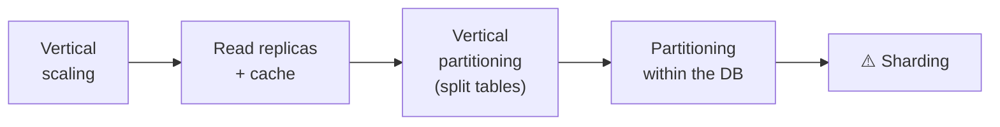
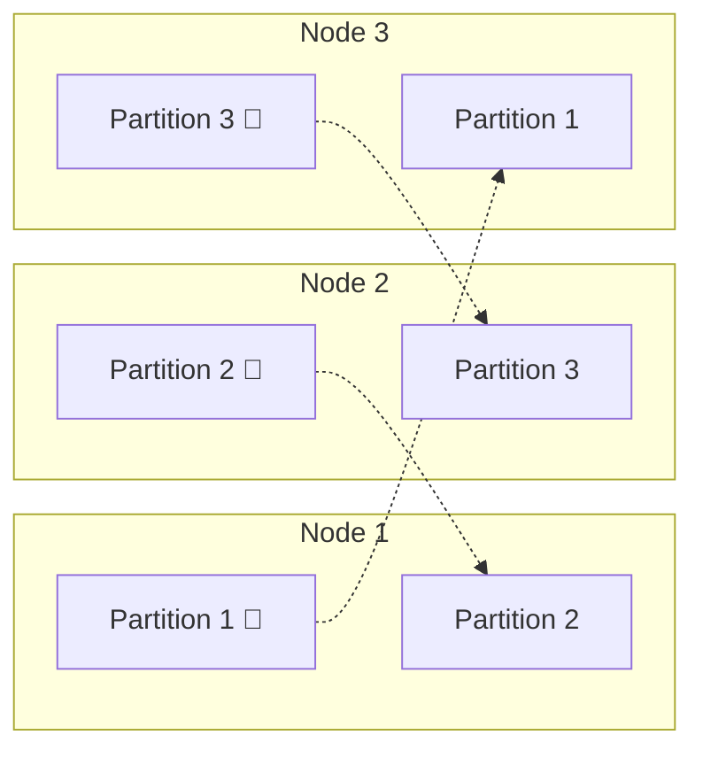
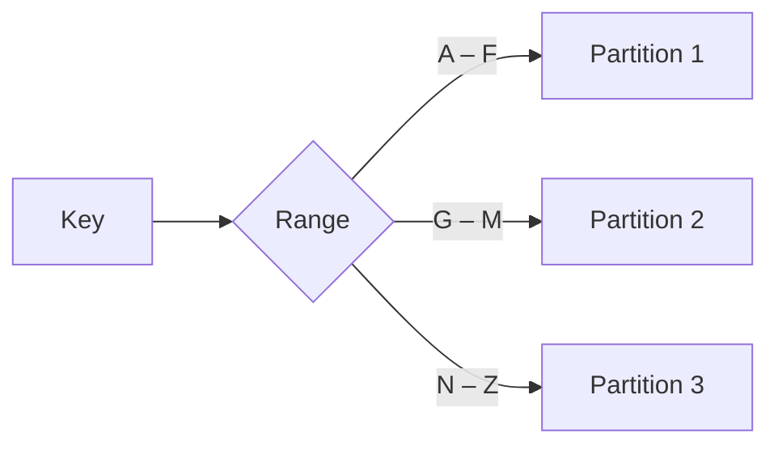
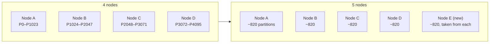
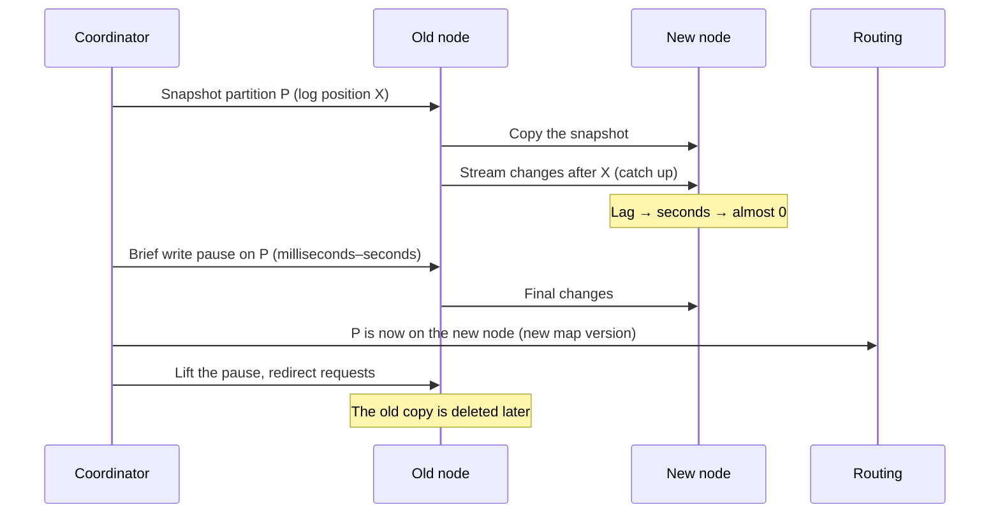
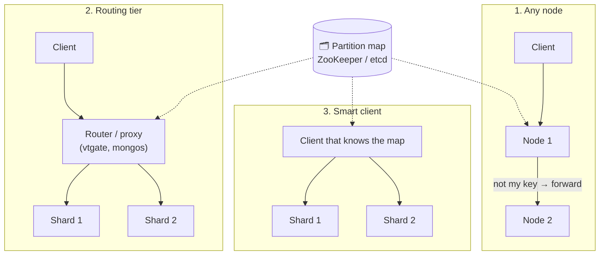
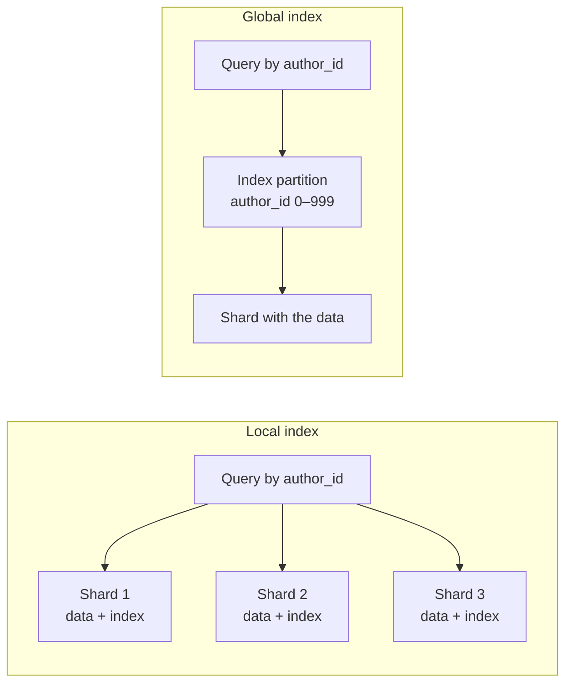
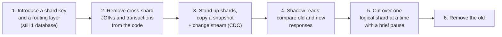

**English** | [Русский](README_RU.md)

# 06. Partitioning (Sharding)

> **Covers:** choosing a partition key, range vs hash, consistent hashing, fixed and dynamic partitions, rebalancing, request routing, secondary indexes, hot partitions, cross-shard operations, moving from one database to shards
> **Study time:** ~4–5 h · **Needed for:** any problem where data or writes don't fit on one node
> **Practice:** interview-style walkthrough — [INTERVIEW.md](./INTERVIEW.md)
> **Related topics:** [01-scaling-basics](../01-scaling-basics/README.md#8-load-balancing-algorithms) (consistent hashing), [04-databases](../04-databases/README.md), [05-replication](../05-replication/README.md)

---

## 📑 Contents

1. [What Partitioning Is and When You Need It](#1-what-partitioning-is-and-when-you-need-it)
2. [The Partition Key — the Key Decision](#2-the-partition-key--the-key-decision)
3. [Strategies: Range, Hash, Directory, Geo](#3-strategies-range-hash-directory-geo)
4. [Why hash mod N Is a Bad Idea and What to Use Instead](#4-why-hash-mod-n-is-a-bad-idea-and-what-to-use-instead)
5. [Rebalancing](#5-rebalancing)
6. [Request Routing](#6-request-routing)
7. [Secondary Indexes](#7-secondary-indexes)
8. [Hot Partitions and Skew](#8-hot-partitions-and-skew)
9. [Cross-Shard Operations](#9-cross-shard-operations)
10. [Moving From One Database to Shards](#10-moving-from-one-database-to-shards)
11. [How Real Systems Do It](#11-how-real-systems-do-it)
12. [How to Talk About This in an Interview](#12-how-to-talk-about-this-in-an-interview)
13. [Self-Check Questions](#13-self-check-questions)
14. [Glossary and Resources](#14-glossary-and-resources)

---

## 1. What Partitioning Is and When You Need It

**Partitioning** means splitting data into parts (partitions), each stored and served separately. When partitions live on **different nodes**, it's usually called **sharding**, and the partitions are **shards**.

| Term | Meaning |
|:-----|:--------|
| **Horizontal partitioning** | A table's rows are split across partitions (users 1–1M here, 1M–2M there). This is what people usually mean |
| **Vertical partitioning** | Columns or tables are split across different stores (profiles in one database, orders in another) |
| **Partitioning within one database** | A table is split into parts on a single server (PostgreSQL declarative partitioning). Helps with maintenance and range queries, but doesn't scale writes |
| **Sharding** | Partitions on different servers. Scales volume, writes and reads |

### When to shard

Sharding is an **expensive** step: it complicates queries, transactions, operations and migrations. Use simpler tools first:



**Signs it's time:**
- writes hit the limits of a single primary (CPU, I/O, WAL), and vertical headroom is exhausted;
- the data doesn't fit on one node, or maintenance (backup, VACUUM, index builds) takes too long;
- the working set doesn't fit in the memory of the largest machine.

> [!TIP]
> In an interview, show this order: "At current numbers, one primary with replicas is enough. I'll start sharding when writes or volume exceed X, and here's the key I'll pick." Sharding "just in case" is a common mistake.

### Partitioning and replication together

Usually every partition is **replicated**: it has a leader and followers. A node can be the leader for some partitions and a follower for others.



---

## 2. The Partition Key — the Key Decision

The **partition key** determines which partition a record goes to. It's the most important and the hardest decision to change: changing the key means moving almost all the data.

### Criteria for a good key

| Criterion | Why it matters |
|:----------|:---------------|
| **Even distribution** | Data and load are spread roughly equally across partitions |
| **Query locality** | The main queries hit **one** partition |
| **Transaction locality** | Data that changes together lives in one partition |
| **High cardinality** | Many more key values than partitions |
| **Stability** | A record's key value doesn't change (otherwise the record must move) |

### Examples

| System | Good key | Why | Bad key | Why it's bad |
|:-------|:---------|:----|:--------|:-------------|
| Chat | `channel_id` (+ a time bucket) | A channel's messages are read together | `message_id` | Channel history scattered across every shard |
| Multi-tenant SaaS | `tenant_id` | A customer's data is read and changed together | `created_at` | All writes go to the "latest" partition |
| Social network: posts | Author's `user_id` | Profile and posts together | `country` | Low cardinality, huge skew |
| Metrics | `(metric_id, time_bucket)` | Even, and convenient for time ranges | `metric_id` | A popular metric grows forever |
| E-commerce orders | `user_id` or `order_id` | Depends on the main query | `status` | 3–5 values across billions of rows |

> [!IMPORTANT]
> **Senior+ signal:** choose the key from the **main query**, not from "evenness in general". Say it explicitly: "The main query is a channel's message history, so the key is channel_id. The cost: 'all messages by a user' becomes scatter-gather, and I'll build a separate index for it."

---

## 3. Strategies: Range, Hash, Directory, Geo

### Range (by key ranges)

Each partition owns a contiguous range of keys: A–F, G–M, N–Z, or dates by month.



| ✅ Pros | ❌ Cons |
|:-------|:-------|
| Efficient range queries (`WHERE created_at BETWEEN ...`) | Skew: boundaries must be tuned to the data distribution |
| Adjacent keys live together | A **monotonically increasing key** (time, auto-increment) sends **all** new writes to the last partition |
| Easy to split a partition in half as it grows | |

**Where:** HBase, Bigtable, CockroachDB, TiKV, MongoDB (range shard key), date partitioning in PostgreSQL.

### Hash (by key hash)

`partition = f(hash(key))`. A good hash function spreads even similar keys evenly.

| ✅ Pros | ❌ Cons |
|:-------|:-------|
| Even distribution | Range queries over the key hit **every** partition |
| Monotonic keys don't create a "hot tail" | Adjacent keys are scattered |

**Where:** Cassandra, DynamoDB, Redis Cluster, Elasticsearch, Kafka (by message key), MongoDB (hashed shard key).

### Compound key: hash + range

The best of both: the **first part** of the key is hashed to choose the partition; the **second** defines the sort order within it.

```sql
-- Cassandra: partition by channel_id, sorted by time within it
CREATE TABLE messages (
  channel_id  bigint,
  bucket      int,          -- e.g. the number of a 10-day window
  message_id  timeuuid,
  author_id   bigint,
  content     text,
  PRIMARY KEY ((channel_id, bucket), message_id)
) WITH CLUSTERING ORDER BY (message_id DESC);
```

The query "last 50 messages in a channel" is one partition and one sequential read. DynamoDB uses the same idea: partition key + sort key.

### Directory (a lookup table)

A separate service stores where each key or group of keys lives: `tenant_42 → shard_7`.

| ✅ Pros | ❌ Cons |
|:-------|:-------|
| Full flexibility: any key can be moved individually | The directory is another critical dependency (needs caching and replication) |
| A large customer can get a dedicated shard | An extra lookup per request (usually from cache) |

### Geo-partitioning

A user's data lives in their region (EU, US, APAC). It reduces latency and addresses data residency requirements (GDPR). More in [05-replication](../05-replication/README.md#12-multi-region-and-operations).

### Comparison

| Strategy | Evenness | Range queries | Movement flexibility | Complexity |
|:---------|:--------:|:-------------:|:--------------------:|:----------:|
| Range | ⚠️ Depends on boundaries | ✅ | ✅ Partition splits | Medium |
| Hash | ✅ | ❌ | ⚠️ Depends on scheme | Low |
| Hash + range (compound) | ✅ | ✅ within a partition | ⚠️ | Medium |
| Directory | ✅ Managed | Depends | ✅✅ | High |
| Geo | ⚠️ Depends on audience | Depends | ⚠️ | High |

---

## 4. Why hash mod N Is a Bad Idea and What to Use Instead

The simplest scheme: `shard = hash(key) % N`. The problem — when N changes:

```
N = 4 → N = 5:  hash(key) % 4  vs  hash(key) % 5
About 1/5 of keys stay put; ~80% move
```

Adding one server moves almost all the data. For a cache that means an empty cache; for a database — a multi-hour migration of everything.

### Fix 1: a fixed number of partitions (more than nodes)

Create, say, **1024 or 4096** partitions from the start and spread them across nodes. A key always lands in the same partition (`hash(key) % 4096`), and when a node is added, **whole partitions move** rather than keys being recomputed.



- Only ~1/N of the data moves — exactly what the new node needs.
- **Where:** Redis Cluster (16,384 slots), Elasticsearch (the number of primary shards is set at index creation), Couchbase (1024 vBuckets), "logical shards" at Instagram and Notion on top of PostgreSQL.
- **Choosing the number:** with headroom for many years of growth. Too many — per-partition overhead; too few — partitions become huge.

### Fix 2: consistent hashing

Nodes and keys are placed on a hash ring; a key belongs to the first node clockwise. Adding a node moves only the keys of the neighboring arc (~1/N). **Virtual nodes** (100–256 points per physical node) even out the distribution. Details in [01-scaling-basics](../01-scaling-basics/README.md#8-load-balancing-algorithms).

**Where:** Cassandra (vnodes), DynamoDB (internally), Riak, distributed caches.

### Fix 3: dynamic partition splitting

Partitions (usually range) **split** when they grow beyond a threshold and **merge** when they shrink. The number of partitions adapts to the data volume.

**Where:** HBase (regions), Bigtable (tablets), CockroachDB (ranges), MongoDB (chunks), DynamoDB (automatic splitting as volume or load grows).

### Other algorithms

| Algorithm | Idea | Advantage |
|:----------|:-----|:----------|
| **Rendezvous (HRW) hashing** | Compute a weight for the key with each node; pick the maximum | Simple, no ring |
| **Jump consistent hash** | Computes the bucket number quickly without storing a ring | Minimal memory, near-perfect evenness; nodes can only be added at the end |

### Comparing rebalancing approaches

| Approach | What moves when a node is added | Number of partitions | Examples |
|:---------|:--------------------------------|:---------------------|:---------|
| `hash % N` | ~all keys | = N | ❌ Don't use |
| Fixed number of partitions | Whole partitions, ~1/N of data | Fixed | Redis Cluster, Elasticsearch, logical shards |
| Consistent hashing + vnodes | ~1/N of keys | Proportional to nodes | Cassandra, Riak |
| Dynamic splitting | Halves of split partitions | Grows with data | HBase, CockroachDB, MongoDB |

---

## 5. Rebalancing

**Rebalancing** is moving partitions between nodes: when nodes are added or removed, when load is skewed, on failures.

### Requirements

- Load is distributed fairly afterwards.
- The database keeps serving reads and writes during the move.
- As little data as possible moves.

### How a partition is moved



### Automatic or manual

| | Automatic | Manual / semi-automatic |
|:-|:----------|:------------------------|
| Pros | No human needed | Control over timing and load |
| Cons | Data movement loads the network and disks; combined with automatic failure detection it can cause a **cascade**: an overloaded node is declared dead, its partitions move to neighbors, which then get overloaded | Requires people and process |
| Practice | Automatically proposed plans + confirmation, or throttled transfer speed | |

> [!WARNING]
> Rebalancing itself loads the system. Throttle transfers, don't run them at peak, and **don't couple** automatic data movement with a short failure-detection timeout — otherwise a node's temporary slowdown turns into an avalanche of moves.

---

## 6. Request Routing

How does a client know which node holds a key? It's a special case of **service discovery**.



| Approach | How | Pros | Cons | Examples |
|:---------|:----|:-----|:-----|:---------|
| **Any node + forwarding** | The client goes to any node; it forwards or replies with a redirect | Simple client | An extra hop | Cassandra (coordinator), Redis Cluster (`MOVED` redirect) |
| **Routing tier** | A separate proxy knows the map | Clients are unaware of shards; convenient for migrations | Another tier and hop | Vitess (vtgate), MongoDB (mongos), Citus coordinator |
| **Smart client** | The client library caches the map | No extra hop | Logic in every client; the map must be kept fresh | Cassandra, Redis Cluster and Kafka clients |

The **partition map** is usually stored in a consensus store (ZooKeeper, etcd) or spread via gossip (Cassandra). The map has a **version**: if a client arrives with an old version, the node replies "map is stale" and the client refreshes it.

---

## 7. Secondary Indexes

Partitioning by primary key works well as long as queries use it. What about a query on another field, like "all orders with status `pending`" or "messages by author X"?

### Local index (document-partitioned)

Each partition indexes **only its own** data.

- **Writes:** fast, touch one partition.
- **Reads:** an index query goes to **every** partition (scatter-gather), and results are merged.

### Global index (term-partitioned)

The index itself is partitioned **by the indexed value**: all entries with `author_id = 42` live in one index partition.

- **Reads:** one index partition.
- **Writes:** touch the data partition **and** index partitions → either a distributed transaction or an **asynchronous** index update (the index lags).



| | Local | Global |
|:-|:------|:-------|
| Writes | One partition | Several partitions (often async) |
| Index reads | Every partition (scatter-gather) | One index partition (+ data reads) |
| Freshness | Immediate | May lag |
| Examples | Elasticsearch, MongoDB, Cassandra (secondary index) | DynamoDB Global Secondary Index, global indexes in Spanner/CockroachDB |

> [!TIP]
> A common practical solution is a **denormalized table for the second query**: `messages_by_channel` and `messages_by_author` with different keys, both fed from one event stream (CDC). That's a "global index" implemented in the application.

### Why scatter-gather is dangerous at scale

If a query goes to 100 shards and **each** is slow 1% of the time, the whole query is slow `1 − 0.99^100 ≈ 63%` of the time. The query's tail latency (p99) is set by the slowest shard. This is called **tail latency amplification**.

---

## 8. Hot Partitions and Skew

**Skew** is when one partition gets disproportionately more data or requests. Such a partition is called **hot** (a hot partition, a hotspot).

### Causes

| Cause | Example |
|:------|:--------|
| A popular key | A celebrity with 100M followers, a viral post, a product on sale |
| A monotonic key with range partitioning | Every new record with the current timestamp lands in the last partition |
| Low cardinality | A `country` key: half the users from one country |
| A large customer in a multi-tenant system | One enterprise customer bigger than all the rest combined |
| An unboundedly growing key | A chat channel used for years |

### Fixes

| Fix | How it works | Cost |
|:----|:-------------|:-----|
| **Salting / key splitting** | Add a 0–N suffix to the hot key: `post_42#0`…`post_42#9`, write to a random one | Reads must gather all N parts |
| **Hash prefix for monotonic keys** | `hash(device_id) + timestamp` instead of `timestamp` | Time-range queries hit every partition |
| **Time buckets** | Key `(channel_id, bucket)`, where the bucket is a week or 10-day window number | Reading long history spans several partitions |
| **Sharded counters** | A like counter split into N sub-counters; the total is their sum | Reads sum N values |
| **Dedicated shard** | A large customer gets its own shard (directory approach) | Manual management |
| **Cache in front of the hot key** | L1/Redis for reads (see [02-caching](../02-caching/README.md#8-common-problems-stampede-penetration-avalanche-hot-keys)) | Helps reads only |
| **Adaptive capacity** | The database gives the hot partition more resources or splits it | Not available everywhere (e.g. DynamoDB has it) |

> [!NOTE]
> Many systems **don't** detect hot keys by themselves. Skew is the responsibility of whoever designs the key. So in an interview, say up front where a hot key is possible and what happens to it.

---

## 9. Cross-Shard Operations

Anything touching several shards becomes more expensive and more complex.

| Operation | Problem | Solutions |
|:----------|:--------|:----------|
| **Queries on a non-key field** | Scatter-gather to every shard | A denormalized table / global index; a search index |
| **JOINs** | Data on different shards | Co-location: related tables sharded by the same key; reference tables replicated to every shard; denormalization |
| **Transactions** | Atomicity across several nodes | Design the key so transactions stay single-shard; 2PC (slow, blocks if the coordinator fails); sagas with compensations; distributed SQL databases |
| **Uniqueness** (email globally unique) | A UNIQUE constraint works only within a shard | A separate uniqueness table sharded by the value itself (`email → user_id`); a global directory |
| **ID generation** | Auto-increment is local to a shard | Snowflake-style IDs, UUID v7, IDs with an embedded shard number |
| **Aggregations and analytics** | Scanning every shard loads production | CDC into a data warehouse, precomputed aggregates |
| **Sorted pagination** | Sorted results from every shard must be merged | Fetch top-K from each shard and merge; better to avoid on the hot path |

### IDs with an embedded shard

If an ID contains the (logical) shard number, the data can be found directly without a directory:

```
64-bit ID:
| 41 bits: milliseconds since epoch | 13 bits: logical shard (up to 8192) | 10 bits: counter |
```

Instagram described such a scheme for its logical shards in PostgreSQL. A user's new objects are created with that user's shard number, and every ID "knows" where it lives.

---

## 10. Moving From One Database to Shards

Resharding a live system without downtime is one of the hardest operations. A typical plan:



**Key ideas:**
- **Logical shards on top of physical ones.** Create many logical shards up front (hundreds to thousands) and lay them out on a few physical databases. Further growth means moving logical shards to new machines without changing the key. Instagram and Notion did this (Notion described 480 logical shards on 32 physical PostgreSQL databases).
- **Dual writes or CDC** to keep the old and new layouts in sync during the migration.
- **Verification before cutover:** shadow reads and checksum comparisons.
- **Rollback:** until the final step, it must remain possible to return to the old layout.

> [!IMPORTANT]
> **Senior+ signal:** say what you'll do about queries that will stop working after sharding (JOINs across users, global uniqueness, analytics) **before** the migration. Most of the work isn't moving data but rewriting those queries.

---

## 11. How Real Systems Do It

| System | Strategy | Rebalancing | Notes |
|:-------|:---------|:------------|:------|
| **Cassandra / ScyllaDB** | Hash (Murmur3) on the partition key + sorting by clustering columns | Consistent hashing with vnodes | Partitions must stay bounded in size (time buckets) |
| **DynamoDB** | Hash partition key + sort key | Automatic partition splitting, adaptive capacity | Each partition has throughput limits; a hot key hits them |
| **MongoDB** | Range or hashed shard key, data in chunks | The balancer moves chunks | Changing the shard key is possible in newer versions, but expensive |
| **Redis Cluster** | `CRC16(key) mod 16384` slots | Moving slots between nodes | Hash tags `{...}` to co-locate keys |
| **Elasticsearch** | `hash(_routing) % number of primary shards` | Moving whole shards | The number of primary shards is fixed at index creation; changing it requires reindexing or split/shrink |
| **Kafka** | Partition = hash(message key) % number of partitions | Moving partition replicas | Adding partitions **changes** the key → partition mapping and breaks per-key ordering |
| **Vitess** | Vindexes (hash, lookup, custom) on top of MySQL | Resharding via copying + VReplication | Sharded MySQL for large companies |
| **Citus** | A distribution column in PostgreSQL | Moving shards | Co-locating tables by the same key |
| **CockroachDB / TiDB / Spanner** | Range with automatic splitting | Automatic | Distributed transactions out of the box |

---

## 12. How to Talk About This in an Interview

### 30-second answer

> "I shard only when writes or volume don't fit in one primary with replicas. I choose the key from the main query and transactions — so they land in one shard. I hash the key into a fixed number of logical shards, much larger than the number of servers: as we grow, whole logical shards move instead of keys being recomputed. Routing goes through a router tier with the map in etcd. For secondary queries — denormalized tables via CDC; for global uniqueness — a separate table keyed by the value; IDs are Snowflake-style with an embedded shard. Hot keys — salting, time buckets or a dedicated shard."

### Questions to ask yourself

1. What's the main query and main transaction? Do they land in one shard with this key?
2. Which queries become scatter-gather, and how will they be served?
3. Where could a hot key appear? Are there "celebrities" or very large customers?
4. How will the shard count grow, and what moves when a node is added?
5. Is global uniqueness or a cross-shard transaction needed?

### Common mistakes

- Sharding from the start without need.
- `hash(key) % N` with N being the number of servers.
- A monotonic key (time, auto-increment) with range partitioning.
- A low-cardinality key (country, status).
- Not thinking through queries that become cross-shard.
- Forgetting hot keys and unboundedly growing partitions.
- Relying on auto-increment and UNIQUE after sharding.

---

## 13. Self-Check Questions

<details>
<summary><b>1. How is partitioning within one database different from sharding?</b></summary>

Partitioning within a database splits a table into parts on a single server: it speeds up range queries and simplifies deleting old data and maintenance, but adds no resources for writes. Sharding spreads the parts across different servers and scales writes, volume and reads.
</details>

<details>
<summary><b>2. Why does range partitioning by time create a hot partition?</b></summary>

Every new record has the current timestamp and lands in the last partition, which takes 100% of writes while the rest sit idle. The fix is a hash prefix (e.g. by device or user) before the time, or a compound key.
</details>

<details>
<summary><b>3. Why does hash(key) % N work poorly when adding a server?</b></summary>

Changing N changes the remainder for almost every key: going from 4 to 5 servers moves about 80% of the data. You need a fixed number of partitions, consistent hashing or dynamic splitting.
</details>

<details>
<summary><b>4. How does a fixed number of partitions solve rebalancing?</b></summary>

A key always maps to the same partition because the number of partitions never changes. When a node is added, whole partitions are handed to it from existing nodes — only the share of data the new node needs moves.
</details>

<details>
<summary><b>5. Local or global secondary index — which to choose?</b></summary>

Local — when writes matter more and index queries are rare or touch many partitions anyway (search). Global — when index queries are frequent and must hit one partition, and a slight index lag is acceptable.
</details>

<details>
<summary><b>6. Why is a scatter-gather query slower than it seems?</b></summary>

The response waits for the slowest shard. If each of 100 shards is slow 1% of the time, the whole query is slow about 63% of the time. Tail latency grows with the number of shards.
</details>

<details>
<summary><b>7. How do you guarantee unique emails if users are sharded by user_id?</b></summary>

A separate `email → user_id` table sharded by email itself. On sign-up, insert into it first (a uniqueness check within one shard), then create the user. Partial failures must be handled (e.g. with a saga or a retryable idempotent operation).
</details>

<details>
<summary><b>8. What do you do about a hot key on writes?</b></summary>

Split the key into N subkeys with a suffix (salting) and write to a random one; gather every part on read. For counters — sharded counters. For a large customer — a dedicated shard. A cache only helps reads.
</details>

<details>
<summary><b>9. Why is adding partitions to a Kafka topic dangerous?</b></summary>

The partition is chosen as hash(key) % number of partitions. When the number changes, messages with the same key start landing in a different partition, and per-key ordering breaks. That's why the partition count is chosen with headroom up front.
</details>

<details>
<summary><b>10. Why use logical shards on top of physical ones?</b></summary>

A key maps to a logical shard forever, and logical shards can move between physical servers. Growth means moving logical shards, with no key recomputation or schema change. The logical shard number can be embedded in IDs.
</details>

---

## 14. Glossary and Resources

### Glossary

| Term | Meaning |
|:-----|:--------|
| Partition / shard | A part of the data stored and served separately |
| Partition key | The field that determines a record's partition |
| Range partitioning | Partitions own key ranges |
| Hash partitioning | The partition is determined by the key's hash |
| Logical shard | A unit of distribution mapped onto a physical server |
| Consistent hashing | Hashing where changing the node count moves ~1/N of keys |
| Vnode | A virtual node on the consistent hashing ring |
| Rebalancing | Moving partitions between nodes |
| Scatter-gather | A query to every partition with results merged |
| Local / global index | An index within each partition / an index partitioned by the indexed value |
| Hot partition | A partition with disproportionately high load |
| Salting | Adding a suffix to a key to spread load |
| Co-location | Placing related data in the same shard |
| Tail latency amplification | Tail latency growing when calling many nodes |

### Resources

- *Designing Data-Intensive Applications*, Martin Kleppmann — chapter 6 "Partitioning"
- Karger et al., *Consistent Hashing and Random Trees* (1997)
- Thaler, Ravishankar, *Using Name-Based Mappings to Increase Hit Rates* (1998) — rendezvous hashing
- Lamping, Veach, *A Fast, Minimal Memory, Consistent Hash Algorithm* (2014) — jump hash
- Instagram Engineering, *Sharding & IDs at Instagram* (2012)
- Notion, *Herding elephants: lessons learned from sharding Postgres at Notion* (2021)
- Discord, *How Discord Stores Billions of Messages* (2017)
- Vitess, Citus, DynamoDB (partition key design) and Redis Cluster documentation