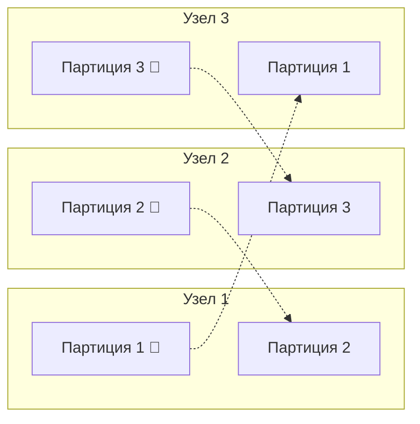
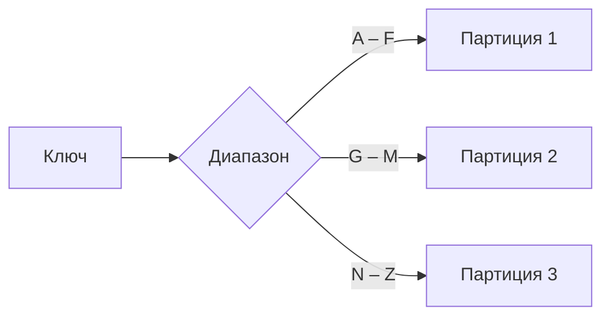
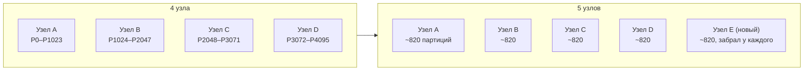
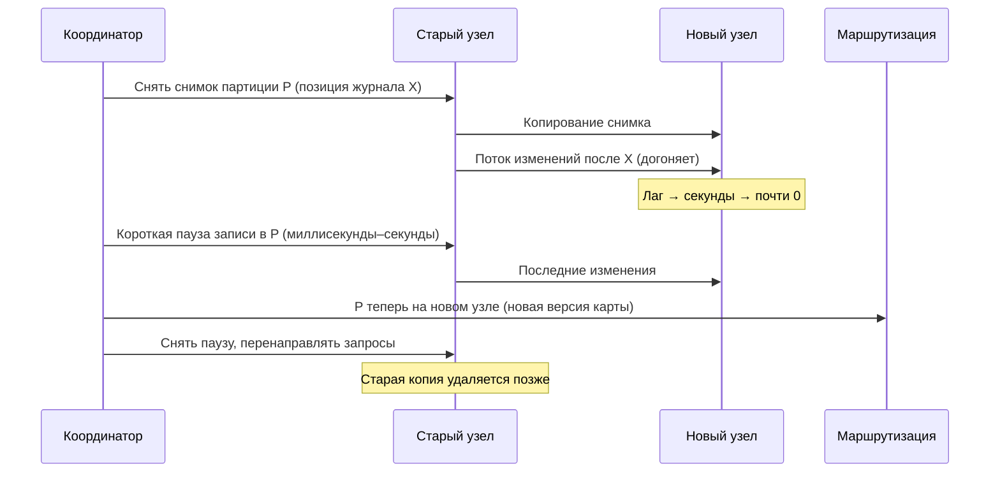
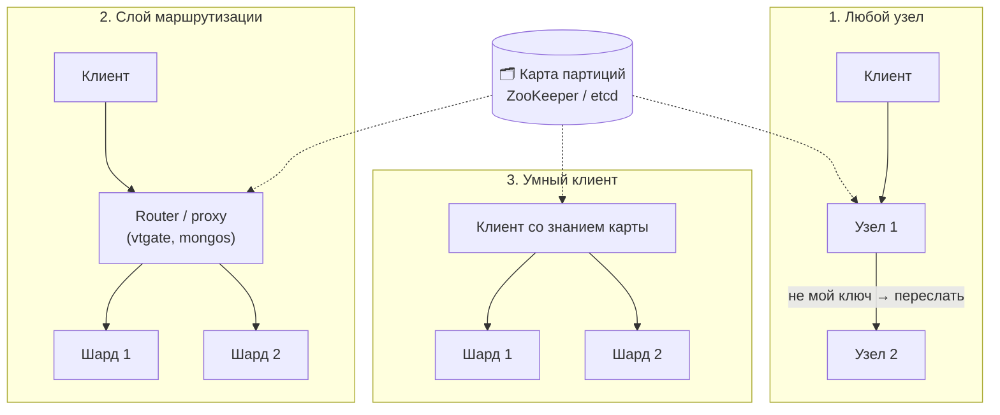
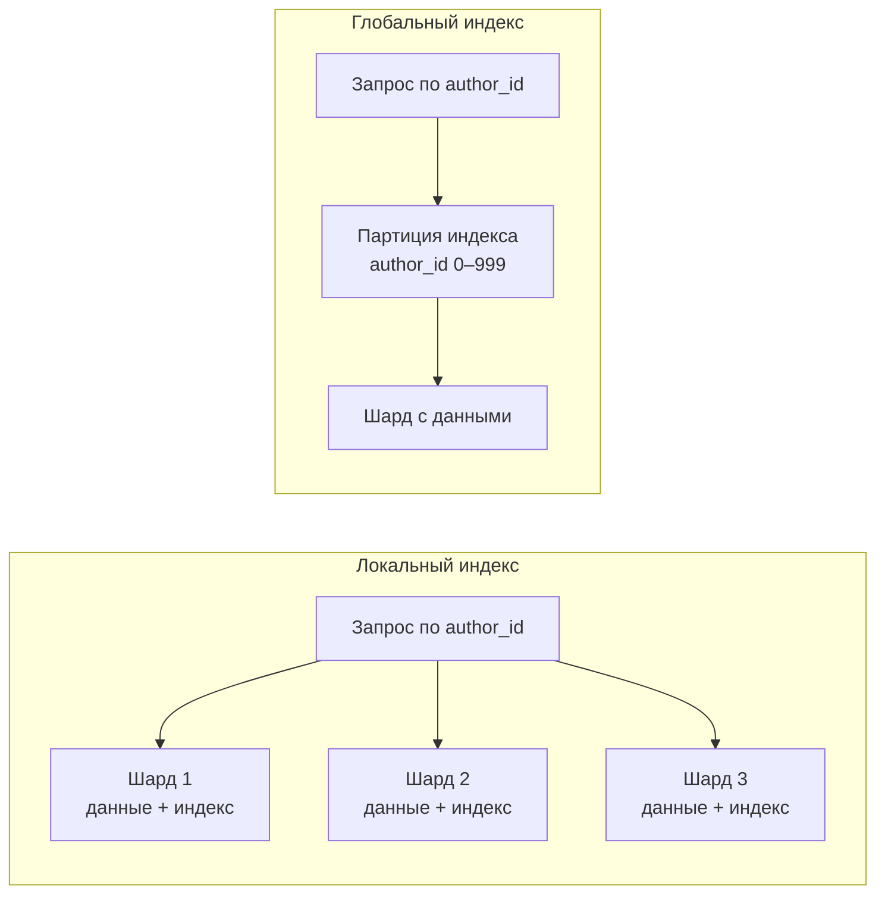
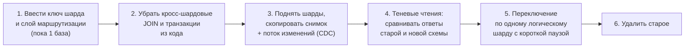

[English](README.md) | **Русский**

# 06. Партиционирование (шардирование)

> **Что внутри:** выбор ключа партиционирования, range vs hash, consistent hashing, фиксированные и динамические партиции, ребалансировка, маршрутизация запросов, вторичные индексы, горячие партиции, кросс-шардовые операции, переход от одной базы к шардам
> **Время на изучение:** ~4–5 ч · **Нужно для:** любой задачи, где данные или запись не помещаются в один узел
> **Практика:** разбор в формате интервью — [INTERVIEW_RU.md](./INTERVIEW_RU.md)
> **Связанные темы:** [01-scaling-basics](../01-scaling-basics/README_RU.md#8-алгоритмы-балансировки) (consistent hashing), [04-databases](../04-databases/README_RU.md), [05-replication](../05-replication/README_RU.md)

---

## 📑 Содержание

1. [Что такое партиционирование и когда оно нужно](#1-что-такое-партиционирование-и-когда-оно-нужно)
2. [Ключ партиционирования — главное решение](#2-ключ-партиционирования--главное-решение)
3. [Стратегии: range, hash, directory, гео](#3-стратегии-range-hash-directory-гео)
4. [Почему hash mod N — плохая идея и что вместо него](#4-почему-hash-mod-n--плохая-идея-и-что-вместо-него)
5. [Ребалансировка](#5-ребалансировка)
6. [Маршрутизация запросов](#6-маршрутизация-запросов)
7. [Вторичные индексы](#7-вторичные-индексы)
8. [Горячие партиции и перекос](#8-горячие-партиции-и-перекос)
9. [Кросс-шардовые операции](#9-кросс-шардовые-операции)
10. [Переход от одной базы к шардам](#10-переход-от-одной-базы-к-шардам)
11. [Как это устроено в реальных системах](#11-как-это-устроено-в-реальных-системах)
12. [Как говорить об этом на интервью](#12-как-говорить-об-этом-на-интервью)
13. [Вопросы для самопроверки](#13-вопросы-для-самопроверки)
14. [Глоссарий и ресурсы](#14-глоссарий-и-ресурсы)

---

## 1. Что такое партиционирование и когда оно нужно

**Партиционирование** — разделение данных на части (партиции), каждая из которых хранится и обслуживается отдельно. Когда партиции живут на **разных узлах**, это обычно называют **шардированием**, а партиции — **шардами**.

| Термин | Значение |
|:-------|:---------|
| **Горизонтальное партиционирование** | Строки таблицы делятся между партициями (пользователи 1–1M — здесь, 1M–2M — там). Обычно о нём и говорят |
| **Вертикальное партиционирование** | Колонки или таблицы разносятся по разным хранилищам (профили — в одной базе, заказы — в другой) |
| **Партиционирование внутри одной базы** | Таблица делится на части на одном сервере (PostgreSQL declarative partitioning). Помогает с обслуживанием и запросами по диапазонам, но не масштабирует запись |
| **Шардирование** | Партиции на разных серверах. Масштабирует объём, запись и чтение |

### Когда шардировать

Шардирование — **дорогой** шаг: усложняет запросы, транзакции, эксплуатацию и миграции. Сначала используют более простые средства:


**Признаки, что пора:**
- запись упирается в один primary (CPU, I/O, WAL), а вертикальный запас исчерпан;
- данные не помещаются на один узел или операции обслуживания (бэкап, VACUUM, создание индекса) идут слишком долго;
- рабочий набор не помещается в память самой большой машины.

> [!TIP]
> На интервью покажи этот порядок: «На текущих цифрах хватит одного primary с репликами. Шардировать начну, когда запись или объём превысят X, и вот какой ключ выберу». Шардирование «на всякий случай» — частая ошибка.

### Партиционирование и репликация вместе

Обычно каждая партиция **реплицирована**: у неё есть лидер и фолловеры. Один узел может быть лидером для одних партиций и фолловером для других.



---

## 2. Ключ партиционирования — главное решение

**Ключ партиционирования** определяет, в какую партицию попадёт запись. Это самое важное и самое трудно изменяемое решение: смена ключа означает перемещение почти всех данных.

### Критерии хорошего ключа

| Критерий | Почему важно |
|:---------|:-------------|
| **Равномерность** | Данные и нагрузка распределяются по партициям примерно поровну |
| **Локальность запросов** | Главные запросы обращаются к **одной** партиции |
| **Локальность транзакций** | Данные, которые меняются вместе, лежат в одной партиции |
| **Высокая кардинальность** | Значений ключа намного больше, чем партиций |
| **Стабильность** | Значение ключа у записи не меняется (иначе запись придётся переносить) |

### Примеры

| Система | Хороший ключ | Почему | Плохой ключ | Почему плохой |
|:--------|:-------------|:-------|:------------|:--------------|
| Чат | `channel_id` (+ временной бакет) | Сообщения канала читаются вместе | `message_id` | История канала размазана по всем шардам |
| Multi-tenant SaaS | `tenant_id` | Данные клиента читаются и меняются вместе | `created_at` | Все записи идут в «последнюю» партицию |
| Соцсеть: посты | `user_id` автора | Профиль и посты пользователя вместе | `country` | Низкая кардинальность, огромный перекос |
| Метрики | `(metric_id, time_bucket)` | Равномерно и удобно для диапазонов времени | `metric_id` | Популярная метрика растёт бесконечно |
| E-commerce заказы | `user_id` или `order_id` | Зависит от главного запроса | `status` | 3–5 значений на миллиарды строк |

> [!IMPORTANT]
> **Сигнал Senior+:** выбирай ключ от **главного запроса**, а не от «равномерности вообще». Скажи явно: «Главный запрос — история сообщений канала, поэтому ключ — channel_id. Цена: запрос “все сообщения пользователя” станет scatter-gather, и для него я сделаю отдельный индекс».

---

## 3. Стратегии: range, hash, directory, гео

### Range (по диапазонам ключа)

Каждая партиция владеет непрерывным диапазоном ключей: A–F, G–M, N–Z или даты по месяцам.



| ✅ Плюсы | ❌ Минусы |
|:--------|:---------|
| Эффективные запросы по диапазону (`WHERE created_at BETWEEN ...`) | Перекос: границы нужно подбирать под распределение данных |
| Соседние ключи лежат вместе | **Монотонно растущий ключ** (время, автоинкремент) отправляет **все** новые записи в последнюю партицию |
| Легко делить партицию пополам при росте | |

**Где:** HBase, Bigtable, CockroachDB, TiKV, MongoDB (range shard key), партиционирование по дате в PostgreSQL.

### Hash (по хэшу ключа)

`partition = f(hash(key))`. Хорошая хэш-функция равномерно распределяет даже похожие ключи.

| ✅ Плюсы | ❌ Минусы |
|:--------|:---------|
| Равномерное распределение | Запросы по диапазону ключа идут во **все** партиции |
| Монотонные ключи не создают «горячий хвост» | Соседние ключи разбросаны |

**Где:** Cassandra, DynamoDB, Redis Cluster, Elasticsearch, Kafka (по ключу сообщения), MongoDB (hashed shard key).

### Составной ключ: hash + range

Лучшее из двух подходов: **первая часть** ключа хэшируется и выбирает партицию, **вторая** задаёт сортировку внутри партиции.

```sql
-- Cassandra: партиция по channel_id, внутри сортировка по времени
CREATE TABLE messages (
  channel_id  bigint,
  bucket      int,          -- например, номер 10-дневного окна
  message_id  timeuuid,
  author_id   bigint,
  content     text,
  PRIMARY KEY ((channel_id, bucket), message_id)
) WITH CLUSTERING ORDER BY (message_id DESC);
```

Запрос «последние 50 сообщений канала» — это одна партиция и одно последовательное чтение. В DynamoDB та же идея: partition key + sort key.

### Directory (таблица соответствия)

Отдельный сервис хранит, где лежит каждый ключ или группа ключей: `tenant_42 → shard_7`.

| ✅ Плюсы | ❌ Минусы |
|:--------|:---------|
| Полная гибкость: любой ключ можно переместить отдельно | Справочник — ещё одна критичная зависимость (нужны кэш и репликация) |
| Крупного клиента можно выделить на отдельный шард | Дополнительный lookup на запрос (обычно из кэша) |

### Гео-партиционирование

Данные пользователя лежат в его регионе (EU, US, APAC). Снижает задержку и решает требования резидентности данных (GDPR). Подробнее — в [05-replication](../05-replication/README_RU.md#12-мульти-регион-и-эксплуатация).

### Сравнение

| Стратегия | Равномерность | Диапазонные запросы | Гибкость перемещения | Сложность |
|:----------|:-------------:|:-------------------:|:--------------------:|:---------:|
| Range | ⚠️ Зависит от границ | ✅ | ✅ Деление партиций | Средняя |
| Hash | ✅ | ❌ | ⚠️ Зависит от схемы | Низкая |
| Hash + range (составной) | ✅ | ✅ внутри партиции | ⚠️ | Средняя |
| Directory | ✅ Управляемая | Зависит | ✅✅ | Высокая |
| Гео | ⚠️ Зависит от аудитории | Зависит | ⚠️ | Высокая |

---

## 4. Почему hash mod N — плохая идея и что вместо него

Самая простая схема: `shard = hash(key) % N`. Проблема — при изменении N:

```
N = 4 → N = 5:  hash(key) % 4  vs  hash(key) % 5
Остаётся на месте примерно 1/5 ключей, переезжают ~80%
```

Добавление одного сервера перемещает почти все данные. Для кэша это пустой кэш, для базы — многочасовая миграция всего.

### Решение 1: фиксированное число партиций (больше, чем узлов)

Создать, например, **1024 или 4096** партиции с самого начала и распределить их по узлам. Ключ всегда попадает в одну и ту же партицию (`hash(key) % 4096`), а при добавлении узла **переезжают целые партиции**, а не пересчитываются ключи.



- Переезжает только ~1/N данных — ровно столько, сколько нужно новому узлу.
- **Где:** Redis Cluster (16 384 слота), Elasticsearch (число primary-шардов задаётся при создании индекса), Couchbase (1024 vBuckets), «логические шарды» в Instagram и Notion поверх PostgreSQL.
- **Выбор числа:** с запасом на много лет роста. Слишком много — накладные расходы на каждую партицию; слишком мало — партиции станут огромными.

### Решение 2: consistent hashing

Узлы и ключи размещаются на кольце хэшей; ключ принадлежит первому узлу по часовой стрелке. При добавлении узла переезжают только ключи соседнего участка (~1/N). **Виртуальные узлы** (по 100–256 точек на физический узел) выравнивают распределение. Подробно — в [01-scaling-basics](../01-scaling-basics/README_RU.md#8-алгоритмы-балансировки).

**Где:** Cassandra (vnodes), DynamoDB (внутри), Riak, распределённые кэши.

### Решение 3: динамическое деление партиций

Партиции (обычно range) **делятся**, когда вырастают больше порога, и **сливаются**, когда уменьшаются. Число партиций подстраивается под объём данных.

**Где:** HBase (regions), Bigtable (tablets), CockroachDB (ranges), MongoDB (chunks), DynamoDB (автоматическое деление при росте объёма или нагрузки).

### Другие алгоритмы

| Алгоритм | Идея | Плюс |
|:---------|:-----|:-----|
| **Rendezvous (HRW) hashing** | Для ключа считается вес с каждым узлом, выбирается максимальный | Простота, нет кольца |
| **Jump consistent hash** | Быстрое вычисление номера бакета без хранения кольца | Минимум памяти, идеальная равномерность; узлы добавляются только в конец |

### Сравнение подходов к ребалансировке

| Подход | Что переезжает при добавлении узла | Число партиций | Примеры |
|:-------|:-----------------------------------|:---------------|:--------|
| `hash % N` | ~все ключи | = N | ❌ Не использовать |
| Фиксированное число партиций | Целые партиции, ~1/N данных | Фиксировано | Redis Cluster, Elasticsearch, логические шарды |
| Consistent hashing + vnodes | ~1/N ключей | Пропорционально узлам | Cassandra, Riak |
| Динамическое деление | Половинки разделённых партиций | Растёт с данными | HBase, CockroachDB, MongoDB |

---

## 5. Ребалансировка

**Ребалансировка** — перемещение партиций между узлами: при добавлении или удалении узлов, при перекосе нагрузки, при отказах.

### Требования

- Нагрузка после ребалансировки распределена честно.
- База продолжает принимать чтения и записи во время переноса.
- Переносится минимум данных.

### Как переносится партиция



### Автоматическая или ручная

| | Автоматическая | Ручная / полуавтоматическая |
|:-|:---------------|:----------------------------|
| Плюсы | Не нужен человек | Контроль времени и нагрузки |
| Минусы | Перенос данных нагружает сеть и диски; в сочетании с автоматическим обнаружением сбоев может вызвать **каскад**: перегруженный узел признан мёртвым, его партиции переносятся на соседей, те перегружаются | Нужны люди и процесс |
| Практика | Автоматические предложения плана + подтверждение или ограничение скорости переноса (throttling) | |

> [!WARNING]
> Ребалансировка сама нагружает систему. Ограничивай скорость переноса, не запускай её в пик, и **не связывай** автоматический перенос данных с коротким таймаутом обнаружения сбоев — иначе временное замедление узла превращается в лавину переносов.

---

## 6. Маршрутизация запросов

Как клиент узнаёт, на каком узле лежит ключ? Это частный случай **service discovery**.



| Подход | Как | Плюсы | Минусы | Примеры |
|:-------|:----|:------|:-------|:--------|
| **Любой узел + пересылка** | Клиент идёт на любой узел, тот пересылает или отвечает редиректом | Простой клиент | Лишний hop | Cassandra (координатор), Redis Cluster (редирект `MOVED`) |
| **Слой маршрутизации** | Отдельный прокси знает карту | Клиенты не знают о шардах; удобно для миграций | Ещё один слой и hop | Vitess (vtgate), MongoDB (mongos), Citus coordinator |
| **Умный клиент** | Клиентская библиотека кэширует карту | Нет лишнего hop | Логика в каждом клиенте; нужно обновлять карту | Клиенты Cassandra, Redis Cluster, Kafka |

**Карта партиций** обычно хранится в консенсусном хранилище (ZooKeeper, etcd) или распространяется gossip-протоколом (Cassandra). У карты есть **версия**: если клиент пришёл со старой версией, узел отвечает «карта устарела» и клиент обновляет её.

---

## 7. Вторичные индексы

Партиционирование по первичному ключу работает хорошо, пока запросы идут по нему. Что делать с запросом по другому полю, например «все заказы со статусом `pending`» или «сообщения автора X»?

### Локальный индекс (document-partitioned)

Каждая партиция индексирует **только свои** данные.

- **Запись:** быстрая, затрагивает одну партицию.
- **Чтение:** запрос по индексу идёт во **все** партиции (scatter-gather), результаты объединяются.

### Глобальный индекс (term-partitioned)

Индекс сам партиционирован **по значению индексируемого поля**: все записи с `author_id = 42` в индексе лежат в одной партиции индекса.

- **Чтение:** одна партиция индекса.
- **Запись:** затрагивает партицию данных **и** партиции индекса → либо распределённая транзакция, либо **асинхронное** обновление индекса (индекс отстаёт).



| | Локальный | Глобальный |
|:-|:----------|:-----------|
| Запись | Одна партиция | Несколько партиций (часто асинхронно) |
| Чтение по индексу | Все партиции (scatter-gather) | Одна партиция индекса (+ чтение данных) |
| Свежесть | Сразу | Возможна задержка |
| Примеры | Elasticsearch, MongoDB, Cassandra (secondary index) | DynamoDB Global Secondary Index, глобальные индексы в Spanner/CockroachDB |

> [!TIP]
> Частое практическое решение — **денормализованная таблица под второй запрос**: `messages_by_channel` и `messages_by_author` с разными ключами, наполняемые из одного потока событий (CDC). Это и есть «глобальный индекс», реализованный в приложении.

### Почему scatter-gather опасен на масштабе

Если запрос идёт в 100 шардов и **каждый** отвечает медленно в 1% случаев, то запрос целиком будет медленным в `1 − 0,99^100 ≈ 63%` случаев. Хвостовая задержка (p99) запроса определяется самым медленным шардом. Это называется **tail latency amplification**.

---

## 8. Горячие партиции и перекос

**Перекос (skew)** — когда одна партиция получает непропорционально много данных или запросов. Такую партицию называют **горячей** (hot partition, hotspot).

### Причины

| Причина | Пример |
|:--------|:-------|
| Популярный ключ | Знаменитость с 100 млн подписчиков, вирусный пост, товар на распродаже |
| Монотонный ключ при range-партиционировании | Все новые записи с текущим timestamp попадают в последнюю партицию |
| Низкая кардинальность | Ключ `country`: половина пользователей из одной страны |
| Крупный клиент в multi-tenant системе | Один корпоративный клиент больше всех остальных вместе |
| Растущий без границ ключ | Канал чата, в котором пишут годами |

### Решения

| Решение | Как работает | Цена |
|:--------|:-------------|:-----|
| **Соль (salting) / разбиение ключа** | К горячему ключу добавляется суффикс 0–N: `post_42#0`…`post_42#9`, запись идёт в случайный | Чтение должно собрать все N частей |
| **Хэш-префикс для монотонных ключей** | `hash(device_id) + timestamp` вместо `timestamp` | Диапазонные запросы по времени идут во все партиции |
| **Временные бакеты** | Ключ `(channel_id, bucket)`, бакет — номер недели или 10-дневного окна | Чтение длинной истории проходит несколько партиций |
| **Шардирование счётчиков** | Счётчик лайков разбит на N под-счётчиков, итог — сумма | Чтение суммирует N значений |
| **Выделенный шард** | Крупный клиент получает свой шард (directory-подход) | Ручное управление |
| **Кэш перед горячим ключом** | L1/Redis для чтения (см. [02-caching](../02-caching/README_RU.md#8-типичные-проблемы-stampede-penetration-avalanche-горячие-ключи)) | Помогает только с чтением |
| **Адаптивная ёмкость** | База сама выделяет горячей партиции больше ресурсов или делит её | Есть не везде (например, DynamoDB) |

> [!NOTE]
> Многие системы **не обнаруживают** горячие ключи сами. Перекос — ответственность того, кто проектирует ключ. Поэтому на интервью стоит заранее сказать, где возможен горячий ключ и что с ним будет.

---

## 9. Кросс-шардовые операции

Всё, что затрагивает несколько шардов, становится дороже и сложнее.

| Операция | Проблема | Решения |
|:---------|:---------|:--------|
| **Запросы по не-ключевому полю** | Scatter-gather во все шарды | Денормализованная таблица / глобальный индекс; поисковый индекс |
| **JOIN** | Данные на разных шардах | Совместное размещение (co-location): связанные таблицы шардируются по одному ключу; справочные таблицы реплицируются на все шарды; денормализация |
| **Транзакции** | Нужна атомарность на нескольких узлах | Спроектировать ключ так, чтобы транзакции были одношардовыми; 2PC (медленно, блокирует при сбое координатора); саги с компенсациями; распределённые SQL-базы |
| **Уникальность** (email уникален глобально) | Ограничение UNIQUE работает только внутри шарда | Отдельная таблица уникальности, шардированная по самому значению (`email → user_id`); глобальный справочник |
| **Генерация ID** | Автоинкремент локален для шарда | Snowflake-подобные ID, UUID v7, ID со встроенным номером шарда |
| **Агрегации и аналитика** | Сканирование всех шардов нагружает продакшен | CDC в хранилище данных (data warehouse), предрасчитанные агрегаты |
| **Пагинация с сортировкой** | Нужно слить отсортированные результаты всех шардов | Получить top-K из каждого шарда и слить; лучше избегать на горячем пути |

### ID со встроенным шардом

Если ID содержит номер (логического) шарда, по нему можно сразу найти данные без справочника:

```
64-битный ID:
| 41 бит: миллисекунды с эпохи | 13 бит: логический шард (до 8192) | 10 бит: счётчик |
```

Такую схему описывал Instagram для своих логических шардов в PostgreSQL. Новые объекты пользователя создаются с номером его шарда, и любой ID «знает», где лежит.

---

## 10. Переход от одной базы к шардам

Перешардирование работающей системы без простоя — одна из самых сложных операций. Типичный план:



**Ключевые идеи:**
- **Логические шарды поверх физических.** Сразу создать много логических шардов (сотни–тысячи), разложить их на немного физических баз. Дальнейший рост — перенос логических шардов на новые машины без смены ключа. Так сделали Instagram и Notion (Notion описывал 480 логических шардов на 32 физических базах PostgreSQL).
- **Двойная запись или CDC** для синхронизации старой и новой схем во время миграции.
- **Проверка до переключения:** теневые чтения и сверка контрольных сумм.
- **Откат:** до финального шага должна оставаться возможность вернуться на старую схему.

> [!IMPORTANT]
> **Сигнал Senior+:** скажи, что делать с запросами, которые после шардирования перестанут работать (JOIN между пользователями, глобальная уникальность, аналитика), **до** миграции. Большая часть работы — не перенос данных, а переписывание таких запросов.

---

## 11. Как это устроено в реальных системах

| Система | Стратегия | Ребалансировка | Особенности |
|:--------|:----------|:---------------|:------------|
| **Cassandra / ScyllaDB** | Hash (Murmur3) по partition key + сортировка по clustering columns | Consistent hashing с vnodes | Партиция должна оставаться ограниченной по размеру (временные бакеты) |
| **DynamoDB** | Hash partition key + sort key | Автоматическое деление партиций, адаптивная ёмкость | У каждой партиции есть лимиты пропускной способности; горячий ключ упирается в них |
| **MongoDB** | Range или hashed shard key, данные в chunks | Балансировщик переносит chunks | Смена shard key возможна в новых версиях, но дорогая |
| **Redis Cluster** | `CRC16(key) mod 16384` слотов | Перенос слотов между узлами | Hash tags `{...}` для совместного размещения ключей |
| **Elasticsearch** | `hash(_routing) % число primary-шардов` | Перенос целых шардов | Число primary-шардов фиксируется при создании индекса; изменение — через переиндексацию или split/shrink |
| **Kafka** | Партиция = hash(ключ сообщения) % число партиций | Перенос реплик партиций | Добавление партиций **меняет** соответствие ключ → партиция и ломает порядок по ключу |
| **Vitess** | Vindexes (hash, lookup, кастомные) поверх MySQL | Resharding через копирование + VReplication | Шардированный MySQL для крупных компаний |
| **Citus** | Distribution column в PostgreSQL | Перенос шардов | Co-location таблиц по одному ключу |
| **CockroachDB / TiDB / Spanner** | Range с автоматическим делением | Автоматическая | Распределённые транзакции из коробки |

---

## 12. Как говорить об этом на интервью

### Ответ за 30 секунд

> «Шардирую, только когда запись или объём не помещаются в один primary с репликами. Ключ выбираю по главному запросу и транзакциям — чтобы они попадали в один шард. Использую hash по ключу с фиксированным числом логических шардов, намного большим числа серверов: при росте переносятся целые логические шарды, а не пересчитываются ключи. Маршрутизация — через слой роутеров с картой в etcd. Для вторичных запросов — денормализованные таблицы через CDC, для глобальной уникальности — отдельная таблица по значению, ID — Snowflake со встроенным шардом. Горячие ключи — соль, временные бакеты или выделенный шард».

### Вопросы, которые стоит задать себе

1. Какой главный запрос и главная транзакция? Попадают ли они в один шард с этим ключом?
2. Какие запросы станут scatter-gather и как их обслужить?
3. Где возможен горячий ключ? Есть ли «знаменитости» или очень крупные клиенты?
4. Как будет расти число шардов и что переедет при добавлении узла?
5. Нужна ли глобальная уникальность или кросс-шардовые транзакции?

### Типичные ошибки

- Шардировать с самого начала без необходимости.
- `hash(key) % N` с числом серверов в качестве N.
- Монотонный ключ (время, автоинкремент) при range-партиционировании.
- Ключ с низкой кардинальностью (страна, статус).
- Не продумать запросы, которые станут кросс-шардовыми.
- Забыть про горячие ключи и неограниченно растущие партиции.
- Полагаться на автоинкремент и UNIQUE после шардирования.

---

## 13. Вопросы для самопроверки

<details>
<summary><b>1. Чем партиционирование внутри одной базы отличается от шардирования?</b></summary>

Партиционирование внутри базы делит таблицу на части на одном сервере: ускоряет запросы по диапазону, упрощает удаление старых данных и обслуживание, но не добавляет ресурсов для записи. Шардирование разносит части по разным серверам и масштабирует запись, объём и чтение.
</details>

<details>
<summary><b>2. Почему range-партиционирование по времени создаёт горячую партицию?</b></summary>

Все новые записи имеют текущий timestamp и попадают в последнюю партицию, которая принимает 100% записи, а остальные простаивают. Решение — хэш-префикс (например, по устройству или пользователю) перед временем или составной ключ.
</details>

<details>
<summary><b>3. Почему hash(key) % N плохо работает при добавлении сервера?</b></summary>

Изменение N меняет остаток почти для всех ключей: при переходе с 4 на 5 серверов переезжает около 80% данных. Нужно фиксированное число партиций, consistent hashing или динамическое деление.
</details>

<details>
<summary><b>4. Как фиксированное число партиций решает проблему ребалансировки?</b></summary>

Ключ всегда отображается в одну и ту же партицию, потому что число партиций не меняется. При добавлении узла ему передаются целые партиции от существующих узлов — переезжает только та доля данных, которая нужна новому узлу.
</details>

<details>
<summary><b>5. Локальный или глобальный вторичный индекс — что выбрать?</b></summary>

Локальный — когда запись важнее и запросы по индексу редкие или всё равно затрагивают много партиций (поиск). Глобальный — когда запросы по индексу частые и должны идти в одну партицию, а небольшое отставание индекса допустимо.
</details>

<details>
<summary><b>6. Почему scatter-gather запрос медленнее, чем кажется?</b></summary>

Ответ ждёт самый медленный шард. Если каждый из 100 шардов медленный в 1% случаев, весь запрос медленный примерно в 63% случаев. Хвостовая задержка растёт с числом шардов.
</details>

<details>
<summary><b>7. Как обеспечить уникальность email, если пользователи шардированы по user_id?</b></summary>

Отдельная таблица `email → user_id`, шардированная по самому email. При регистрации сначала вставка в неё (проверка уникальности в одном шарде), затем создание пользователя. Нужна обработка частичных сбоев (например, через сагу или повторяемую идемпотентную операцию).
</details>

<details>
<summary><b>8. Что делать с горячим ключом при записи?</b></summary>

Разбить ключ на N подключей с суффиксом (salting) и писать в случайный; при чтении собирать все части. Для счётчиков — шардированные счётчики. Для крупного клиента — выделенный шард. Кэш помогает только с чтением.
</details>

<details>
<summary><b>9. Почему добавление партиций в топик Kafka опасно?</b></summary>

Партиция выбирается как hash(ключ) % число партиций. При изменении числа партиций сообщения с тем же ключом начинают попадать в другую партицию, и порядок сообщений по ключу нарушается. Поэтому число партиций выбирают с запасом заранее.
</details>

<details>
<summary><b>10. Зачем нужны логические шарды поверх физических?</b></summary>

Ключ отображается в логический шард навсегда, а логические шарды можно переносить между физическими серверами. Рост системы — это перенос логических шардов, без пересчёта ключей и смены схемы. Номер логического шарда можно встроить в ID.
</details>

---

## 14. Глоссарий и ресурсы

### Глоссарий

| Термин | Значение |
|:-------|:---------|
| Партиция / шард | Часть данных, хранимая и обслуживаемая отдельно |
| Ключ партиционирования | Поле, по которому определяется партиция записи |
| Range-партиционирование | Партиции владеют диапазонами ключей |
| Hash-партиционирование | Партиция определяется хэшем ключа |
| Логический шард | Единица распределения, отображаемая на физический сервер |
| Consistent hashing | Хэширование, при котором изменение числа узлов перемещает ~1/N ключей |
| Vnode | Виртуальный узел на кольце consistent hashing |
| Ребалансировка | Перемещение партиций между узлами |
| Scatter-gather | Запрос во все партиции с объединением результатов |
| Локальный / глобальный индекс | Индекс внутри каждой партиции / индекс, партиционированный по индексируемому значению |
| Горячая партиция | Партиция с непропорционально большой нагрузкой |
| Salting | Добавление суффикса к ключу для распределения нагрузки |
| Co-location | Размещение связанных данных в одном шарде |
| Tail latency amplification | Рост хвостовой задержки при обращении к многим узлам |

### Ресурсы

- *Designing Data-Intensive Applications*, Martin Kleppmann — глава 6 «Partitioning»
- Karger et al., *Consistent Hashing and Random Trees* (1997)
- Thaler, Ravishankar, *Using Name-Based Mappings to Increase Hit Rates* (1998) — rendezvous hashing
- Lamping, Veach, *A Fast, Minimal Memory, Consistent Hash Algorithm* (2014) — jump hash
- Instagram Engineering, *Sharding & IDs at Instagram* (2012)
- Notion, *Herding elephants: lessons learned from sharding Postgres at Notion* (2021)
- Discord, *How Discord Stores Billions of Messages* (2017)
- Документация Vitess, Citus, DynamoDB (partition key design), Redis Cluster