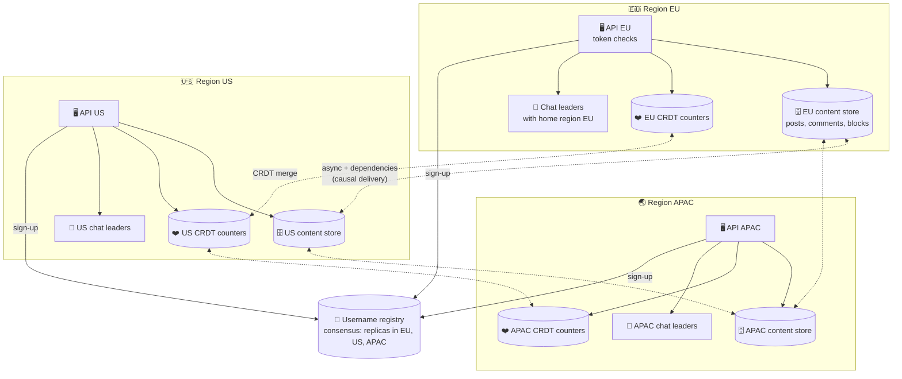
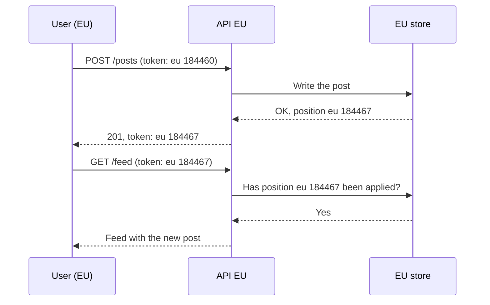
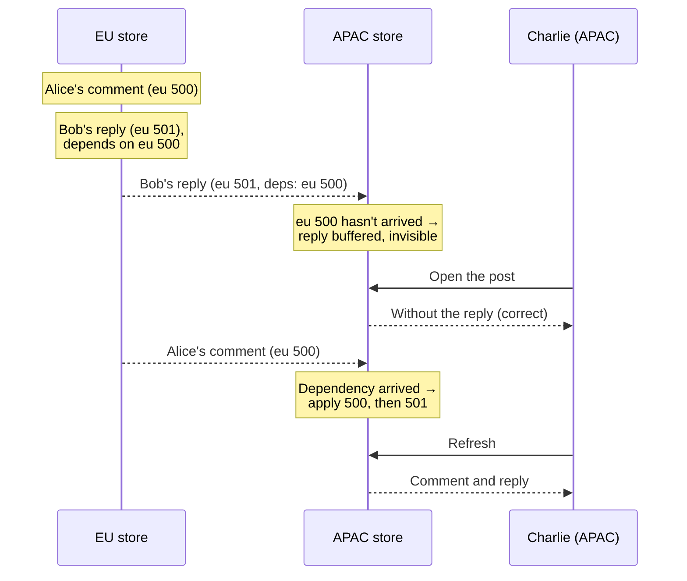
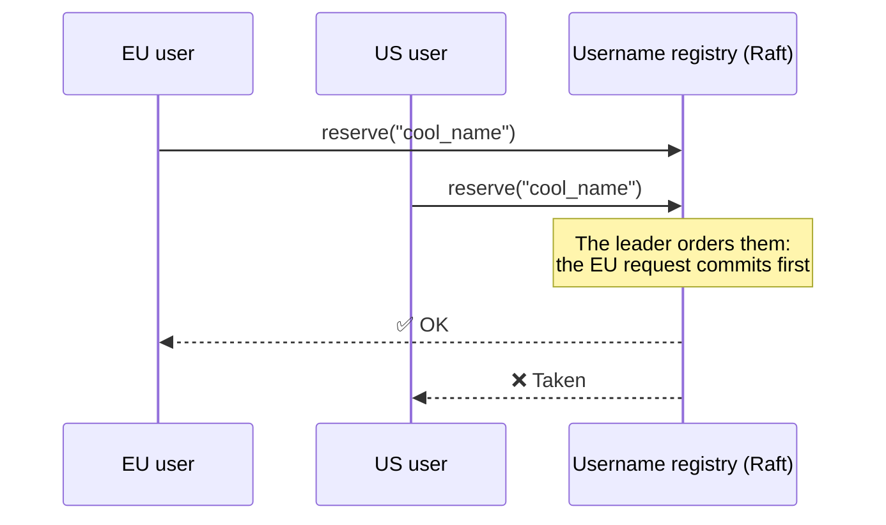
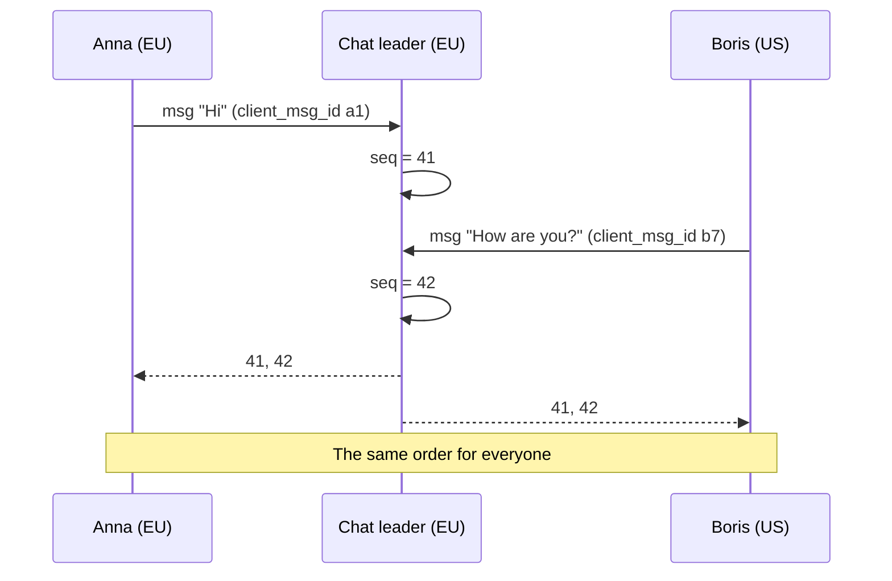

**English** | [Русский](INTERVIEW_RU.md) · Theory: [README.md](./README.md)

# 07. Consistency Models: Guarantees for a Global Social Network

> **Topic:** from user complaints to anomalies and consistency models; session tokens, causal consistency with dependencies, linearizable uniqueness, CRDT counters, message ordering, CAP and PACELC per feature
> **Level:** Hard · **Interview time:** 45 min · **Study time:** ~5 h
> **Where it's asked:** "What consistency guarantees does this system need?" — in nearly every senior interview about social networks, messengers and collaboration tools

---

## 🗺️ How to Read This Walkthrough

| Icon | Meaning |
|:----:|:--------|
| 🎤 | Interviewer |
| 🗣️ | What I (the candidate) say out loud |
| ✏️ | What I draw on the whiteboard |
| ⏱️ | Time budget for the step |

Callouts: **TIP** — a good technique, **WARNING** — a trap, **IMPORTANT** — a Senior+ signal.

---

## 📑 Contents

1. [Problem Statement](#1-problem-statement)
2. [From Complaints to Anomalies](#2-from-complaints-to-anomalies)
3. [Requirements](#3-requirements)
4. [Estimates and Latency Budget](#4-estimates-and-latency-budget)
5. [Choosing a Model per Feature](#5-choosing-a-model-per-feature)
6. [API With Consistency Tokens](#6-api-with-consistency-tokens)
7. [High-Level Design](#7-high-level-design)
8. [Deep Dive 1: Session Guarantees via a Token](#8-deep-dive-1-session-guarantees-via-a-token)
9. [Deep Dive 2: Causal Consistency for Comments and Privacy](#9-deep-dive-2-causal-consistency-for-comments-and-privacy)
10. [Deep Dive 3: Unique Usernames](#10-deep-dive-3-unique-usernames)
11. [Deep Dive 4: Counters That Don't Go Backwards](#11-deep-dive-4-counters-that-dont-go-backwards)
12. [Deep Dive 5: Message Order in Chats](#12-deep-dive-5-message-order-in-chats)
13. [CAP and PACELC per Feature](#13-cap-and-pacelc-per-feature)
14. [Bottlenecks and Failure Scenarios](#14-bottlenecks-and-failure-scenarios)
15. [Interviewer Questions with Answers](#15-interviewer-questions-with-answers)
16. [Common Mistakes](#16-common-mistakes)
17. [Cheat Sheet and Self-Check](#17-cheat-sheet-and-self-check)

---

## 1. Problem Statement

> 🎤 "We run a social network with users worldwide; data is replicated asynchronously across three regions. Support receives complaints:
> 1. "I published a post, refreshed the page — and it's gone";
> 2. "I see a reply to a comment, but not the comment itself";
> 3. "I blocked my ex and immediately posted a photo — and he saw it";
> 4. "My friend and I were given the same username";
> 5. "The like count keeps going up and down";
> 6. "In a group chat, my friend and I see messages in different orders".
>
> Design the consistency guarantees that fix this without killing performance."

**Time plan:**

| Step | ⏱️ |
|:-----|:--:|
| Complaints → anomalies | 6 min |
| Requirements and latency budget | 5 min |
| Model per feature | 5 min |
| High-level design | 5 min |
| Deep dives | 20 min |
| CAP/PACELC and wrap-up | 4 min |

> [!TIP]
> A strong opening is to **name each complaint by its anomaly**. It shows you won't just "add synchronous replication", but understand exactly which guarantee is broken and which minimal model restores it.

---

## 2. From Complaints to Anomalies

⏱️ 6 min

| # | Complaint | Anomaly | Minimal model that rules it out |
|:-:|:----------|:--------|:--------------------------------|
| 1 | Post vanished after refresh | **Read-your-writes** violation | Session guarantees |
| 2 | Reply without the comment | **Causal consistency** violation (writes-follow-reads) | Causal |
| 3 | The ex saw a photo after being blocked | **Causal consistency** violation: "block" → "post" not ordered on another replica | Causal |
| 4 | Two users with one username | **Uniqueness** violation: concurrent writes in different regions without coordination | Linearizability |
| 5 | Likes jump around | **Monotonic reads** violation (different replicas) | Session guarantees (+ CRDT for convergence) |
| 6 | Different message order | No **total order** within the chat | Total order per chat |

🗣️ "Linearizability is needed in only one of six cases. The rest is solved by cheaper models that don't require cross-region coordination on every write."

---

## 3. Requirements

⏱️ 3 min

### Functional

1. Posts, comments with replies, likes, follows.
2. Blocking and privacy settings.
3. Sign-up with a unique username.
4. Direct and group chats.

### Non-functional

| Requirement | Target |
|:------------|:-------|
| Write latency (post, comment, like) | p99 < 150 ms — no cross-region round trip |
| Feed read latency | p99 < 200 ms, local to the region |
| Sign-up | p99 < 1 s (a rare operation) |
| Availability | Feed reads and publishing work during a cross-region partition |
| Correctness | Zero duplicate usernames; a block always "precedes" later posts |
| Visibility | 99% of writes visible in every region within 2 s |

---

## 4. Estimates and Latency Budget

⏱️ 2 min

✏️

```
DAU                    = 500M across 3 regions
Posts + comments       ≈ 50,000 writes/s at peak
Likes                  ≈ 500,000 writes/s at peak
Sign-ups               ≈ 200/s
Chat messages          ≈ 300,000/s

Cross-region RTT       ~80–200 ms
Post write budget      150 ms → cross-region coordination doesn't fit
Sign-up budget         1 s    → cross-region consensus (~100–200 ms) fits
```

🗣️ "It follows immediately: posts, comments and likes get local writes with async replication only. We can afford strict cross-region coordination only for sign-up."

---

## 5. Choosing a Model per Feature

⏱️ 5 min

| Feature | Model | Mechanism | Cost |
|:--------|:------|:----------|:-----|
| Own posts and profile | Session guarantees (RYW, monotonic reads) | A session token with a log position | Occasionally waiting for a replica or reading from the home region |
| Comments and replies | Causal | Dependency metadata, deferred visibility | Slight visibility delay under lag |
| Blocking and privacy | Causal + a read-time check | A block is a dependency of later posts | Same |
| Username | Linearizability | A consensus store with replicas in 3 regions | +100–200 ms on sign-up; unavailable if a majority is lost |
| Likes | Strong eventual (CRDT) + monotonic reads per session | G-Counter/PN-Counter, "no less than already shown" | The number may lag by seconds |
| Chat | Total order per chat | The chat leader assigns sequence numbers | Chat writes go through the chat leader's region |

> [!IMPORTANT]
> **Senior+ signal:** each row is the minimal sufficient model. "Linearizability everywhere" would cost 100–200 ms per like and unavailability during a partition. "Eventual everywhere" wouldn't fix a single complaint.

---

## 6. API With Consistency Tokens

⏱️ 2 min

```http
POST /v1/posts
     Headers: X-Session-Token: <token>
     Body:    { text, media_ids[], visibility }
     → 201 { post_id, session_token: <new token> }

GET  /v1/feed?cursor=...
     Headers: X-Session-Token: <token>
     → 200 { items[], session_token }

POST /v1/comments
     Body: { post_id, parent_comment_id?, text }
     Headers: X-Session-Token: <token including the position of the comment read>

POST /v1/users/me/blocks          { blocked_user_id }

POST /v1/signup                   { username, email, ... }   ← linearizable check

POST /v1/chats/{chat_id}/messages { client_msg_id, text }
     → 201 { message_id, seq }    ← sequence number within the chat
```

🗣️ "The **session token** is the centerpiece: it compactly encodes which writes the client has already seen or made. The server returns an updated token with every response, and the client stores it and sends it with every request. For multiple devices the token is also stored server-side in the user's session."

---

## 7. High-Level Design

⏱️ 5 min

✏️



🗣️ "Core content is written **locally** and replicated asynchronously, but with **dependency metadata**: a replica makes a write visible only after its causes. Counters are CRDTs. Usernames are the only thing that goes through consensus. Chats — each chat has a home region where a leader assigns the order."

---

## 8. Deep Dive 1: Session Guarantees via a Token

> 🎤 "Complaint 1: a post disappears after a page refresh. How do you fix it without reading everything from the leader?"

🗣️ "That's read-your-writes. Each content store keeps a **log with positions** in its region. The token is a vector of per-region positions the client has seen or written to:

```
session_token = { eu: 184467, us: 99120, apac: 50311 }
```

The rule for a replica: **it may answer only if it has applied every write up to the positions in the token**. Otherwise — wait briefly (usually milliseconds) or redirect the request to a region that has caught up."



🗣️ "The same token gives **monotonic reads**: after each response the token contains the highest position seen, so the next response can't be older. That also solves part of complaint 5."

> 🎤 "And if the user is traveling, and their request landed in US where the EU position hasn't applied yet?"

🗣️ "The US replica waits with a timeout (say, 200 ms), then redirects the read to EU. The user gets a slightly slower but correct response. It's a rare path, since 99% of writes replicate within seconds."

---

## 9. Deep Dive 2: Causal Consistency for Comments and Privacy

> 🎤 "Complaints 2 and 3. Why doesn't the token from the previous step solve them?"

🗣️ "The token protects **one** user. Complaints 2 and 3 involve **different** users: Bob replied to Alice's comment, and Charlie sees the reply without the comment. We need causal consistency **for everyone**: a write must never become visible anywhere before its causes."

### How to implement it

1. **Every write carries dependencies:** when a client writes, its session token (the positions it has seen) becomes the write's **dependencies**.
2. **Causal delivery:** when a replica receives a write from another region, it checks the dependencies. If any isn't applied yet, the write is **buffered** and becomes visible only once the dependencies arrive.



### Blocking and privacy (complaint 3)

🗣️ "Alice blocked her ex (a `block` write), then published a photo. At publish time, Alice's token contains the `block` position, so the photo **depends** on the block. No replica will show the photo until it applies the block — and once applied, the read-time access check hides the photo from the ex.

Additionally, for privacy I do a **read-time access check in the author's region** if the block dependency hasn't arrived — protection against bugs in the metadata. A privacy violation costs more than a small delay."

> [!WARNING]
> **Trap: external channels.** If a user learns about a new post via a push notification sent before the post replicated, they'll open the app and not find it. Fix: the notification carries a token with the post's position, and the client passes it on open — the replica will wait or redirect.

### The cost of causal

| Cost | Mitigation |
|:-----|:-----------|
| Dependency metadata size | A per-region vector, not per-write |
| Visibility delay if a dependency lags | An SLO on replication lag; monitor buffer size |
| The buffer grows if a region is unavailable for long | Bound the buffer; when exceeded, redirect reads to the source region |

---

## 10. Deep Dive 3: Unique Usernames

> 🎤 "Complaint 4. Why not check that a username is free in the local database?"

🗣️ "Two users in EU and US check `cool_name` simultaneously: each region sees the name is free, and both write. Async replication detects the conflict **after** both have been confirmed. Causal consistency doesn't help — these operations are concurrent, not causally related. We need **linearizability**: a single point of truth that orders competing attempts."

### The solution

- A **username registry** — a small consensus store (a Raft group with replicas in three regions, like etcd or Spanner/CockroachDB).
- Sign-up: an atomic "insert if not exists" (`INSERT ... ON CONFLICT DO NOTHING` or compare-and-set).
- A commit by a majority of two regions: ~100–200 ms — within the 1 s budget.



> 🎤 "What about during a partition?"

🗣️ "A region that can't see a majority **cannot** register new names — a deliberate CP choice for one operation. The user sees 'try again in a minute'. Login, the feed and publishing in that region keep working, because they don't need consensus."

> [!TIP]
> You can soften the UX: in an isolated region, allow sign-up **without choosing a username** (a temporary name like `user_8f3a2`), with the name chosen after connectivity returns. That way the CP restriction affects one feature, not sign-up as a whole.

---

## 11. Deep Dive 4: Counters That Don't Go Backwards

> 🎤 "Complaint 5. Likes go up and down. It's just a counter, isn't it?"

🗣️ "Two problems:
1. **Convergence:** concurrent likes in different regions. If you store one number and overwrite it (LWW), likes get lost. The fix is a **PN-Counter (CRDT)**: each region has its own 'plus' and 'minus' components, and the total is their sum. All regions are guaranteed to converge (strong eventual consistency).
2. **Going backwards:** a user sees 1,002 from one replica, then 998 from another, lagging one. That's monotonic reads."

### Fixing the jumps

- The session token from deep dive 1 already protects against reading from a lagging replica.
- Additionally, on the client: **never show a value lower than one already shown** for the same post in this session, unless the user unliked it themselves.
- For the user's own like — read-your-writes: they see their like immediately (optimistic client update + token).

> [!NOTE]
> Nobody needs the exact like count at any moment; what matters is that it doesn't behave strangely. For big posts the count is often **rounded** too ("12.4K"), which masks differences between regions.

### Why not a linearizable counter

500,000 likes per second with cross-region coordination on each means hundreds of milliseconds per like and huge load on the leaders of popular posts (hot keys). Plus unavailability during partitions. The cost is out of proportion to the benefit.

---

## 12. Deep Dive 5: Message Order in Chats

> 🎤 "Complaint 6. Why not sort messages by send time?"

🗣️ "Device and server clocks drift. A message sent later can get a smaller timestamp, and different participants see different orders if sorting uses different time sources. We need a **single total order** within a chat."

### The solution: the chat leader assigns sequence numbers

- Each chat has a **home region** (by creator or by where most participants are) and a leader — a partition that assigns messages a monotonic `seq`.
- Every participant sorts messages by `seq`, so the order is the same for everyone.
- Messages are replicated to participants' regions for fast reads.



| Question | Solution |
|:---------|:---------|
| Latency for Boris in US | The write goes to EU (~90 ms) — acceptable for chat. His own message shows immediately and optimistically, marked "sending" |
| Resending after a dropped connection | `client_msg_id` — idempotency: a duplicate doesn't get a new seq |
| The leader's region is unavailable | The chat temporarily stops accepting new messages (or leadership moves via consensus); reading history works from replicas |
| Messages sent offline | The client queues and sends on reconnect; seq is assigned when the leader receives them |

> [!TIP]
> It's the same idea as Kafka: **total order within a partition**, with no global order across partitions. A global order across all chats isn't needed and would be very expensive.

---

## 13. CAP and PACELC per Feature

| Feature | During partition (P) | Normally (E) | Behavior during a partition |
|:--------|:--------------------:|:------------:|:----------------------------|
| Feed, posts, comments | A | L | Keeps working; new writes appear in other regions after recovery, in correct causal order |
| Blocking and privacy | A | L | Applied locally immediately; posts depending on them don't appear in other regions before the block |
| Likes | A | L | Counted locally; the CRDT merges after recovery |
| Username sign-up | **C** | **C** | Unavailable in a region without a majority (or a temporary name) |
| Chat messages | **C** for chat writes | **C** (via the leader) | If the chat leader's region is unavailable, writes to that chat pause |

🗣️ "No feature is a 'CP system' or an 'AP system' as a whole — the choice is made **per operation** by the cost of being wrong."

---

## 14. Bottlenecks and Failure Scenarios

| Scenario | What happens | How we protect |
|:---------|:-------------|:---------------|
| A 10-minute EU ↔ US partition | Writes accumulate; causal dependency buffers grow | Feed and publishing work locally; after recovery writes apply in causal order |
| A client lost its token (new device) | No read-your-writes on the new device | The token is also stored server-side in the user's session |
| A huge dependency buffer | Write visibility is delayed, memory grows | Bound the buffer; redirect reads to the source region; alerts |
| Server clock skew | Wrong order when sorting by time | Order by seq and logical clocks, not physical time |
| Username registry loses its majority | Sign-up with name choice unavailable | Temporary names; the rest of the product works |
| A push notification outruns replication | The user can't find the post from the notification | A token in the notification; wait or redirect |
| A hot post with millions of likes | Load on one counter partition | Sharded counters within the region (see [06-partitioning](../06-partitioning/README.md#8-hot-partitions-and-skew)) |
| A bug in dependency metadata | A privacy violation is possible | An extra read-time access check in the author's region for sensitive cases |

---

## 15. Interviewer Questions with Answers

<details>
<summary><b>Why not make everything linearizable with Spanner?</b></summary>

Every write would cost a cross-region commit (~100–200 ms), breaking the 150 ms budget for posts and comments, and 500,000 likes per second through consensus is enormous load, especially on hot posts. Plus, during a partition, a region without a majority would stop accepting posts. Linearizability is needed only where an invariant breaks without it — here that's usernames and chat order.
</details>

<details>
<summary><b>How is causal consistency better than plain read-your-writes?</b></summary>

Read-your-writes protects one user: they see their own writes. Causal protects relationships between users: Bob's reply won't be visible to Charlie before Alice's comment that Bob replied to. Complaints 2 and 3 involve several users, so session guarantees aren't enough.
</details>

<details>
<summary><b>Why a vector of per-region positions rather than per-client vector clocks?</b></summary>

Per-client vector clocks would be enormous (hundreds of millions of components). Each region's log position already orders all of that region's writes, so a vector of 3–6 numbers is enough to express "the client has seen everything up to these positions". The cost is some extra dependencies (a write depends on the whole log prefix, not just the writes actually read), which slightly increases visibility delay but greatly simplifies the system.
</details>

<details>
<summary><b>How do you guarantee a block takes effect even if dependency metadata is lost?</b></summary>

Two layers of defense: dependencies in the metadata (the main mechanism) and a block-list check at read time. For sensitive operations (privacy), the author's block list can be read from a causally fresh replica or from the author's home region. A privacy violation is more expensive than a few extra milliseconds.
</details>

<details>
<summary><b>What if two users edit the same post at once (e.g. a shared album)?</b></summary>

Causal consistency doesn't resolve conflicts between concurrent writes — it only orders causally related ones. Co-edited objects need separate conflict resolution: CRDTs (e.g. an OR-Set for photos in an album), versions with explicit merging, or single-leader for such objects.
</details>

<details>
<summary><b>Why not order chat messages with Lamport clocks?</b></summary>

Lamport clocks give a total order consistent with causality, and that could work if every participant exchanges timestamps. But concurrent messages are ordered by node number, which looks arbitrary, and for the same order everywhere, everyone must see the same set of messages before displaying them. A leader with seq is simpler: one order, assigned in one place, and gaps in seq are immediately visible to the client.
</details>

---

## 16. Common Mistakes

| ❌ Mistake | ✅ Do this instead |
|:----------|:------------------|
| "Let's do synchronous replication" for every complaint | Name the anomaly behind each complaint and choose the minimal model |
| Read-your-writes for the reply-without-comment problem | That's causal between different users |
| Checking username uniqueness locally | A linearizable store with compare-and-set |
| LWW for likes | A CRDT counter |
| Sorting messages by timestamp | Seq from the chat leader |
| Declaring the whole system "AP" or "CP" | A decision per operation |
| Forgetting notifications as an external channel | A position token in the notification |
| Causal without a buffer bound | Bounds, monitoring, redirection |

---

## 17. Cheat Sheet and Self-Check

### 30-second answer

> I map each complaint to an anomaly and choose the minimal model. The vanishing post and jumping likes — session guarantees via a token with a vector of log positions. The reply without its comment and the block bypass — causal consistency: writes carry dependencies, and a replica buffers a write until its causes arrive. Duplicate usernames — linearizability via a consensus registry across three regions. Likes — a PN-Counter CRDT plus monotonic reads. Chat order — seq from the chat leader. During a partition, the feed, posts and likes stay available (PA/EL); username sign-up and writes to a chat whose leader is unreachable don't (PC/EC).

### Self-check

- [ ] I can map the 6 complaints to anomalies and minimal models
- [ ] I can explain how a session token gives read-your-writes and monotonic reads
- [ ] I can draw causal delivery with dependency buffering
- [ ] I can explain why block + post is causal, not RYW
- [ ] I can explain why usernames need linearizability and likes don't
- [ ] I can explain why messages can't be sorted by time
- [ ] I can fill in the CAP/PACELC table per feature
- [ ] I can name the cost of causal consistency and how to bound it

### Further reading

- Theory for this topic: [README.md](./README.md)
- Lloyd et al., *Don't Settle for Eventual: Scalable Causal Consistency for Wide-Area Storage with COPS*
- Azure Cosmos DB documentation: Session consistency
- MongoDB documentation: Causal consistency sessions
- Martin Kleppmann, *Please stop calling databases CP or AP*