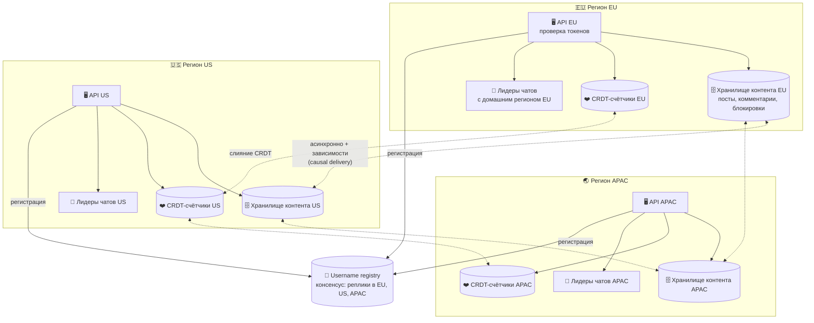
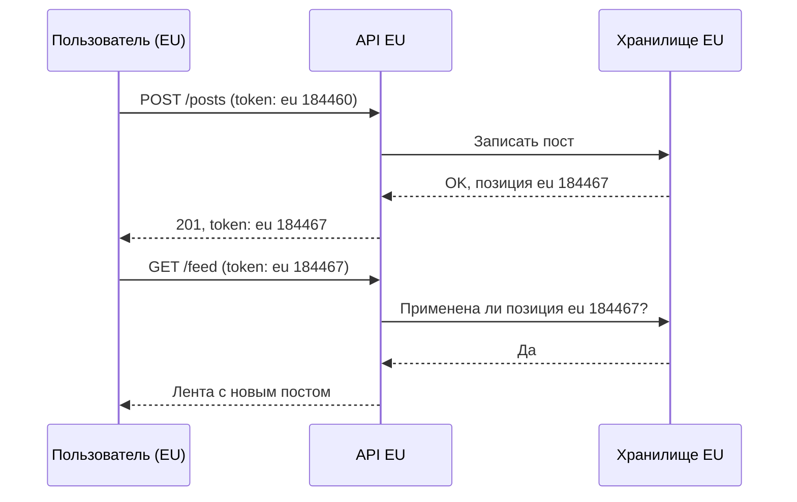
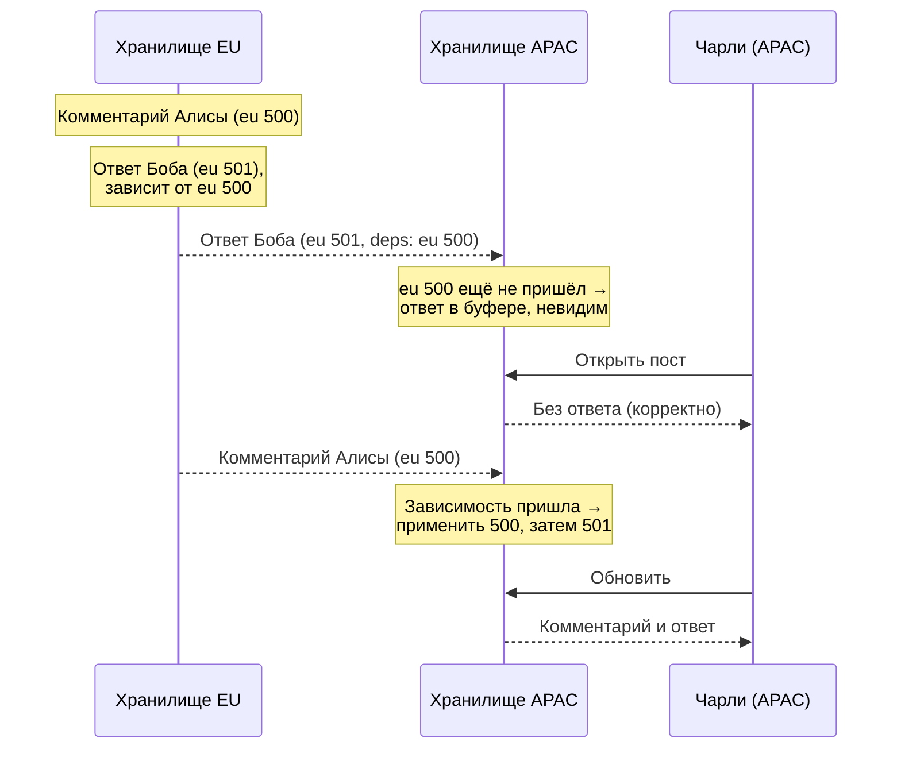
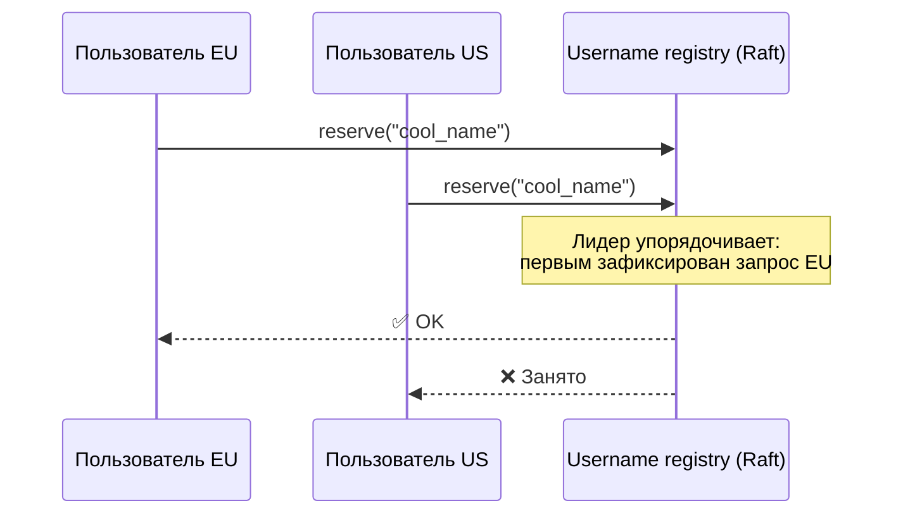
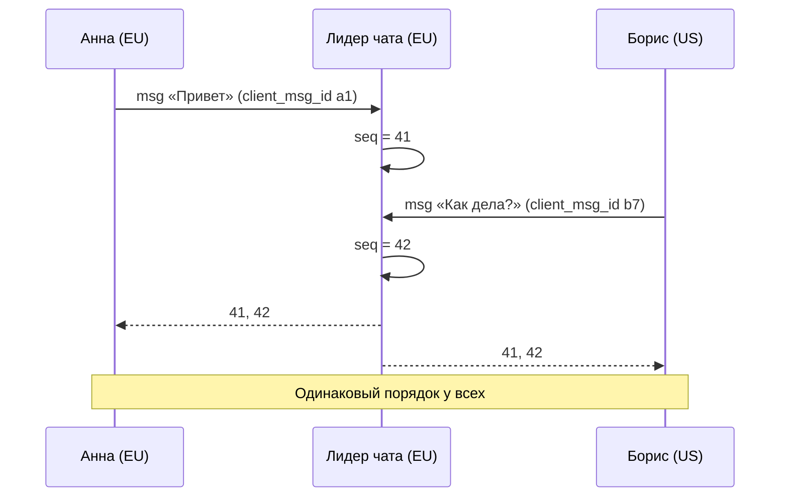

[English](INTERVIEW.md) | **Русский** · Теория: [README_RU.md](./README.ru.md)

# 07. Consistency Models: гарантии для глобальной соцсети

> **Тема:** от жалоб пользователей к аномалиям и моделям консистентности; сессионные токены, causal consistency с зависимостями, линеаризуемая уникальность, CRDT-счётчики, порядок сообщений, CAP и PACELC для каждой функции
> **Уровень:** Hard · **Время на интервью:** 45 мин · **Время на разбор:** ~5 ч
> **Где спрашивают:** «Какие гарантии консистентности нужны в этой системе?» — почти в каждом senior-интервью про соцсети, мессенджеры, совместную работу

---

## 🗺️ Как читать этот разбор

| Значок | Что значит |
|:------:|:-----------|
| 🎤 | Реплика интервьюера |
| 🗣️ | Что говорю вслух я (кандидат) |
| ✏️ | Что рисую на доске |
| ⏱️ | Сколько времени тратить на шаг |

Блоки **TIP** — хороший приём, **WARNING** — ловушка, **IMPORTANT** — сигнал для уровня Senior+.

---

## 📑 Содержание

1. [Условие задачи](#1-условие-задачи)
2. [От жалоб к аномалиям](#2-от-жалоб-к-аномалиям)
3. [Требования](#3-требования)
4. [Оценки и бюджет задержек](#4-оценки-и-бюджет-задержек)
5. [Выбор модели для каждой функции](#5-выбор-модели-для-каждой-функции)
6. [API с токенами консистентности](#6-api-с-токенами-консистентности)
7. [High-level дизайн](#7-high-level-дизайн)
8. [Deep dive 1: сессионные гарантии через токен](#8-deep-dive-1-сессионные-гарантии-через-токен)
9. [Deep dive 2: causal consistency для комментариев и приватности](#9-deep-dive-2-causal-consistency-для-комментариев-и-приватности)
10. [Deep dive 3: уникальный username](#10-deep-dive-3-уникальный-username)
11. [Deep dive 4: счётчики, которые не прыгают назад](#11-deep-dive-4-счётчики-которые-не-прыгают-назад)
12. [Deep dive 5: порядок сообщений в чатах](#12-deep-dive-5-порядок-сообщений-в-чатах)
13. [CAP и PACELC по функциям](#13-cap-и-pacelc-по-функциям)
14. [Узкие места и сценарии сбоев](#14-узкие-места-и-сценарии-сбоев)
15. [Вопросы интервьюера с ответами](#15-вопросы-интервьюера-с-ответами)
16. [Типичные ошибки](#16-типичные-ошибки)
17. [Шпаргалка и самопроверка](#17-шпаргалка-и-самопроверка)

---

## 1. Условие задачи

> 🎤 «У нас соцсеть с пользователями по всему миру, данные реплицируются асинхронно между тремя регионами. В поддержку приходят жалобы:
> 1. «Я опубликовал пост, обновил страницу — а его нет»;
> 2. «Вижу ответ на комментарий, а самого комментария нет»;
> 3. «Я заблокировала бывшего и сразу выложила фото — а он его увидел»;
> 4. «Мне и другу выдали один и тот же username»;
> 5. «Число лайков то растёт, то уменьшается»;
> 6. «В групповом чате у меня и у друга разный порядок сообщений».
>
> Спроектируй гарантии консистентности, которые это исправят, не убив производительность».

**План по времени:**

| Шаг | ⏱️ |
|:----|:--:|
| Жалобы → аномалии | 6 мин |
| Требования и бюджет задержек | 5 мин |
| Модель для каждой функции | 5 мин |
| High-level дизайн | 5 мин |
| Deep dives | 20 мин |
| CAP/PACELC и итоги | 4 мин |

> [!TIP]
> Сильный старт — **назвать каждую жалобу по имени аномалии**. Это показывает, что ты не просто «добавишь синхронную репликацию», а понимаешь, какая именно гарантия нарушена и какая минимальная модель её восстановит.

---

## 2. От жалоб к аномалиям

⏱️ 6 мин

| № | Жалоба | Аномалия | Минимальная модель, которая её исключает |
|:-:|:-------|:---------|:-----------------------------------------|
| 1 | Пост пропал после обновления | Нарушение **read-your-writes** | Сессионные гарантии |
| 2 | Ответ без комментария | Нарушение **causal consistency** (writes-follow-reads) | Causal |
| 3 | Бывший увидел фото после блокировки | Нарушение **causal consistency**: «заблокировать» → «опубликовать» не упорядочены на чужой реплике | Causal |
| 4 | Один username у двоих | Нарушение **уникальности**: конкурентные записи в разных регионах без координации | Линеаризуемость |
| 5 | Лайки прыгают | Нарушение **monotonic reads** (разные реплики) | Сессионные гарантии (+ CRDT для сходимости) |
| 6 | Разный порядок сообщений | Нет **общего порядка** (total order) внутри чата | Total order в рамках чата |

🗣️ «Видно, что линеаризуемость нужна только в одном случае из шести. Остальное решается более дешёвыми моделями, которые не требуют межрегиональной координации на каждую запись».

---

## 3. Требования

⏱️ 3 мин

### Функциональные

1. Посты, комментарии с ответами, лайки, подписки.
2. Блокировки и настройки приватности.
3. Регистрация с уникальным username.
4. Личные и групповые чаты.

### Нефункциональные

| Требование | Цель |
|:-----------|:-----|
| Задержка записи (пост, комментарий, лайк) | p99 < 150 мс — без межрегионального round trip |
| Задержка чтения ленты | p99 < 200 мс, локально в регионе |
| Регистрация | p99 < 1 с (редкая операция) |
| Доступность | Чтение ленты и публикация работают при разрыве связи между регионами |
| Корректность | Ни одного дубликата username; блокировка всегда «раньше» последующих постов |
| Видимость | 99% записей видны во всех регионах за 2 с |

---

## 4. Оценки и бюджет задержек

⏱️ 2 мин

✏️

```
DAU                    = 500M в 3 регионах
Посты + комментарии    ≈ 50 000 записей/с в пике
Лайки                  ≈ 500 000 записей/с в пике
Регистрации            ≈ 200/с
Сообщения в чатах      ≈ 300 000/с

RTT между регионами    ~80–200 мс
Бюджет записи поста    150 мс → межрегиональная координация не помещается
Бюджет регистрации     1 с    → межрегиональный консенсус (~100–200 мс) помещается
```

🗣️ «Из этого сразу следует: для постов, комментариев и лайков — только локальная запись с асинхронной репликацией. Строгую координацию между регионами можем позволить только регистрации».

---

## 5. Выбор модели для каждой функции

⏱️ 5 мин

| Функция | Модель | Механизм | Цена |
|:--------|:-------|:---------|:-----|
| Свои посты и профиль | Сессионные гарантии (RYW, monotonic reads) | Сессионный токен с позицией журнала | Иногда ожидание реплики или чтение из домашнего региона |
| Комментарии и ответы | Causal | Метаданные зависимостей, отложенная видимость | Небольшая задержка видимости при лаге |
| Блокировки и приватность | Causal + проверка при чтении | Блокировка — зависимость последующих постов | То же |
| Username | Линеаризуемость | Консенсусное хранилище с репликами в 3 регионах | +100–200 мс к регистрации; при потере большинства регистрация недоступна |
| Лайки | Strong eventual (CRDT) + monotonic reads в сессии | G-Counter/PN-Counter, «не меньше уже показанного» | Число может отставать на секунды |
| Чат | Total order внутри чата | Лидер чата назначает порядковые номера | Запись в чат идёт через регион лидера чата |

> [!IMPORTANT]
> **Сигнал Senior+:** каждая строка — минимальная достаточная модель. «Линеаризуемость везде» дала бы 100–200 мс на каждый лайк и недоступность при разрыве сети. «Eventual везде» не исправила бы ни одной жалобы.

---

## 6. API с токенами консистентности

⏱️ 2 мин

```http
POST /v1/posts
     Headers: X-Session-Token: <токен>
     Body:    { text, media_ids[], visibility }
     → 201 { post_id, session_token: <новый токен> }

GET  /v1/feed?cursor=...
     Headers: X-Session-Token: <токен>
     → 200 { items[], session_token }

POST /v1/comments
     Body: { post_id, parent_comment_id?, text }
     Headers: X-Session-Token: <токен, в котором есть позиция прочитанного комментария>

POST /v1/users/me/blocks          { blocked_user_id }

POST /v1/signup                   { username, email, ... }   ← линеаризуемая проверка

POST /v1/chats/{chat_id}/messages { client_msg_id, text }
     → 201 { message_id, seq }    ← порядковый номер в чате
```

🗣️ «**Сессионный токен** — центральная часть: он компактно кодирует, какие записи клиент уже видел или сделал. Сервер возвращает обновлённый токен в каждом ответе, клиент хранит его и отправляет в каждом запросе. Для нескольких устройств токен дополнительно хранится на сервере в сессии пользователя».

---

## 7. High-level дизайн

⏱️ 5 мин

✏️



🗣️ «Основной контент пишется **локально** и реплицируется асинхронно, но с **метаданными зависимостей**: реплика делает запись видимой только после её причин. Счётчики — CRDT. Username — единственное, что идёт через консенсус. Чаты — у каждого чата есть домашний регион, где лидер назначает порядок».

---

## 8. Deep dive 1: сессионные гарантии через токен

> 🎤 «Жалоба 1: пост пропадает после обновления страницы. Как исправить, не читая всё с лидера?»

🗣️ «Это read-your-writes. Каждое хранилище контента ведёт **журнал с позициями** в своём регионе. Токен — это вектор позиций по регионам, которые клиент видел или куда писал:

```
session_token = { eu: 184467, us: 99120, apac: 50311 }
```

Правило для реплики: **ответить можно, только если она применила все записи до позиций из токена**. Иначе — подождать немного (обычно миллисекунды) или переадресовать запрос в регион, который догнал».



🗣️ «Тот же токен даёт **monotonic reads**: после каждого ответа токен содержит максимальную виденную позицию, и следующий ответ не может быть старше. Это заодно решает часть жалобы 5».

> 🎤 «А если пользователь в поездке, и его запрос попал в US, где позиция EU ещё не применилась?»

🗣️ «Реплика US ждёт с таймаутом (например, 200 мс), затем переадресует чтение в EU. Пользователь получит ответ чуть медленнее, но корректный. Это редкий путь, потому что 99% записей реплицируются за секунды».

---

## 9. Deep dive 2: causal consistency для комментариев и приватности

> 🎤 «Жалобы 2 и 3. Почему токен из прошлого шага их не решает?»

🗣️ «Токен защищает **одного** пользователя. Жалобы 2 и 3 затрагивают **разных** пользователей: Боб ответил на комментарий Алисы, а Чарли видит ответ без комментария. Нужна причинная согласованность **для всех**: запись не должна становиться видимой нигде раньше своих причин».

### Как это реализовать

1. **Каждая запись несёт зависимости:** когда клиент пишет, токен его сессии (позиции, которые он видел) становится **зависимостями** записи.
2. **Causal delivery:** реплика, получив запись из другого региона, проверяет зависимости. Если какая-то ещё не применена — запись **буферизуется** и становится видимой, только когда зависимости придут.



### Блокировка и приватность (жалоба 3)

🗣️ «Алиса заблокировала бывшего (запись `block`), затем опубликовала фото. В момент публикации токен Алисы содержит позицию `block`, поэтому фото **зависит** от блокировки. Ни одна реплика не покажет фото, пока не применит блокировку — а после её применения проверка доступа при чтении скроет фото от бывшего.

Дополнительно, для приватности делаю **проверку доступа при чтении в регионе автора**, если зависимость о блокировке ещё не пришла, — защита на случай ошибок в метаданных. Нарушение приватности стоит дороже небольшой задержки».

> [!WARNING]
> **Ловушка: внешние каналы.** Если о новом посте пользователь узнаёт через push-уведомление, которое ушло раньше, чем пост реплицировался, он откроет приложение и не найдёт пост. Решение: уведомление несёт токен с позицией поста, и клиент передаёт его при открытии — реплика подождёт или переадресует запрос.

### Цена causal

| Цена | Как смягчить |
|:-----|:-------------|
| Размер метаданных зависимостей | Вектор по регионам (3–6 чисел), а не по каждой записи |
| Задержка видимости, если зависимость отстаёт | SLO на лаг репликации; мониторинг размера буфера |
| Буфер растёт, если регион долго недоступен | Ограничение буфера; при превышении — переадресация чтения в регион-источник |

---

## 10. Deep dive 3: уникальный username

> 🎤 «Жалоба 4. Почему не проверить, что username свободен, в локальной базе?»

🗣️ «Два пользователя в EU и US одновременно проверяют `cool_name`: каждый регион видит, что имя свободно, и оба записывают. Асинхронная репликация обнаружит конфликт **после** того, как оба уже получили подтверждение. Причинная консистентность не поможет — эти операции параллельны, а не причинно связаны. Нужна **линеаризуемость**: одна точка истины, которая упорядочивает конкурентные попытки».

### Решение

- **Username registry** — небольшое консенсусное хранилище (Raft-группа, реплики в трёх регионах, как etcd или Spanner/CockroachDB).
- Регистрация: атомарная операция «вставить, если не существует» (`INSERT ... ON CONFLICT DO NOTHING` или compare-and-set).
- Коммит большинством двух регионов: ~100–200 мс — укладывается в бюджет 1 с.



> 🎤 «А при разрыве сети?»

🗣️ «Регион, который не видит большинство, **не может** регистрировать новые имена — это осознанный CP-выбор для одной операции. Пользователь видит «попробуйте через минуту». Вход, лента и публикация в этом регионе продолжают работать, потому что им консенсус не нужен».

> [!TIP]
> Можно смягчить UX: в изолированном регионе разрешить регистрацию **без выбора username** (временное имя `user_8f3a2`), а выбор имени — после восстановления связи. Так CP-ограничение затрагивает только одну функцию, а не регистрацию целиком.

---

## 11. Deep dive 4: счётчики, которые не прыгают назад

> 🎤 «Жалоба 5. Лайки то растут, то уменьшаются. Это же просто счётчик?»

🗣️ «Две проблемы:
1. **Сходимость:** параллельные лайки в разных регионах. Если хранить одно число и перезаписывать его (LWW), лайки теряются. Решение — **PN-Counter (CRDT)**: у каждого региона свои слагаемые «плюс» и «минус», итог — сумма. Все регионы гарантированно сходятся (strong eventual consistency).
2. **Прыжки назад:** пользователь видит 1 002 с одной реплики, затем 998 с другой, отстающей. Это monotonic reads».

### Решение для прыжков

- Сессионный токен из deep dive 1 уже защищает от чтения с отстающей реплики.
- Дополнительно на клиенте: **не показывать значение меньше уже показанного** для того же поста в этой сессии, если пользователь сам не отменял лайк.
- Для собственного лайка — read-your-writes: пользователь сразу видит свой лайк (оптимистичное обновление на клиенте + токен).

> [!NOTE]
> Точное значение лайков в моменте никому не нужно, важно, чтобы оно не вело себя странно. Для крупных постов часто ещё и **округляют** («12,4 тыс.»), что маскирует расхождения между регионами.

### Почему не линеаризуемый счётчик

500 000 лайков в секунду с межрегиональной координацией на каждый — это сотни миллисекунд на лайк и огромная нагрузка на лидеров популярных постов (горячие ключи). Плюс недоступность при разрыве сети. Цена несоразмерна пользе.

---

## 12. Deep dive 5: порядок сообщений в чатах

> 🎤 «Жалоба 6. Почему не сортировать сообщения по времени отправки?»

🗣️ «Часы устройств и серверов расходятся. Сообщение, отправленное позже, может получить меньший timestamp, и у разных участников порядок будет разным, если сортировать по разным источникам времени. Нужен **единый порядок (total order)** внутри чата».

### Решение: лидер чата назначает порядковые номера

- У каждого чата есть **домашний регион** (по создателю или по большинству участников) и лидер — партиция, которая назначает сообщениям монотонный `seq`.
- Все участники сортируют сообщения по `seq`, поэтому порядок одинаков у всех.
- Сообщения реплицируются в регионы участников для быстрого чтения.



| Вопрос | Решение |
|:-------|:--------|
| Задержка для Бориса из US | Запись идёт в EU (~90 мс) — для чата приемлемо. Своё сообщение показывается сразу оптимистично, с пометкой «отправляется» |
| Повторная отправка при обрыве | `client_msg_id` — идемпотентность: дубль не получит новый seq |
| Регион лидера недоступен | Чат временно не принимает новые сообщения (или лидерство переносится через консенсус); чтение истории работает с реплик |
| Сообщения из офлайна | Клиент копит и отправляет при подключении; seq назначается при получении лидером |

> [!TIP]
> Это та же идея, что в Kafka: **total order внутри партиции**, без глобального порядка между партициями. Глобальный порядок всех чатов не нужен и был бы очень дорогим.

---

## 13. CAP и PACELC по функциям

| Функция | При разрыве сети (P) | В норме (E) | Поведение при разрыве |
|:--------|:--------------------:|:-----------:|:----------------------|
| Лента, посты, комментарии | A | L | Работает; новые записи видны в других регионах после восстановления, в правильном причинном порядке |
| Блокировки и приватность | A | L | Применяются локально сразу; посты, зависящие от них, не видны в других регионах раньше блокировки |
| Лайки | A | L | Считаются локально; CRDT сливает после восстановления |
| Регистрация username | **C** | **C** | В регионе без большинства — недоступна (или временное имя) |
| Сообщения в чате | **C** для записи в чат | **C** (через лидера) | Если регион лидера чата недоступен — запись в этот чат приостановлена |

🗣️ «Ни одна функция не «CP-система» и не «AP-система» целиком — выбор сделан **для каждой операции** по цене ошибки».

---

## 14. Узкие места и сценарии сбоев

| Сценарий | Что произойдёт | Как защищаемся |
|:---------|:---------------|:---------------|
| Разрыв EU ↔ US на 10 минут | Записи копятся; буферы causal-зависимостей растут | Лента и публикация работают локально; после восстановления записи применяются в причинном порядке |
| Клиент потерял токен (новое устройство) | Нет read-your-writes на новом устройстве | Токен хранится и на сервере в сессии пользователя |
| Огромный буфер зависимостей | Видимость записей задерживается, память растёт | Лимит буфера; переадресация чтения в регион-источник; алерты |
| Расхождение часов серверов | Неправильный порядок при сортировке по времени | Порядок по seq и логическим часам, а не по физическому времени |
| Потеря большинства в username registry | Регистрация с выбором имени недоступна | Временные имена; остальной продукт работает |
| Push-уведомление опережает репликацию | Пользователь не находит пост по уведомлению | Токен в уведомлении; ожидание или переадресация |
| Горячий пост с миллионами лайков | Нагрузка на одну партицию счётчика | Шардированные счётчики внутри региона (см. [06-partitioning](../06_Partitioning/README.ru.md#8-горячие-партиции-и-перекос)) |
| Баг в метаданных зависимостей | Возможно нарушение приватности | Дополнительная проверка доступа при чтении в регионе автора для чувствительных случаев |

---

## 15. Вопросы интервьюера с ответами

<details>
<summary><b>Почему бы не сделать всё линеаризуемым через Spanner?</b></summary>

Каждая запись стоила бы межрегионального коммита (~100–200 мс), что ломает бюджет 150 мс на пост и комментарий, а 500 000 лайков в секунду через консенсус — огромная нагрузка, особенно на горячих постах. Плюс при разрыве сети регион без большинства перестал бы принимать посты. Линеаризуемость нужна только там, где без неё нарушается инвариант — здесь это username и порядок в чате.
</details>

<details>
<summary><b>Чем causal consistency лучше простого read-your-writes?</b></summary>

Read-your-writes защищает одного пользователя: он видит свои записи. Causal защищает отношения между пользователями: ответ Боба не будет виден Чарли раньше комментария Алисы, на который Боб отвечал. Жалобы 2 и 3 затрагивают нескольких пользователей, поэтому сессионных гарантий недостаточно.
</details>

<details>
<summary><b>Почему вектор позиций по регионам, а не векторные часы по каждому клиенту?</b></summary>

Векторные часы по клиентам были бы огромными (сотни миллионов компонент). Позиция в журнале каждого региона уже упорядочивает все записи этого региона, поэтому вектора из 3–6 чисел достаточно, чтобы выразить «клиент видел всё до этих позиций». Цена — немного лишних зависимостей (запись зависит от всего префикса журнала, а не только от реально прочитанных записей), что даёт чуть большую задержку видимости, но сильно упрощает систему.
</details>

<details>
<summary><b>Как гарантировать, что блокировка сработает, даже если метаданные зависимостей потерялись?</b></summary>

Двойная защита: зависимости в метаданных (основной механизм) и проверка списка блокировок при чтении. Для чувствительных операций (приватность) чтение списка блокировок автора можно делать с причинно свежей реплики или из домашнего региона автора. Нарушение приватности дороже, чем дополнительные миллисекунды.
</details>

<details>
<summary><b>Что если два пользователя одновременно отредактировали один пост (например, общий альбом)?</b></summary>

Causal consistency не разрешает конфликты параллельных записей — она только упорядочивает причинно связанные. Для совместно редактируемых объектов нужно отдельное разрешение конфликтов: CRDT (например, OR-Set для фото в альбоме), версии с явным слиянием или single-leader для таких объектов.
</details>

<details>
<summary><b>Почему нельзя упорядочивать сообщения чата по Lamport-часам?</b></summary>

Lamport-часы дают общий порядок, согласованный с причинностью, и это работало бы, если все участники обмениваются метками. Но параллельные сообщения упорядочиваются по номеру узла, что выглядит произвольно, а для одинакового порядка у всех нужно, чтобы все видели одинаковый набор сообщений до показа. Лидер с seq проще: порядок один, назначается в одном месте, и пропуски в seq сразу видны клиенту.
</details>

---

## 16. Типичные ошибки

| ❌ Ошибка | ✅ Как правильно |
|:---------|:----------------|
| «Сделаем синхронную репликацию» на все жалобы | Назвать аномалию каждой жалобы и выбрать минимальную модель |
| Read-your-writes для проблемы ответа без комментария | Это causal между разными пользователями |
| Проверять уникальность username локально | Линеаризуемое хранилище с compare-and-set |
| LWW для лайков | CRDT-счётчик |
| Сортировать сообщения по timestamp | Seq от лидера чата |
| Объявить систему «AP» или «CP» целиком | Решение для каждой операции |
| Забыть про уведомления как внешний канал | Токен с позицией в уведомлении |
| Causal без лимита буфера | Лимит, мониторинг, переадресация |

---

## 17. Шпаргалка и самопроверка

### Ответ за 30 секунд

> Каждую жалобу сопоставляю с аномалией и выбираю минимальную модель. Пропавший пост и прыгающие лайки — сессионные гарантии через токен с вектором позиций журналов. Ответ без комментария и обход блокировки — causal consistency: записи несут зависимости, реплика буферизует запись до прихода её причин. Дубликаты username — линеаризуемость через консенсусный registry в трёх регионах. Лайки — PN-Counter CRDT плюс monotonic reads. Порядок в чате — seq от лидера чата. При разрыве сети лента, посты и лайки доступны (PA/EL), регистрация имени и запись в чат с недоступным лидером — нет (PC/EC).

### Самопроверка

- [ ] Могу сопоставить 6 жалоб с аномалиями и минимальными моделями
- [ ] Могу объяснить, как сессионный токен даёт read-your-writes и monotonic reads
- [ ] Могу нарисовать causal delivery с буферизацией зависимостей
- [ ] Могу объяснить, почему блокировка + пост — это causal, а не RYW
- [ ] Могу объяснить, почему username требует линеаризуемости, а лайки — нет
- [ ] Могу объяснить, почему нельзя сортировать сообщения по времени
- [ ] Могу заполнить таблицу CAP/PACELC для каждой функции
- [ ] Могу назвать цену causal consistency и как её ограничить

### Что почитать

- Теория по теме: [README_RU.md](./README.ru.md)
- Lloyd et al., *Don't Settle for Eventual: Scalable Causal Consistency for Wide-Area Storage with COPS*
- Документация Azure Cosmos DB: Session consistency
- Документация MongoDB: Causal consistency sessions
- Martin Kleppmann, *Please stop calling databases CP or AP*