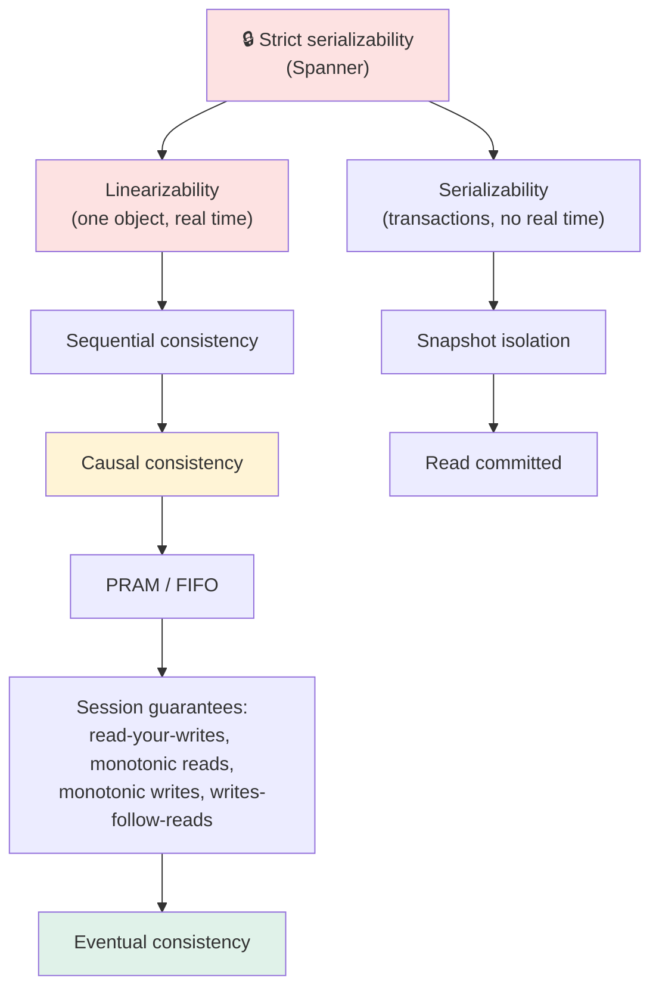
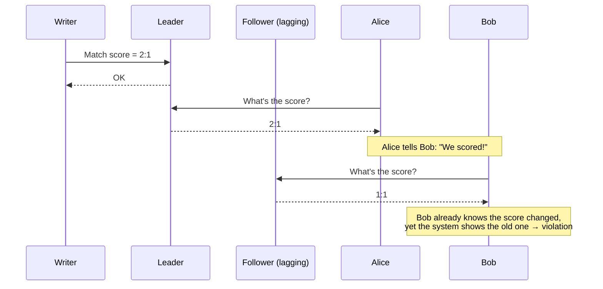
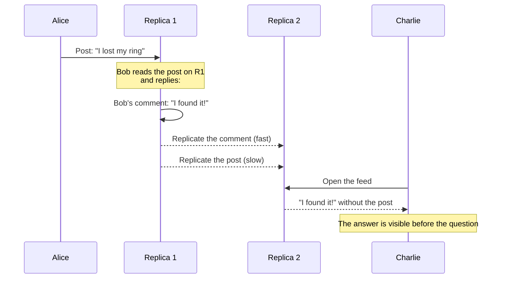
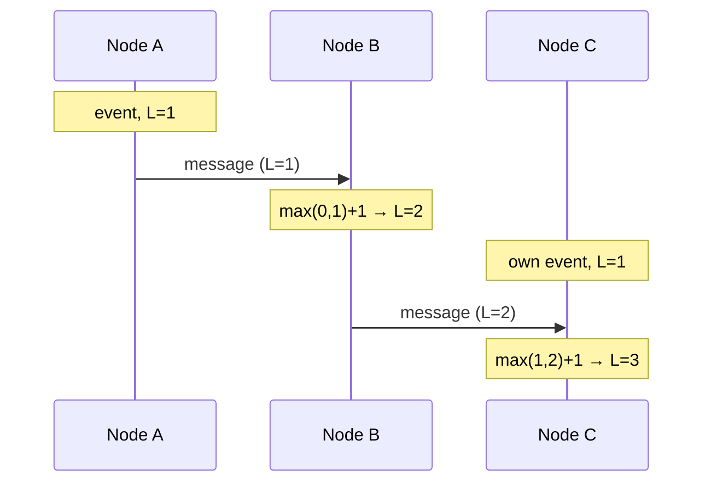
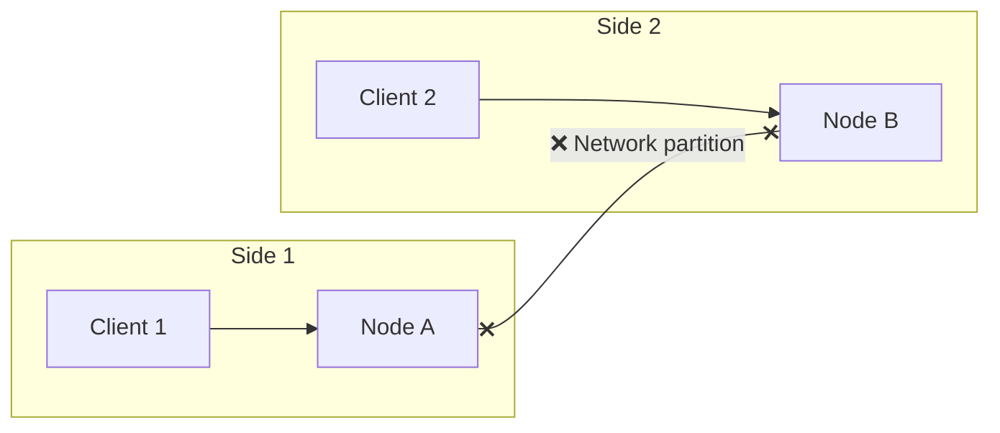

**English** | [Русский](README_RU.md)

# 07. Consistency Models

> **Covers:** what a consistency model is, linearizability, serializability and strict serializability, sequential and causal consistency, session guarantees, eventual consistency, clocks and event ordering, CAP and PACELC, tunable consistency in real databases
> **Study time:** ~5 h · **Needed for:** any distributed system with replication; nearly every Senior+ interview
> **Practice:** interview-style walkthrough — [INTERVIEW.md](./INTERVIEW.md)
> **Related topics:** [04-databases](../04-databases/README.md#10-isolation-levels) (isolation levels), [05-replication](../05-replication/README.md#6-replication-lag-and-read-guarantees) (lag and read guarantees), [06-partitioning](../06-partitioning/README.md)

---

## 📑 Contents

1. [What a Consistency Model Is](#1-what-a-consistency-model-is)
2. [Map of Models: From Strong to Weak](#2-map-of-models-from-strong-to-weak)
3. [Linearizability](#3-linearizability)
4. [Linearizability, Serializability and Strict Serializability](#4-linearizability-serializability-and-strict-serializability)
5. [Sequential Consistency](#5-sequential-consistency)
6. [Causal Consistency](#6-causal-consistency)
7. [Session Guarantees](#7-session-guarantees)
8. [Eventual Consistency](#8-eventual-consistency)
9. [Clocks and Event Ordering](#9-clocks-and-event-ordering)
10. [The CAP Theorem](#10-the-cap-theorem)
11. [PACELC](#11-pacelc)
12. [Tunable Consistency in Real Systems](#12-tunable-consistency-in-real-systems)
13. [Choosing a Model for the Job](#13-choosing-a-model-for-the-job)
14. [How to Talk About This in an Interview](#14-how-to-talk-about-this-in-an-interview)
15. [Self-Check Questions](#15-self-check-questions)
16. [Glossary and Resources](#16-glossary-and-resources)

---

## 1. What a Consistency Model Is

A **consistency model** is a **contract** between a storage system and its clients: which values a read may return, given all the writes that happened before it and concurrently with it.

On a single server without replicas the question barely arises: you read and get the latest write. With replication and a network, there's a choice: how "fresh" and "consistent" responses must be, and at what cost (latency, availability).

> [!WARNING]
> The word "consistency" is overloaded in distributed systems:
> - **C in ACID** — preserving data invariants (constraints, business rules);
> - **C in CAP** — linearizability;
> - **consistency model** — what clients see during concurrent operations on replicas;
> - **isolation level** — how concurrent **transactions** over multiple objects interact.
>
> Always clarify which one is meant.

### Two dimensions

| Dimension | Question | Example models |
|:----------|:---------|:---------------|
| **Transaction isolation** (multiple objects) | Do concurrent transactions look as if they ran one at a time? | Read Committed, Snapshot Isolation, Serializable |
| **Replica consistency** (one object, freshness) | Does a read see the latest write in real time? | Linearizable, Causal, Eventual |

Isolation is covered in [04-databases](../04-databases/README.md#10-isolation-levels). This topic is mainly about the second dimension and where the two meet (strict serializability).

---

## 2. Map of Models: From Strong to Weak

| The higher | The more |
|:-----------|:---------|
| ⬆️ Stronger model | Easier to reason about correctness, but higher latency and lower availability during network failures |
| ⬇️ Weaker model | Faster and more available, but the application must cope with anomalies |

> [!IMPORTANT]
> The key fact: **causal consistency is the strongest model that remains available during a network partition** (provided a client sticks to one replica). Anything stronger (sequential, linearizable) requires coordination and must refuse some requests when the network splits.

---

## 3. Linearizability

**Linearizability** (atomic consistency, strong consistency) — the system behaves as if there's **a single copy of the data**, and each operation takes effect **atomically at some point** between its start and its end.

The main consequence: **once a write completes (or someone reads the new value), every later read in real time sees that value or a newer one.**

### Example: not linearizable

Alice and Bob used an **external channel** (talking). Linearizability guarantees that once anyone has seen the new value, nobody sees the old one — regardless of which replica serves the request.

### Where linearizability is genuinely needed

| Scenario | Why |
|:---------|:----|
| **Leader election and distributed locks** | Every node must agree on who the current owner is |
| **Uniqueness constraints** | Two users must not get the same username or seat number |
| **Inventory, balances** | You can't sell the last item twice or go negative |
| **Cross-channel dependencies** | A service writes a file to storage and sends a "process this file" message; the processor must see the file |

### How to get it

| Mechanism | Linearizable? |
|:----------|:--------------|
| Single-leader, reads and writes only via the leader | ✅ Yes, if there's definitely one leader (needs split-brain protection: a lease or consensus) |
| Reads from async replicas | ❌ No |
| Consensus (Raft, Paxos) for writes + read index or lease for reads | ✅ Yes |
| Multi-leader | ❌ No |
| Leaderless with quorums (Dynamo-style) | ⚠️ Usually not: with concurrent writes and LWW; only possible with synchronous read repair and no LWW |

### The cost

- **Latency:** every operation requires coordination. Across regions that's tens to hundreds of milliseconds.
- **Availability:** during a partition, nodes that can't see a majority (or the leader) **must refuse**, otherwise they might return stale data.
- **Throughput:** everything goes through the leader or a quorum.

> [!NOTE]
> Even a multi-core CPU's RAM isn't linearizable by default: cores have their own caches, and without memory barriers a thread may see stale values. Linearizability is so expensive that it's given up for performance even inside a single computer.

---

## 4. Linearizability, Serializability and Strict Serializability

These terms are often confused.

| | Linearizability | Serializability | Strict serializability |
|:-|:----------------|:----------------|:-----------------------|
| About | Individual operations on **one** object | **Transactions** over many objects | Transactions over many objects |
| Guarantee | Operations appear atomic in **real-time** order | The result equals **some** serial execution of transactions | Equals a serial execution **in real-time order** |
| Respects real time | ✅ | ❌ | ✅ |
| Example anomaly it allows | No multi-object transactions | A transaction that finished earlier may "appear" to run later | — |
| Examples | etcd, ZooKeeper (writes), single-node Redis | PostgreSQL SERIALIZABLE (SSI) on one node | Google Spanner ("external consistency"), FoundationDB, CockroachDB (close, with caveats) |

> [!TIP]
> A handy phrasing: **linearizability is a "freshness" guarantee for one key; serializability is an "isolation" guarantee for transactions; strict serializability is both at once.**

---

## 5. Sequential Consistency

All operations appear to execute in **one global order**, and in that order each client's operations appear in the order the client issued them. But that global order **doesn't have to match real time** across different clients.

| | Linearizable | Sequential |
|:-|:-------------|:-----------|
| One global order | ✅ | ✅ |
| Each client's order preserved | ✅ | ✅ |
| Real time across clients respected | ✅ | ❌ |

**Example:** ZooKeeper guarantees linearizable writes, but reads from a replica give sequential consistency: a client may lag slightly but always sees events in the right order. For a fresh read there's the `sync()` operation.

---

## 6. Causal Consistency

Order is preserved only between **causally related** operations. Concurrent (independent) operations may be seen in different orders by different clients.

### What "causally related" means (happens-before)

Operation A **happened before** B if:
- A and B were performed by the same client, and A came first;
- B read a value written by A;
- there's a chain of such relations.

If neither A → B nor B → A, the operations are **concurrent**.

### Classic anomalies without causal consistency

| Anomaly | Example |
|:--------|:--------|
| Answer before the question | A reply comment is visible while the post it answers isn't yet |
| Access control violation | Alice removed her boss from friends, then posted "looking for a new job". On a replica where the removal hasn't applied, the boss sees the post |
| "Resurrection" | A user deleted a photo, then added a caption "deleted". On another replica the caption is there, and so is the photo |

### How it's implemented

- Each write carries **dependency metadata**: the version or vector clock of what the client had seen before writing.
- A replica **doesn't make a write visible** until all its dependencies have been applied (it buffers it).
- Examples: COPS (a research system, "causal+"), MongoDB causal consistency sessions, implementations on top of CRDTs.

| ✅ Pros | ❌ Cons |
|:-------|:-------|
| Stays available during network partitions | Dependency metadata overhead |
| No cross-region coordination per write | A write's visibility may be delayed until its dependencies arrive |
| Eliminates the anomalies users notice most | Doesn't resolve conflicts between concurrent writes — those need separate handling |

---

## 7. Session Guarantees

Weaker but very practical guarantees scoped to **one client (session)**. Formulated by Terry et al. in 1994.

| Guarantee | What it promises | Anomaly without it | Typical implementation |
|:----------|:-----------------|:-------------------|:-----------------------|
| **Read-your-writes** | The client sees its own writes | Updated a profile — sees the old one | A token with the last write's position; read from the leader after writing |
| **Monotonic reads** | Successive reads never "go back in time" | A comment appeared, then vanished on refresh | Replica pinning; a token with the highest position seen |
| **Monotonic writes** | A client's writes are applied in the order issued | "Change password" then "log out everywhere" — applied in reverse | Client write sequence numbers |
| **Writes-follow-reads** | A write made after a read is ordered after what was read | A reply is visible where the comment isn't yet | The write carries the position of what was read |

> [!TIP]
> All four together give roughly **causal consistency within a single session**. A practical technique is a **session token**: the server returns a position (LSN, version, vector clock) after each operation, the client passes it on subsequent requests, and a replica answers only once it has caught up to that position. That's how the Session level in Azure Cosmos DB works.

More on read-your-writes and monotonic reads, with diagrams, in [05-replication](../05-replication/README.md#6-replication-lag-and-read-guarantees).

---

## 8. Eventual Consistency

**If new writes stop, all replicas will eventually converge to the same value.**

That's a **very weak** guarantee:
- it only speaks about the future (liveness) and promises nothing at any given moment (safety);
- it doesn't say **when** replicas converge;
- it doesn't say **to which** value (with LWW — to whichever happened to win).

### Strong eventual consistency

A stronger variant: **replicas that have received the same set of updates are in the same state** — regardless of the order received. This is the **CRDT** guarantee (see [05-replication](../05-replication/README.md#8-conflict-resolution)). There are no conflicts to resolve manually.

### How "eventual" in practice

- Replicas usually converge within milliseconds to seconds.
- The PBS study (Probabilistically Bounded Staleness, Bailis et al., 2012) showed how to estimate staleness probabilistically: "with 99.9% probability, a read 10 ms after a write will see it".
- Monitor replication lag and expose it as an SLO: "99% of writes are visible in every region within 2 s".

---

## 9. Clocks and Event Ordering

Many models require knowing **what happened first**. Physical clocks are unreliable for that.

### Why physical clocks are unreliable

- Quartz clocks **drift** (typically tens of microseconds per second).
- NTP synchronizes them to within milliseconds, but worse when the network misbehaves; clocks can **jump backward**.
- So "the write with the larger timestamp happened later" is a **false** assumption across servers (see the LWW problem in [05-replication](../05-replication/README.md#8-conflict-resolution)).

### Logical and hybrid clocks

| Clock | How it works | What it gives | What it doesn't |
|:------|:-------------|:--------------|:----------------|
| **Lamport clock** | A counter: +1 per event; on receiving a message, `max(own, received) + 1` | If A → B, then L(A) < L(B). A total order consistent with causality | Can't tell concurrent events from ordered ones |
| **Vector clock** | A vector of per-node counters | Determines exactly: A → B, B → A, or concurrent | Size grows with the number of nodes |
| **Hybrid Logical Clock (HLC)** | Physical time + a logical counter | Close to real time and consistent with causality; compact | Doesn't provide strict linearizability by itself |
| **TrueTime** (Google Spanner) | Time as an interval `[earliest, latest]` with bounded uncertainty (GPS and atomic clocks) | Strict serializability via **commit wait**: wait out the uncertainty | Requires special infrastructure |

> [!NOTE]
> CockroachDB uses HLC and a bound on maximum clock offset (by default on the order of hundreds of milliseconds); if a node's clock drifts beyond it, the node shuts down. Spanner instead bounds uncertainty in hardware (TrueTime) and pays a small commit-wait latency.

---

## 10. The CAP Theorem

**Statement (Brewer 2000, proven by Gilbert and Lynch 2002):** during a **network partition** (Partition), a distributed system must choose between:
- **C (Consistency)** — linearizability;
- **A (Availability)** — every non-failing node responds to every request (not with an error).

Client 2 reads from node B. Node B doesn't know what changed on A. Options:
- **respond** (possibly with a stale value) → chose **A**, sacrificed C;
- **refuse** or wait for the link to return → chose **C**, sacrificed A.

### Common misconceptions

| Misconception | Reality |
|:--------------|:--------|
| "Pick any 2 of 3" | Partitions happen whether you like it or not. The real choice is **what to do during a partition** |
| "A CA system" | Only possible without a network: a single node. Every distributed system must account for P |
| "A system is either CP or AP" | Most systems are neither strictly CP nor strictly AP: they have different modes per operation, tunable levels, and "A" in CAP is a very strict definition |
| "CAP describes a system's overall trade-offs" | CAP only covers linearizability and only during a partition. It says nothing about latency in normal operation |
| "AP means no consistency" | An AP system can offer causal consistency, session guarantees, CRDTs |

> [!TIP]
> Instead of "the system is CP or AP", be precise: "During a cross-region partition, **order writes** in a region without a majority are rejected (we choose consistency), while the **cart** keeps working and merges later (we choose availability)." The decision is made **per operation**, not for the whole system.

---

## 11. PACELC

CAP is silent about normal operation, yet there's a trade-off even without failures. **PACELC** (Daniel Abadi, 2012) extends it:

> **If P** (a partition) — choose between **A** and **C**.
> **Else (E)** — choose between **L** (latency) and **C** (consistency).

Even without failures, strong consistency requires coordination between replicas, which costs latency.

| System (default settings) | During partition (P) | Normally (E) | Comment |
|:--------------------------|:--------------------:|:------------:|:--------|
| DynamoDB, Cassandra, Riak | A | L | Availability and speed; consistency tunable per request |
| Spanner, CockroachDB, etcd, ZooKeeper (writes) | C | C | Always coordinate; pay in latency |
| PostgreSQL / MySQL with async replicas, reads from replicas | A* | L | *Replica reads continue; writes only on the leader |
| MongoDB | Depends on `readConcern` / `writeConcern` | Depends | With `majority` closer to PC/EC; with `w: 1` and secondary reads closer to PA/EL |
| Azure Cosmos DB | Depends on level | Depends | Five consistency levels to choose from |

> [!IMPORTANT]
> **Senior+ signal:** bring up PACELC when discussing consistency in normal operation: "Even without failures, a linearizable write across three regions costs ~90 ms — that's EC. For the feed I choose EL: local writes, async replication."

---

## 12. Tunable Consistency in Real Systems

| System | Settings | What to choose |
|:-------|:---------|:---------------|
| **Cassandra** | Consistency level per request: `ONE`, `QUORUM`, `LOCAL_QUORUM`, `ALL`; `SERIAL` for lightweight transactions (Paxos) | `LOCAL_QUORUM` for most; LWT for uniqueness, but expensive |
| **DynamoDB** | Eventually consistent reads (default) or strongly consistent (costlier, from the partition leader); transactions | Strongly consistent only for read-after-write where it matters |
| **MongoDB** | `writeConcern` (`w: 1`, `w: "majority"`), `readConcern` (`local`, `majority`, `linearizable`, `snapshot`), causal consistency sessions | `majority` + causal sessions — a good balance |
| **Azure Cosmos DB** | Strong, Bounded staleness, Session, Consistent prefix, Eventual | Session — the default and usually enough |
| **etcd** | Linearizable reads (default) or serializable (local, may lag) | Linearizable for locks and leader election |
| **ZooKeeper** | Writes linearizable; reads sequential; `sync()` before reading for freshness | `sync()` when freshness is needed |
| **Redis** | Async replication; `WAIT` to wait for replicas | Don't use as a source of strong consistency without extra mechanisms |

### Cosmos DB's five levels — a clear scale

| Level | Guarantee |
|:------|:----------|
| **Strong** | Linearizability |
| **Bounded staleness** | Lag of at most K versions or T seconds |
| **Session** | Read-your-writes, monotonic reads and writes within a session |
| **Consistent prefix** | Reads see a prefix of writes in the right order, with no "gaps" |
| **Eventual** | Convergence only |

---

## 13. Choosing a Model for the Job

| Task | Model | Why |
|:-----|:------|:----|
| Account balance, inventory deduction | Linearizability / serializable transactions | No double spending |
| Unique username, email | Linearizability | Two users must not get the same name |
| Leader election, distributed locks | Linearizability (consensus) | Everyone must agree on the owner |
| Comments and replies, feeds with reshares | Causal | No answer before the question |
| Access rights, privacy | Causal (at minimum) | A permission change must apply before subsequent actions |
| Own profile, own settings | Read-your-writes | Users see their own changes |
| Like and view counters | Eventual (CRDT) + monotonic reads | Exact value in the moment doesn't matter, but the number mustn't "go backwards" |
| Chat messages | Total order within a chat | Every participant sees the same order |
| Cart | Strong eventual (CRDT) | Always available, merges without loss |
| Analytics, recommendations | Eventual | Minutes of lag don't matter |

---

## 14. How to Talk About This in an Interview

### 30-second answer

> "I choose a model per operation, not for the whole system. Linearizability only where an invariant breaks without it: uniqueness, balances, locks; I get it through consensus and pay in latency — that's PC/EC. For user content — causal consistency via dependency metadata: an answer never appears before its question, and the system stays available during a partition. For a user's own data — session guarantees via a token carrying a log position. For counters — eventual with CRDTs and monotonic reads in the session. I don't trust physical clocks for ordering — I use logical or hybrid clocks."

### Questions to ask

1. Which invariants must never be violated?
2. Which anomalies will users notice and not forgive?
3. What should happen during a cross-region partition — for each operation?
4. What write latency is acceptable? Does cross-region coordination fit in it?
5. Are there external channels (notifications, messages) through which users learn about events before replicas do?

### Common mistakes

- Confusing C in ACID with C in CAP.
- "We choose CP" or "we choose AP" for the whole system.
- A "CA system" for a distributed database.
- Assuming a W + R > N quorum gives linearizability.
- Using timestamps from different servers to order events.
- Demanding linearizability everywhere "just in case".
- Saying "eventual consistency" without explaining how the application handles anomalies.

---

## 15. Self-Check Questions

<b>1. How is linearizability different from serializability?</b>

Linearizability is a guarantee about individual operations on one object, respecting real time: once a write completes, everyone sees the new value. Serializability is a guarantee about transactions over many objects: the result equals some serial execution, with no real-time requirement. Strict serializability combines both.

<b>2. Why isn't reading from an async replica linearizable?</b>

The replica may lag: after a write completes on the leader (and someone may already have read the new value), a replica read can return the old one. That violates "once anyone has seen the new value, nobody sees the old one".

<b>3. How is causal consistency weaker than sequential?</b>

Sequential requires a single order of all operations for all clients. Causal requires a consistent order only for causally related operations; different clients may see concurrent operations in different orders. In return, causal can be provided without coordination and during partitions.

<b>4. Give an anomaly that causal consistency prevents.</b>

A reply comment is visible before the post it answers. Or: a user removes someone from an access list, then publishes a post — and that person sees the post on a replica where the removal hasn't applied yet.

<b>5. Why is a "CA system" a meaningless notion for distributed databases?</b>

Network partitions in a distributed system are inevitable. Giving up P means the system only works without partitions — effectively on a single node. The real choice is between C and A during a partition.

<b>6. What does PACELC add to CAP?</b>

CAP only covers behavior during a partition. PACELC adds the trade-off in normal operation: even without failures, strong consistency requires coordination between replicas and costs latency (EL vs EC).

<b>7. Why are vector clocks better than Lamport clocks?</b>

Lamport clocks guarantee that if A → B, then L(A) < L(B), but the timestamps can't tell you whether events were concurrent. Vector clocks determine precisely whether events are ordered or concurrent, which is needed for conflict detection.

<b>8. How does Spanner provide strict serializability without perfect clocks?</b>

TrueTime returns an interval `[earliest, latest]` with bounded uncertainty. On commit, a transaction gets a timestamp and waits (commit wait) until the uncertainty has passed, so any transaction that starts later in real time gets a larger timestamp.

<b>9. What is a session token and what guarantees does it give?</b>

After each operation the server returns a position (LSN, version), the client passes it on the next request, and a replica answers only once it has caught up to that position. This gives read-your-writes and monotonic reads (and, if the position is passed on writes, writes-follow-reads) without reading from the leader.

<b>10. What does strong eventual consistency mean?</b>

Replicas that have received the same set of updates are in the same state, regardless of the order received. It's the CRDT guarantee: no conflicts requiring manual resolution.

---

## 16. Glossary and Resources

### Glossary

| Term | Meaning |
|:-----|:--------|
| Consistency model | A contract on which values reads may return during concurrent operations |
| Linearizability | The illusion of a single copy with atomic operations in real-time order |
| Serializability | Transactions appear to run serially in some order |
| Strict serializability | Serializability + real-time order |
| Sequential consistency | One global order consistent with each client's order, without real time |
| Causal consistency | Preserving the order of causally related operations |
| Happens-before | The causal relation between operations |
| Session guarantees | Read-your-writes, monotonic reads, monotonic writes, writes-follow-reads |
| Eventual consistency | Replicas converge if writes stop |
| Strong eventual consistency | Same set of updates → same state |
| Lamport clock | Logical clocks consistent with causality |
| Vector clock | A counter vector that identifies causality and concurrency |
| HLC | Hybrid logical clocks: physical time + a counter |
| TrueTime | Time as an interval with bounded uncertainty (Spanner) |
| CAP | During a partition — a choice between linearizability and availability |
| PACELC | CAP + the latency vs consistency trade-off in normal operation |

### Resources

- *Designing Data-Intensive Applications*, Martin Kleppmann — chapter 9 "Consistency and Consensus"
- Herlihy, Wing, *Linearizability: A Correctness Condition for Concurrent Objects* (1990)
- Lamport, *Time, Clocks, and the Ordering of Events in a Distributed System* (1978)
- Gilbert, Lynch, *Brewer's Conjecture and the Feasibility of Consistent, Available, Partition-Tolerant Web Services* (2002)
- Eric Brewer, *CAP Twelve Years Later: How the "Rules" Have Changed* (2012)
- Daniel Abadi, *Consistency Tradeoffs in Modern Distributed Database System Design* (2012) — PACELC
- Terry et al., *Session Guarantees for Weakly Consistent Replicated Data* (1994)
- Lloyd et al., *Don't Settle for Eventual: Scalable Causal Consistency for Wide-Area Storage with COPS* (SOSP 2011)
- Bailis et al., *Probabilistically Bounded Staleness for Practical Partial Quorums* (VLDB 2012)
- Corbett et al., *Spanner: Google's Globally-Distributed Database* (OSDI 2012)
- Kulkarni et al., *Logical Physical Clocks* (2014) — HLC
- Martin Kleppmann, *Please stop calling databases CP or AP* (2015)
- jepsen.io/consistency — a map of consistency models with definitions
- Azure Cosmos DB documentation: Consistency levels