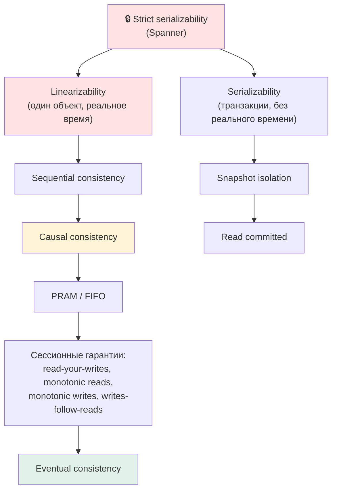
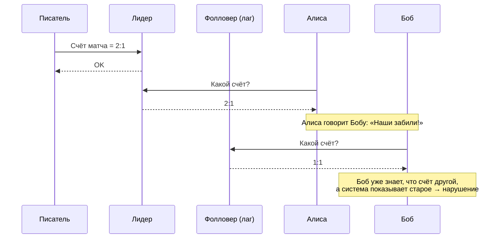
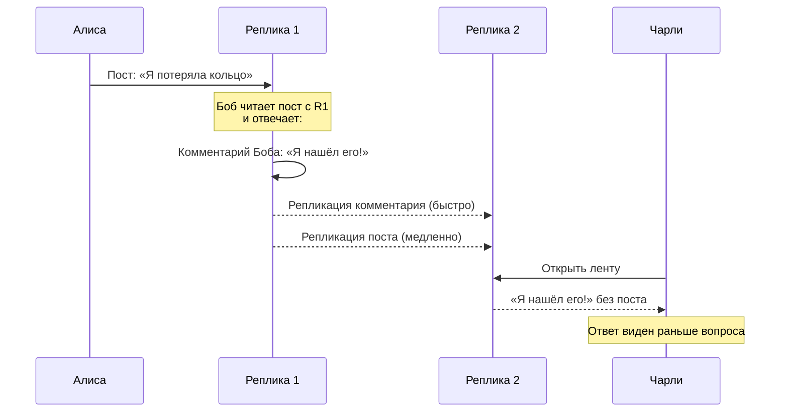
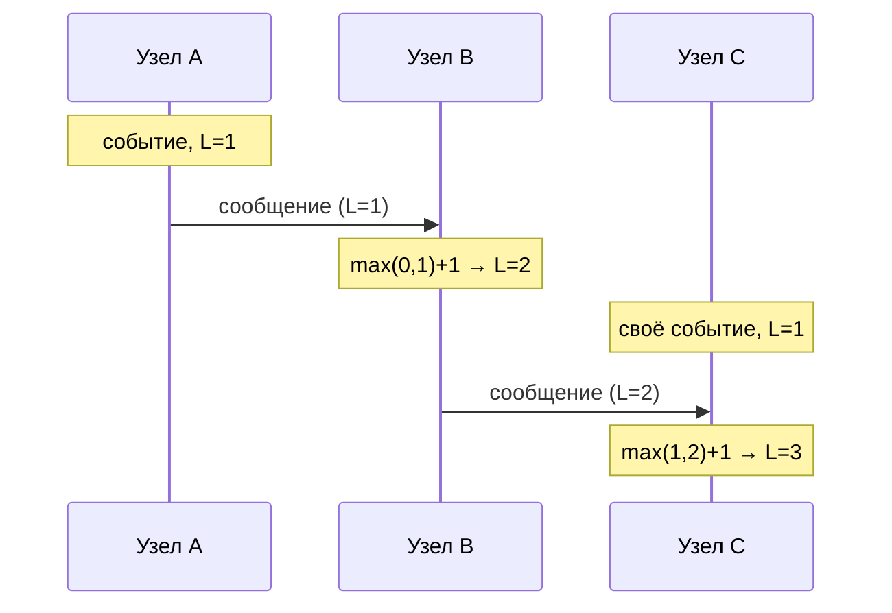
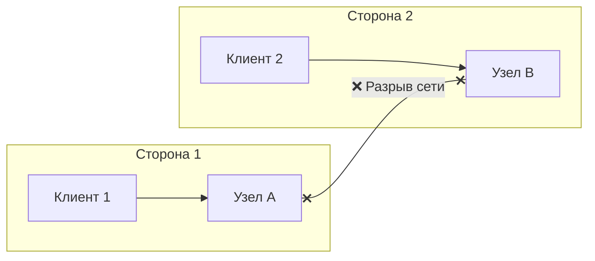

[English](README.md) | **Русский**

# 07. Модели консистентности

> **Что внутри:** что такое модель консистентности, линеаризуемость, сериализуемость и strict serializability, sequential и causal consistency, сессионные гарантии, eventual consistency, часы и порядок событий, CAP и PACELC, настраиваемая консистентность в реальных базах
> **Время на изучение:** ~5 ч · **Нужно для:** любой распределённой системы с репликацией; почти каждое интервью уровня Senior+
> **Практика:** разбор в формате интервью — [INTERVIEW_RU.md](./INTERVIEW_RU.md)
> **Связанные темы:** [04-databases](../04-databases/README_RU.md#10-уровни-изоляции) (уровни изоляции), [05-replication](../05-replication/README_RU.md#6-лаг-репликации-и-гарантии-чтения) (лаг и гарантии чтения), [06-partitioning](../06-partitioning/README_RU.md)

---

## 📑 Содержание

1. [Что такое модель консистентности](#1-что-такое-модель-консистентности)
2. [Карта моделей: от сильных к слабым](#2-карта-моделей-от-сильных-к-слабым)
3. [Линеаризуемость](#3-линеаризуемость)
4. [Линеаризуемость, сериализуемость и strict serializability](#4-линеаризуемость-сериализуемость-и-strict-serializability)
5. [Sequential consistency](#5-sequential-consistency)
6. [Causal consistency](#6-causal-consistency)
7. [Сессионные гарантии](#7-сессионные-гарантии)
8. [Eventual consistency](#8-eventual-consistency)
9. [Часы и порядок событий](#9-часы-и-порядок-событий)
10. [Теорема CAP](#10-теорема-cap)
11. [PACELC](#11-pacelc)
12. [Настраиваемая консистентность в реальных системах](#12-настраиваемая-консистентность-в-реальных-системах)
13. [Как выбрать модель под задачу](#13-как-выбрать-модель-под-задачу)
14. [Как говорить об этом на интервью](#14-как-говорить-об-этом-на-интервью)
15. [Вопросы для самопроверки](#15-вопросы-для-самопроверки)
16. [Глоссарий и ресурсы](#16-глоссарий-и-ресурсы)

---

## 1. Что такое модель консистентности

**Модель консистентности** — это **контракт** между системой хранения и клиентом: какие значения может вернуть чтение, учитывая все записи, которые происходили до него и параллельно с ним.

На одном сервере без реплик вопрос почти не возникает: прочитал — получил последнее записанное. С репликацией и сетью появляется выбор: насколько «свежими» и «согласованными» должны быть ответы, и какой ценой (задержка, доступность).

> [!WARNING]
> Слово «консистентность» в распределённых системах перегружено:
> - **C в ACID** — соблюдение инвариантов данных (ограничения, бизнес-правила);
> - **C в CAP** — линеаризуемость;
> - **модель консистентности** — что видят клиенты при параллельных операциях над репликами;
> - **уровень изоляции** — как взаимодействуют параллельные **транзакции** над несколькими объектами.
>
> Всегда уточняй, о какой из них идёт речь.

### Два измерения

| Измерение | Вопрос | Примеры моделей |
|:----------|:-------|:----------------|
| **Изоляция транзакций** (несколько объектов) | Выглядят ли параллельные транзакции так, будто выполнялись по одной? | Read Committed, Snapshot Isolation, Serializable |
| **Консистентность реплик** (один объект, свежесть) | Видит ли чтение самую последнюю запись в реальном времени? | Linearizable, Causal, Eventual |

Изоляция подробно разобрана в [04-databases](../04-databases/README_RU.md#10-уровни-изоляции). Здесь — в основном второе измерение и место, где они встречаются (strict serializability).

---

## 2. Карта моделей: от сильных к слабым

| Чем выше | Тем |
|:---------|:----|
| ⬆️ Сильнее модель | Проще рассуждать о корректности, но выше задержка и ниже доступность при сбоях сети |
| ⬇️ Слабее модель | Быстрее и доступнее, но приложение должно справляться с аномалиями |

> [!IMPORTANT]
> Ключевой факт: **causal consistency — самая сильная модель, которая остаётся доступной при разделении сети** (при условии, что клиент работает с одной репликой). Всё, что сильнее (sequential, linearizable), требует координации и при разрыве сети вынуждено отказывать части запросов.

---

## 3. Линеаризуемость

**Линеаризуемость** (linearizability, atomic consistency, strong consistency) — система ведёт себя так, будто существует **одна копия данных**, и каждая операция выполняется **атомарно в какой-то момент** между своим началом и окончанием.

Главное следствие: **как только запись завершилась (или кто-то прочитал новое значение), все последующие по реальному времени чтения видят это значение или более новое.**

### Пример: не линеаризуемо

Алиса и Боб использовали **внешний канал** (разговор). Линеаризуемость гарантирует, что после того как кто-то увидел новое значение, никто уже не увидит старое — независимо от того, какой реплике пришёл запрос.

### Где линеаризуемость действительно нужна

| Сценарий | Почему |
|:---------|:-------|
| **Выбор лидера и распределённые блокировки** | Все узлы должны согласиться, кто сейчас владелец |
| **Ограничения уникальности** | Два пользователя не должны получить один username, один номер места |
| **Остатки, балансы** | Нельзя продать последний товар дважды, нельзя уйти в минус |
| **Межканальные зависимости** | Сервис записал файл в хранилище и отправил сообщение «обработай файл»; обработчик должен увидеть файл |

### Как её получают

| Механизм | Линеаризуемо? |
|:---------|:--------------|
| Single-leader, чтение и запись только через лидера | ✅ Да, если лидер точно один (нужна защита от split brain: lease или консенсус) |
| Чтение с асинхронных реплик | ❌ Нет |
| Консенсус (Raft, Paxos) для записи + read index или lease для чтения | ✅ Да |
| Multi-leader | ❌ Нет |
| Leaderless с кворумами (Dynamo-стиль) | ⚠️ Обычно нет: при конкурентных записях и LWW; возможно только с синхронным read repair и без LWW |

### Цена

- **Задержка:** каждая операция требует координации. Между регионами это десятки–сотни миллисекунд.
- **Доступность:** при разрыве сети узлы, не видящие большинство (или лидера), **должны отказывать**, иначе могут вернуть устаревшие данные.
- **Пропускная способность:** всё проходит через лидера или кворум.

> [!NOTE]
> Даже оперативная память многоядерного процессора не линеаризуема по умолчанию: ядра имеют свои кэши, и без барьеров памяти поток может видеть устаревшие значения. Линеаризуемость дорога настолько, что от неё отказываются ради производительности даже внутри одного компьютера.

---

## 4. Линеаризуемость, сериализуемость и strict serializability

Эти термины часто путают.

| | Linearizability | Serializability | Strict serializability |
|:-|:----------------|:----------------|:-----------------------|
| О чём | Отдельные операции над **одним** объектом | **Транзакции** над многими объектами | Транзакции над многими объектами |
| Гарантия | Операции выглядят атомарными в порядке **реального времени** | Результат как при **каком-то** последовательном выполнении транзакций | Как при последовательном выполнении **в порядке реального времени** |
| Учитывает реальное время | ✅ | ❌ | ✅ |
| Пример аномалии, которую допускает | Нет транзакций из многих объектов | Транзакция, завершившаяся раньше, может «выглядеть» выполненной позже | — |
| Примеры | etcd, ZooKeeper (запись), Redis на одном узле | PostgreSQL SERIALIZABLE (SSI) на одном узле | Google Spanner («external consistency»), FoundationDB, CockroachDB (близко, с оговорками) |

> [!TIP]
> Удобная формулировка: **linearizability — гарантия «свежести» для одного ключа; serializability — гарантия «изоляции» для транзакций; strict serializability — обе сразу.**

---

## 5. Sequential consistency

Все операции выглядят выполненными в **одном общем порядке**, и в этом порядке операции каждого клиента идут в том же порядке, в каком он их выполнял. Но этот общий порядок **не обязан совпадать с реальным временем** между разными клиентами.

| | Linearizable | Sequential |
|:-|:-------------|:-----------|
| Один общий порядок | ✅ | ✅ |
| Порядок операций каждого клиента сохранён | ✅ | ✅ |
| Учитывает реальное время между клиентами | ✅ | ❌ |

**Пример:** ZooKeeper гарантирует линеаризуемые записи, но чтения с реплики дают sequential consistency: клиент может немного отставать, но всегда видит события в правильном порядке. Для свежего чтения есть операция `sync()`.

---

## 6. Causal consistency

Сохраняется порядок только между **причинно связанными** операциями. Параллельные (независимые) операции разные клиенты могут увидеть в разном порядке.

### Что такое «причинно связаны» (happens-before)

Операция A **произошла раньше** B, если:
- A и B выполнены одним клиентом, и A была первой;
- B прочитала значение, записанное A;
- есть цепочка таких связей.

Если ни A → B, ни B → A, операции **параллельны** (concurrent).

### Классические аномалии без causal consistency

| Аномалия | Пример |
|:---------|:-------|
| Ответ раньше вопроса | Комментарий виден, а пост, на который он отвечает, — ещё нет |
| Нарушение прав доступа | Алиса удалила начальника из друзей, затем опубликовала пост «ищу новую работу». На реплике, где удаление ещё не применилось, начальник видит пост |
| «Воскрешение» | Пользователь удалил фото, затем добавил подпись «удалено». На другой реплике подпись есть, а фото тоже ещё есть |

### Как реализуют

- Каждая запись несёт **метаданные зависимостей**: версию или векторные часы того, что клиент видел перед записью.
- Реплика **не делает запись видимой**, пока не применены все её зависимости (буферизует).
- Примеры: COPS (исследовательская система, «causal+»), сессионная консистентность в MongoDB (causal consistency sessions), реализации поверх CRDT.

| ✅ Плюсы | ❌ Минусы |
|:--------|:---------|
| Остаётся доступной при разделении сети | Накладные расходы на метаданные зависимостей |
| Без межрегиональной координации на запись | Видимость записи может задерживаться, пока не придут зависимости |
| Устраняет самые заметные пользователю аномалии | Не защищает от конфликтов параллельных записей — их нужно разрешать отдельно |

---

## 7. Сессионные гарантии

Более слабые, но очень практичные гарантии в рамках **одного клиента (сессии)**. Сформулированы Terry и соавторами в 1994 году.

| Гарантия | Что обещает | Аномалия без неё | Типичная реализация |
|:---------|:------------|:-----------------|:--------------------|
| **Read-your-writes** | Клиент видит свои записи | Обновил профиль — видит старый | Токен с позицией последней записи; чтение с лидера после записи |
| **Monotonic reads** | Последовательные чтения не «откатываются назад» | Комментарий появился, при обновлении исчез | Привязка к реплике; токен с максимальной виденной позицией |
| **Monotonic writes** | Записи клиента применяются в порядке их выполнения | Сначала «сменить пароль», потом «выйти отовсюду» — применились наоборот | Последовательные номера записей клиента |
| **Writes-follow-reads** | Запись, сделанная после чтения, упорядочена после прочитанной записи | Ответ на комментарий виден там, где комментария ещё нет | Запись несёт позицию прочитанного |

> [!TIP]
> Все четыре вместе дают примерно **causal consistency в рамках одной сессии**. Практический приём — **сессионный токен**: сервер возвращает позицию (LSN, версию, векторные часы) после каждой операции, клиент передаёт её в следующих запросах, а реплика отвечает, только когда догнала эту позицию. Так работает уровень Session в Azure Cosmos DB.

Подробнее о read-your-writes и monotonic reads с диаграммами — в [05-replication](../05-replication/README_RU.md#6-лаг-репликации-и-гарантии-чтения).

---

## 8. Eventual consistency

**Если новые записи прекратятся, все реплики со временем сойдутся к одному значению.**

Это **очень слабая** гарантия:
- она говорит только о будущем (liveness), но ничего не обещает в каждый конкретный момент (safety);
- не говорит, **когда** реплики сойдутся;
- не говорит, **к какому** значению (при LWW — к случайно выигравшему).

### Strong eventual consistency

Усиленный вариант: **реплики, получившие одинаковый набор обновлений, находятся в одинаковом состоянии** — независимо от порядка получения. Это гарантия **CRDT** (см. [05-replication](../05-replication/README_RU.md#8-разрешение-конфликтов)). Нет конфликтов, которые нужно разрешать вручную.

### Насколько «eventual» на практике

- Обычно реплики сходятся за миллисекунды–секунды.
- Исследование PBS (Probabilistically Bounded Staleness, Bailis и соавторы, 2012) показало, как вероятностно оценить устарелость: «с вероятностью 99,9% чтение через 10 мс после записи увидит её».
- Мониторь лаг репликации и показывай его как SLO: «99% записей видны во всех регионах за 2 с».

---

## 9. Часы и порядок событий

Многие модели требуют понимать, **что произошло раньше**. Физические часы для этого ненадёжны.

### Почему физические часы ненадёжны

- Кварцевые часы **дрейфуют** (типично десятки микросекунд в секунду).
- NTP синхронизирует их с точностью порядка миллисекунд, но при проблемах сети — хуже; часы могут **прыгать назад**.
- Поэтому «запись с бо́льшим timestamp произошла позже» — **неверное** предположение между разными серверами (см. проблему LWW в [05-replication](../05-replication/README_RU.md#8-разрешение-конфликтов)).

### Логические и гибридные часы

| Часы | Как работают | Что дают | Чего не дают |
|:-----|:-------------|:---------|:-------------|
| **Lamport clock** | Счётчик: +1 на каждое событие; при получении сообщения `max(свой, чужой) + 1` | Если A → B, то L(A) < L(B). Общий порядок, согласованный с причинностью | Не отличает параллельные события от упорядоченных |
| **Vector clock** | Вектор счётчиков по узлам | Точно определяет: A → B, B → A или параллельны | Размер растёт с числом узлов |
| **Hybrid Logical Clock (HLC)** | Физическое время + логический счётчик | Близко к реальному времени и согласовано с причинностью; компактно | Не даёт строгой линеаризуемости сам по себе |
| **TrueTime** (Google Spanner) | Время как интервал `[earliest, latest]` с гарантированной погрешностью (GPS и атомные часы) | Strict serializability через **commit wait**: ждать, пока погрешность не пройдёт | Требует специальной инфраструктуры |

> [!NOTE]
> CockroachDB использует HLC и ограничение на максимальное расхождение часов (по умолчанию порядка сотен миллисекунд); если часы узла уходят дальше допустимого, узел останавливается. Spanner вместо этого ограничивает погрешность аппаратно (TrueTime) и платит небольшой задержкой commit wait.

---

## 10. Теорема CAP

**Формулировка (Brewer 2000, доказательство Gilbert и Lynch 2002):** при **разделении сети** (Partition) распределённая система вынуждена выбирать между:
- **C (Consistency)** — линеаризуемостью;
- **A (Availability)** — каждый работающий узел отвечает на каждый запрос (не ошибкой).

Клиент 2 читает с узла B. Узел B не знает, что изменилось на A. Варианты:
- **ответить** (может быть, устаревшим значением) → выбрали **A**, пожертвовали C;
- **отказать** или ждать восстановления связи → выбрали **C**, пожертвовали A.

### Распространённые заблуждения

| Заблуждение | Как на самом деле |
|:------------|:------------------|
| «Выбери любые 2 из 3» | Разделения сети случаются независимо от вашего желания. Реальный выбор — **что делать во время разделения** |
| «CA-система» | Возможна только без сети: один узел. Любая распределённая система должна учитывать P |
| «Система либо CP, либо AP» | Большинство систем ни строго CP, ни строго AP: у них разные режимы для разных операций, настраиваемые уровни, а «A» в CAP — очень строгое определение |
| «CAP описывает компромиссы системы в целом» | CAP говорит только о линеаризуемости и только во время разделения. Он ничего не говорит о задержке в нормальном режиме |
| «AP значит никакой консистентности» | AP-система может давать causal consistency, сессионные гарантии, CRDT |

> [!TIP]
> Вместо «система CP или AP» говори точнее: «При разрыве сети между регионами **запись заказов** в регионе без большинства отклоняется (выбираем консистентность), а **корзина** продолжает работать и потом сливается (выбираем доступность)». Решение принимается **для каждой операции**, а не для всей системы.

---

## 11. PACELC

CAP молчит о нормальной работе, хотя компромисс есть и без сбоев. **PACELC** (Daniel Abadi, 2012) дополняет его:

> **Если P** (разделение сети) — выбор между **A** и **C**.
> **Иначе (E, else)** — выбор между **L** (latency, задержкой) и **C** (консистентностью).

Даже без сбоев сильная консистентность требует координации между репликами, а это задержка.

| Система (настройки по умолчанию) | При разделении (P) | В норме (E) | Комментарий |
|:---------------------------------|:------------------:|:-----------:|:------------|
| DynamoDB, Cassandra, Riak | A | L | Доступность и скорость; консистентность настраивается на запрос |
| Spanner, CockroachDB, etcd, ZooKeeper (запись) | C | C | Координация всегда; платим задержкой |
| PostgreSQL / MySQL с асинхронными репликами, чтение с реплик | A* | L | *Чтения с реплик продолжаются; запись — только на лидере |
| MongoDB | Зависит от `readConcern` / `writeConcern` | Зависит | С `majority` ближе к PC/EC, с `w: 1` и чтением с secondary — к PA/EL |
| Azure Cosmos DB | Зависит от уровня | Зависит | Пять уровней консистентности на выбор |

> [!IMPORTANT]
> **Сигнал Senior+:** упоминай PACELC, когда обсуждаешь консистентность в нормальном режиме: «Даже без сбоев линеаризуемая запись через три региона стоит ~90 мс — это EC. Для ленты я выбираю EL: локальная запись, асинхронная репликация».

---

## 12. Настраиваемая консистентность в реальных системах

| Система | Настройки | Что выбрать |
|:--------|:----------|:------------|
| **Cassandra** | Consistency level на каждый запрос: `ONE`, `QUORUM`, `LOCAL_QUORUM`, `ALL`; `SERIAL` для lightweight transactions (Paxos) | `LOCAL_QUORUM` для большинства; LWT — для уникальности, но дорого |
| **DynamoDB** | Чтения eventually consistent (по умолчанию) или strongly consistent (дороже, с лидера партиции); транзакции | Strongly consistent — только для чтения после записи там, где это важно |
| **MongoDB** | `writeConcern` (`w: 1`, `w: "majority"`), `readConcern` (`local`, `majority`, `linearizable`, `snapshot`), causal consistency sessions | `majority` + causal sessions — хороший баланс |
| **Azure Cosmos DB** | Strong, Bounded staleness, Session, Consistent prefix, Eventual | Session — по умолчанию и чаще всего достаточно |
| **etcd** | Линеаризуемые чтения (по умолчанию) или serializable (локальные, могут отставать) | Линеаризуемые для блокировок и выбора лидера |
| **ZooKeeper** | Записи линеаризуемые; чтения sequential; `sync()` перед чтением для свежести | `sync()`, если нужна свежесть |
| **Redis** | Асинхронная репликация; `WAIT` для ожидания реплик | Не использовать как источник строгой консистентности без дополнительных механизмов |

### Пять уровней Cosmos DB — наглядная шкала

| Уровень | Гарантия |
|:--------|:---------|
| **Strong** | Линеаризуемость |
| **Bounded staleness** | Отставание не больше K версий или T секунд |
| **Session** | Read-your-writes, monotonic reads и writes в рамках сессии |
| **Consistent prefix** | Чтения видят префикс записей в правильном порядке, без «дыр» |
| **Eventual** | Только сходимость |

---

## 13. Как выбрать модель под задачу

| Задача | Модель | Почему |
|:-------|:-------|:-------|
| Баланс счёта, списание остатков | Линеаризуемость / serializable транзакции | Нельзя потратить дважды |
| Уникальный username, email | Линеаризуемость | Два пользователя не должны получить одно имя |
| Выбор лидера, распределённые блокировки | Линеаризуемость (консенсус) | Все должны согласиться, кто владелец |
| Комментарии и ответы, лента с репостами | Causal | Ответ не раньше вопроса |
| Права доступа, приватность | Causal (минимум) | Изменение прав должно применяться до последующих действий |
| Свой профиль, свои настройки | Read-your-writes | Пользователь видит свои изменения |
| Счётчики лайков и просмотров | Eventual (CRDT) + monotonic reads | Точность в моменте не важна, но цифра не должна «прыгать назад» |
| Сообщения в чате | Total order внутри чата | Все участники видят одинаковый порядок |
| Корзина | Strong eventual (CRDT) | Всегда доступна, сливается без потерь |
| Аналитика, рекомендации | Eventual | Отставание на минуты не важно |

---

## 14. Как говорить об этом на интервью

### Ответ за 30 секунд

> «Выбираю модель для каждой операции, а не для системы в целом. Линеаризуемость — только там, где без неё нарушается инвариант: уникальность, балансы, блокировки; получаю её через консенсус и плачу задержкой — это PC/EC. Для пользовательского контента — causal consistency через метаданные зависимостей: ответ не появится раньше вопроса, и система остаётся доступной при разрыве сети. Для своих данных — сессионные гарантии через токен с позицией журнала. Для счётчиков — eventual с CRDT и monotonic reads в сессии. Физическим часам для порядка не доверяю — использую логические или гибридные».

### Вопросы, которые стоит задать

1. Какие инварианты нельзя нарушить ни при каких условиях?
2. Какие аномалии заметит и не простит пользователь?
3. Что должно происходить при разрыве сети между регионами — для каждой операции?
4. Какая задержка допустима для записи? Укладывается ли в неё межрегиональная координация?
5. Есть ли внешние каналы (уведомления, сообщения), через которые пользователи узнают о событиях раньше, чем реплики?

### Типичные ошибки

- Путать C в ACID и C в CAP.
- «Выбираем CP» или «выбираем AP» для всей системы.
- «CA-система» для распределённой базы.
- Считать, что кворум W + R > N даёт линеаризуемость.
- Использовать timestamp разных серверов для упорядочивания событий.
- Требовать линеаризуемость везде «на всякий случай».
- Говорить «eventual consistency» и не объяснять, как приложение справляется с аномалиями.

---

## 15. Вопросы для самопроверки

<b>1. Чем линеаризуемость отличается от сериализуемости?</b>

Линеаризуемость — гарантия для отдельных операций над одним объектом с учётом реального времени: после завершения записи все видят новое значение. Сериализуемость — гарантия для транзакций над многими объектами: результат как при каком-то последовательном выполнении, но без требований к реальному времени. Strict serializability объединяет обе.

<b>2. Почему чтение с асинхронной реплики не линеаризуемо?</b>

Реплика может отставать: после того как запись завершилась на лидере (и, возможно, кто-то уже прочитал новое значение), чтение с реплики может вернуть старое. Это нарушает требование «после того как кто-то увидел новое значение, никто не видит старое».

<b>3. Чем causal consistency слабее sequential?</b>

Sequential требует единого порядка всех операций для всех клиентов. Causal требует согласованного порядка только для причинно связанных операций; параллельные операции разные клиенты могут видеть в разном порядке. Зато causal можно обеспечить без координации и при разделении сети.

<b>4. Приведите аномалию, которую предотвращает causal consistency.</b>

Комментарий-ответ виден раньше поста, на который он отвечает. Или: пользователь удалил человека из списка доступа, а потом опубликовал пост — и этот человек увидел пост на реплике, где удаление ещё не применилось.

<b>5. Почему «CA-система» — некорректное понятие для распределённых баз?</b>

Разделения сети в распределённой системе неизбежны. Отказ от P означает, что система работает только без разделений, то есть фактически на одном узле. Реальный выбор — между C и A во время разделения.

<b>6. Что добавляет PACELC к CAP?</b>

CAP говорит только о поведении во время разделения сети. PACELC добавляет компромисс в нормальном режиме: даже без сбоев сильная консистентность требует координации между репликами и стоит задержки (EL vs EC).

<b>7. Чем векторные часы лучше часов Лэмпорта?</b>

Часы Лэмпорта гарантируют: если A → B, то L(A) < L(B), но по меткам нельзя понять, были ли события параллельными. Векторные часы позволяют точно определить, упорядочены события или параллельны, что нужно для обнаружения конфликтов.

<b>8. Как Spanner обеспечивает strict serializability без идеальных часов?</b>

TrueTime возвращает интервал `[earliest, latest]` с гарантированной погрешностью. При коммите транзакция получает timestamp и ждёт (commit wait), пока не пройдёт погрешность, чтобы любая транзакция, начавшаяся позже по реальному времени, получила бо́льший timestamp.

<b>9. Что такое сессионный токен и какие гарантии он даёт?</b>

Сервер после каждой операции возвращает позицию (LSN, версию), клиент передаёт её в следующем запросе, и реплика отвечает только после того, как догнала эту позицию. Это даёт read-your-writes и monotonic reads (и при передаче позиции в записях — writes-follow-reads) без чтения с лидера.

<b>10. Что означает strong eventual consistency?</b>

Реплики, получившие одинаковый набор обновлений, находятся в одинаковом состоянии независимо от порядка их получения. Это гарантия CRDT: нет конфликтов, требующих ручного разрешения.

---

## 16. Глоссарий и ресурсы

### Глоссарий

| Термин | Значение |
|:-------|:---------|
| Модель консистентности | Контракт о том, какие значения могут вернуть чтения при параллельных операциях |
| Линеаризуемость | Иллюзия одной копии данных с атомарными операциями в порядке реального времени |
| Serializability | Транзакции выглядят выполненными последовательно в каком-то порядке |
| Strict serializability | Serializability + порядок реального времени |
| Sequential consistency | Единый порядок операций, согласованный с порядком каждого клиента, без реального времени |
| Causal consistency | Сохранение порядка причинно связанных операций |
| Happens-before | Отношение причинности между операциями |
| Сессионные гарантии | Read-your-writes, monotonic reads, monotonic writes, writes-follow-reads |
| Eventual consistency | Реплики сходятся, если записи прекратятся |
| Strong eventual consistency | Одинаковый набор обновлений → одинаковое состояние |
| Lamport clock | Логические часы, согласованные с причинностью |
| Vector clock | Вектор счётчиков, определяющий причинность и параллельность |
| HLC | Гибридные логические часы: физическое время + счётчик |
| TrueTime | Время как интервал с гарантированной погрешностью (Spanner) |
| CAP | При разделении сети — выбор между линеаризуемостью и доступностью |
| PACELC | CAP + компромисс задержки и консистентности в нормальном режиме |

### Ресурсы

- *Designing Data-Intensive Applications*, Martin Kleppmann — глава 9 «Consistency and Consensus»
- Herlihy, Wing, *Linearizability: A Correctness Condition for Concurrent Objects* (1990)
- Lamport, *Time, Clocks, and the Ordering of Events in a Distributed System* (1978)
- Gilbert, Lynch, *Brewer's Conjecture and the Feasibility of Consistent, Available, Partition-Tolerant Web Services* (2002)
- Eric Brewer, *CAP Twelve Years Later: How the "Rules" Have Changed* (2012)
- Daniel Abadi, *Consistency Tradeoffs in Modern Distributed Database System Design* (2012) — PACELC
- Terry et al., *Session Guarantees for Weakly Consistent Replicated Data* (1994)
- Lloyd et al., *Don't Settle for Eventual: Scalable Causal Consistency for Wide-Area Storage with COPS* (SOSP 2011)
- Bailis et al., *Probabilistically Bounded Staleness for Practical Partial Quorums* (VLDB 2012)
- Corbett et al., *Spanner: Google's Globally-Distributed Database* (OSDI 2012)
- Kulkarni et al., *Logical Physical Clocks* (2014) — HLC
- Martin Kleppmann, *Please stop calling databases CP or AP* (2015)
- jepsen.io/consistency — карта моделей консистентности с определениями
- Документация Azure Cosmos DB: Consistency levels