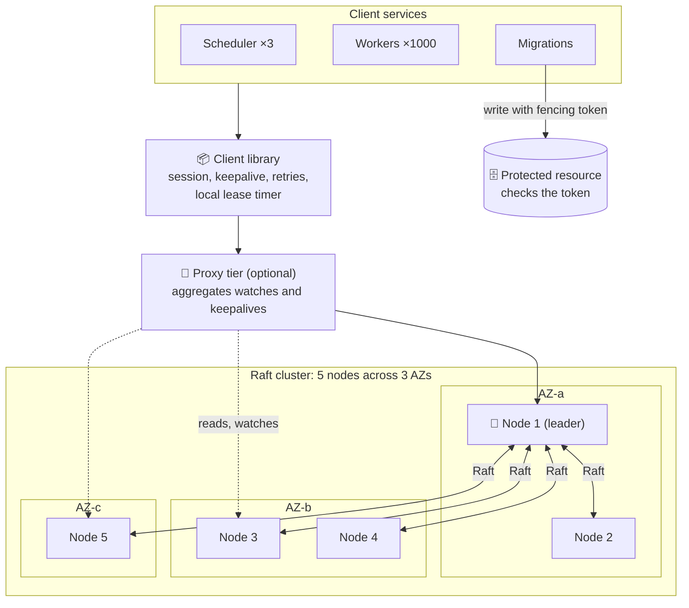
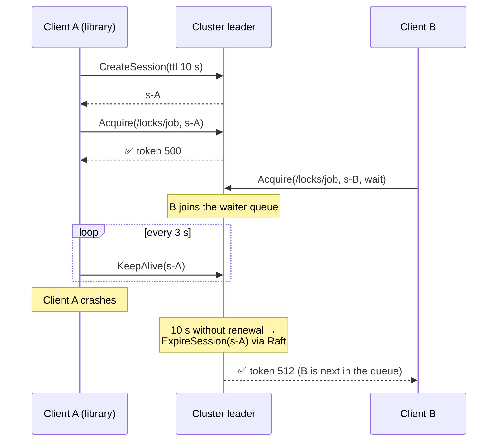
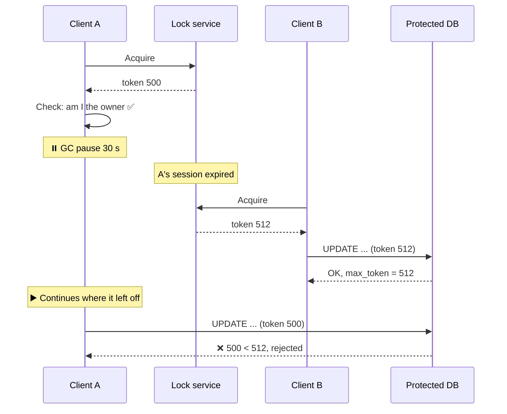
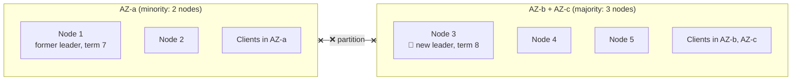

**English** | [Русский](INTERVIEW_RU.md) · Theory: [README.md](./README.md)

# 08. Consensus: A Distributed Lock and Leader Election Service

> **Topic:** a replicated state machine on Raft, cluster size and placement, sessions and leases, fencing tokens, linearizable reads, split-brain protection, scaling reads and watches, operations
> **Level:** Hard · **Interview time:** 45 min · **Study time:** ~5 h
> **Where it's asked:** "Design a distributed lock service / Chubby / ZooKeeper", and as a deep dive in problems about schedulers, leader election and shard metadata

---

## 🗺️ How to Read This Walkthrough

| Icon | Meaning |
|:----:|:--------|
| 🎤 | Interviewer |
| 🗣️ | What I (the candidate) say out loud |
| ✏️ | What I draw on the whiteboard |
| ⏱️ | Time budget for the step |

Callouts: **TIP** — a good technique, **WARNING** — a trap, **IMPORTANT** — a Senior+ signal.

---

## 📑 Contents

1. [Problem Statement](#1-problem-statement)
2. [Clarifying Questions and Requirements](#2-clarifying-questions-and-requirements)
3. [Capacity Estimates](#3-capacity-estimates)
4. [API](#4-api)
5. [Data Model: A Replicated State Machine](#5-data-model-a-replicated-state-machine)
6. [High-Level Design](#6-high-level-design)
7. [Deep Dive 1: The Raft Cluster, Size and Placement](#7-deep-dive-1-the-raft-cluster-size-and-placement)
8. [Deep Dive 2: Sessions, Leases and Locks](#8-deep-dive-2-sessions-leases-and-locks)
9. [Deep Dive 3: Fencing Tokens](#9-deep-dive-3-fencing-tokens)
10. [Deep Dive 4: Network Partitions and Split Brain](#10-deep-dive-4-network-partitions-and-split-brain)
11. [Deep Dive 5: Scaling Reads and Watches](#11-deep-dive-5-scaling-reads-and-watches)
12. [Operations](#12-operations)
13. [Bottlenecks and Failure Scenarios](#13-bottlenecks-and-failure-scenarios)
14. [What Changes at 10x Scale](#14-what-changes-at-10x-scale)
15. [Interviewer Questions with Answers](#15-interviewer-questions-with-answers)
16. [Common Mistakes](#16-common-mistakes)
17. [Cheat Sheet and Self-Check](#17-cheat-sheet-and-self-check)

---

## 1. Problem Statement

> 🎤 "Our internal services need distributed locks and leader election: 'only one scheduler instance runs jobs', 'only one worker processes a partition', 'only one process runs a migration'. Today each team does it its own way with Redis, and jobs sometimes run twice. Design a shared service."

**Time plan:**

| Step | ⏱️ |
|:-----|:--:|
| Requirements | 5 min |
| Estimates | 3 min |
| API and data model | 7 min |
| High-level design | 5 min |
| Deep dives | 20 min |
| Failures and wrap-up | 5 min |

> [!TIP]
> The phrase "jobs sometimes run twice" is a hint. The interviewer expects you to explain **why** Redis locks don't guarantee correctness and to propose consensus + fencing tokens.

---

## 2. Clarifying Questions and Requirements

⏱️ 5 min

| My question | Interviewer's answer | What it changes |
|:------------|:---------------------|:----------------|
| Are locks for efficiency or for correctness? | For correctness: running a migration twice or processing payments twice is unacceptable | Need consensus and fencing tokens, not "best effort" |
| How many clients and locks? | Tens of thousands of service instances, ~100K locks | Small data volume, many sessions and renewals |
| How long are locks held? | Seconds to hours (a leader holds it while alive) | Need renewable leases, not a fixed per-operation TTL |
| One region or several? | One region with 3 AZs for now | A cluster within the region; write latency in milliseconds |
| Are notifications needed? | Yes: "tell me when the leader changes", "when a lock is released" | A watch API |
| How critical is availability? | If the service is down, no new locks are granted — but that's better than double ownership | CP: correctness over availability |

### Functional requirements

1. Acquire and release a lock by name; wait if it's taken.
2. Leader election among a service's instances; find out the current leader.
3. Automatic release if the owner crashes or loses connectivity.
4. Watch: notifications about lock or leader changes.
5. A fencing token on every acquisition.

### Non-functional requirements

| Requirement | Target |
|:------------|:-------|
| Safety | Never two owners of one lock **from the service's point of view**; with fencing — from the protected resource's too |
| Availability | 99.99%; survives losing an AZ plus one more node |
| Latency | Lock acquisition p99 < 50 ms within the region |
| Owner failure detection | The lock is released within 10–15 s of a client crash |
| Volume | < 1 GB of data |

---

## 3. Capacity Estimates

⏱️ 3 min

✏️

```
Client sessions             = 50,000
Session renewal             = every 3 s  → ~17,000 renewals/s
Lock operations             = ~2,000/s (acquire, release)
Locks                       = 100,000 × ~1 KB ≈ 100 MB
Active watches              = ~200,000
"Who's the leader" reads    = ~20,000/s
```

🗣️ **Conclusions:**
- **Little data** — it all fits in each node's memory.
- **Consensus writes** at ~2,000/s — comfortable for a single Raft group.
- **Session renewals are the main load (~17,000/s).** Writing each renewal to the Raft log is wasteful; this needs optimizing (see deep dive 2).
- **Reads and watches** must be offloaded from the leader.

---

## 4. API

⏱️ 3 min

```http
# Session: the unit of a client's life
POST   /v1/sessions                     { ttl_seconds: 10 }
       → { session_id, ttl }
POST   /v1/sessions/{id}/keepalive      → { ttl_remaining }
DELETE /v1/sessions/{id}

# Locks
POST   /v1/locks/{name}/acquire         { session_id, wait_timeout_ms }
       → { acquired: true, fencing_token: 104857, owner: session_id }
POST   /v1/locks/{name}/release         { session_id, fencing_token }
GET    /v1/locks/{name}?consistency=linearizable
       → { owner, fencing_token, acquired_at }

# Leader election
POST   /v1/elections/{name}/campaign    { session_id, value: "host-17:8080" }
       → { leader: true, fencing_token }     (blocks until it becomes leader)
GET    /v1/elections/{name}/leader      → { value, fencing_token }

# Notifications
WATCH  /v1/watch?prefix=/locks/billing&from_revision=104800   (gRPC stream)
```

🗣️ "Locks are tied not to a per-lock timer but to a **session**: the client renews one session, and all its locks live as long as the session does. That's like ZooKeeper sessions and etcd leases. A fencing token is returned on every acquisition."

---

## 5. Data Model: A Replicated State Machine

⏱️ 4 min

The service's state is a small state machine, identical on every node. Every mutating operation is an entry in the Raft log.

```
revision: 104857                         ← a global monotonic counter, incremented on every write

sessions:
  s-81f2 → { ttl: 10s, expires_at (leader only), owner_host }

locks:
  /locks/billing-migration → { owner: s-81f2, token: 104857, waiters: [s-93aa, s-12bc] }

elections:
  /elections/scheduler → { candidates: [(s-81f2, rev 104100), (s-77de, rev 104230)] }
                          leader = the candidate with the lowest creation revision
```

| Operation | What it changes in the state machine |
|:----------|:-------------------------------------|
| `CreateSession` | A new session |
| `Acquire` | If free — owner = session, token = current revision; otherwise — joins the waiter queue |
| `Release` | Free it; hand it to the first waiter with a new token |
| `ExpireSession` | Delete the session and **all its locks**; hand them to waiters |

🗣️ "**Fencing token = the revision** at acquisition time. The revision grows with every log write, so each subsequent owner gets a strictly larger token — that's how etcd does it."

---

## 6. High-Level Design

⏱️ 5 min

✏️



🗣️ "Three layers:
- the **client library** — the most important for correctness: it holds the session, renews it, runs **its own** lease timer and stops work early, and passes the fencing token to the resource;
- the **proxy** — for scale: it aggregates thousands of connections and watches;
- a **5-node Raft cluster** — the source of truth."

---

## 7. Deep Dive 1: The Raft Cluster, Size and Placement

> 🎤 "Why 5 nodes, and how do you place them?"

🗣️

| Option | Survives | Downsides |
|:-------|:---------|:----------|
| 3 nodes, 1-1-1 across AZs | 1 node or 1 AZ failure | No headroom while one node is under maintenance |
| **5 nodes, 2-2-1 across AZs** | An AZ failure **plus** one more node, or any 2 nodes | Writes wait for 3 acknowledgments |
| 7 nodes | 3 failures | Slower writes; overkill for us |

"I pick 5 nodes in 2-2-1: I can update a node (planned downtime) and still survive a sudden AZ failure."

### Write path and latency

```
Acquire → leader: append to log + fsync (~1 ms on NVMe)
        → AppendEntries to followers in other AZs (RTT ~1 ms)
        → fsync on followers
        → 3 of 5 acknowledged → commit → apply → reply
Total: ~3–10 ms p99 within the region
```

### Leader election in the cluster itself

- Heartbeats every ~100 ms, an election timeout of ~1 s (randomized) — a balance between recovery speed and spurious elections.
- **Pre-vote** enabled: a node temporarily cut off doesn't disrupt a working leader with its inflated term.
- When the leader fails: ~1–2 s of write unavailability, then a new leader with the complete log.

### Linearizable reads

🗣️ "`GET /locks/{name}?consistency=linearizable` goes through **ReadIndex**: the node (even a follower) gets the commit index from the leader, the leader confirms its leadership with a majority, the node waits until it has applied up to that index, and answers. No disk write. For 'roughly current' state there's a cheap `serializable` read from any node."

---

## 8. Deep Dive 2: Sessions, Leases and Locks

> 🎤 "17,000 renewals per second — through Raft?"

🗣️ "No. As in etcd: **renewals are handled by the leader in memory**, without a log entry. Only session creation and **expiry** are written to the log. If the leader changes, the new leader doesn't know exactly how much time each lease had left — so it **conservatively extends** every lease by its full TTL. That's safe: a lock may be released a bit later, but never earlier than it should."

### A lock's lifecycle



### Two sides of the timer

| Side | Timer | Why |
|:-----|:------|:----|
| **Server** | Expires TTL = 10 s after the last renewal | Frees the lock of a crashed client |
| **Client library** | Considers the lease lost, e.g., 7 s after **sending** the last successfully acknowledged renewal | The client stops work **before** the server grants the lock to someone else |

> [!WARNING]
> The client timer counts from when the renewal request was **sent**, not when the reply arrived: the reply may have been delayed, and the server may have renewed the lease earlier. The margin (10 s on the server vs 7 s on the client) covers clock drift and delays. But a GC pause can happen **after** the timer check — which is why fencing tokens are still required.

### A waiter queue without a herd

🗣️ "If 100 workers wait for one lock, you can't wake all of them when it's released. The server keeps a **queue** and hands the lock to the first waiter (like ZooKeeper's sequential-znode recipe, where each watches only its predecessor)."

---

## 9. Deep Dive 3: Fencing Tokens

> 🎤 "Okay, you have Raft, sessions and timers. Why can a job still run twice?"

🗣️ "Because the **cluster's** correctness doesn't imply the **client's** correctness. Client A acquired the lock, then froze in a 30-second GC pause. The server honestly expired its session and granted the lock to B. A wakes up — its code already passed the 'I'm the owner' check before the pause — and writes to the database. Two owners write to the same resource."



### How the resource checks the token

```sql
-- The protected table stores the latest token
UPDATE job_state
SET    status = 'running', owner = 'A', fencing_token = 500
WHERE  job_id = 'billing-migration'
  AND  fencing_token < 500;
-- 0 rows updated → someone already holds a higher token; stop work
```

| Resource | How to apply the token |
|:---------|:-----------------------|
| Your own DB | A `fencing_token` column + a conditional UPDATE (as above) |
| Object storage | A conditional write (object version, `If-Match`) or the token in metadata |
| A Kafka producer | A transactional producer with an epoch (the same principle: the old producer is "fenced off") |
| An external API without support | An idempotency key derived from the token; reconciling results |

> [!IMPORTANT]
> **Senior+ signal:** "The lock service is responsible for tokens strictly increasing. The resource is responsible for rejecting old tokens. Without the second half, a lock is just an optimization, not a guarantee." That's exactly why Redis locks without tokens caused duplicate runs.

---

## 10. Deep Dive 4: Network Partitions and Split Brain

> 🎤 "AZ-a, which hosts the cluster leader, is cut off from the rest. What happens?"

✏️



| What | Behavior |
|:-----|:---------|
| Node 1 (old leader) | Can't get acknowledgments from a majority → **commits nothing**. Stops answering linearizable reads (ReadIndex fails) |
| Nodes 3–5 | Elect a new leader with term 8 within ~1 s |
| Clients in AZ-a | Can't renew sessions → their client timers expire in 7 s → they **stop work themselves** |
| Server (new leader) | Sessions of AZ-a clients expire in 10 s → locks pass to waiters in other AZs with **new tokens** |
| AZ-a returns | Node 1 sees term 8 → becomes a follower and catches up. Clients that failed to stop are rejected by resources via tokens |

🗣️ "Inside the cluster, split brain is impossible: two leaders in the same term need two disjoint majorities. Among clients it's **possible** in the window between the session expiring on the server and the client stopping — closed by the client timer with a margin and by fencing tokens."

> [!NOTE]
> This is a deliberate **CP choice** (see [07-consistency-models](../07-consistency-models/README.md#10-the-cap-theorem)): clients in the cut-off AZ lose their locks and can't acquire new ones. For locks that correctness depends on, that's the right call.

---

## 11. Deep Dive 5: Scaling Reads and Watches

> 🎤 "Load has grown: 200,000 watches and 50,000 'who's the leader' reads per second. The leader can't keep up."

🗣️ Solutions by level:

| Solution | How it helps |
|:---------|:-------------|
| **Watches on followers** | Followers receive the same log and can send notifications; the leader handles only writes |
| **Learners / observers** | Non-voting replicas: they receive the log and serve reads and watches, but don't participate in the quorum or slow down writes (observers in ZooKeeper, learners in etcd) |
| **An aggregating proxy** | 1,000 clients watching one key become a single watch from the proxy to the cluster (like the etcd gRPC proxy) |
| **Client-side cache with invalidation** | As in Chubby: the client library caches the value, and the server sends an invalidation on change |
| **Serializable reads** | "Who's roughly the leader" doesn't need linearizability — a local read from any replica is enough |

> [!TIP]
> Scaling **writes** of a single Raft group is limited. If writes grow too much, split the namespace across several independent clusters (by team or prefix) — Multi-Raft at the service level.

---

## 12. Operations

| Topic | Practice |
|:------|:---------|
| Disks | A dedicated fast SSD for the log; alert on rising fsync duration (slow fsync → missed heartbeats → spurious elections) |
| Membership changes | Strictly one node at a time; a new node joins as a learner first, catches up, then is promoted to voter |
| Upgrades | One node at a time, the leader last (transfer leadership first) |
| Snapshots | Regular snapshots and log compaction; a database size limit |
| Backups | Periodic snapshots to external storage; restore drills |
| Monitoring | Leader changes, fsync and commit duration, proposal failures, session and watch counts, database size, follower lag |
| Abuse protection | Per-team quotas on keys, sessions and requests; a ban on large values |

---

## 13. Bottlenecks and Failure Scenarios

| Scenario | What happens | How we protect |
|:---------|:-------------|:---------------|
| The cluster leader fails | ~1–2 s with no writes; lease renewals unavailable | The new leader conservatively extends every lease → nobody loses a lock due to a leader change |
| An entire AZ fails | A 2-2-1 cluster keeps its majority | Keeps working; clients in that AZ lose their locks |
| A slow disk on the leader | Frequent spurious elections | fsync monitoring, leadership transfer, disk replacement |
| A client GC pause | The client thinks it owns the lock | A client timer with a margin + fencing tokens at the resource |
| Clock skew | Wrong timers | Timers on monotonic clocks; a margin between server and client TTLs |
| A renewal storm after the network recovers | Leader overload | Randomized retry jitter, proxies, limits |
| A client holds a lock forever (a bug) | Everyone else waits forever | A max hold time per lock type; alerts; manual forced release (with a new token) |
| Someone stores large data | Database growth, slow snapshots | Quotas and a value size limit |

---

## 14. What Changes at 10x Scale

> 🎤 "10× more services and several regions?"

🗣️ "What changes:
1. **A cluster per region** for local locks: latency stays in milliseconds, and a region failure doesn't affect others. Most locks are local by nature.
2. **Global locks** (rare, e.g. a global migration) — a separate cluster with nodes in three regions; ~100 ms writes are acceptable for them.
3. **Splitting the namespace** across several clusters within a region, by team or prefix.
4. **Learners and proxies** for reads and watches.
5. **Quotas and self-service** for teams, so one client can't overload the shared service."

---

## 15. Interviewer Questions with Answers

<details>
<summary><b>Why not use Redis and Redlock?</b></summary>

Redis replicates asynchronously: on failover a lock can be "lost", and two clients get it. Redlock (across several independent nodes) relies on bounded process pauses and clock drift and doesn't issue fencing tokens. For efficiency locks (avoid doing work twice, but a duplicate isn't dangerous), Redis is fine. For correctness — a consensus service and fencing tokens.
</details>

<details>
<summary><b>Why not just use etcd or ZooKeeper instead of designing a service?</b></summary>

In reality that's exactly what you should do: it's the "under the hood" answer. In an interview what's valued is understanding what's inside — a Raft cluster, sessions and leases, revisions as fencing tokens, herd-free lock recipes — and what the service must give teams on top: a client library with correct timers, quotas, monitoring. A good answer: "I'll use etcd as the core and build a library, proxies and usage rules around it."
</details>

<details>
<summary><b>Why aren't lease renewals written to the Raft log?</b></summary>

There are tens of thousands per second, and writing each through consensus (a majority fsync) would overload the cluster. It's enough for the leader to track them in memory, with only session creation and expiry written to the log. On a leader change, the new leader extends every lease by its full TTL — this may delay a release, but will never release a lock early.
</details>

<details>
<summary><b>What if the protected resource can't check tokens?</b></summary>

Options: a wrapper around the resource (your own service that checks the token and only then calls the resource); idempotent operations with a key derived from the token; designing the work so that running it twice is safe. If none of that is possible, say honestly that the lock reduces the likelihood of a double run but doesn't eliminate it.
</details>

<details>
<summary><b>Why is the client leader chosen by the lowest creation revision?</b></summary>

The revision defines a global order agreed on by every cluster node. The candidate with the lowest revision is first in line. Each other candidate watches only the one directly ahead and becomes leader when it disappears. That gives fairness and no herd effect.
</details>

<details>
<summary><b>Can one Raft cluster span three regions for all locks?</b></summary>

It can, but every write then costs a round trip to the nearest majority of regions (~100 ms), and renewals and reads also cross regions. For most locks, which are local by nature, that's unnecessary latency. Better a cluster per region plus a separate cross-region cluster only for global locks.
</details>

---

## 16. Common Mistakes

| ❌ Mistake | ✅ Do this instead |
|:----------|:------------------|
| A Redis lock for correctness | A consensus service + fencing tokens |
| A lock without a fencing token | A monotonic token checked by the resource |
| 2 or 4 nodes in the cluster | 3 or 5, across different AZs |
| Every renewal through Raft | Renewals in the leader's memory; only creation and expiry in the log |
| The client treats the lease as valid until the server replies | A client timer with a margin, counted from the send time |
| Every waiter watches the same key | A waiter queue; wake only the next one |
| Treating a "leader read" as linearizable | ReadIndex |
| Storing large data in the service | Quotas, limits, metadata only |
| One cross-region cluster for everything | A cluster per region + a separate global one |

---

## 17. Cheat Sheet and Self-Check

### 30-second answer

> The core is a 5-node Raft cluster across 3 AZs (2-2-1); the state is a small state machine: sessions, locks with queues, elections. Locks are tied to sessions with leases; renewals are handled by the leader in memory, only creation and expiry go to the log, and on a leader change every lease is extended. The fencing token is a global revision that grows with every write; the protected resource rejects old tokens via a conditional write. The client library runs its own timer with a margin and stops work before the server does. Linearizable reads go through ReadIndex; reads and watches scale via learners and proxies. During a partition the minority can't commit anything — that's CP, and it's the right choice for correctness.

### Self-check

- [ ] I can explain why Redis locks cause duplicate runs
- [ ] I can justify 5 nodes in a 2-2-1 placement
- [ ] I can describe the service's state machine and which operations go through the log
- [ ] I can explain why renewals aren't logged and what a new leader does
- [ ] I can draw the GC pause scenario and the fencing-token defense
- [ ] I can describe the behavior when the AZ with the leader is cut off
- [ ] I can name 4 ways to scale reads and watches
- [ ] I can list operational metrics and the rules for membership changes

### Further reading

- Theory for this topic: [README.md](./README.md)
- Mike Burrows, *The Chubby Lock Service for Loosely-Coupled Distributed Systems*
- Martin Kleppmann, *How to do distributed locking*
- etcd documentation: leases, concurrency (Mutex, Election), learners
- ZooKeeper documentation: recipes (locks, leader election)