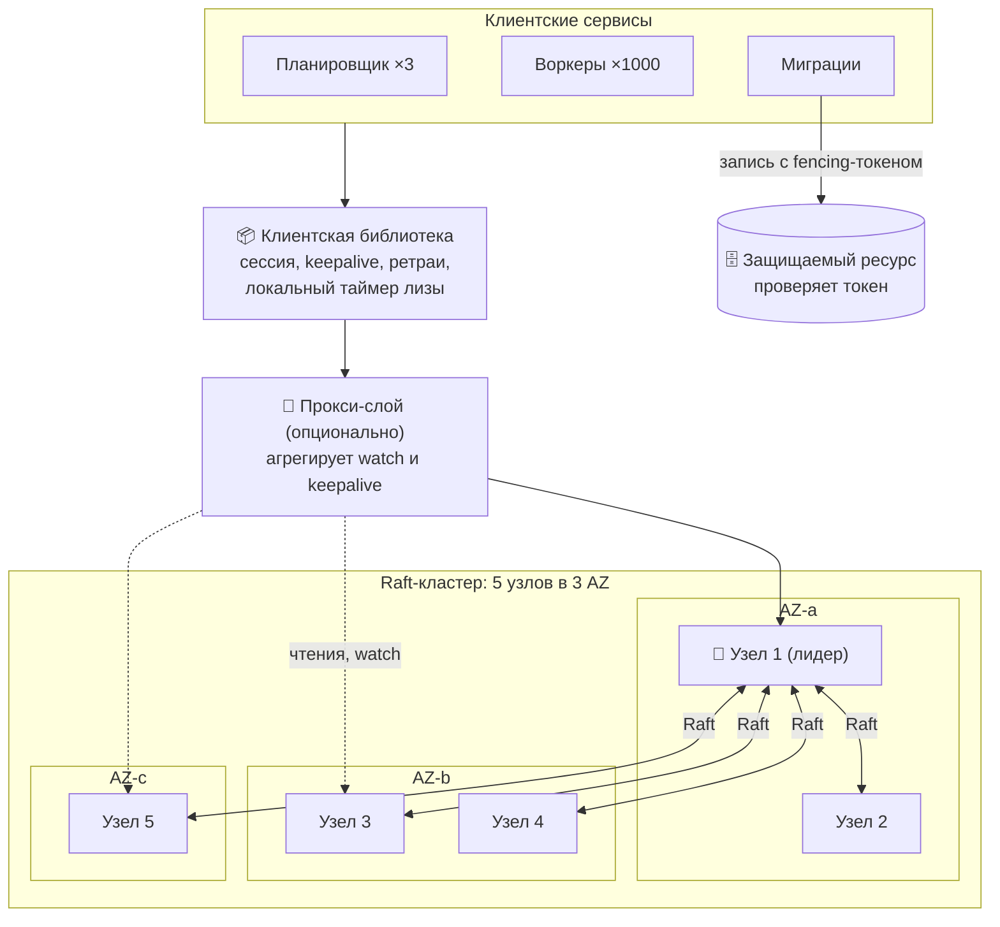
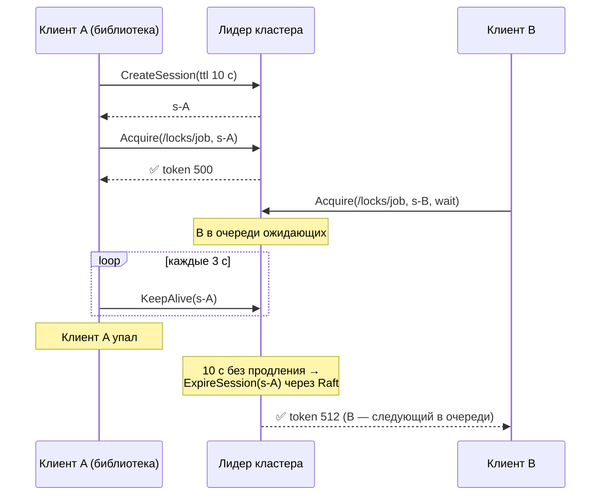
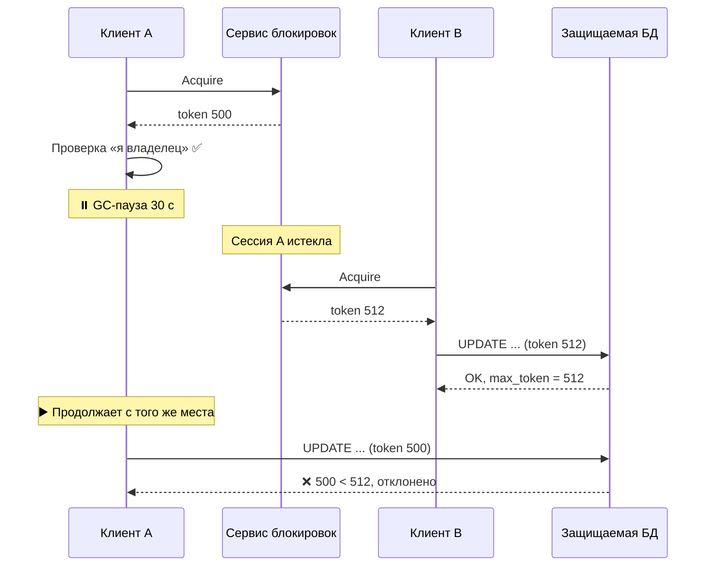
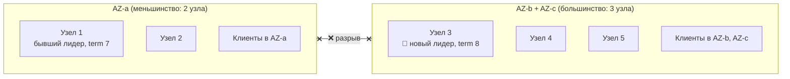

[English](INTERVIEW.md) | **Русский** · Теория: [README_RU.md](./README_RU.md)

# 08. Consensus: сервис распределённых блокировок и выбора лидера

> **Тема:** реплицированный конечный автомат на Raft, размер и размещение кластера, сессии и лизы, fencing-токены, линеаризуемые чтения, защита от split brain, масштабирование чтений и watch, эксплуатация
> **Уровень:** Hard · **Время на интервью:** 45 мин · **Время на разбор:** ~5 ч
> **Где спрашивают:** «Design a distributed lock service / Chubby / ZooKeeper», а также как deep dive в задачах про планировщики, выбор лидера, метаданные шардов

---

## 🗺️ Как читать этот разбор

| Значок | Что значит |
|:------:|:-----------|
| 🎤 | Реплика интервьюера |
| 🗣️ | Что говорю вслух я (кандидат) |
| ✏️ | Что рисую на доске |
| ⏱️ | Сколько времени тратить на шаг |

Блоки **TIP** — хороший приём, **WARNING** — ловушка, **IMPORTANT** — сигнал для уровня Senior+.

---

## 📑 Содержание

1. [Условие задачи](#1-условие-задачи)
2. [Уточняющие вопросы и требования](#2-уточняющие-вопросы-и-требования)
3. [Оценки нагрузки](#3-оценки-нагрузки)
4. [API](#4-api)
5. [Модель данных: реплицированный конечный автомат](#5-модель-данных-реплицированный-конечный-автомат)
6. [High-level дизайн](#6-high-level-дизайн)
7. [Deep dive 1: Raft-кластер, размер и размещение](#7-deep-dive-1-raft-кластер-размер-и-размещение)
8. [Deep dive 2: сессии, лизы и блокировки](#8-deep-dive-2-сессии-лизы-и-блокировки)
9. [Deep dive 3: fencing-токены](#9-deep-dive-3-fencing-токены)
10. [Deep dive 4: разрывы сети и split brain](#10-deep-dive-4-разрывы-сети-и-split-brain)
11. [Deep dive 5: масштабирование чтений и watch](#11-deep-dive-5-масштабирование-чтений-и-watch)
12. [Эксплуатация](#12-эксплуатация)
13. [Узкие места и сценарии сбоев](#13-узкие-места-и-сценарии-сбоев)
14. [Что изменится при росте в 10 раз](#14-что-изменится-при-росте-в-10-раз)
15. [Вопросы интервьюера с ответами](#15-вопросы-интервьюера-с-ответами)
16. [Типичные ошибки](#16-типичные-ошибки)
17. [Шпаргалка и самопроверка](#17-шпаргалка-и-самопроверка)

---

## 1. Условие задачи

> 🎤 «Внутренним сервисам компании нужны распределённые блокировки и выбор лидера: «только один экземпляр планировщика запускает задачи», «только один воркер обрабатывает партицию», «только один процесс делает миграцию». Сейчас каждая команда делает это по-своему через Redis, и случаются двойные запуски. Спроектируй общий сервис».

**План по времени:**

| Шаг | ⏱️ |
|:----|:--:|
| Требования | 5 мин |
| Оценки | 3 мин |
| API и модель данных | 7 мин |
| High-level дизайн | 5 мин |
| Deep dives | 20 мин |
| Сбои и итоги | 5 мин |

> [!TIP]
> Фраза «случаются двойные запуски» — подсказка. Интервьюер ждёт, что ты объяснишь, **почему** блокировки в Redis не гарантируют корректность, и предложишь консенсус + fencing-токены.

---

## 2. Уточняющие вопросы и требования

⏱️ 5 мин

| Мой вопрос | Ответ интервьюера | Что это меняет |
|:-----------|:------------------|:---------------|
| Блокировки нужны для эффективности или для корректности? | Для корректности: двойной запуск миграции или двойная обработка платежей недопустимы | Нужен консенсус и fencing-токены, а не «лучшее усилие» |
| Сколько клиентов и блокировок? | Десятки тысяч экземпляров сервисов, ~100 тыс. блокировок | Небольшой объём данных, много сессий и продлений |
| Как долго держат блокировку? | От секунд до часов (лидер держит, пока жив) | Нужны лизы с продлением, а не фиксированный TTL на операцию |
| В одном регионе или в нескольких? | Сначала один регион с 3 AZ | Кластер внутри региона, задержка записи — миллисекунды |
| Нужны ли уведомления? | Да: «сообщи, когда лидер сменился», «когда блокировка освободилась» | Watch API |
| Насколько критична доступность? | Если сервис недоступен — новые блокировки не выдаются, но это лучше двойного владения | CP: корректность важнее доступности |

### Функциональные требования

1. Получить и освободить блокировку по имени; ждать, если занята.
2. Выбор лидера среди экземпляров сервиса; узнать текущего лидера.
3. Автоматическое освобождение, если владелец упал или потерял связь.
4. Watch: уведомления об изменениях блокировки или лидера.
5. Fencing-токен при каждом получении блокировки.

### Нефункциональные требования

| Требование | Цель |
|:-----------|:-----|
| Безопасность | Никогда два владельца одной блокировки **в смысле сервиса**; с fencing — и в смысле защищаемого ресурса |
| Доступность | 99,99%; переживает отказ AZ и ещё одного узла |
| Latency | Получение блокировки p99 < 50 мс в регионе |
| Обнаружение отказа владельца | Блокировка освобождается не позже чем через 10–15 с после падения клиента |
| Объём | < 1 ГБ данных |

---

## 3. Оценки нагрузки

⏱️ 3 мин

✏️

```
Клиентских сессий           = 50 000
Продление сессии            = каждые 3 с  → ~17 000 продлений/с
Операции с блокировками     = ~2 000/с (получение, освобождение)
Блокировок                  = 100 000 × ~1 КБ ≈ 100 МБ
Активных watch              = ~200 000
Чтений «кто лидер»          = ~20 000/с
```

🗣️ **Выводы:**
- **Данных мало** — всё помещается в память каждого узла.
- **Записей через консенсус** ~2 000/с — комфортно для одной Raft-группы.
- **Продления сессий — главная нагрузка (~17 000/с).** Писать каждое продление в Raft-журнал расточительно; это нужно оптимизировать (см. deep dive 2).
- **Чтения и watch** нужно разгрузить с лидера.

---

## 4. API

⏱️ 3 мин

```http
# Сессия: единица жизни клиента
POST   /v1/sessions                     { ttl_seconds: 10 }
       → { session_id, ttl }
POST   /v1/sessions/{id}/keepalive      → { ttl_remaining }
DELETE /v1/sessions/{id}

# Блокировки
POST   /v1/locks/{name}/acquire         { session_id, wait_timeout_ms }
       → { acquired: true, fencing_token: 104857, owner: session_id }
POST   /v1/locks/{name}/release         { session_id, fencing_token }
GET    /v1/locks/{name}?consistency=linearizable
       → { owner, fencing_token, acquired_at }

# Выбор лидера
POST   /v1/elections/{name}/campaign    { session_id, value: "host-17:8080" }
       → { leader: true, fencing_token }     (ждёт, пока не станет лидером)
GET    /v1/elections/{name}/leader      → { value, fencing_token }

# Уведомления
WATCH  /v1/watch?prefix=/locks/billing&from_revision=104800   (gRPC stream)
```

🗣️ «Блокировки привязаны не к таймеру на каждую блокировку, а к **сессии**: клиент продлевает одну сессию, и все его блокировки живут, пока жива сессия. Это как сессии в ZooKeeper и лизы в etcd. Fencing-токен возвращается при каждом получении».

---

## 5. Модель данных: реплицированный конечный автомат

⏱️ 4 мин

Состояние сервиса — небольшой конечный автомат, одинаковый на всех узлах. Каждая изменяющая операция — запись в Raft-журнал.

```
revision: 104857                         ← глобальный монотонный счётчик, растёт с каждой записью

sessions:
  s-81f2 → { ttl: 10s, expires_at (только на лидере), owner_host }

locks:
  /locks/billing-migration → { owner: s-81f2, token: 104857, waiters: [s-93aa, s-12bc] }

elections:
  /elections/scheduler → { candidates: [(s-81f2, rev 104100), (s-77de, rev 104230)] }
                          leader = кандидат с наименьшей ревизией создания
```

| Операция | Что меняет в автомате |
|:---------|:----------------------|
| `CreateSession` | Новая сессия |
| `Acquire` | Если свободна — owner = сессия, token = текущая revision; иначе — в очередь ожидающих |
| `Release` | Освободить; передать первому в очереди с новым токеном |
| `ExpireSession` | Удалить сессию и **все её блокировки**; передать ожидающим |

🗣️ «**Fencing-токен = revision** в момент получения блокировки. Revision растёт с каждой записью в журнал, поэтому каждый следующий владелец получает строго больший токен — так делает etcd».

---

## 6. High-level дизайн

⏱️ 5 мин

✏️



🗣️ «Три слоя:
- **клиентская библиотека** — главное для корректности: держит сессию, продлевает её, ведёт **свой** таймер лизы и прекращает работу заранее, передаёт fencing-токен в ресурс;
- **прокси** — для масштаба: агрегирует тысячи соединений и watch;
- **Raft-кластер из 5 узлов** — источник истины».

---

## 7. Deep dive 1: Raft-кластер, размер и размещение

> 🎤 «Почему 5 узлов и как их разместить?»

🗣️

| Вариант | Переживает | Минусы |
|:--------|:-----------|:-------|
| 3 узла, 1-1-1 по AZ | Отказ 1 узла или 1 AZ | Во время обслуживания одного узла нет запаса |
| **5 узлов, 2-2-1 по AZ** | Отказ AZ **и** ещё одного узла, или 2 любых узлов | Запись ждёт 3 подтверждения |
| 7 узлов | 3 отказа | Медленнее запись, для нас избыточно |

«Беру 5 узлов 2-2-1: можно обновлять узел (плановое отключение) и при этом пережить внезапный отказ AZ».

### Путь записи и задержка

```
Acquire → лидер: запись в журнал + fsync (~1 мс на NVMe)
        → AppendEntries фолловерам в других AZ (RTT ~1 мс)
        → fsync на фолловерах
        → 3 из 5 подтвердили → commit → применить → ответ
Итого: ~3–10 мс p99 внутри региона
```

### Выборы лидера в самом кластере

- Heartbeat каждые ~100 мс, таймаут выборов ~1 с (случайный разброс) — компромисс между скоростью восстановления и ложными выборами.
- **Pre-vote** включён: узел, временно отрезанный от сети, не срывает работающего лидера своим выросшим term.
- При падении лидера: ~1–2 с недоступности записи, затем новый лидер с полным журналом.

### Линеаризуемые чтения

🗣️ «`GET /locks/{name}?consistency=linearizable` идёт через **ReadIndex**: узел (даже фолловер) узнаёт у лидера commit index, лидер подтверждает лидерство у большинства, узел ждёт применения до этого индекса и отвечает. Без записи на диск. Для «примерно актуального» состояния есть дешёвое `serializable`-чтение с любого узла».

---

## 8. Deep dive 2: сессии, лизы и блокировки

> 🎤 «17 000 продлений в секунду — через Raft?»

🗣️ «Нет. Как в etcd: **продления обрабатывает лидер в памяти**, без записи в журнал. В журнал пишется только создание сессии и её **истечение**. Если лидер сменился, новый лидер не знает точного остатка времени лиз — поэтому он **консервативно продлевает** все лизы на полный TTL. Это безопасно: блокировка может освободиться чуть позже, но никогда раньше времени».

### Жизненный цикл блокировки



### Две стороны таймера

| Сторона | Таймер | Зачем |
|:--------|:-------|:------|
| **Сервер** | Истекает через TTL = 10 с после последнего продления | Освобождает блокировку упавшего клиента |
| **Клиентская библиотека** | Считает лизу потерянной через, например, 7 с после **отправки** последнего успешно подтверждённого продления | Клиент прекращает работу **раньше**, чем сервер выдаст блокировку другому |

> [!WARNING]
> Клиентский таймер отсчитывается от момента **отправки** запроса продления, а не получения ответа: ответ мог задержаться в сети, а сервер мог продлить лизу раньше. Запас (10 с на сервере против 7 с на клиенте) покрывает дрейф часов и задержки. Но GC-пауза может случиться **после** проверки таймера — поэтому всё равно нужны fencing-токены.

### Очередь ожидающих без «стада»

🗣️ «Если 100 воркеров ждут одну блокировку, при её освобождении нельзя будить всех. Сервер ведёт **очередь** и передаёт блокировку первому ожидающему (как рецепт с последовательными znode в ZooKeeper, где каждый следит только за предыдущим)».

---

## 9. Deep dive 3: fencing-токены

> 🎤 «Хорошо, у вас Raft, сессии и таймеры. Почему всё ещё возможен двойной запуск?»

🗣️ «Потому что корректность **кластера** не означает корректности **клиента**. Клиент A получил блокировку, затем завис в GC-паузе на 30 секунд. Сервер честно истёк его сессию и выдал блокировку B. A просыпается — его код уже прошёл проверку «я владелец» перед паузой — и пишет в базу. Два владельца пишут в один ресурс».



### Как ресурс проверяет токен

```sql
-- В защищаемой таблице хранится последний токен
UPDATE job_state
SET    status = 'running', owner = 'A', fencing_token = 500
WHERE  job_id = 'billing-migration'
  AND  fencing_token < 500;
-- 0 строк изменено → у кого-то уже токен больше, работу прекратить
```

| Ресурс | Как применить токен |
|:-------|:--------------------|
| Своя БД | Колонка `fencing_token` + условный UPDATE (как выше) |
| Объектное хранилище | Условная запись (версия объекта, `If-Match`) или токен в метаданных |
| Kafka-продюсер | Транзакционный продюсер с epoch (тот же принцип: старый продюсер «отгорожен») |
| Внешний API без поддержки | Идемпотентный ключ операции, производный от токена; сверка результатов |

> [!IMPORTANT]
> **Сигнал Senior+:** «Сервис блокировок отвечает за то, чтобы токены строго росли. Ресурс отвечает за то, чтобы отклонять старые токены. Без второй половины блокировка — лишь оптимизация, а не гарантия». Именно поэтому блокировки в Redis без токенов давали двойные запуски.

---

## 10. Deep dive 4: разрывы сети и split brain

> 🎤 «AZ-a, где находится лидер кластера, отрезана от остальных. Что происходит?»

✏️



| Что | Поведение |
|:----|:----------|
| Узел 1 (старый лидер) | Не может получить подтверждения большинства → **не фиксирует** ни одной записи. Перестаёт отвечать на линеаризуемые чтения (ReadIndex не проходит) |
| Узлы 3–5 | Через ~1 с выбирают нового лидера с term 8 |
| Клиенты в AZ-a | Не могут продлить сессии → их клиентские таймеры истекают через 7 с → они **сами прекращают работу** |
| Сервер (новый лидер) | Сессии клиентов из AZ-a истекают через 10 с → блокировки переходят к ожидающим из других AZ с **новыми токенами** |
| Возвращение AZ-a | Узел 1 видит term 8 → становится фолловером, догоняет журнал. Клиенты, если что-то не успели остановить, отклоняются ресурсами по токенам |

🗣️ «Внутри кластера split brain невозможен: два лидера в одном term требуют двух непересекающихся большинств. У клиентов он **возможен** в окне между истечением сессии на сервере и остановкой клиента — его закрывают клиентский таймер с запасом и fencing-токены».

> [!NOTE]
> Это сознательный **CP-выбор** (см. [07-consistency-models](../07-consistency-models/README_RU.md#10-теорема-cap)): клиенты в отрезанной AZ теряют блокировки и не могут получить новые. Для блокировок, от которых зависит корректность, это правильно.

---

## 11. Deep dive 5: масштабирование чтений и watch

> 🎤 «Нагрузка выросла: 200 000 watch и 50 000 чтений «кто лидер» в секунду. Лидер не справляется».

🗣️ Решения по уровням:

| Решение | Как помогает |
|:--------|:-------------|
| **Watch на фолловерах** | Фолловеры получают тот же журнал и могут рассылать уведомления; лидер занимается только записью |
| **Learners / observers** | Неголосующие реплики: принимают журнал, обслуживают чтения и watch, но не участвуют в кворуме и не замедляют запись (в ZooKeeper — observers, в etcd — learners) |
| **Прокси с агрегацией** | 1 000 клиентов, следящих за одним ключом, — один watch от прокси к кластеру (как etcd gRPC proxy) |
| **Кэш на клиенте с инвалидацией** | Как в Chubby: клиентская библиотека кэширует значение, сервер присылает инвалидацию при изменении |
| **Serializable-чтения** | Для «кто примерно лидер» не нужна линеаризуемость — достаточно локального чтения с любой реплики |

> [!TIP]
> Масштабирование **записи** одной Raft-группы ограничено. Если записей станет слишком много — делить пространство имён на несколько независимых кластеров (по командам или префиксам), то есть Multi-Raft на уровне сервиса.

---

## 12. Эксплуатация

| Тема | Практика |
|:-----|:---------|
| Диски | Отдельный быстрый SSD под журнал; алерт на рост длительности fsync (медленный fsync → пропущенные heartbeat → ложные выборы) |
| Изменение состава | Строго по одному узлу; новый узел сначала добавляется как learner, догоняет, затем повышается до голосующего |
| Обновления | По одному узлу, лидер — последним (сначала передать лидерство) |
| Снимки | Регулярные снимки и сжатие журнала; лимит на размер базы |
| Бэкапы | Периодические снимки во внешнее хранилище; учения по восстановлению |
| Мониторинг | Число смен лидера, длительность fsync и commit, отказы предложений, число сессий и watch, размер базы, лаг фолловеров |
| Защита от злоупотреблений | Квоты на число ключей, сессий и запросов по командам; запрет больших значений |

---

## 13. Узкие места и сценарии сбоев

| Сценарий | Что произойдёт | Как защищаемся |
|:---------|:---------------|:---------------|
| Падение лидера кластера | ~1–2 с нет записи; продления лиз недоступны | Новый лидер консервативно продлевает все лизы → никто не теряет блокировку из-за смены лидера |
| Отказ целой AZ | Кластер 2-2-1 сохраняет большинство | Работает дальше; клиенты в этой AZ теряют блокировки |
| Медленный диск на лидере | Частые ложные выборы | Мониторинг fsync, передача лидерства, замена диска |
| GC-пауза клиента | Клиент думает, что владеет блокировкой | Клиентский таймер с запасом + fencing-токены в ресурсе |
| Расхождение часов | Неверные таймеры | Таймеры на монотонных часах; запас между TTL сервера и клиента |
| Шторм продлений после восстановления сети | Перегрузка лидера | Случайный разброс (jitter) повторов, прокси, лимиты |
| Клиент держит блокировку бесконечно (баг) | Остальные ждут вечно | Максимальное время владения для типа блокировки; алерты; ручное принудительное освобождение (с новым токеном) |
| Кто-то хранит большие данные | Рост базы, медленные снимки | Квоты и лимит размера значения |

---

## 14. Что изменится при росте в 10 раз

> 🎤 «В 10 раз больше сервисов и несколько регионов?»

🗣️ «Что меняется:
1. **Кластер на регион** для локальных блокировок: задержка остаётся миллисекундами, отказ одного региона не затрагивает другие. Большинство блокировок локальны по смыслу.
2. **Глобальные блокировки** (редкие, например глобальная миграция) — отдельный кластер с узлами в трёх регионах; запись ~100 мс, что для них приемлемо.
3. **Разделение пространства имён** между несколькими кластерами в регионе по командам или префиксам.
4. **Learners и прокси** для чтений и watch.
5. **Квоты и самообслуживание** для команд, чтобы один клиент не перегрузил общий сервис».

---

## 15. Вопросы интервьюера с ответами

<details>
<summary><b>Почему не использовать Redis и Redlock?</b></summary>

Redis реплицирует асинхронно: при failover блокировка может «потеряться», и её получат двое. Redlock (по нескольким независимым узлам) полагается на ограниченные паузы процессов и дрейф часов и не выдаёт fencing-токенов. Для блокировок ради эффективности (не делать работу дважды, но дубль не опасен) Redis подходит. Для корректности — консенсусный сервис и fencing-токены.
</details>

<details>
<summary><b>Почему нельзя просто взять etcd или ZooKeeper вместо проектирования сервиса?</b></summary>

В реальности именно так и нужно сделать: это и есть ответ «под капотом». На интервью ценится понимание того, что внутри: Raft-кластер, сессии и лизы, ревизии как fencing-токены, рецепты блокировок без «стада», и что сервис должен дать командам поверх: клиентскую библиотеку с правильными таймерами, квоты, мониторинг. Хороший ответ: «Использую etcd как ядро и строю вокруг библиотеку, прокси и правила использования».
</details>

<details>
<summary><b>Почему продления лиз не пишутся в Raft-журнал?</b></summary>

Их десятки тысяч в секунду, и запись каждого через консенсус (fsync большинства) перегрузила бы кластер. Достаточно, чтобы лидер учитывал их в памяти, а в журнал писались только создание и истечение сессий. При смене лидера новый лидер продлевает все лизы на полный TTL — это может задержать освобождение, но никогда не освободит блокировку раньше времени.
</details>

<details>
<summary><b>Что если защищаемый ресурс не умеет проверять токены?</b></summary>

Варианты: обёртка над ресурсом (свой сервис, который проверяет токен и только потом вызывает ресурс); идемпотентные операции с ключом, производным от токена; проектирование работы так, чтобы двойное выполнение было безопасным. Если ничего из этого невозможно, честно сказать, что блокировка снижает вероятность двойного выполнения, но не исключает его.
</details>

<details>
<summary><b>Почему выбор лидера среди клиентов — по наименьшей ревизии создания?</b></summary>

Ревизия задаёт общий порядок, согласованный всеми узлами кластера. Кандидат с наименьшей ревизией — первый в очереди. Каждый остальной следит только за кандидатом прямо перед собой и становится лидером, когда тот исчезает. Это даёт справедливость и отсутствие «стада».
</details>

<details>
<summary><b>Можно ли запустить один Raft-кластер на три региона для всех блокировок?</b></summary>

Можно, но каждая запись тогда стоит round trip до ближайшего большинства регионов (~100 мс), а продления и чтения тоже пойдут через межрегиональные связи. Для большинства блокировок, которые локальны по смыслу, это лишняя задержка. Лучше кластер на регион плюс отдельный межрегиональный кластер только для глобальных блокировок.
</details>

---

## 16. Типичные ошибки

| ❌ Ошибка | ✅ Как правильно |
|:---------|:----------------|
| Redis-блокировка для корректности | Консенсусный сервис + fencing-токены |
| Блокировка без fencing-токена | Монотонный токен, проверяемый ресурсом |
| 2 или 4 узла в кластере | 3 или 5, в разных AZ |
| Каждое продление через Raft | Продления в памяти лидера, в журнал — только создание и истечение |
| Клиент считает лизу действующей до ответа сервера | Клиентский таймер с запасом от момента отправки |
| Все ждущие следят за одним ключом | Очередь ожидающих, будить только следующего |
| Чтение «с лидера» как линеаризуемое | ReadIndex |
| Хранить в сервисе большие данные | Квоты, лимиты, только метаданные |
| Один межрегиональный кластер для всего | Кластер на регион + отдельный глобальный |

---

## 17. Шпаргалка и самопроверка

### Ответ за 30 секунд

> Ядро — Raft-кластер из 5 узлов в 3 AZ (2-2-1), состояние — небольшой конечный автомат: сессии, блокировки с очередями, выборы. Блокировки привязаны к сессиям с лизами; продления обрабатывает лидер в памяти, в журнал пишутся создание и истечение, при смене лидера все лизы продлеваются. Fencing-токен = глобальная ревизия, растущая с каждой записью; защищаемый ресурс отклоняет старые токены условной записью. Клиентская библиотека ведёт свой таймер с запасом и прекращает работу раньше сервера. Линеаризуемые чтения — через ReadIndex, чтения и watch масштабируются через learners и прокси. При разрыве меньшинство не может ничего зафиксировать — это CP, и это правильно для корректности.

### Самопроверка

- [ ] Могу объяснить, почему Redis-блокировки дают двойные запуски
- [ ] Могу обосновать 5 узлов в размещении 2-2-1
- [ ] Могу описать конечный автомат сервиса и операции, идущие через журнал
- [ ] Могу объяснить, почему продления не пишутся в журнал и что делает новый лидер
- [ ] Могу нарисовать сценарий GC-паузы и защиту fencing-токеном
- [ ] Могу описать поведение при отрезанной AZ с лидером
- [ ] Могу назвать 4 способа масштабировать чтения и watch
- [ ] Могу перечислить метрики эксплуатации и правила изменения состава

### Что почитать

- Теория по теме: [README_RU.md](./README_RU.md)
- Mike Burrows, *The Chubby Lock Service for Loosely-Coupled Distributed Systems*
- Martin Kleppmann, *How to do distributed locking*
- Документация etcd: leases, concurrency (Mutex, Election), learners
- Документация ZooKeeper: recipes (locks, leader election)