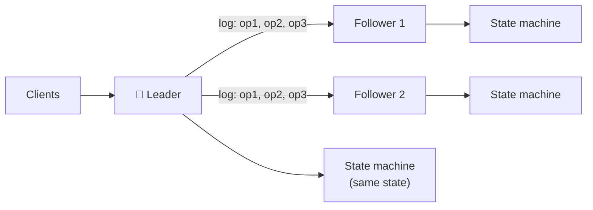
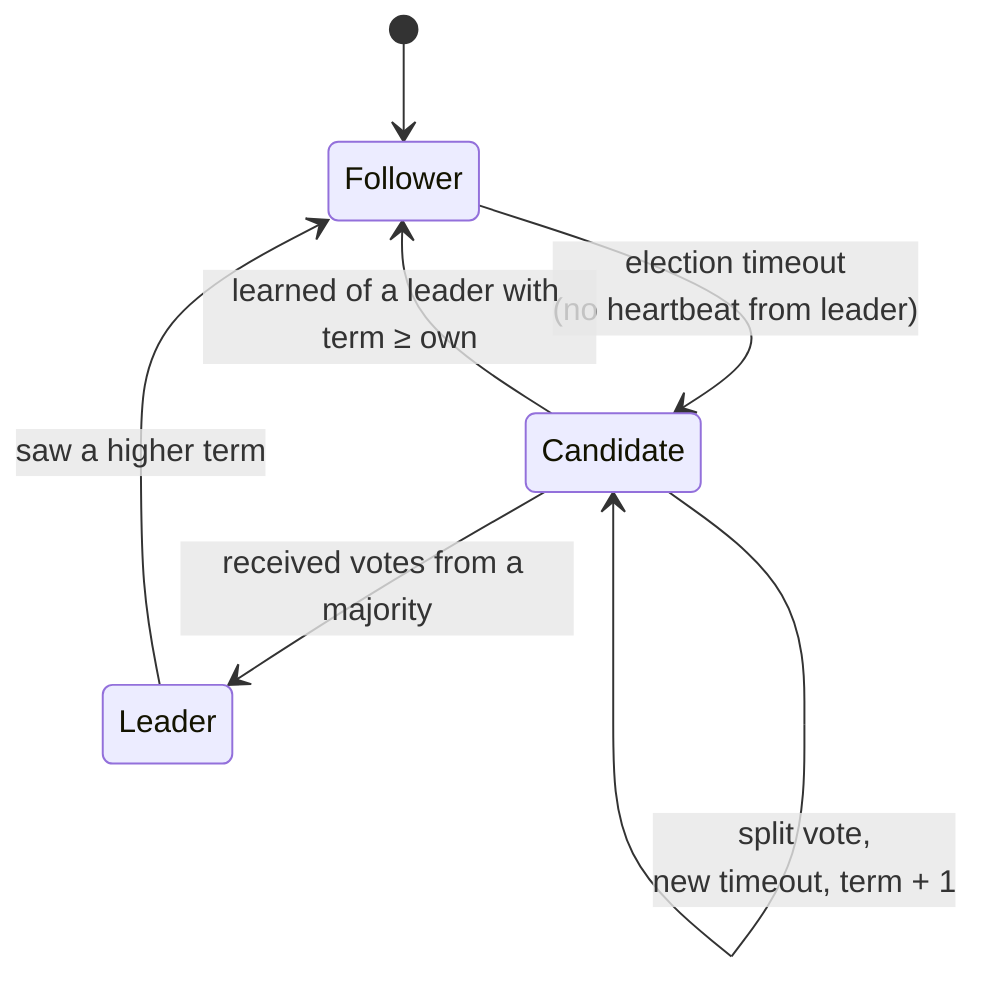
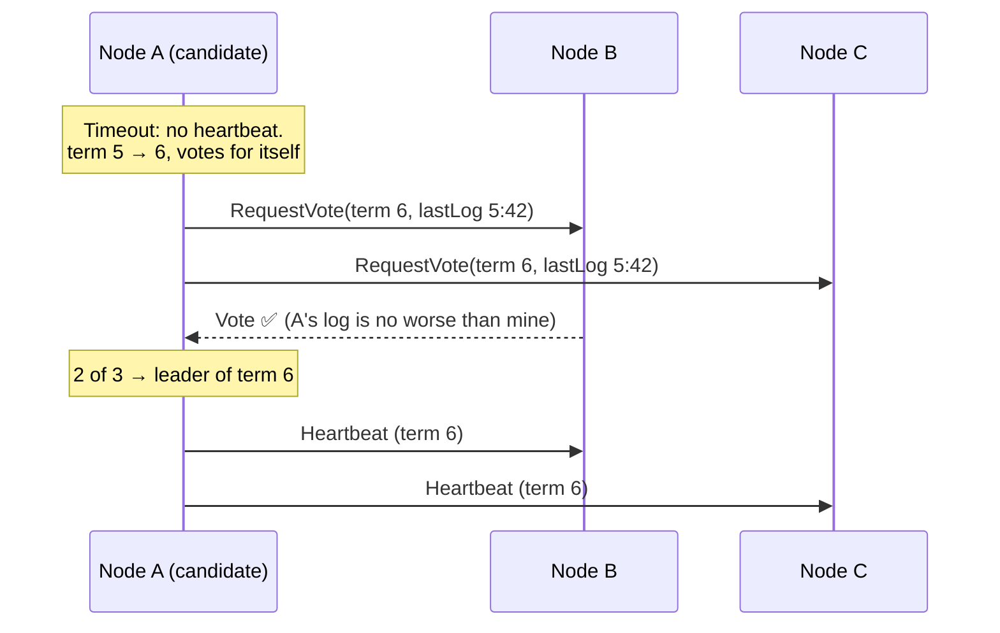
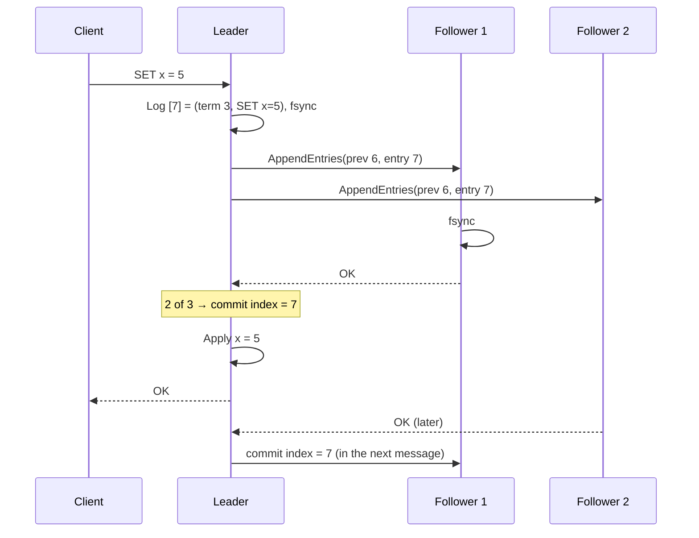
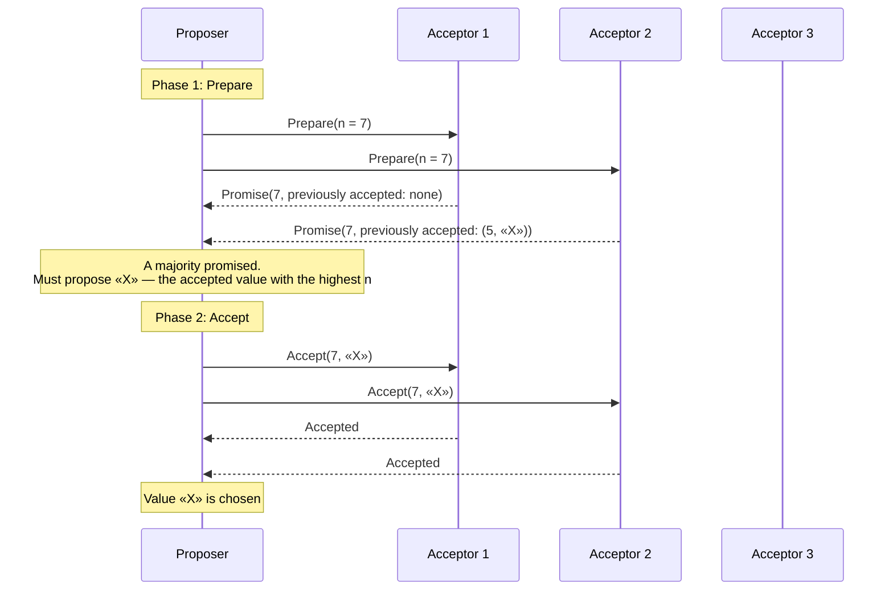
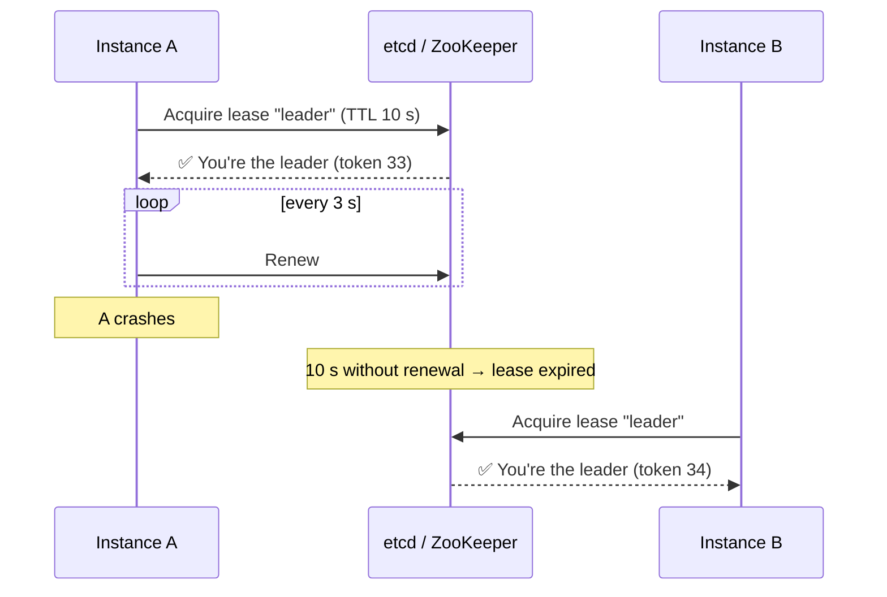
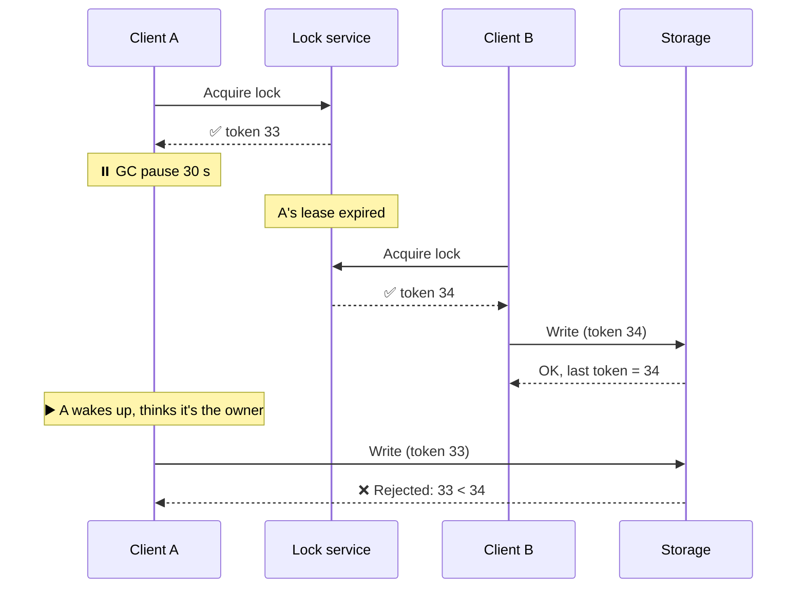
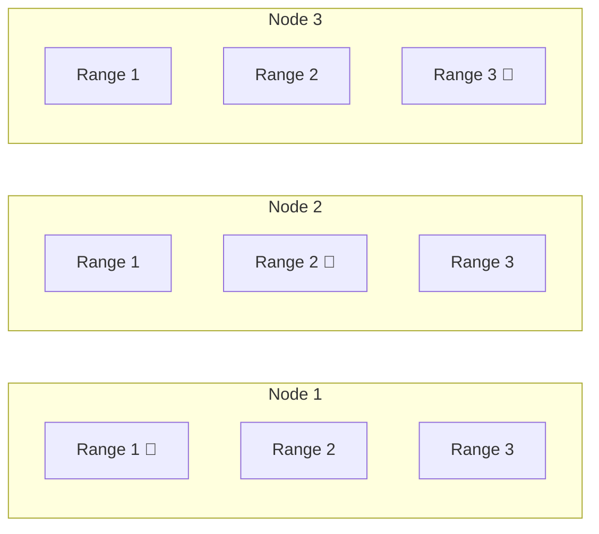

**English** | [Русский](README_RU.md)

# 08. Consensus

> **Covers:** what consensus is and why it's needed, FLP, quorums, Raft in detail (leader election, log replication, linearizable reads, membership changes), Paxos, leases, split brain, fencing tokens, coordination services (ZooKeeper, etcd), Multi-Raft
> **Study time:** ~5–6 h · **Needed for:** leader election, distributed locks, metadata stores, any system with RPO = 0 and no split brain
> **Practice:** interview-style walkthrough — [INTERVIEW.md](./INTERVIEW.md)
> **Related topics:** [05-replication](../05-replication/README.md#10-consensus-based-replication), [07-consistency-models](../07-consistency-models/README.md#3-linearizability)

---

## 📑 Contents

1. [What Consensus Is](#1-what-consensus-is)
2. [Why It's Hard: Failure Models and FLP](#2-why-its-hard-failure-models-and-flp)
3. [Quorums and Majorities](#3-quorums-and-majorities)
4. [Raft: Overview](#4-raft-overview)
5. [Raft: Leader Election](#5-raft-leader-election)
6. [Raft: Log Replication](#6-raft-log-replication)
7. [Raft: Reads, Membership Changes, Snapshots](#7-raft-reads-membership-changes-snapshots)
8. [Paxos and Other Algorithms](#8-paxos-and-other-algorithms)
9. [Leases and Leader Election for Applications](#9-leases-and-leader-election-for-applications)
10. [Split Brain and Fencing Tokens](#10-split-brain-and-fencing-tokens)
11. [Coordination Services: ZooKeeper, etcd, Consul](#11-coordination-services-zookeeper-etcd-consul)
12. [Performance, Placement and Multi-Raft](#12-performance-placement-and-multi-raft)
13. [How to Talk About This in an Interview](#13-how-to-talk-about-this-in-an-interview)
14. [Self-Check Questions](#14-self-check-questions)
15. [Glossary and Resources](#15-glossary-and-resources)

---

## 1. What Consensus Is

**Consensus** is a way to get several nodes to **agree on a single value** (or a sequence of values), even when some nodes crash and the network loses and delays messages.

### Formal properties

| Property | Meaning |
|:---------|:--------|
| **Agreement** | No two nodes decide differently |
| **Integrity** | A node decides at most once |
| **Validity** | The decided value was proposed by someone |
| **Termination** | Every non-failing node eventually decides |

The first three are **safety** properties (nothing bad happens); the last is **liveness** (something good eventually happens).

### Why it's needed

| Task | How it reduces to consensus |
|:-----|:----------------------------|
| **Leader election** | Everyone agrees who the leader is in a given term |
| **Distributed locks** | Everyone agrees who owns the lock |
| **Replicated log** (replicated state machine) | Everyone agrees on the order of operations; each node applies them identically and reaches the same state |
| **Uniqueness** | Everyone agrees who claimed a name first |
| **Atomic commit** | All participants agree: commit or abort |
| **Cluster membership and configuration** | Everyone agrees on membership and settings |

> [!IMPORTANT]
> The key idea: **total order broadcast is equivalent to consensus**. If nodes agree on the order of all operations and apply them deterministically, they reach the same state. That's how etcd, ZooKeeper, CockroachDB, Spanner and Kafka KRaft work.



---

## 2. Why It's Hard: Failure Models and FLP

### Failure models

| Model | What can happen to a node | Typical use |
|:------|:--------------------------|:------------|
| **Crash-stop** | Crashes and never returns | Theoretical models |
| **Crash-recovery** | Crashes and returns with whatever it wrote to disk | Raft, Paxos, ZooKeeper — real data centers |
| **Byzantine** | Behaves arbitrarily, including maliciously | Blockchains, avionics; requires 3f + 1 nodes |

### Timing models

- **Synchronous:** known upper bounds on message delay and node speed. Unrealistic.
- **Asynchronous:** no timing guarantees at all. A node can't tell "crashed" from "slow".
- **Partially synchronous:** the system usually behaves synchronously, but bounds are sometimes violated. The **realistic model** for data centers.

### FLP

**The FLP theorem** (Fischer, Lynch, Paterson, 1985): in a fully asynchronous system there is **no deterministic algorithm** that always reaches consensus if even one node may crash.

The practical takeaway: real algorithms (Raft, Paxos) are **always safe** (they never make two different decisions), but guarantee **liveness** only under partial synchrony — using timeouts. Under a very bad network they may temporarily stop making progress, but they won't violate correctness.

### Why 2PC isn't consensus

Two-phase commit (2PC) solves atomic commit but **blocks** if the coordinator fails: participants that voted "yes" can neither commit nor abort and wait for it to come back. Consensus algorithms keep working while a majority is available. Modern systems often run 2PC **on top of** consensus-replicated participants (Spanner): then the "coordinator" is a Raft/Paxos group that doesn't disappear when one node fails.

---

## 3. Quorums and Majorities

Consensus relies on a **majority** (a quorum of ⌊N/2⌋ + 1 nodes). Any two majorities **overlap** in at least one node — that node "remembers" the earlier decision and prevents a contradictory one.

| Nodes (N) | Quorum | Tolerates failures | Comment |
|:---------:|:------:|:------------------:|:--------|
| 1 | 1 | 0 | No fault tolerance |
| 2 | 2 | 0 | Worse than 1: any failure halts the system |
| **3** | 2 | **1** | The production minimum |
| 4 | 3 | 1 | Same as 3, but costlier and slower |
| **5** | 3 | **2** | Typical for critical clusters |
| 7 | 4 | 3 | Rare: higher write latency |

> [!TIP]
> **Why an odd number:** 4 nodes tolerate as many failures as 3 but need a quorum of 3, so they're slower and costlier. An even node count adds no fault tolerance.

### Placement across zones

| Placement | What it survives |
|:----------|:-----------------|
| 3 nodes in one AZ | A node failure, but not an AZ failure |
| 3 nodes in 3 AZs (1-1-1) | Losing any AZ |
| 5 nodes in 3 AZs (2-2-1) | Losing any AZ **and** one more node |
| 5 nodes in 2 AZs (3-2) | ❌ Losing the AZ with three nodes halts the cluster |

> [!WARNING]
> With two data centers you can't survive losing either one: one of them always holds the majority. You need a **third** participant — at least a small witness node in a third location.

---

## 4. Raft: Overview

**Raft** (Ongaro, Ousterhout, 2014) was designed as an understandable alternative to Paxos. It's used in etcd, Consul, CockroachDB, TiKV, Kafka KRaft, RabbitMQ quorum queues and many others.

### Three subproblems

1. **Leader election** — at most one leader per term at any time.
2. **Log replication** — the leader accepts commands and replicates them to followers.
3. **Safety** — once an entry is committed, it will be in the log of every future leader.

### Roles and transitions



### Term

A **term** is a logical "epoch". Each election starts a new term (a monotonically increasing number). There's at most one leader per term. Every message carries the sender's term:
- if a node sees a **higher** term, it immediately becomes a follower and updates its term;
- messages with an **old** term are rejected.

The term is what stops an "old" leader that wakes up after a pause from breaking anything inside the cluster.

---

## 5. Raft: Leader Election

1. The leader regularly sends a **heartbeat** (an empty AppendEntries) to all followers.
2. If a follower receives no heartbeat within the **election timeout** (randomized, e.g. 150–300 ms in the original paper; often hundreds of ms to seconds in production), it becomes a **candidate**: increments the term, votes for itself and sends **RequestVote**.
3. A node votes **at most once per term**, and only for a candidate whose log is **at least as up to date** as its own (by the term of the last entry, then by length).
4. A candidate that receives a **majority** becomes the leader and immediately sends heartbeats.



### Why a randomized timeout

If every follower waited the same amount of time, they'd become candidates simultaneously, split the vote, and repeat elections forever. Random spread almost always gives one node a head start, and it wins in a single round.

### The election restriction

Only a candidate with an up-to-date log gets votes. Since a committed entry is on a majority, and winning requires a majority of votes, **at least one voter** has that entry and won't vote for a candidate without it. So **a new leader always contains every committed entry** (leader completeness).

### Pre-vote

A node temporarily cut off from the network keeps incrementing its term. When it returns, its higher term forces the working leader to step down — an unnecessary election. **Pre-vote**: the candidate first asks "would you vote for me?" without incrementing its term, and starts a real election only if a majority says yes. Used in etcd and other implementations.

---

## 6. Raft: Log Replication

1. A client sends a command to the **leader** (followers redirect).
2. The leader appends the entry to its log (with the current term and index) and sends **AppendEntries** to followers.
3. Once the entry is on a **majority** of nodes (including the leader, written to disk), it's **committed**.
4. The leader applies the entry to the state machine and replies to the client. Followers learn the commit index in subsequent messages and apply it too.



### Log consistency

Every AppendEntries contains the index and term of the **preceding** entry. A follower accepts new entries only if it has a matching preceding entry. If not, the leader backs up until it finds a common point and **overwrites** the follower's divergent tail. That's how every node's log converges to the leader's.

> [!WARNING]
> A leader commits entries **only from its current term** by counting replicas. Entries from earlier terms are committed indirectly, together with an entry from the new term. That's why a new leader immediately appends an empty (no-op) entry — otherwise it couldn't safely determine what's committed.

### The cost of a write

```
Write latency ≈ fsync on the leader + RTT to the fastest follower in the majority + fsync there
Within a region (3 AZs):   ~2–10 ms
Across regions:            ~RTT to the nearest majority (tens to hundreds of ms)
```

---

## 7. Raft: Reads, Membership Changes, Snapshots

### Linearizable reads

Naively reading from the leader is dangerous: a node may **think** it's the leader when it has already been replaced (a partition, a pause). Options:

| Method | How | Cost | Risk |
|:-------|:----|:-----|:-----|
| **Read through the log** | A read goes through the log like a write | Same as a write | None, but expensive |
| **ReadIndex** | The leader records the commit index, sends heartbeats and waits for a majority to confirm it's still the leader; answers once applied up to that index | One round trip to a majority, no disk write | None |
| **Lease read** | The leader considers itself leader for T ms after the last majority confirmation and answers locally | Almost free | Depends on bounded clock drift |
| **Follower read** | A follower asks the leader for the commit index (ReadIndex) and waits until it has applied it | Offloads the leader | None when using ReadIndex |
| **Serializable / stale read** | Any node answers with what it has | Free | May be stale |

### Membership changes

You can't switch every node from the old configuration to the new one at the same instant: during the transition, **two independent majorities** (old and new) and two leaders could exist.

- **Joint consensus:** an intermediate configuration where decisions require a majority **in both** the old and the new membership.
- **One node at a time:** add or remove nodes **strictly one at a time** — the old and new majorities are guaranteed to overlap. etcd and many others use this.
- **Learner (non-voting member):** a new node first catches up on the log without a vote and only then becomes a voter — so availability doesn't drop while it's empty.

### Snapshots and log compaction

The log grows forever. Periodically a node saves a **snapshot** of the state machine and deletes log entries up to that point. For a lagging or new node, the leader sends the snapshot (InstallSnapshot) followed by the missing entries.

---

## 8. Paxos and Other Algorithms

### Basic Paxos

Lamport, "The Part-Time Parliament" (1998) and "Paxos Made Simple" (2001). Roles: **proposer**, **acceptor**, **learner**.



- **Phase 1 (Prepare/Promise):** the proposer picks a number n; an acceptor promises not to accept proposals with a lower number and reports what it has already accepted.
- **Phase 2 (Accept/Accepted):** the proposer proposes a value (it must use the previously accepted value with the highest number, if any); the value is chosen once a majority accepts it.

### Multi-Paxos

Basic Paxos chooses **one** value in two round trips. Multi-Paxos elects a stable leader that skips phase 1 for subsequent writes — roughly the same as Raft: one round trip per write.

### Comparison

| | Paxos / Multi-Paxos | Raft | ZAB (ZooKeeper) |
|:-|:--------------------|:-----|:----------------|
| Understandability | Hard, many variants | Designed to be understandable | Medium |
| Leader | An optimization in Multi-Paxos | Mandatory; the log flows only from the leader | Mandatory |
| Gaps in the log | Possible | None | None |
| Where | Spanner, Chubby, Megastore | etcd, Consul, CockroachDB, TiKV, Kafka KRaft | ZooKeeper |

Others: **Viewstamped Replication** (predates the Paxos publication, very close to Raft), **EPaxos** (no designated leader, low latency across regions), **Flexible Paxos** (phase quorums may differ as long as they intersect), **PBFT** (Byzantine faults, 3f + 1 nodes).

> [!NOTE]
> Interviews almost never ask you to implement Paxos. They expect you to understand **majorities, terms/proposal numbers, a leader, commit on majority, a new leader holds everything committed** — and to apply a ready-made service (etcd, ZooKeeper) correctly.

---

## 9. Leases and Leader Election for Applications

Most applications don't implement consensus themselves; they use a **coordination service** to elect a leader among their instances (e.g. "only one scheduler instance runs jobs").

### A lease

A **lease** is a lock with a limited lifetime. The owner must **renew** it before it expires; if it doesn't (crashed, partitioned), the lease expires and someone else can take it.



### The problem: a lease doesn't guarantee exclusivity by itself

The owner may **think** the lease is still valid when it has already expired:
- a **GC pause** or a process stopped for tens of seconds;
- a **virtual machine** paused and migrated;
- **clocks** on the client and server running at different rates;
- **network delay:** a request sent while the lease was valid reaches the resource after it expired.

**Client-side protection:** treat the lease as lost **earlier** than the server does (its own timer with a margin), and check that the lease is still valid before each operation — but this **doesn't eliminate** the problem: a pause can occur between the check and the operation. The definitive solution is **fencing tokens**.

---

## 10. Split Brain and Fencing Tokens

**Split brain** — two nodes simultaneously believe they're the leader (lock owner) and perform operations only one should perform.

### Inside a consensus cluster, split brain is impossible

Two leaders in the same term would require two disjoint majorities — impossible. An old leader in the minority **can't commit** a single entry. When it returns, it sees a higher term and becomes a follower.

### But split brain among clients is possible

The etcd cluster is correct, but a **client** that believes it owns a lock can, after a pause, write to an **external resource** (a database, file storage) when the lock already belongs to someone else.



### The fencing token

- On every acquisition, the lock service issues a **monotonically increasing number** (in etcd — the revision, in ZooKeeper — the zxid or znode version, in Raft — the term).
- The client passes the token with **every** request to the protected resource.
- The resource remembers the highest token seen and **rejects** requests with a lower one.

> [!IMPORTANT]
> **Senior+ signal:** "A lock by itself doesn't guarantee exclusivity — you need a fencing token checked by the protected resource." That's what separates a superficial answer from a deep one. If the resource can't check tokens (e.g. an external API), use idempotency and conditional writes (`WHERE version = ...`) — essentially the same mechanism.

### Redlock and the debate around it

Redlock is a locking algorithm across several independent Redis nodes. In 2016 Martin Kleppmann published a critique: Redlock relies on bounded pauses and clock drift and doesn't provide fencing tokens, so it isn't suitable for locks that **correctness** depends on. The author of Redis (antirez) responded with objections. The practical takeaway: for **efficiency** (avoid doing work twice, but a duplicate isn't harmful) a simple Redis lock is fine; for **correctness** — a consensus service + fencing tokens.

### Other ways to fight split brain

| Method | How |
|:-------|:----|
| **STONITH** ("shoot the other node in the head") | Before taking over, the new leader forcibly powers off the old one (via power management, a cloud API) |
| **Revoking access** | The old leader's access to storage is cut off (e.g. revoking permissions or a key) |
| **Self-fencing** | A node that loses contact with the majority stops working by itself (e.g. Patroni demotes PostgreSQL to a replica) |

---

## 11. Coordination Services: ZooKeeper, etcd, Consul

Almost nobody implements consensus from scratch. Ready-made services store **small**, critical data.

| | ZooKeeper | etcd | Consul |
|:-|:----------|:-----|:-------|
| Algorithm | ZAB | Raft | Raft |
| Data model | A tree of znodes | A flat keyspace with revisions (MVCC) | Key-value + a service catalog |
| Sessions and leases | Sessions; **ephemeral** nodes vanish with the session | Leases that keys attach to | Sessions |
| Notifications | Watches (one-shot; newer versions add persistent ones) | Watch by key or prefix from a revision | Blocking queries, watches |
| Atomic operations | Znode versions, multi-op | "compare → then / else" transactions | Check-and-set |
| Ordering | **Sequential** znodes | Revisions | Indexes |
| Used in | Hadoop, HBase, older Kafka | Kubernetes, many cloud systems | Service discovery, the HashiCorp stack |

### Common recipes

| Recipe | In ZooKeeper | In etcd |
|:-------|:-------------|:--------|
| **Leader election** | Each creates an ephemeral sequential znode; the leader has the lowest number; each watches only its predecessor (no herd) | Campaign via a key with a lease; the leader is the key with the lowest creation revision (`concurrency.Election`) |
| **Lock** | The same recipe with sequential znodes | `concurrency.Mutex`: a key with a lease + waiting for the predecessor's deletion |
| **Service discovery** | Instances' ephemeral znodes | Keys with leases + watch |
| **Configuration** | Znode + watch | Keys + watch |

> [!TIP]
> **The herd effect:** if every waiter watches the same lock key, all of them wake up and rush to grab it at once when it's released. The sequential-node recipe, where each watches only its **predecessor**, wakes exactly one.

### What to store in a coordination service and what not to

| ✅ Fits | ❌ Doesn't fit |
|:-------|:--------------|
| Who's the leader, who owns a lock | User data |
| Configuration, feature flags | Large objects |
| Cluster membership, the shard map | High-frequency writes (metrics, events) |
| Metadata (Kubernetes, Kafka KRaft) | Anything that needs to scale writes |

Coordination services are designed for data volumes on the order of a few gigabytes and thousands to tens of thousands of writes per second. Every write goes through the leader and a majority fsync.

---

## 12. Performance, Placement and Multi-Raft

### What performance depends on

| Factor | Why | What to do |
|:-------|:----|:-----------|
| **fsync** | A write is acknowledged after it's on disk on a majority | Fast SSDs, a dedicated log disk |
| **RTT to a majority** | Every write is at least one round trip | Place nodes close (one region, different AZs) |
| **The leader is a bottleneck** | Every write goes through it | Batching, pipelining; Multi-Raft |
| **Data size** | Snapshots, recovery, memory | Store only metadata |
| **Number of watchers and clients** | Notification fan-out load | Proxies, client-side caching |

### Multi-Raft: scaling through many groups

A single Raft group is bounded by its leader's capacity. Distributed databases split data into **thousands of ranges** (ranges, regions), and **each** has its own Raft group of 3–5 replicas. Leaders of different groups are spread across nodes.



**Where:** CockroachDB, TiKV/TiDB, YugabyteDB, Spanner (Paxos groups per split). Transactions touching several groups use 2PC on top of the groups.

### Common operational mistakes

- An even number of nodes, or all nodes in one AZ.
- A slow or shared disk — rising fsync latency causes spurious elections.
- An election timeout that's too short — frequent leader changes on ordinary pauses.
- Removing and adding several nodes at once.
- Storing large volumes of data in etcd/ZooKeeper.
- No monitoring: leader changes, fsync duration, proposal failures, database size.

---

## 13. How to Talk About This in an Interview

### 30-second answer

> "Consensus is needed for leader election, locks, metadata and linearizable writes without split brain. I don't write it myself — I use etcd or ZooKeeper (Raft/ZAB): 5 nodes in 3 AZs, surviving the loss of an AZ plus one more node. A write is committed by a majority, a new leader holds everything committed, and an old leader in the minority can't commit anything thanks to the term. For application locks I use leases with renewal, but I guarantee correctness with fencing tokens — a monotonic revision that the protected resource checks. Linearizable reads go through ReadIndex. I store only small metadata there; for scale — Multi-Raft."

### Questions to ask yourself

1. Is consensus needed here, or is single-leader with manual failover enough?
2. What resource does the lock protect, and can it check fencing tokens?
3. How many failures (nodes, AZs, regions) must the system survive?
4. What write latency is acceptable — does cross-region consensus fit?
5. Am I trying to store something in the coordination service that it isn't meant for?

### Common mistakes

- An even number of nodes, or "2 nodes for fault tolerance".
- A lock without a fencing token for operations where correctness matters.
- A Redis lock for critical correctness.
- Confusing 2PC with consensus.
- Reading "from the leader" without ReadIndex or a lease and calling it linearizable.
- Storing business data in etcd/ZooKeeper.
- Cross-region consensus without computing write latency.

---

## 14. Self-Check Questions

<details>
<summary><b>1. Why is a 4-node cluster no better than a 3-node one?</b></summary>

Both tolerate only one failure: the quorum is 3 for 4 nodes and 2 for 3 nodes. But 4 nodes need acknowledgments from three, which is slower and costlier. An even node count adds no fault tolerance.
</details>

<details>
<summary><b>2. What does the FLP theorem say, and why does Raft still work?</b></summary>

In a fully asynchronous system there's no deterministic algorithm guaranteeing consensus terminates if one node may fail. Raft is always safe, and provides liveness under partial synchrony using timeouts: under a bad network it may temporarily stop progressing, but it won't make contradictory decisions.
</details>

<details>
<summary><b>3. Why does Raft use a randomized election timeout?</b></summary>

So followers don't become candidates at the same time. Otherwise votes would split and elections would repeat endlessly. Random spread almost always gives one node a head start.
</details>

<details>
<summary><b>4. Why does a new Raft leader always contain every committed entry?</b></summary>

A committed entry is on a majority of nodes, and winning requires votes from a majority. These two majorities overlap, and the overlapping node won't vote for a candidate with a less up-to-date log (the election restriction).
</details>

<details>
<summary><b>5. Why might a read from the leader not be linearizable?</b></summary>

A node may believe it's the leader after it has been replaced (a partition, a pause) and return stale data. Protection — ReadIndex (confirm leadership with a majority before answering) or a lease read (if clock drift is bounded).
</details>

<details>
<summary><b>6. Why are nodes added and removed strictly one at a time?</b></summary>

If several nodes change at once, during the transition the old and new majorities may not overlap, and two leaders could appear. Changing one at a time guarantees the overlap. The alternative is joint consensus.
</details>

<details>
<summary><b>7. Why doesn't a lease guarantee a single owner?</b></summary>

After a pause (GC, a VM stop) or due to network delay, the owner can perform an operation when the lease has already expired and been granted to someone else. It doesn't know it lost the lease. Protection — fencing tokens checked by the resource.
</details>

<details>
<summary><b>8. How does a fencing token work?</b></summary>

On every lock acquisition the service issues a monotonically increasing number. The client passes it with every request to the resource. The resource remembers the highest number seen and rejects requests with a lower one. An old owner returning after a pause arrives with a lower token and is rejected.
</details>

<details>
<summary><b>9. How is 2PC different from consensus?</b></summary>

2PC solves atomic commit but blocks if the coordinator fails: participants wait for it to return. Consensus keeps working while a majority is available. Modern systems run 2PC on top of consensus-replicated groups so the coordinator isn't a single point of failure.
</details>

<details>
<summary><b>10. What is Multi-Raft and why is it needed?</b></summary>

Data is split into many ranges, each with its own Raft group. Leaders are spread across nodes, so writes scale horizontally instead of being bounded by one leader. Used in CockroachDB, TiKV, YugabyteDB.
</details>

---

## 15. Glossary and Resources

### Glossary

| Term | Meaning |
|:-----|:--------|
| Consensus | Nodes agreeing on one value or a sequence of values despite failures |
| Replicated state machine | Identical state machines applying the same command log |
| Total order broadcast | Delivering messages to every node in the same order; equivalent to consensus |
| FLP | The impossibility of guaranteed deterministic consensus in an asynchronous system with failures |
| Quorum / majority | ⌊N/2⌋ + 1 nodes; any two quorums overlap |
| Term | A monotonic epoch in Raft; at most one leader per term |
| Commit index | The index of the last committed log entry |
| ReadIndex | A linearizable read via confirming leadership with a majority |
| Joint consensus | A transitional configuration for safe membership changes |
| Learner | A non-voting member catching up on the log |
| Lease | A time-limited lock that must be renewed |
| Split brain | Two nodes both believe they're the leader |
| Fencing token | A monotonic number a resource uses to reject old owners' requests |
| STONITH | Forcibly powering off the old leader |
| Ephemeral / sequential znode | A ZooKeeper node that vanishes with its session / gets an automatic sequence number |
| Multi-Raft | Many Raft groups, one per data range |

### Resources

- *Designing Data-Intensive Applications*, Martin Kleppmann — chapters 8 "The Trouble with Distributed Systems" and 9 "Consistency and Consensus"
- Ongaro, Ousterhout, *In Search of an Understandable Consensus Algorithm (Raft)* (2014); interactive visualization at raft.github.io
- Leslie Lamport, *Paxos Made Simple* (2001)
- Fischer, Lynch, Paterson, *Impossibility of Distributed Consensus with One Faulty Process* (1985)
- Mike Burrows, *The Chubby Lock Service for Loosely-Coupled Distributed Systems* (OSDI 2006)
- Hunt et al., *ZooKeeper: Wait-free Coordination for Internet-scale Systems* (USENIX ATC 2010)
- Martin Kleppmann, *How to do distributed locking* (2016)
- Heidi Howard, Richard Mortier, *Paxos vs Raft: Have we reached consensus on distributed consensus?* (2020)
- Gray, Lamport, *Consensus on Transaction Commit* (2006)
- etcd documentation (Raft, leases, concurrency) and ZooKeeper documentation (recipes)