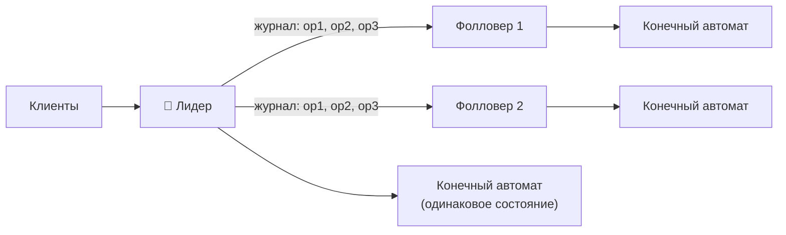
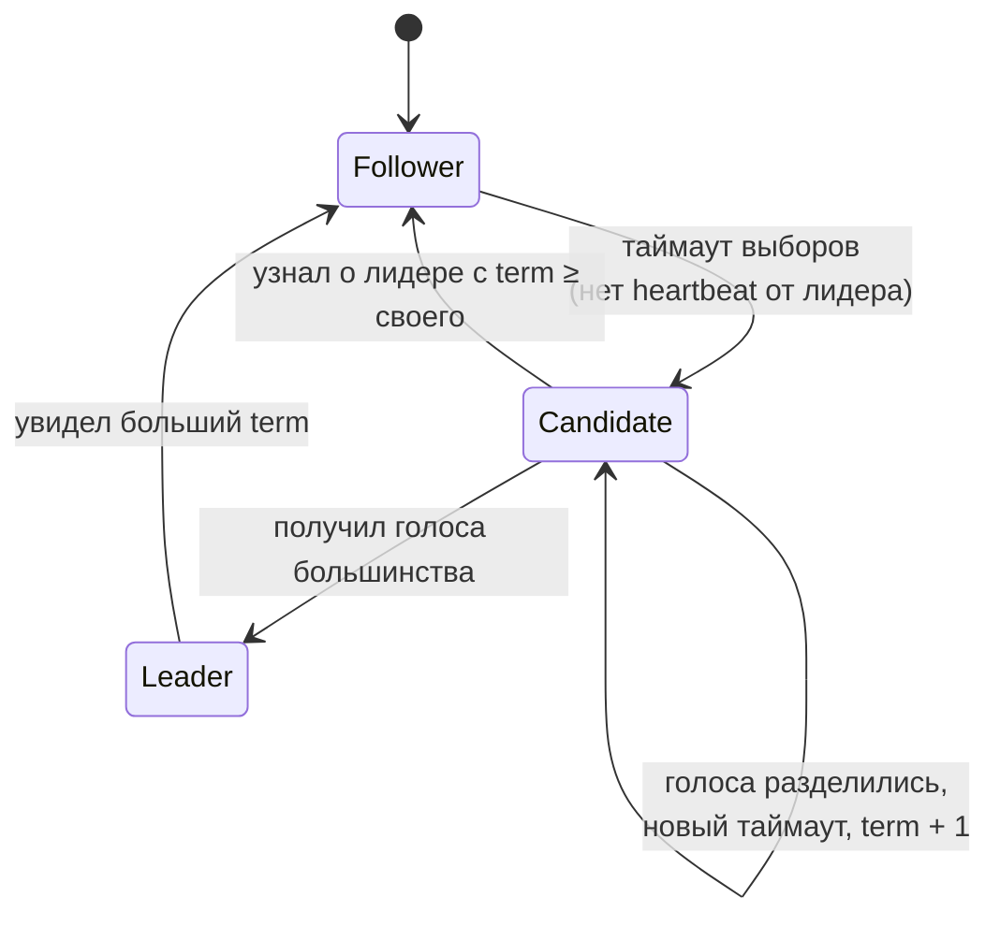
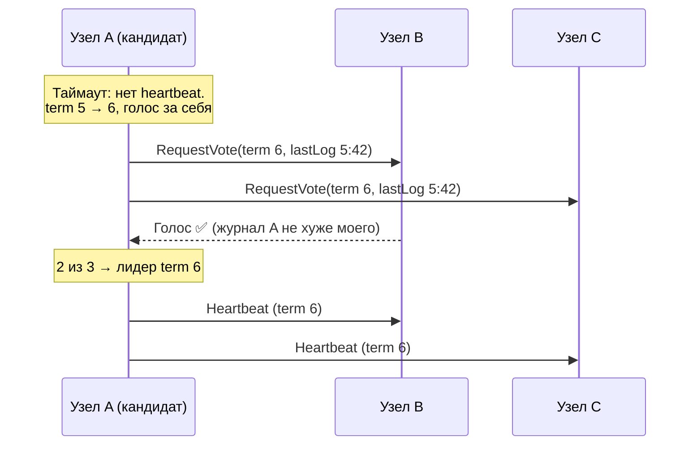
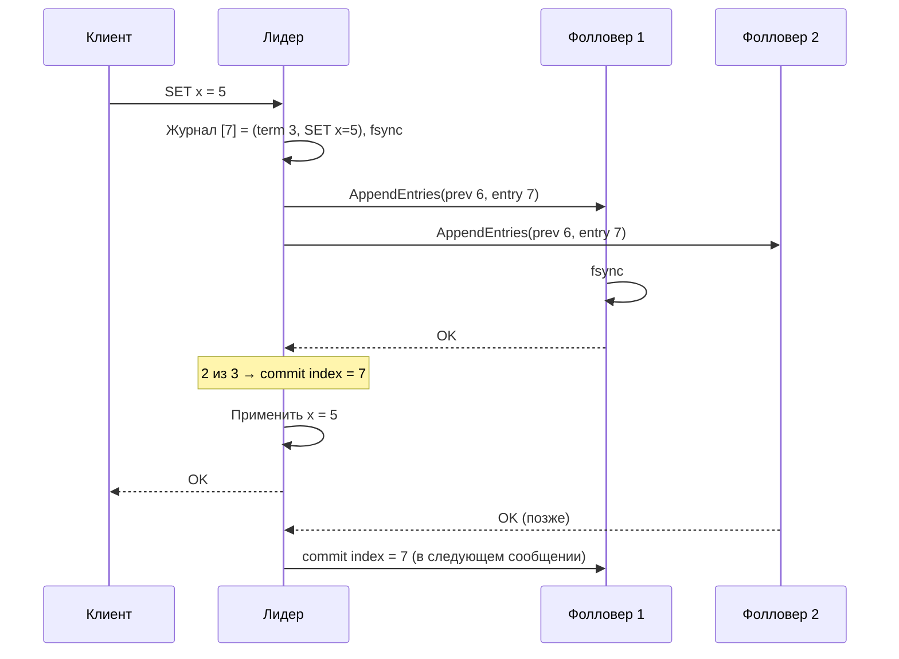
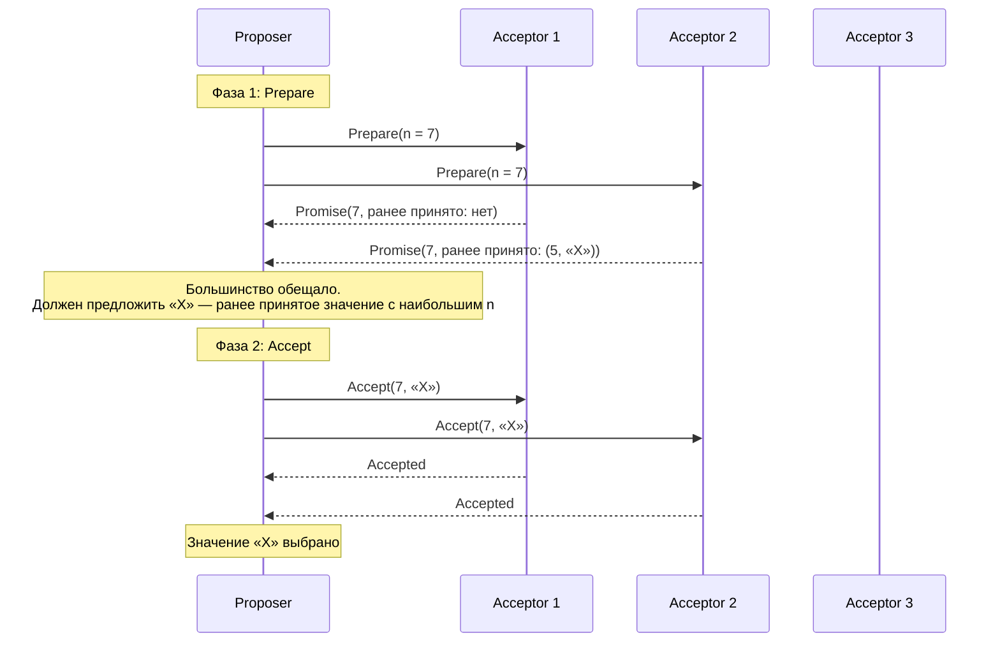
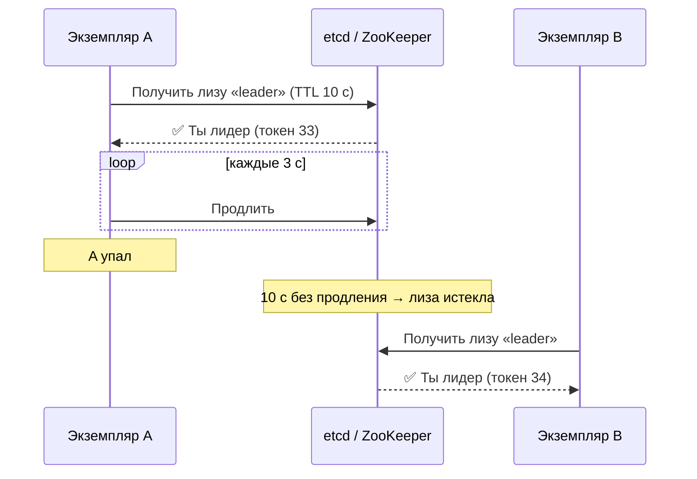
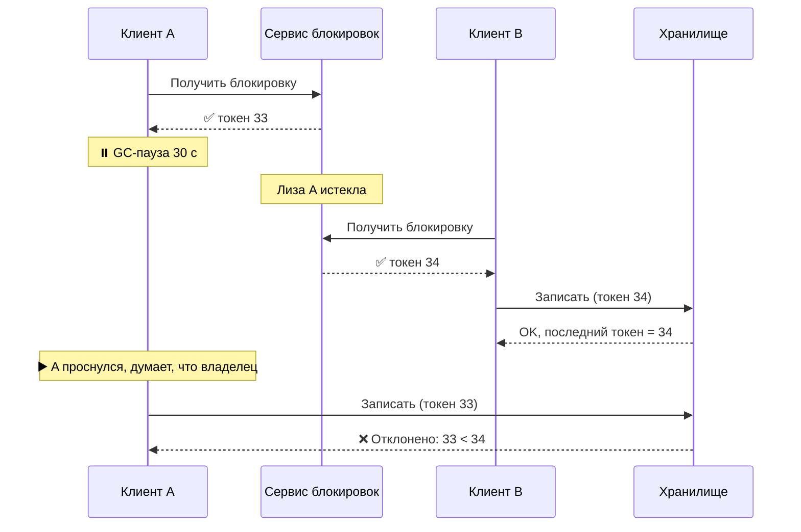
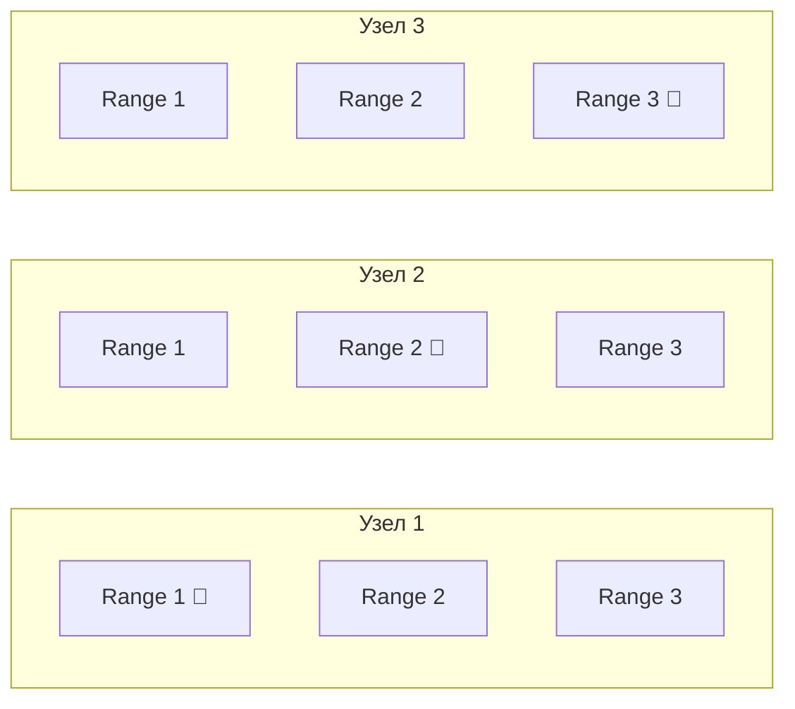

[English](README.md) | **Русский**

# 08. Консенсус

> **Что внутри:** что такое консенсус и зачем он нужен, FLP, кворумы, Raft подробно (выбор лидера, репликация журнала, линеаризуемые чтения, смена состава), Paxos, лизы, split brain, fencing-токены, сервисы координации (ZooKeeper, etcd), Multi-Raft
> **Время на изучение:** ~5–6 ч · **Нужно для:** выбора лидера, распределённых блокировок, хранилищ метаданных, любой системы с RPO = 0 без split brain
> **Практика:** разбор в формате интервью — [INTERVIEW_RU.md](./INTERVIEW.ru.md)
> **Связанные темы:** [05-replication](../05_Replication/README.ru.md#10-репликация-на-основе-консенсуса), [07-consistency-models](../07_Consistency%20models/README.ru.md#3-линеаризуемость)

---

## 📑 Содержание

1. [Что такое консенсус](#1-что-такое-консенсус)
2. [Почему это сложно: модели отказов и FLP](#2-почему-это-сложно-модели-отказов-и-flp)
3. [Кворумы и большинство](#3-кворумы-и-большинство)
4. [Raft: обзор](#4-raft-обзор)
5. [Raft: выбор лидера](#5-raft-выбор-лидера)
6. [Raft: репликация журнала](#6-raft-репликация-журнала)
7. [Raft: чтения, смена состава, снимки](#7-raft-чтения-смена-состава-снимки)
8. [Paxos и другие алгоритмы](#8-paxos-и-другие-алгоритмы)
9. [Лизы и выбор лидера для приложений](#9-лизы-и-выбор-лидера-для-приложений)
10. [Split brain и fencing-токены](#10-split-brain-и-fencing-токены)
11. [Сервисы координации: ZooKeeper, etcd, Consul](#11-сервисы-координации-zookeeper-etcd-consul)
12. [Производительность, размещение и Multi-Raft](#12-производительность-размещение-и-multi-raft)
13. [Как говорить об этом на интервью](#13-как-говорить-об-этом-на-интервью)
14. [Вопросы для самопроверки](#14-вопросы-для-самопроверки)
15. [Глоссарий и ресурсы](#15-глоссарий-и-ресурсы)

---

## 1. Что такое консенсус

**Консенсус** — способ заставить несколько узлов **согласиться об одном значении** (или о последовательности значений), даже если часть узлов падает, а сеть теряет и задерживает сообщения.

### Формальные свойства

| Свойство | Смысл |
|:---------|:------|
| **Согласие (agreement)** | Никакие два узла не решают по-разному |
| **Целостность (integrity)** | Узел решает не больше одного раза |
| **Обоснованность (validity)** | Решённое значение было кем-то предложено |
| **Завершаемость (termination)** | Каждый работающий узел в итоге принимает решение |

Первые три — свойства **безопасности** (ничего плохого не происходит), последнее — **живучести** (что-то хорошее в итоге происходит).

### Зачем он нужен

| Задача | Как сводится к консенсусу |
|:-------|:--------------------------|
| **Выбор лидера** | Все соглашаются, кто лидер в данном term |
| **Распределённые блокировки** | Все соглашаются, кто владелец блокировки |
| **Реплицированный журнал** (replicated state machine) | Все соглашаются о порядке операций; каждый узел применяет их одинаково и приходит в одно состояние |
| **Уникальность** | Все соглашаются, кто первым занял имя |
| **Атомарный коммит** | Все участники соглашаются: зафиксировать или откатить |
| **Членство в кластере и конфигурация** | Все соглашаются о составе и настройках |

> [!IMPORTANT]
> Ключевая идея: **total order broadcast (атомарная рассылка в общем порядке) эквивалентна консенсусу**. Если узлы договорились о порядке всех операций и применяют их детерминированно, они получают одинаковое состояние. Так устроены etcd, ZooKeeper, CockroachDB, Spanner и Kafka KRaft.



---

## 2. Почему это сложно: модели отказов и FLP

### Модели отказов

| Модель | Что может случиться с узлом | Типичное применение |
|:-------|:----------------------------|:--------------------|
| **Crash-stop** | Падает и больше не возвращается | Теоретические модели |
| **Crash-recovery** | Падает и возвращается с тем, что успел записать на диск | Raft, Paxos, ZooKeeper — реальные дата-центры |
| **Byzantine** | Ведёт себя произвольно, в том числе злонамеренно | Блокчейны, авионика; требует 3f + 1 узлов |

### Модели времени

- **Синхронная:** известны верхние границы задержки сообщений и скорости узлов. Нереалистично.
- **Асинхронная:** никаких гарантий времени. Узел не может отличить «упал» от «медленный».
- **Частично синхронная:** обычно система ведёт себя синхронно, но иногда границы нарушаются. **Реалистичная модель** для дата-центров.

### FLP

**Теорема FLP** (Fischer, Lynch, Paterson, 1985): в полностью асинхронной системе **нет детерминированного алгоритма**, который всегда завершает консенсус, если хотя бы один узел может упасть.

Практический вывод: реальные алгоритмы (Raft, Paxos) **всегда безопасны** (никогда не примут два разных решения), но **живучесть** обеспечивают только при частичной синхронности — с помощью таймаутов. При очень плохой сети они могут временно не прогрессировать, но не нарушат корректность.

### Почему 2PC — не консенсус

Двухфазный коммит (2PC) решает задачу атомарного коммита, но **блокируется** при падении координатора: участники, проголосовавшие «да», не могут ни зафиксировать, ни откатить и ждут его возвращения. Консенсусные алгоритмы продолжают работу, пока доступно большинство. В современных системах 2PC часто запускают **поверх** реплицированных через консенсус участников (Spanner): тогда «координатор» — это Raft/Paxos-группа, которая не исчезает при падении одного узла.

---

## 3. Кворумы и большинство

Консенсус опирается на **большинство** (кворум из ⌊N/2⌋ + 1 узлов). Любые два большинства **пересекаются** хотя бы в одном узле — этот узел «помнит» предыдущее решение и не даст принять противоречащее.

| Узлов (N) | Кворум | Переживает отказов | Комментарий |
|:---------:|:------:|:------------------:|:------------|
| 1 | 1 | 0 | Нет отказоустойчивости |
| 2 | 2 | 0 | Хуже, чем 1: любой отказ останавливает систему |
| **3** | 2 | **1** | Минимум для продакшена |
| 4 | 3 | 1 | Как 3, но дороже и медленнее |
| **5** | 3 | **2** | Типично для критичных кластеров |
| 7 | 4 | 3 | Редко: выше задержка записи |

> [!TIP]
> **Почему нечётное число:** 4 узла переживают столько же отказов, сколько 3, но требуют кворума из 3, то есть медленнее и дороже. Чётное число узлов не даёт выигрыша в отказоустойчивости.

### Размещение по зонам

| Размещение | Что переживает |
|:-----------|:---------------|
| 3 узла в одной AZ | Отказ узла, но не отказ AZ |
| 3 узла в 3 AZ (1-1-1) | Отказ любой AZ |
| 5 узлов в 3 AZ (2-2-1) | Отказ любой AZ **и** ещё одного узла |
| 5 узлов в 2 AZ (3-2) | ❌ Отказ AZ с тремя узлами останавливает кластер |

> [!WARNING]
> С двумя дата-центрами нельзя пережить потерю любого из них: один всегда содержит большинство. Нужен **третий** участник — хотя бы маленький узел-свидетель (witness) в третьем месте.

---

## 4. Raft: обзор

**Raft** (Ongaro, Ousterhout, 2014) разработан как понятная альтернатива Paxos. Используется в etcd, Consul, CockroachDB, TiKV, Kafka KRaft, RabbitMQ quorum queues и многих других.

### Три подзадачи

1. **Выбор лидера** — в каждый момент не больше одного лидера на term.
2. **Репликация журнала** — лидер принимает команды и реплицирует их на фолловеров.
3. **Безопасность** — если запись зафиксирована, она будет в журнале каждого будущего лидера.

### Роли и переходы



### Term

**Term** — логические «эпохи». Каждые выборы начинают новый term (монотонно растущий номер). В каждом term не больше одного лидера. Любое сообщение несёт term отправителя:
- если узел видит **больший** term — он немедленно становится фолловером и обновляет свой term;
- сообщения со **старым** term отвергаются.

Term — это то, что не даёт «старому» лидеру, проснувшемуся после паузы, что-либо испортить внутри кластера.

---

## 5. Raft: выбор лидера

1. Лидер регулярно шлёт **heartbeat** (пустой AppendEntries) всем фолловерам.
2. Если фолловер не получает heartbeat в течение **таймаута выборов** (случайного, например 150–300 мс в оригинальной статье; в продакшене часто сотни мс – секунды), он становится **кандидатом**: увеличивает term, голосует за себя и рассылает **RequestVote**.
3. Узел голосует **не больше одного раза за term** и только за кандидата, чей журнал **не менее свежий**, чем его собственный (по term последней записи, затем по длине).
4. Кандидат, получивший **большинство**, становится лидером и сразу шлёт heartbeat.



### Почему случайный таймаут

Если бы все фолловеры ждали одинаково, они стали бы кандидатами одновременно, голоса разделились бы, и выборы повторялись бы бесконечно. Случайный разброс почти всегда даёт одному узлу фору, и он побеждает за один раунд.

### Ограничение выборов (election restriction)

Голос получает только кандидат с не менее свежим журналом. Так как зафиксированная запись есть у большинства, а для победы нужно большинство голосов, **хотя бы один голосующий** имеет эту запись и не проголосует за кандидата без неё. Поэтому **новый лидер всегда содержит все зафиксированные записи** (leader completeness).

### Pre-vote

Узел, временно отрезанный от сети, будет снова и снова увеличивать свой term. Когда он вернётся, его больший term заставит действующего лидера уйти в отставку — лишние выборы. **Pre-vote**: кандидат сначала спрашивает «проголосовали бы вы за меня?», не увеличивая term, и начинает настоящие выборы, только если получит большинство. Используется в etcd и других реализациях.

---

## 6. Raft: репликация журнала

1. Клиент отправляет команду **лидеру** (фолловеры переадресуют).
2. Лидер добавляет запись в свой журнал (с текущим term и индексом) и отправляет **AppendEntries** фолловерам.
3. Когда запись есть на **большинстве** узлов (включая лидера, с записью на диск), она **зафиксирована (committed)**.
4. Лидер применяет запись к конечному автомату и отвечает клиенту. Фолловеры узнают индекс фиксации в следующих сообщениях и тоже применяют.



### Согласованность журналов

Каждый AppendEntries содержит индекс и term **предыдущей** записи. Фолловер принимает новые записи, только если у него есть совпадающая предыдущая. Если нет — лидер отступает назад, пока не найдёт общую точку, и **перезаписывает** расходящийся хвост фолловера. Так журналы всех узлов сходятся к журналу лидера.

> [!WARNING]
> Лидер фиксирует записи **только своего текущего term** через подсчёт реплик. Записи предыдущих term фиксируются косвенно, вместе с записью нового term. Поэтому новый лидер сразу добавляет в журнал пустую запись (no-op) — иначе он не смог бы безопасно определить, что зафиксировано.

### Стоимость записи

```
Задержка записи ≈ fsync на лидере + RTT до самого быстрого фолловера из большинства + fsync там
Внутри региона (3 AZ):   ~2–10 мс
Между регионами:         ~RTT до ближайшего большинства (десятки–сотни мс)
```

---

## 7. Raft: чтения, смена состава, снимки

### Линеаризуемые чтения

Наивно читать с лидера опасно: узел может **думать**, что он лидер, хотя его уже сменили (разрыв сети, пауза). Варианты:

| Способ | Как | Стоимость | Риск |
|:-------|:----|:----------|:-----|
| **Чтение через журнал** | Чтение — как запись: проходит через журнал | Как запись | Нет, но дорого |
| **ReadIndex** | Лидер запоминает commit index, рассылает heartbeat и ждёт подтверждения большинства, что он всё ещё лидер; отвечает после применения до этого индекса | Один round trip до большинства, без записи на диск | Нет |
| **Lease read** | Лидер считает себя лидером ещё T мс после последнего подтверждения большинства и отвечает локально | Почти бесплатно | Зависит от ограниченного дрейфа часов |
| **Чтение с фолловера** | Фолловер спрашивает у лидера commit index (ReadIndex) и ждёт, пока применит его | Разгружает лидера | Нет при использовании ReadIndex |
| **Serializable / stale read** | Любой узел отвечает тем, что у него есть | Бесплатно | Может быть устаревшим |

### Смена состава кластера

Нельзя просто переключить конфигурацию со старой на новую на всех узлах одновременно: в переходный момент могут существовать **два независимых большинства** (старое и новое) и два лидера.

- **Joint consensus:** промежуточная конфигурация, где решения требуют большинства **и** в старом, **и** в новом составе.
- **Изменение по одному узлу:** добавлять или удалять узлы **строго по одному** — старое и новое большинства гарантированно пересекаются. Это используют etcd и многие другие.
- **Learner (non-voting member):** новый узел сначала догоняет журнал без права голоса и только потом становится голосующим — чтобы не снижать доступность, пока он пустой.

### Снимки и сжатие журнала

Журнал растёт бесконечно. Периодически узел сохраняет **снимок** состояния конечного автомата и удаляет записи журнала до этого места. Отставшему или новому узлу лидер отправляет снимок (InstallSnapshot), а затем недостающие записи.

---

## 8. Paxos и другие алгоритмы

### Basic Paxos

Lamport, «The Part-Time Parliament» (1998) и «Paxos Made Simple» (2001). Роли: **proposer**, **acceptor**, **learner**.



- **Фаза 1 (Prepare/Promise):** proposer выбирает номер n; acceptor обещает не принимать предложения с меньшим номером и сообщает, что уже принимал.
- **Фаза 2 (Accept/Accepted):** proposer предлагает значение (обязан взять ранее принятое с наибольшим номером, если оно есть); значение выбрано, когда его приняло большинство.

### Multi-Paxos

Basic Paxos выбирает **одно** значение за два round trip. Multi-Paxos выбирает стабильного лидера, который пропускает фазу 1 для последующих записей — получается примерно то же, что Raft: один round trip на запись.

### Сравнение

| | Paxos / Multi-Paxos | Raft | ZAB (ZooKeeper) |
|:-|:--------------------|:-----|:----------------|
| Понятность | Сложно, много вариантов | Проектировался как понятный | Средне |
| Лидер | В Multi-Paxos — оптимизация | Обязателен, журнал течёт только от лидера | Обязателен |
| Пропуски в журнале | Возможны | Нет | Нет |
| Где | Spanner, Chubby, Megastore | etcd, Consul, CockroachDB, TiKV, Kafka KRaft | ZooKeeper |

Другие: **Viewstamped Replication** (появился раньше Paxos-публикации, очень близок к Raft), **EPaxos** (без выделенного лидера, низкая задержка в нескольких регионах), **Flexible Paxos** (кворумы фаз могут различаться, если пересекаются), **PBFT** (византийские отказы, 3f + 1 узлов).

> [!NOTE]
> На интервью почти никогда не просят реализовать Paxos. Ожидают, что ты понимаешь: **большинство, term/номер предложения, лидер, фиксация при большинстве, новый лидер содержит всё зафиксированное**, — и умеешь применить готовый сервис (etcd, ZooKeeper) правильно.

---

## 9. Лизы и выбор лидера для приложений

Большинство приложений не реализуют консенсус сами, а используют **сервис координации** для выбора лидера среди своих экземпляров (например, «только один экземпляр планировщика запускает задачи»).

### Лиза (lease)

**Лиза** — блокировка с ограниченным временем действия. Владелец должен **продлевать** её до истечения; если не продлил (упал, отрезан сетью) — лиза истекает, и её может получить другой.



### Проблема: лиза не гарантирует исключительность сама по себе

Владелец может **думать**, что лиза ещё действует, когда она уже истекла:
- **GC-пауза** или остановка процесса на десятки секунд;
- **виртуальная машина** приостановлена и перенесена;
- **часы** на клиенте и сервере идут с разной скоростью;
- **задержка сети:** запрос, отправленный, пока лиза действовала, приходит к ресурсу, когда она уже истекла.

**Защита клиента:** считать лизу потерянной **раньше** сервера (свой таймер с запасом), проверять, что лиза ещё действует, перед каждой операцией — но это **не устраняет** проблему полностью: пауза может случиться между проверкой и операцией. Окончательное решение — **fencing-токены**.

---

## 10. Split brain и fencing-токены

**Split brain** — два узла одновременно считают себя лидером (владельцем блокировки) и выполняют операции, которые должен выполнять только один.

### Внутри консенсусного кластера split brain невозможен

Два лидера в одном term требуют двух непересекающихся большинств — это невозможно. Старый лидер в меньшинстве **не может зафиксировать** ни одной записи. Если он вернётся, увидит больший term и станет фолловером.

### Но split brain у клиентов — возможен

Кластер etcd корректен, но **клиент**, считающий себя владельцем блокировки, может после паузы записать в **внешний ресурс** (базу, файловое хранилище), когда блокировка уже у другого.



### Fencing-токен

- Сервис блокировок выдаёт при каждом получении **монотонно растущий номер** (в etcd — revision, в ZooKeeper — zxid или версия znode, в Raft — term).
- Клиент передаёт токен в **каждый** запрос к защищаемому ресурсу.
- Ресурс запоминает максимальный виденный токен и **отклоняет** запросы с меньшим.

> [!IMPORTANT]
> **Сигнал Senior+:** «Блокировка сама по себе не гарантирует исключительность — нужен fencing-токен, который проверяет защищаемый ресурс». Это то, что отличает поверхностный ответ от глубокого. Если ресурс не умеет проверять токены (например, внешний API), используй идемпотентность и условные записи (`WHERE version = ...`) — по сути тот же механизм.

### Redlock и споры о нём

Redlock — алгоритм блокировок поверх нескольких независимых узлов Redis. В 2016 году Мартин Клеппман опубликовал критику: Redlock полагается на ограниченные паузы и дрейф часов и не даёт fencing-токенов, поэтому не подходит для блокировок, от которых зависит **корректность**. Автор Redis (antirez) ответил возражениями. Практический вывод: для **эффективности** (не делать работу дважды, но дубль не страшен) подойдёт и простая блокировка в Redis; для **корректности** — консенсусный сервис + fencing-токены.

### Другие способы борьбы со split brain

| Способ | Как |
|:-------|:----|
| **STONITH** («shoot the other node in the head») | Перед захватом роли новый лидер принудительно выключает старый (через управление питанием, API облака) |
| **Отзыв доступа** | Старому лидеру отключают доступ к хранилищу (например, отзыв прав или ключа) |
| **Самоограничение** | Узел, потерявший связь с большинством, сам прекращает работу (например, Patroni понижает PostgreSQL до реплики) |

---

## 11. Сервисы координации: ZooKeeper, etcd, Consul

Почти никто не реализует консенсус с нуля. Используют готовые сервисы, хранящие **небольшие** критичные данные.

| | ZooKeeper | etcd | Consul |
|:-|:----------|:-----|:-------|
| Алгоритм | ZAB | Raft | Raft |
| Модель данных | Дерево znode | Плоское пространство ключей с ревизиями (MVCC) | Key-value + каталог сервисов |
| Сессии и лизы | Сессии; **эфемерные** узлы исчезают с сессией | Лизы, к которым привязываются ключи | Сессии |
| Уведомления | Watches (одноразовые; в новых версиях есть постоянные) | Watch по ключу или префиксу с ревизии | Blocking queries, watches |
| Атомарные операции | Версии znode, multi-op | Транзакции «compare → then / else» | Check-and-set |
| Порядок | **Последовательные** (sequential) znode | Ревизии | Индексы |
| Где используется | Hadoop, HBase, старые версии Kafka | Kubernetes, многие облачные системы | Service discovery, HashiCorp-стек |

### Типовые рецепты

| Рецепт | Как в ZooKeeper | Как в etcd |
|:-------|:----------------|:-----------|
| **Выбор лидера** | Каждый создаёт эфемерный последовательный znode; лидер — с наименьшим номером; каждый следит только за предыдущим (без «стада») | Кампания через ключ с лизой; лидер — ключ с наименьшей ревизией создания (`concurrency.Election`) |
| **Блокировка** | Тот же рецепт с последовательными znode | `concurrency.Mutex`: ключ с лизой + ожидание удаления предыдущего |
| **Обнаружение сервисов** | Эфемерные znode экземпляров | Ключи с лизами + watch |
| **Конфигурация** | Znode + watch | Ключи + watch |

> [!TIP]
> **Эффект стада (herd effect):** если все ожидающие следят за одним ключом блокировки, при её освобождении все проснутся и бросятся захватывать её одновременно. Рецепт с последовательными узлами, где каждый следит только за **предыдущим**, будит ровно одного.

### Что хранить в сервисе координации, а что нет

| ✅ Подходит | ❌ Не подходит |
|:-----------|:--------------|
| Кто лидер, кто владеет блокировкой | Пользовательские данные |
| Конфигурация, feature flags | Большие объекты |
| Членство в кластере, карта шардов | Высокочастотные записи (метрики, события) |
| Метаданные (Kubernetes, Kafka KRaft) | Всё, что нужно масштабировать по записи |

Сервисы координации рассчитаны на объём данных порядка единиц гигабайт и тысячи–десятки тысяч записей в секунду. Каждая запись проходит через лидера и fsync большинства.

---

## 12. Производительность, размещение и Multi-Raft

### От чего зависит производительность

| Фактор | Почему | Что делать |
|:-------|:-------|:-----------|
| **fsync** | Запись подтверждается после записи на диск у большинства | Быстрые SSD, отдельный диск под журнал |
| **RTT до большинства** | Каждая запись — минимум один round trip | Размещать узлы близко (одна область, разные AZ) |
| **Лидер — узкое место** | Все записи проходят через него | Батчинг, конвейеризация (pipelining); Multi-Raft |
| **Размер данных** | Снимки, восстановление, память | Хранить только метаданные |
| **Число watchers и клиентов** | Нагрузка на рассылку уведомлений | Прокси, кэширование на клиентах |

### Multi-Raft: масштабирование через много групп

Одна Raft-группа ограничена мощностью лидера. Распределённые базы делят данные на **тысячи диапазонов** (ranges, regions), и у **каждого** своя Raft-группа из 3–5 реплик. Лидеры разных групп распределены по разным узлам.



**Где:** CockroachDB, TiKV/TiDB, YugabyteDB, Spanner (Paxos-группы на split). Транзакции, затрагивающие несколько групп, используют 2PC поверх групп.

### Типичные ошибки эксплуатации

- Чётное число узлов или все узлы в одной AZ.
- Медленный или общий диск — рост задержки fsync приводит к ложным выборам.
- Слишком короткий таймаут выборов — частая смена лидера при обычных паузах.
- Удаление и добавление нескольких узлов одновременно.
- Хранение больших объёмов данных в etcd/ZooKeeper.
- Нет мониторинга: число смен лидера, длительность fsync, отказы предложений (proposal failures), размер базы.

---

## 13. Как говорить об этом на интервью

### Ответ за 30 секунд

> «Консенсус нужен для выбора лидера, блокировок, метаданных и линеаризуемой записи без split brain. Не пишу его сам — беру etcd или ZooKeeper (Raft/ZAB): 5 узлов в 3 AZ, переживают отказ AZ и ещё одного узла. Запись фиксируется большинством, новый лидер содержит всё зафиксированное, старый лидер в меньшинстве не может ничего закоммитить благодаря term. Для блокировок в приложениях использую лизы с продлением, но корректность обеспечиваю fencing-токенами — монотонной ревизией, которую проверяет защищаемый ресурс. Линеаризуемые чтения — через ReadIndex. Храню там только маленькие метаданные; для масштаба — Multi-Raft».

### Вопросы, которые стоит задать себе

1. Нужен ли здесь консенсус, или достаточно single-leader с ручным failover?
2. Какой ресурс защищает блокировка, и умеет ли он проверять fencing-токены?
3. Сколько отказов (узлов, AZ, регионов) должна пережить система?
4. Какая задержка записи допустима — помещается ли межрегиональный консенсус?
5. Не пытаюсь ли я хранить в сервисе координации то, что ему не предназначено?

### Типичные ошибки

- Чётное число узлов или «2 узла для отказоустойчивости».
- Блокировка без fencing-токена для операций, где важна корректность.
- Redis-блокировка для критичной корректности.
- Путать 2PC и консенсус.
- Чтение «с лидера» без ReadIndex или лизы и считать его линеаризуемым.
- Хранить в etcd/ZooKeeper бизнес-данные.
- Консенсус между регионами без расчёта задержки записи.

---

## 14. Вопросы для самопроверки

<details>
<summary><b>1. Почему кластер из 4 узлов не лучше кластера из 3?</b></summary>

Оба переживают только один отказ: для 4 узлов кворум — 3, для 3 узлов — 2. Но 4 узла требуют подтверждения от трёх, что медленнее и дороже. Чётное число узлов не добавляет отказоустойчивости.
</details>

<details>
<summary><b>2. Что говорит теорема FLP и почему Raft всё же работает?</b></summary>

В полностью асинхронной системе нет детерминированного алгоритма, гарантирующего завершение консенсуса при возможном отказе одного узла. Raft всегда безопасен, а живучесть обеспечивает при частичной синхронности с помощью таймаутов: при плохой сети он может временно не прогрессировать, но не примет противоречивых решений.
</details>

<details>
<summary><b>3. Зачем в Raft случайный таймаут выборов?</b></summary>

Чтобы фолловеры не становились кандидатами одновременно. Иначе голоса делились бы, и выборы повторялись бы без конца. Случайный разброс почти всегда даёт одному узлу фору.
</details>

<details>
<summary><b>4. Почему новый лидер в Raft всегда содержит все зафиксированные записи?</b></summary>

Зафиксированная запись есть у большинства узлов, а для победы нужны голоса большинства. Эти два большинства пересекаются, и пересекающийся узел не проголосует за кандидата с менее свежим журналом (election restriction).
</details>

<details>
<summary><b>5. Почему чтение с лидера может быть нелинеаризуемым?</b></summary>

Узел может считать себя лидером, хотя его уже сменили (разрыв сети, пауза), и вернуть устаревшие данные. Защита — ReadIndex (подтвердить лидерство у большинства перед ответом) или lease read (если дрейф часов ограничен).
</details>

<details>
<summary><b>6. Почему узлы добавляют и удаляют строго по одному?</b></summary>

При одновременном изменении нескольких узлов в переходный момент старое и новое большинства могут не пересекаться, и в кластере могут появиться два лидера. Изменение по одному гарантирует пересечение. Альтернатива — joint consensus.
</details>

<details>
<summary><b>7. Почему лиза не гарантирует, что владелец только один?</b></summary>

Владелец может после паузы (GC, остановка VM) или из-за задержки сети выполнить операцию, когда лиза уже истекла и выдана другому. Он не знает, что потерял её. Защита — fencing-токены, проверяемые ресурсом.
</details>

<details>
<summary><b>8. Как работает fencing-токен?</b></summary>

При каждом получении блокировки сервис выдаёт монотонно растущий номер. Клиент передаёт его в каждый запрос к ресурсу. Ресурс помнит максимальный виденный номер и отклоняет запросы с меньшим. Старый владелец после паузы придёт с меньшим токеном и будет отклонён.
</details>

<details>
<summary><b>9. Чем 2PC отличается от консенсуса?</b></summary>

2PC решает атомарный коммит, но блокируется при отказе координатора: участники ждут его возвращения. Консенсус продолжает работать, пока доступно большинство. В современных системах 2PC запускают поверх групп, реплицированных консенсусом, чтобы координатор не был единой точкой отказа.
</details>

<details>
<summary><b>10. Что такое Multi-Raft и зачем он нужен?</b></summary>

Данные делятся на много диапазонов, и у каждого своя Raft-группа. Лидеры распределяются по узлам, поэтому запись масштабируется горизонтально, а не упирается в одного лидера. Используется в CockroachDB, TiKV, YugabyteDB.
</details>

---

## 15. Глоссарий и ресурсы

### Глоссарий

| Термин | Значение |
|:-------|:---------|
| Консенсус | Согласие узлов об одном значении или последовательности значений при отказах |
| Replicated state machine | Одинаковые конечные автоматы, применяющие одинаковый журнал команд |
| Total order broadcast | Доставка сообщений всем узлам в одном порядке; эквивалентна консенсусу |
| FLP | Невозможность гарантированного детерминированного консенсуса в асинхронной системе с отказами |
| Кворум / большинство | ⌊N/2⌋ + 1 узлов; любые два кворума пересекаются |
| Term | Монотонная эпоха в Raft; не больше одного лидера на term |
| Commit index | Индекс последней зафиксированной записи журнала |
| ReadIndex | Способ линеаризуемого чтения через подтверждение лидерства у большинства |
| Joint consensus | Переходная конфигурация для безопасной смены состава |
| Learner | Неголосующий член кластера, догоняющий журнал |
| Лиза | Блокировка с ограниченным сроком, которую нужно продлевать |
| Split brain | Два узла одновременно считают себя лидером |
| Fencing-токен | Монотонный номер, по которому ресурс отклоняет запросы старых владельцев |
| STONITH | Принудительное отключение старого лидера |
| Ephemeral / sequential znode | Узел ZooKeeper, исчезающий с сессией / с автоматическим порядковым номером |
| Multi-Raft | Множество Raft-групп на диапазоны данных |

### Ресурсы

- *Designing Data-Intensive Applications*, Martin Kleppmann — главы 8 «The Trouble with Distributed Systems» и 9 «Consistency and Consensus»
- Ongaro, Ousterhout, *In Search of an Understandable Consensus Algorithm (Raft)* (2014); интерактивная визуализация на raft.github.io
- Leslie Lamport, *Paxos Made Simple* (2001)
- Fischer, Lynch, Paterson, *Impossibility of Distributed Consensus with One Faulty Process* (1985)
- Mike Burrows, *The Chubby Lock Service for Loosely-Coupled Distributed Systems* (OSDI 2006)
- Hunt et al., *ZooKeeper: Wait-free Coordination for Internet-scale Systems* (USENIX ATC 2010)
- Martin Kleppmann, *How to do distributed locking* (2016)
- Heidi Howard, Richard Mortier, *Paxos vs Raft: Have we reached consensus on distributed consensus?* (2020)
- Gray, Lamport, *Consensus on Transaction Commit* (2006)
- Документация etcd (Raft, leases, concurrency) и ZooKeeper (recipes)