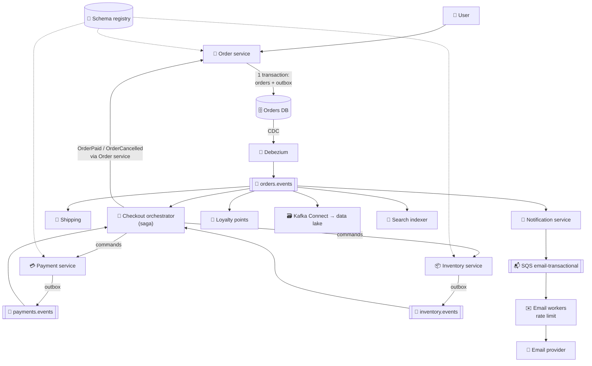
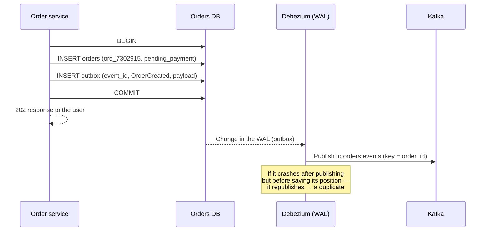
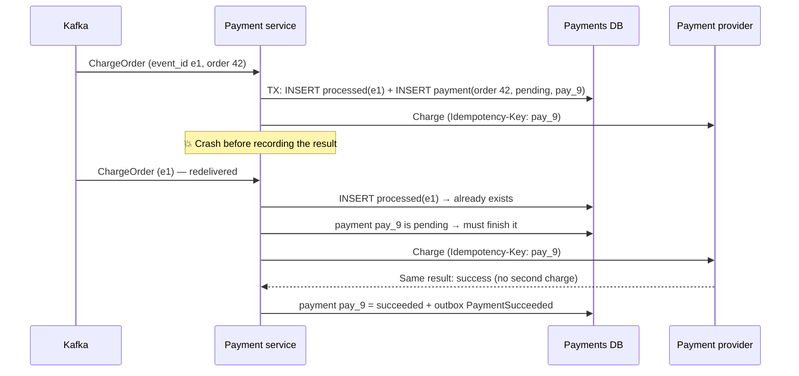
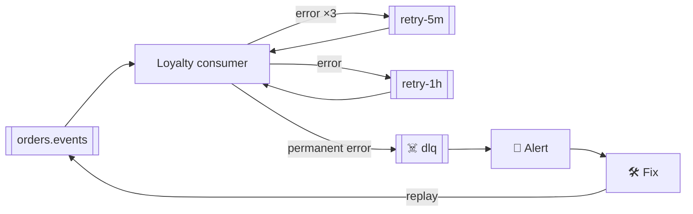
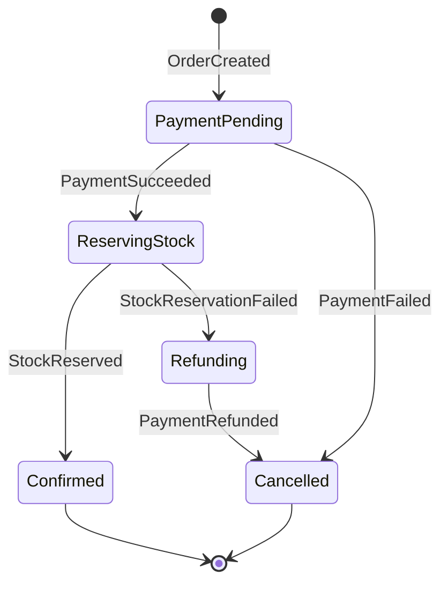

**English** | [Русский](INTERVIEW_RU.md) · Theory: [README.md](./README.md)

# 09. Messaging: Event-Driven Order Processing for an Online Store

> **Topic:** synchronous vs asynchronous, Kafka + SQS, the outbox, partition keys and ordering, idempotency, sagas, retries and DLQs, backpressure on Black Friday, schema evolution, replay
> **Level:** Medium–Hard · **Interview time:** 45 min · **Study time:** ~5 h
> **Where it's asked:** "Design event-driven order / notification / payment processing", and as a deep dive in almost any microservices problem

---

## 🗺️ How to Read This Walkthrough

| Icon | Meaning |
|:----:|:--------|
| 🎤 | Interviewer |
| 🗣️ | What I (the candidate) say out loud |
| ✏️ | What I draw on the whiteboard |
| ⏱️ | Time budget for the step |

Callouts: **TIP** — a good technique, **WARNING** — a trap, **IMPORTANT** — a Senior+ signal.

---

## 📑 Contents

1. [Problem Statement](#1-problem-statement)
2. [Clarifying Questions and Requirements](#2-clarifying-questions-and-requirements)
3. [Capacity Estimates](#3-capacity-estimates)
4. [What's Synchronous and What's Asynchronous](#4-whats-synchronous-and-whats-asynchronous)
5. [Events, Topics and API](#5-events-topics-and-api)
6. [High-Level Design](#6-high-level-design)
7. [Deep Dive 1: Lossless Publishing — the Outbox](#7-deep-dive-1-lossless-publishing--the-outbox)
8. [Deep Dive 2: Idempotency and "Exactly Once" for Payments](#8-deep-dive-2-idempotency-and-exactly-once-for-payments)
9. [Deep Dive 3: Order Event Ordering](#9-deep-dive-3-order-event-ordering)
10. [Deep Dive 4: Retries, DLQs and Replay](#10-deep-dive-4-retries-dlqs-and-replay)
11. [Deep Dive 5: Black Friday and Backpressure](#11-deep-dive-5-black-friday-and-backpressure)
12. [Deep Dive 6: The Checkout Saga](#12-deep-dive-6-the-checkout-saga)
13. [Bottlenecks and Failure Scenarios](#13-bottlenecks-and-failure-scenarios)
14. [What Changes at 10x Scale](#14-what-changes-at-10x-scale)
15. [Interviewer Questions with Answers](#15-interviewer-questions-with-answers)
16. [Common Mistakes](#16-common-mistakes)
17. [Cheat Sheet and Self-Check](#17-cheat-sheet-and-self-check)

---

## 1. Problem Statement

> 🎤 "Today the order service, at checkout, synchronously calls payments, inventory, shipping, emails and analytics. If any of them is slow, checkout slows down; if any fails, the whole order fails. On Black Friday everything went down. Rebuild order processing around events."

**Time plan:**

| Step | ⏱️ |
|:-----|:--:|
| Requirements | 5 min |
| Estimates | 3 min |
| Sync vs async, events | 7 min |
| High-level design | 5 min |
| Deep dives | 20 min |
| Failures and wrap-up | 5 min |

> [!TIP]
> Don't move **everything** to events. A strong answer starts by separating what the user must know at checkout time (synchronous) from what can happen seconds or minutes later (asynchronous).

---

## 2. Clarifying Questions and Requirements

⏱️ 5 min

| My question | Interviewer's answer | What it changes |
|:------------|:---------------------|:----------------|
| What must the user see right after clicking "Place order"? | That the order was accepted; payment status can arrive a few seconds later | Only order creation is synchronous; payment is async with a status |
| Can money be charged twice? Can an order be lost? | No and no | Outbox, idempotency, an idempotency key for the payment API |
| Which services react to an order? | Payments, inventory, shipping, emails, loyalty points, analytics, search; more in the future | Fan-out via a log; new consumers with history |
| Does event order matter? | For a single order — yes ("cancelled" must not arrive before "paid") | Partition key — order_id |
| Constraints of external systems? | The email provider has a per-second send limit; the payment provider has its own limits | Queues with rate limiting in front of external APIs |
| How long should events be kept? | Analytics and new services need at least a week of history | Retention ≥ 7 days + an archive in storage |

### Functional requirements

1. Checkout responds quickly, even if downstream services are slow or down.
2. Payment, inventory reservation, shipping, emails, loyalty points and analytics run on events.
3. If payment or reservation fails, the order is cancelled and the reservation and charge are compensated.
4. The user sees the current order status.
5. New services can be plugged in without changing the order service.

### Non-functional requirements

| Requirement | Target |
|:------------|:-------|
| Checkout latency | p99 < 300 ms (seconds today) |
| Correctness | Zero lost orders; zero double charges |
| Checkout availability | Independent of emails, analytics and shipping availability |
| Peaks | ×5 average on Black Friday with no loss |
| Processing delay | Payment — seconds; emails — up to a minute; analytics — minutes |

---

## 3. Capacity Estimates

⏱️ 3 min

✏️

```
Orders               = 5M/day → ~60/s average; Black Friday ×5–10 → ~600/s, peak minutes up to ~3,000/s
Events per order     ≈ 10 (created, payment_*, reserved, shipped, delivered, ...)
Events at peak       ≈ 30,000/s
Event size           ≈ 1–2 KB → ~60 MB/s at peak
Storage              ≈ 5M × 10 × 2 KB = 100 GB/day × 7 days × 3 replicas ≈ 2 TB
Emails               ≈ 20M/day, provider limit, e.g. 1,000/s
```

🗣️ **Conclusions:**
- **Kafka** handles 30,000 events/s easily — a small cluster.
- **Partitions:** the slowest consumer (e.g. payments with an external API at ~100 ms per event and 10 threads per partition) processes ~100 events/s per partition. For a 3,000 orders/s peak, we need ≥ 30 partitions → I'll take **64** with headroom, since changing it later is expensive.
- **Emails:** at peak, more may arrive than the provider's limit → a buffer with rate limiting is needed, not direct calls.

---

## 4. What's Synchronous and What's Asynchronous

⏱️ 3 min

| Step | Sync / async | Why |
|:-----|:-------------|:----|
| Validate cart, prices, address | Sync | The order can't be created without it |
| Create the order (status `pending`) | Sync | The user must get an order number |
| Payment | Async (status arrives in seconds) | The external provider is slow and sometimes unavailable |
| Inventory reservation | Async | Can be slow; compensated on failure |
| Shipping | Async | Needed only after payment and reservation |
| Emails, push | Async | A few seconds of delay don't matter |
| Loyalty points, analytics, search | Async | Minutes of delay are acceptable |

🗣️ "Checkout does **one** local transaction in its own database and responds. Everything else reacts to the `OrderCreated` event. The user sees the order page with a 'awaiting payment' status that updates (polling or WebSocket)."

> [!IMPORTANT]
> **Senior+ signal:** a synchronous chain of N services has availability equal to the **product** of their availabilities (5 services at 99.9% → ~99.5%). Asynchrony breaks that dependency: checkout depends only on its own database.

---

## 5. Events, Topics and API

⏱️ 4 min

### Kafka topics

| Topic | Key | Partitions | Retention | Contents |
|:------|:----|:----------:|:---------:|:---------|
| `orders.events` | `order_id` | 64 | 7 days + archive | `OrderCreated`, `OrderPaid`, `OrderCancelled`, `OrderShipped`... |
| `payments.events` | `order_id` | 64 | 7 days | `PaymentSucceeded`, `PaymentFailed`, `PaymentRefunded` |
| `inventory.events` | `order_id` | 64 | 7 days | `StockReserved`, `StockReservationFailed`, `StockReleased` |
| `*.dlq` | same as source | — | 30 days | Unprocessable messages with a reason |

🗣️ "The key is `order_id` in **every** order-related topic: all of an order's events are ordered within their partitions, and a consumer reading several topics can process one order's events on one thread."

### An example event

```json
{
  "event_id": "evt_01HZX3K9...",          // unique, assigned by the producer
  "event_type": "OrderCreated",
  "schema_version": 3,
  "order_id": "ord_7302915",
  "order_version": 1,                     // increments with every change to the order
  "occurred_at": "2026-11-27T10:15:03Z",
  "user_id": "u_42",
  "items": [{ "sku": "A-100", "qty": 2, "price": "19.99" }],
  "total": "39.98",
  "currency": "EUR"
}
```

### SQS queues (work, not events)

| Queue | What | Why a queue, not a topic |
|:------|:-----|:-------------------------|
| `email-transactional` | Order emails | Per-message retries, provider rate limits, DLQ |
| `email-marketing` | Marketing emails | Separate, so they don't interfere with transactional ones |

### API

```http
POST /v1/orders                 Headers: Idempotency-Key
     → 202 { order_id, status: "pending_payment" }
GET  /v1/orders/{id}            → { status, history[] }
WS   /v1/orders/{id}/updates    ← status updates
```

---

## 6. High-Level Design

⏱️ 5 min

✏️



🗣️ "Key decisions:
- **Outbox + CDC:** an event is published exactly when the order is committed;
- **Kafka as the event backbone:** each service is its own consumer group; new ones plug in without changes to the Order service and can read history;
- **an orchestrated saga** for payment and reservation — with compensations;
- **SQS in front of external providers** — retries, DLQ, rate limiting;
- a **schema registry** — event contracts and compatibility."

---

## 7. Deep Dive 1: Lossless Publishing — the Outbox

> 🎤 "Why not send the event to Kafka right after committing the order?"

🗣️ "That's a dual write. If the service crashes between the commit and the send, the order exists but the event doesn't: payment never starts, and the user sees 'awaiting payment' forever. If you send before the commit, a rolled-back transaction leaves an event about a non-existent order."



| Decision | Why |
|:---------|:----|
| CDC from the WAL rather than polling | Lower latency and DB load; ordering matches the log |
| `event_id` assigned when writing to the outbox | A duplicate after republishing has the **same** ID → consumers discard it |
| Outbox cleanup | Partition the table by date and drop old partitions |

---

## 8. Deep Dive 2: Idempotency and "Exactly Once" for Payments

> 🎤 "The `OrderCreated` event may arrive twice. How do you avoid charging twice?"

🗣️ "Delivery is at-least-once, so I protect at three levels:

| Level | Mechanism |
|:------|:----------|
| 1. Consumer | A `processed_events (consumer, event_id)` table with UNIQUE, inserted in the same transaction as creating the payment record |
| 2. Business logic | One `payments` row per `order_id` (UNIQUE): a second payment for an order can't be created |
| 3. External provider | **Idempotency key** = `payment_id`: a repeated call returns the first result instead of charging again |



The subtlety: if the event is already marked as processed but the payment is stuck in `pending`, the service **doesn't abandon** it — it finishes it with the same idempotency key. Plus background reconciliation with the provider for stuck payments."

> [!WARNING]
> Kafka exactly-once (transactions) **won't help** here: it works within Kafka, while charging money happens in an external system. An exactly-once effect for external systems comes only from idempotency.

---

## 9. Deep Dive 3: Order Event Ordering

> 🎤 "A user paid and immediately cancelled the order. Shipping received `OrderCancelled` before `OrderPaid`. What happens?"

🗣️ "Within one topic keyed by `order_id`, order is guaranteed. But events come from **different** topics (`orders.events`, `payments.events`) — there's no ordering across topics. So:

1. **An order version in every event** (`order_version`). A consumer stores the last applied version and **ignores** older events.
2. **Events carry state**, not just a delta: `OrderCancelled` contains the final status and version. The consumer brings its copy to that state.
3. **A single source of order status** — the Order service. Shipping reacts to `orders.events` events (`OrderReadyToShip`, `OrderCancelled`), not to raw payment events."

```sql
-- Shipping consumer: apply the event only if it's newer
UPDATE shipments
SET    status = $new_status, order_version = $event_version
WHERE  order_id = $order_id AND order_version < $event_version;
```

### Ordering within a consumer

- A partition is read by one consumer, but processing can be parallelized **by key**: one `order_id`'s events in one thread.
- The offset is committed only up to the last event processed with no gaps.

> [!TIP]
> The "don't apply an older version" check protects against both duplicates and out-of-order delivery. It's one of the most useful techniques in event-driven systems.

---

## 10. Deep Dive 4: Retries, DLQs and Replay

> 🎤 "The loyalty service crashes on one weird order, and its whole partition is stuck. What do you do?"

🗣️ "That's a poison message. The error-handling scheme for Kafka consumers:

| Error | Action |
|:------|:-------|
| Transient (timeout, 503) | A few quick in-place retries with backoff (seconds) |
| Still failing after quick retries | To `bonuses.retry-5m`, then `bonuses.retry-1h` |
| Permanent (invalid data, schema error) or attempts exhausted | To `bonuses.dlq` with the reason, stack trace, source topic, partition and offset |
| A message in the DLQ | Alert the team; after a fix — replay into the main stream |

For loyalty points, order isn't critical (crediting is idempotent and depends only on the final total), so retry topics are fine.

For **shipping**, order matters: if an order's event goes to retry, **all subsequent events for that order** are routed to retry too ('parking' the key) until the first is processed. Otherwise `OrderCancelled` overtakes the deferred `OrderReadyToShip`."



### Replay

- A tool that reads the DLQ (or the source topic from a given offset/time) and republishes messages for a specific consumer group.
- Thanks to idempotency, reprocessing is safe.
- The same mechanism is needed when a **new service** wants to process history: a new consumer group with `auto.offset.reset=earliest`, or from the data lake archive if the history is older than retention.

---

## 11. Deep Dive 5: Black Friday and Backpressure

> 🎤 "Black Friday: 10× more orders. What breaks, and how do you prevent it?"

🗣️ "Layer by layer:

| Layer | What happens | Protection |
|:------|:-------------|:-----------|
| Order service + DB | 10× order writes | A DB scaled up in advance, a connection pool; checkout is one short transaction |
| Kafka | 30,000 events/s | Headroom in brokers and disks; this is a small load for Kafka |
| Payments | The external provider limits throughput | Consumers stay under the provider's limit (a rate limiter); lag grows but events aren't lost; the user sees 'awaiting payment' |
| Inventory | Consumers fall behind | Autoscaling on lag up to 64 instances (the partition count) |
| Emails | 50,000 emails/min against a 1,000/s provider limit | SQS absorbs the spike; workers send with a rate limit; transactional emails have their own queue prioritized over marketing |
| Analytics | Falls minutes behind | Acceptable; marketing campaigns can be paused |

The key metrics: **lag in seconds** per consumer group and the **age of the oldest message** in SQS. Alerts aren't on 'lag is high' but on 'lag is growing faster than it shrinks' and 'lag is approaching retention'.

### Prioritization

- The critical path (payments, inventory) gets separate consumers and resources, not sharing quotas with analytics.
- **Load shedding:** under overload, temporarily turn off non-critical consumers (recommendations, marketing emails) — their events will wait in Kafka."

> [!WARNING]
> Autoscaling consumers **beyond the partition count** is useless — the extra instances sit idle. If 64 partitions aren't enough, increase parallelism inside the consumer (per-key threads) or create the topic with more partitions in advance.

---

## 12. Deep Dive 6: The Checkout Saga

> 🎤 "Payment succeeded, but the inventory reservation didn't. How do you roll back?"

🗣️ "There's no distributed transaction across services — we use a **saga**: a sequence of local transactions, each with a **compensation**. I choose **orchestration**: a separate orchestrator holds the saga state and sends commands. For checkout this is easier to debug than choreography, where the logic is scattered across services."



| Step | Action | Compensation |
|:-----|:-------|:-------------|
| 1 | Charge payment | Refund |
| 2 | Reserve stock | Release the reservation |
| 3 | Confirm the order | Cancel the order |

🗣️ "The orchestrator:
- stores saga state in its own database and publishes commands through its own **outbox**;
- makes every command idempotent (saga ID + step);
- has **timeouts**: if there's no payment response for 15 minutes — query the payment service's status, then cancel;
- retries compensations until they succeed — they can't be 'abandoned'."

> [!NOTE]
> The step order is a deliberate choice: often stock is **reserved** first (a cheap, easily reversible operation), and money is charged afterwards. Then the 'refund' compensation is needed less often. Worth calling out in an interview as a trade-off.

---

## 13. Bottlenecks and Failure Scenarios

| Scenario | What happens | How we protect |
|:---------|:-------------|:---------------|
| Order service crashes after commit | The event isn't lost | Outbox + CDC |
| Debezium crashes or lags | Events are delayed | CDC lag monitoring; the outbox accumulates in the DB and will be published |
| A Kafka broker fails | Partitions fail over to replicas | `replication.factor=3`, `min.insync.replicas=2`, `acks=all` |
| A duplicate event | Reprocessing | Idempotent consumers, an idempotency key for external APIs |
| A poison message | The partition stalls | Bounded retries → DLQ |
| A consumer falls behind past retention | Events are lost for it | An alert on lag in time; 7-day retention + a data lake archive |
| The external provider is down | Payments pile up | Retries with backoff, a circuit breaker; orders stay 'awaiting payment'; a saga timeout |
| A breaking schema change | Consumers crash | A schema registry with compatibility checks in CI; a new topic for breaking changes |
| A rebalance storm during deploys | Processing pauses | Cooperative rebalancing, static membership, staged deploys |
| The partition count was increased | Ordering breaks for existing orders | Don't change it on a live topic; a new topic and migration |

---

## 14. What Changes at 10x Scale

> 🎤 "50 million orders a day and several regions?"

🗣️ "What changes:
1. **Kafka clusters per region**; orders are processed in the user's region; cross-region replication (MirrorMaker 2 or a managed equivalent) for analytics and redundancy.
2. **More partitions** in new topics (256+), smaller consumer services.
3. **Tiered storage** — old Kafka segments in object storage, to keep history longer without big disks.
4. **Separate clusters** for the critical path and for analytics/logs, so noisy analytics doesn't affect payments.
5. **An event platform:** self-service topic creation, an event catalog, owners and SLOs for every topic."

---

## 15. Interviewer Questions with Answers

<details>
<summary><b>Why Kafka and not just SQS + SNS?</b></summary>

The main reason is history and independent consumers: a new service (search, recommendations, analytics) can read a week of events, and after a bug a consumer can reread them. Plus per-key ordering and high throughput. SQS still handles specific work with per-message retries and rate limiting — emails. You could build everything on SNS → SQS, but then there's no replay, and every new consumer sees only future events.
</details>

<details>
<summary><b>Why not use Kafka transactions for exactly-once?</b></summary>

They guarantee atomic read-process-write within Kafka. Our consumers write to external databases and call external APIs (the payment provider), which Kafka transactions don't cover. For those, an exactly-once effect is achieved through idempotency: deduplication by event_id and an idempotency key.
</details>

<details>
<summary><b>Choreography or orchestration for the saga?</b></summary>

Choreography (each service reacts to others' events) is simpler for 2–3 steps and has no central component, but the process logic is scattered and hard to understand and change. Orchestration gives an explicit state machine, timeouts and compensations in one place. For checkout, with money and compensations, I choose orchestration; for side effects (emails, loyalty points) — choreography.
</details>

<details>
<summary><b>How do you onboard a new service that needs a year of history?</b></summary>

Kafka keeps 7 days. For older data — the data lake archive (Kafka Connect writes every event to object storage). The new service first loads history from the archive (a backfill), then starts reading Kafka from the offset matching the end of the archive. Idempotency protects against the overlap.
</details>

<details>
<summary><b>What if you need to increase the partition count of orders.events?</b></summary>

Adding partitions changes `hash(key) % N`, and an order's events start landing in a different partition — ordering breaks for in-flight orders. Options: create a new topic with the needed partition count, switch producers, drain the old topic and switch consumers. That's why the partition count is chosen with headroom up front.
</details>

<details>
<summary><b>How does the user find out the payment succeeded?</b></summary>

The Order service owns the status: it consumes the saga's result and updates the order. The client gets the update via WebSocket or polls `GET /orders/{id}`. An email also goes out via the Notification service. What matters is that the user immediately sees an intermediate 'awaiting payment' status rather than a frozen screen.
</details>

---

## 16. Common Mistakes

| ❌ Mistake | ✅ Do this instead |
|:----------|:------------------|
| Everything on events, including what's needed for the response | Only order creation is synchronous |
| Sending the event after commit without an outbox | Outbox + CDC |
| "Kafka exactly-once will solve double charging" | Idempotency + an idempotency key for the external API |
| A random or user_id partition key | `order_id` in every order topic |
| Ignoring ordering across topics | An order version in events; ignore older ones |
| Endless retries | Bounded retries → retry topics → DLQ |
| A retry topic for data where order matters | Park the key, or retry in place |
| Calling the email provider directly from a Kafka consumer | SQS + rate limit + DLQ |
| Autoscaling beyond the partition count | Per-key parallelism inside the consumer |
| A distributed transaction across services | A saga with compensations and timeouts |

---

## 17. Cheat Sheet and Self-Check

### 30-second answer

> Checkout is one local transaction with an outbox write, returning 202 with an 'awaiting payment' status. CDC publishes events to Kafka keyed by `order_id`, 64 partitions, 7-day retention + an archive. Payment and reservation run as an orchestrated saga with compensations and timeouts. Delivery is at-least-once, and consumers are idempotent: event_id in a processed table, UNIQUE on order_id, an idempotency key for the payment API. Ordering — by key within a topic and by order version across topics. Errors — bounded retries, retry topics (parking the key where order matters), a DLQ with alerts and replay. Emails go through SQS with rate limiting and priorities. At peak — autoscaling on lag up to the partition count, and shedding non-critical consumers.

### Self-check

- [ ] I can split checkout steps into sync and async and justify it
- [ ] I can explain the dual-write problem and the outbox with CDC
- [ ] I can show three levels of protection against double charging
- [ ] I can explain why Kafka transactions don't give exactly-once for external systems
- [ ] I can guarantee order event ordering within a topic and across topics
- [ ] I can draw the retry, DLQ and replay scheme and explain key parking
- [ ] I can explain how each layer behaves on Black Friday
- [ ] I can draw the checkout saga with compensations

### Further reading

- Theory for this topic: [README.md](./README.md)
- Chris Richardson, microservices.io — Transactional outbox, Saga, Idempotent consumer
- Debezium documentation: Outbox Event Router
- Confluent: Error handling patterns for Kafka (retry topics, DLQ)
- Stripe API: Idempotent requests