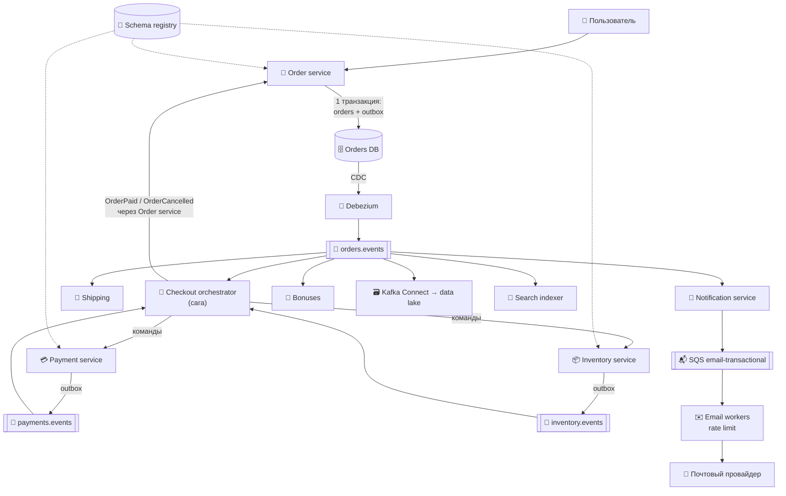
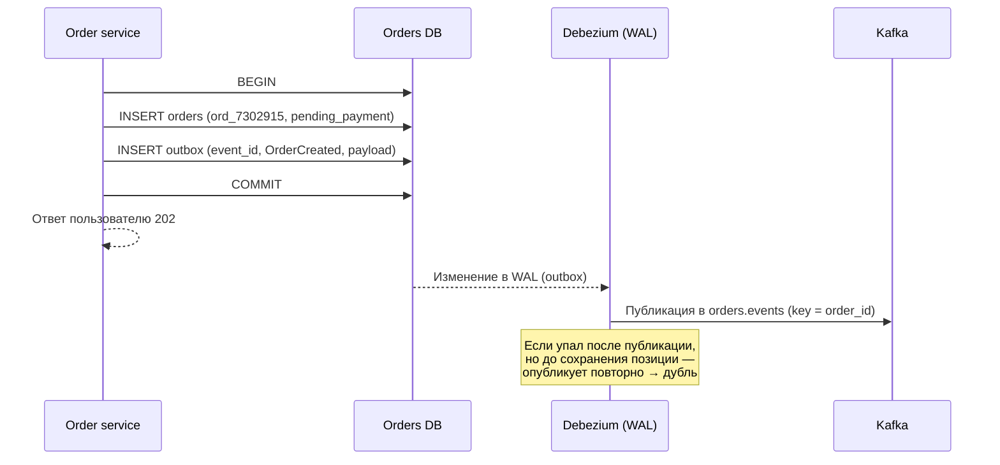
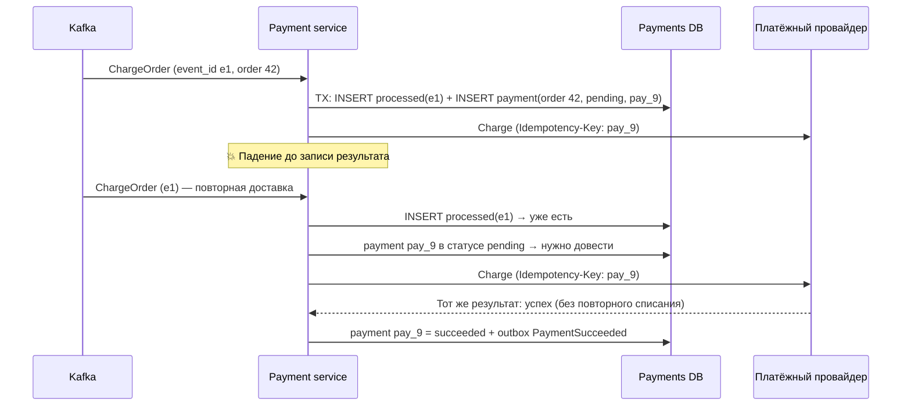
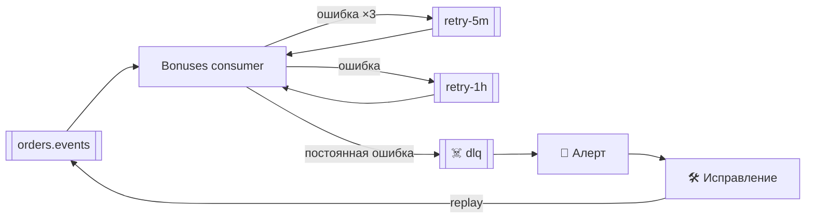
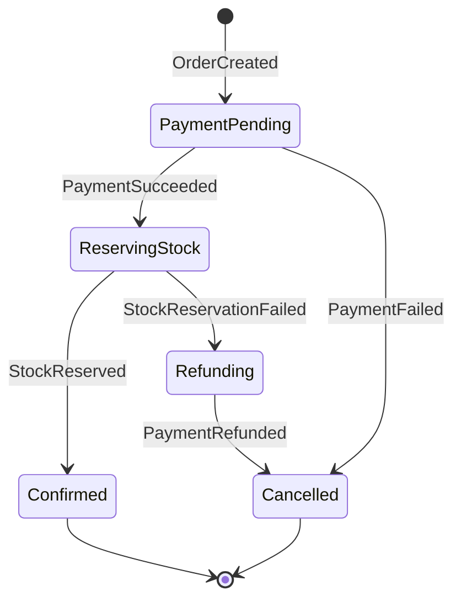

[English](INTERVIEW.md) | **Русский** · Теория: [README_RU.md](./README_RU.md)

# 09. Messaging: событийная обработка заказов в интернет-магазине

> **Тема:** синхронное vs асинхронное, Kafka + SQS, outbox, ключи партиций и порядок, идемпотентность, саги, ретраи и DLQ, backpressure в Чёрную пятницу, эволюция схем, replay
> **Уровень:** Medium–Hard · **Время на интервью:** 45 мин · **Время на разбор:** ~5 ч
> **Где спрашивают:** «Спроектируй обработку заказов / нотификаций / платежей на событиях», а также как deep dive почти в любой микросервисной задаче

---

## 🗺️ Как читать этот разбор

| Значок | Что значит |
|:------:|:-----------|
| 🎤 | Реплика интервьюера |
| 🗣️ | Что говорю вслух я (кандидат) |
| ✏️ | Что рисую на доске |
| ⏱️ | Сколько времени тратить на шаг |

Блоки **TIP** — хороший приём, **WARNING** — ловушка, **IMPORTANT** — сигнал для уровня Senior+.

---

## 📑 Содержание

1. [Условие задачи](#1-условие-задачи)
2. [Уточняющие вопросы и требования](#2-уточняющие-вопросы-и-требования)
3. [Оценки нагрузки](#3-оценки-нагрузки)
4. [Что синхронно, а что асинхронно](#4-что-синхронно-а-что-асинхронно)
5. [События, топики и API](#5-события-топики-и-api)
6. [High-level дизайн](#6-high-level-дизайн)
7. [Deep dive 1: публикация без потерь — outbox](#7-deep-dive-1-публикация-без-потерь--outbox)
8. [Deep dive 2: идемпотентность и «ровно один раз» для оплаты](#8-deep-dive-2-идемпотентность-и-ровно-один-раз-для-оплаты)
9. [Deep dive 3: порядок событий заказа](#9-deep-dive-3-порядок-событий-заказа)
10. [Deep dive 4: ретраи, DLQ и replay](#10-deep-dive-4-ретраи-dlq-и-replay)
11. [Deep dive 5: Чёрная пятница и backpressure](#11-deep-dive-5-чёрная-пятница-и-backpressure)
12. [Deep dive 6: сага оформления заказа](#12-deep-dive-6-сага-оформления-заказа)
13. [Узкие места и сценарии сбоев](#13-узкие-места-и-сценарии-сбоев)
14. [Что изменится при росте в 10 раз](#14-что-изменится-при-росте-в-10-раз)
15. [Вопросы интервьюера с ответами](#15-вопросы-интервьюера-с-ответами)
16. [Типичные ошибки](#16-типичные-ошибки)
17. [Шпаргалка и самопроверка](#17-шпаргалка-и-самопроверка)

---

## 1. Условие задачи

> 🎤 «Сейчас сервис заказов при оформлении синхронно вызывает оплату, склад, доставку, письма и аналитику. Если любой из них медленный — оформление тормозит; если падает — заказ падает целиком. В Чёрную пятницу всё легло. Перестрой обработку заказов на событиях».

**План по времени:**

| Шаг | ⏱️ |
|:----|:--:|
| Требования | 5 мин |
| Оценки | 3 мин |
| Синхронное vs асинхронное, события | 7 мин |
| High-level дизайн | 5 мин |
| Deep dives | 20 мин |
| Сбои и итоги | 5 мин |

> [!TIP]
> Не переводи на события **всё**. Сильный ответ начинается с разделения: что пользователь должен знать в момент оформления (синхронно), а что может произойти через секунды или минуты (асинхронно).

---

## 2. Уточняющие вопросы и требования

⏱️ 5 мин

| Мой вопрос | Ответ интервьюера | Что это меняет |
|:-----------|:------------------|:---------------|
| Что пользователь должен увидеть сразу после нажатия «Оформить»? | Что заказ принят; статус оплаты может прийти через несколько секунд | Синхронно — только создание заказа; оплата — асинхронно со статусом |
| Можно ли списать деньги дважды? Потерять заказ? | Нет и нет | Outbox, идемпотентность, idempotency key в платёжный API |
| Какие сервисы реагируют на заказ? | Оплата, склад, доставка, письма, бонусы, аналитика, поиск; в будущем ещё | Fan-out через лог, новые потребители с историей |
| Важен ли порядок событий? | Для одного заказа — да (нельзя отправить «отменён» раньше «оплачен») | Ключ партиции — order_id |
| Ограничения внешних систем? | Почтовый провайдер — лимит отправки в секунду, платёжный провайдер — свои лимиты | Очереди с rate limiting перед внешними API |
| Сколько хранить события? | Аналитике и новым сервисам нужна история хотя бы за неделю | Retention ≥ 7 дней + архив в хранилище |

### Функциональные требования

1. Оформление заказа отвечает быстро, даже если downstream-сервисы медленные или недоступны.
2. Оплата, резерв на складе, доставка, письма, бонусы, аналитика выполняются по событиям.
3. Если оплата или резерв не прошли — заказ отменяется, резерв и платёж компенсируются.
4. Пользователь видит актуальный статус заказа.
5. Новые сервисы можно подключать без изменения сервиса заказов.

### Нефункциональные требования

| Требование | Цель |
|:-----------|:-----|
| Latency оформления | p99 < 300 мс (сейчас — секунды) |
| Корректность | Ни одного потерянного заказа; ни одного двойного списания |
| Доступность оформления | Не зависит от доступности писем, аналитики, доставки |
| Пики | ×5 к среднему в Чёрную пятницу без потерь |
| Задержка обработки | Оплата — секунды; письма — до минуты; аналитика — минуты |

---

## 3. Оценки нагрузки

⏱️ 3 мин

✏️

```
Заказов              = 5M/день → ~60/с в среднем; Чёрная пятница ×5–10 → ~600/с, пиковые минуты до ~3 000/с
Событий на заказ     ≈ 10 (created, payment_*, reserved, shipped, delivered, ...)
Событий в пике       ≈ 30 000/с
Размер события       ≈ 1–2 КБ → ~60 МБ/с в пике
Хранение             ≈ 5M × 10 × 2 КБ = 100 ГБ/день × 7 дней × 3 реплики ≈ 2 ТБ
Писем                ≈ 20M/день, лимит провайдера, например 1 000/с
```

🗣️ **Выводы:**
- **Kafka** легко справляется с 30 000 событий/с — это небольшой кластер.
- **Партиции:** самый медленный консьюмер (например, оплата с внешним API ~100 мс на событие и параллелизмом 10 потоков на партицию) обрабатывает ~100 событий/с на партицию. Для пика в 3 000 заказов/с нужно ≥ 30 партиций → беру **64** с запасом, менять потом дорого.
- **Письма:** в пике может прийти больше, чем лимит провайдера → нужен буфер с rate limiting, а не прямые вызовы.

---

## 4. Что синхронно, а что асинхронно

⏱️ 3 мин

| Шаг | Синхронно / асинхронно | Почему |
|:----|:-----------------------|:-------|
| Проверить корзину, цены, адрес | Синхронно | Без этого нельзя создать заказ |
| Создать заказ (статус `pending`) | Синхронно | Пользователь должен получить номер заказа |
| Оплата | Асинхронно (статус приходит через секунды) | Внешний провайдер медленный и иногда недоступен |
| Резерв на складе | Асинхронно | Может быть медленным; при неудаче — компенсация |
| Доставка | Асинхронно | Нужна только после оплаты и резерва |
| Письма, push | Асинхронно | Задержка в секунды не важна |
| Бонусы, аналитика, поиск | Асинхронно | Задержка в минуты допустима |

🗣️ «Оформление делает **одну** локальную транзакцию в своей базе и отвечает. Всё остальное — реакция на событие `OrderCreated`. Пользователь видит страницу заказа со статусом «ожидает оплаты», который обновляется (polling или WebSocket)».

> [!IMPORTANT]
> **Сигнал Senior+:** синхронная цепочка из N сервисов имеет доступность, равную **произведению** их доступностей (5 сервисов по 99,9% → ~99,5%). Асинхронность разрывает эту зависимость: оформление зависит только от своей базы.

---

## 5. События, топики и API

⏱️ 4 мин

### Топики Kafka

| Топик | Ключ | Партиций | Retention | Что в нём |
|:------|:-----|:--------:|:---------:|:----------|
| `orders.events` | `order_id` | 64 | 7 дней + архив | `OrderCreated`, `OrderPaid`, `OrderCancelled`, `OrderShipped`... |
| `payments.events` | `order_id` | 64 | 7 дней | `PaymentSucceeded`, `PaymentFailed`, `PaymentRefunded` |
| `inventory.events` | `order_id` | 64 | 7 дней | `StockReserved`, `StockReservationFailed`, `StockReleased` |
| `*.dlq` | как в исходном | — | 30 дней | Необработанные сообщения с причиной |

🗣️ «Ключ — `order_id` **во всех** топиках, связанных с заказом: все события одного заказа упорядочены в своих партициях, а консьюмер, читающий несколько топиков, может обработать события одного заказа на одном потоке».

### Пример события

```json
{
  "event_id": "evt_01HZX3K9...",          // уникален, назначен продюсером
  "event_type": "OrderCreated",
  "schema_version": 3,
  "order_id": "ord_7302915",
  "order_version": 1,                     // растёт с каждым изменением заказа
  "occurred_at": "2026-11-27T10:15:03Z",
  "user_id": "u_42",
  "items": [{ "sku": "A-100", "qty": 2, "price": "19.99" }],
  "total": "39.98",
  "currency": "EUR"
}
```

### Очереди SQS (работа, а не события)

| Очередь | Что | Почему очередь, а не топик |
|:--------|:----|:---------------------------|
| `email-transactional` | Письма о заказе | Ретраи по одному, rate limit провайдера, DLQ |
| `email-marketing` | Маркетинговые письма | Отдельно, чтобы не мешать транзакционным |

### API

```http
POST /v1/orders                 Headers: Idempotency-Key
     → 202 { order_id, status: "pending_payment" }
GET  /v1/orders/{id}            → { status, history[] }
WS   /v1/orders/{id}/updates    ← обновления статуса
```

---

## 6. High-level дизайн

⏱️ 5 мин

✏️



🗣️ «Ключевые решения:
- **Outbox + CDC:** событие публикуется ровно тогда, когда заказ закоммичен;
- **Kafka как позвоночник событий:** каждый сервис — своя группа консьюмеров, новые подключаются без изменений в Order service и могут прочитать историю;
- **сага с оркестратором** для оплаты и резерва — с компенсациями;
- **SQS перед внешними провайдерами** — ретраи, DLQ, rate limiting;
- **schema registry** — контракты событий и совместимость».

---

## 7. Deep dive 1: публикация без потерь — outbox

> 🎤 «Почему не отправить событие в Kafka сразу после коммита заказа?»

🗣️ «Это двойная запись. Если сервис упадёт между коммитом и отправкой — заказ есть, а события нет: оплата не начнётся, пользователь будет вечно видеть «ожидает оплаты». Если отправлять до коммита — при откате транзакции появится событие о несуществующем заказе».



| Решение | Почему |
|:--------|:-------|
| CDC из WAL, а не polling | Меньше задержка и нагрузка на БД; порядок как в журнале |
| `event_id` назначается при записи в outbox | Дубль после повторной публикации имеет **тот же** ID → консьюмеры его отбросят |
| Очистка outbox | Партиционирование таблицы по дате и удаление старых партиций |

---

## 8. Deep dive 2: идемпотентность и «ровно один раз» для оплаты

> 🎤 «Событие `OrderCreated` может прийти дважды. Как не списать деньги дважды?»

🗣️ «Доставка at-least-once, поэтому защищаюсь на трёх уровнях:

| Уровень | Механизм |
|:--------|:---------|
| 1. Консьюмер | Таблица `processed_events (consumer, event_id)` с UNIQUE, вставка в той же транзакции, что и создание записи платежа |
| 2. Бизнес-логика | Одна запись `payments` на `order_id` (UNIQUE): второй платёж для заказа создать нельзя |
| 3. Внешний провайдер | **Idempotency key** = `payment_id`: повторный вызов вернёт результат первого, а не спишет снова |



Тонкость: если событие уже помечено обработанным, но платёж застрял в `pending`, сервис **не бросает** его, а доводит до конца тем же idempotency key. Плюс фоновая сверка (reconciliation) с провайдером для зависших платежей».

> [!WARNING]
> Kafka exactly-once (транзакции) здесь **не поможет**: она работает внутри Kafka, а списание денег — во внешней системе. Ровно-один-эффект для внешних систем — только через идемпотентность.

---

## 9. Deep dive 3: порядок событий заказа

> 🎤 «Пользователь оплатил и сразу отменил заказ. Доставка получила `OrderCancelled` раньше `OrderPaid`. Что будет?»

🗣️ «Внутри одного топика с ключом `order_id` порядок гарантирован. Но события приходят из **разных** топиков (`orders.events`, `payments.events`) — между топиками порядка нет. Поэтому:

1. **Версия заказа в каждом событии** (`order_version`). Консьюмер хранит последнюю применённую версию и **игнорирует** более старые события.
2. **События несут состояние**, а не только дельту: `OrderCancelled` содержит итоговый статус и версию. Консьюмер приводит свою копию к этому состоянию.
3. **Единый источник статуса заказа** — Order service. Доставка реагирует на события `orders.events` (`OrderReadyToShip`, `OrderCancelled`), а не на сырые события оплаты».

```sql
-- Консьюмер доставки: применять событие, только если оно новее
UPDATE shipments
SET    status = $new_status, order_version = $event_version
WHERE  order_id = $order_id AND order_version < $event_version;
```

### Порядок внутри консьюмера

- Партиция читается одним консьюмером, но обработку можно параллелить **по ключу**: события одного `order_id` — в один поток.
- Offset коммитится только до последнего события, обработанного без пропусков.

> [!TIP]
> Проверка «не применять старую версию» работает и как защита от дублей, и как защита от нарушения порядка. Это одна из самых полезных техник в событийных системах.

---

## 10. Deep dive 4: ретраи, DLQ и replay

> 🎤 «Сервис бонусов падает на одном странном заказе, и вся его партиция встала. Что делать?»

🗣️ «Это ядовитое сообщение. Схема обработки ошибок для консьюмеров Kafka:

| Ошибка | Действие |
|:-------|:---------|
| Временная (таймаут, 503) | Несколько быстрых ретраев на месте с backoff (секунды) |
| Не прошла после быстрых ретраев | В `bonuses.retry-5m`, затем `bonuses.retry-1h` |
| Постоянная (невалидные данные, ошибка схемы) или исчерпаны попытки | В `bonuses.dlq` с причиной, стеком, исходным топиком, партицией, offset |
| Сообщение в DLQ | Алерт команде; после исправления — replay в основной поток |

Для бонусов порядок не критичен (начисление идемпотентно и зависит только от итоговой суммы), поэтому retry-топики подходят.

Для **доставки** порядок важен: если событие заказа ушло в retry, **все последующие события этого заказа** тоже направляются в retry («парковка» ключа), пока первое не обработано. Иначе `OrderCancelled` обгонит отложенный `OrderReadyToShip`».



### Replay

- Инструмент, который читает DLQ (или исходный топик с определённого offset/времени) и публикует сообщения заново для конкретной группы консьюмеров.
- Благодаря идемпотентности повторная обработка безопасна.
- Тот же механизм нужен, когда **новый сервис** хочет обработать историю: новая группа консьюмеров с `auto.offset.reset=earliest` или из архива в data lake, если история старше retention.

---

## 11. Deep dive 5: Чёрная пятница и backpressure

> 🎤 «Чёрная пятница: заказов в 10 раз больше. Что сломается и как не допустить?»

🗣️ «Разберу по слоям:

| Слой | Что произойдёт | Защита |
|:-----|:---------------|:-------|
| Order service + БД | Запись заказов ×10 | Заранее масштабированная БД, пул соединений; оформление — одна короткая транзакция |
| Kafka | 30 000 событий/с | Запас по брокерам и дискам; это малая нагрузка для Kafka |
| Оплата | Внешний провайдер ограничивает скорость | Консьюмеры не превышают лимит провайдера (rate limiter); lag растёт, но события не теряются; статус «ожидает оплаты» виден пользователю |
| Склад | Консьюмеры отстают | Автоскейлинг по lag до 64 экземпляров (по числу партиций) |
| Письма | 50 000 писем/мин, лимит провайдера 1 000/с | SQS поглощает пик; воркеры отправляют с rate limit; транзакционные — отдельная очередь с приоритетом над маркетингом |
| Аналитика | Отстаёт на минуты | Допустимо; маркетинговые рассылки можно поставить на паузу |

Главные метрики: **lag в секундах** по каждой группе консьюмеров и **возраст самого старого сообщения** в SQS. Алерты не на «lag большой», а на «lag растёт быстрее, чем падает» и «lag приближается к retention».

### Приоритизация

- Критичный путь (оплата, склад) — отдельные консьюмеры и ресурсы, не делят квоты с аналитикой.
- **Load shedding:** при перегрузке временно выключаем некритичные консьюмеры (рекомендации, маркетинговые письма) — их события подождут в Kafka.

> [!WARNING]
> Автоскейлинг консьюмеров **дальше числа партиций** бесполезен — лишние экземпляры простаивают. Если 64 партиций не хватает, увеличивать нужно параллелизм внутри консьюмера (потоки по ключу) или заранее создавать топик с большим числом партиций.

---

## 12. Deep dive 6: сага оформления заказа

> 🎤 «Оплата прошла, а резерв на складе нет. Как откатить?»

🗣️ «Распределённой транзакции между сервисами нет — используется **сага**: последовательность локальных транзакций, у каждой есть **компенсация**. Беру **оркестрацию**: отдельный оркестратор хранит состояние саги и отправляет команды. Для оформления заказа это проще отлаживать, чем хореографию, где логика размазана по сервисам».



| Шаг | Действие | Компенсация |
|:----|:---------|:------------|
| 1 | Списать оплату | Вернуть деньги (refund) |
| 2 | Зарезервировать товар | Снять резерв |
| 3 | Подтвердить заказ | Отменить заказ |

🗣️ «Оркестратор:
- хранит состояние саги в своей базе и публикует команды через свой **outbox**;
- каждая команда идемпотентна (ID саги + шаг);
- имеет **таймауты**: если ответа об оплате нет 15 минут — запрос статуса у сервиса оплаты, затем отмена;
- компенсации тоже ретраятся до успеха — их нельзя «бросить»».

> [!NOTE]
> Порядок шагов выбран сознательно: часто сначала **резервируют** товар (дешёвая и быстро отменяемая операция), а потом списывают деньги. Тогда компенсация «вернуть деньги» нужна реже. Это стоит проговорить на интервью как компромисс.

---

## 13. Узкие места и сценарии сбоев

| Сценарий | Что произойдёт | Как защищаемся |
|:---------|:---------------|:---------------|
| Падение Order service после коммита | Событие не потеряно | Outbox + CDC |
| Debezium упал или отстаёт | События задерживаются | Мониторинг лага CDC; outbox в БД копится и будет опубликован |
| Брокер Kafka упал | Партиции переходят на реплики | `replication.factor=3`, `min.insync.replicas=2`, `acks=all` |
| Дубль события | Повторная обработка | Идемпотентные консьюмеры, idempotency key во внешних API |
| Ядовитое сообщение | Партиция встаёт | Ограниченные ретраи → DLQ |
| Консьюмер отстал больше retention | Потеря событий для него | Алерт на lag во времени; retention 7 дней + архив в data lake |
| Внешний провайдер недоступен | Оплаты копятся | Ретраи с backoff, circuit breaker; заказы в статусе «ожидает оплаты»; таймаут саги |
| Ломающее изменение схемы | Консьюмеры падают | Schema registry с проверкой совместимости в CI; новый топик для ломающих изменений |
| Rebalance-шторм при деплое | Паузы обработки | Cooperative rebalancing, static membership, поэтапный деплой |
| Увеличили число партиций | Нарушение порядка для существующих заказов | Не менять на живом топике; новый топик и миграция |

---

## 14. Что изменится при росте в 10 раз

> 🎤 «50 миллионов заказов в день и несколько регионов?»

🗣️ «Что меняется:
1. **Кластеры Kafka по регионам**, заказы обрабатываются в регионе пользователя; межрегиональная репликация (MirrorMaker 2 или managed-аналог) — для аналитики и резервирования.
2. **Больше партиций** в новых топиках (256+), более мелкие сервисы-консьюмеры.
3. **Tiered storage** — старые сегменты Kafka в объектном хранилище, чтобы держать историю дольше без больших дисков.
4. **Отдельные кластеры** для критичного пути и для аналитики/логов, чтобы шумная аналитика не влияла на оплату.
5. **Платформа событий:** self-service создание топиков, каталог событий, владельцы и SLO для каждого топика».

---

## 15. Вопросы интервьюера с ответами

<details>
<summary><b>Почему Kafka, а не только SQS + SNS?</b></summary>

Главная причина — история и независимые потребители: новый сервис (поиск, рекомендации, аналитика) может прочитать события за неделю, а при ошибке консьюмер может перечитать их заново. Плюс порядок по ключу и высокая пропускная способность. SQS при этом остаётся для конкретной работы с ретраями по одному сообщению и rate limiting — письма. Можно было бы построить всё на SNS → SQS, но тогда нет replay, и каждый новый потребитель видит только будущие события.
</details>

<details>
<summary><b>Почему не использовать транзакции Kafka для exactly-once?</b></summary>

Они гарантируют атомарность чтения-обработки-записи внутри Kafka. Наши консьюмеры пишут во внешние базы и вызывают внешние API (платёжный провайдер), на которые транзакции Kafka не распространяются. Для них exactly-once эффект достигается идемпотентностью: дедупликация по event_id и idempotency key.
</details>

<details>
<summary><b>Хореография или оркестрация для саги?</b></summary>

Хореография (каждый сервис реагирует на события других) проще для 2–3 шагов и не имеет центрального компонента, но логика процесса размазана, и её сложно понять и изменить. Оркестрация даёт явный конечный автомат, таймауты и компенсации в одном месте. Для оформления заказа с деньгами и компенсациями выбираю оркестрацию; для побочных реакций (письма, бонусы) — хореографию.
</details>

<details>
<summary><b>Как подключить новый сервис, которому нужна история за год?</b></summary>

Kafka хранит 7 дней. Для старых данных — архив в data lake (Kafka Connect пишет все события в объектное хранилище). Новый сервис сначала загружает историю из архива (backfill), затем начинает читать Kafka с offset, соответствующего моменту окончания архива. Идемпотентность защищает от пересечения.
</details>

<details>
<summary><b>Что если нужно увеличить число партиций orders.events?</b></summary>

Добавление партиций меняет `hash(key) % N`, и события одного заказа начнут попадать в другую партицию — порядок для заказов «в процессе» нарушится. Варианты: создать новый топик с нужным числом партиций, переключить продюсеров, дочитать старый топик и переключить консьюмеров. Поэтому число партиций выбирают с запасом изначально.
</details>

<details>
<summary><b>Как пользователь узнаёт, что оплата прошла?</b></summary>

Order service — владелец статуса: он потребляет результат саги и обновляет заказ. Клиент получает обновление через WebSocket или опрашивает `GET /orders/{id}`. Также уходит письмо через Notification service. Важно, что пользователь сразу видит промежуточный статус «ожидает оплаты», а не зависший экран.
</details>

---

## 16. Типичные ошибки

| ❌ Ошибка | ✅ Как правильно |
|:---------|:----------------|
| Всё на событиях, включая то, что нужно для ответа | Синхронно — только создание заказа |
| Отправка события после коммита без outbox | Outbox + CDC |
| «Kafka exactly-once решит проблему двойного списания» | Идемпотентность + idempotency key во внешний API |
| Ключ партиции случайный или по user_id | `order_id` во всех топиках заказа |
| Игнорировать порядок между топиками | Версия заказа в событиях, игнорирование старых |
| Бесконечные ретраи | Ограниченные ретраи → retry-топики → DLQ |
| Retry-топик для данных, где важен порядок | Парковка ключа или ретраи на месте |
| Прямые вызовы провайдера писем из консьюмера Kafka | SQS + rate limit + DLQ |
| Автоскейлинг дальше числа партиций | Параллелизм по ключу внутри консьюмера |
| Распределённая транзакция между сервисами | Сага с компенсациями и таймаутами |

---

## 17. Шпаргалка и самопроверка

### Ответ за 30 секунд

> Оформление заказа — одна локальная транзакция с записью в outbox, ответ 202 со статусом «ожидает оплаты». CDC публикует события в Kafka с ключом `order_id`, 64 партиции, retention 7 дней + архив. Оплата и резерв — сага с оркестратором, компенсациями и таймаутами. Доставка at-least-once, консьюмеры идемпотентны: event_id в таблице обработанных, UNIQUE по order_id, idempotency key в платёжный API. Порядок — по ключу внутри топика и по версии заказа между топиками. Ошибки — ограниченные ретраи, retry-топики (с парковкой ключа, где важен порядок), DLQ с алертом и replay. Письма — через SQS с rate limit и приоритетами. В пик — автоскейлинг по lag до числа партиций и отключение некритичных консьюмеров.

### Самопроверка

- [ ] Могу разделить шаги оформления на синхронные и асинхронные и обосновать
- [ ] Могу объяснить проблему двойной записи и outbox с CDC
- [ ] Могу показать три уровня защиты от двойного списания
- [ ] Могу объяснить, почему транзакции Kafka не дают exactly-once для внешних систем
- [ ] Могу обеспечить порядок событий заказа внутри топика и между топиками
- [ ] Могу нарисовать схему ретраев, DLQ и replay и объяснить парковку ключа
- [ ] Могу объяснить поведение каждого слоя в Чёрную пятницу
- [ ] Могу нарисовать сагу оформления с компенсациями

### Что почитать

- Теория по теме: [README_RU.md](./README_RU.md)
- Chris Richardson, microservices.io — Transactional outbox, Saga, Idempotent consumer
- Документация Debezium: Outbox Event Router
- Confluent: Error handling patterns for Kafka (retry topics, DLQ)
- Stripe API: Idempotent requests