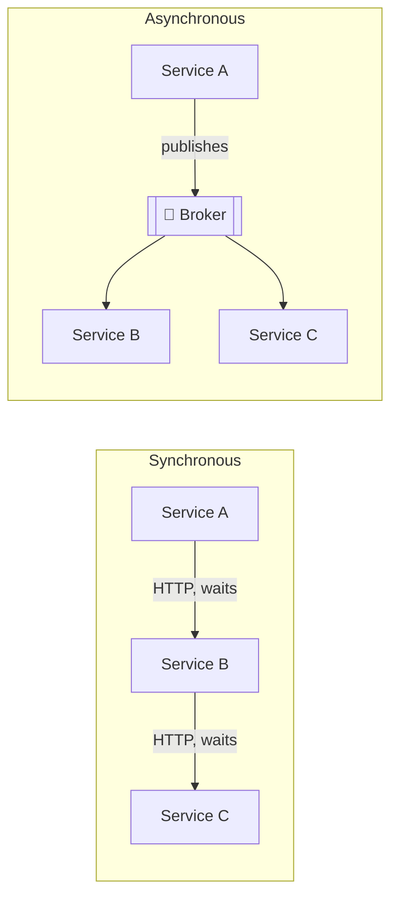
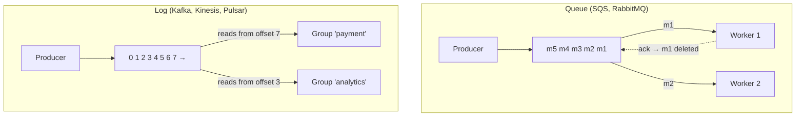
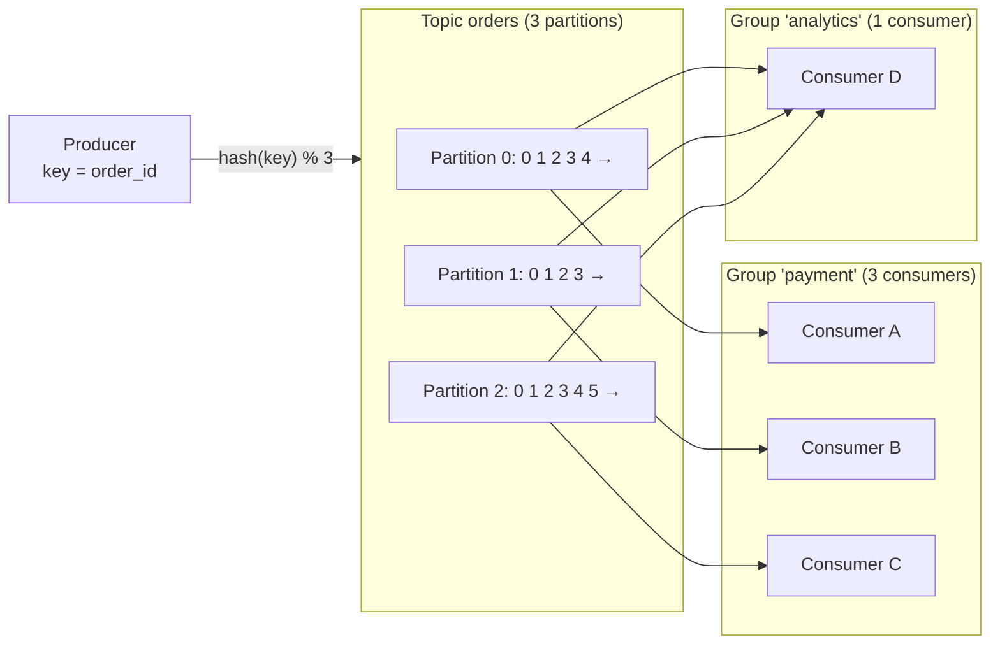
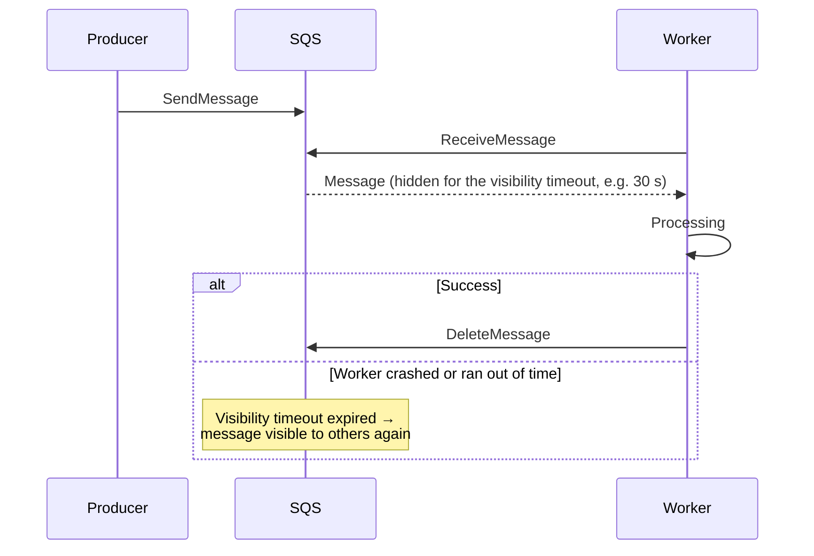
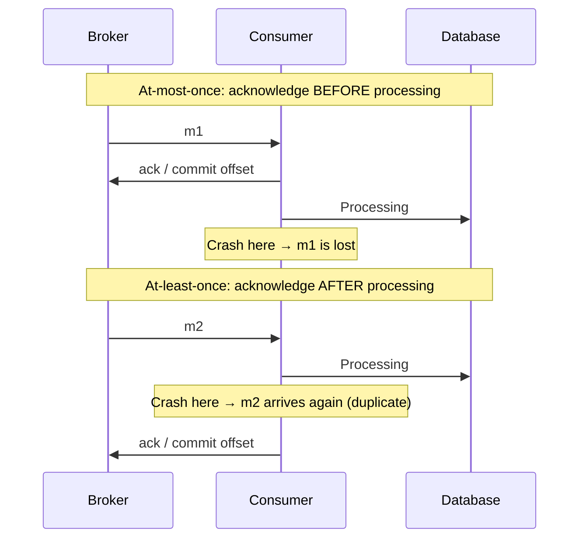
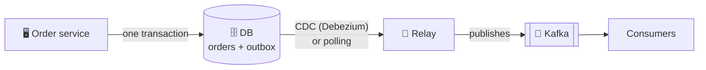
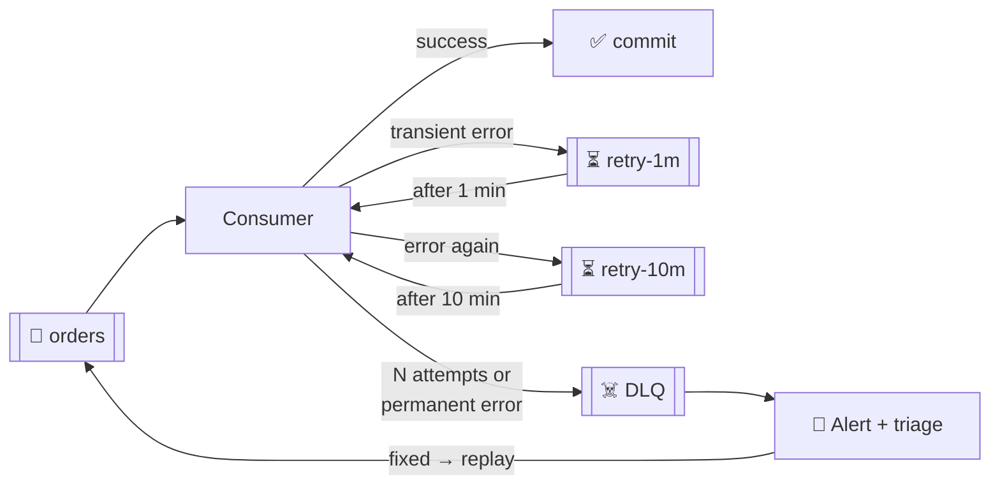

**English** | [Русский](README.ru.md)

# 09. Messaging

> **Covers:** why asynchrony, queues vs logs (SQS/RabbitMQ vs Kafka), how Kafka and queues work, delivery semantics (at-most/at-least/exactly-once), idempotency, the outbox, message ordering, retries and DLQs, backpressure, scaling consumers, event schemas
> **Study time:** ~5 h · **Needed for:** almost any problem with background jobs, events, microservices or data streams
> **Practice:** interview-style walkthrough — [INTERVIEW.md](./INTERVIEW.md)
> **Related topics:** [05-replication](../05_Replication/README.md) (replication in Kafka), [06-partitioning](../06_Partitioning/README.md) (partitions), [08-consensus](../08_Consensus/README.md)

---

## 📑 Contents

1. [Why Asynchronous Messaging](#1-why-asynchronous-messaging)
2. [Queue vs Log](#2-queue-vs-log)
3. [How Kafka Works](#3-how-kafka-works)
4. [How Queues Work: SQS and RabbitMQ](#4-how-queues-work-sqs-and-rabbitmq)
5. [Delivery Semantics](#5-delivery-semantics)
6. [Idempotent Consumers](#6-idempotent-consumers)
7. [The Producer Side: The Dual-Write Problem and the Outbox](#7-the-producer-side-the-dual-write-problem-and-the-outbox)
8. [Message Ordering](#8-message-ordering)
9. [Failures: Retries, DLQs, Poison Messages](#9-failures-retries-dlqs-poison-messages)
10. [Backpressure and Flow Control](#10-backpressure-and-flow-control)
11. [Scaling Consumers](#11-scaling-consumers)
12. [Patterns and Event Design](#12-patterns-and-event-design)
13. [Comparing Systems](#13-comparing-systems)
14. [How to Talk About This in an Interview](#14-how-to-talk-about-this-in-an-interview)
15. [Self-Check Questions](#15-self-check-questions)
16. [Glossary and Resources](#16-glossary-and-resources)

---

## 1. Why Asynchronous Messaging

With a synchronous call, service A waits for service B's response. With an asynchronous one, A puts a message into a **broker** and moves on, and B processes it when it can.



| Benefit | How the broker helps |
|:--------|:---------------------|
| **Decoupling** | The producer doesn't know who or how many consumers will process the message |
| **Load leveling** | A 10× spike becomes a queue that consumers drain at their own pace |
| **Fault tolerance** | If a consumer crashes, messages wait in the broker instead of being lost |
| **Fan-out** | One event reaches many independent services |
| **Fast user response** | Heavy work (video, emails, reports) runs in the background |
| **Replay** | In logs (Kafka), new consumers can read the history |

| The cost of asynchrony | Why |
|:-----------------------|:----|
| Eventual consistency | The result doesn't appear immediately |
| Harder debugging | A request is "smeared" across services and time — tracing is needed |
| Duplicates and ordering | You must think about redelivery and order |
| One more component | The broker must be operated and scaled |

> [!TIP]
> Rule of thumb: **synchronous — whatever you can't answer the user without** (check a balance, create an order). **Asynchronous — everything that can happen a bit later** (an email, analytics, search index updates, loyalty points).

### Three delivery models

| Model | How | Example |
|:------|:----|:--------|
| **Point-to-point (work queue)** | Each message is processed by **one** consumer | Workers processing orders |
| **Publish/subscribe** | Each message is received by **every** subscriber | "Order created" → payment, warehouse, emails |
| **Event streaming (log)** | Messages are stored in an ordered log; consumer groups read from different positions | Kafka: analytics, CDC, event sourcing |

---

## 2. Queue vs Log

This is the main architectural difference between brokers.



| | Queue | Log |
|:-|:------|:----|
| After processing | The message is **deleted** | The message **stays** until retention expires |
| Read position | The broker tracks each message (in flight, acknowledged) | The consumer keeps an **offset** — a position in the log |
| Replaying history | No | Yes: reset the offset back |
| Multiple independent consumers | A separate queue per consumer (fan-out via SNS, exchanges) | Each consumer group reads the log independently |
| Ordering | Usually not guaranteed (except FIFO queues) | Guaranteed **within a partition** |
| Parallelism | Any number of competing workers | At most the number of partitions per group |
| One "bad" message | Only it goes back for retry; others proceed | Blocks the partition unless moved aside |
| Per-message delays, priorities | Often available (delay, priority) | Usually not |
| Throughput | High | Very high (sequential writes, batching) |

### When to choose which

| Task | Choice |
|:-----|:-------|
| Background jobs where each job is independent (emails, image resizing) | **Queue** |
| An event many services need, including future ones | **Log** |
| History must be re-read (a new service, a bug fix, an index rebuild) | **Log** |
| Strict event order per entity (order, account) | **Log** with a partition key (or a FIFO queue) |
| Jobs with varying duration, per-message retries | **Queue** |
| High-volume data streams (clicks, logs, CDC) | **Log** |

> [!IMPORTANT]
> **Senior+ signal:** large systems use **both**: a log as the event "backbone" (what happened) and queues for specific work (what to do). For example, the "order paid" event goes to Kafka, while the "send an email" job goes to SQS for workers with retries and rate limiting.

---

## 3. How Kafka Works



| Concept | Meaning |
|:--------|:--------|
| **Topic** | A named stream of messages |
| **Partition** | An ordered, immutable log; the unit of parallelism and ordering |
| **Offset** | A message's position in a partition |
| **Key** | Determines the partition: `hash(key) % number_of_partitions`. Messages with the same key land in one partition and are ordered |
| **Consumer group** | A set of consumers sharing partitions: each partition is read by **one** consumer in the group |
| **Rebalance** | Reassigning partitions when a consumer joins or leaves |
| **Retention** | How long messages are kept: by time (e.g. 7 days) or by size |
| **Log compaction** | Keep only the **latest** value per key (for "current state", CDC) |
| **Replication** | Each partition is replicated: a leader + followers, ISR (see [05-replication](../05_Replication/README.md#11-comparing-approaches-and-real-systems)) |

### Why Kafka is fast

- **Sequential writes** to the end of a file instead of random ones.
- **Batching and compression** in the producer.
- **The OS page cache** instead of its own cache: recent messages are read from memory.
- **Zero-copy:** data goes from file to socket without copying into user space.
- **The consumer stores its own offset** — the broker doesn't track each message's state.

### Write durability

| Setting | Meaning |
|:--------|:--------|
| `acks=0` | Don't wait for acknowledgment — fast, can lose data |
| `acks=1` | Wait for the partition leader — loss if the leader dies before replicating |
| `acks=all` + `min.insync.replicas=2` | Wait for all in-sync replicas (at least two) — no loss if one broker dies |
| `enable.idempotence=true` | The broker discards duplicates from producer retries, preserving order |

---

## 4. How Queues Work: SQS and RabbitMQ

### A message's lifecycle in SQS



| Concept | Meaning |
|:--------|:--------|
| **Visibility timeout** | How long a received message is hidden from others. Must exceed processing time (or be extended) |
| **Ack / delete** | Confirms successful processing |
| **Redelivery** | An unacknowledged message returns to the queue → **at-least-once** |
| **maxReceiveCount + DLQ** | After N failed receives, the message moves to a dead letter queue |
| **Long polling** | Wait up to N seconds for messages instead of constant empty requests |
| **FIFO queue** | Ordering and deduplication within a **message group id**; lower throughput |
| **Delay** | The message becomes visible after a set time |

### RabbitMQ: exchanges and routing

A producer publishes to an **exchange**, which routes the message to queues by rules.

| Exchange type | How it routes |
|:--------------|:--------------|
| **Direct** | By exact routing key match |
| **Topic** | By pattern (`order.*.created`, `order.#`) |
| **Fanout** | To every bound queue |
| **Headers** | By message headers |

Also: **prefetch** (how many unacknowledged messages a consumer holds), publisher confirms, Raft-based quorum queues for durability, and in newer versions — Streams (a Kafka-style log).

---

## 5. Delivery Semantics

The key question: **when to acknowledge** — before or after processing.



| Semantics | Guarantee | Risk | When |
|:----------|:----------|:-----|:-----|
| **At-most-once** | Processed 0 or 1 times | Loss | Metrics, logs where loss is acceptable |
| **At-least-once** | Processed 1 or more times | Duplicates | **The default** almost everywhere |
| **Exactly-once** | The processing effect happens exactly once | Complexity, cost | Money, accounting where duplicates are unacceptable |

### The exactly-once myth

Exactly-once **delivery** can't be guaranteed in a distributed system: if an acknowledgment is lost in the network, the sender doesn't know whether the message arrived and must retry. What's achievable is exactly-once **processing** (effectively-once) — an effect as if it happened exactly once:

```
Exactly-once effect = at-least-once delivery + idempotent processing
```

### Exactly-once in Kafka

Kafka offers exactly-once **within Kafka** (read from a topic → process → write to a topic):
- an **idempotent producer** — the broker discards duplicates by (producer id, sequence number);
- **transactions** — writes to several partitions and the consumer offset commit happen atomically;
- consumers with `isolation.level=read_committed` don't see uncommitted messages.

> [!WARNING]
> Kafka transactions don't extend to **external systems**. If a consumer writes to PostgreSQL or calls a payment API, you must provide exactly-once yourself: idempotency, or storing the offset in the same database transaction as the result.

---

## 6. Idempotent Consumers

An **idempotent operation** gives the same result whether performed once or many times.

| Technique | How | Example |
|:----------|:----|:--------|
| **A processed-messages table** | In the same transaction as the result, insert the `message_id` with UNIQUE; a duplicate fails on the constraint | `INSERT INTO processed(message_id) ...` + the business change in one transaction |
| **Naturally idempotent operations** | `SET status = 'paid'` instead of `balance = balance + 100` | Upsert by key |
| **Conditional write by version** | Apply an event only if its version is greater than the stored one | `UPDATE ... WHERE version < $event_version` |
| **An idempotency key in external APIs** | Pass a stable key (e.g. derived from message_id); the provider returns the earlier result | Payment APIs (Stripe and others) support an Idempotency-Key |
| **Offset in the same transaction** | Store the Kafka offset in your database together with the result; on start, read from the stored one | Exactly-once with an external DB |

```sql
BEGIN;
INSERT INTO processed_messages (consumer, message_id) VALUES ('billing', 'evt-81f2');
-- If that row already exists → unique violation → rollback → already processed, just acknowledge
UPDATE accounts SET balance = balance - 100 WHERE id = 42;
COMMIT;
```

> [!TIP]
> Every event should have a **unique, stable ID** assigned by the producer (not the broker) — then deduplication works even when the event is republished.

---

## 7. The Producer Side: The Dual-Write Problem and the Outbox

### The dual-write problem

A service must save an order to the database **and** publish an event. Two independent writes aren't atomic:

| Order | What can go wrong |
|:------|:------------------|
| DB first, then broker | The service crashes after the commit → the event is **lost** |
| Broker first, then DB | The DB transaction rolls back → an event about a **non-existent** order |

### The solution: the transactional outbox



1. In **one transaction**, write the business data and a row in the `outbox` table (the event).
2. A separate process (CDC from the WAL or periodic polling) reads the outbox and publishes to the broker.
3. After publishing, it marks or deletes the row.

- ✅ The event is published **if and only if** the transaction committed.
- ⚠️ The relay may publish an event again (it crashed after publishing but before marking) → consumers must be **idempotent**.

### Other producer practices

- `acks=all`, an idempotent producer, retries with backoff.
- Batching (`linger.ms`, batch size) — a trade-off between latency and throughput.
- The partition key is the entity whose order matters.

---

## 8. Message Ordering

### Kinds of ordering

| Ordering | Where | Cost |
|:---------|:------|:-----|
| **Global** | One partition / one FIFO queue | No parallelism: the whole stream through one consumer |
| **Per key** | Kafka (key → partition), SQS FIFO (message group id) | Parallelism across keys; order only within a key |
| **None** | Standard queues | Maximum parallelism |

> [!TIP]
> **Per-key ordering** is almost always enough: one order's events in order, different orders independently. Global ordering is almost never needed and very expensive.

### What breaks ordering

| Cause | How to avoid |
|:------|:-------------|
| Producer retries with several requests in flight | Kafka's idempotent producer (preserves order on retries) |
| Several consumers on a non-FIFO queue | A key-based partition or FIFO with a group id |
| Parallel processing inside a consumer | Parallelize by key: one key's messages in one thread |
| Moving a message to a retry topic | Subsequent messages with the same key overtake it (see below) |
| Adding partitions to a topic | A key starts landing in a different partition |
| Rebalance | Possible reprocessing; idempotency is required |

### Coping with out-of-order delivery

- **Versions in events:** a consumer applies an event only if its version is greater than the stored one, ignoring older ones.
- **Events carrying full state** (event-carried state) instead of a delta: the latest version wins.
- **Per-key buffering:** wait a bounded time for a missing sequence number.

---

## 9. Failures: Retries, DLQs, Poison Messages

### Types of errors

| Type | Example | What to do |
|:-----|:--------|:-----------|
| **Transient** | A timeout, a downstream outage, a rate limit | Retry with exponential backoff and jitter |
| **Permanent** | Invalid data, a schema error, a bug | Don't retry forever → DLQ |
| **Poison message (poison pill)** | A message the consumer crashes on every time | DLQ after N attempts; otherwise it blocks processing |

### A retry and DLQ scheme



| Practice | Why |
|:---------|:----|
| A bounded number of retries | Don't waste resources on hopeless messages |
| Exponential backoff + jitter | Don't hammer an overloaded downstream with synchronized retry waves |
| Store the reason, stack trace, attempt count, source topic and offset in the DLQ | So you can investigate and replay |
| Alert on DLQ growth | A DLQ nobody looks at is silent data loss |
| A replay tool | Return messages from the DLQ to the main stream after a fix |

> [!WARNING]
> **Retry topics break per-key ordering:** while order 42's message waits in retry-1m, the next event for order 42 is processed first. If order matters: either retry **in place** (blocking the partition — fine for short outages), or when sending to retry, **"park" the key** — route all subsequent messages for that key to retry too until it's processed.

---

## 10. Backpressure and Flow Control

**Backpressure** is a mechanism by which a slow consumer signals a fast producer to "slow down", instead of drowning in data.

### Where the broker helps and where it doesn't

- The broker **absorbs spikes**: the producer writes fast, consumers fall behind, the queue grows.
- But growth **isn't infinite**: disk space, retention, waiting time.

> [!WARNING]
> In Kafka, messages are deleted by **retention** even if nobody has read them. If a consumer falls further behind than the retention period, the data is **lost**. Track lag in units of time and keep retention with headroom.

### Metrics

| Metric | Meaning |
|:-------|:--------|
| **Consumer lag** | How many messages (and how many seconds) the consumer is behind the end of the log |
| **Age of the oldest message** (SQS: ApproximateAgeOfOldestMessage) | How delayed processing is |
| **Processing rate vs arrival rate** | Whether the backlog is growing |

### Little's law for sizing

```
L = λ × W
L — average number of messages in the system
λ — arrival rate (messages/s)
W — average time in the system (s)

Example: 2,000 messages/s, processing one takes 50 ms per thread
→ you need at least 2,000 × 0.05 = 100 parallel handlers
```

### Tools

| Tool | How it works |
|:-----|:-------------|
| **The pull model** | The consumer fetches messages at its own pace (Kafka, SQS) |
| **Prefetch / max.poll.records** | Limit how many messages a consumer takes at once |
| **Autoscaling on lag** | Add consumers as lag grows (e.g. KEDA in Kubernetes); in Kafka — no more than the number of partitions |
| **Bounded buffers** | Fixed-size in-app queues; block reading when full |
| **Downstream rate limiting** | Don't send an external API more than allowed, even if the queue is large |
| **Priorities** | Separate queues for critical and non-critical (transactional vs marketing emails) |
| **Load shedding** | Under overload, drop or defer low-priority work |

---

## 11. Scaling Consumers

| | Queue | Kafka |
|:-|:------|:------|
| How to scale | Add workers — they compete for messages | Add consumers to the group — at most one per partition |
| Parallelism limit | Practically none | **The number of partitions** |
| Reassignment | Not needed | Rebalance: a short pause |

### Choosing the partition count

- Start from peak load and a single consumer's speed: `partitions ≥ peak rate / one consumer's rate`, with headroom for growth.
- You can increase partitions, but it **changes the key mapping** → ordering breaks for existing keys. That's why the count is chosen with headroom up front.
- Too many partitions — more overhead (files, metadata, rebalance time).

### Parallelism within a partition

If processing is slow (calls to external APIs), one consumer can process a partition with **several threads by key**: one key's messages in one thread, different keys in parallel. The offset is committed only up to the last message processed **with no gaps**.

### Painless rebalancing

- **Cooperative rebalancing** — only the moving partitions are reassigned; the rest keep working.
- **Static membership** — a brief consumer restart doesn't trigger a rebalance.
- Commit offsets correctly before giving up a partition.

---

## 12. Patterns and Event Design

### Patterns

| Pattern | Essence |
|:--------|:--------|
| **Work queue** | Jobs are distributed among workers |
| **Fan-out (pub/sub)** | One event → many subscribers (Kafka groups; SNS → several SQS) |
| **Transactional outbox** | An atomic write of data and event (see [section 7](#7-the-producer-side-the-dual-write-problem-and-the-outbox)) |
| **Event sourcing** | The source of truth is a sequence of events; state is derived from them |
| **CQRS** | Writes and reads are separated; read models are built from events |
| **Saga** | A distributed transaction as a chain of local steps with compensations (choreography via events or an orchestrator) |
| **Request-reply** | An async request with a reply in a separate queue (correlation id) |
| **Claim check** | Large data goes into object storage; the message carries only a reference |
| **Delayed / scheduled messages** | Deferred delivery (reminders, timeouts) |

### Which events to publish

| Type | Contents | Pros | Cons |
|:-----|:---------|:-----|:-----|
| **Event notification** | "Order 42 changed" (ID only) | Small, never stale | The consumer must fetch data → load on the source |
| **Event-carried state transfer** | The full order state after the change | The consumer is self-sufficient | Larger; leaks the internal model |
| **Domain event** | "OrderPaid {order_id, amount, paid_at}" — a business fact | Clear, stable | The set of events needs thought |

### Schemas and their evolution

- Use a **schema** (Avro, Protobuf, JSON Schema) and a **schema registry**.
- Compatibility rules: **backward** (new consumers read old events), **forward** (old consumers read new events).
- Safe: adding optional fields. Dangerous: removing, renaming, changing types.
- A breaking change — a **new topic** or a new event version published in parallel.
- Messages should be **small**: brokers have size limits (on the order of hundreds of kilobytes to a few megabytes depending on the system); for large data — claim check.

---

## 13. Comparing Systems

| System | Model | Ordering | Storage | Notes |
|:-------|:------|:---------|:--------|:------|
| **Apache Kafka** | Log | Per partition | Time/size retention, compaction | Huge throughput, ecosystem (Connect, Streams), exactly-once within Kafka |
| **Apache Pulsar** | Log + queues | Per partition | Tiered storage (BookKeeper + object storage) | Compute/storage separation, multi-tenancy, geo-replication |
| **AWS Kinesis Data Streams** | Log | Per shard | Limited period | Managed, AWS integration |
| **AWS SQS** | Queue | FIFO queues — per group id | Until deleted (with a time limit) | Fully managed, scales without limit, visibility timeout, DLQ |
| **AWS SNS** | Pub/sub (push) | FIFO topics | Doesn't store | Fan-out to SQS, Lambda, HTTP, SMS |
| **RabbitMQ** | Queue (+ Streams) | Within a queue | Until acknowledged | Flexible routing (exchanges), priorities, quorum queues |
| **Google Pub/Sub** | Pub/sub with subscriptions | By ordering key | Limited period | Managed, global |
| **NATS / JetStream** | Pub/sub + log | Per stream | JetStream — persistence | Very low latency, lightweight |
| **Redis Streams** | Log | Within a stream | In memory | Simple if you already have Redis; bounded by memory |

---

## 14. How to Talk About This in an Interview

### 30-second answer

> "I do synchronously only what I can't answer the user without; everything else goes through a broker. I publish domain events to Kafka via a transactional outbox, with the entity ID as the partition key to preserve per-entity order. Background work with retries and rate limits goes into a queue (SQS). Delivery is at-least-once, so consumers are idempotent: deduplication by event ID in the same transaction, and an idempotency key for external APIs. Transient errors get retries with backoff; permanent ones go to a DLQ with an alert and replay. I watch lag in seconds, autoscale consumers up to the partition count, and keep retention with headroom. Schemas live in a registry with compatibility rules."

### Questions to ask

1. What must be ready before answering the user, and what can happen later?
2. Is ordering needed, and per which entity?
3. What happens on a duplicate message? On a lost one?
4. Who else will need these events — now and in the future (is history needed)?
5. What if a consumer or downstream is slower than the producer?

### Common mistakes

- Writing to the DB and publishing to the broker without an outbox.
- "We have exactly-once" without idempotent consumers.
- Acknowledging before processing where loss is unacceptable.
- Global ordering when per-key ordering is enough.
- Endless retries of a poison message blocking a partition.
- A DLQ without alerts or a replay tool.
- Autoscaling Kafka consumers beyond the partition count.
- Ignoring retention when lag is large.

---

## 15. Self-Check Questions

<details>
<summary><b>1. How is a queue different from a log?</b></summary>

In a queue, a message is deleted after acknowledgment, the broker tracks each message's state, parallelism is practically unlimited, and history isn't kept. In a log, messages are kept until retention expires, the consumer stores an offset, different groups read independently and can replay history, ordering is guaranteed within a partition, and parallelism is limited by the number of partitions.
</details>

<details>
<summary><b>2. Why is exactly-once delivery impossible while exactly-once processing is possible?</b></summary>

If an acknowledgment is lost, the sender doesn't know whether the message arrived and must retry — so duplicates are possible. But if processing is idempotent (deduplication by ID, conditional writes), redelivery doesn't change the result. At-least-once + idempotency = an exactly-once effect.
</details>

<details>
<summary><b>3. What problem does the transactional outbox solve?</b></summary>

The dual write: saving data to the DB and publishing an event to the broker aren't atomic. The outbox writes the event to a table in the same transaction as the data, and a separate process publishes it. The event appears if and only if the transaction committed (possibly more than once — hence idempotent consumers).
</details>

<details>
<summary><b>4. How do you guarantee the order of one order's events in Kafka?</b></summary>

Use order_id as the message key: all of the order's events land in one partition and are read in order by one consumer in the group. Enable the idempotent producer, process one key's messages sequentially, and don't move them one by one into a retry topic without "parking" the key.
</details>

<details>
<summary><b>5. Why can't a Kafka consumer retry a message forever?</b></summary>

If the message is "poisoned" (the error always recurs), the consumer gets stuck on it and the whole partition stops. You need a bounded number of attempts, after which the message goes to a DLQ.
</details>

<details>
<summary><b>6. What happens if a Kafka consumer falls behind by more than the retention period?</b></summary>

Messages it hasn't read get deleted — the data is lost for that consumer. That's why you monitor lag in time, keep retention with headroom and alert early.
</details>

<details>
<summary><b>7. Why doesn't adding consumers to a group always speed up processing?</b></summary>

In Kafka each partition is read by only one consumer in the group. If there are more consumers than partitions, the extras sit idle. The parallelism limit is the number of partitions (or per-key parallelism inside a consumer).
</details>

<details>
<summary><b>8. How do you make a consumer idempotent if it writes to PostgreSQL?</b></summary>

In the same transaction as the business change, insert the message ID into a processed table with a uniqueness constraint; if the ID already exists, the transaction rolls back and the message is simply acknowledged. Alternatives: upsert, conditional writes by version, storing the offset in the same transaction.
</details>

<details>
<summary><b>9. What is the visibility timeout in SQS and how do you choose it?</b></summary>

The time a received message is hidden from other consumers. If the message isn't deleted within it, it becomes available again. The timeout must exceed the maximum processing time, or the consumer must extend it for long jobs — otherwise two consumers will process one message in parallel.
</details>

<details>
<summary><b>10. When should you publish a "thin" event with an ID, and when one with full state?</b></summary>

A thin event fits when consumers need little data or the data goes stale quickly, but it forces them to call the source. An event with full state makes consumers independent and offloads the source, but it's larger and exposes the internal model. Domain events with business facts and the needed fields are a common choice.
</details>

---

## 16. Glossary and Resources

### Glossary

| Term | Meaning |
|:-----|:--------|
| Broker | A system that receives, stores and delivers messages |
| Producer / consumer | The sender / receiver of messages |
| Topic / partition | A named stream / an ordered log within it |
| Offset | A message's position in a partition |
| Consumer group | Consumers sharing a topic's partitions |
| Retention / compaction | How long data is kept / keeping the latest value per key |
| Visibility timeout | How long a received message is hidden in SQS |
| Ack | Acknowledgment of processing |
| At-most / at-least / exactly-once | Delivery and processing semantics |
| Idempotency | Repeating an operation doesn't change the result |
| Outbox | A table of events written in the same transaction as the data |
| DLQ | Dead letter queue — a queue of unprocessable messages |
| Poison message | A message whose processing always fails |
| Consumer lag | How far a consumer is behind the end of the log |
| Backpressure | A signal from a slow consumer to slow down |
| Schema registry | A store of event schemas with compatibility checks |
| Claim check | A reference to large data instead of the data itself in a message |

### Resources

- *Designing Data-Intensive Applications*, Martin Kleppmann — chapter 11 "Stream Processing"
- Jay Kreps, *The Log: What every software engineer should know about real-time data's unifying abstraction* (2013)
- Kreps, Narkhede, Rao, *Kafka: a Distributed Messaging System for Log Processing* (NetDB 2011)
- Hohpe, Woolf, *Enterprise Integration Patterns* (2003)
- Neha Narkhede, *Exactly-once Semantics Are Possible: Here's How Kafka Does It* (Confluent, 2017)
- Chris Richardson, microservices.io — Transactional outbox, Saga, Idempotent consumer
- Apache Kafka, AWS SQS/SNS and RabbitMQ documentation