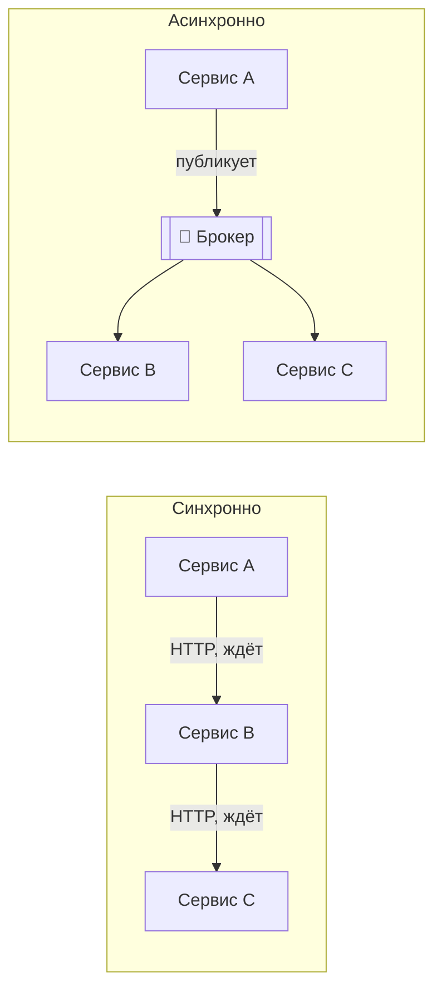
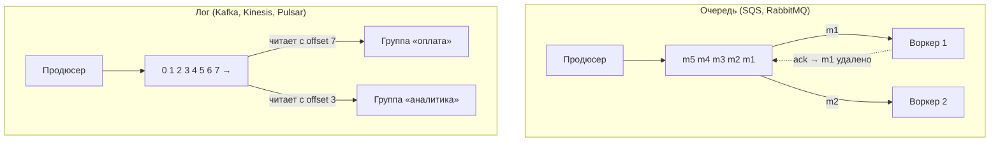
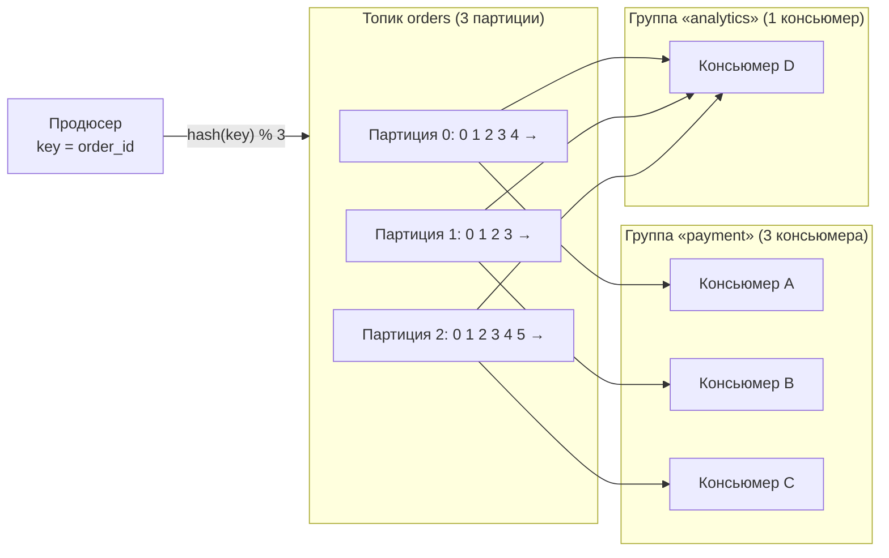
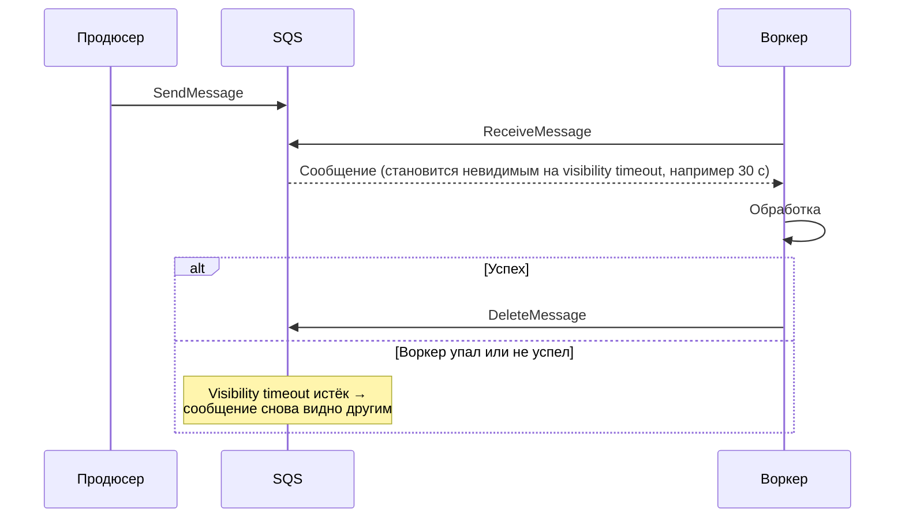
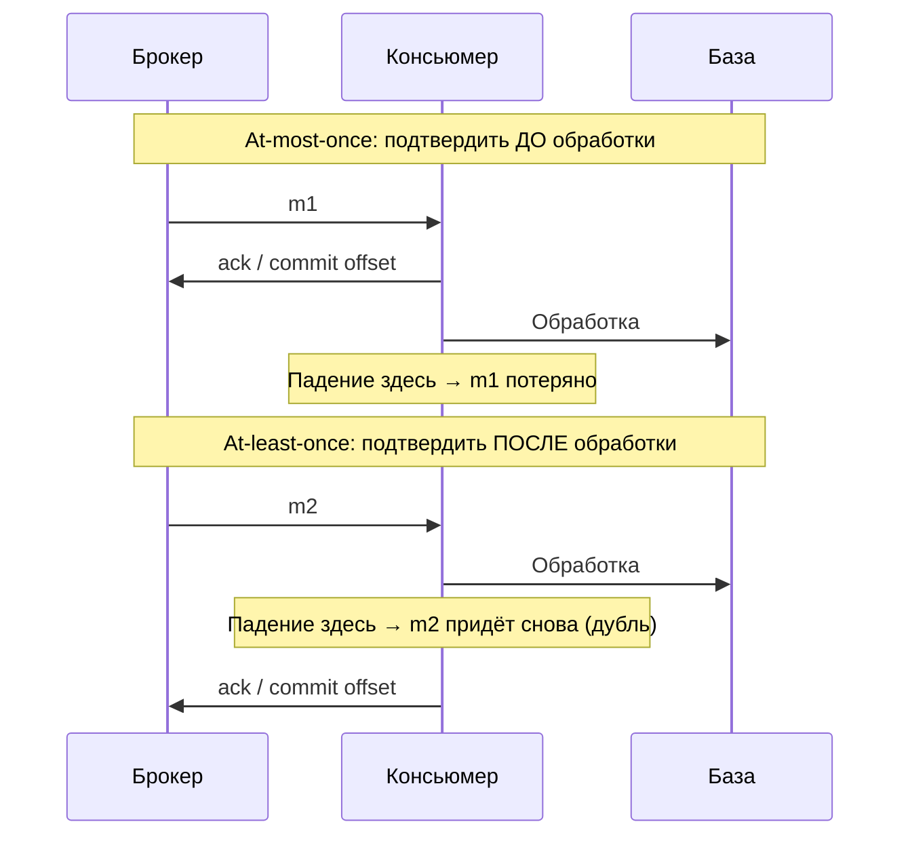
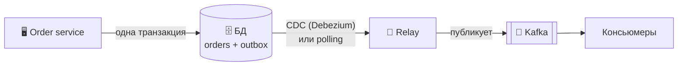
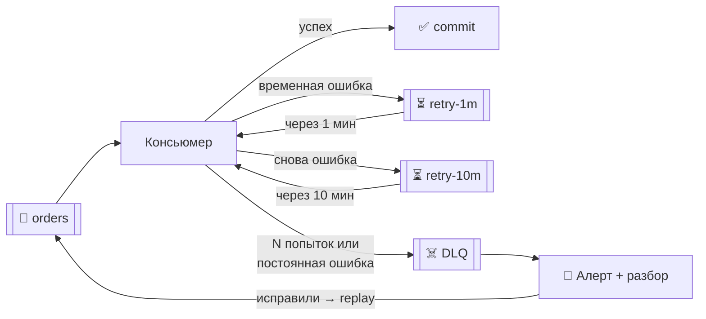

[English](README.md) | **Русский**

# 09. Обмен сообщениями (Messaging)

> **Что внутри:** зачем асинхронность, очереди vs логи (SQS/RabbitMQ vs Kafka), устройство Kafka и очередей, семантика доставки (at-most/at-least/exactly-once), идемпотентность, outbox, порядок сообщений, ретраи и DLQ, backpressure, масштабирование консьюмеров, схемы событий
> **Время на изучение:** ~5 ч · **Нужно для:** почти любой задачи с фоновыми задачами, событиями, микросервисами, потоками данных
> **Практика:** разбор в формате интервью — [INTERVIEW_RU.md](./INTERVIEW.ru.md)
> **Связанные темы:** [05-replication](../05_Replication/README.ru.md) (репликация в Kafka), [06-partitioning](../06_Partitioning/README.ru.md) (партиции), [08-consensus](../08_Consensus/README.ru.md)

---

## 📑 Содержание

1. [Зачем нужен асинхронный обмен сообщениями](#1-зачем-нужен-асинхронный-обмен-сообщениями)
2. [Очередь vs лог](#2-очередь-vs-лог)
3. [Как устроена Kafka](#3-как-устроена-kafka)
4. [Как устроены очереди: SQS и RabbitMQ](#4-как-устроены-очереди-sqs-и-rabbitmq)
5. [Семантика доставки](#5-семантика-доставки)
6. [Идемпотентность консьюмеров](#6-идемпотентность-консьюмеров)
7. [Сторона продюсера: проблема двойной записи и outbox](#7-сторона-продюсера-проблема-двойной-записи-и-outbox)
8. [Порядок сообщений](#8-порядок-сообщений)
9. [Ошибки: ретраи, DLQ, ядовитые сообщения](#9-ошибки-ретраи-dlq-ядовитые-сообщения)
10. [Backpressure и управление потоком](#10-backpressure-и-управление-потоком)
11. [Масштабирование консьюмеров](#11-масштабирование-консьюмеров)
12. [Паттерны и дизайн событий](#12-паттерны-и-дизайн-событий)
13. [Сравнение систем](#13-сравнение-систем)
14. [Как говорить об этом на интервью](#14-как-говорить-об-этом-на-интервью)
15. [Вопросы для самопроверки](#15-вопросы-для-самопроверки)
16. [Глоссарий и ресурсы](#16-глоссарий-и-ресурсы)

---

## 1. Зачем нужен асинхронный обмен сообщениями

При синхронном вызове сервис A ждёт ответа сервиса B. При асинхронном A кладёт сообщение в **брокер** и продолжает работу, а B обрабатывает его, когда сможет.



| Выгода | Как помогает брокер |
|:-------|:--------------------|
| **Развязка (decoupling)** | Продюсер не знает, кто и сколько консьюмеров обработают сообщение |
| **Сглаживание нагрузки** | Пик в 10 раз превращается в очередь, которую консьюмеры разбирают в своём темпе |
| **Отказоустойчивость** | Если консьюмер упал, сообщения ждут в брокере, а не теряются |
| **Fan-out** | Одно событие получают много независимых сервисов |
| **Быстрый ответ пользователю** | Тяжёлая работа (видео, письма, отчёты) — в фоне |
| **Повторное чтение** | В логах (Kafka) новые потребители могут прочитать историю |

| Цена асинхронности | Почему |
|:-------------------|:-------|
| Eventual consistency | Результат появляется не сразу |
| Сложнее отладка | Запрос «размазан» по сервисам и времени — нужна трассировка |
| Дубли и порядок | Нужно думать о повторной доставке и порядке |
| Ещё один компонент | Брокер нужно эксплуатировать и масштабировать |

> [!TIP]
> Правило: **синхронно — то, без чего нельзя ответить пользователю** (проверить баланс, создать заказ). **Асинхронно — всё, что может произойти чуть позже** (письмо, аналитика, обновление поиска, начисление бонусов).

### Три модели доставки

| Модель | Как | Пример |
|:-------|:----|:-------|
| **Point-to-point (очередь задач)** | Каждое сообщение обрабатывает **один** из консьюмеров | Обработка заказов воркерами |
| **Publish/subscribe** | Каждое сообщение получает **каждый** подписчик | Событие «заказ создан» → оплата, склад, письма |
| **Event streaming (лог)** | Сообщения хранятся в упорядоченном журнале; группы консьюмеров читают с разных позиций | Kafka: аналитика, CDC, event sourcing |

---

## 2. Очередь vs лог

Это главное архитектурное различие между брокерами.



| | Очередь | Лог |
|:-|:--------|:----|
| Что происходит после обработки | Сообщение **удаляется** | Сообщение **остаётся** до истечения retention |
| Позиция чтения | Брокер следит за каждым сообщением (в обработке, подтверждено) | Консьюмер хранит **offset** — номер в журнале |
| Повторное чтение истории | Нет | Да: сбросить offset назад |
| Несколько независимых потребителей | Нужна отдельная очередь на каждого (fan-out через SNS, exchange) | Каждая группа консьюмеров читает лог независимо |
| Порядок | Обычно не гарантирован (кроме FIFO-очередей) | Гарантирован **внутри партиции** |
| Параллелизм | Сколько угодно конкурирующих воркеров | Не больше числа партиций на группу |
| Обработка одного «плохого» сообщения | Только оно уходит на повтор, остальные идут дальше | Блокирует партицию, если не вынести его отдельно |
| Задержка отдельных сообщений, приоритеты | Часто есть (delay, priority) | Обычно нет |
| Пропускная способность | Высокая | Очень высокая (последовательная запись, батчи) |

### Когда что выбирать

| Задача | Выбор |
|:-------|:------|
| Фоновые задачи, где каждая задача независима (письма, ресайз картинок) | **Очередь** |
| Событие, которое нужно многим сервисам, включая будущие | **Лог** |
| Нужно перечитать историю (новый сервис, исправление бага, перестройка индекса) | **Лог** |
| Строгий порядок событий по сущности (заказ, счёт) | **Лог** с ключом партиции (или FIFO-очередь) |
| Задачи с разным временем выполнения, ретраи по одной | **Очередь** |
| Поток данных большого объёма (клики, логи, CDC) | **Лог** |

> [!IMPORTANT]
> **Сигнал Senior+:** в больших системах используют **оба**: лог как «позвоночник» событий (что произошло) и очереди для конкретной работы (что сделать). Например, событие «заказ оплачен» — в Kafka, а задача «отправить письмо» — в SQS для воркеров с ретраями и ограничением скорости.

---

## 3. Как устроена Kafka



| Понятие | Значение |
|:--------|:---------|
| **Топик** | Именованный поток сообщений |
| **Партиция** | Упорядоченный неизменяемый журнал; единица параллелизма и порядка |
| **Offset** | Номер сообщения в партиции |
| **Ключ** | Определяет партицию: `hash(key) % число_партиций`. Сообщения с одним ключом попадают в одну партицию и упорядочены |
| **Группа консьюмеров** | Набор консьюмеров, делящих партиции: каждая партиция читается **одним** консьюмером группы |
| **Rebalance** | Перераспределение партиций при добавлении или уходе консьюмера |
| **Retention** | Сколько хранить сообщения: по времени (например, 7 дней) или по размеру |
| **Log compaction** | Хранить только **последнее** значение для каждого ключа (для «текущего состояния», CDC) |
| **Репликация** | Каждая партиция реплицирована: лидер + фолловеры, ISR (см. [05-replication](../05_Replication/README.ru.md#11-сравнение-подходов-и-реальные-системы)) |

### Почему Kafka быстрая

- **Последовательная запись** в конец файла вместо случайной.
- **Батчинг и сжатие** на продюсере.
- **Page cache ОС** вместо собственного кэша: свежие сообщения читаются из памяти.
- **Zero-copy:** данные передаются из файла в сокет без копирования в пространство пользователя.
- **Консьюмер сам хранит offset** — брокеру не нужно отслеживать состояние каждого сообщения.

### Надёжность записи

| Настройка | Значение |
|:----------|:---------|
| `acks=0` | Не ждать подтверждения — быстро, можно потерять |
| `acks=1` | Ждать лидера партиции — потеря при падении лидера до репликации |
| `acks=all` + `min.insync.replicas=2` | Ждать всех in-sync реплик (минимум двух) — не теряется при падении одного брокера |
| `enable.idempotence=true` | Брокер отбрасывает дубли от ретраев продюсера, порядок сохраняется |

---

## 4. Как устроены очереди: SQS и RabbitMQ

### Жизненный цикл сообщения в SQS



| Понятие | Значение |
|:--------|:---------|
| **Visibility timeout** | Время, на которое полученное сообщение скрыто от других. Должно быть больше времени обработки (или продлеваться) |
| **Ack / delete** | Подтверждение успешной обработки |
| **Redelivery** | Неподтверждённое сообщение возвращается в очередь → **at-least-once** |
| **maxReceiveCount + DLQ** | После N неудачных получений сообщение уходит в dead letter queue |
| **Long polling** | Ожидание сообщений до N секунд вместо постоянных пустых запросов |
| **FIFO-очередь** | Порядок и дедупликация в рамках **message group id**; ниже пропускная способность |
| **Delay** | Сообщение становится видимым через заданное время |

### RabbitMQ: exchanges и маршрутизация

Продюсер публикует в **exchange**, который по правилам направляет сообщение в очереди.

| Тип exchange | Как маршрутизирует |
|:-------------|:-------------------|
| **Direct** | По точному совпадению routing key |
| **Topic** | По шаблону (`order.*.created`, `order.#`) |
| **Fanout** | Во все привязанные очереди |
| **Headers** | По заголовкам сообщения |

Также: **prefetch** (сколько неподтверждённых сообщений держит консьюмер), подтверждения издателя (publisher confirms), quorum queues на Raft для надёжности, а в новых версиях — Streams (лог в стиле Kafka).

---

## 5. Семантика доставки

Ключевой вопрос: **когда подтверждать** — до или после обработки.



| Семантика | Что гарантирует | Риск | Когда |
|:----------|:----------------|:-----|:------|
| **At-most-once** | Сообщение обработано 0 или 1 раз | Потеря | Метрики, логи, где потеря допустима |
| **At-least-once** | Обработано 1 или больше раз | Дубли | **По умолчанию** почти везде |
| **Exactly-once** | Эффект обработки ровно один | Сложность, стоимость | Деньги, учёт, где дубли недопустимы |

### Миф о exactly-once

**Доставку** ровно один раз в распределённой системе гарантировать нельзя: если подтверждение потерялось в сети, отправитель не знает, дошло ли сообщение, и должен повторить. Достижимо **exactly-once обработка** (effectively-once) — эффект как будто ровно один раз:

```
Exactly-once эффект = at-least-once доставка + идемпотентная обработка
```

### Exactly-once в Kafka

Kafka предлагает exactly-once **внутри Kafka** (прочитать из топика → обработать → записать в топик):
- **идемпотентный продюсер** — брокер отбрасывает дубли по (producer id, sequence number);
- **транзакции** — запись в несколько партиций и коммит offset консьюмера атомарно;
- консьюмеры с `isolation.level=read_committed` не видят незакоммиченные сообщения.

> [!WARNING]
> Транзакции Kafka не распространяются на **внешние системы**. Если консьюмер пишет в PostgreSQL или вызывает платёжный API, exactly-once нужно обеспечивать самому: идемпотентность или хранение offset в той же транзакции базы, что и результат.

---

## 6. Идемпотентность консьюмеров

**Идемпотентная операция** — повторное выполнение даёт тот же результат, что и однократное.

| Техника | Как | Пример |
|:--------|:----|:-------|
| **Таблица обработанных сообщений** | В той же транзакции, что и результат, записать `message_id` с UNIQUE; дубль упадёт на ограничении | `INSERT INTO processed(message_id) ...` + бизнес-изменение в одной транзакции |
| **Естественно идемпотентные операции** | `SET status = 'paid'` вместо `balance = balance + 100` | Upsert по ключу |
| **Условная запись по версии** | Применять событие, только если его версия больше сохранённой | `UPDATE ... WHERE version < $event_version` |
| **Idempotency key во внешнем API** | Передавать стабильный ключ (например, производный от message_id), провайдер вернёт прежний результат | Платёжные API (Stripe и другие) поддерживают Idempotency-Key |
| **Offset в той же транзакции** | Хранить offset Kafka в своей базе вместе с результатом; при старте читать с сохранённого | Exactly-once с внешней БД |

```sql
BEGIN;
INSERT INTO processed_messages (consumer, message_id) VALUES ('billing', 'evt-81f2');
-- Если такая строка уже есть → ошибка уникальности → откат → сообщение уже обработано, просто подтвердить
UPDATE accounts SET balance = balance - 100 WHERE id = 42;
COMMIT;
```

> [!TIP]
> У каждого события должен быть **уникальный стабильный ID**, назначенный продюсером (а не брокером), — тогда дедупликация работает и при повторной публикации.

---

## 7. Сторона продюсера: проблема двойной записи и outbox

### Проблема двойной записи (dual write)

Сервис должен сохранить заказ в базе **и** опубликовать событие. Две независимые записи не атомарны:

| Порядок | Что может пойти не так |
|:--------|:-----------------------|
| Сначала БД, потом брокер | Сервис упал после коммита → событие **потеряно** |
| Сначала брокер, потом БД | Транзакция БД откатилась → событие о **несуществующем** заказе |

### Решение: transactional outbox



1. В **одной транзакции** записать бизнес-данные и строку в таблицу `outbox` (событие).
2. Отдельный процесс (CDC из WAL или периодический опрос) читает outbox и публикует в брокер.
3. После публикации помечает или удаляет строку.

- ✅ Событие публикуется **тогда и только тогда**, когда транзакция закоммичена.
- ⚠️ Relay может опубликовать событие повторно (упал после публикации, но до отметки) → консьюмеры должны быть **идемпотентны**.

### Другие практики продюсера

- `acks=all`, идемпотентный продюсер, ретраи с backoff.
- Батчинг (`linger.ms`, размер батча) — компромисс между задержкой и пропускной способностью.
- Ключ партиции выбирается по сущности, для которой важен порядок.

---

## 8. Порядок сообщений

### Какой порядок бывает

| Порядок | Где | Цена |
|:--------|:----|:-----|
| **Глобальный** | Одна партиция / одна FIFO-очередь | Нет параллелизма: весь поток через один консьюмер |
| **По ключу** | Kafka (ключ → партиция), SQS FIFO (message group id) | Параллелизм по разным ключам; порядок только внутри ключа |
| **Без гарантий** | Обычные очереди | Максимальный параллелизм |

> [!TIP]
> Почти всегда достаточно **порядка по ключу**: события одного заказа в порядке, события разных заказов — независимо. Глобальный порядок почти никогда не нужен и очень дорог.

### Что ломает порядок

| Причина | Как избежать |
|:--------|:-------------|
| Ретраи продюсера при нескольких запросах «в полёте» | Идемпотентный продюсер Kafka (сохраняет порядок при ретраях) |
| Несколько консьюмеров на одну очередь без FIFO | Ключевая партиция или FIFO с group id |
| Параллельная обработка внутри консьюмера | Параллелить по ключу: сообщения одного ключа — в один поток |
| Вынос сообщения в retry-топик | Следующие сообщения того же ключа обгонят его (см. ниже) |
| Добавление партиций в топик | Ключ начинает попадать в другую партицию |
| Rebalance | Возможна повторная обработка; нужна идемпотентность |

### Как справляться с нарушением порядка

- **Версии в событиях:** консьюмер применяет событие, только если его версия больше сохранённой; старые — игнорирует.
- **Событие с полным состоянием** (event-carried state) вместо дельты: последнее по версии побеждает.
- **Буферизация по ключу:** ждать недостающий номер последовательности ограниченное время.

---

## 9. Ошибки: ретраи, DLQ, ядовитые сообщения

### Типы ошибок

| Тип | Пример | Что делать |
|:----|:-------|:-----------|
| **Временные (transient)** | Таймаут, недоступен downstream, rate limit | Ретрай с экспоненциальной задержкой и jitter |
| **Постоянные** | Невалидные данные, ошибка схемы, баг | Не ретраить бесконечно → DLQ |
| **Ядовитое сообщение (poison pill)** | Сообщение, на котором консьюмер падает каждый раз | DLQ после N попыток, иначе блокирует обработку |

### Схема ретраев и DLQ



| Практика | Зачем |
|:---------|:------|
| Ограниченное число ретраев | Не тратить ресурсы на безнадёжные сообщения |
| Экспоненциальная задержка + jitter | Не добивать перегруженный downstream синхронными волнами повторов |
| Сохранять в DLQ причину, стек, число попыток, исходный топик и offset | Чтобы можно было разобраться и переиграть |
| Алерт на рост DLQ | DLQ, которую никто не смотрит, — это тихая потеря данных |
| Инструмент replay | Вернуть сообщения из DLQ в основной поток после исправления |

> [!WARNING]
> **Retry-топики ломают порядок по ключу:** пока сообщение заказа 42 ждёт в retry-1m, следующее событие заказа 42 будет обработано раньше. Если порядок важен: либо ретраить **на месте** (блокируя партицию — подходит для коротких сбоев), либо при отправке в retry **«парковать» ключ** — все следующие сообщения этого ключа тоже отправлять в retry, пока он не обработан.

---

## 10. Backpressure и управление потоком

**Backpressure** — механизм, при котором медленный потребитель сигнализирует быстрому производителю «притормози», а не тонет в данных.

### Где брокер помогает, а где нет

- Брокер **поглощает пики**: продюсер пишет быстро, консьюмеры отстают, очередь растёт.
- Но рост **не бесконечен**: место на дисках, retention, время ожидания.

> [!WARNING]
> В Kafka сообщения удаляются по **retention**, даже если их никто не прочитал. Если консьюмер отстал больше, чем на срок хранения, данные **потеряны**. Отслеживай lag в единицах времени и держи retention с запасом.

### Метрики

| Метрика | Значение |
|:--------|:---------|
| **Consumer lag** | Сколько сообщений (и сколько секунд) консьюмер отстаёт от конца лога |
| **Возраст самого старого сообщения** (SQS: ApproximateAgeOfOldestMessage) | Насколько задерживается обработка |
| **Скорость обработки vs скорость поступления** | Растёт ли отставание |

### Закон Литтла для оценки

```
L = λ × W
L — среднее число сообщений в системе
λ — скорость поступления (сообщений/с)
W — среднее время в системе (с)

Пример: 2 000 сообщений/с, обработка одного — 50 мс на поток
→ нужно минимум 2 000 × 0,05 = 100 параллельных обработчиков
```

### Инструменты

| Инструмент | Как работает |
|:-----------|:-------------|
| **Pull-модель** | Консьюмер сам забирает сообщения в своём темпе (Kafka, SQS) |
| **Prefetch / max.poll.records** | Ограничить, сколько сообщений консьюмер берёт за раз |
| **Автоскейлинг по lag** | Добавлять консьюмеров при росте отставания (например, KEDA в Kubernetes); в Kafka — не больше числа партиций |
| **Ограниченные буферы** | Внутри приложения — очереди фиксированного размера; при заполнении блокировать чтение |
| **Rate limiting downstream** | Не слать во внешний API больше разрешённого, даже если очередь большая |
| **Приоритеты** | Отдельные очереди для критичного и некритичного (транзакционные письма vs маркетинг) |
| **Load shedding** | При перегрузке отбрасывать или откладывать низкоприоритетное |

---

## 11. Масштабирование консьюмеров

| | Очередь | Kafka |
|:-|:--------|:------|
| Как масштабировать | Добавить воркеров — они конкурируют за сообщения | Добавить консьюмеров в группу — максимум один на партицию |
| Предел параллелизма | Практически нет | **Число партиций** |
| Перераспределение | Не нужно | Rebalance: короткая пауза |

### Выбор числа партиций

- Исходить из пиковой нагрузки и скорости одного консьюмера: `партиций ≥ пиковый поток / скорость одного консьюмера`, с запасом на рост.
- Увеличить число партиций можно, но это **меняет отображение ключей** → нарушается порядок для существующих ключей. Поэтому выбирают с запасом заранее.
- Слишком много партиций — больше накладных расходов (файлы, метаданные, время rebalance).

### Параллелизм внутри партиции

Если обработка медленная (вызовы внешних API), один консьюмер может обрабатывать партицию **несколькими потоками по ключу**: сообщения одного ключа — в один поток, разные ключи — параллельно. Offset коммитится только до последнего сообщения, обработанного **без пропусков**.

### Rebalance без боли

- **Cooperative rebalancing** — перераспределяются только переезжающие партиции, остальные продолжают работу.
- **Static membership** — короткий рестарт консьюмера не вызывает rebalance.
- Корректный commit offset перед отдачей партиции.

---

## 12. Паттерны и дизайн событий

### Паттерны

| Паттерн | Суть |
|:--------|:-----|
| **Work queue** | Задачи распределяются между воркерами |
| **Fan-out (pub/sub)** | Одно событие → много подписчиков (Kafka-группы; SNS → несколько SQS) |
| **Transactional outbox** | Атомарная запись данных и события (см. [раздел 7](#7-сторона-продюсера-проблема-двойной-записи-и-outbox)) |
| **Event sourcing** | Источник правды — последовательность событий, состояние вычисляется из них |
| **CQRS** | Запись и чтение разделены; модели чтения строятся из событий |
| **Saga** | Распределённая транзакция как цепочка локальных шагов с компенсациями (хореография через события или оркестратор) |
| **Request-reply** | Асинхронный запрос с ответом в отдельную очередь (correlation id) |
| **Claim check** | Большие данные кладутся в объектное хранилище, в сообщении — только ссылка |
| **Delayed / scheduled messages** | Отложенная доставка (напоминания, таймауты) |

### Какие события публиковать

| Тип | Что содержит | Плюсы | Минусы |
|:----|:-------------|:------|:-------|
| **Event notification** | «Заказ 42 изменён» (только ID) | Маленькое, не устаревает | Консьюмер должен сходить за данными → нагрузка на источник |
| **Event-carried state transfer** | Полное состояние заказа после изменения | Консьюмер самодостаточен | Больше размер; утечка внутренней модели |
| **Domain event** | «OrderPaid {order_id, amount, paid_at}» — бизнес-факт | Понятно, стабильно | Нужно продумать набор событий |

### Схемы и их эволюция

- Используй **схему** (Avro, Protobuf, JSON Schema) и **schema registry**.
- Правила совместимости: **backward** (новые консьюмеры читают старые события), **forward** (старые консьюмеры читают новые события).
- Безопасно: добавлять необязательные поля. Опасно: удалять, переименовывать, менять тип.
- Ломающее изменение — **новый топик** или новая версия события с параллельной публикацией.
- Сообщения должны быть **небольшими**: у брокеров есть лимиты размера (порядка сотен килобайт — единиц мегабайт в зависимости от системы); для больших данных — claim check.

---

## 13. Сравнение систем

| Система | Модель | Порядок | Хранение | Особенности |
|:--------|:-------|:--------|:---------|:------------|
| **Apache Kafka** | Лог | По партиции | Retention по времени/размеру, compaction | Огромная пропускная способность, экосистема (Connect, Streams), exactly-once внутри Kafka |
| **Apache Pulsar** | Лог + очереди | По партиции | Многоуровневое хранение (BookKeeper + объектное хранилище) | Разделение вычислений и хранения, multi-tenancy, гео-репликация |
| **AWS Kinesis Data Streams** | Лог | По шарду | Ограниченный срок | Managed, интеграция с AWS |
| **AWS SQS** | Очередь | FIFO-очереди — по group id | До удаления (с лимитом срока) | Полностью managed, бесконечно масштабируется, visibility timeout, DLQ |
| **AWS SNS** | Pub/sub (push) | FIFO-топики | Не хранит | Fan-out в SQS, Lambda, HTTP, SMS |
| **RabbitMQ** | Очередь (+ Streams) | Внутри очереди | До подтверждения | Гибкая маршрутизация (exchanges), приоритеты, quorum queues |
| **Google Pub/Sub** | Pub/sub с подписками | По ordering key | Ограниченный срок | Managed, глобальный |
| **NATS / JetStream** | Pub/sub + лог | По потоку | JetStream — хранение | Очень низкая задержка, лёгкий |
| **Redis Streams** | Лог | В потоке | В памяти | Просто, если Redis уже есть; ограничен памятью |

---

## 14. Как говорить об этом на интервью

### Ответ за 30 секунд

> «Синхронно делаю только то, без чего нельзя ответить пользователю, остальное — через брокер. События домена публикую в Kafka через transactional outbox, ключ партиции — ID сущности, чтобы сохранить порядок по ней. Фоновую работу с ретраями и лимитами скорости кладу в очередь (SQS). Доставка at-least-once, поэтому консьюмеры идемпотентны: дедупликация по ID события в той же транзакции, idempotency key во внешние API. Временные ошибки — ретраи с backoff, постоянные — в DLQ с алертом и replay. Слежу за lag в секундах, автоскейлю консьюмеров до числа партиций, retention с запасом. Схемы — в registry с правилами совместимости».

### Вопросы, которые стоит задать

1. Что должно быть готово до ответа пользователю, а что может произойти позже?
2. Нужен ли порядок, и по какой сущности?
3. Что будет при дубле сообщения? При потере?
4. Кому ещё понадобятся эти события — сейчас и в будущем (нужна ли история)?
5. Что делать, если консьюмер или downstream медленнее продюсера?

### Типичные ошибки

- Запись в БД и публикация в брокер без outbox.
- «У нас exactly-once» без идемпотентных консьюмеров.
- Подтверждение до обработки там, где потеря недопустима.
- Глобальный порядок, когда достаточно порядка по ключу.
- Бесконечные ретраи ядовитого сообщения, блокирующие партицию.
- DLQ без алертов и без инструмента replay.
- Автоскейлинг консьюмеров Kafka больше числа партиций.
- Не учитывать retention при большом lag.

---

## 15. Вопросы для самопроверки

<details>
<summary><b>1. Чем очередь отличается от лога?</b></summary>

В очереди сообщение удаляется после подтверждения, брокер следит за состоянием каждого сообщения, параллелизм практически не ограничен, история не хранится. В логе сообщения хранятся до истечения retention, консьюмер хранит offset, разные группы читают независимо и могут перечитать историю, порядок гарантирован внутри партиции, а параллелизм ограничен числом партиций.
</details>

<details>
<summary><b>2. Почему exactly-once доставка невозможна, а exactly-once обработка — возможна?</b></summary>

Если подтверждение потерялось, отправитель не знает, дошло ли сообщение, и должен повторить — значит, возможны дубли. Но если обработка идемпотентна (дедупликация по ID, условные записи), повторная доставка не меняет результат. At-least-once + идемпотентность = эффект ровно один раз.
</details>

<details>
<summary><b>3. Какую проблему решает transactional outbox?</b></summary>

Двойную запись: сохранение данных в БД и публикация события в брокер не атомарны. Outbox записывает событие в таблицу в той же транзакции, что и данные, а отдельный процесс публикует его. Событие появится тогда и только тогда, когда транзакция закоммичена (возможно, повторно — поэтому консьюмеры идемпотентны).
</details>

<details>
<summary><b>4. Как гарантировать порядок событий одного заказа в Kafka?</b></summary>

Использовать order_id как ключ сообщения: все события заказа попадут в одну партицию и будут прочитаны одним консьюмером группы по порядку. Включить идемпотентный продюсер, обрабатывать сообщения одного ключа последовательно и не выносить их по одному в retry-топик без «парковки» ключа.
</details>

<details>
<summary><b>5. Почему нельзя бесконечно ретраить сообщение в Kafka-консьюмере?</b></summary>

Если сообщение «ядовитое» (ошибка всегда повторяется), консьюмер застрянет на нём, и вся партиция остановится. Нужно ограниченное число попыток, после которого сообщение уходит в DLQ.
</details>

<details>
<summary><b>6. Что произойдёт, если консьюмер Kafka отстал больше, чем на retention?</b></summary>

Сообщения, которые он не успел прочитать, будут удалены — данные потеряны для этого консьюмера. Поэтому нужно мониторить lag во времени, держать retention с запасом и алертить заранее.
</details>

<details>
<summary><b>7. Почему добавление консьюмеров в группу не всегда ускоряет обработку?</b></summary>

В Kafka каждую партицию читает только один консьюмер группы. Если консьюмеров больше, чем партиций, лишние простаивают. Предел параллелизма — число партиций (или параллелизм по ключу внутри консьюмера).
</details>

<details>
<summary><b>8. Как сделать консьюмер идемпотентным, если он пишет в PostgreSQL?</b></summary>

В той же транзакции, что и бизнес-изменение, вставить ID сообщения в таблицу обработанных с ограничением уникальности; если такой ID уже есть, транзакция откатится, а сообщение просто подтверждается. Альтернативы: upsert, условная запись по версии, хранение offset в той же транзакции.
</details>

<details>
<summary><b>9. Что такое visibility timeout в SQS и как его выбрать?</b></summary>

Время, на которое полученное сообщение скрыто от других консьюмеров. Если за это время сообщение не удалено, оно снова становится доступным. Таймаут должен быть больше максимального времени обработки, либо консьюмер должен продлевать его для долгих задач — иначе одно сообщение начнут обрабатывать параллельно двое.
</details>

<details>
<summary><b>10. Когда публиковать «тонкое» событие с ID, а когда — с полным состоянием?</b></summary>

Тонкое событие подходит, когда консьюмерам нужно немного данных или данные быстро устаревают, но заставляет их ходить в источник. Событие с полным состоянием делает консьюмеров независимыми и разгружает источник, но больше по размеру и раскрывает внутреннюю модель. Часто выбирают доменные события с бизнес-фактами и нужными полями.
</details>

---

## 16. Глоссарий и ресурсы

### Глоссарий

| Термин | Значение |
|:-------|:---------|
| Брокер | Система, принимающая, хранящая и доставляющая сообщения |
| Продюсер / консьюмер | Отправитель / получатель сообщений |
| Топик / партиция | Именованный поток / упорядоченный журнал внутри него |
| Offset | Номер сообщения в партиции |
| Группа консьюмеров | Консьюмеры, делящие партиции топика |
| Retention / compaction | Срок хранения / хранение последнего значения по ключу |
| Visibility timeout | Время скрытия полученного сообщения в SQS |
| Ack | Подтверждение обработки |
| At-most / at-least / exactly-once | Семантики доставки и обработки |
| Идемпотентность | Повтор операции не меняет результат |
| Outbox | Таблица событий, записываемая в одной транзакции с данными |
| DLQ | Dead letter queue — очередь необработанных сообщений |
| Poison message | Сообщение, обработка которого всегда падает |
| Consumer lag | Отставание консьюмера от конца лога |
| Backpressure | Сигнал от медленного потребителя замедлиться |
| Schema registry | Хранилище схем событий с проверкой совместимости |
| Claim check | Ссылка на большие данные вместо самих данных в сообщении |

### Ресурсы

- *Designing Data-Intensive Applications*, Martin Kleppmann — глава 11 «Stream Processing»
- Jay Kreps, *The Log: What every software engineer should know about real-time data's unifying abstraction* (2013)
- Kreps, Narkhede, Rao, *Kafka: a Distributed Messaging System for Log Processing* (NetDB 2011)
- Hohpe, Woolf, *Enterprise Integration Patterns* (2003)
- Neha Narkhede, *Exactly-once Semantics Are Possible: Here's How Kafka Does It* (Confluent, 2017)
- Chris Richardson, microservices.io — Transactional outbox, Saga, Idempotent consumer
- Документация Apache Kafka, AWS SQS/SNS, RabbitMQ