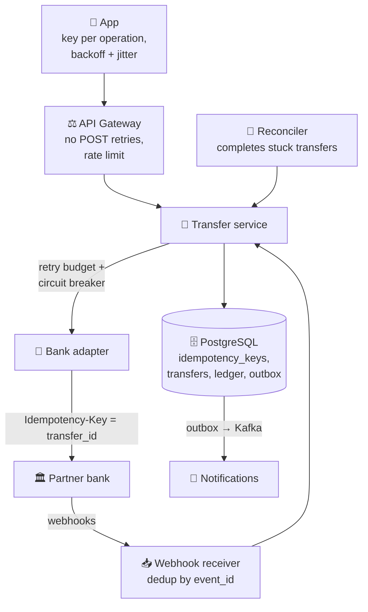
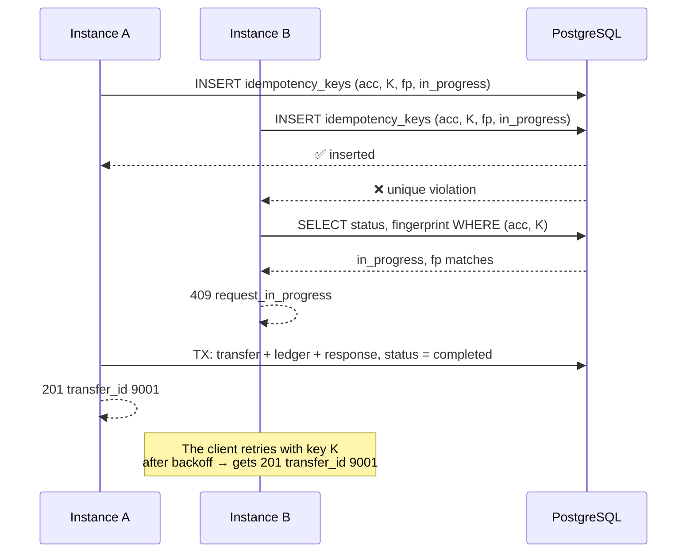
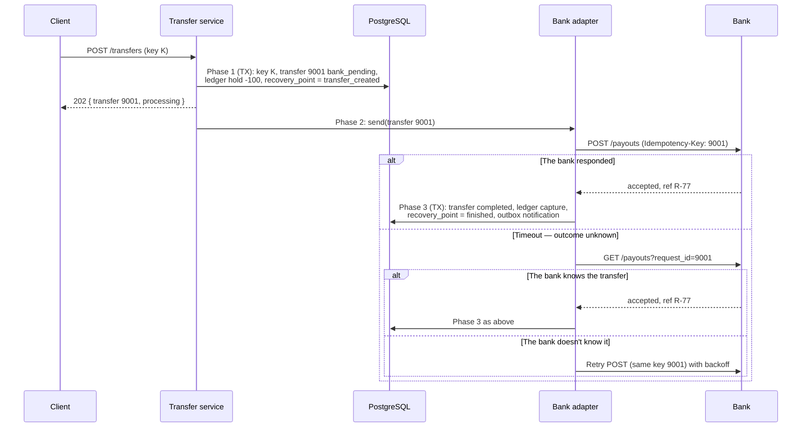
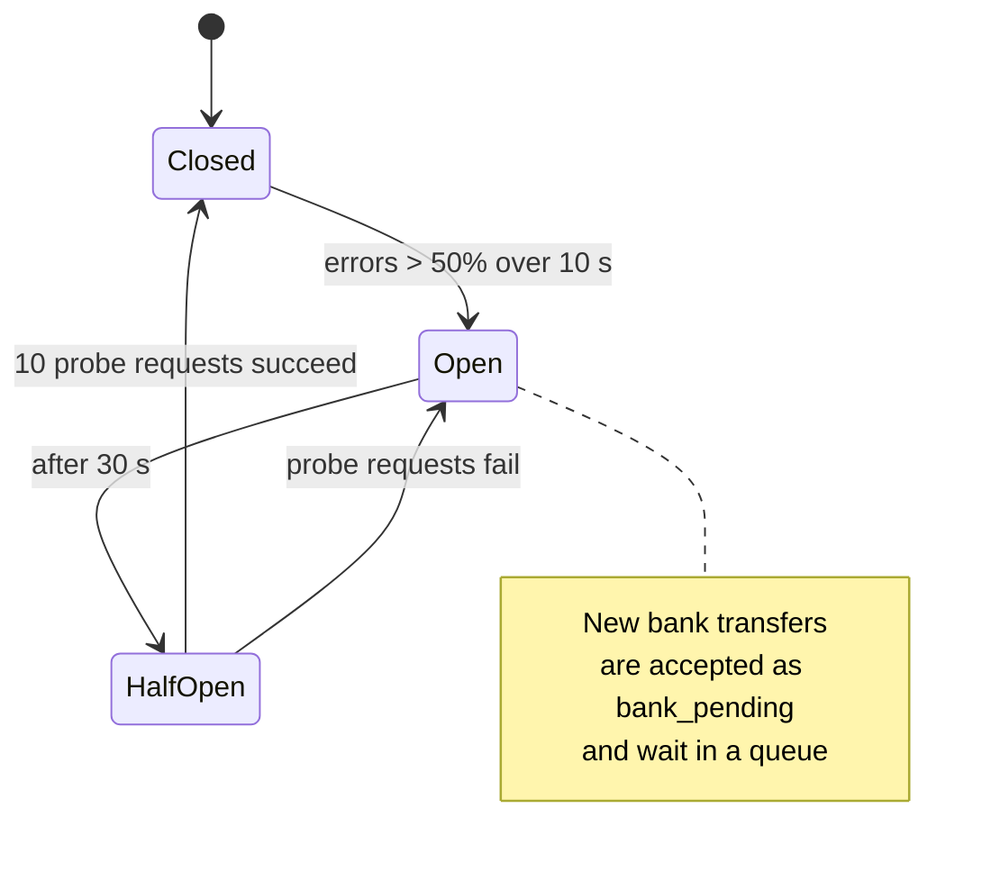

**English** | [Русский](INTERVIEW_RU.md) · Theory: [README.md](./README.md)

# 10. Idempotency: A Transfers API That's Safe to Retry

> **Topic:** double transfers caused by retries, idempotency keys, atomic phases and recovery points, concurrent duplicates, an external bank with unknown outcomes, retries with backoff and jitter, retry storms, retry budgets, circuit breakers, webhooks
> **Level:** Medium–Hard · **Interview time:** 45 min · **Study time:** ~4 h
> **Where it's asked:** "Design a payments API / transfers / Stripe", and as a deep dive in any problem involving money or external calls

---

## 🗺️ How to Read This Walkthrough

| Icon | Meaning |
|:----:|:--------|
| 🎤 | Interviewer |
| 🗣️ | What I (the candidate) say out loud |
| ✏️ | What I draw on the whiteboard |
| ⏱️ | Time budget for the step |

Callouts: **TIP** — a good technique, **WARNING** — a trap, **IMPORTANT** — a Senior+ signal.

---

## 📑 Contents

1. [Problem Statement](#1-problem-statement)
2. [Clarifying Questions and Requirements](#2-clarifying-questions-and-requirements)
3. [Capacity Estimates](#3-capacity-estimates)
4. [Where Duplicates Come From](#4-where-duplicates-come-from)
5. [API](#5-api)
6. [Data Model](#6-data-model)
7. [High-Level Design](#7-high-level-design)
8. [Deep Dive 1: Handling the Idempotency Key](#8-deep-dive-1-handling-the-idempotency-key)
9. [Deep Dive 2: A Transfer Through an External Bank — Atomic Phases](#9-deep-dive-2-a-transfer-through-an-external-bank--atomic-phases)
10. [Deep Dive 3: A Client on a Bad Network](#10-deep-dive-3-a-client-on-a-bad-network)
11. [Deep Dive 4: A Retry Storm During a Bank Outage](#11-deep-dive-4-a-retry-storm-during-a-bank-outage)
12. [Deep Dive 5: Bank Webhooks and Notifications](#12-deep-dive-5-bank-webhooks-and-notifications)
13. [Bottlenecks and Failure Scenarios](#13-bottlenecks-and-failure-scenarios)
14. [What Changes at 10x Scale](#14-what-changes-at-10x-scale)
15. [Interviewer Questions with Answers](#15-interviewer-questions-with-answers)
16. [Common Mistakes](#16-common-mistakes)
17. [Cheat Sheet and Self-Check](#17-cheat-sheet-and-self-check)

---

## 1. Problem Statement

> 🎤 "We have a mobile app for person-to-person transfers, like Venmo or Revolut. Two problems:
> 1. Users on the subway and on bad networks complain about **double transfers** — support refunds them manually.
> 2. When our partner bank had a 10-minute outage, our service went down for an hour: after recovering, the bank fell over again under **a wave of our retries**.
>
> Redesign the transfers API so this doesn't happen again."

**Time plan:**

| Step | ⏱️ |
|:-----|:--:|
| Requirements | 5 min |
| Estimates and sources of duplicates | 5 min |
| API and data model | 7 min |
| High-level design | 3 min |
| Deep dives | 20 min |
| Failures and wrap-up | 5 min |

> [!TIP]
> The problem contains **two distinct** issues: correctness (duplicates → idempotency) and resilience (a retry storm → backoff, jitter, budgets, circuit breakers). Name both up front and split your time between them.

---

## 2. Clarifying Questions and Requirements

⏱️ 5 min

| My question | Interviewer's answer | What it changes |
|:------------|:---------------------|:----------------|
| Transfers within our system or through a bank? | Internal (between our users) — instant; to an external card or account — through the partner bank | Two paths: a local transaction and an external call |
| Does the bank support an idempotency key? | Yes, by our `request_id`; there's also a status query API | The bank call can be retried safely |
| How long does a bank transfer take? | Usually 1–3 s, sometimes up to 30 s, sometimes no response at all | Can't hold the client's HTTP request and a transaction that long |
| Which clients? | iOS, Android, web; often on bad networks | Client retries are inevitable; the key must survive app restarts |
| Is a double transfer ever acceptable? | Never | Layered protection |
| How does the user learn the outcome? | A status screen + push | An async status for bank transfers |

### Functional requirements

1. Transfer money to another user (instantly) or to an external card (via the bank).
2. View a transfer's status.
3. Get notified of the outcome.

### Non-functional requirements

| Requirement | Target |
|:------------|:-------|
| Correctness | Zero double transfers under any retries, drops or double taps |
| Latency | Internal transfer p99 < 500 ms; bank transfer — "accepted" response < 500 ms, outcome async |
| Resilience | A bank outage doesn't take our service down and isn't prolonged by our retries |
| Recovery | After a bank outage, stuck transfers are completed automatically |

---

## 3. Capacity Estimates

⏱️ 2 min

✏️

```
Transfers            = 10M/day → ~120/s average, peak ~1,000/s
Via the bank         ≈ 30% → ~300/s at peak
Client retries       ≈ 2–5% of requests (bad networks) — and that's what causes duplicates

Idempotency keys     = 10M/day × ~1 KB (with the stored response), kept 7 days ≈ 70 GB
Unprotected retries  = client 3 × gateway 3 × service 3 = up to 27 bank calls per transfer
```

🗣️ "The load is small — the main question isn't scale but **correctness under retries**. 70 GB of keys live comfortably in the same PostgreSQL as the transfers — in a separate table partitioned by day."

---

## 4. Where Duplicates Come From

⏱️ 3 min

🗣️ "Before fixing anything, let me find every source of repeats":

| Source | How it happens |
|:-------|:---------------|
| Double tap | The user taps "Send" twice |
| Client retry after a timeout | The transfer went through, the response was lost on the subway → the app retried |
| App restart | The OS killed the app mid-request → it resends on next launch |
| Retries in the HTTP library / gateway / mesh | Automatic repeats at intermediate layers |
| Our service's retries to the bank | A bank timeout → a repeated call |
| Repeated bank webhooks | The bank delivers at-least-once |

> [!IMPORTANT]
> **Senior+ signal:** each of these sources must be closed by **its own** mechanism. Disabling the button closes only the first. A client idempotency key closes the first four. A key to the bank closes the fifth. Webhook deduplication closes the sixth.

---

## 5. API

⏱️ 3 min

```http
POST /v1/transfers
Headers:
  Authorization: Bearer <token>
  Idempotency-Key: 5d1c8f0e-9b7a-4e6f-a3c2-7f1b2e8d9c40
Body:
  { "to_user_id": "u_77", "amount": "100.00", "currency": "EUR", "note": "dinner" }

Responses:
  201 { transfer_id, status: "completed" }            ← internal transfer
  202 { transfer_id, status: "processing" }           ← bank transfer, outcome later
  409 { error: "request_in_progress" }                ← same key still being processed
  422 { error: "idempotency_key_reused" }             ← same key, different body
  503 + Retry-After                                   ← overloaded, retry later

A retry with the same key → the same code and body as the first time

GET /v1/transfers/{transfer_id}  → { status, amount, created_at, failure_reason? }
```

🗣️ "The key point: the response to a retry is **identical** to the first, including `transfer_id`. The client doesn't need to tell 'first time' from 'retry' — it just gets the result."

---

## 6. Data Model

⏱️ 4 min

```sql
CREATE TABLE idempotency_keys (
  account_id      BIGINT      NOT NULL,
  idem_key        UUID        NOT NULL,
  fingerprint     BYTEA       NOT NULL,        -- sha256(method + path + body)
  status          TEXT        NOT NULL,        -- in_progress | completed
  recovery_point  TEXT        NOT NULL,        -- started | transfer_created | bank_called | finished
  transfer_id     BIGINT,
  response_code   INT,
  response_body   JSONB,
  locked_at       TIMESTAMPTZ,
  created_at      TIMESTAMPTZ NOT NULL DEFAULT now(),
  PRIMARY KEY (account_id, idem_key)
) PARTITION BY RANGE (created_at);              -- old partitions dropped after 7 days

CREATE TABLE transfers (
  transfer_id     BIGINT PRIMARY KEY,           -- also the idempotency key for the bank
  from_account    BIGINT NOT NULL,
  to_account      BIGINT,
  external_dest   TEXT,
  amount          NUMERIC(18,2) NOT NULL,
  status          TEXT NOT NULL,                -- pending | bank_pending | completed | failed
  bank_reference  TEXT UNIQUE,
  created_at      TIMESTAMPTZ NOT NULL
);

CREATE TABLE ledger_entries (                   -- double-entry: a transfer's entries sum to 0
  entry_id     BIGINT PRIMARY KEY,
  transfer_id  BIGINT NOT NULL,
  account_id   BIGINT NOT NULL,
  amount       NUMERIC(18,2) NOT NULL,          -- negative for the sender, positive for the recipient
  kind         TEXT NOT NULL,                   -- hold | capture | release
  UNIQUE (transfer_id, account_id, kind)        -- the last line of defense against duplicate entries
);
```

🗣️ "Three layers of protection in the data:
1. **`PRIMARY KEY (account_id, idem_key)`** — one key per client;
2. **`transfer_id` as the bank key** — a repeated bank call doesn't create a second transfer;
3. **`UNIQUE (transfer_id, account_id, kind)`** in the ledger — even a bug in the code can't create two entries of the same kind for one transfer."

---

## 7. High-Level Design

⏱️ 3 min

✏️



🗣️ "Retries are allowed in exactly two places: the **client** (for its own requests to us, with an idempotency key) and the **bank adapter** (for requests to the bank, keyed by `transfer_id`, with a budget and a circuit breaker). The gateway and internal HTTP libraries **don't retry** `POST`."

---

## 8. Deep Dive 1: Handling the Idempotency Key

> 🎤 "A user tapped 'Send' twice within 50 ms. Both requests with the same key landed on different instances. What happens?"



### The algorithm

```
1. INSERT the key with status = in_progress, locked_at = now()
   ├─ inserted → execute the operation (step 2)
   └─ conflict → read the existing row:
        ├─ different fingerprint        → 422 idempotency_key_reused
        ├─ completed                    → return the stored response
        ├─ in_progress, fresh locked_at → 409 request_in_progress
        └─ in_progress, stale locked_at → take over the lock (UPDATE ... WHERE locked_at = old)
                                          and resume from recovery_point
2. Execute the operation in phases (deep dive 2)
3. Store response_code, response_body, status = completed
```

### Which responses to store

| Outcome | Store? | Why |
|:--------|:------:|:----|
| Success (`201`, `202`) | ✅ | A retry must get the same `transfer_id` |
| Business error (insufficient funds, `422`) | ✅ | A retry with the same key must get the same response; a new attempt uses a new key |
| A transient error **before** any changes (DB unavailable) | ❌ The key is deleted or marked for retry | A retry must execute the operation afresh |
| A failure **after** partial changes | The `recovery_point` is stored | A retry resumes rather than restarting |

> [!WARNING]
> Don't store a transient `503` as the "final" response if the operation never started. Otherwise the client will keep getting `503` on retries with that key, and the transfer will never happen.

---

## 9. Deep Dive 2: A Transfer Through an External Bank — Atomic Phases

> 🎤 "A transfer to an external card: the bank responds within 30 seconds and sometimes not at all. How do you make it idempotent?"

🗣️ "An external call can't be rolled back, so it can't live inside a transaction. I split the operation into **atomic phases**, each ending with a recovery point write."



### Why `202` first

🗣️ "The client gets `202 processing` right after phase 1 — it doesn't wait for the bank. A client retry with key K returns the same `202` and `transfer_id`; the client learns the status via `GET` or push. That way a bank with 30-second responses doesn't hold the mobile client's connection or provoke its retries."

### An unknown outcome

| Situation | Action |
|:----------|:-------|
| The bank responded with success | Phase 3: capture, notification |
| The bank responded with a final error (invalid card) | Phase 3: release the hold, transfer failed, notification |
| Timeout | **Query the status first** by `request_id`; if the bank hasn't seen the transfer — retry with the same key |
| The service crashed between phases | The **reconciler** finds transfers in `bank_pending` older than N minutes and completes them from their recovery point |
| The bank is unavailable for a long time | Transfers stay `bank_pending`; the hold keeps the money reserved; after an SLA (e.g. 24 h) — release and fail with a notification |

> [!IMPORTANT]
> **Senior+ signal:** "The key to the bank is `transfer_id`, not the client's idempotency key. It's stable, known before the first call and stored in our database — so any process (a client retry, the reconciler, another instance) repeats the call with the same key." Plus a daily **reconciliation** against the bank's statement as the last line of defense.

---

## 10. Deep Dive 3: A Client on a Bad Network

> 🎤 "How should the mobile app behave?"

🗣️

| Rule | Why |
|:-----|:----|
| The key is generated **when 'Send' is tapped**, not per HTTP attempt | All attempts are one operation |
| The key and request body are persisted **locally** (in the app's database) until a final response | After the app is killed and relaunched — a retry with the same key, not a new transfer |
| The button is disabled, "Sending…" is shown | Removes most double taps (but doesn't replace server-side protection) |
| Retry: timeouts, dropped connections, `409`, `429`, `5xx` | `409` means "still in progress"; a later retry returns the result |
| Don't retry: `400`, `401`, `403`, `422` | A retry won't help |
| Exponential backoff + full jitter, at most 5 attempts, an overall deadline of ~30 s | Avoid synchronized waves |
| `Retry-After` takes priority | The server knows best |
| After the deadline — a "Checking status" screen and `GET /transfers?idempotency_key=K` | The user doesn't blindly tap "Send" again |

```kotlin
// Client pseudocode
val key = pendingStore.getOrCreateKey(draftTransfer)      // survives restarts
val result = retry(maxAttempts = 5, base = 200.ms, cap = 5.s, deadline = 30.s, jitter = FULL) {
    api.createTransfer(draftTransfer, idempotencyKey = key)
}
pendingStore.markDone(key, result)
```

> [!TIP]
> A nice UX detail: if the user creates **exactly the same** transfer to the same person a minute later, it may be intentional (a second payment). Don't deduplicate by content — only by key. But you can ask for confirmation: "You sent €100 to Anna a minute ago. Send again?"

---

## 11. Deep Dive 4: A Retry Storm During a Bank Outage

> 🎤 "Back to the second problem: the bank was down for 10 minutes, and we were down for an hour. Why?"

🗣️ "The classic retry storm:

```
Normal:          300 bank calls/s
Bank outage:     every request → a 30 s timeout → retries at 3 layers
                 client × gateway × service = up to 27 calls per transfer
                 + new transfers keep arriving
                 → our service's threads and connections are tied up waiting on timeouts
                 → our service stops responding, even to internal transfers
Bank recovers:   the accumulated wave hits it (thousands of requests/s, synchronized)
                 → the bank falls over again
```

Fixes by layer:

| Problem | Fix |
|:--------|:----|
| Retries at three layers | Retries only in the client and the bank adapter; the gateway and internal HTTP clients don't retry `POST` |
| Synchronized retry waves | Exponential backoff + **full jitter** |
| Retries grow with the outage | A **retry budget**: bank retries ≤ 10% of primary calls |
| Waiting on timeouts ties up threads | A bank timeout at p99.9 (e.g. 5 s), not 30 s; a dedicated thread pool for the bank (bulkhead) |
| We keep sending requests to a dead bank | A **circuit breaker**: after N% errors — open; no requests go to the bank |
| Bank transfers interfere with internal ones | Isolation: internal transfers don't depend on the bank adapter |
| The user doesn't know what's going on | While the breaker is open, bank transfers are accepted as `bank_pending` and queued; the user sees "The bank is temporarily unavailable; your transfer will complete later" |
| A wave after recovery | Half-open: let a few requests through; the reconciler drains the queue **at a limited rate** |



> [!WARNING]
> A circuit breaker without a queue simply turns a "timeout" into an "instant error" for the user. For money it's better to **accept** the transfer (funds held, status "processing") and execute it when the bank returns — at a limited rate, so you don't create a new wave.

---

## 12. Deep Dive 5: Bank Webhooks and Notifications

> 🎤 "The bank sends a webhook when a transfer completes. Sometimes twice, sometimes before it has replied to our request."

🗣️

| Rule | Implementation |
|:-----|:---------------|
| Deduplicate by `bank_event_id` | A `processed_webhooks` table with UNIQUE, inserted in the same transaction as the transfer update |
| Verify the signature | HMAC with the bank's secret; otherwise `401` |
| Respond `200` quickly | Store the event and process it asynchronously — otherwise the bank retries on timeout |
| Order isn't guaranteed | State transitions are conditional: `UPDATE transfers SET status = 'completed' WHERE transfer_id = $1 AND status = 'bank_pending'` — the webhook and the request response converge on one result, whichever arrives first |
| Unknown `request_id` | Store it and let the reconciler sort it out (our transfer may not be committed yet) |

### Our notifications to users

- Push and email about the outcome come from the **outbox** in the same transaction as phase 3.
- The notification carries `transfer_id`; the notification service deduplicates by `(transfer_id, type)` — no double "Transfer completed" push.

---

## 13. Bottlenecks and Failure Scenarios

| Scenario | What happens | How we protect |
|:---------|:-------------|:---------------|
| Double tap | Two requests with one key | UNIQUE on the key; the second gets `409`, then the same response |
| Response lost, the client retried | A retry | The same response from the keys table |
| The app was killed mid-request | A retry after relaunch | The key is persisted locally |
| The service crashed after phase 1 | A transfer in `bank_pending` without a bank call | A client retry or the reconciler resumes from the recovery point |
| A bank timeout | Unknown outcome | A status query, then a retry with the same `transfer_id` |
| The bank is down for long | Errors, retry storm risk | Circuit breaker, retry budget, a `bank_pending` queue, rate-limited recovery |
| A repeated webhook | Double processing | Dedup by `bank_event_id`, conditional transitions |
| A bug: phase 3 runs twice | A double ledger entry | `UNIQUE (transfer_id, account_id, kind)` in the ledger |
| A key reused with a different body | Risk of executing the wrong thing | `422` by fingerprint |
| The keys table grows | Disk space | Daily partitions, dropped after 7 days |
| Divergence from the bank | A silent error | Daily reconciliation against the bank statement |

---

## 14. What Changes at 10x Scale

> 🎤 "100 million transfers a day and several partner banks?"

🗣️ "What changes:
1. **Sharding** transfers, the ledger and keys by the sender's `account_id` — the key and the transfer stay in one shard, so transactions remain local.
2. **A bank adapter per partner** with its own limits, budgets and circuit breaker; one bank's outage doesn't affect the others.
3. **Routing** between banks: when one bank's breaker is open, route the transfer through another (if the product allows).
4. **Automated reconciliation** with each bank in near real time.
5. **Retry budgets and rate limits** tuned dynamically from bank health data."

---

## 15. Interviewer Questions with Answers

<details>
<summary><b>Why not deduplicate by request content (recipient, amount, time)?</b></summary>

Two identical transfers may be intentional (paying for the same thing twice). Deduplicating by content would discard a legitimate operation. An idempotency key expresses the client's intent: "this is the same operation". Content is used only as a fingerprint, to detect reuse of a key for a different request.
</details>

<details>
<summary><b>Why keep the keys in PostgreSQL rather than Redis?</b></summary>

The key, the transfer, the ledger entries and the stored response are written in one transaction — all or nothing. With Redis, a state where the key is written but the transfer isn't (or vice versa) is possible, and keys can be lost on failover with async replication. For money that's unacceptable. At 1,000 requests per second, PostgreSQL copes easily.
</details>

<details>
<summary><b>How long should keys be kept?</b></summary>

Longer than the client can retry the operation, with headroom: the client retries for up to 30 seconds, but the app may be closed and reopened days later with an unfinished request. I'll take 7 days. After expiry, a retry with the same key executes as a new request — so the client must not keep unfinished keys longer than the server's TTL.
</details>

<details>
<summary><b>Why does the client get a 409 instead of waiting for the first request to finish?</b></summary>

Waiting holds a server connection and thread, and the first request may take a long time. A `409` with `Retry-After` is cheaper: the client retries after backoff and gets the ready response. For short operations you could wait up to a small timeout — it's a trade-off between client simplicity and server resources.
</details>

<details>
<summary><b>What if the bank doesn't support an idempotency key?</b></summary>

Then before a retry you must query the status by our identifier (if the bank lets you pass your own reference), retry only when you're sure the operation doesn't exist, and rely on daily reconciliation. If there's no status API either — don't retry automatically; route to manual review. Worth naming explicitly as an integration risk.
</details>

<details>
<summary><b>Why a retry budget if there's a circuit breaker?</b></summary>

They complement each other. A circuit breaker reacts to a high error rate and cuts calls off entirely. A retry budget always caps the extra load from retries, including during partial degradation, when there aren't enough errors to open the breaker but retries already noticeably increase load.
</details>

---

## 16. Common Mistakes

| ❌ Mistake | ✅ Do this instead |
|:----------|:------------------|
| Only disabling the button | A server-side idempotency key + unique constraints |
| A new key for each HTTP attempt | A key per operation, persisted locally |
| Keys in Redis, separate from the transaction | In the same database and transaction as the transfer |
| Calling the bank inside a transaction | Atomic phases, with the call between transactions |
| Using the client's key as the bank key | `transfer_id` — stable, known before the call |
| Bank timeout = "not executed" → retry | Query the status first |
| Storing a `503` as the final response | Transient errors before any changes don't finalize the key |
| Retries in the client, the gateway and the service | Retries at one layer per hop |
| Backoff without jitter, a 30 s timeout | Full jitter, a timeout at p99.9, a retry budget, a circuit breaker |
| Processing webhooks synchronously, without dedup | A quick `200`, dedup by event_id, conditional transitions |

---

## 17. Cheat Sheet and Self-Check

### 30-second answer

> The client generates an idempotency key when 'Send' is tapped, persists it locally and uses it on every retry. The server inserts the key with a request fingerprint into the same PostgreSQL as the transfers: a conflict with a different fingerprint — 422, in progress — 409, completed — the same response. A bank transfer runs in atomic phases: a transaction with a hold and a `202`, a bank call keyed by `transfer_id`, a transaction with the result; on a timeout — query the status first; the reconciler completes stuck ones. UNIQUE in the ledger is the last line of defense. Retries only in the client and the bank adapter, with exponential backoff and full jitter, a deadline, a 10% retry budget, and a circuit breaker with a `bank_pending` queue and rate-limited recovery. Webhooks — dedup by event_id and conditional transitions.

### Self-check

- [ ] I can list the 6 sources of duplicates and the mechanism for each
- [ ] I can describe the key-handling algorithm, including 409 and 422
- [ ] I can explain which responses to store and which not to
- [ ] I can draw the atomic phases of a bank transfer with recovery points
- [ ] I can explain why the bank key is `transfer_id`
- [ ] I can describe how the mobile client behaves on a bad network
- [ ] I can explain the mechanics of a retry storm and the fixes by layer
- [ ] I can describe safe webhook handling

### Further reading

- Theory for this topic: [README.md](./README.md)
- Brandur Leach, *Implementing Stripe-like Idempotency Keys in Postgres*
- Amazon Builders' Library: *Making retries safe with idempotent APIs*
- Marc Brooker, *Exponential Backoff And Jitter*
- Stripe API documentation: Idempotent requests