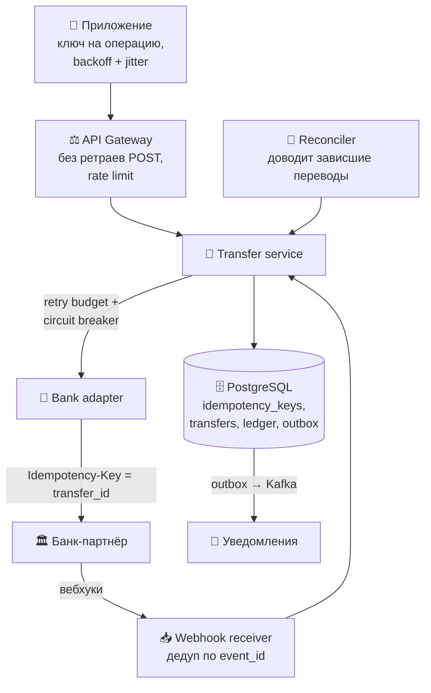
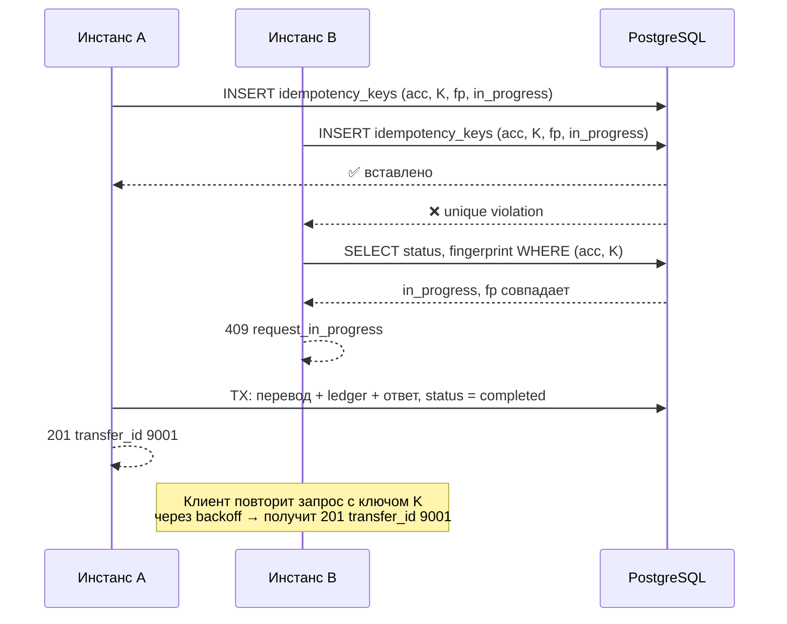
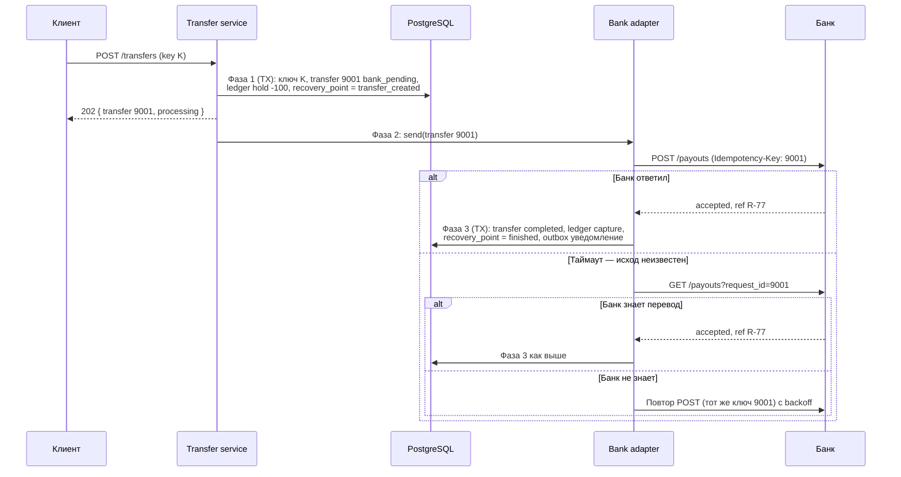
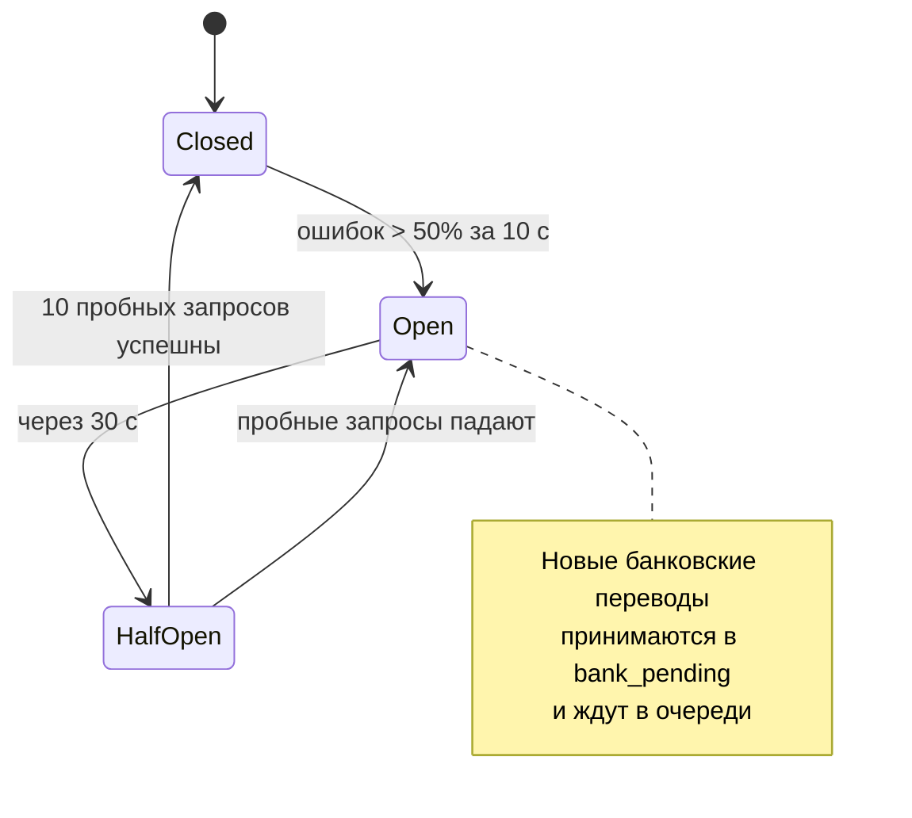

[English](INTERVIEW.md) | **Русский** · Теория: [README_RU.md](./README_RU.md)

# 10. Idempotency: API переводов, которое безопасно ретраить

> **Тема:** двойные переводы из-за ретраев, idempotency keys, атомарные фазы и точки восстановления, конкурентные дубли, внешний банк с неизвестным исходом, ретраи с backoff и jitter, retry storm, retry budget, circuit breaker, вебхуки
> **Уровень:** Medium–Hard · **Время на интервью:** 45 мин · **Время на разбор:** ~4 ч
> **Где спрашивают:** «Спроектируй платёжный API / переводы / Stripe», а также как deep dive в любой задаче, где есть деньги или внешние вызовы

---

## 🗺️ Как читать этот разбор

| Значок | Что значит |
|:------:|:-----------|
| 🎤 | Реплика интервьюера |
| 🗣️ | Что говорю вслух я (кандидат) |
| ✏️ | Что рисую на доске |
| ⏱️ | Сколько времени тратить на шаг |

Блоки **TIP** — хороший приём, **WARNING** — ловушка, **IMPORTANT** — сигнал для уровня Senior+.

---

## 📑 Содержание

1. [Условие задачи](#1-условие-задачи)
2. [Уточняющие вопросы и требования](#2-уточняющие-вопросы-и-требования)
3. [Оценки нагрузки](#3-оценки-нагрузки)
4. [Откуда берутся дубли](#4-откуда-берутся-дубли)
5. [API](#5-api)
6. [Модель данных](#6-модель-данных)
7. [High-level дизайн](#7-high-level-дизайн)
8. [Deep dive 1: обработка idempotency key](#8-deep-dive-1-обработка-idempotency-key)
9. [Deep dive 2: перевод через внешний банк — атомарные фазы](#9-deep-dive-2-перевод-через-внешний-банк--атомарные-фазы)
10. [Deep dive 3: клиент на плохой сети](#10-deep-dive-3-клиент-на-плохой-сети)
11. [Deep dive 4: retry storm при сбое банка](#11-deep-dive-4-retry-storm-при-сбое-банка)
12. [Deep dive 5: вебхуки банка и уведомления](#12-deep-dive-5-вебхуки-банка-и-уведомления)
13. [Узкие места и сценарии сбоев](#13-узкие-места-и-сценарии-сбоев)
14. [Что изменится при росте в 10 раз](#14-что-изменится-при-росте-в-10-раз)
15. [Вопросы интервьюера с ответами](#15-вопросы-интервьюера-с-ответами)
16. [Типичные ошибки](#16-типичные-ошибки)
17. [Шпаргалка и самопроверка](#17-шпаргалка-и-самопроверка)

---

## 1. Условие задачи

> 🎤 «У нас мобильное приложение для переводов между людьми, как Venmo или Revolut. Две проблемы:
> 1. Пользователи в метро и на плохой сети жалуются на **двойные переводы** — поддержка вручную делает возвраты.
> 2. Когда у банка-партнёра был 10-минутный сбой, наш сервис лёг на час: после восстановления банк снова упал под **волной наших ретраев**.
>
> Перепроектируй API переводов так, чтобы это не повторялось».

**План по времени:**

| Шаг | ⏱️ |
|:----|:--:|
| Требования | 5 мин |
| Оценки и источники дублей | 5 мин |
| API и модель данных | 7 мин |
| High-level дизайн | 3 мин |
| Deep dives | 20 мин |
| Сбои и итоги | 5 мин |

> [!TIP]
> Задача содержит **две разные** проблемы: корректность (дубли → идемпотентность) и устойчивость (retry storm → backoff, jitter, бюджеты, circuit breaker). Назови обе в начале и распредели время между ними.

---

## 2. Уточняющие вопросы и требования

⏱️ 5 мин

| Мой вопрос | Ответ интервьюера | Что это меняет |
|:-----------|:------------------|:---------------|
| Переводы внутри нашей системы или через банк? | Внутренние (между нашими пользователями) — мгновенные; на внешнюю карту или счёт — через банк-партнёр | Два пути: локальная транзакция и внешний вызов |
| Поддерживает ли банк idempotency key? | Да, по нашему `request_id`; есть API запроса статуса | Можно безопасно повторять вызов банка |
| Сколько длится перевод через банк? | Обычно 1–3 с, иногда до 30 с, иногда ответ не приходит | Нельзя держать HTTP-запрос клиента и транзакцию всё это время |
| Какие клиенты? | iOS, Android, веб; часто плохая сеть | Ретраи на клиенте неизбежны; ключ должен переживать перезапуск приложения |
| Двойной перевод допустим хоть иногда? | Никогда | Защита в несколько слоёв |
| Как пользователь узнаёт результат? | Экран статуса + push | Асинхронный статус для банковских переводов |

### Функциональные требования

1. Перевести деньги другому пользователю (мгновенно) или на внешнюю карту (через банк).
2. Посмотреть статус перевода.
3. Получить уведомление о результате.

### Нефункциональные требования

| Требование | Цель |
|:-----------|:-----|
| Корректность | Ни одного двойного перевода при любых повторах, обрывах, двойных нажатиях |
| Latency | Внутренний перевод p99 < 500 мс; банковский — ответ «принят» < 500 мс, результат — асинхронно |
| Устойчивость | Сбой банка не валит наш сервис и не продлевается из-за наших ретраев |
| Восстановление | После сбоя банка зависшие переводы доводятся автоматически |

---

## 3. Оценки нагрузки

⏱️ 2 мин

✏️

```
Переводы             = 10M/день → ~120/с в среднем, пик ~1 000/с
Из них через банк    ≈ 30% → ~300/с в пике
Повторы с клиента    ≈ 2–5% запросов (плохая сеть) — и это то, что даёт дубли

Idempotency keys     = 10M/день × ~1 КБ (с сохранённым ответом), хранить 7 дней ≈ 70 ГБ
Ретраи без защиты    = клиент 3 × gateway 3 × сервис 3 = до 27 вызовов банка на один перевод
```

🗣️ «Нагрузка небольшая — главный вопрос не масштаб, а **корректность при повторах**. 70 ГБ ключей спокойно живут в той же PostgreSQL, что и переводы, — в отдельной таблице, партиционированной по дню».

---

## 4. Откуда берутся дубли

⏱️ 3 мин

🗣️ «Прежде чем лечить, найду все источники повторов»:

| Источник | Как возникает |
|:---------|:--------------|
| Двойное нажатие | Пользователь нажал «Отправить» дважды |
| Ретрай клиента после таймаута | Перевод прошёл, ответ потерялся в метро → приложение повторило |
| Перезапуск приложения | Приложение убито системой во время запроса → при открытии отправляет снова |
| Ретраи HTTP-библиотеки / gateway / mesh | Автоматические повторы на промежуточных уровнях |
| Ретраи нашего сервиса к банку | Таймаут от банка → повторный вызов |
| Повторные вебхуки банка | Банк доставляет at-least-once |

> [!IMPORTANT]
> **Сигнал Senior+:** каждый из этих источников нужно закрыть **своим** механизмом. Блокировка кнопки закрывает только первый. Idempotency key от клиента — первые четыре. Ключ к банку — пятый. Дедупликация вебхуков — шестой.

---

## 5. API

⏱️ 3 мин

```http
POST /v1/transfers
Headers:
  Authorization: Bearer <token>
  Idempotency-Key: 5d1c8f0e-9b7a-4e6f-a3c2-7f1b2e8d9c40
Body:
  { "to_user_id": "u_77", "amount": "100.00", "currency": "EUR", "note": "ужин" }

Ответы:
  201 { transfer_id, status: "completed" }            ← внутренний перевод
  202 { transfer_id, status: "processing" }           ← банковский, результат позже
  409 { error: "request_in_progress" }                ← тот же ключ ещё обрабатывается
  422 { error: "idempotency_key_reused" }             ← тот же ключ, другое тело
  503 + Retry-After                                   ← перегрузка, повторить позже

Повтор с тем же ключом → тот же код и тело, что и в первый раз

GET /v1/transfers/{transfer_id}  → { status, amount, created_at, failure_reason? }
```

🗣️ «Ключевой момент: ответ на повтор **идентичен** первому, включая `transfer_id`. Клиенту не нужно отличать «первый раз» от «повтора» — он просто получает результат».

---

## 6. Модель данных

⏱️ 4 мин

```sql
CREATE TABLE idempotency_keys (
  account_id      BIGINT      NOT NULL,
  idem_key        UUID        NOT NULL,
  fingerprint     BYTEA       NOT NULL,        -- sha256(method + path + body)
  status          TEXT        NOT NULL,        -- in_progress | completed
  recovery_point  TEXT        NOT NULL,        -- started | transfer_created | bank_called | finished
  transfer_id     BIGINT,
  response_code   INT,
  response_body   JSONB,
  locked_at       TIMESTAMPTZ,
  created_at      TIMESTAMPTZ NOT NULL DEFAULT now(),
  PRIMARY KEY (account_id, idem_key)
) PARTITION BY RANGE (created_at);              -- старые партиции удаляются через 7 дней

CREATE TABLE transfers (
  transfer_id     BIGINT PRIMARY KEY,           -- он же idempotency key для банка
  from_account    BIGINT NOT NULL,
  to_account      BIGINT,
  external_dest   TEXT,
  amount          NUMERIC(18,2) NOT NULL,
  status          TEXT NOT NULL,                -- pending | bank_pending | completed | failed
  bank_reference  TEXT UNIQUE,
  created_at      TIMESTAMPTZ NOT NULL
);

CREATE TABLE ledger_entries (                   -- двойная запись: сумма проводок перевода = 0
  entry_id     BIGINT PRIMARY KEY,
  transfer_id  BIGINT NOT NULL,
  account_id   BIGINT NOT NULL,
  amount       NUMERIC(18,2) NOT NULL,          -- минус у отправителя, плюс у получателя
  kind         TEXT NOT NULL,                   -- hold | capture | release
  UNIQUE (transfer_id, account_id, kind)        -- последняя линия защиты от дублей проводок
);
```

🗣️ «Три слоя защиты в данных:
1. **`PRIMARY KEY (account_id, idem_key)`** — один ключ на клиента;
2. **`transfer_id` как ключ для банка** — повторный вызов банка не создаёт второй перевод;
3. **`UNIQUE (transfer_id, account_id, kind)`** в ledger — даже баг в коде не создаст две проводки одного вида для одного перевода».

---

## 7. High-level дизайн

⏱️ 3 мин

✏️



🗣️ «Ретраи разрешены ровно в двух местах: **клиент** (для своих запросов к нам, с idempotency key) и **bank adapter** (для запросов к банку, с ключом `transfer_id`, бюджетом и circuit breaker). Gateway и HTTP-библиотеки внутри **не ретраят** `POST`».

---

## 8. Deep dive 1: обработка idempotency key

> 🎤 «Пользователь нажал «Отправить» дважды за 50 мс. Оба запроса с одним ключом пришли на разные инстансы. Что будет?»



### Алгоритм

```
1. INSERT ключа с status = in_progress, locked_at = now()
   ├─ вставлено → выполняем операцию (шаг 2)
   └─ конфликт → читаем существующую запись:
        ├─ fingerprint другой              → 422 idempotency_key_reused
        ├─ completed                        → вернуть сохранённый response
        ├─ in_progress, locked_at свежий    → 409 request_in_progress
        └─ in_progress, locked_at старый    → забрать блокировку (UPDATE ... WHERE locked_at = old)
                                              и продолжить с recovery_point
2. Выполнить операцию по фазам (deep dive 2)
3. Сохранить response_code, response_body, status = completed
```

### Какие ответы сохранять

| Исход | Сохранить? | Почему |
|:------|:----------:|:-------|
| Успех (`201`, `202`) | ✅ | Повтор должен получить тот же `transfer_id` |
| Ошибка бизнес-логики (недостаточно средств, `422`) | ✅ | Повтор с тем же ключом должен получить тот же ответ; новая попытка — новый ключ |
| Временная ошибка **до** любых изменений (БД недоступна) | ❌ Ключ удаляется или помечается для повтора | Повтор должен выполнить операцию заново |
| Сбой **после** частичных изменений | Сохраняется `recovery_point` | Повтор продолжает, а не начинает заново |

> [!WARNING]
> Не сохраняй как «окончательный» ответ временную ошибку `503`, если операция при этом не началась. Иначе клиент будет вечно получать `503` на повторы с этим ключом и перевод никогда не выполнится.

---

## 9. Deep dive 2: перевод через внешний банк — атомарные фазы

> 🎤 «Перевод на внешнюю карту: банк отвечает до 30 секунд и иногда не отвечает вообще. Как это сделать идемпотентно?»

🗣️ «Внешний вызов нельзя откатить, поэтому нельзя держать его внутри транзакции. Разбиваю операцию на **атомарные фазы**, каждая заканчивается записью точки восстановления».



### Почему сначала `202`

🗣️ «Клиент получает `202 processing` сразу после фазы 1 — не ждёт банк. Повтор клиента с ключом K вернёт тот же `202` и `transfer_id`; статус клиент узнаёт через `GET` или push. Так банк с ответом в 30 секунд не держит соединение мобильного клиента и не провоцирует его ретраи».

### Неизвестный исход

| Ситуация | Действие |
|:---------|:---------|
| Банк ответил успехом | Фаза 3: capture, уведомление |
| Банк ответил окончательной ошибкой (неверная карта) | Фаза 3: release удержания, перевод failed, уведомление |
| Таймаут | **Сначала запросить статус** по `request_id`; если банк перевод не видел — повторить с тем же ключом |
| Сервис упал между фазами | **Reconciler** находит переводы в `bank_pending` старше N минут и доводит их с точки восстановления |
| Банк недоступен долго | Переводы остаются `bank_pending`; удержание держит деньги; через SLA (например, 24 ч) — release и failed с уведомлением |

> [!IMPORTANT]
> **Сигнал Senior+:** «Ключ к банку — `transfer_id`, а не idempotency key клиента. Он стабилен, известен до первого вызова и сохранён в нашей базе — значит, любой процесс (повтор клиента, reconciler, другой инстанс) повторит вызов с тем же ключом». Плюс ежедневная **сверка** с выпиской банка как последняя линия защиты.

---

## 10. Deep dive 3: клиент на плохой сети

> 🎤 «Как должно вести себя мобильное приложение?»

🗣️

| Правило | Зачем |
|:--------|:------|
| Ключ генерируется **при нажатии «Отправить»**, а не при каждой HTTP-попытке | Все попытки — одна операция |
| Ключ и тело запроса сохраняются **локально** (в базе приложения) до окончательного ответа | После убийства приложения и перезапуска — повтор с тем же ключом, а не новый перевод |
| Кнопка блокируется, показывается «Отправляем…» | Убирает большинство двойных нажатий (но не заменяет серверную защиту) |
| Ретраи: таймауты, обрывы, `409`, `429`, `5xx` | `409` — «ещё выполняется», повтор позже вернёт результат |
| Не ретраить: `400`, `401`, `403`, `422` | Повтор не поможет |
| Exponential backoff + full jitter, максимум 5 попыток, общий дедлайн ~30 с | Не создавать синхронных волн |
| `Retry-After` имеет приоритет | Сервер знает лучше |
| После дедлайна — экран «Проверяем статус» и `GET /transfers?idempotency_key=K` | Пользователь не нажимает «Отправить» снова вслепую |

```kotlin
// Псевдокод клиента
val key = pendingStore.getOrCreateKey(draftTransfer)      // переживает перезапуск
val result = retry(maxAttempts = 5, base = 200.ms, cap = 5.s, deadline = 30.s, jitter = FULL) {
    api.createTransfer(draftTransfer, idempotencyKey = key)
}
pendingStore.markDone(key, result)
```

> [!TIP]
> Хорошая UX-деталь: если пользователь создаёт **точно такой же** перевод тому же человеку через минуту, это может быть намеренно (вторая оплата). Не дедуплицируй по содержимому — только по ключу. Но можно спросить подтверждение: «Вы уже отправили 100 € Анне минуту назад. Отправить ещё раз?»

---

## 11. Deep dive 4: retry storm при сбое банка

> 🎤 «Вернёмся ко второй проблеме: банк упал на 10 минут, а мы лежали час. Почему?»

🗣️ «Типичная картина retry storm:

```
Нормально:    300 вызовов банка/с
Сбой банка:   каждый запрос → таймаут 30 с → ретраи на 3 уровнях
              клиент × gateway × сервис = до 27 вызовов на перевод
              + новые переводы продолжают приходить
              → потоки и соединения нашего сервиса заняты ожиданием таймаутов
              → наш сервис перестаёт отвечать и на внутренние переводы
Банк поднялся: на него обрушивается накопленная волна (тысячи запросов/с синхронно)
              → банк падает снова
```

Исправления по слоям:

| Проблема | Исправление |
|:---------|:------------|
| Ретраи на трёх уровнях | Ретраи только на клиенте и в bank adapter; gateway и HTTP-клиенты внутри — без ретраев `POST` |
| Синхронные волны повторов | Exponential backoff + **full jitter** |
| Ретраи растут вместе со сбоем | **Retry budget**: ретраи к банку ≤ 10% от числа первичных вызовов |
| Ожидание таймаутов занимает потоки | Таймаут к банку по p99.9 (например, 5 с), а не 30 с; отдельный пул потоков для банка (bulkhead) |
| Продолжаем слать запросы в мёртвый банк | **Circuit breaker**: после N% ошибок — open, запросы не идут в банк |
| Банковские переводы мешают внутренним | Изоляция: внутренние переводы не зависят от bank adapter |
| Пользователь не знает, что происходит | При open breaker банковские переводы принимаются в `bank_pending` и ставятся в очередь; пользователь видит «Банк временно недоступен, перевод выполнится позже» |
| Волна после восстановления | Half-open: пропускаем немного запросов; reconciler разбирает очередь **с ограничением скорости** |



> [!WARNING]
> Circuit breaker без очереди просто превращает «таймаут» в «мгновенную ошибку» для пользователя. Для денег правильнее **принять** перевод (деньги удержаны, статус «в обработке») и выполнить его, когда банк вернётся, — с ограничением скорости, чтобы не устроить новую волну.

---

## 12. Deep dive 5: вебхуки банка и уведомления

> 🎤 «Банк присылает вебхук о завершении перевода. Иногда дважды, иногда раньше, чем ответил на наш запрос».

🗣️

| Правило | Реализация |
|:--------|:-----------|
| Дедупликация по `bank_event_id` | Таблица `processed_webhooks` с UNIQUE, вставка в той же транзакции, что и обновление перевода |
| Проверка подписи | HMAC с секретом банка, иначе `401` |
| Быстрый ответ `200` | Сохранить событие и обработать асинхронно — иначе банк ретраит по таймауту |
| Порядок не гарантирован | Переходы состояния условные: `UPDATE transfers SET status = 'completed' WHERE transfer_id = $1 AND status = 'bank_pending'` — вебхук и ответ на запрос сходятся к одному результату, кто бы ни пришёл первым |
| Неизвестный `request_id` | Сохранить и разобрать через reconciler (возможно, наш перевод ещё не закоммичен) |

### Наши уведомления пользователям

- Push и письмо о результате — из **outbox** в той же транзакции, что и фаза 3.
- Уведомление несёт `transfer_id`; сервис уведомлений дедуплицирует по `(transfer_id, тип)` — двойной push «Перевод выполнен» не уйдёт.

---

## 13. Узкие места и сценарии сбоев

| Сценарий | Что произойдёт | Как защищаемся |
|:---------|:---------------|:---------------|
| Двойное нажатие | Два запроса с одним ключом | UNIQUE на ключ, второй — `409`, затем тот же ответ |
| Ответ потерялся, клиент повторил | Повтор | Тот же ответ из таблицы ключей |
| Приложение убито во время запроса | Повтор после запуска | Ключ сохранён локально |
| Сервис упал после фазы 1 | Перевод в `bank_pending` без вызова банка | Повтор клиента или reconciler продолжает с точки восстановления |
| Таймаут от банка | Исход неизвестен | Запрос статуса, затем повтор с тем же `transfer_id` |
| Банк недоступен долго | Ошибки, риск retry storm | Circuit breaker, retry budget, очередь `bank_pending`, восстановление с ограничением скорости |
| Повторный вебхук | Двойная обработка | Дедупликация по `bank_event_id`, условные переходы |
| Баг: два вызова фазы 3 | Двойная проводка | `UNIQUE (transfer_id, account_id, kind)` в ledger |
| Ключ переиспользован с другим телом | Риск выполнить не то | `422` по отпечатку |
| Таблица ключей растёт | Место на диске | Партиционирование по дню, удаление через 7 дней |
| Расхождение с банком | Тихая ошибка | Ежедневная сверка с выпиской банка |

---

## 14. Что изменится при росте в 10 раз

> 🎤 «100 миллионов переводов в день и несколько банков-партнёров?»

🗣️ «Что меняется:
1. **Шардирование** переводов, ledger и ключей по `account_id` отправителя — ключ и перевод остаются в одном шарде, транзакции локальные.
2. **Bank adapter на каждого партнёра** со своими лимитами, бюджетами и circuit breaker; сбой одного банка не влияет на других.
3. **Маршрутизация** между банками: при открытом breaker у одного — перевод через другого (если это допустимо продуктом).
4. **Автоматическая сверка** с каждым банком в режиме, близком к реальному времени.
5. **Retry budget и rate limit** настраиваются динамически по данным о здоровье банка».

---

## 15. Вопросы интервьюера с ответами

<details>
<summary><b>Почему не дедуплицировать по содержимому запроса (кому, сколько, когда)?</b></summary>

Два одинаковых перевода могут быть намеренными (дважды оплатить одно и то же). Дедупликация по содержимому отбросит законную операцию. Idempotency key выражает намерение клиента: «это одна и та же операция». Содержимое используется только как отпечаток, чтобы обнаружить повторное использование ключа для другого запроса.
</details>

<details>
<summary><b>Почему ключи в PostgreSQL, а не в Redis?</b></summary>

Ключ, перевод, проводки и сохранённый ответ записываются в одной транзакции — либо всё, либо ничего. В Redis возможно состояние «ключ записан, перевода нет» или наоборот, а также потеря ключей при failover с асинхронной репликацией. Для денег это неприемлемо. При 1 000 запросов в секунду PostgreSQL справляется без проблем.
</details>

<details>
<summary><b>Сколько хранить ключи?</b></summary>

Дольше, чем клиент может повторять операцию, с запасом: клиент ретраит до 30 секунд, но приложение может быть закрыто и открыто через несколько дней с незавершённым запросом. Беру 7 дней. После истечения повтор с тем же ключом выполнится как новый запрос — поэтому клиент не должен хранить незавершённые ключи дольше TTL сервера.
</details>

<details>
<summary><b>Почему клиент получает 409, а не ждёт завершения первого запроса?</b></summary>

Ожидание держит соединение и поток сервера, а первый запрос может длиться долго. `409` с `Retry-After` дешевле: клиент повторит через backoff и получит готовый ответ. Для коротких операций можно и подождать до небольшого таймаута — это компромисс между простотой клиента и ресурсами сервера.
</details>

<details>
<summary><b>Что если банк не поддерживает idempotency key?</b></summary>

Тогда перед повтором обязательно запрашивать статус по нашему идентификатору (если банк позволяет передать свой reference), повторять только при уверенности, что операции нет, и опираться на ежедневную сверку. Если и статуса нет — не ретраить автоматически, а переводить в ручной разбор. Это стоит явно назвать как риск интеграции.
</details>

<details>
<summary><b>Зачем retry budget, если есть circuit breaker?</b></summary>

Они дополняют друг друга. Circuit breaker реагирует на высокий процент ошибок и полностью отключает вызовы. Retry budget ограничивает дополнительную нагрузку от ретраев всегда, в том числе при частичной деградации, когда ошибок недостаточно для открытия breaker, но ретраи уже заметно увеличивают нагрузку.
</details>

---

## 16. Типичные ошибки

| ❌ Ошибка | ✅ Как правильно |
|:---------|:----------------|
| Только блокировка кнопки | Idempotency key на сервере + уникальные ограничения |
| Новый ключ на каждую HTTP-попытку | Ключ на операцию, сохранённый локально |
| Ключи в Redis отдельно от транзакции | В той же базе и транзакции, что и перевод |
| Вызов банка внутри транзакции | Атомарные фазы, вызов между транзакциями |
| Клиентский ключ как ключ для банка | `transfer_id` — стабильный, известен до вызова |
| Таймаут банка = «не выполнено» → повторить | Сначала запросить статус |
| Сохранить `503` как окончательный ответ | Временные ошибки до изменений не фиксируют ключ |
| Ретраи на клиенте, gateway и в сервисе | Ретраи на одном уровне для каждой связи |
| Backoff без jitter, таймаут 30 с | Full jitter, таймаут по p99.9, retry budget, circuit breaker |
| Обрабатывать вебхук синхронно и без дедупликации | Быстрый `200`, дедуп по event_id, условные переходы |

---

## 17. Шпаргалка и самопроверка

### Ответ за 30 секунд

> Клиент генерирует idempotency key при нажатии «Отправить», хранит его локально и использует во всех повторах. Сервер вставляет ключ с отпечатком запроса в ту же PostgreSQL, что и переводы: конфликт с другим отпечатком — 422, в процессе — 409, завершён — тот же ответ. Банковский перевод — атомарные фазы: транзакция с удержанием и `202`, вызов банка с ключом `transfer_id`, транзакция с результатом; при таймауте — сначала запрос статуса; reconciler доводит зависшие. UNIQUE в ledger — последняя линия защиты. Ретраи — только на клиенте и в bank adapter, exponential backoff с full jitter, дедлайн, retry budget 10%, circuit breaker с очередью `bank_pending` и восстановлением с ограничением скорости. Вебхуки — дедуп по event_id и условные переходы.

### Самопроверка

- [ ] Могу перечислить 6 источников дублей и механизм для каждого
- [ ] Могу описать алгоритм обработки ключа, включая 409 и 422
- [ ] Могу объяснить, какие ответы сохранять, а какие нет
- [ ] Могу нарисовать атомарные фазы банковского перевода с точками восстановления
- [ ] Могу объяснить, почему ключ к банку — `transfer_id`
- [ ] Могу описать поведение мобильного клиента на плохой сети
- [ ] Могу объяснить механику retry storm и исправления по слоям
- [ ] Могу описать безопасную обработку вебхуков

### Что почитать

- Теория по теме: [README_RU.md](./README_RU.md)
- Brandur Leach, *Implementing Stripe-like Idempotency Keys in Postgres*
- Amazon Builders' Library: *Making retries safe with idempotent APIs*
- Marc Brooker, *Exponential Backoff And Jitter*
- Документация Stripe API: Idempotent requests