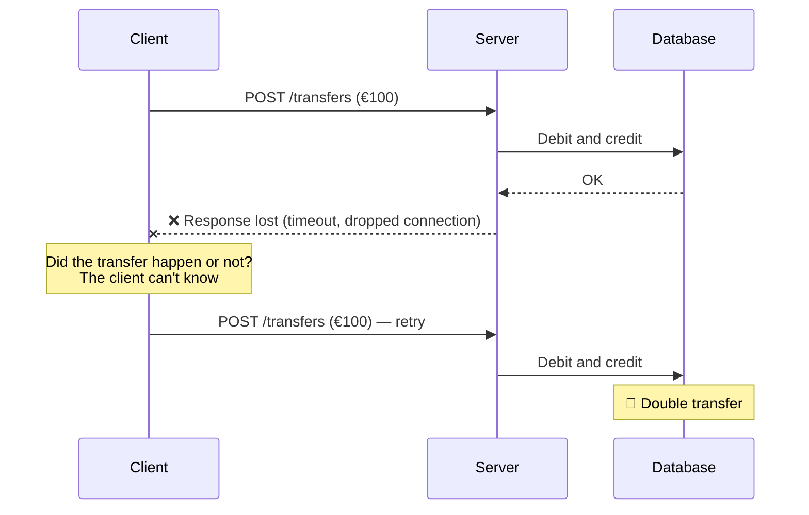
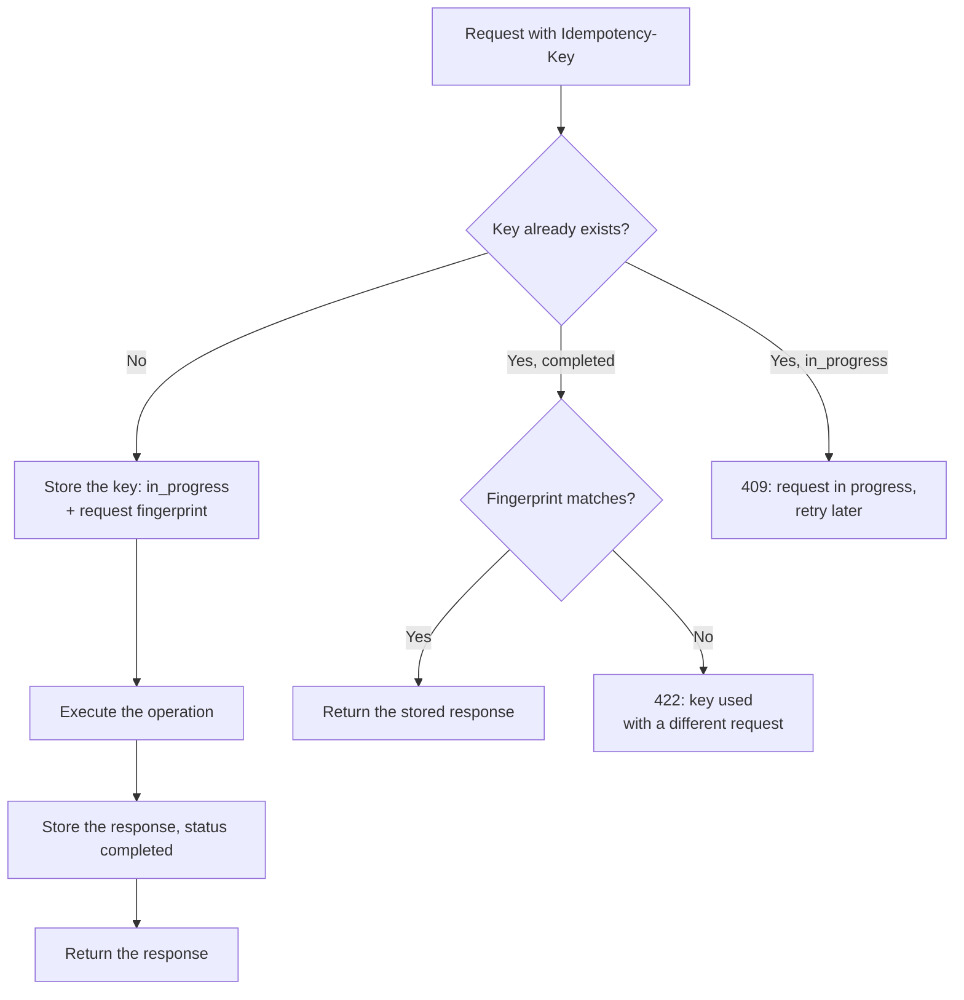
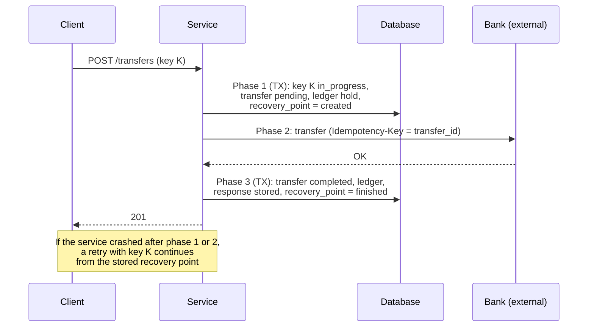
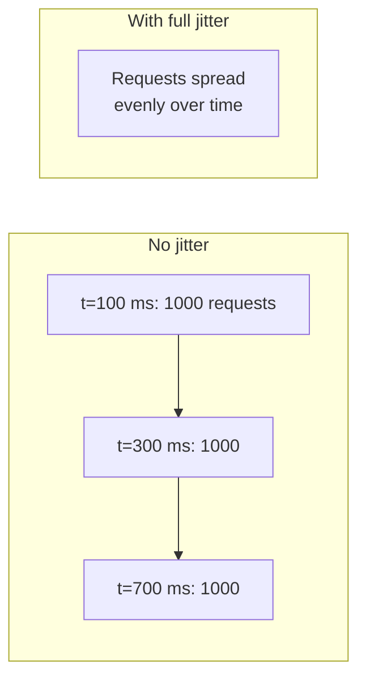
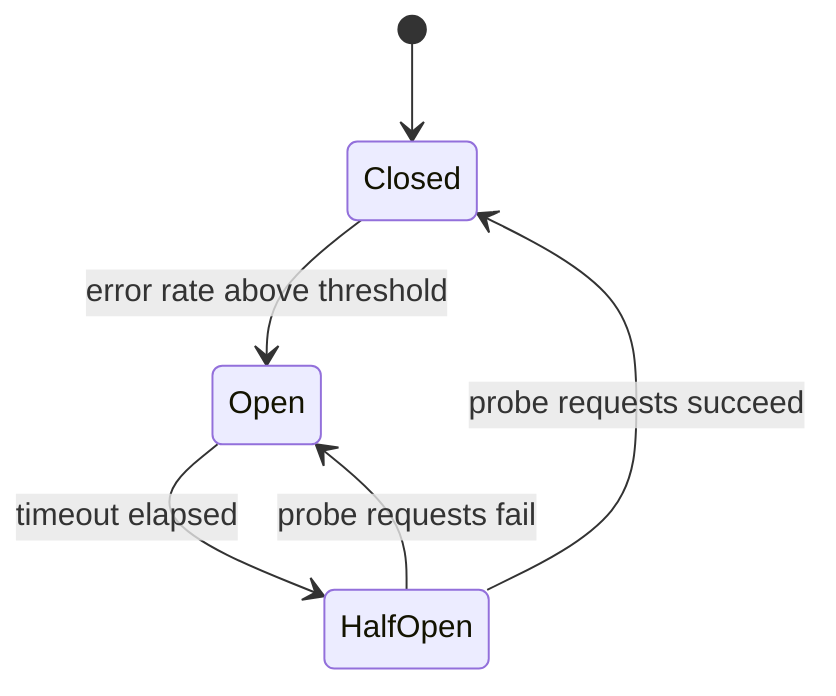

**English** | [Русский](README.ru.md)

# 10. Idempotency and Retries

> **Covers:** why retries are inevitable, HTTP method idempotency, naturally idempotent API design, idempotency keys (Stripe-style), atomic phases and recovery points, deduplication at different layers, when and where to retry, exponential backoff and jitter, retry budgets, circuit breakers, webhooks
> **Study time:** ~4 h · **Needed for:** payments, any API with mutating operations, mobile clients, integrations with external services
> **Practice:** interview-style walkthrough — [INTERVIEW.md](./INTERVIEW.md)
> **Related topics:** [09-messaging](../09_Messaging/README.md#6-idempotent-consumers) (idempotent consumers), [04-databases](../04_Databases/README.md#11-concurrency-control-locks-mvcc-optimistic-approach), [08-consensus](../08_Consensus/README.md#10-split-brain-and-fencing-tokens)

---

## 📑 Contents

1. [Why Retries Are Inevitable](#1-why-retries-are-inevitable)
2. [What Idempotency Is](#2-what-idempotency-is)
3. [Naturally Idempotent API Design](#3-naturally-idempotent-api-design)
4. [Idempotency Keys](#4-idempotency-keys)
5. [Implementation: Atomicity and Recovery Points](#5-implementation-atomicity-and-recovery-points)
6. [Deduplication at Different Layers](#6-deduplication-at-different-layers)
7. [When and Where to Retry](#7-when-and-where-to-retry)
8. [Exponential Backoff and Jitter](#8-exponential-backoff-and-jitter)
9. [Timeouts, Retry Budgets and Circuit Breakers](#9-timeouts-retry-budgets-and-circuit-breakers)
10. [Idempotency in Workflows and Webhooks](#10-idempotency-in-workflows-and-webhooks)
11. [How to Talk About This in an Interview](#11-how-to-talk-about-this-in-an-interview)
12. [Self-Check Questions](#12-self-check-questions)
13. [Glossary and Resources](#13-glossary-and-resources)

---

## 1. Why Retries Are Inevitable

In a distributed system a request has **three** outcomes, not two: success, failure and **unknown**.



A timeout doesn't mean "the request wasn't executed" — it means "no response was received". The server may have:
- never received the request;
- received it and crashed before processing;
- processed it and lost the response;
- still be processing it.

**The only way to learn the outcome is to retry.** And for a retry to be safe, the operation must be **idempotent**.

> [!IMPORTANT]
> Retries happen at every layer, often without your knowledge: a mobile client switching networks, an HTTP library, a load balancer, a service mesh, a cloud SDK, a user tapping a button twice. So the question isn't "will there be retries" but "what happens on a retry".

---

## 2. What Idempotency Is

**An operation is idempotent** if performing it many times has **the same effect** as performing it once.

```
f(f(x)) = f(x)
```

| Operation | Idempotent? | Why |
|:----------|:-----------:|:----|
| `SET balance = 100` | ✅ | A repeat leaves the same value |
| `balance = balance + 100` | ❌ | Each repeat adds another 100 |
| `DELETE user 42` | ✅ | After the first time the user is gone; a repeat changes nothing |
| "Send an email" | ❌ | Each repeat sends a new email |
| `INSERT ... ON CONFLICT DO NOTHING` | ✅ | The row won't be inserted twice |
| "Move status pending → paid" (conditionally) | ✅ | If already `paid`, the condition fails |

> [!NOTE]
> Idempotency is about the **effect on state**, not about an identical **response**. The first `DELETE /users/42` returns `204`, the second `404`, but the system state is the same. For client convenience, people often make the response identical too — that's what idempotency keys do.

### HTTP methods (RFC 9110)

| Method | Safe (doesn't change state) | Idempotent |
|:-------|:---------------------------:|:----------:|
| `GET`, `HEAD`, `OPTIONS` | ✅ | ✅ |
| `PUT` | ❌ | ✅ (full resource replacement) |
| `DELETE` | ❌ | ✅ |
| `POST` | ❌ | ❌ |
| `PATCH` | ❌ | ❌ (depends on the patch format) |

Many clients, proxies and libraries **automatically retry** idempotent methods. So a `GET` with side effects or a non-idempotent `PUT` is a source of subtle bugs.

---

## 3. Naturally Idempotent API Design

The best idempotency key is one you don't need, because the operation is idempotent by nature.

| Technique | Instead of | Do |
|:----------|:-----------|:---|
| **Setting a value instead of incrementing** | `POST /cart/items/42/increment` | `PUT /cart/items/42 { qty: 3 }` |
| **A client-generated ID** | `POST /orders` → the server creates the ID | `PUT /orders/{client_uuid}` — a repeat creates the same resource or does nothing |
| **Conditional requests** | Overwriting without a check | `If-Match: "<etag>"` or `WHERE version = $v` — a repeat after success won't apply |
| **State machine transitions** | "Mark as paid" unconditionally | `UPDATE ... SET status = 'paid' WHERE status = 'pending'` |
| **Uniqueness constraints** | Checking in code before inserting | `UNIQUE (order_id)` in the payments table — a second payment for an order is impossible |
| **Sets instead of lists** | "Append a tag" to an array | A set of tags: adding again changes nothing |

```http
# Creation with a client-generated ID: retries are safe
PUT /v1/orders/7f3c9e2a-41b8-4c1d-9a2f-1c2b3d4e5f60
{ "items": [...], "address_id": "a_12" }

→ 201 Created (first time)
→ 200 OK, the same order (retry)
```

> [!TIP]
> In an interview, first try to make an operation **naturally idempotent** (a client ID, a conditional write, a unique constraint). An idempotency key is the universal mechanism for operations that can't be made so: "transfer money", "send a message", "start a job".

---

## 4. Idempotency Keys

The client generates a **unique key per logical operation** and sends it with every retry. The server remembers the result of the first execution and returns it on retries.

```http
POST /v1/transfers
Idempotency-Key: 5d1c8f0e-9b7a-4e6f-a3c2-7f1b2e8d9c40
Content-Type: application/json

{ "to": "u_77", "amount": "100.00", "currency": "EUR" }
```

This is how the Stripe, Adyen, PayPal and many other APIs work. The IETF has a draft standard for the `Idempotency-Key` header.

### How the server handles the key



### What to store

| Field | Why |
|:------|:----|
| `scope` (account, API client) + `key` | The key is unique per client, not globally |
| `request_fingerprint` | A hash of method, path and body — to detect reuse of the key for a **different** request |
| `status` | `in_progress` / `completed` |
| `locked_at` | When processing started — to recognize a "stuck" request |
| `recovery_point` | How far the operation got (see [section 5](#5-implementation-atomicity-and-recovery-points)) |
| `response_code`, `response_body` | What to return on a retry |
| `created_at` | For TTL-based deletion |

### Rules

| Question | Rule |
|:---------|:-----|
| Who generates the key | **The client**, once per logical operation (the "Send" tap), before the first attempt. It keeps the key until it gets a final response — even across app restarts |
| Format | A random UUID (v4 or v7); no business logic in the key |
| Same key, different body | A `422` error — almost always a client bug |
| Two concurrent requests with one key | The second gets `409 Conflict` (or waits for the first to finish) — never execute in parallel |
| How long to keep keys | Longer than the client may retry: usually 24 hours to a few days |
| Which responses to store | Final ones: success and validation/business errors (`4xx`). If the request failed with a transient error **before** any changes, the key can be released so a retry executes afresh |

> [!WARNING]
> The key must be **per operation, not per HTTP attempt**. If the client generates a new key on every retry, there's no idempotency. If one key is used for different operations (e.g. all of a user's transfers), the second transfer returns the first one's result.

---

## 5. Implementation: Atomicity and Recovery Points

The main difficulty is storing the key and performing the operation **consistently**. If the key is stored but the operation wasn't performed (or vice versa), a retry behaves incorrectly.

### The best case: everything in one transaction

If the operation is just a write to one database, keep the key **in the same database** and the same transaction:

```sql
BEGIN;
INSERT INTO idempotency_keys (account_id, key, fingerprint, status)
VALUES ($acc, $key, $fp, 'in_progress');
-- If the key already exists → unique violation → read the stored response and return it

INSERT INTO transfers (...) VALUES (...);
INSERT INTO ledger_entries (...) VALUES (...), (...);

UPDATE idempotency_keys
SET status = 'completed', response_code = 201, response_body = $json
WHERE account_id = $acc AND key = $key;
COMMIT;
```

All or nothing: a retry after a failure either finds the ready response or performs the operation from scratch.

### The hard case: external calls

If the operation calls an external service (a bank, a payment provider, email), one transaction isn't enough — an external call can't be rolled back. The solution is **atomic phases with recovery points** (the approach described by Brandur Leach of Stripe):



| Principle | Why |
|:----------|:----|
| Each phase is a local transaction ending with a `recovery_point` write | A retry knows where to resume |
| External calls happen **between** transactions, never inside | Don't hold locks during network calls |
| The external service gets **its own** idempotency key (stable, e.g. `transfer_id`) | A repeated external call doesn't create a second transfer |
| A background process (a completer / reaper) finishes stuck operations | The operation completes even if the client never retries |
| For an unknown external outcome — query the status first | If the external service can answer "what happened to operation X" |

### Database or Redis for keys

| | In the same database as the data | Separately in Redis |
|:-|:---------------------------------|:--------------------|
| Atomicity with the business write | ✅ One transaction | ❌ Two systems — an inconsistency window |
| Speed | Enough for most APIs | Higher |
| Durability | Same as the main database | Depends on persistence and failover settings |
| When | **The default**, especially for money | High load, operations that are naturally idempotent internally, keys as a "first filter" |

---

## 6. Deduplication at Different Layers

| Layer | Mechanism | Example |
|:------|:----------|:--------|
| **UI** | Disable the button after a tap | Protects against double clicks (doesn't replace server-side protection) |
| **Client** | One idempotency key per operation, persisted locally | A mobile app survives a restart |
| **API** | An idempotency keys table | The `Idempotency-Key` header |
| **Business logic** | Conditional state transitions, versions | `WHERE status = 'pending'` |
| **Database** | Uniqueness constraints | `UNIQUE (order_id)` for payments |
| **Broker** | Kafka's idempotent producer, SQS FIFO deduplication | The SQS FIFO deduplication window is 5 minutes |
| **Consumers** | A processed `event_id` table | See [09-messaging](../09_Messaging/README.md#6-idempotent-consumers) |
| **External calls** | Passing an idempotency key to the provider | Payment APIs |

> [!TIP]
> Protection is built in **layers**: the UI removes most accidental duplicates, the idempotency key handles network retries, and a unique constraint in the database is the last line of defense against bugs in the code.

### Deduplicating a large stream

For huge event streams (clicks, views), where an exact key table is expensive:
- a **deduplication window** — keep IDs only for the last N minutes;
- a **Bloom filter** — a compact probabilistic structure: "definitely not seen / maybe seen"; on "maybe", check an exact store or accept a small error;
- for analytics, **approximate** deduplication is often enough.

---

## 7. When and Where to Retry

### What to retry

| ✅ Retry | ❌ Don't retry |
|:--------|:--------------|
| Timeouts, dropped connections, connection resets | `400 Bad Request` — the request is wrong; a retry won't help |
| `429 Too Many Requests` (honoring `Retry-After`) | `401`, `403` — no permission |
| `502`, `503`, `504` | `404` (usually), a business `409` conflict, `422` validation |
| Errors explicitly marked as transient | Non-idempotent operations **without** an idempotency key |

### Where to retry: at one layer only

If retries are configured at every layer, they **multiply**:


```
3 × 3 × 3 = 27 downstream requests per user request
```

If the downstream is overloaded, retries increase its load **27×** — and finish it off. That's a **retry storm**.

**The rule:** retry at **one** layer, the one closest to the source of uncertainty (usually the direct caller of the overloaded service, or the end client), and have the other layers not retry or retry very sparingly.

### Honor the server's signals

- `Retry-After` in `429` and `503` responses — wait the specified time.
- A server under load should **fail fast** (`503`, `429`) rather than hold the connection until a timeout.
- **Deadlines:** if the user request has 200 ms left, there's no point starting an attempt that takes 1 s. Pass the remaining time down the chain (deadline propagation, as in gRPC).

---

## 8. Exponential Backoff and Jitter

### Exponential backoff

Each subsequent attempt waits longer: `delay = min(cap, base × 2^attempt)`.

| Attempt | base = 100 ms, cap = 10 s |
|:-------:|:-------------------------:|
| 1 | 100 ms |
| 2 | 200 ms |
| 3 | 400 ms |
| 4 | 800 ms |
| 5 | 1.6 s |
| ... | ... up to 10 s |

### Why jitter is needed

If a thousand clients got an error at the same moment (a downstream outage), then **without randomness** they all retry after 100 ms, then all after 200 ms… Load arrives in synchronized waves, and the service can't recover.



### Jitter variants

The classic analysis is Marc Brooker's "Exponential Backoff And Jitter" on the AWS Architecture Blog (2015).

| Variant | Formula | Properties |
|:--------|:--------|:-----------|
| **No jitter** | `min(cap, base × 2^n)` | Synchronized waves ❌ |
| **Full jitter** | `random(0, min(cap, base × 2^n))` | The best load spreading, a good default |
| **Equal jitter** | `t = min(cap, base × 2^n)`; `t/2 + random(0, t/2)` | A guaranteed minimum pause |
| **Decorrelated jitter** | `min(cap, random(base, previous × 3))` | Works well in practice; depends on the previous delay |

```python
import random, time

def call_with_retries(op, max_attempts=5, base=0.1, cap=10.0, deadline=None):
    for attempt in range(max_attempts):
        try:
            return op()
        except RetryableError as e:
            if attempt == max_attempts - 1:
                raise
            delay = random.uniform(0, min(cap, base * 2 ** attempt))   # full jitter
            if e.retry_after:
                delay = max(delay, e.retry_after)                        # honor the server
            if deadline and time.monotonic() + delay > deadline:
                raise                                                    # won't make it — don't try
            time.sleep(delay)
```

> [!TIP]
> Good defaults: **3–5 attempts**, base 50–200 ms, a cap of a few seconds, **full jitter**, an overall deadline for the whole operation, and `Retry-After` takes priority.

---

## 9. Timeouts, Retry Budgets and Circuit Breakers

Retries are safe only together with mechanisms that stop them from amplifying an outage.

### Timeouts

- **Always** set timeouts: connect and read. An "infinite" timeout turns a slow downstream into exhausted threads and connections in the caller.
- Choose the timeout from the downstream's latency distribution (e.g. slightly above p99.9), not by guesswork.
- The sum of timeouts and retries along the chain must fit within the request's deadline.

### Retry budget

Cap the share of retries relative to total requests, e.g. **no more than 10%**. While the downstream is healthy, there are few retries and the budget isn't exhausted. When it fails, retries quickly hit the budget, and their load doesn't snowball. Implemented as a token bucket: each successful request adds a fraction of a token, each retry spends one.

### Circuit breaker



| State | Behavior |
|:------|:---------|
| **Closed** | Requests flow normally; errors are counted |
| **Open** | Requests are rejected immediately (or go to a fallback) without calling the downstream — giving it time to recover |
| **Half-open** | A few probe requests are let through; based on the result, close or reopen |

### Hedged requests

For **idempotent reads** with strict tail-latency requirements: if no response arrives by p95, send the same request to another replica and take the first response (Dean, Barroso, "The Tail at Scale"). Only for idempotent operations and with a capped share — otherwise it's another source of extra load.

> [!NOTE]
> Reliability patterns in more depth (bulkheads, load shedding, graceful degradation) are covered in a separate topic. The key thing to remember here: **retries without backoff, jitter, a budget and a circuit breaker turn a partial outage into a full one**.

---

## 10. Idempotency in Workflows and Webhooks

### Multi-step workflows (sagas)

- Each step is idempotent with the key **(workflow ID, step number)**.
- Compensations are idempotent too — they're retried until they succeed.
- Workflow state is a state machine with conditional transitions.

### Background jobs and schedulers

- Schedulers usually guarantee **at-least-once**: a job can run twice (after a failure, on a leader change).
- A job must be idempotent: e.g. "accrue interest for 2026-11-30" keyed by `(account, date)`, not "accrue interest for yesterday".

### Webhooks

| Side | Rules |
|:-----|:------|
| **Sender** | At-least-once delivery with retries (exponential backoff + jitter, over hours or days); a unique `event_id` in every event; a request signature (HMAC); ordering isn't guaranteed — include the object's version or timestamp |
| **Receiver** | Respond `2xx` quickly and process asynchronously; **deduplicate by `event_id`**; verify the signature; don't rely on order — check the version or fetch the current state from the sender |

---

## 11. How to Talk About This in an Interview

### 30-second answer

> "A timeout doesn't mean 'not executed' — it means 'unknown', so retries are inevitable, and every mutating operation must be idempotent. Where possible I make it natural: client IDs, PUT instead of increments, conditional state transitions, unique constraints. For the rest — an idempotency key the client generates once per operation; the server stores the key, request fingerprint and response in the same database and transaction as the data; a concurrent duplicate gets 409, a different request with the same key gets 422. External calls happen between transactions, with recovery points and the service's own key for the provider. I retry only transient errors, at one layer, with exponential backoff and full jitter, a deadline, a retry budget and a circuit breaker."

### Questions to ask

1. What happens if this request executes twice?
2. Can the client distinguish "not executed" from "response lost"?
3. What external side effects does the operation have, and do they support an idempotency key?
4. At how many layers are retries configured, and how do they multiply?
5. What happens to the downstream if it slows down and every client starts retrying?

### Common mistakes

- A new idempotency key for each HTTP attempt.
- Keeping keys in Redis separately from a money transaction without understanding the inconsistency window.
- Retrying a `POST` without an idempotency key.
- Retries at every layer — a retry storm.
- Backoff without jitter.
- Retrying `400`, `401`, `422`.
- "Infinite" default timeouts.
- An external call inside a database transaction.
- Assuming a disabled button solves double taps.

---

## 12. Self-Check Questions

<details>
<summary><b>1. Why can't you assume a request wasn't executed after a timeout?</b></summary>

A timeout means no response was received. The server may not have received the request, may have received it and crashed, may have executed it and lost the response, or may still be executing it. The client can't tell these apart and must retry, so the operation must be idempotent.
</details>

<details>
<summary><b>2. Is DELETE idempotent if the second call returns 404?</b></summary>

Yes. Idempotency concerns the effect on state: after the first and the second call, the resource doesn't exist. The response may differ.
</details>

<details>
<summary><b>3. How do you make order creation idempotent without an idempotency key?</b></summary>

The client generates the order ID and uses `PUT /orders/{id}`: a retry either creates the same order or finds the existing one. The alternative is a unique constraint on the operation's natural key.
</details>

<details>
<summary><b>4. What should the server do if the same idempotency key arrives with a different body?</b></summary>

Return an error (usually `422`): it's reuse of a key for a different operation, almost always a client bug. Executing the new request or returning the old one's response would both be wrong.
</details>

<details>
<summary><b>5. What do you do with two concurrent requests that share a key?</b></summary>

Execute only one. The first stores the key with status `in_progress` (an insert with a unique constraint); the second sees this and gets `409 Conflict` with a suggestion to retry later, or waits for the first to finish and returns its response.
</details>

<details>
<summary><b>6. Why is it better to keep the key in the same database as the data?</b></summary>

Then storing the key, the business changes and the response happen in one transaction: all or nothing. With a separate store, a state is possible where the key is written but the operation isn't (or vice versa), and a retry behaves incorrectly.
</details>

<details>
<summary><b>7. What if the operation calls an external payment API?</b></summary>

Split it into atomic phases with recovery points: a local transaction → the external call (outside the transaction, with its own stable idempotency key for the provider) → a local transaction with the result. A retry resumes from the last point; a background process finishes stuck operations; for an unknown outcome — query the provider's status.
</details>

<details>
<summary><b>8. Why are retries at every layer dangerous?</b></summary>

They multiply: 3 layers with 3 attempts each give up to 27 downstream requests per user request. When the downstream is overloaded, this multiplies its load and prevents it from recovering (a retry storm).
</details>

<details>
<summary><b>9. Why do you need jitter if you already have exponential backoff?</b></summary>

Without randomness, clients that got an error at the same moment also retry at the same moment — in synchronized waves. Jitter spreads retries over time and smooths the load.
</details>

<details>
<summary><b>10. What is a retry budget?</b></summary>

A cap on the share of retries relative to total requests (e.g. 10%). When the downstream is healthy, the budget suffices; during a mass outage, retries quickly hit the limit and don't amplify the load.
</details>

---

## 13. Glossary and Resources

### Glossary

| Term | Meaning |
|:-----|:--------|
| Idempotency | Repeating an operation has the same effect as performing it once |
| Safe method | An HTTP method that doesn't change state |
| Idempotency key | A unique key for a logical operation, sent with every retry |
| Request fingerprint | A hash of method, path and body to check the key is used for the same request |
| Recovery point | The saved progress of a multi-phase operation |
| Deduplication | Discarding repeated messages or requests |
| Deduplication window | The period during which processed IDs are remembered |
| Exponential backoff | Exponentially growing delay between attempts |
| Jitter | A random component of the delay |
| Retry storm | An avalanche of retries that amplifies an outage |
| Retry budget | A cap on the share of retries |
| Circuit breaker | Automatically stopping calls to a failing service |
| Deadline propagation | Passing a request's remaining time down the chain |
| Hedged request | A duplicate request to another replica to cut tail latency |

### Resources

- Brandur Leach, *Designing robust and predictable APIs with idempotency* (Stripe Blog, 2017)
- Brandur Leach, *Implementing Stripe-like Idempotency Keys in Postgres* (2017)
- IETF HTTPAPI WG, *The Idempotency-Key HTTP Header Field* (Internet-Draft)
- RFC 9110 *HTTP Semantics* — safe and idempotent methods
- Marc Brooker, *Exponential Backoff And Jitter* (AWS Architecture Blog, 2015)
- Amazon Builders' Library: *Timeouts, retries, and backoff with jitter*; *Making retries safe with idempotent APIs*
- Jeffrey Dean, Luiz André Barroso, *The Tail at Scale* (Communications of the ACM, 2013)
- Google SRE Book — chapters "Handling Overload" and "Addressing Cascading Failures"
- Stripe API documentation: Idempotent requests