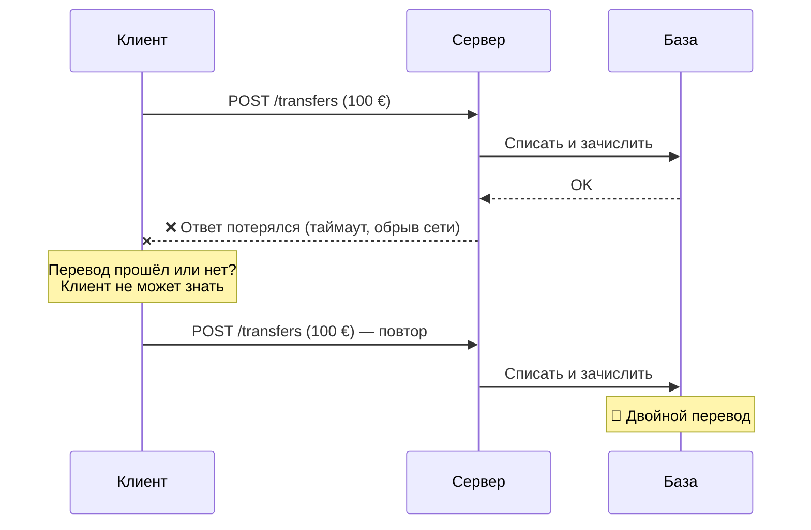
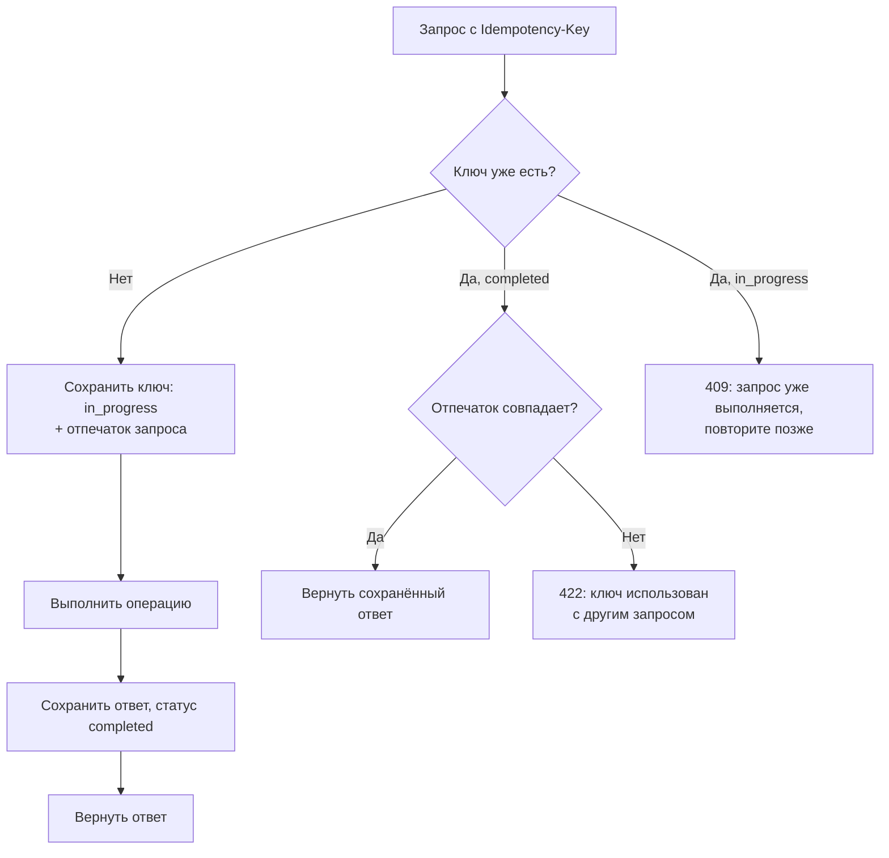
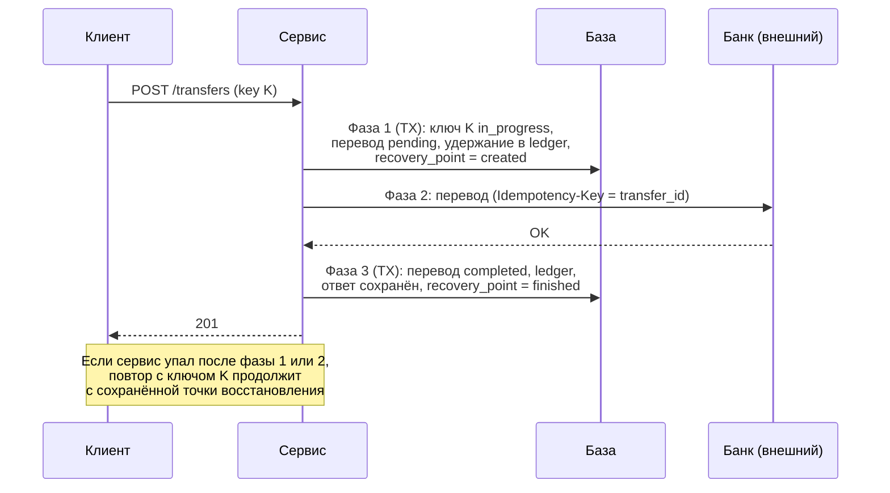
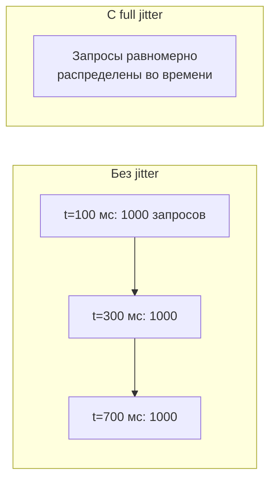
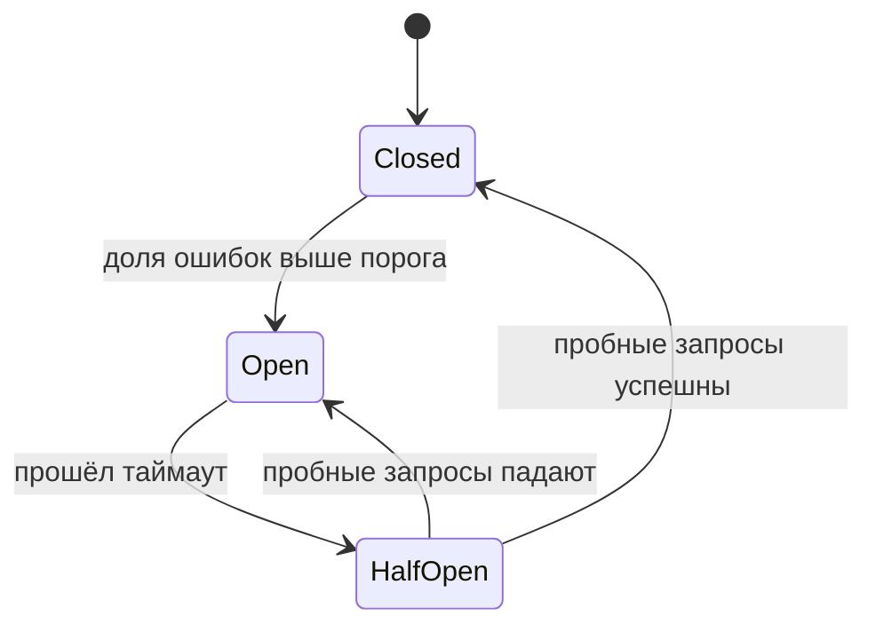

[English](README.md) | **Русский**

# 10. Идемпотентность и ретраи

> **Что внутри:** почему ретраи неизбежны, идемпотентность HTTP-методов, естественно идемпотентный дизайн API, idempotency keys (как у Stripe), атомарные фазы и точки восстановления, дедупликация на разных уровнях, когда и где ретраить, exponential backoff и jitter, retry budget, circuit breaker, вебхуки
> **Время на изучение:** ~4 ч · **Нужно для:** платежей, любых API с изменяющими операциями, мобильных клиентов, интеграций с внешними сервисами
> **Практика:** разбор в формате интервью — [INTERVIEW_RU.md](./INTERVIEW_RU.md)
> **Связанные темы:** [09-messaging](../09-messaging/README_RU.md#6-идемпотентность-консьюмеров) (идемпотентные консьюмеры), [04-databases](../04-databases/README_RU.md#11-управление-конкурентным-доступом-блокировки-mvcc-оптимистичный-подход), [08-consensus](../08-consensus/README_RU.md#10-split-brain-и-fencing-токены)

---

## 📑 Содержание

1. [Почему ретраи неизбежны](#1-почему-ретраи-неизбежны)
2. [Что такое идемпотентность](#2-что-такое-идемпотентность)
3. [Естественно идемпотентный дизайн API](#3-естественно-идемпотентный-дизайн-api)
4. [Idempotency keys](#4-idempotency-keys)
5. [Реализация: атомарность и точки восстановления](#5-реализация-атомарность-и-точки-восстановления)
6. [Дедупликация на разных уровнях](#6-дедупликация-на-разных-уровнях)
7. [Когда и где ретраить](#7-когда-и-где-ретраить)
8. [Exponential backoff и jitter](#8-exponential-backoff-и-jitter)
9. [Таймауты, retry budget и circuit breaker](#9-таймауты-retry-budget-и-circuit-breaker)
10. [Идемпотентность в процессах и вебхуках](#10-идемпотентность-в-процессах-и-вебхуках)
11. [Как говорить об этом на интервью](#11-как-говорить-об-этом-на-интервью)
12. [Вопросы для самопроверки](#12-вопросы-для-самопроверки)
13. [Глоссарий и ресурсы](#13-глоссарий-и-ресурсы)

---

## 1. Почему ретраи неизбежны

В распределённой системе у запроса есть **три** исхода, а не два: успех, ошибка и **неизвестность**.



Таймаут не означает «запрос не выполнен» — он означает «ответ не получен». Сервер мог:
- не получить запрос;
- получить и упасть до обработки;
- обработать и потерять ответ;
- всё ещё обрабатывать.

**Единственный способ узнать результат — повторить запрос.** А чтобы повтор был безопасным, операция должна быть **идемпотентной**.

> [!IMPORTANT]
> Ретраи происходят на каждом уровне, часто без вашего ведома: мобильный клиент при смене сети, HTTP-библиотека, балансировщик, service mesh, SDK облака, пользователь, нажавший кнопку дважды. Поэтому вопрос не «будут ли повторы», а «что произойдёт при повторе».

---

## 2. Что такое идемпотентность

**Операция идемпотентна**, если её многократное выполнение даёт **тот же эффект**, что и однократное.

```
f(f(x)) = f(x)
```

| Операция | Идемпотентна? | Почему |
|:---------|:-------------:|:-------|
| `SET balance = 100` | ✅ | Повтор оставляет то же значение |
| `balance = balance + 100` | ❌ | Каждый повтор добавляет ещё 100 |
| `DELETE user 42` | ✅ | После первого раза пользователя нет, повтор ничего не меняет |
| «Отправить письмо» | ❌ | Каждый повтор — новое письмо |
| `INSERT ... ON CONFLICT DO NOTHING` | ✅ | Второй раз строка не вставится |
| «Перевести статус pending → paid» (условно) | ✅ | Если уже `paid`, условие не выполнится |

> [!NOTE]
> Идемпотентность — про **эффект на состояние**, а не про одинаковый **ответ**. Первый `DELETE /users/42` вернёт `204`, второй — `404`, но состояние системы одинаково. Для клиентского удобства часто стараются, чтобы и ответ был одинаковым — это делают idempotency keys.

### HTTP-методы (RFC 9110)

| Метод | Безопасный (не меняет состояние) | Идемпотентный |
|:------|:--------------------------------:|:-------------:|
| `GET`, `HEAD`, `OPTIONS` | ✅ | ✅ |
| `PUT` | ❌ | ✅ (полная замена ресурса) |
| `DELETE` | ❌ | ✅ |
| `POST` | ❌ | ❌ |
| `PATCH` | ❌ | ❌ (зависит от формата патча) |

Многие клиенты, прокси и библиотеки **автоматически ретраят** идемпотентные методы. Поэтому `GET` с побочными эффектами или неидемпотентный `PUT` — источник трудноуловимых ошибок.

---

## 3. Естественно идемпотентный дизайн API

Лучший idempotency key — тот, который не нужен, потому что операция идемпотентна по своей природе.

| Приём | Вместо | Делай |
|:------|:-------|:------|
| **Установка значения вместо приращения** | `POST /cart/items/42/increment` | `PUT /cart/items/42 { qty: 3 }` |
| **ID, сгенерированный клиентом** | `POST /orders` → сервер создаёт ID | `PUT /orders/{client_uuid}` — повтор создаёт тот же ресурс или ничего не делает |
| **Условные запросы** | Перезапись без проверки | `If-Match: "<etag>"` или `WHERE version = $v` — повтор после успеха не пройдёт |
| **Переходы конечного автомата** | «Сделать оплаченным» безусловно | `UPDATE ... SET status = 'paid' WHERE status = 'pending'` |
| **Ограничения уникальности** | Проверка в коде перед вставкой | `UNIQUE (order_id)` в таблице платежей — второй платёж за заказ невозможен |
| **Множества вместо списков** | «Добавить тег» в массив | Множество тегов: повторное добавление ничего не меняет |

```http
# Создание с клиентским ID: повтор безопасен
PUT /v1/orders/7f3c9e2a-41b8-4c1d-9a2f-1c2b3d4e5f60
{ "items": [...], "address_id": "a_12" }

→ 201 Created (первый раз)
→ 200 OK, тот же заказ (повтор)
```

> [!TIP]
> На интервью сначала попробуй сделать операцию **естественно идемпотентной** (клиентский ID, условная запись, уникальное ограничение). Idempotency key — универсальный механизм для операций, которые так сделать нельзя: «перевести деньги», «отправить сообщение», «запустить задачу».

---

## 4. Idempotency keys

Клиент генерирует **уникальный ключ на одну логическую операцию** и передаёт его в каждом повторе. Сервер запоминает результат первого выполнения и возвращает его на повторы.

```http
POST /v1/transfers
Idempotency-Key: 5d1c8f0e-9b7a-4e6f-a3c2-7f1b2e8d9c40
Content-Type: application/json

{ "to": "u_77", "amount": "100.00", "currency": "EUR" }
```

Так работают API Stripe, Adyen, PayPal и многих других. В IETF есть черновик стандарта заголовка `Idempotency-Key`.

### Как сервер обрабатывает ключ



### Что хранить

| Поле | Зачем |
|:-----|:------|
| `scope` (аккаунт, API-клиент) + `key` | Ключ уникален в пределах клиента, а не глобально |
| `request_fingerprint` | Хэш метода, пути и тела — чтобы обнаружить повторное использование ключа для **другого** запроса |
| `status` | `in_progress` / `completed` |
| `locked_at` | Когда начали обработку — чтобы распознать «зависший» запрос |
| `recovery_point` | До какого шага дошла операция (см. [раздел 5](#5-реализация-атомарность-и-точки-восстановления)) |
| `response_code`, `response_body` | Что вернуть на повтор |
| `created_at` | Для удаления по TTL |

### Правила

| Вопрос | Правило |
|:-------|:--------|
| Кто генерирует ключ | **Клиент**, один раз на логическую операцию (нажатие «Отправить»), до первой попытки. Хранит его, пока не получит окончательный ответ — даже между перезапусками приложения |
| Какой формат | Случайный UUID (v4 или v7); никакой бизнес-логики в ключе |
| Тот же ключ, другое тело | Ошибка `422` — это почти всегда баг клиента |
| Два одновременных запроса с одним ключом | Второй получает `409 Conflict` (или ждёт завершения первого) — нельзя выполнять параллельно |
| Сколько хранить | Дольше, чем клиент может ретраить: обычно 24 часа – несколько дней |
| Какие ответы сохранять | Окончательные: успех и ошибки валидации/бизнес-логики (`4xx`). Если запрос упал из-за временной ошибки **до** каких-либо изменений — ключ можно освободить, чтобы повтор выполнился заново |

> [!WARNING]
> Ключ должен быть **на операцию, а не на HTTP-попытку**. Если клиент генерирует новый ключ при каждом ретрае, идемпотентности нет. Если один ключ используется для разных операций (например, для всех переводов пользователя) — второй перевод вернёт результат первого.

---

## 5. Реализация: атомарность и точки восстановления

Главная сложность — сохранить ключ и выполнить операцию **согласованно**. Если ключ сохранён, а операция не выполнена (или наоборот), повтор поведёт себя неправильно.

### Лучший случай: всё в одной транзакции

Если операция — только запись в одну базу, храни ключ **в той же базе** и в той же транзакции:

```sql
BEGIN;
INSERT INTO idempotency_keys (account_id, key, fingerprint, status)
VALUES ($acc, $key, $fp, 'in_progress');
-- Если ключ уже есть → unique violation → прочитать сохранённый ответ и вернуть его

INSERT INTO transfers (...) VALUES (...);
INSERT INTO ledger_entries (...) VALUES (...), (...);

UPDATE idempotency_keys
SET status = 'completed', response_code = 201, response_body = $json
WHERE account_id = $acc AND key = $key;
COMMIT;
```

Либо всё, либо ничего: повтор после сбоя либо найдёт готовый ответ, либо выполнит операцию заново с нуля.

### Сложный случай: внешние вызовы

Если операция вызывает внешний сервис (банк, платёжный провайдер, почту), одной транзакции недостаточно — внешний вызов нельзя откатить. Решение — **атомарные фазы с точками восстановления** (подход, описанный Брандуром Личем из Stripe):



| Принцип | Зачем |
|:--------|:------|
| Каждая фаза — локальная транзакция, заканчивается записью `recovery_point` | Повтор знает, откуда продолжать |
| Внешние вызовы — **между** транзакциями, никогда внутри | Не держать блокировки во время сетевых вызовов |
| Во внешний сервис передаётся **свой** idempotency key (стабильный, например `transfer_id`) | Повторный внешний вызов не создаёт второй перевод |
| Зависшие операции доводит фоновый процесс (completer / reaper) | Если клиент больше не повторит запрос, операция всё равно завершится |
| Для неизвестного исхода внешнего вызова — сначала запросить статус | Если внешний сервис умеет отвечать «что с операцией X» |

### Redis или база для ключей

| | В той же базе, что и данные | Отдельно в Redis |
|:-|:----------------------------|:-----------------|
| Атомарность с бизнес-записью | ✅ Одна транзакция | ❌ Две системы — окно рассогласования |
| Скорость | Достаточно для большинства API | Выше |
| Надёжность | Как у основной базы | Зависит от настроек персистентности и failover |
| Когда | **По умолчанию**, особенно для денег | Высокая нагрузка, операции с естественной идемпотентностью внутри, ключи как «первый фильтр» |

---

## 6. Дедупликация на разных уровнях

| Уровень | Механизм | Пример |
|:--------|:---------|:-------|
| **UI** | Блокировать кнопку после нажатия | Защита от двойного клика (не заменяет серверную) |
| **Клиент** | Один idempotency key на операцию, сохранённый локально | Мобильное приложение переживает перезапуск |
| **API** | Таблица idempotency keys | `Idempotency-Key` заголовок |
| **Бизнес-логика** | Условные переходы состояний, версии | `WHERE status = 'pending'` |
| **База данных** | Ограничения уникальности | `UNIQUE (order_id)` для платежей |
| **Брокер** | Идемпотентный продюсер Kafka, дедупликация SQS FIFO | Окно дедупликации SQS FIFO — 5 минут |
| **Консьюмеры** | Таблица обработанных `event_id` | См. [09-messaging](../09-messaging/README_RU.md#6-идемпотентность-консьюмеров) |
| **Внешние вызовы** | Передача idempotency key провайдеру | Платёжные API |

> [!TIP]
> Защита строится **слоями**: UI убирает большинство случайных дублей, idempotency key — повторы по сети, уникальное ограничение в базе — последняя линия обороны от багов в коде.

### Дедупликация большого потока

Для огромных потоков событий (клики, просмотры), где точная таблица ключей дорога:
- **окно дедупликации** — хранить ID только за последние N минут;
- **Bloom filter** — компактная вероятностная структура «точно не видели / возможно видели»; при «возможно» — проверка точным хранилищем или принятие небольшой погрешности;
- для аналитики часто достаточно **приблизительной** дедупликации.

---

## 7. Когда и где ретраить

### Что ретраить

| ✅ Ретраить | ❌ Не ретраить |
|:-----------|:--------------|
| Таймауты, обрыв соединения, connection reset | `400 Bad Request` — запрос неверный, повтор не поможет |
| `429 Too Many Requests` (с учётом `Retry-After`) | `401`, `403` — нет прав |
| `502`, `503`, `504` | `404` (обычно), `409` конфликт бизнес-логики, `422` валидация |
| Ошибки, явно помеченные как временные | Неидемпотентные операции **без** idempotency key |

### Где ретраить: только на одном уровне

Если ретраи настроены на каждом уровне, они **перемножаются**:


```
3 × 3 × 3 = 27 запросов к downstream на один пользовательский запрос
```

Если downstream перегружен, ретраи увеличивают нагрузку **в 27 раз** — и окончательно его добивают. Это **retry storm**.

**Правило:** ретраить на **одном** уровне, ближайшем к источнику неопределённости (обычно — у вызывающего непосредственно перегруженный сервис или у конечного клиента), а остальные уровни — без ретраев или с очень ограниченными.

### Уважать сигналы сервера

- `Retry-After` в ответах `429` и `503` — ждать указанное время.
- Сервер под нагрузкой должен **быстро отказывать** (`503`, `429`), а не держать соединение до таймаута.
- **Дедлайны:** если у пользовательского запроса осталось 200 мс, нет смысла начинать попытку, рассчитанную на 1 с. Передавай оставшееся время вниз по цепочке (deadline propagation, как в gRPC).

---

## 8. Exponential backoff и jitter

### Exponential backoff

Каждая следующая попытка ждёт дольше: `delay = min(cap, base × 2^attempt)`.

| Попытка | base = 100 мс, cap = 10 с |
|:-------:|:-------------------------:|
| 1 | 100 мс |
| 2 | 200 мс |
| 3 | 400 мс |
| 4 | 800 мс |
| 5 | 1,6 с |
| ... | ... до 10 с |

### Почему нужен jitter

Если тысяча клиентов получила ошибку одновременно (сбой downstream), то **без случайности** они все повторят запрос через 100 мс, потом все через 200 мс… Нагрузка приходит синхронными волнами, и сервис не может восстановиться.



### Варианты jitter

Классический разбор — статья Марка Брукера «Exponential Backoff And Jitter» в блоге AWS Architecture (2015).

| Вариант | Формула | Свойства |
|:--------|:--------|:---------|
| **Без jitter** | `min(cap, base × 2^n)` | Синхронные волны ❌ |
| **Full jitter** | `random(0, min(cap, base × 2^n))` | Лучшее распределение нагрузки, хороший дефолт |
| **Equal jitter** | `t = min(cap, base × 2^n)`; `t/2 + random(0, t/2)` | Гарантированная минимальная пауза |
| **Decorrelated jitter** | `min(cap, random(base, previous × 3))` | Хорошо работает на практике, зависит от предыдущей задержки |

```python
import random, time

def call_with_retries(op, max_attempts=5, base=0.1, cap=10.0, deadline=None):
    for attempt in range(max_attempts):
        try:
            return op()
        except RetryableError as e:
            if attempt == max_attempts - 1:
                raise
            delay = random.uniform(0, min(cap, base * 2 ** attempt))   # full jitter
            if e.retry_after:
                delay = max(delay, e.retry_after)                        # уважать сервер
            if deadline and time.monotonic() + delay > deadline:
                raise                                                    # не успеем — не пытаться
            time.sleep(delay)
```

> [!TIP]
> Хорошие дефолты: **3–5 попыток**, base 50–200 мс, cap несколько секунд, **full jitter**, общий дедлайн на всю операцию, `Retry-After` имеет приоритет.

---

## 9. Таймауты, retry budget и circuit breaker

Ретраи безопасны только вместе с механизмами, которые не дают им усилить сбой.

### Таймауты

- **Всегда** задавай таймауты: соединения и чтения. Таймаут «бесконечно» превращает медленный downstream в исчерпание потоков и соединений у вызывающего.
- Таймаут выбирается по распределению задержек downstream (например, чуть выше p99.9), а не «на глаз».
- Сумма таймаутов и ретраев по цепочке должна укладываться в дедлайн запроса.

### Retry budget

Ограничить долю ретраев от общего числа запросов, например **не больше 10%**. Пока downstream здоров, ретраев мало и бюджет не исчерпывается. Когда он падает, ретраи быстро упираются в бюджет, и нагрузка от них не растёт лавинообразно. Реализуется как token bucket: каждый успешный запрос добавляет долю токена, каждый ретрай тратит токен.

### Circuit breaker



| Состояние | Поведение |
|:----------|:----------|
| **Closed** | Запросы идут как обычно, ошибки считаются |
| **Open** | Запросы сразу отклоняются (или идут в fallback) без обращения к downstream — даём ему восстановиться |
| **Half-open** | Пропускаем немного пробных запросов; по результату закрываем или снова открываем |

### Hedged requests

Для **идемпотентных чтений** с жёсткими требованиями к хвостовой задержке: если ответ не пришёл за p95, отправить такой же запрос на другую реплику и взять первый ответ (Dean, Barroso, «The Tail at Scale»). Только для идемпотентных операций и с ограничением доли — иначе это ещё один источник лишней нагрузки.

> [!NOTE]
> Подробнее паттерны надёжности (bulkhead, load shedding, graceful degradation) — в отдельной теме. Здесь важно запомнить: **ретраи без backoff, jitter, бюджета и circuit breaker превращают частичный сбой в полный**.

---

## 10. Идемпотентность в процессах и вебхуках

### Многошаговые процессы (саги)

- Каждый шаг идемпотентен с ключом **(ID процесса, номер шага)**.
- Компенсации тоже идемпотентны — их ретраят до успеха.
- Состояние процесса — конечный автомат с условными переходами.

### Фоновые задачи и планировщики

- Планировщики обычно гарантируют **at-least-once**: задача может запуститься дважды (после сбоя, при смене лидера).
- Задача должна быть идемпотентной: например, «начислить проценты за 2026-11-30» с ключом `(account, date)`, а не «начислить проценты за вчера».

### Вебхуки

| Сторона | Правила |
|:--------|:--------|
| **Отправитель** | Доставка at-least-once с ретраями (exponential backoff + jitter, часами или сутками); уникальный `event_id` в каждом событии; подпись запроса (HMAC); порядок не гарантируется — отправлять версию или timestamp объекта |
| **Получатель** | Быстро ответить `2xx` и обработать асинхронно; **дедуплицировать по `event_id`**; проверять подпись; не полагаться на порядок — сверяться с версией или запрашивать актуальное состояние у отправителя |

---

## 11. Как говорить об этом на интервью

### Ответ за 30 секунд

> «Таймаут не значит „не выполнено“ — значит „неизвестно“, поэтому ретраи неизбежны, а все изменяющие операции должны быть идемпотентными. Где можно — делаю это естественно: клиентские ID, PUT вместо инкремента, условные переходы состояний, уникальные ограничения. Для остального — idempotency key, который клиент генерирует один раз на операцию; сервер хранит ключ, отпечаток запроса и ответ в той же базе и транзакции, что и данные; одновременный дубль получает 409, другой запрос с тем же ключом — 422. Внешние вызовы — между транзакциями, с точками восстановления и собственным ключом для провайдера. Ретраю только временные ошибки, на одном уровне, с exponential backoff и full jitter, дедлайном, retry budget и circuit breaker».

### Вопросы, которые стоит задать

1. Что произойдёт, если этот запрос выполнится дважды?
2. Может ли клиент отличить «не выполнено» от «ответ потерялся»?
3. Какие внешние побочные эффекты у операции и поддерживают ли они idempotency key?
4. На скольких уровнях настроены ретраи и как они перемножаются?
5. Что будет с downstream, если он замедлится, а все клиенты начнут ретраить?

### Типичные ошибки

- Новый idempotency key на каждую HTTP-попытку.
- Хранить ключи в Redis отдельно от транзакции с деньгами без понимания окна рассогласования.
- Ретраить `POST` без idempotency key.
- Ретраи на каждом уровне — retry storm.
- Backoff без jitter.
- Ретраить `400`, `401`, `422`.
- Таймауты по умолчанию «бесконечно».
- Внешний вызов внутри транзакции базы.
- Считать, что двойной клик решается только блокировкой кнопки.

---

## 12. Вопросы для самопроверки

<details>
<summary><b>1. Почему после таймаута нельзя считать, что запрос не выполнился?</b></summary>

Таймаут означает, что ответ не получен. Сервер мог не получить запрос, получить и упасть, выполнить и потерять ответ или всё ещё выполнять. Клиент не может различить эти случаи и вынужден повторять, поэтому операция должна быть идемпотентной.
</details>

<details>
<summary><b>2. Идемпотентен ли DELETE, если второй вызов возвращает 404?</b></summary>

Да. Идемпотентность касается эффекта на состояние: после первого и после второго вызова ресурса нет. Ответ может отличаться.
</details>

<details>
<summary><b>3. Как сделать создание заказа идемпотентным без idempotency key?</b></summary>

Клиент генерирует ID заказа и использует `PUT /orders/{id}`: повтор либо создаёт тот же заказ, либо обнаруживает существующий. Альтернатива — уникальное ограничение на естественный ключ операции.
</details>

<details>
<summary><b>4. Что сервер должен сделать, если пришёл тот же idempotency key с другим телом запроса?</b></summary>

Вернуть ошибку (обычно `422`): это повторное использование ключа для другой операции, почти всегда баг клиента. Выполнять новый запрос или возвращать ответ старого — неправильно.
</details>

<details>
<summary><b>5. Что делать с двумя одновременными запросами с одним ключом?</b></summary>

Выполнить только один. Первый сохраняет ключ со статусом `in_progress` (вставка с уникальным ограничением), второй видит это и получает `409 Conflict` с предложением повторить позже, или ждёт завершения первого и возвращает его ответ.
</details>

<details>
<summary><b>6. Почему ключ лучше хранить в той же базе, что и данные?</b></summary>

Тогда сохранение ключа, бизнес-изменения и ответа происходят в одной транзакции: либо всё, либо ничего. С отдельным хранилищем возможно состояние, где ключ записан, а операция нет (или наоборот), и повтор поведёт себя неправильно.
</details>

<details>
<summary><b>7. Как быть, если операция вызывает внешний платёжный API?</b></summary>

Разбить на атомарные фазы с точками восстановления: локальная транзакция → внешний вызов (вне транзакции, со своим стабильным idempotency key для провайдера) → локальная транзакция с результатом. Повтор продолжает с последней точки; фоновый процесс доводит зависшие операции; при неизвестном исходе — запросить статус у провайдера.
</details>

<details>
<summary><b>8. Почему ретраи на каждом уровне опасны?</b></summary>

Они перемножаются: 3 уровня по 3 попытки дают до 27 запросов к downstream на один пользовательский запрос. Когда downstream перегружен, это многократно увеличивает нагрузку и не даёт ему восстановиться (retry storm).
</details>

<details>
<summary><b>9. Зачем jitter, если уже есть exponential backoff?</b></summary>

Без случайности клиенты, получившие ошибку одновременно, повторяют запросы тоже одновременно — синхронными волнами. Jitter распределяет повторы во времени и сглаживает нагрузку.
</details>

<details>
<summary><b>10. Что такое retry budget?</b></summary>

Ограничение доли ретраев относительно общего числа запросов (например, 10%). При здоровом downstream бюджета хватает, а при массовом сбое ретраи быстро упираются в лимит и не усиливают нагрузку.
</details>

---

## 13. Глоссарий и ресурсы

### Глоссарий

| Термин | Значение |
|:-------|:---------|
| Идемпотентность | Повтор операции даёт тот же эффект, что и однократное выполнение |
| Безопасный метод | HTTP-метод, не меняющий состояние |
| Idempotency key | Уникальный ключ логической операции, передаваемый во всех повторах |
| Отпечаток запроса | Хэш метода, пути и тела для проверки, что ключ используется для того же запроса |
| Точка восстановления | Сохранённый прогресс многофазной операции |
| Дедупликация | Отбрасывание повторных сообщений или запросов |
| Окно дедупликации | Период, в течение которого помнятся обработанные ID |
| Exponential backoff | Экспоненциальный рост задержки между попытками |
| Jitter | Случайная составляющая задержки |
| Retry storm | Лавина ретраев, усиливающая сбой |
| Retry budget | Ограничение доли ретраев |
| Circuit breaker | Автоматическое прекращение вызовов к неисправному сервису |
| Deadline propagation | Передача оставшегося времени запроса вниз по цепочке |
| Hedged request | Дублирующий запрос к другой реплике для снижения хвостовой задержки |

### Ресурсы

- Brandur Leach, *Designing robust and predictable APIs with idempotency* (Stripe Blog, 2017)
- Brandur Leach, *Implementing Stripe-like Idempotency Keys in Postgres* (2017)
- IETF HTTPAPI WG, *The Idempotency-Key HTTP Header Field* (Internet-Draft)
- RFC 9110 *HTTP Semantics* — безопасные и идемпотентные методы
- Marc Brooker, *Exponential Backoff And Jitter* (AWS Architecture Blog, 2015)
- Amazon Builders' Library: *Timeouts, retries, and backoff with jitter*; *Making retries safe with idempotent APIs*
- Jeffrey Dean, Luiz André Barroso, *The Tail at Scale* (Communications of the ACM, 2013)
- Google SRE Book — главы «Handling Overload» и «Addressing Cascading Failures»
- Документация Stripe API: Idempotent requests