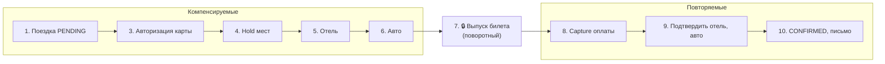
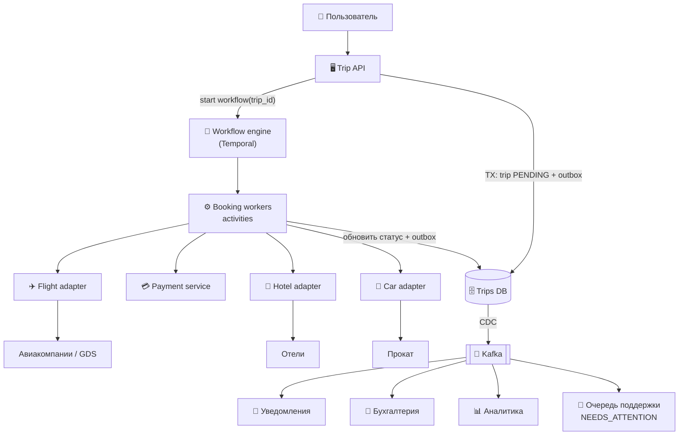
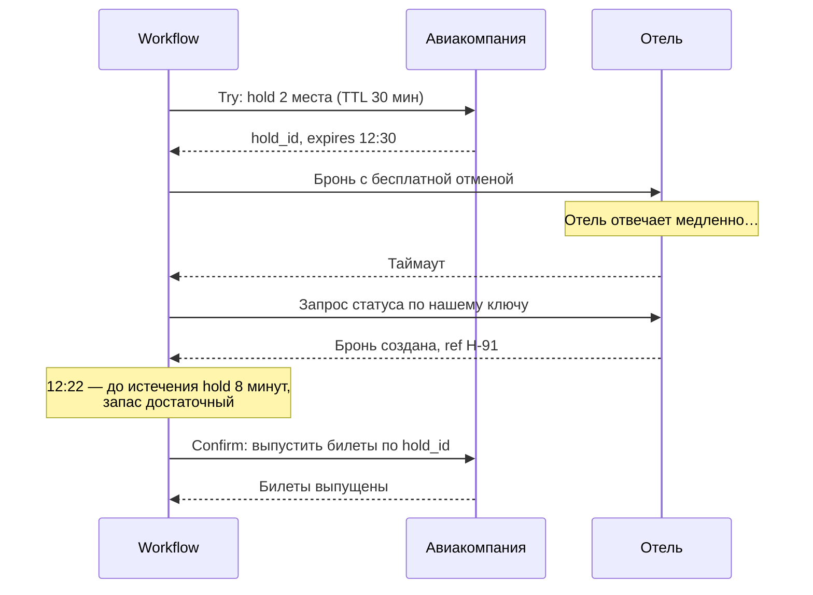
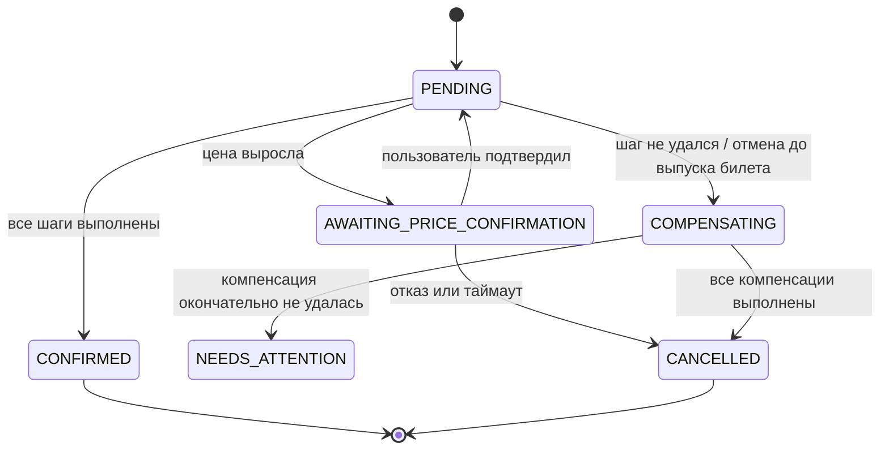

[English](INTERVIEW.md) | **Русский** · Теория: [README_RU.md](./README_RU.md)

# 11. Distributed Transactions: бронирование поездки (перелёт + отель + авто)

> **Тема:** почему не 2PC, сага с оркестрацией, порядок шагов (компенсируемые → поворотный → повторяемые), TCC-резервы у партнёров, durable workflow, аномалии изоляции, компенсации, которые не удаются, outbox и CDC для остальных систем
> **Уровень:** Hard · **Время на интервью:** 45 мин · **Время на разбор:** ~5 ч
> **Где спрашивают:** «Спроектируй бронирование поездок / Expedia / Booking», «как сделать транзакцию между микросервисами», а также как deep dive в задачах про заказы и платежи

---

## 🗺️ Как читать этот разбор

| Значок | Что значит |
|:------:|:-----------|
| 🎤 | Реплика интервьюера |
| 🗣️ | Что говорю вслух я (кандидат) |
| ✏️ | Что рисую на доске |
| ⏱️ | Сколько времени тратить на шаг |

Блоки **TIP** — хороший приём, **WARNING** — ловушка, **IMPORTANT** — сигнал для уровня Senior+.

---

## 📑 Содержание

1. [Условие задачи](#1-условие-задачи)
2. [Уточняющие вопросы и требования](#2-уточняющие-вопросы-и-требования)
3. [Оценки нагрузки](#3-оценки-нагрузки)
4. [Почему не 2PC](#4-почему-не-2pc)
5. [Шаги саги и их порядок](#5-шаги-саги-и-их-порядок)
6. [API и модель данных](#6-api-и-модель-данных)
7. [High-level дизайн](#7-high-level-дизайн)
8. [Deep dive 1: оркестратор на durable workflow](#8-deep-dive-1-оркестратор-на-durable-workflow)
9. [Deep dive 2: резервы у партнёров (TCC)](#9-deep-dive-2-резервы-у-партнёров-tcc)
10. [Deep dive 3: изоляция — что видят пользователь и другие сервисы](#10-deep-dive-3-изоляция--что-видят-пользователь-и-другие-сервисы)
11. [Deep dive 4: когда компенсация не удаётся](#11-deep-dive-4-когда-компенсация-не-удаётся)
12. [Deep dive 5: связь с остальными системами — outbox и CDC](#12-deep-dive-5-связь-с-остальными-системами--outbox-и-cdc)
13. [Узкие места и сценарии сбоев](#13-узкие-места-и-сценарии-сбоев)
14. [Что изменится при росте в 10 раз](#14-что-изменится-при-росте-в-10-раз)
15. [Вопросы интервьюера с ответами](#15-вопросы-интервьюера-с-ответами)
16. [Типичные ошибки](#16-типичные-ошибки)
17. [Шпаргалка и самопроверка](#17-шпаргалка-и-самопроверка)

---

## 1. Условие задачи

> 🎤 «Пользователь собирает поездку: перелёт, отель и аренда авто — и оплачивает всё одной кнопкой. Все три бронирования делаются через API внешних партнёров. Нельзя, чтобы пользователь заплатил и остался с билетом без отеля или с отелем без билета. Спроектируй бронирование».

**План по времени:**

| Шаг | ⏱️ |
|:----|:--:|
| Требования | 5 мин |
| Оценки | 2 мин |
| Почему не 2PC, шаги саги | 8 мин |
| API, данные, high-level | 7 мин |
| Deep dives | 18 мин |
| Сбои и итоги | 5 мин |

> [!TIP]
> Это классическая задача про саги. Интервьюер ждёт, что ты сначала **объяснишь, почему 2PC невозможен**, а потом спроектируешь сагу с продуманным **порядком шагов**. Порядок шагов — самая важная часть ответа.

---

## 2. Уточняющие вопросы и требования

⏱️ 5 мин

| Мой вопрос | Ответ интервьюера | Что это меняет |
|:-----------|:------------------|:---------------|
| Поддерживают ли партнёры удержание (hold) без окончательного бронирования? | Авиакомпании — удержание мест на 15–30 минут; отели — бронь с бесплатной отменой; прокат — бронь с бесплатной отменой | Можно сделать TCC-резервы |
| Что необратимо? | Выпуск авиабилета: после него отмена — только возврат с комиссией | Выпуск билета — поворотный шаг, как можно позже |
| Как работает оплата? | Авторизация карты (удержание) и списание отдельно | Авторизация — компенсируемая (void), списание — после успеха |
| Сколько отвечают партнёры? | От секунды до минуты; иногда таймауты и ошибки (1–5%) | Асинхронный процесс со статусом, таймауты, ретраи |
| Может ли пользователь получить частичную поездку? | Нет: либо всё, либо ничего (с возвратом денег) | Сага с компенсациями всех шагов до поворотного |
| Что если цена изменилась между поиском и бронированием? | Показать новую цену и попросить подтвердить | Перепроверка значения перед бронированием |

### Функциональные требования

1. Забронировать перелёт, отель и авто как одну поездку с одной оплатой.
2. Всё или ничего: при неудаче любого шага — отмена остальных и возврат денег.
3. Пользователь видит статус бронирования в реальном времени.
4. Отмена поездки пользователем после подтверждения (по правилам тарифов).

### Нефункциональные требования

| Требование | Цель |
|:-----------|:-----|
| Корректность | Ни одной «половинчатой» поездки, оплаченной пользователем; ни одного двойного бронирования у партнёра |
| Надёжность | Процесс бронирования переживает перезапуск любого нашего сервиса |
| Latency | Ответ «бронирование начато» < 500 мс; итог — обычно < 1 мин |
| Наблюдаемость | Для каждой поездки видно, на каком шаге она и почему |

---

## 3. Оценки нагрузки

⏱️ 2 мин

✏️

```
Бронирований поездок     = 500K/день → ~6/с в среднем, пик ~100/с
Шагов на поездку         ≈ 8–10 (резервы, оплата, выпуск, подтверждения)
Вызовов партнёров        ≈ 100 × 6 = 600/с в пике (с ретраями — больше)
Отказы партнёров         ≈ 1–5% вызовов
Состояние саги           ≈ 20 событий × 1 КБ = 20 КБ на поездку → 10 ГБ/день
```

🗣️ «Нагрузка небольшая. Сложность не в масштабе, а в **корректности** при медленных, ненадёжных внешних системах и в том, что процесс длится от секунд до минут».

---

## 4. Почему не 2PC

⏱️ 3 мин

> 🎤 «Почему нельзя просто сделать распределённую транзакцию?»

🗣️

| Причина | В этой задаче |
|:--------|:--------------|
| Нет поддержки протокола | Партнёры — внешние REST API; они не будут участниками нашего 2PC и не поддерживают XA |
| Долгие операции | Ответы до минуты; держать блокировки и ждать «prepare» от всех — нереально |
| Доступность | Транзакция успешна, только если доступны **все** партнёры одновременно |
| Блокировка при отказе | Если наш координатор упадёт, удержания у партнёров зависнут |

«Зато партнёры дают **резервы с TTL** (удержание мест, бронь с бесплатной отменой) — это бизнес-аналог фазы prepare. Поэтому решение — **сага**, а там, где можно, — **TCC-резервы** у партнёров».

---

## 5. Шаги саги и их порядок

⏱️ 5 мин

🗣️ «Главное — порядок: **компенсируемые шаги → поворотный → повторяемые**».

| № | Шаг | Тип | Компенсация | Почему здесь |
|:-:|:----|:----|:------------|:-------------|
| 1 | Создать поездку `PENDING` | Компенсируемый | Поездка `CANCELLED` | Семантическая блокировка с первой секунды |
| 2 | Перепроверить цены у партнёров | — | — | Цена могла измениться с момента поиска |
| 3 | Авторизовать карту (удержание суммы) | Компенсируемый | Void авторизации | Самая частая причина отказа (недостаточно средств) — проверяем рано и дёшево |
| 4 | Удержать места на рейс (hold, TTL 30 мин) | Компенсируемый | Отпустить места | Авиа — самый дефицитный ресурс |
| 5 | Забронировать отель (бесплатная отмена) | Компенсируемый | Отменить бронь | |
| 6 | Забронировать авто (бесплатная отмена) | Компенсируемый | Отменить бронь | |
| 7 | **Выпустить авиабилет** | **Поворотный** | — (только возврат с комиссией) | Необратимо — поэтому после всех резервов |
| 8 | Списать оплату (capture) | Повторяемый | — | Авторизация уже есть — ретраится до успеха |
| 9 | Подтвердить отель и авто | Повторяемый | — | Брони уже есть |
| 10 | Поездка `CONFIRMED`, письмо, бонусы | Повторяемый | — | Ретраи до успеха |



> [!IMPORTANT]
> **Сигнал Senior+:** объясни, **почему** именно такой порядок:
> - авторизация карты рано — это самая частая причина отказа, и её отмена бесплатна;
> - выпуск билета поздно — он единственный необратимый;
> - после поворотного шага не осталось ничего, что может окончательно провалиться: capture по существующей авторизации и подтверждение существующих броней только ретраятся.

---

## 6. API и модель данных

⏱️ 3 мин

### API

```http
POST /v1/trips
     Headers: Idempotency-Key: <uuid>
     Body: { flight_offer_id, hotel_offer_id, car_offer_id, payment_method_id, travelers[] }
     → 202 { trip_id, status: "PENDING" }

GET  /v1/trips/{trip_id}         → { status, steps[], price, failure_reason? }
WS   /v1/trips/{trip_id}/events  ← изменения статуса
POST /v1/trips/{trip_id}/confirm-price   { new_total }   ← если цена изменилась
POST /v1/trips/{trip_id}/cancel
```

### Данные

```sql
CREATE TABLE trips (
  trip_id       BIGINT PRIMARY KEY,
  user_id       BIGINT NOT NULL,
  status        TEXT   NOT NULL,   -- PENDING | AWAITING_PRICE_CONFIRMATION | CONFIRMED
                                   -- | COMPENSATING | CANCELLED | NEEDS_ATTENTION
  total_amount  NUMERIC(12,2),
  version       INT    NOT NULL,
  created_at    TIMESTAMPTZ
);

CREATE TABLE trip_bookings (       -- по строке на каждого партнёра
  trip_id          BIGINT,
  kind             TEXT,           -- flight | hotel | car | payment
  partner_ref      TEXT,           -- ID брони или удержания у партнёра
  idempotency_key  TEXT UNIQUE,    -- наш ключ для вызовов партнёра: trip_id + kind + step
  status           TEXT,           -- HELD | BOOKED | CONFIRMED | RELEASED | FAILED
  hold_expires_at  TIMESTAMPTZ,
  PRIMARY KEY (trip_id, kind)
);

CREATE TABLE outbox ( ... );       -- события для других систем
```

🗣️ «Состояние самой саги (на каком шаге, сколько попыток, таймеры) хранит **движок workflow**. В нашей базе — бизнес-состояние поездки и бронирований, которое видят пользователь и другие сервисы».

---

## 7. High-level дизайн

⏱️ 4 мин

✏️



🗣️ «Ключевые решения:
- **Оркестрация** через durable workflow — у нас 10 шагов, компенсации, таймауты и деньги;
- **адаптеры** для каждого типа партнёров: единый интерфейс hold/confirm/cancel, idempotency key, ретраи с backoff и circuit breaker на каждого партнёра;
- **outbox + CDC** — остальные системы (уведомления, бухгалтерия, аналитика) узнают об изменениях поездки надёжно и асинхронно».

---

## 8. Deep dive 1: оркестратор на durable workflow

> 🎤 «Почему движок workflow, а не своя таблица состояний?»

🗣️ «Свой оркестратор — это конечный автомат в базе, таймеры, ретраи с backoff, outbox для команд, обработка перезапусков, наблюдаемость. Много кода с тонкими ошибками. Durable workflow (Temporal или аналог) даёт это из коробки: процесс пишется как обычный код, движок сохраняет историю каждого шага и восстанавливает выполнение после сбоя».

```python
@workflow
def book_trip(trip):
    undo = []
    try:
        activity(recheck_prices, trip)                                  # BusinessError, если цена выросла
        auth = activity(authorize_card, trip, idem=f"{trip.id}:auth")
        undo.append(lambda: activity(void_authorization, auth))

        hold = activity(hold_flight_seats, trip, idem=f"{trip.id}:flight-hold")
        undo.append(lambda: activity(release_flight_hold, hold))

        hotel = activity(book_hotel_refundable, trip, idem=f"{trip.id}:hotel")
        undo.append(lambda: activity(cancel_hotel, hotel))

        car = activity(book_car_refundable, trip, idem=f"{trip.id}:car")
        undo.append(lambda: activity(cancel_car, car))

        # 🔒 Поворотный шаг: после него — только вперёд
        ticket = activity(issue_ticket, hold, idem=f"{trip.id}:ticket",
                          timeout=minutes(2), retry=limited)
    except BusinessError as e:
        for u in reversed(undo):
            u()                                    # каждая компенсация ретраится до успеха
        activity(mark_trip_cancelled, trip, reason=e)
        return

    # Повторяемые шаги: бесконечные ретраи с backoff
    activity(capture_payment, auth, retry=forever)
    activity(confirm_hotel_and_car, hotel, car, retry=forever)
    activity(mark_trip_confirmed, trip, retry=forever)
```

| Свойство | Как обеспечено |
|:---------|:---------------|
| Переживает перезапуск | Движок хранит историю и восстанавливает состояние |
| Идемпотентность вызовов партнёров | Детерминированный ключ `trip_id:шаг` → повтор не создаёт вторую бронь (см. [10-idempotency](../10-idempotency/README_RU.md)) |
| Таймауты шагов | Задаются на activity; при таймауте — запрос статуса у партнёра, затем решение |
| Видимость | Каждая поездка — workflow с историей в UI движка |

> [!WARNING]
> Код workflow должен быть **детерминированным**: никаких прямых сетевых вызовов, текущего времени или случайности — только через activities и API движка. Иначе при воспроизведении истории процесс поведёт себя иначе.

---

## 9. Deep dive 2: резервы у партнёров (TCC)

> 🎤 «Удержание мест действует 30 минут. Что если сага застряла дольше?»

🗣️ «Это и есть TCC: **try** = hold мест, **confirm** = выпуск билета, **cancel** = отпустить hold. Если мы не сделали ни confirm, ни cancel, резерв **сам истечёт** по TTL у партнёра — это защита от зависания.

Но нельзя допустить, чтобы hold истёк **до** выпуска билета, когда мы уже думаем, что место есть:
- сохраняю `hold_expires_at` и перед выпуском билета проверяю запас времени;
- у шагов отеля и авто — жёсткие таймауты, чтобы сага укладывалась в TTL;
- если запаса мало — продлить hold (если партнёр позволяет) или начать компенсацию».



| Ситуация | Действие |
|:---------|:---------|
| Партнёр ответил ошибкой «нет мест» | `BusinessError` → компенсации |
| Таймаут | Запрос статуса по нашему ключу, затем ретрай с тем же ключом |
| Hold скоро истечёт | Продлить или компенсировать, **не** выпускать билет на истёкший hold |
| Выпуск билета не удался после ретраев | До поворотного шага ничего не необратимо → полная компенсация |

---

## 10. Deep dive 3: изоляция — что видят пользователь и другие сервисы

> 🎤 «Пока сага выполняется, пользователь нажимает «Отменить поездку». Или служба лояльности начисляет бонусы за ещё не подтверждённую поездку. Что делать?»

🗣️ «У саги нет изоляции — промежуточные состояния видны. Для каждой опасной аномалии — своя контрмера:

| Аномалия | Пример | Контрмера |
|:---------|:-------|:----------|
| Действие над поездкой «в процессе» | Отмена во время бронирования | **Семантическая блокировка:** поездка в `PENDING`; отмена превращается в **сигнал** workflow, который сам решит: если поворотный шаг не пройден — компенсировать всё; если пройден — отмена по правилам тарифов |
| Dirty read | Бонусы за поездку, которую потом откатили | **Пессимистичный порядок:** событие для бонусов и бухгалтерии публикуется только при `CONFIRMED`, а не на промежуточных шагах |
| Fuzzy read | Цена изменилась между поиском и бронированием | **Перечитать значение:** шаг 2 перепроверяет цены; если выросли — `AWAITING_PRICE_CONFIRMATION` и ждём подтверждения пользователя (сигнал workflow с таймаутом) |
| Двойная поездка | Пользователь дважды нажал «Оплатить» | Idempotency key на `POST /trips` |



> [!TIP]
> Пользовательская отмена — это не прямое изменение поездки, а **сигнал** в работающий workflow. Так решение принимается в одном месте, с учётом того, какие шаги уже выполнены.

---

## 11. Deep dive 4: когда компенсация не удаётся

> 🎤 «Отель забронирован, выпуск билета упал, а API отеля на отмену возвращает 500 уже час. Что делать?»

🗣️ «Компенсации нельзя бросать:

| Уровень | Действие |
|:--------|:---------|
| 1 | Ретраи компенсации с exponential backoff и jitter, часами (движок workflow позволяет долгие ретраи) |
| 2 | Идемпотентный ключ отмены `trip_id:hotel-cancel` — повторы безопасны |
| 3 | Остальные компенсации выполняются **независимо**: void авторизации карты не ждёт отеля — пользователь не должен ждать возврата денег из-за чужой проблемы |
| 4 | После N часов или постоянной ошибки — статус `NEEDS_ATTENTION`, задача в очереди поддержки с полной историей шагов |
| 5 | Поддержка отменяет вручную (по телефону партнёру) и закрывает задачу; если отель всё же выставит счёт — бухгалтерия разбирает отдельно |
| 6 | Ежедневная **сверка** с партнёрами: брони у партнёра без подтверждённой поездки у нас → автоматическая отмена |

### Компенсация раньше исходной операции

🗣️ «Тонкий случай: бронь в отеле упала по таймауту, мы начали компенсацию и отправили отмену, а отель на самом деле **создал** бронь, и запрос на создание дошёл позже отмены. Защита:
- отмена отправляется с тем же ключом, что и создание (`trip_id:hotel`) — если брони ещё нет, адаптер отеля запоминает «отменено» для этого ключа;
- сверка с партнёром поймает оставшиеся расхождения».

> [!WARNING]
> Компенсация «вернуть деньги» после **поворотного** шага — это уже не компенсация саги, а **отдельный бизнес-процесс** (возврат по правилам тарифа). Не смешивай их: до поворотного шага — откат саги, после — только вперёд или пользовательская отмена по правилам.

---

## 12. Deep dive 5: связь с остальными системами — outbox и CDC

> 🎤 «Уведомления, бухгалтерия, аналитика, поддержка — как они узнают о поездке?»

🗣️ «Каждое изменение статуса поездки записывается **в одной транзакции** с событием в outbox. Debezium читает WAL и публикует события в Kafka, ключ — `trip_id`:

| Потребитель | Событие | Особенности |
|:------------|:--------|:------------|
| Уведомления | `TripConfirmed`, `TripCancelled`, `PriceChanged` | Дедупликация по `(trip_id, тип)` |
| Бухгалтерия | `TripConfirmed` с суммами | Inbox с UNIQUE по event_id: ровно один раз эффекта |
| Аналитика | Все события | Допустима задержка |
| Поддержка | `TripNeedsAttention` | Создаёт тикет |
| Бонусы | `TripConfirmed` | Только после подтверждения (пессимистичный порядок) |

Почему не публиковать события прямо из workflow? Потому что изменение статуса в базе и публикация должны быть **атомарны** — иначе возможно «статус в базе CONFIRMED, а события нет» или наоборот. Outbox решает это одной локальной транзакцией».

> [!NOTE]
> Для CDC в PostgreSQL — мониторинг отставания replication slot: если коннектор остановится надолго, WAL заполнит диск. Это стоит упомянуть как эксплуатационный риск.

---

## 13. Узкие места и сценарии сбоев

| Сценарий | Что произойдёт | Как защищаемся |
|:---------|:---------------|:---------------|
| Падение воркера посреди шага | Шаг не завершён | Движок переназначит activity; идемпотентный ключ к партнёру |
| Падение Trip API после создания поездки | Workflow может не стартовать | Старт workflow с ID = trip_id идемпотентен; reconciler стартует workflow для `PENDING` без процесса |
| Партнёр недоступен | Шаги падают | Ретраи с backoff, circuit breaker на партнёра; при долгом сбое — компенсации и честное сообщение пользователю |
| Таймаут при бронировании | Неизвестный исход | Запрос статуса по ключу, затем ретрай с тем же ключом |
| Hold мест истёк | Выпуск билета невозможен | Проверка запаса времени, продление или компенсация до выпуска |
| Компенсация не удаётся | Расхождение с партнёром | Долгие ретраи → `NEEDS_ATTENTION` → поддержка + сверка |
| Цена изменилась | Пользователь платит другую сумму | Перепроверка цены, подтверждение пользователем |
| Пользователь отменяет во время саги | Гонка с шагами | Отмена — сигнал в workflow |
| Debezium отстаёт | Уведомления задерживаются | Мониторинг лага; события не теряются |
| Двойное нажатие «Оплатить» | Две поездки | Idempotency key на создание поездки |

---

## 14. Что изменится при росте в 10 раз

> 🎤 «5 миллионов поездок в день и сотни партнёров?»

🗣️ «Что меняется:
1. **Кластер движка workflow** с шардированием по `trip_id`; история старых workflow архивируется.
2. **Адаптеры партнёров как отдельные сервисы** с изоляцией ресурсов (bulkhead): медленный партнёр не занимает воркеры остальных.
3. **Квоты и rate limit на партнёра**, согласованные с их лимитами.
4. **Динамический порядок шагов:** сначала самый «рискованный» по статистике партнёр (с наибольшей долей отказов) — меньше компенсаций.
5. **Автоматическая сверка** почти в реальном времени и автоматическое разрешение типовых расхождений».

---

## 15. Вопросы интервьюера с ответами

<details>
<summary><b>Почему авторизация карты — до бронирований, а не после?</b></summary>

Это самая частая причина отказа (нет денег, карта заблокирована), проверка быстрая, а отмена (void) бесплатна и мгновенна. Если делать её после бронирований, при отказе пришлось бы отменять три брони у партнёров. Списание (capture) — после поворотного шага, по уже существующей авторизации.
</details>

<details>
<summary><b>Почему не хореография?</b></summary>

У нас 10 шагов, компенсации в обратном порядке, таймауты и деньги. В хореографии логика была бы размазана по сервисам оплаты, перелётов, отелей и авто, и каждому пришлось бы знать, на какие события реагировать компенсацией. Отладка «на каком шаге застряла поездка» стала бы трудной. Оркестрация даёт явный процесс в одном месте. Хореографию оставляю для побочных реакций: уведомления, бонусы, аналитика.
</details>

<details>
<summary><b>Что если авиакомпания не поддерживает удержание мест?</b></summary>

Тогда бронирование места и выпуск билета сливаются в один необратимый шаг, и он становится поворотным. Все остальные шаги (отель, авто) нужно сделать до него в отменяемом виде. Если какой-то шаг после него может провалиться (например, отель без бесплатной отмены), это риск, который нужно явно принять: либо возврат с комиссией, либо не продавать такие комбинации пакетом.
</details>

<details>
<summary><b>Можно ли обойтись без движка workflow?</b></summary>

Да: таблица состояний саги, outbox для команд, воркеры, которые продвигают сагу по событиям, и планировщик таймеров. Это рабочий подход, но много кода с тонкими ошибками (параллельные обновления состояния, таймеры, ретраи). Движок даёт это из коробки. На интервью стоит назвать оба варианта и выбрать с обоснованием.
</details>

<details>
<summary><b>Как гарантировать, что бухгалтерия учтёт поездку ровно один раз?</b></summary>

Событие публикуется через outbox (не теряется, но может повториться), а бухгалтерия обрабатывает его через inbox: ID события записывается с ограничением уникальности в той же транзакции, что и проводки. Повтор упадёт на ограничении и будет просто подтверждён.
</details>

<details>
<summary><b>Что пользователь видит во время бронирования?</b></summary>

Сразу — `202` и экран «Бронируем вашу поездку» со статусами шагов, которые обновляются через WebSocket. Если цена изменилась — запрос подтверждения. Итог — «Поездка подтверждена» или «Не удалось забронировать, деньги не списаны» (авторизация отменена). Если поездка в `NEEDS_ATTENTION`, пользователь видит «Мы разбираемся» и контакт поддержки.
</details>

---

## 16. Типичные ошибки

| ❌ Ошибка | ✅ Как правильно |
|:---------|:----------------|
| «Сделаем 2PC между партнёрами» | Сага + TCC-резервы, которые предоставляют партнёры |
| Выпуск билета в начале | Поворотный шаг как можно позже |
| Списание денег в начале | Авторизация рано, списание после поворотного шага |
| Компенсация как «откат» необратимого | После поворотного — только вперёд или отдельный процесс возврата |
| Бросить сагу, если компенсация не удалась | Долгие ретраи → `NEEDS_ATTENTION` → поддержка → сверка |
| Новый ключ при каждом вызове партнёра | Детерминированный ключ `trip_id:шаг` |
| Отмена пользователя напрямую меняет поездку | Сигнал в workflow |
| Бонусы на промежуточном статусе | Событие только при `CONFIRMED` |
| Публикация событий прямо из workflow | Outbox в транзакции с изменением статуса |
| Не следить за TTL удержания | Проверка запаса времени перед поворотным шагом |

---

## 17. Шпаргалка и самопроверка

### Ответ за 30 секунд

> 2PC невозможен: партнёры — внешние API без общего протокола, операции длятся до минуты. Делаю сагу с оркестрацией на durable workflow. Порядок: поездка PENDING (семантическая блокировка) → перепроверка цен → авторизация карты → hold мест → отель и авто с бесплатной отменой → выпуск билета (поворотный) → capture, подтверждения, CONFIRMED (повторяемые). Партнёрские резервы — это TCC с TTL; перед выпуском проверяю запас времени. Каждый вызов — с детерминированным idempotency key, при таймауте — запрос статуса. Компенсации независимы, ретраятся часами, затем `NEEDS_ATTENTION` и поддержка; ежедневная сверка с партнёрами. Отмена пользователя — сигнал в workflow. Остальные системы узнают об изменениях через outbox и CDC, бухгалтерия — через inbox.

### Самопроверка

- [ ] Могу объяснить 4 причины, почему здесь нельзя 2PC
- [ ] Могу упорядочить 10 шагов и обосновать место каждого
- [ ] Могу объяснить, почему авторизация рано, а списание поздно
- [ ] Могу показать, как TCC-резервы и их TTL влияют на сагу
- [ ] Могу назвать 3 аномалии изоляции в этой задаче и контрмеры
- [ ] Могу описать, что делать, если компенсация не удаётся
- [ ] Могу объяснить случай «компенсация пришла раньше операции»
- [ ] Могу объяснить, зачем outbox, а не публикация из workflow

### Что почитать

- Теория по теме: [README_RU.md](./README_RU.md)
- Chris Richardson, *Microservices Patterns* — глава 4 «Managing transactions with sagas»
- Caitie McCaffrey, *Applying the Saga Pattern*
- Документация Temporal: Saga pattern
- Pat Helland, *Life beyond Distributed Transactions*