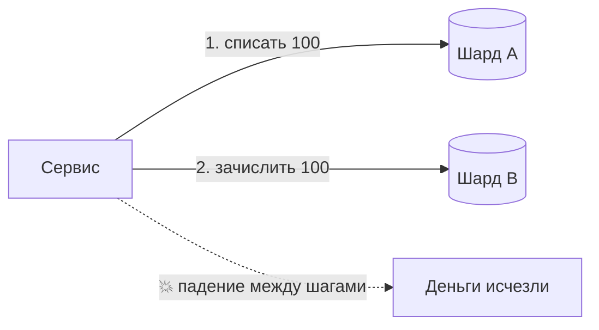
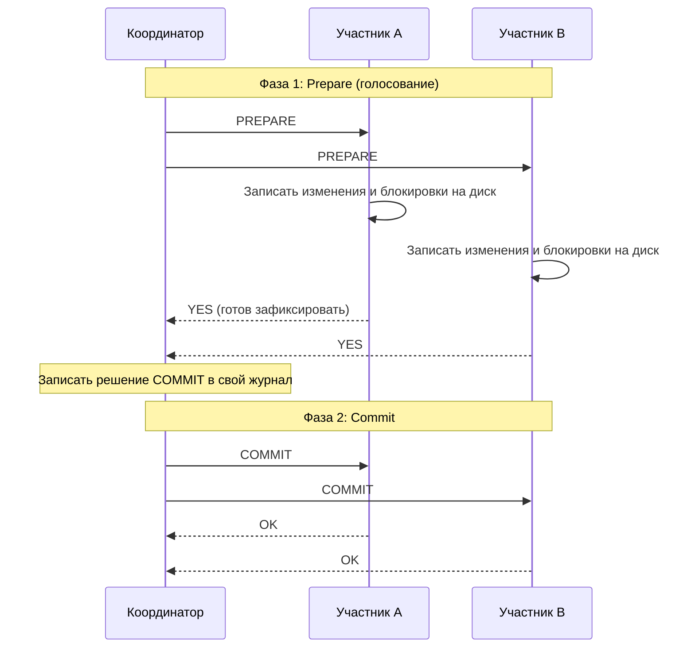
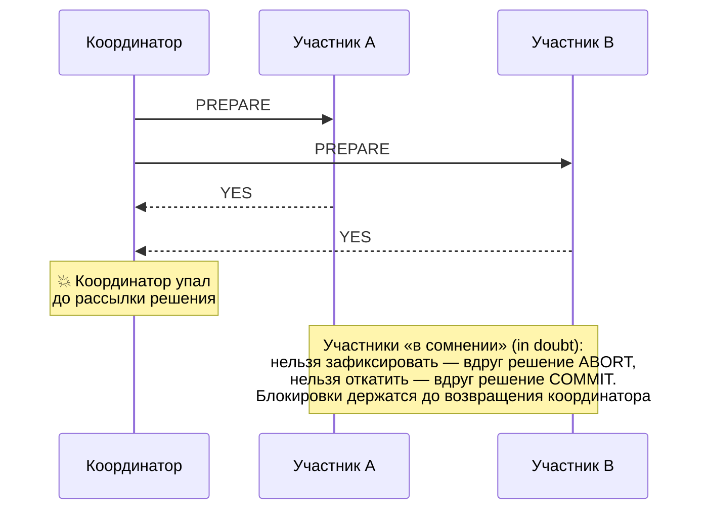
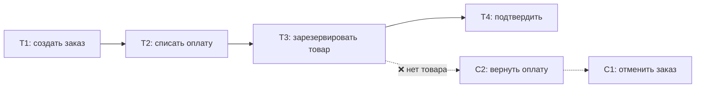
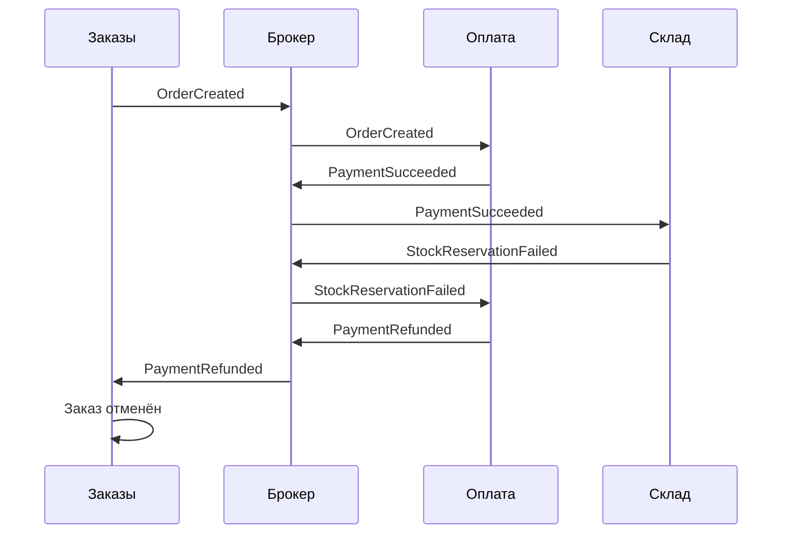
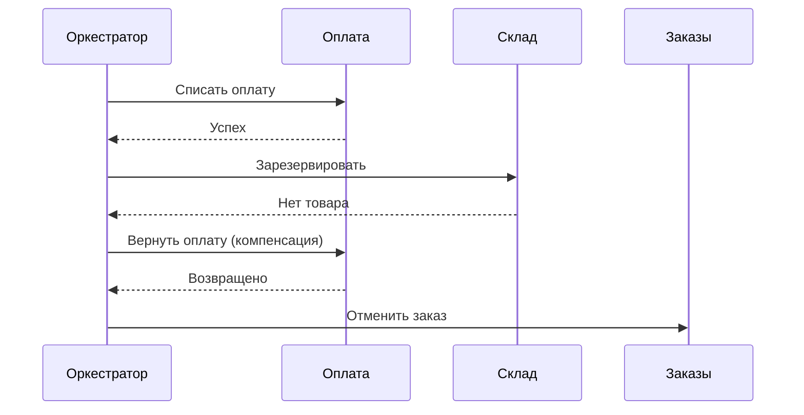
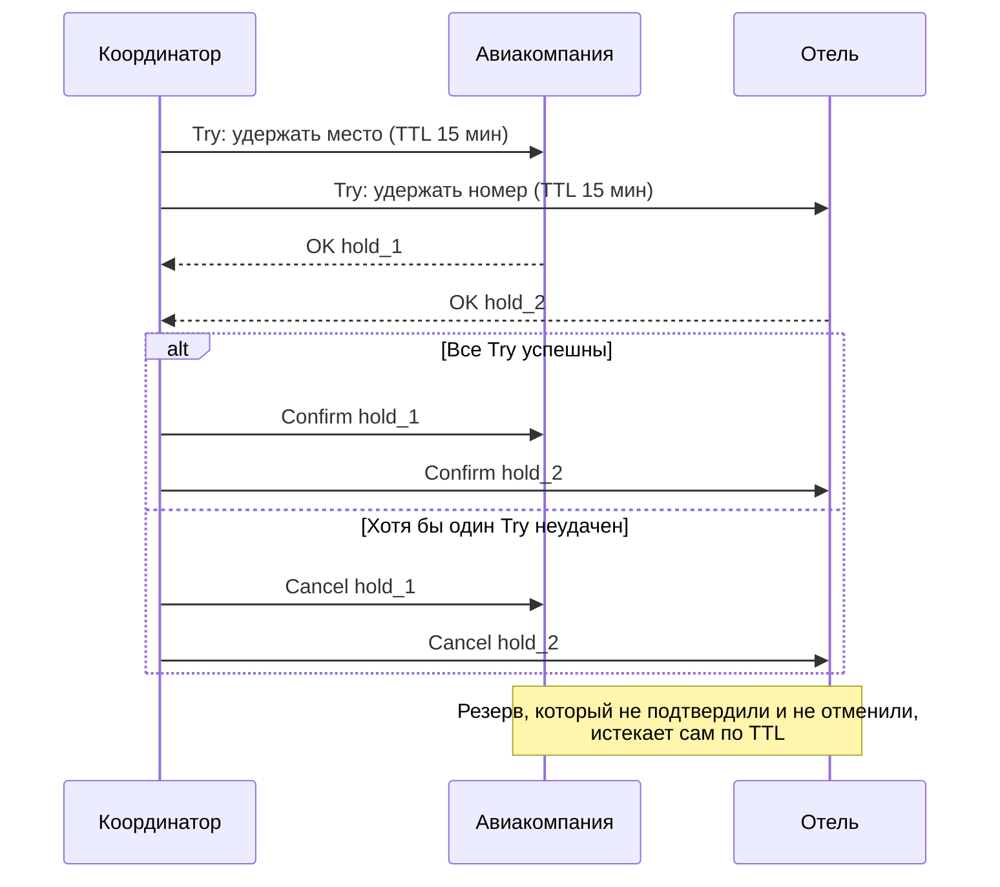
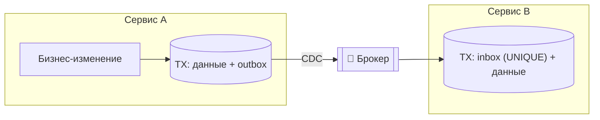
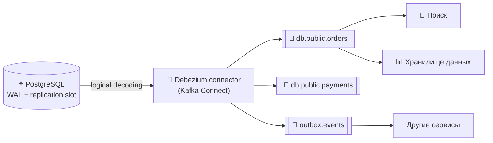
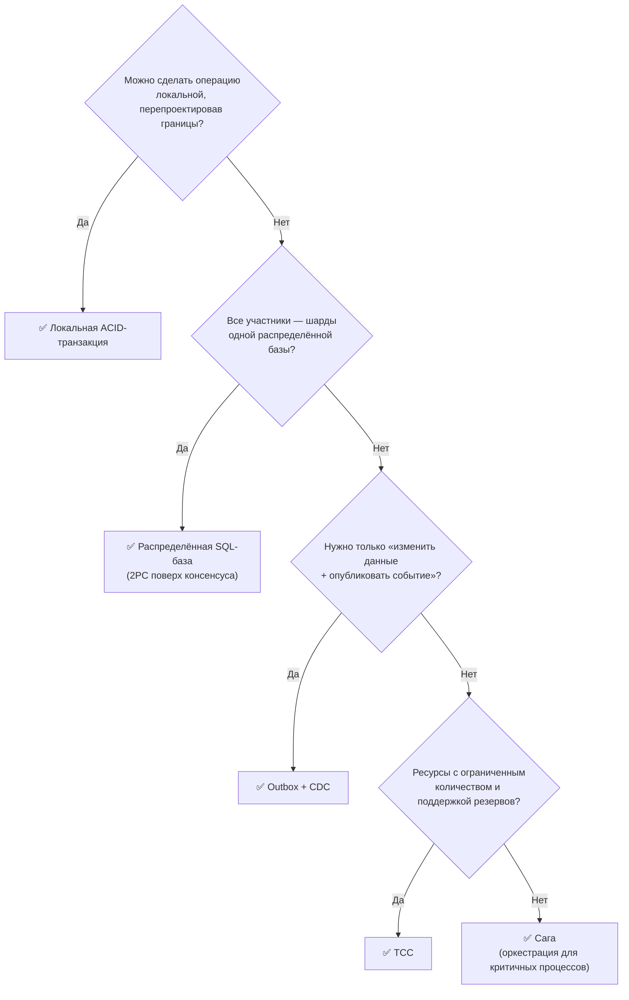

[English](README.md) | **Русский**

# 11. Распределённые транзакции

> **Что внутри:** зачем и когда нужны, 2PC и его блокировка, XA, как это делают Spanner, CockroachDB и Percolator, саги (типы шагов, хореография vs оркестрация, аномалии изоляции и контрмеры, компенсации), TCC, outbox и inbox, CDC, движки рабочих процессов (Temporal, Step Functions)
> **Время на изучение:** ~5 ч · **Нужно для:** микросервисов, платежей, бронирований, шардированных баз, любой операции, затрагивающей несколько систем
> **Практика:** разбор в формате интервью — [INTERVIEW_RU.md](./INTERVIEW_RU.md)
> **Связанные темы:** [04-databases](../04-databases/README_RU.md#8-транзакции-и-acid), [08-consensus](../08-consensus/README_RU.md#2-почему-это-сложно-модели-отказов-и-flp), [09-messaging](../09-messaging/README_RU.md#7-сторона-продюсера-проблема-двойной-записи-и-outbox), [10-idempotency](../10-idempotency/README_RU.md)

---

## 📑 Содержание

1. [Проблема: атомарность через несколько систем](#1-проблема-атомарность-через-несколько-систем)
2. [Карта решений](#2-карта-решений)
3. [Двухфазный коммит (2PC)](#3-двухфазный-коммит-2pc)
4. [Распределённые транзакции в современных базах](#4-распределённые-транзакции-в-современных-базах)
5. [Почему микросервисы избегают 2PC](#5-почему-микросервисы-избегают-2pc)
6. [Саги](#6-саги)
7. [Хореография vs оркестрация](#7-хореография-vs-оркестрация)
8. [Изоляция в сагах: аномалии и контрмеры](#8-изоляция-в-сагах-аномалии-и-контрмеры)
9. [Проектирование компенсаций](#9-проектирование-компенсаций)
10. [TCC: Try-Confirm-Cancel](#10-tcc-try-confirm-cancel)
11. [Outbox и inbox](#11-outbox-и-inbox)
12. [CDC: Change Data Capture](#12-cdc-change-data-capture)
13. [Движки рабочих процессов](#13-движки-рабочих-процессов)
14. [Как выбрать подход](#14-как-выбрать-подход)
15. [Как говорить об этом на интервью](#15-как-говорить-об-этом-на-интервью)
16. [Вопросы для самопроверки](#16-вопросы-для-самопроверки)
17. [Глоссарий и ресурсы](#17-глоссарий-и-ресурсы)

---

## 1. Проблема: атомарность через несколько систем

Внутри одной базы транзакция гарантирует «всё или ничего». Но бизнес-операции часто затрагивают **несколько** независимых систем:

| Операция | Какие системы затрагивает |
|:---------|:--------------------------|
| Оформление заказа | Заказы, оплата, склад, доставка |
| Перевод между счетами на разных шардах | Шард A, шард B |
| Бронирование поездки | Авиакомпания, отель, прокат авто, оплата |
| Сохранение данных и публикация события | База данных, брокер сообщений |



Если между шагами что-то упало, система остаётся в **несогласованном** состоянии: деньги списаны, но не зачислены; оплата прошла, а товара нет.

> [!IMPORTANT]
> Лучшая распределённая транзакция — **та, которой нет**. Прежде чем выбирать механизм, спроси: можно ли перепроектировать границы так, чтобы операция стала локальной? Например, шардировать по ключу, при котором обе стороны операции окажутся в одном шарде, или объединить сервисы, которые всегда меняются вместе. Пэт Хелланд в эссе «Life beyond Distributed Transactions» (2007) подробно описывает этот подход: проектировать **сущности**, внутри которых нужна атомарность, а между ними — асинхронный обмен сообщениями.

---

## 2. Карта решений

| Подход | Гарантия | Цена | Когда |
|:-------|:---------|:-----|:------|
| **Перепроектировать границы** | Локальная ACID-транзакция | Работа над моделью | Всегда сначала попробовать |
| **2PC / XA** | Атомарность (ACID) между участниками | Блокировки, задержка, блокирующий отказ координатора | Внутри одной системы или между ресурсами, поддерживающими XA |
| **Распределённая SQL-база** (Spanner, CockroachDB) | ACID между шардами | Задержка записи, специальная база | Нужны транзакции между шардами одной базы |
| **Сага** | Атомарность в итоге (все шаги или компенсации), **без изоляции** | Сложность компенсаций и аномалий | Микросервисы, внешние API, долгие процессы |
| **TCC** | Резервирование с подтверждением или отменой | Каждый участник должен поддерживать резервы | Ресурсы с ограниченным количеством (места, деньги) |
| **Outbox + CDC** | Атомарно «изменить данные + опубликовать событие» | Отдельный процесс публикации, дубли | Связь базы и брокера |

---

## 3. Двухфазный коммит (2PC)

**2PC (two-phase commit)** — протокол **атомарного коммита**: все участники либо фиксируют транзакцию, либо все откатывают.

### Протокол



1. **Prepare:** координатор спрашивает всех участников, готовы ли они. Участник, ответивший **YES**, обещает зафиксировать транзакцию при любых обстоятельствах (даже после перезапуска) — поэтому записывает изменения на диск и держит блокировки.
2. **Решение:** если все ответили YES — координатор записывает **COMMIT** в свой журнал (это точка невозврата). Если хоть один ответил NO или не ответил — **ABORT**.
3. **Commit/Abort:** координатор рассылает решение; участники применяют его и снимают блокировки. Координатор повторяет рассылку, пока все не подтвердят.

### Главная проблема: блокировка



Участник, проголосовавший YES, **не может** принять решение сам: он не знает, что решил координатор. Блокировки на его строках висят, пока координатор не вернётся. Все транзакции, которым нужны эти строки, ждут.

| Характеристика | Значение |
|:---------------|:---------|
| Задержка | Минимум 2 round trip + несколько fsync |
| Блокировки | Держатся от prepare до commit у всех участников |
| Отказ координатора | **Блокирует** участников в состоянии prepared |
| Отказ участника до голосования | Транзакция откатывается |
| Восстановление | Участники спрашивают координатора; иногда нужно ручное вмешательство (эвристическое решение администратора, которое может нарушить атомарность) |

### XA

**XA** — стандарт 2PC между разнородными ресурсами (базами, брокерами) через общий менеджер транзакций. Поддерживается многими реляционными базами и JMS-брокерами, но:
- координатор обычно живёт внутри сервера приложений и сам становится точкой отказа;
- не все системы поддерживают XA (Kafka, REST API, большинство NoSQL — нет);
- блокировки держатся долго, пропускная способность падает.

### 3PC и неблокирующие варианты

**Трёхфазный коммит** добавляет фазу pre-commit и в теории не блокируется, но только при ограниченных задержках сети — в реальных сетях он не гарантирует корректности. На практике проблему блокировки решают иначе: **делают координатора и участников отказоустойчивыми через консенсус** (Paxos Commit, Gray и Lamport, 2006). Именно так работают Spanner и CockroachDB.

---

## 4. Распределённые транзакции в современных базах

| Система | Подход | Ключевая идея |
|:--------|:-------|:--------------|
| **Google Spanner** | 2PC поверх Paxos-групп + TrueTime | Каждый участник — реплицированная группа, а не узел; координатор не «исчезает». Strict serializability через commit wait |
| **CockroachDB** | 2PC поверх Raft-групп, **parallel commits** | Write intents (временные записи) + запись транзакции; parallel commits сокращают коммит до одного round trip в типичном случае |
| **Percolator** (Google) | Транзакции поверх Bigtable с timestamp oracle | Snapshot isolation; одна «первичная» блокировка определяет судьбу транзакции; используется в TiDB/TiKV |
| **Calvin / FaunaDB** | Детерминированный порядок транзакций | Сначала глобально упорядочить транзакции, затем выполнить детерминированно — без 2PC при выполнении |
| **Kafka transactions** | Протокол, похожий на 2PC, с координатором транзакций | Атомарная запись в несколько партиций + коммит offset |

> [!NOTE]
> Вывод: 2PC сам по себе не плох — плох **хрупкий** координатор. Внутри одной распределённой базы, где координатор и участники реплицированы консенсусом, 2PC работает хорошо. Проблемы начинаются, когда участники — независимые сервисы и внешние системы.

---

## 5. Почему микросервисы избегают 2PC

| Причина | Объяснение |
|:--------|:-----------|
| **Доступность** | Транзакция требует, чтобы **все** участники были доступны. Доступность падает как произведение |
| **Задержка и блокировки** | Ресурсы заблокированы на время всех сетевых раундов; долгие операции (внешний API отвечает 30 с) держат блокировки долго |
| **Нет поддержки** | REST API, Kafka, внешние платёжные провайдеры, большинство NoSQL не поддерживают XA |
| **Связанность** | Сервисы становятся участниками общего протокола и зависят от общего менеджера транзакций |
| **Автономность данных** | Каждый сервис владеет своей базой и не должен давать другим держать в ней блокировки |

Поэтому между сервисами используют **саги** и **outbox**, принимая eventual consistency.

---

## 6. Саги

**Сага** (Garcia-Molina, Salem, 1987) — последовательность **локальных** транзакций. Каждая транзакция обновляет одну систему и запускает следующий шаг. Если шаг не удался, выполняются **компенсирующие транзакции** для уже выполненных шагов в обратном порядке.



| Свойство ACID | В саге |
|:--------------|:-------|
| **Atomicity** | В итоге: либо все шаги, либо компенсации всех выполненных |
| **Consistency** | Локальная в каждом шаге; глобальная — в итоге |
| **Isolation** | **❌ Нет.** Промежуточные состояния видны другим (см. [раздел 8](#8-изоляция-в-сагах-аномалии-и-контрмеры)) |
| **Durability** | ✅ Каждая локальная транзакция надёжна |

### Типы шагов (по Крису Ричардсону)

| Тип | Что это | Пример |
|:----|:--------|:-------|
| **Компенсируемый (compensatable)** | Можно отменить компенсацией | Резерв товара (снять резерв), авторизация карты (void) |
| **Поворотный (pivot)** | Точка невозврата: после него сага идёт только вперёд | Выпуск авиабилета, отправка товара курьеру |
| **Повторяемый (retriable)** | Гарантированно завершится при повторах; не может «не удаться» по бизнес-причинам | Отправить письмо, начислить бонусы, финальный capture платежа |

**Правило порядка:**

```
Компенсируемые шаги  →  Поворотный шаг  →  Повторяемые шаги
```

- Сначала всё, что можно отменить. Самые вероятные к отказу шаги — пораньше, чтобы реже компенсировать.
- Поворотный шаг — как можно **позже**.
- После него — только шаги, которые не могут окончательно провалиться (их ретраят до успеха).

> [!TIP]
> Проектирование саги — это в первую очередь **упорядочивание шагов**. Правильный порядок уменьшает число компенсаций и исключает ситуации, когда отменить уже невозможно.

---

## 7. Хореография vs оркестрация

### Хореография

Нет центрального координатора: каждый сервис слушает события и публикует свои.



### Оркестрация

Оркестратор хранит состояние саги и отправляет команды участникам.



| | Хореография | Оркестрация |
|:-|:------------|:------------|
| Где логика процесса | Размазана по сервисам | В одном месте |
| Связанность | Слабая: сервисы знают только о событиях | Оркестратор знает об участниках |
| Понимание и отладка | Сложно: процесс не виден целиком, возможны циклы | Проще: явный конечный автомат |
| Таймауты, компенсации | Каждый сервис сам | Централизованно |
| Точка отказа | Нет центральной | Оркестратор (делают отказоустойчивым) |
| Когда | 2–3 шага, простые реакции | 4+ шагов, компенсации, таймауты, деньги |

> [!TIP]
> Частый практичный вариант — **гибрид**: оркестрация для критичного бизнес-процесса (оформление, бронирование), хореография для побочных реакций (письма, аналитика, бонусы), которые не влияют на исход саги.

---

## 8. Изоляция в сагах: аномалии и контрмеры

Сага — это **ACD без I**: промежуточные состояния видны другим транзакциям и пользователям.

### Аномалии

| Аномалия | Пример |
|:---------|:-------|
| **Lost update** | Сага А обновила заказ, сага Б перезаписала его, затем сага А компенсировала — изменения Б потеряны |
| **Dirty read** | Сервис бонусов увидел оплату, которую затем вернули (компенсировали), и начислил бонусы |
| **Fuzzy / non-repeatable read** | Разные шаги саги читают одни данные в разные моменты и видят разные значения (цена изменилась между шагами) |

### Контрмеры

| Контрмера | Как работает | Пример |
|:----------|:-------------|:-------|
| **Семантическая блокировка** | Флаг «в процессе» на записи (`status = PENDING`); другие операции видят его и ждут, отказывают или учитывают | Заказ в `APPROVAL_PENDING` нельзя изменить |
| **Коммутативные обновления** | Операции, порядок которых не важен | Списание и зачисление на счёт как приращения |
| **Пессимистичное представление** | Переставить шаги так, чтобы «грязные» данные не были видны там, где это опасно | Начислять бонусы только после поворотного шага |
| **Перечитать значение** | Перед изменением проверить, что данные не изменились с начала саги (оптимистичная блокировка) | Проверить цену перед бронированием |
| **Журнал версий** | Записывать операции, чтобы применить их в правильном порядке, даже если пришли не по порядку | Отмена пришла раньше создания — запомнить и применить позже |
| **По значению (by value)** | Для рискованных операций (крупная сумма) — распределённая транзакция или синхронная проверка; для обычных — сага | Переводы выше порога через более строгий путь |

> [!IMPORTANT]
> **Сигнал Senior+:** сказать, что у саги нет изоляции, и назвать, какая аномалия опасна в этой задаче и какая контрмера её закрывает. Обычно достаточно **семантической блокировки** (статус `PENDING`) и **пессимистичного порядка** шагов.

---

## 9. Проектирование компенсаций

| Правило | Почему |
|:--------|:-------|
| **Компенсация — это бизнес-операция, а не «откат»** | Списанные деньги не «отменяются», а возвращаются (refund), возможно с комиссией; отправленное письмо нельзя отозвать — отправляют уточнение |
| **Компенсации идемпотентны** | Их будут повторять ([10-idempotency](../10-idempotency/README_RU.md)) |
| **Компенсации ретраят до успеха** | Их нельзя «бросить» — иначе система навсегда несогласованна |
| **Компенсация может окончательно не удаться** | Внешний API отказал навсегда → очередь ручного разбора и уведомление поддержки |
| **Компенсировать можно не всё** | Поэтому необратимые действия — поворотный шаг, как можно позже |
| **Компенсации коммутируют с повторами** | Если компенсация пришла раньше самой операции (сообщения не по порядку), операция должна это увидеть и не выполниться («отменено до начала») |
| **Таймауты** | Каждый шаг имеет таймаут; при истечении — запрос статуса и решение: ждать, ретраить или компенсировать |

> [!WARNING]
> Классическая ловушка: участник получил **компенсацию раньше**, чем исходную команду (из-за ретраев и порядка доставки). Если он «ничего не делает», а потом приходит исходная команда — он её выполнит, и операция останется незакомпенсированной. Решение: записывать «отменено» даже для неизвестной операции и отклонять исходную команду, если отмена уже была.

---

## 10. TCC: Try-Confirm-Cancel

Вариант саги, где каждый участник предоставляет **три** операции:

| Фаза | Что делает | Пример: бронирование места |
|:-----|:-----------|:---------------------------|
| **Try** | Резервирует ресурс, проверяет бизнес-правила, ничего не делает окончательно | Удержать место на 15 минут |
| **Confirm** | Окончательно применяет резерв | Выписать место на пассажира |
| **Cancel** | Освобождает резерв | Вернуть место в продажу |



| | Сага с компенсациями | TCC |
|:-|:---------------------|:----|
| Видимость промежуточного состояния | Изменение уже применено | Только резерв |
| Компенсация | Обратная бизнес-операция (refund) | Отмена резерва — дешевле и чище |
| Требования к участникам | Операция + компенсация | Три операции и поддержка резервов с TTL |
| Похоже на | — | 2PC на уровне бизнес-логики, но без удержания блокировок базы |

TCC подходит для ресурсов с ограниченным количеством: места, номера, деньги (авторизация карты = try, capture = confirm, void = cancel).

---

## 11. Outbox и inbox

### Outbox (отправка)

Атомарно изменить данные **и** опубликовать событие: событие пишется в таблицу `outbox` в той же транзакции, отдельный процесс публикует его в брокер. Подробно — в [09-messaging](../09-messaging/README_RU.md#7-сторона-продюсера-проблема-двойной-записи-и-outbox).

| Способ публикации | Как | Плюсы | Минусы |
|:------------------|:----|:------|:-------|
| **Polling publisher** | Периодически `SELECT ... FROM outbox WHERE published = false` | Просто, без доп. инфраструктуры | Задержка, нагрузка на БД, сложнее сохранить порядок при нескольких публикаторах |
| **Log tailing (CDC)** | Чтение WAL/binlog (Debezium) | Низкая задержка, порядок как в журнале, нет нагрузки запросами | Нужна CDC-инфраструктура |

### Inbox (получение)

Зеркальный паттерн для получателя: входящее сообщение сначала записывается в таблицу `inbox` (с UNIQUE по ID сообщения) **в той же транзакции**, что и его обработка. Дубль упадёт на ограничении. Это и есть идемпотентный консьюмер.



### Listen to yourself

Сервис публикует событие и **сам** обрабатывает его, чтобы обновить свои данные. Тогда событие и изменение состояния не расходятся. Используется редко, но полезно знать.

---

## 12. CDC: Change Data Capture

**CDC** — превращение изменений в базе в поток событий.

### Способы

| Способ | Как | Плюсы | Минусы |
|:-------|:----|:------|:-------|
| **По запросам (query-based)** | Периодически выбирать строки с `updated_at > последний_раз` | Просто | Не видит удаления; пропускает промежуточные изменения; нагрузка на БД; проблемы с одинаковым временем |
| **Триггеры** | Триггер пишет изменения в таблицу-журнал | Видит всё | Замедляет запись, связывает схему с CDC |
| **Чтение журнала (log-based)** | Чтение WAL (PostgreSQL), binlog (MySQL), oplog (MongoDB) | Все изменения, включая удаления, в порядке коммитов, без нагрузки запросами | Сложнее инфраструктура, зависимость от формата журнала |

### Как работает Debezium



1. **Начальный снимок:** при первом запуске выгрузить текущее состояние таблиц.
2. **Стриминг:** затем читать изменения из журнала, начиная с позиции снимка.
3. Каждое изменение — событие с `before` и `after` (для удаления — `after = null`, затем tombstone для compaction в Kafka).
4. Ключ сообщения — первичный ключ строки → все изменения одной строки упорядочены в одной партиции.
5. Доставка **at-least-once**: после сбоя коннектор может повторить события → консьюмеры идемпотентны.

### Применения

| Применение | Как |
|:-----------|:----|
| Outbox | Публикация событий из таблицы outbox |
| Инвалидация кэша | См. [02-caching](../02-caching/README_RU.md#7-инвалидация) |
| Поисковые индексы | Elasticsearch обновляется из потока изменений |
| Хранилище данных и аналитика | Почти реальное время вместо ночных выгрузок |
| Синхронизация данных между сервисами | Локальные копии чужих данных |
| Миграции без простоя | Поток изменений из старой базы в новую (см. [06-partitioning](../06-partitioning/README_RU.md#10-переход-от-одной-базы-к-шардам)) |

> [!WARNING]
> **Эксплуатационная ловушка PostgreSQL:** replication slot держит WAL, пока коннектор его не прочитал. Если Debezium остановлен на несколько часов, WAL копится и может **заполнить диск primary** и остановить базу. Нужен мониторинг отставания слота и лимит (`max_slot_wal_keep_size`).

### Сырой CDC или outbox

| | Сырые изменения таблиц | Outbox через CDC |
|:-|:-----------------------|:-----------------|
| Что видят потребители | Внутреннюю схему таблиц | Явные доменные события |
| Изменение схемы БД | Ломает потребителей | Не влияет, контракт — событие |
| Когда | Внутренние задачи: аналитика, поиск, кэш | Обмен между сервисами разных команд |

---

## 13. Движки рабочих процессов

Писать оркестратор саги вручную (конечный автомат, таймеры, ретраи, outbox) — много кода с тонкими ошибками. Поэтому используют **движки рабочих процессов** (durable execution):

| Движок | Модель |
|:-------|:-------|
| **Temporal** / Cadence | Workflow как обычный код; движок сохраняет историю событий и восстанавливает состояние после сбоев воспроизведением (replay) |
| **AWS Step Functions** | Конечный автомат в JSON/YAML, managed |
| **Camunda / Zeebe** | BPMN-процессы |
| **Netflix Conductor** | JSON-описание процессов |

```python
# Псевдокод workflow в стиле Temporal: сага как обычный код
@workflow
def book_order(order):
    compensations = []
    try:
        pay = activity(charge_payment, order, retry=RetryPolicy(max_attempts=5))
        compensations.append(lambda: activity(refund_payment, pay))
        res = activity(reserve_stock, order)
        compensations.append(lambda: activity(release_stock, res))
        activity(confirm_order, order)
    except BusinessError:
        for undo in reversed(compensations):
            undo()                     # компенсации тоже ретраятся движком
        activity(cancel_order, order)
```

| Что даёт движок | Почему важно |
|:----------------|:-------------|
| Надёжное состояние | Процесс переживает перезапуск сервиса |
| Ретраи и таймауты на шаг | Не нужно писать самому |
| Долгие таймеры | «Подождать 3 дня ответа» без cron и опроса |
| Видимость | Каждый процесс и его история видны в UI |

> [!NOTE]
> Требование к коду workflow — **детерминированность**: при воспроизведении истории он должен принимать те же решения. Все побочные эффекты (сеть, время, случайность) — только через activities и API движка.

---

## 14. Как выбрать подход



---

## 15. Как говорить об этом на интервью

### Ответ за 30 секунд

> «Сначала пытаюсь избежать распределённой транзакции: сделать границы сервисов или шардов так, чтобы операция была локальной. Если не получается: между шардами одной базы — распределённая SQL (2PC поверх Raft, координатор не точка отказа). Между сервисами и внешними API 2PC не использую — блокирует при отказе координатора и не поддерживается. Вместо него — сага: компенсируемые шаги, затем поворотный, затем повторяемые; оркестрация через durable workflow для критичных процессов. Изоляции у саги нет — закрываю семантическими блокировками и порядком шагов. Компенсации идемпотентны и ретраятся до успеха, иначе — ручной разбор. Для ресурсов с ограниченным количеством — TCC с резервами по TTL. Данные и события связываю через outbox и CDC».

### Вопросы, которые стоит задать

1. Какие системы затрагивает операция? Под чьим контролем каждая?
2. Можно ли отменить каждый шаг? Какой шаг необратим?
3. Что увидят пользователи и другие сервисы в промежуточном состоянии?
4. Что делать, если компенсация не удалась?
5. Сколько длится процесс: миллисекунды или дни?

### Типичные ошибки

- Предлагать 2PC между микросервисами и внешними API.
- Сага без компенсаций или с компенсациями, которые «откатывают» необратимое.
- Необратимый шаг в начале саги.
- Забыть про отсутствие изоляции.
- Неидемпотентные шаги и компенсации.
- Компенсация «ничего не делает», если операции ещё не было, — и потом операция выполняется.
- Двойная запись в базу и брокер без outbox.
- CDC без мониторинга replication slot.

---

## 16. Вопросы для самопроверки

<details>
<summary><b>1. Почему 2PC называют блокирующим протоколом?</b></summary>

Участник, проголосовавший YES, обязан выполнить решение координатора, но не знает его, если координатор упал до рассылки. Он не может ни зафиксировать, ни откатить и держит блокировки, пока координатор не вернётся. Все транзакции, которым нужны эти данные, ждут.
</details>

<details>
<summary><b>2. Почему Spanner и CockroachDB используют 2PC, а микросервисы — нет?</b></summary>

В распределённых базах координатор и участники — группы, реплицированные консенсусом, поэтому отказ одного узла не блокирует протокол, а сеть внутри кластера быстрая. Микросервисы и внешние API не поддерживают общий протокол, имеют независимую доступность и долгие операции, а блокировки в чужих базах нарушают автономность сервисов.
</details>

<details>
<summary><b>3. Что такое поворотный шаг саги и где его размещать?</b></summary>

Точка невозврата: после него сага идёт только вперёд, а все последующие шаги должны быть повторяемыми. Его размещают после всех компенсируемых шагов и как можно позже, чтобы необратимое действие выполнялось только когда всё остальное уже точно получилось.
</details>

<details>
<summary><b>4. Хореография или оркестрация для процесса из 6 шагов с деньгами?</b></summary>

Оркестрация: явный конечный автомат, таймауты и компенсации в одном месте, процесс легко понять и отладить. Хореография для 6 шагов размазывает логику по сервисам и усложняет компенсации и анализ сбоев.
</details>

<details>
<summary><b>5. Почему у саги нет изоляции и как с этим жить?</b></summary>

Каждый шаг — отдельная закоммиченная транзакция, поэтому промежуточные состояния видны другим. Контрмеры: семантическая блокировка (статус PENDING), коммутативные операции, пессимистичный порядок шагов, перепроверка значений перед изменением, журнал версий, более строгий путь для рискованных операций.
</details>

<details>
<summary><b>6. Что делать, если компенсация окончательно не удалась?</b></summary>

Ретраить с backoff, пока есть шанс; если ошибка постоянная — перевести сагу в состояние «требует вмешательства», поставить задачу в очередь ручного разбора, уведомить поддержку и при необходимости пользователя. Сагу нельзя молча бросить.
</details>

<details>
<summary><b>7. Чем TCC отличается от обычной саги?</b></summary>

В TCC первый шаг — только резерв (try), а не окончательное изменение; затем confirm или cancel. Отмена резерва дешевле и чище, чем обратная бизнес-операция, а незавершённые резервы истекают по TTL. Цена — каждый участник должен поддерживать резервы.
</details>

<details>
<summary><b>8. Зачем нужен inbox, если есть outbox?</b></summary>

Outbox гарантирует, что событие будет опубликовано (возможно, повторно). Inbox на стороне получателя гарантирует, что повторное событие не будет обработано дважды: ID сообщения записывается с ограничением уникальности в той же транзакции, что и обработка.
</details>

<details>
<summary><b>9. Чем log-based CDC лучше выборки по updated_at?</b></summary>

Чтение журнала видит все изменения, включая удаления и промежуточные значения, в порядке коммитов, и не нагружает базу запросами. Выборка по updated_at пропускает удаления и промежуточные изменения, путается при одинаковом времени и создаёт нагрузку.
</details>

<details>
<summary><b>10. Какая эксплуатационная опасность у CDC в PostgreSQL?</b></summary>

Replication slot удерживает WAL, пока коннектор его не прочитал. Если коннектор долго не работает, WAL растёт и может заполнить диск primary. Нужны мониторинг отставания слота и ограничение `max_slot_wal_keep_size`.
</details>

---

## 17. Глоссарий и ресурсы

### Глоссарий

| Термин | Значение |
|:-------|:---------|
| Распределённая транзакция | Транзакция, затрагивающая несколько независимых систем |
| 2PC | Двухфазный коммит: prepare и commit/abort |
| Координатор / участник | Управляющий узел 2PC / узел, выполняющий часть транзакции |
| In doubt | Участник проголосовал YES и не знает решения |
| XA | Стандарт 2PC между разнородными ресурсами |
| Сага | Последовательность локальных транзакций с компенсациями |
| Компенсирующая транзакция | Бизнес-операция, отменяющая эффект шага |
| Поворотный шаг | Точка невозврата саги |
| Хореография / оркестрация | Координация саги через события / через центральный оркестратор |
| Семантическая блокировка | Флаг «в процессе» на уровне бизнес-данных |
| TCC | Try-Confirm-Cancel: резерв, подтверждение, отмена |
| Outbox / inbox | Таблица исходящих событий / входящих сообщений в транзакции с данными |
| CDC | Change Data Capture: поток изменений базы |
| Replication slot | Механизм PostgreSQL, удерживающий WAL для потребителя |
| Durable execution | Выполнение процессов с сохранением состояния, переживающее сбои |

### Ресурсы

- *Designing Data-Intensive Applications*, Martin Kleppmann — глава 9, раздел «Distributed Transactions and Consensus»
- Hector Garcia-Molina, Kenneth Salem, *Sagas* (SIGMOD 1987)
- Jim Gray, Leslie Lamport, *Consensus on Transaction Commit* (2006)
- Pat Helland, *Life beyond Distributed Transactions: an Apostate's Opinion* (CIDR 2007)
- Chris Richardson, *Microservices Patterns* (2018) — глава 4 «Managing transactions with sagas»
- Peng, Dabek, *Large-scale Incremental Processing Using Distributed Transactions and Notifications* (OSDI 2010) — Percolator
- Thomson et al., *Calvin: Fast Distributed Transactions for Partitioned Database Systems* (SIGMOD 2012)
- Corbett et al., *Spanner: Google's Globally-Distributed Database* (OSDI 2012)
- Caitie McCaffrey, *Applying the Saga Pattern* (доклад, 2015)
- Документация Debezium, Temporal, AWS Step Functions