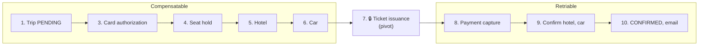
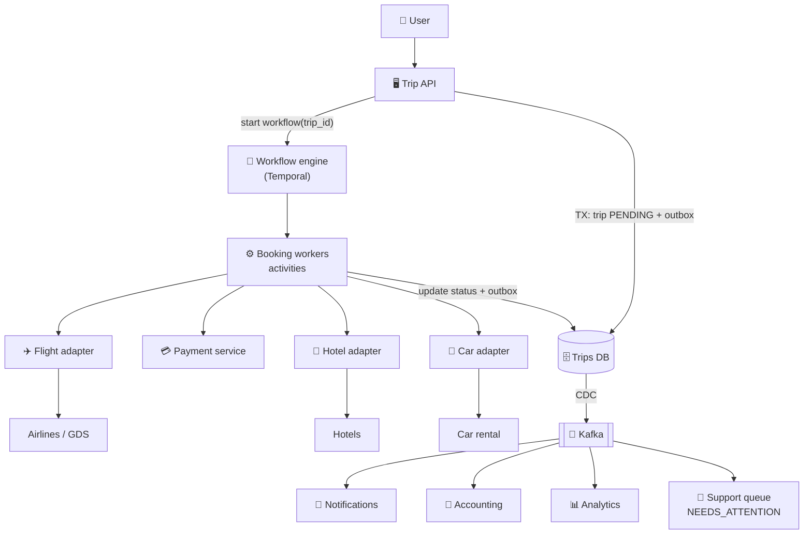
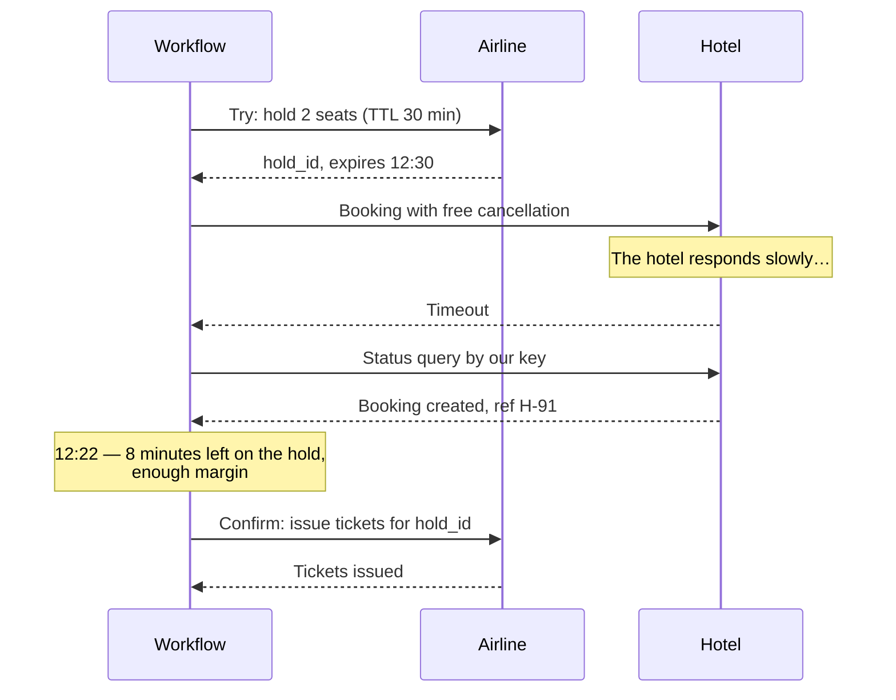
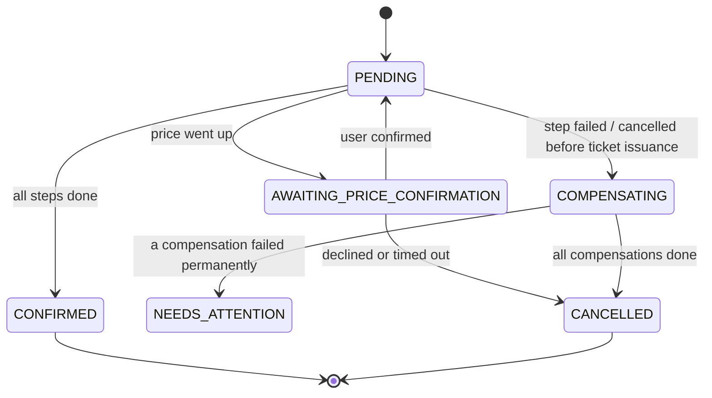

**English** | [Русский](INTERVIEW.ru.md) · Theory: [README.md](./README.md)

# 11. Distributed Transactions: Booking a Trip (Flight + Hotel + Car)

> **Topic:** why not 2PC, an orchestrated saga, step ordering (compensatable → pivot → retriable), TCC reservations at partners, a durable workflow, isolation anomalies, compensations that fail, outbox and CDC for the other systems
> **Level:** Hard · **Interview time:** 45 min · **Study time:** ~5 h
> **Where it's asked:** "Design trip booking / Expedia / Booking", "how do you do a transaction across microservices", and as a deep dive in order and payment problems

---

## 🗺️ How to Read This Walkthrough

| Icon | Meaning |
|:----:|:--------|
| 🎤 | Interviewer |
| 🗣️ | What I (the candidate) say out loud |
| ✏️ | What I draw on the whiteboard |
| ⏱️ | Time budget for the step |

Callouts: **TIP** — a good technique, **WARNING** — a trap, **IMPORTANT** — a Senior+ signal.

---

## 📑 Contents

1. [Problem Statement](#1-problem-statement)
2. [Clarifying Questions and Requirements](#2-clarifying-questions-and-requirements)
3. [Capacity Estimates](#3-capacity-estimates)
4. [Why Not 2PC](#4-why-not-2pc)
5. [Saga Steps and Their Order](#5-saga-steps-and-their-order)
6. [API and Data Model](#6-api-and-data-model)
7. [High-Level Design](#7-high-level-design)
8. [Deep Dive 1: The Orchestrator on a Durable Workflow](#8-deep-dive-1-the-orchestrator-on-a-durable-workflow)
9. [Deep Dive 2: Partner Reservations (TCC)](#9-deep-dive-2-partner-reservations-tcc)
10. [Deep Dive 3: Isolation — What the User and Other Services See](#10-deep-dive-3-isolation--what-the-user-and-other-services-see)
11. [Deep Dive 4: When a Compensation Fails](#11-deep-dive-4-when-a-compensation-fails)
12. [Deep Dive 5: Connecting the Other Systems — Outbox and CDC](#12-deep-dive-5-connecting-the-other-systems--outbox-and-cdc)
13. [Bottlenecks and Failure Scenarios](#13-bottlenecks-and-failure-scenarios)
14. [What Changes at 10x Scale](#14-what-changes-at-10x-scale)
15. [Interviewer Questions with Answers](#15-interviewer-questions-with-answers)
16. [Common Mistakes](#16-common-mistakes)
17. [Cheat Sheet and Self-Check](#17-cheat-sheet-and-self-check)

---

## 1. Problem Statement

> 🎤 "A user assembles a trip: a flight, a hotel and a rental car — and pays for everything with one button. All three bookings go through external partner APIs. The user must never pay and end up with a ticket but no hotel, or a hotel but no ticket. Design the booking."

**Time plan:**

| Step | ⏱️ |
|:-----|:--:|
| Requirements | 5 min |
| Estimates | 2 min |
| Why not 2PC, saga steps | 8 min |
| API, data, high-level | 7 min |
| Deep dives | 18 min |
| Failures and wrap-up | 5 min |

> [!TIP]
> This is the classic saga problem. The interviewer expects you to first **explain why 2PC is impossible**, then design a saga with a well-thought-out **step order**. The step order is the most important part of the answer.

---

## 2. Clarifying Questions and Requirements

⏱️ 5 min

| My question | Interviewer's answer | What it changes |
|:------------|:---------------------|:----------------|
| Do partners support a hold without a final booking? | Airlines — seat holds for 15–30 minutes; hotels — bookings with free cancellation; car rental — bookings with free cancellation | TCC reservations are possible |
| What's irreversible? | Issuing an airline ticket: after it, cancelling means a refund with a fee | Ticket issuance is the pivot step, as late as possible |
| How does payment work? | Card authorization (a hold) and capture are separate | Authorization is compensatable (void), capture comes after success |
| How fast do partners respond? | A second to a minute; sometimes timeouts and errors (1–5%) | An async process with a status, timeouts, retries |
| Can the user get a partial trip? | No: all or nothing (with a refund) | A saga compensating every step before the pivot |
| What if the price changed between search and booking? | Show the new price and ask for confirmation | Reread the value before booking |

### Functional requirements

1. Book a flight, a hotel and a car as one trip with one payment.
2. All or nothing: if any step fails, cancel the others and refund.
3. The user sees booking status in real time.
4. The user can cancel after confirmation (per fare rules).

### Non-functional requirements

| Requirement | Target |
|:------------|:-------|
| Correctness | No "half" trip paid for by the user; no double booking at a partner |
| Reliability | The booking process survives a restart of any of our services |
| Latency | "Booking started" response < 500 ms; the outcome usually < 1 min |
| Observability | For each trip, you can see which step it's on and why |

---

## 3. Capacity Estimates

⏱️ 2 min

✏️

```
Trip bookings            = 500K/day → ~6/s average, peak ~100/s
Steps per trip           ≈ 8–10 (reservations, payment, issuance, confirmations)
Partner calls            ≈ 100 × 6 = 600/s at peak (more with retries)
Partner failures         ≈ 1–5% of calls
Saga state               ≈ 20 events × 1 KB = 20 KB per trip → 10 GB/day
```

🗣️ "The load is small. The difficulty isn't scale but **correctness** with slow, unreliable external systems, and the fact that the process lasts from seconds to minutes."

---

## 4. Why Not 2PC

⏱️ 3 min

> 🎤 "Why can't you just do a distributed transaction?"

🗣️

| Reason | In this problem |
|:-------|:----------------|
| No protocol support | Partners are external REST APIs; they won't participate in our 2PC and don't support XA |
| Long operations | Responses take up to a minute; holding locks and waiting for "prepare" from everyone isn't realistic |
| Availability | The transaction succeeds only if **every** partner is available at the same time |
| Blocking on failure | If our coordinator crashes, the partner holds get stuck |

"But partners provide **reservations with TTL** (seat holds, bookings with free cancellation) — the business equivalent of the prepare phase. So the solution is a **saga**, with **TCC reservations** at partners where possible."

---

## 5. Saga Steps and Their Order

⏱️ 5 min

🗣️ "The key is the order: **compensatable steps → pivot → retriable**."

| # | Step | Type | Compensation | Why here |
|:-:|:-----|:-----|:-------------|:---------|
| 1 | Create the trip `PENDING` | Compensatable | Trip `CANCELLED` | A semantic lock from the first second |
| 2 | Recheck prices with partners | — | — | The price may have changed since search |
| 3 | Authorize the card (hold the amount) | Compensatable | Void the authorization | The most common reason for failure (insufficient funds) — check it early and cheaply |
| 4 | Hold flight seats (TTL 30 min) | Compensatable | Release the seats | Flights are the scarcest resource |
| 5 | Book the hotel (free cancellation) | Compensatable | Cancel the booking | |
| 6 | Book the car (free cancellation) | Compensatable | Cancel the booking | |
| 7 | **Issue the airline ticket** | **Pivot** | — (only a refund with a fee) | Irreversible — so after all reservations |
| 8 | Capture the payment | Retriable | — | The authorization exists — retried until it succeeds |
| 9 | Confirm the hotel and car | Retriable | — | The bookings exist |
| 10 | Trip `CONFIRMED`, email, loyalty points | Retriable | — | Retried until they succeed |



> [!IMPORTANT]
> **Senior+ signal:** explain **why** the order is what it is:
> - card authorization comes early — it's the most common failure reason, and voiding it is free;
> - ticket issuance comes late — it's the only irreversible step;
> - after the pivot, nothing can fail permanently: capturing an existing authorization and confirming existing bookings are only ever retried.

---

## 6. API and Data Model

⏱️ 3 min

### API

```http
POST /v1/trips
     Headers: Idempotency-Key: <uuid>
     Body: { flight_offer_id, hotel_offer_id, car_offer_id, payment_method_id, travelers[] }
     → 202 { trip_id, status: "PENDING" }

GET  /v1/trips/{trip_id}         → { status, steps[], price, failure_reason? }
WS   /v1/trips/{trip_id}/events  ← status changes
POST /v1/trips/{trip_id}/confirm-price   { new_total }   ← if the price changed
POST /v1/trips/{trip_id}/cancel
```

### Data

```sql
CREATE TABLE trips (
  trip_id       BIGINT PRIMARY KEY,
  user_id       BIGINT NOT NULL,
  status        TEXT   NOT NULL,   -- PENDING | AWAITING_PRICE_CONFIRMATION | CONFIRMED
                                   -- | COMPENSATING | CANCELLED | NEEDS_ATTENTION
  total_amount  NUMERIC(12,2),
  version       INT    NOT NULL,
  created_at    TIMESTAMPTZ
);

CREATE TABLE trip_bookings (       -- one row per partner
  trip_id          BIGINT,
  kind             TEXT,           -- flight | hotel | car | payment
  partner_ref      TEXT,           -- the booking or hold ID at the partner
  idempotency_key  TEXT UNIQUE,    -- our key for partner calls: trip_id + kind + step
  status           TEXT,           -- HELD | BOOKED | CONFIRMED | RELEASED | FAILED
  hold_expires_at  TIMESTAMPTZ,
  PRIMARY KEY (trip_id, kind)
);

CREATE TABLE outbox ( ... );       -- events for other systems
```

🗣️ "The saga's own state (which step, how many attempts, timers) is held by the **workflow engine**. Our database holds the business state of the trip and bookings that the user and other services see."

---

## 7. High-Level Design

⏱️ 4 min

✏️



🗣️ "Key decisions:
- **Orchestration** via a durable workflow — we have 10 steps, compensations, timeouts and money;
- **adapters** per partner type: a uniform hold/confirm/cancel interface, an idempotency key, retries with backoff and a circuit breaker per partner;
- **outbox + CDC** — the other systems (notifications, accounting, analytics) learn about trip changes reliably and asynchronously."

---

## 8. Deep Dive 1: The Orchestrator on a Durable Workflow

> 🎤 "Why a workflow engine and not your own state table?"

🗣️ "A home-grown orchestrator is a state machine in a database, timers, retries with backoff, an outbox for commands, restart handling, observability. Lots of code with subtle bugs. A durable workflow (Temporal or similar) gives all of this out of the box: the process is written as ordinary code, and the engine stores each step's history and restores execution after a failure."

```python
@workflow
def book_trip(trip):
    undo = []
    try:
        activity(recheck_prices, trip)                                  # BusinessError if the price went up
        auth = activity(authorize_card, trip, idem=f"{trip.id}:auth")
        undo.append(lambda: activity(void_authorization, auth))

        hold = activity(hold_flight_seats, trip, idem=f"{trip.id}:flight-hold")
        undo.append(lambda: activity(release_flight_hold, hold))

        hotel = activity(book_hotel_refundable, trip, idem=f"{trip.id}:hotel")
        undo.append(lambda: activity(cancel_hotel, hotel))

        car = activity(book_car_refundable, trip, idem=f"{trip.id}:car")
        undo.append(lambda: activity(cancel_car, car))

        # 🔒 The pivot step: after it, only forward
        ticket = activity(issue_ticket, hold, idem=f"{trip.id}:ticket",
                          timeout=minutes(2), retry=limited)
    except BusinessError as e:
        for u in reversed(undo):
            u()                                    # each compensation is retried until it succeeds
        activity(mark_trip_cancelled, trip, reason=e)
        return

    # Retriable steps: unlimited retries with backoff
    activity(capture_payment, auth, retry=forever)
    activity(confirm_hotel_and_car, hotel, car, retry=forever)
    activity(mark_trip_confirmed, trip, retry=forever)
```

| Property | How it's provided |
|:---------|:------------------|
| Survives restarts | The engine stores history and restores state |
| Idempotent partner calls | A deterministic key `trip_id:step` → a retry doesn't create a second booking (see [10-idempotency](../10_Idempotency/README.md)) |
| Step timeouts | Set per activity; on timeout — query the partner's status, then decide |
| Visibility | Each trip is a workflow with history in the engine's UI |

> [!WARNING]
> Workflow code must be **deterministic**: no direct network calls, current time or randomness — only through activities and the engine's API. Otherwise, replaying history makes the process behave differently.

---

## 9. Deep Dive 2: Partner Reservations (TCC)

> 🎤 "A seat hold lasts 30 minutes. What if the saga is stuck longer than that?"

🗣️ "This is TCC: **try** = seat hold, **confirm** = ticket issuance, **cancel** = release the hold. If we do neither confirm nor cancel, the reservation **expires by itself** via the partner's TTL — protection against getting stuck.

But we must not let the hold expire **before** issuing the ticket while we think the seat is ours:
- I store `hold_expires_at` and check the remaining time before ticket issuance;
- the hotel and car steps have strict timeouts so the saga fits within the TTL;
- if there's little time left — extend the hold (if the partner allows) or start compensating."



| Situation | Action |
|:----------|:-------|
| The partner answered "no seats" | `BusinessError` → compensations |
| Timeout | Query the status by our key, then retry with the same key |
| The hold is about to expire | Extend it or compensate; **don't** issue a ticket on an expired hold |
| Ticket issuance failed after retries | Nothing before the pivot is irreversible → full compensation |

---

## 10. Deep Dive 3: Isolation — What the User and Other Services See

> 🎤 "While the saga is running, the user clicks 'Cancel trip'. Or the loyalty service credits points for a trip that isn't confirmed yet. What do you do?"

🗣️ "A saga has no isolation — intermediate states are visible. For each dangerous anomaly — its own countermeasure:

| Anomaly | Example | Countermeasure |
|:--------|:--------|:---------------|
| An action on a trip 'in progress' | A cancellation during booking | **Semantic lock:** the trip is `PENDING`; cancellation becomes a **signal** to the workflow, which decides itself: if the pivot hasn't been passed — compensate everything; if it has — cancel per fare rules |
| Dirty read | Points for a trip that later rolled back | **Pessimistic order:** the event for loyalty and accounting is published only on `CONFIRMED`, not on intermediate steps |
| Fuzzy read | The price changed between search and booking | **Reread value:** step 2 rechecks prices; if they went up — `AWAITING_PRICE_CONFIRMATION`, wait for the user's confirmation (a workflow signal with a timeout) |
| A double trip | The user tapped 'Pay' twice | An idempotency key on `POST /trips` |



> [!TIP]
> A user's cancellation isn't a direct change to the trip but a **signal** to the running workflow. That way the decision is made in one place, taking into account which steps have already been done.

---

## 11. Deep Dive 4: When a Compensation Fails

> 🎤 "The hotel is booked, ticket issuance failed, and the hotel's cancellation API has been returning 500 for an hour. What do you do?"

🗣️ "Compensations can't be abandoned:

| Level | Action |
|:------|:-------|
| 1 | Retry the compensation with exponential backoff and jitter, for hours (the workflow engine allows long retries) |
| 2 | An idempotent cancellation key `trip_id:hotel-cancel` — retries are safe |
| 3 | The other compensations run **independently**: voiding the card authorization doesn't wait for the hotel — the user shouldn't wait for a refund because of someone else's problem |
| 4 | After N hours or a permanent error — status `NEEDS_ATTENTION`, a task in the support queue with the full step history |
| 5 | Support cancels manually (by phone with the partner) and closes the task; if the hotel bills anyway, accounting handles it separately |
| 6 | Daily **reconciliation** with partners: bookings at a partner with no confirmed trip on our side → automatic cancellation |

### A compensation arriving before the original operation

🗣️ "A subtle case: the hotel booking failed with a timeout, we started compensating and sent a cancellation, but the hotel actually **created** the booking, and the create request arrived after the cancellation. Protection:
- the cancellation is sent with the same key as the creation (`trip_id:hotel`) — if there's no booking yet, the hotel adapter records 'cancelled' for that key;
- reconciliation with the partner catches any remaining discrepancies."

> [!WARNING]
> A 'refund the money' after the **pivot** step isn't a saga compensation anymore but a **separate business process** (a refund per fare rules). Don't mix them: before the pivot — a saga rollback; after it — only forward, or a user cancellation per the rules.

---

## 12. Deep Dive 5: Connecting the Other Systems — Outbox and CDC

> 🎤 "Notifications, accounting, analytics, support — how do they find out about a trip?"

🗣️ "Every trip status change is written **in one transaction** with an event in the outbox. Debezium reads the WAL and publishes the events to Kafka, keyed by `trip_id`:

| Consumer | Event | Notes |
|:---------|:------|:------|
| Notifications | `TripConfirmed`, `TripCancelled`, `PriceChanged` | Dedup by `(trip_id, type)` |
| Accounting | `TripConfirmed` with amounts | An inbox with UNIQUE on event_id: exactly-once effect |
| Analytics | All events | Delay is acceptable |
| Support | `TripNeedsAttention` | Creates a ticket |
| Loyalty points | `TripConfirmed` | Only after confirmation (pessimistic order) |

Why not publish events straight from the workflow? Because the status change in the database and the publication must be **atomic** — otherwise 'status CONFIRMED in the database but no event' or the reverse is possible. The outbox solves this with one local transaction."

> [!NOTE]
> For CDC in PostgreSQL — monitor replication slot lag: if the connector stops for long, WAL fills the disk. Worth mentioning as an operational risk.

---

## 13. Bottlenecks and Failure Scenarios

| Scenario | What happens | How we protect |
|:---------|:-------------|:---------------|
| A worker crashes mid-step | The step isn't finished | The engine reassigns the activity; an idempotent key to the partner |
| The Trip API crashes after creating the trip | The workflow may not start | Starting a workflow with ID = trip_id is idempotent; a reconciler starts workflows for `PENDING` trips without one |
| A partner is unavailable | Steps fail | Retries with backoff, a circuit breaker per partner; on a long outage — compensations and an honest message to the user |
| A timeout during booking | Unknown outcome | A status query by key, then a retry with the same key |
| The seat hold expired | Ticket issuance impossible | Check the remaining time; extend or compensate before issuing |
| A compensation fails | A discrepancy with the partner | Long retries → `NEEDS_ATTENTION` → support + reconciliation |
| The price changed | The user pays a different amount | Price recheck, user confirmation |
| The user cancels during the saga | A race with the steps | Cancellation is a workflow signal |
| Debezium lags | Notifications are delayed | Lag monitoring; events aren't lost |
| A double tap on 'Pay' | Two trips | An idempotency key on trip creation |

---

## 14. What Changes at 10x Scale

> 🎤 "5 million trips a day and hundreds of partners?"

🗣️ "What changes:
1. **A workflow engine cluster** sharded by `trip_id`; the history of old workflows is archived.
2. **Partner adapters as separate services** with resource isolation (bulkheads): a slow partner doesn't tie up the others' workers.
3. **Per-partner quotas and rate limits**, aligned with their limits.
4. **Dynamic step ordering:** the statistically 'riskiest' partner (highest failure rate) goes first — fewer compensations.
5. **Automated reconciliation** in near real time and automatic resolution of common discrepancies."

---

## 15. Interviewer Questions with Answers

<details>
<summary><b>Why authorize the card before the bookings rather than after?</b></summary>

It's the most common failure reason (no funds, a blocked card), the check is fast, and cancelling it (void) is free and instant. Doing it after the bookings would mean cancelling three partner bookings on failure. Capture comes after the pivot, against the existing authorization.
</details>

<details>
<summary><b>Why not choreography?</b></summary>

We have 10 steps, compensations in reverse order, timeouts and money. With choreography the logic would be scattered across the payment, flight, hotel and car services, and each would need to know which events to react to with a compensation. Debugging "which step is this trip stuck on" would become hard. Orchestration gives an explicit process in one place. I keep choreography for side effects: notifications, loyalty points, analytics.
</details>

<details>
<summary><b>What if the airline doesn't support seat holds?</b></summary>

Then booking the seat and issuing the ticket merge into one irreversible step, which becomes the pivot. All other steps (hotel, car) must be done before it in a cancellable form. If some step after it could fail (e.g. a hotel without free cancellation), that's a risk to accept explicitly: either a refund with a fee, or not selling such combinations as a package.
</details>

<details>
<summary><b>Can you do without a workflow engine?</b></summary>

Yes: a saga state table, an outbox for commands, workers that advance the saga on events, and a timer scheduler. It's a workable approach, but a lot of code with subtle bugs (concurrent state updates, timers, retries). An engine provides this out of the box. In an interview, name both options and choose with a justification.
</details>

<details>
<summary><b>How do you guarantee accounting records a trip exactly once?</b></summary>

The event is published via the outbox (never lost, but it may repeat), and accounting processes it through an inbox: the event ID is written with a uniqueness constraint in the same transaction as the ledger entries. A repeat fails on the constraint and is simply acknowledged.
</details>

<details>
<summary><b>What does the user see during booking?</b></summary>

Immediately — a `202` and a "Booking your trip" screen with step statuses updated via WebSocket. If the price changed — a confirmation request. The outcome — "Trip confirmed" or "We couldn't book it; no money was charged" (the authorization is voided). If the trip is in `NEEDS_ATTENTION`, the user sees "We're looking into it" and a support contact.
</details>

---

## 16. Common Mistakes

| ❌ Mistake | ✅ Do this instead |
|:----------|:------------------|
| "Let's do 2PC across partners" | A saga + the TCC reservations partners provide |
| Issuing the ticket at the start | The pivot step as late as possible |
| Charging money at the start | Authorize early, capture after the pivot |
| Compensation as a "rollback" of the irreversible | After the pivot — only forward, or a separate refund process |
| Abandoning the saga if a compensation fails | Long retries → `NEEDS_ATTENTION` → support → reconciliation |
| A new key on every partner call | A deterministic key `trip_id:step` |
| The user's cancel directly modifies the trip | A signal to the workflow |
| Loyalty points on an intermediate status | The event only on `CONFIRMED` |
| Publishing events straight from the workflow | An outbox in the transaction with the status change |
| Ignoring the hold TTL | Check the remaining time before the pivot |

---

## 17. Cheat Sheet and Self-Check

### 30-second answer

> 2PC is impossible: partners are external APIs with no shared protocol, and operations take up to a minute. I build a saga orchestrated by a durable workflow. The order: trip PENDING (a semantic lock) → price recheck → card authorization → seat hold → hotel and car with free cancellation → ticket issuance (the pivot) → capture, confirmations, CONFIRMED (retriable). Partner reservations are TCC with a TTL; before issuance I check the remaining time. Every call has a deterministic idempotency key; on a timeout — a status query first. Compensations are independent and retried for hours, then `NEEDS_ATTENTION` and support; daily reconciliation with partners. A user's cancel is a workflow signal. The other systems learn about changes via outbox and CDC; accounting via an inbox.

### Self-check

- [ ] I can explain 4 reasons 2PC isn't possible here
- [ ] I can order the 10 steps and justify each one's place
- [ ] I can explain why authorization is early and capture is late
- [ ] I can show how TCC reservations and their TTL affect the saga
- [ ] I can name 3 isolation anomalies in this problem and their countermeasures
- [ ] I can describe what to do when a compensation fails
- [ ] I can explain the "compensation arrives before the operation" case
- [ ] I can explain why an outbox rather than publishing from the workflow

### Further reading

- Theory for this topic: [README.md](./README.md)
- Chris Richardson, *Microservices Patterns* — chapter 4 "Managing transactions with sagas"
- Caitie McCaffrey, *Applying the Saga Pattern*
- Temporal documentation: Saga pattern
- Pat Helland, *Life beyond Distributed Transactions*