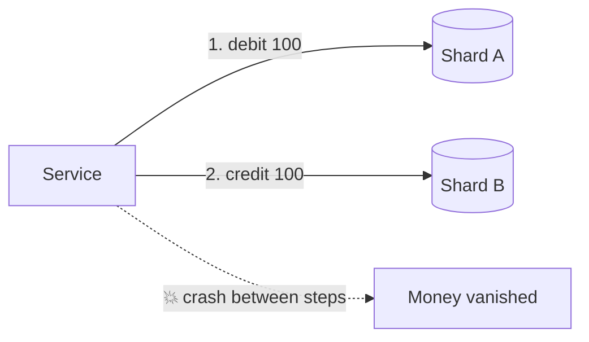
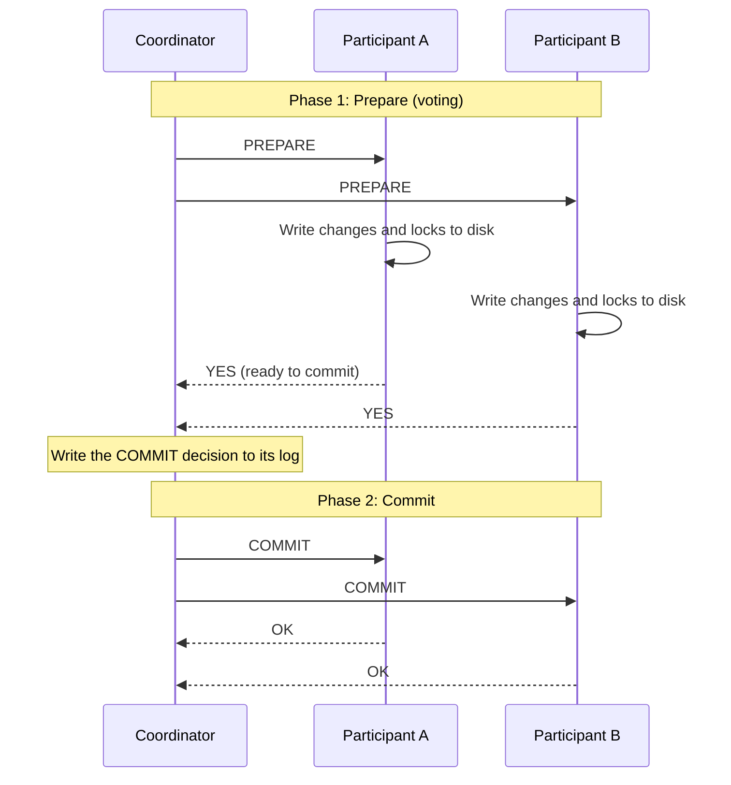
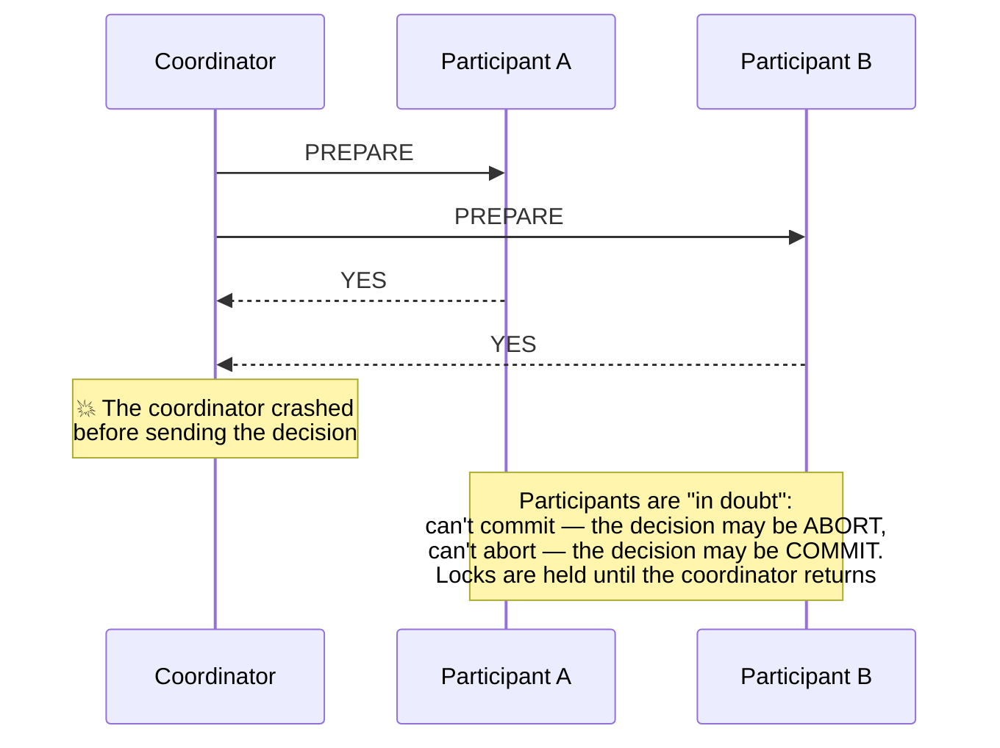
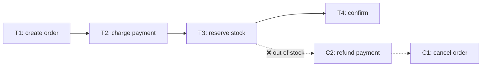
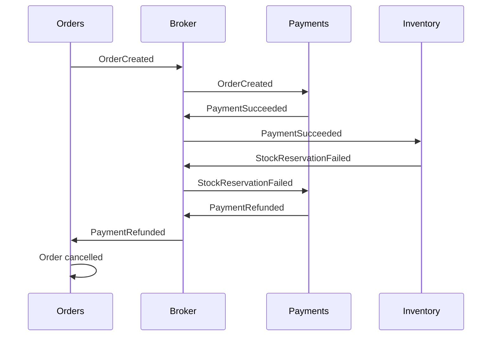
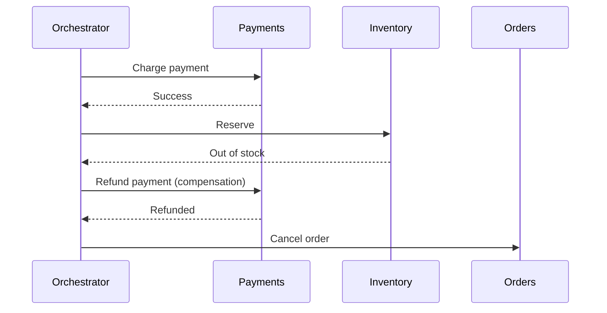
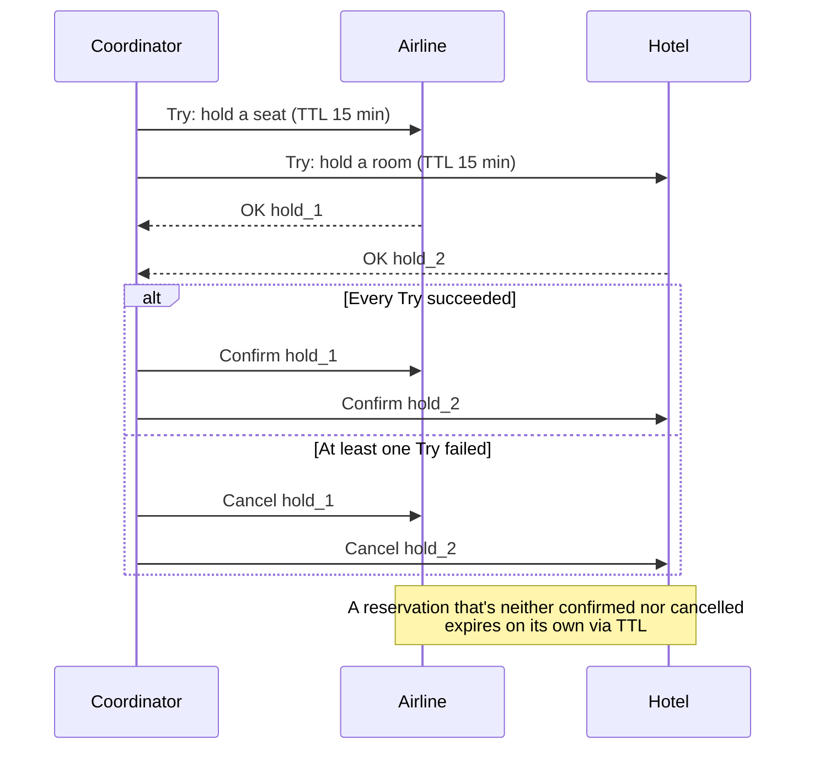
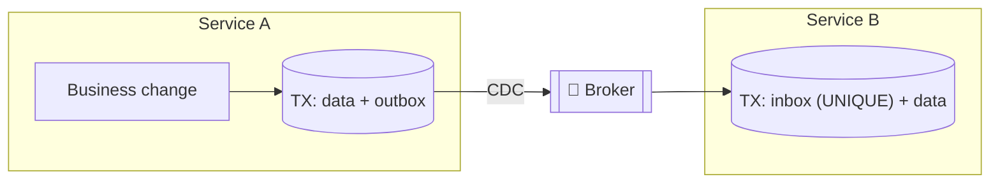
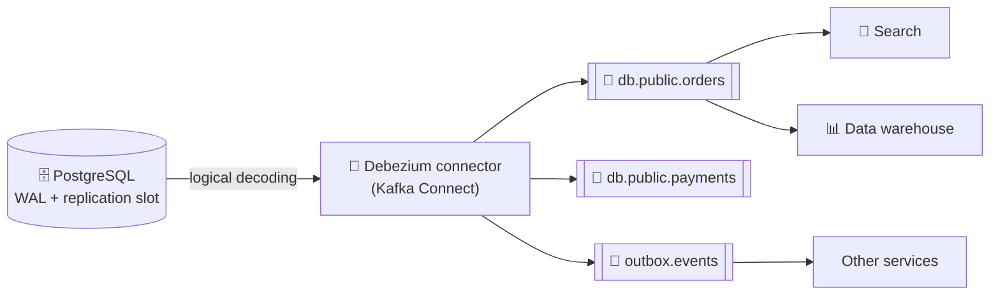
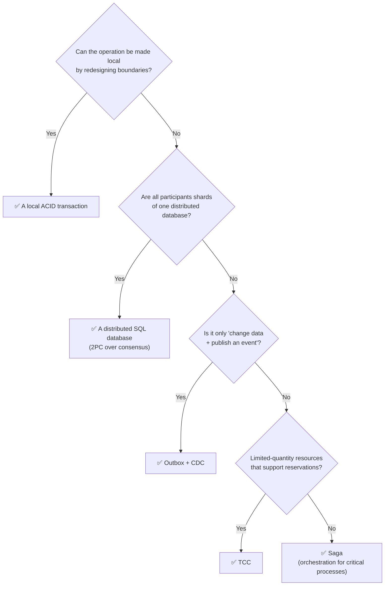

**English** | [Русский](README.ru.md)

# 11. Distributed Transactions

> **Covers:** why and when they're needed, 2PC and its blocking problem, XA, how Spanner, CockroachDB and Percolator do it, sagas (step types, choreography vs orchestration, isolation anomalies and countermeasures, compensations), TCC, outbox and inbox, CDC, workflow engines (Temporal, Step Functions)
> **Study time:** ~5 h · **Needed for:** microservices, payments, bookings, sharded databases, any operation spanning several systems
> **Practice:** interview-style walkthrough — [INTERVIEW.md](./INTERVIEW.md)
> **Related topics:** [04-databases](../04_Databases/README.md#8-transactions-and-acid), [08-consensus](../08_Consensus/README.md#2-why-its-hard-failure-models-and-flp), [09-messaging](../09_Messaging/README.md#7-the-producer-side-the-dual-write-problem-and-the-outbox), [10-idempotency](../10_Idempotency/README.md)

---

## 📑 Contents

1. [The Problem: Atomicity Across Several Systems](#1-the-problem-atomicity-across-several-systems)
2. [Map of Solutions](#2-map-of-solutions)
3. [Two-Phase Commit (2PC)](#3-two-phase-commit-2pc)
4. [Distributed Transactions in Modern Databases](#4-distributed-transactions-in-modern-databases)
5. [Why Microservices Avoid 2PC](#5-why-microservices-avoid-2pc)
6. [Sagas](#6-sagas)
7. [Choreography vs Orchestration](#7-choreography-vs-orchestration)
8. [Isolation in Sagas: Anomalies and Countermeasures](#8-isolation-in-sagas-anomalies-and-countermeasures)
9. [Designing Compensations](#9-designing-compensations)
10. [TCC: Try-Confirm-Cancel](#10-tcc-try-confirm-cancel)
11. [Outbox and Inbox](#11-outbox-and-inbox)
12. [CDC: Change Data Capture](#12-cdc-change-data-capture)
13. [Workflow Engines](#13-workflow-engines)
14. [Choosing an Approach](#14-choosing-an-approach)
15. [How to Talk About This in an Interview](#15-how-to-talk-about-this-in-an-interview)
16. [Self-Check Questions](#16-self-check-questions)
17. [Glossary and Resources](#17-glossary-and-resources)

---

## 1. The Problem: Atomicity Across Several Systems

Within one database, a transaction guarantees "all or nothing". But business operations often touch **several** independent systems:

| Operation | Systems touched |
|:----------|:----------------|
| Checkout | Orders, payments, inventory, shipping |
| A transfer between accounts on different shards | Shard A, shard B |
| Booking a trip | Airline, hotel, car rental, payment |
| Saving data and publishing an event | Database, message broker |



If something fails between steps, the system is left **inconsistent**: money debited but not credited; payment taken but no goods.

> [!IMPORTANT]
> The best distributed transaction is **the one you don't have**. Before choosing a mechanism, ask: can the boundaries be redesigned so the operation becomes local? For example, shard by a key that puts both sides of the operation in one shard, or merge services that always change together. Pat Helland's essay "Life beyond Distributed Transactions" (2007) describes this approach in detail: design **entities** within which you need atomicity, with asynchronous messaging between them.

---

## 2. Map of Solutions

| Approach | Guarantee | Cost | When |
|:---------|:----------|:-----|:-----|
| **Redesign the boundaries** | A local ACID transaction | Modeling work | Always try first |
| **2PC / XA** | Atomicity (ACID) across participants | Locks, latency, blocking on coordinator failure | Within one system or across XA-capable resources |
| **A distributed SQL database** (Spanner, CockroachDB) | ACID across shards | Write latency, a specialized database | Transactions across shards of one database |
| **Saga** | Eventual atomicity (all steps or compensations), **no isolation** | Complex compensations and anomalies | Microservices, external APIs, long-running processes |
| **TCC** | Reservations with confirmation or cancellation | Each participant must support reservations | Limited-quantity resources (seats, money) |
| **Outbox + CDC** | Atomically "change data + publish an event" | A separate publishing process, duplicates | Linking a database and a broker |

---

## 3. Two-Phase Commit (2PC)

**2PC (two-phase commit)** is an **atomic commit** protocol: either every participant commits the transaction, or every participant aborts.

### The protocol



1. **Prepare:** the coordinator asks every participant whether it's ready. A participant that answers **YES** promises to commit no matter what (even after a restart) — so it writes its changes to disk and holds its locks.
2. **Decision:** if everyone answered YES, the coordinator writes **COMMIT** to its log (the point of no return). If anyone answered NO or didn't answer — **ABORT**.
3. **Commit/Abort:** the coordinator sends the decision; participants apply it and release their locks. The coordinator keeps resending until everyone acknowledges.

### The main problem: blocking



A participant that voted YES **can't** decide on its own: it doesn't know what the coordinator decided. Locks on its rows stay until the coordinator returns. Every transaction needing those rows waits.

| Property | Value |
|:---------|:------|
| Latency | At least 2 round trips + several fsyncs |
| Locks | Held from prepare to commit on every participant |
| Coordinator failure | **Blocks** participants in the prepared state |
| Participant failure before voting | The transaction aborts |
| Recovery | Participants ask the coordinator; sometimes manual intervention is needed (an administrator's heuristic decision, which can break atomicity) |

### XA

**XA** is a standard for 2PC across heterogeneous resources (databases, brokers) through a shared transaction manager. Many relational databases and JMS brokers support it, but:
- the coordinator usually lives inside the application server and itself becomes a point of failure;
- not every system supports XA (Kafka, REST APIs, most NoSQL — no);
- locks are held long, and throughput drops.

### 3PC and non-blocking variants

**Three-phase commit** adds a pre-commit phase and in theory doesn't block, but only with bounded network delays — in real networks it doesn't guarantee correctness. In practice the blocking problem is solved differently: **make the coordinator and participants fault-tolerant through consensus** (Paxos Commit, Gray and Lamport, 2006). That's how Spanner and CockroachDB work.

---

## 4. Distributed Transactions in Modern Databases

| System | Approach | Key idea |
|:-------|:---------|:---------|
| **Google Spanner** | 2PC over Paxos groups + TrueTime | Each participant is a replicated group, not a node; the coordinator doesn't "disappear". Strict serializability via commit wait |
| **CockroachDB** | 2PC over Raft groups, **parallel commits** | Write intents (provisional writes) + a transaction record; parallel commits cut the commit to one round trip in the typical case |
| **Percolator** (Google) | Transactions on top of Bigtable with a timestamp oracle | Snapshot isolation; a single "primary" lock decides the transaction's fate; used in TiDB/TiKV |
| **Calvin / FaunaDB** | Deterministic transaction order | Globally order transactions first, then execute deterministically — no 2PC during execution |
| **Kafka transactions** | A 2PC-like protocol with a transaction coordinator | Atomic writes to several partitions + an offset commit |

> [!NOTE]
> The takeaway: 2PC itself isn't bad — a **fragile** coordinator is. Inside one distributed database, where the coordinator and participants are replicated by consensus, 2PC works well. The problems start when participants are independent services and external systems.

---

## 5. Why Microservices Avoid 2PC

| Reason | Explanation |
|:-------|:------------|
| **Availability** | The transaction requires **every** participant to be available. Availability drops multiplicatively |
| **Latency and locks** | Resources are locked through every network round; long operations (an external API taking 30 s) hold locks for a long time |
| **No support** | REST APIs, Kafka, external payment providers and most NoSQL don't support XA |
| **Coupling** | Services become participants in a shared protocol and depend on a shared transaction manager |
| **Data autonomy** | Each service owns its database and shouldn't let others hold locks in it |

That's why sagas and the outbox are used between services, accepting eventual consistency.

---

## 6. Sagas

A **saga** (Garcia-Molina, Salem, 1987) is a sequence of **local** transactions. Each transaction updates one system and triggers the next step. If a step fails, **compensating transactions** run for the steps already performed, in reverse order.



| ACID property | In a saga |
|:--------------|:----------|
| **Atomicity** | Eventually: either all steps, or compensations for every completed one |
| **Consistency** | Local in each step; global — eventually |
| **Isolation** | **❌ None.** Intermediate states are visible to others (see [section 8](#8-isolation-in-sagas-anomalies-and-countermeasures)) |
| **Durability** | ✅ Each local transaction is durable |

### Step types (per Chris Richardson)

| Type | What it is | Example |
|:-----|:-----------|:--------|
| **Compensatable** | Can be undone by a compensation | Reserving stock (release it), a card authorization (void) |
| **Pivot** | The point of no return: after it the saga only moves forward | Issuing an airline ticket, handing goods to a courier |
| **Retriable** | Guaranteed to complete with retries; can't "fail" for business reasons | Sending an email, crediting loyalty points, the final payment capture |

**The ordering rule:**

```
Compensatable steps  →  Pivot step  →  Retriable steps
```

- First, everything that can be undone. The steps most likely to fail go early, so you compensate less often.
- The pivot step — as **late** as possible.
- After it — only steps that can't fail permanently (they're retried until they succeed).

> [!TIP]
> Designing a saga is first and foremost **ordering its steps**. The right order reduces the number of compensations and rules out situations where undoing is no longer possible.

---

## 7. Choreography vs Orchestration

### Choreography

There's no central coordinator: each service listens to events and publishes its own.



### Orchestration

An orchestrator holds the saga state and sends commands to participants.



| | Choreography | Orchestration |
|:-|:-------------|:--------------|
| Where the process logic lives | Scattered across services | In one place |
| Coupling | Loose: services know only about events | The orchestrator knows the participants |
| Understanding and debugging | Hard: the process isn't visible as a whole; cycles are possible | Easier: an explicit state machine |
| Timeouts, compensations | Each service on its own | Centralized |
| Point of failure | No central one | The orchestrator (made fault-tolerant) |
| When | 2–3 steps, simple reactions | 4+ steps, compensations, timeouts, money |

> [!TIP]
> A common practical option is a **hybrid**: orchestration for the critical business process (checkout, booking), choreography for side effects (emails, analytics, loyalty points) that don't affect the saga's outcome.

---

## 8. Isolation in Sagas: Anomalies and Countermeasures

A saga is **ACD without I**: intermediate states are visible to other transactions and users.

### Anomalies

| Anomaly | Example |
|:--------|:--------|
| **Lost update** | Saga A updated an order, saga B overwrote it, then saga A compensated — B's changes are lost |
| **Dirty read** | The loyalty service saw a payment that was later refunded (compensated) and credited points |
| **Fuzzy / non-repeatable read** | Different saga steps read the same data at different times and see different values (the price changed between steps) |

### Countermeasures

| Countermeasure | How it works | Example |
|:---------------|:-------------|:--------|
| **Semantic lock** | An "in progress" flag on the record (`status = PENDING`); other operations see it and wait, refuse or account for it | An order in `APPROVAL_PENDING` can't be modified |
| **Commutative updates** | Operations whose order doesn't matter | Debits and credits to an account as increments |
| **Pessimistic view** | Reorder steps so "dirty" data isn't visible where it's dangerous | Credit loyalty points only after the pivot step |
| **Reread value** | Before changing, check the data hasn't changed since the saga started (optimistic locking) | Recheck the price before booking |
| **Version file** | Record operations so they can be applied in the right order, even if they arrive out of order | A cancel arrived before the create — remember it and apply later |
| **By value** | For risky operations (large amounts) — a distributed transaction or a synchronous check; for ordinary ones — a saga | Transfers above a threshold take a stricter path |

> [!IMPORTANT]
> **Senior+ signal:** say that a saga has no isolation, and name which anomaly is dangerous in this problem and which countermeasure closes it. Usually a **semantic lock** (a `PENDING` status) and a **pessimistic step order** are enough.

---

## 9. Designing Compensations

| Rule | Why |
|:-----|:----|
| **A compensation is a business operation, not a "rollback"** | Charged money isn't "un-charged" but refunded, possibly with a fee; a sent email can't be recalled — you send a correction |
| **Compensations are idempotent** | They will be retried ([10-idempotency](../10_Idempotency/README.md)) |
| **Compensations are retried until they succeed** | They can't be "abandoned" — otherwise the system is permanently inconsistent |
| **A compensation can fail permanently** | An external API refuses forever → a manual review queue and a support notification |
| **Not everything can be compensated** | Hence irreversible actions are the pivot step, as late as possible |
| **Compensations commute with retries** | If a compensation arrives before the operation itself (out-of-order messages), the operation must notice and not execute ("cancelled before it started") |
| **Timeouts** | Every step has a timeout; on expiry — query the status and decide: wait, retry or compensate |

> [!WARNING]
> A classic trap: a participant receives the **compensation before** the original command (due to retries and delivery order). If it "does nothing" and then the original command arrives, it executes it, and the operation stays uncompensated. The fix: record "cancelled" even for an unknown operation, and reject the original command if a cancellation has already happened.

---

## 10. TCC: Try-Confirm-Cancel

A saga variant where each participant offers **three** operations:

| Phase | What it does | Example: booking a seat |
|:------|:-------------|:------------------------|
| **Try** | Reserves the resource and checks business rules, without doing anything final | Hold the seat for 15 minutes |
| **Confirm** | Applies the reservation for good | Issue the seat to the passenger |
| **Cancel** | Releases the reservation | Return the seat to sale |



| | Saga with compensations | TCC |
|:-|:------------------------|:----|
| Visibility of intermediate state | The change is already applied | Only a reservation |
| Compensation | A reverse business operation (refund) | Cancelling a reservation — cheaper and cleaner |
| Participant requirements | An operation + a compensation | Three operations and support for reservations with TTL |
| Resembles | — | 2PC at the business-logic level, but without holding database locks |

TCC fits limited-quantity resources: seats, rooms, money (a card authorization = try, capture = confirm, void = cancel).

---

## 11. Outbox and Inbox

### Outbox (sending)

Atomically change data **and** publish an event: the event is written to an `outbox` table in the same transaction, and a separate process publishes it to the broker. Details in [09-messaging](../09_Messaging/README.md#7-the-producer-side-the-dual-write-problem-and-the-outbox).

| Publishing method | How | Pros | Cons |
|:------------------|:----|:-----|:-----|
| **Polling publisher** | Periodically `SELECT ... FROM outbox WHERE published = false` | Simple, no extra infrastructure | Latency, DB load, harder to preserve order with several publishers |
| **Log tailing (CDC)** | Reading the WAL/binlog (Debezium) | Low latency, log order, no query load | Requires CDC infrastructure |

### Inbox (receiving)

The mirror pattern for the receiver: an incoming message is first written to an `inbox` table (with UNIQUE on the message ID) **in the same transaction** as its processing. A duplicate fails on the constraint. This is the idempotent consumer.



### Listen to yourself

A service publishes an event and **itself** consumes it to update its own data. Then the event and the state change can't diverge. Rarely used, but worth knowing.

---

## 12. CDC: Change Data Capture

**CDC** turns database changes into a stream of events.

### Approaches

| Approach | How | Pros | Cons |
|:---------|:----|:-----|:-----|
| **Query-based** | Periodically select rows with `updated_at > last_time` | Simple | Misses deletes; skips intermediate changes; DB load; trouble with equal timestamps |
| **Triggers** | A trigger writes changes to a log table | Sees everything | Slows writes, ties the schema to CDC |
| **Log-based** | Reading the WAL (PostgreSQL), binlog (MySQL), oplog (MongoDB) | Every change, including deletes, in commit order, with no query load | More complex infrastructure, dependence on the log format |

### How Debezium works



1. **Initial snapshot:** on first start, export the current table state.
2. **Streaming:** then read changes from the log, starting at the snapshot's position.
3. Each change is an event with `before` and `after` (for a delete, `after = null`, followed by a tombstone for Kafka compaction).
4. The message key is the row's primary key → all changes to one row are ordered in one partition.
5. Delivery is **at-least-once**: after a failure the connector may repeat events → consumers are idempotent.

### Uses

| Use | How |
|:----|:----|
| Outbox | Publishing events from the outbox table |
| Cache invalidation | See [02-caching](../02_Caching/README.md#7-invalidation) |
| Search indexes | Elasticsearch updated from the change stream |
| Data warehouse and analytics | Near real time instead of nightly exports |
| Data sync between services | Local copies of other services' data |
| Zero-downtime migrations | A change stream from the old database to the new (see [06-partitioning](../06_Partitioning/README.md#10-moving-from-one-database-to-shards)) |

> [!WARNING]
> **A PostgreSQL operational trap:** a replication slot retains WAL until the connector has read it. If Debezium is stopped for a few hours, WAL piles up and can **fill the primary's disk** and halt the database. Monitor slot lag and set a limit (`max_slot_wal_keep_size`).

### Raw CDC or outbox

| | Raw table changes | Outbox via CDC |
|:-|:------------------|:---------------|
| What consumers see | The internal table schema | Explicit domain events |
| A DB schema change | Breaks consumers | No effect; the contract is the event |
| When | Internal jobs: analytics, search, cache | Exchange between services owned by different teams |

---

## 13. Workflow Engines

Hand-writing a saga orchestrator (a state machine, timers, retries, an outbox) is a lot of code with subtle bugs. That's why people use **workflow engines** (durable execution):

| Engine | Model |
|:-------|:------|
| **Temporal** / Cadence | A workflow as ordinary code; the engine stores an event history and restores state after failures by replaying it |
| **AWS Step Functions** | A state machine in JSON/YAML, managed |
| **Camunda / Zeebe** | BPMN processes |
| **Netflix Conductor** | JSON process definitions |

```python
# Temporal-style workflow pseudocode: a saga as ordinary code
@workflow
def book_order(order):
    compensations = []
    try:
        pay = activity(charge_payment, order, retry=RetryPolicy(max_attempts=5))
        compensations.append(lambda: activity(refund_payment, pay))
        res = activity(reserve_stock, order)
        compensations.append(lambda: activity(release_stock, res))
        activity(confirm_order, order)
    except BusinessError:
        for undo in reversed(compensations):
            undo()                     # compensations are retried by the engine too
        activity(cancel_order, order)
```

| What the engine provides | Why it matters |
|:-------------------------|:---------------|
| Durable state | The process survives a service restart |
| Per-step retries and timeouts | You don't write them yourself |
| Long timers | "Wait 3 days for a response" without cron or polling |
| Visibility | Every process and its history are visible in a UI |

> [!NOTE]
> Workflow code must be **deterministic**: when replaying history it must make the same decisions. All side effects (network, time, randomness) go only through activities and the engine's API.

---

## 14. Choosing an Approach



---

## 15. How to Talk About This in an Interview

### 30-second answer

> "First I try to avoid a distributed transaction: draw service or shard boundaries so the operation is local. If that's not possible: across shards of one database — distributed SQL (2PC over Raft, where the coordinator isn't a point of failure). Between services and external APIs I don't use 2PC — it blocks on coordinator failure and isn't supported. Instead — a saga: compensatable steps, then the pivot, then retriable steps; orchestration via a durable workflow for critical processes. A saga has no isolation — I close that with semantic locks and step ordering. Compensations are idempotent and retried until they succeed, otherwise — manual review. For limited-quantity resources — TCC with TTL reservations. I link data and events with the outbox and CDC."

### Questions to ask

1. Which systems does the operation touch? Who controls each one?
2. Can each step be undone? Which step is irreversible?
3. What will users and other services see in an intermediate state?
4. What if a compensation fails?
5. How long does the process take: milliseconds or days?

### Common mistakes

- Proposing 2PC between microservices and external APIs.
- A saga without compensations, or with compensations that "roll back" the irreversible.
- An irreversible step at the start of the saga.
- Forgetting about the lack of isolation.
- Non-idempotent steps and compensations.
- A compensation that "does nothing" when the operation hasn't happened yet — and then the operation executes.
- A dual write to the database and the broker without an outbox.
- CDC without monitoring the replication slot.

---

## 16. Self-Check Questions

<details>
<summary><b>1. Why is 2PC called a blocking protocol?</b></summary>

A participant that voted YES must carry out the coordinator's decision but doesn't know it if the coordinator crashed before sending it. It can neither commit nor abort, and holds its locks until the coordinator returns. Every transaction needing that data waits.
</details>

<details>
<summary><b>2. Why do Spanner and CockroachDB use 2PC while microservices don't?</b></summary>

In distributed databases, the coordinator and participants are groups replicated by consensus, so a single node failure doesn't block the protocol, and the network inside the cluster is fast. Microservices and external APIs don't share a protocol, have independent availability and long operations, and locks in other services' databases violate their autonomy.
</details>

<details>
<summary><b>3. What is a saga's pivot step and where do you place it?</b></summary>

The point of no return: after it the saga only moves forward, and every subsequent step must be retriable. It's placed after all compensatable steps and as late as possible, so the irreversible action happens only once everything else has definitely succeeded.
</details>

<details>
<summary><b>4. Choreography or orchestration for a 6-step process involving money?</b></summary>

Orchestration: an explicit state machine, timeouts and compensations in one place; the process is easy to understand and debug. Choreography for 6 steps scatters the logic across services and complicates compensations and failure analysis.
</details>

<details>
<summary><b>5. Why does a saga have no isolation, and how do you live with it?</b></summary>

Each step is a separate committed transaction, so intermediate states are visible to others. Countermeasures: a semantic lock (a PENDING status), commutative operations, a pessimistic step order, rechecking values before changing them, a version file, and a stricter path for risky operations.
</details>

<details>
<summary><b>6. What if a compensation fails permanently?</b></summary>

Retry with backoff while there's a chance; if the error is permanent — move the saga to a "needs attention" state, enqueue a manual review task, notify support and, if needed, the user. A saga can't be silently abandoned.
</details>

<details>
<summary><b>7. How is TCC different from an ordinary saga?</b></summary>

In TCC the first step is only a reservation (try), not a final change; then confirm or cancel. Cancelling a reservation is cheaper and cleaner than a reverse business operation, and unfinished reservations expire via TTL. The cost — every participant must support reservations.
</details>

<details>
<summary><b>8. Why do you need an inbox if you have an outbox?</b></summary>

The outbox guarantees the event gets published (possibly more than once). The inbox on the receiving side guarantees a repeated event isn't processed twice: the message ID is written with a uniqueness constraint in the same transaction as the processing.
</details>

<details>
<summary><b>9. Why is log-based CDC better than selecting by updated_at?</b></summary>

Reading the log sees every change, including deletes and intermediate values, in commit order, without loading the database with queries. Selecting by updated_at misses deletes and intermediate changes, gets confused by equal timestamps and creates load.
</details>

<details>
<summary><b>10. What's the operational danger of CDC in PostgreSQL?</b></summary>

A replication slot retains WAL until the connector reads it. If the connector is down for long, WAL grows and can fill the primary's disk. You need slot lag monitoring and a `max_slot_wal_keep_size` limit.
</details>

---

## 17. Glossary and Resources

### Glossary

| Term | Meaning |
|:-----|:--------|
| Distributed transaction | A transaction spanning several independent systems |
| 2PC | Two-phase commit: prepare and commit/abort |
| Coordinator / participant | The node driving 2PC / a node performing part of the transaction |
| In doubt | A participant that voted YES and doesn't know the decision |
| XA | A standard for 2PC across heterogeneous resources |
| Saga | A sequence of local transactions with compensations |
| Compensating transaction | A business operation that undoes a step's effect |
| Pivot step | A saga's point of no return |
| Choreography / orchestration | Coordinating a saga via events / via a central orchestrator |
| Semantic lock | An "in progress" flag at the business-data level |
| TCC | Try-Confirm-Cancel: reserve, confirm, cancel |
| Outbox / inbox | A table of outgoing events / incoming messages in a transaction with the data |
| CDC | Change Data Capture: a stream of database changes |
| Replication slot | A PostgreSQL mechanism that retains WAL for a consumer |
| Durable execution | Running processes with persisted state that survive failures |

### Resources

- *Designing Data-Intensive Applications*, Martin Kleppmann — chapter 9, section "Distributed Transactions and Consensus"
- Hector Garcia-Molina, Kenneth Salem, *Sagas* (SIGMOD 1987)
- Jim Gray, Leslie Lamport, *Consensus on Transaction Commit* (2006)
- Pat Helland, *Life beyond Distributed Transactions: an Apostate's Opinion* (CIDR 2007)
- Chris Richardson, *Microservices Patterns* (2018) — chapter 4 "Managing transactions with sagas"
- Peng, Dabek, *Large-scale Incremental Processing Using Distributed Transactions and Notifications* (OSDI 2010) — Percolator
- Thomson et al., *Calvin: Fast Distributed Transactions for Partitioned Database Systems* (SIGMOD 2012)
- Corbett et al., *Spanner: Google's Globally-Distributed Database* (OSDI 2012)
- Caitie McCaffrey, *Applying the Saga Pattern* (talk, 2015)
- Debezium, Temporal and AWS Step Functions documentation