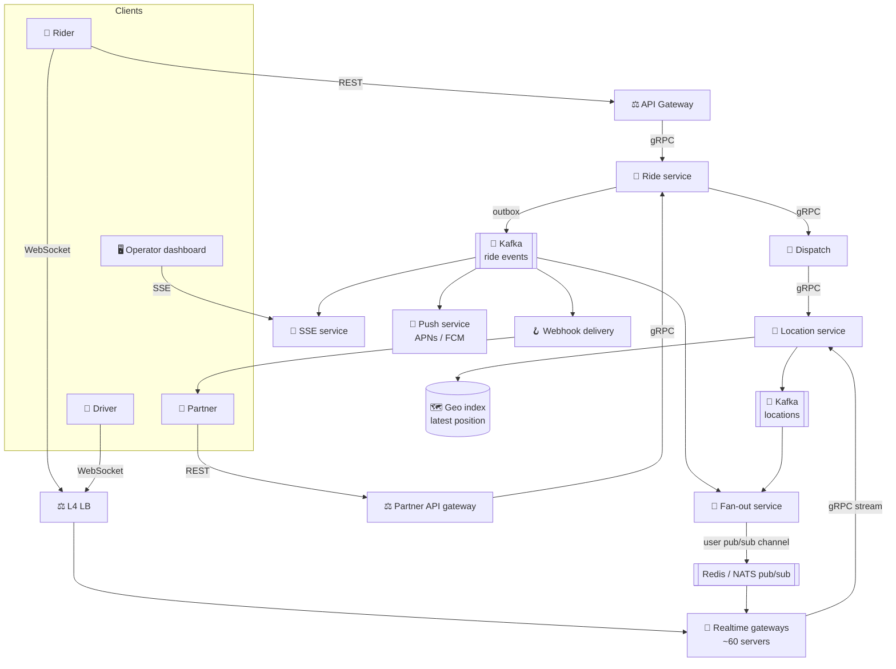
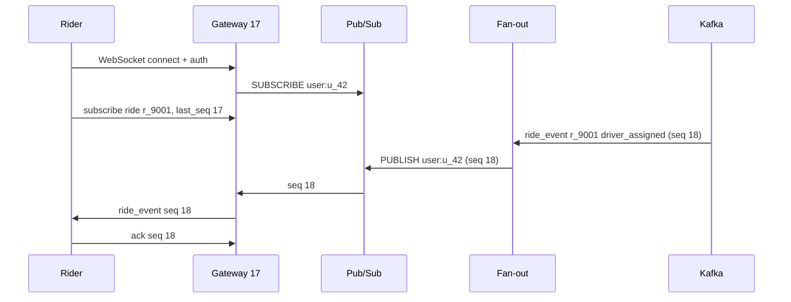
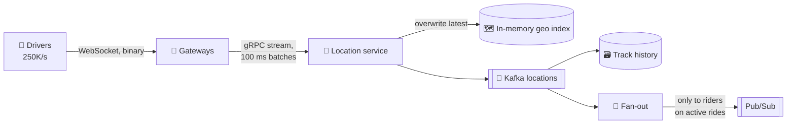
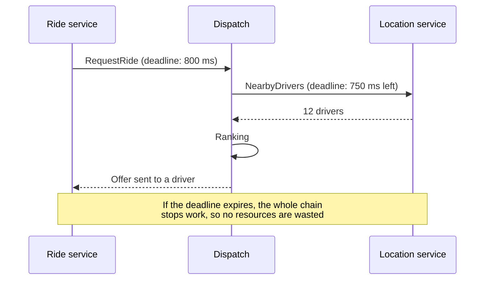
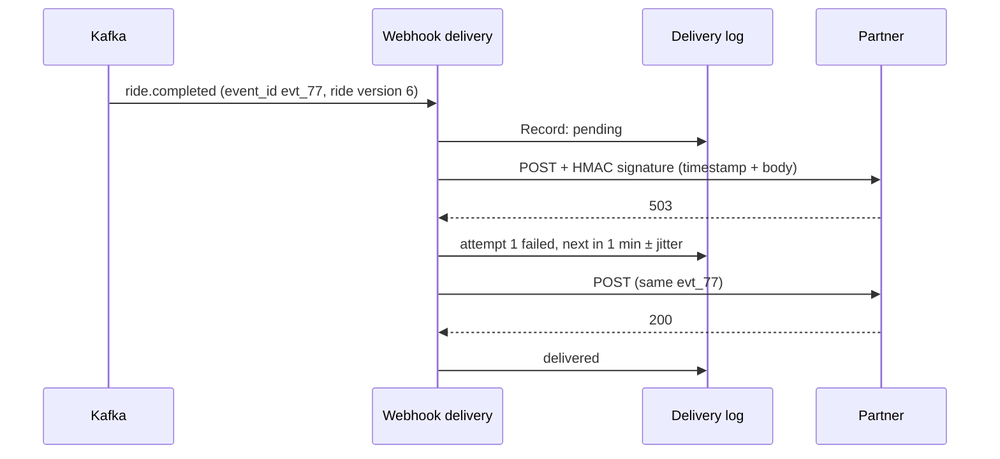

**English** | [Русский](INTERVIEW.ru.md) · Theory: [README.md](./README.md)

# 12. Communication: Protocols for a Ride-Hailing Service

> **Topic:** choosing a protocol per channel (REST, gRPC, WebSocket, SSE, push, webhooks, a broker), scaling a WebSocket gateway, the driver location stream, internal gRPC, a public API for partners, mobile networks and reconnect storms
> **Level:** Medium–Hard · **Interview time:** 45 min · **Study time:** ~4–5 h
> **Where it's asked:** "Design Uber / delivery / chat — how do clients and services talk?", and as a deep dive in any real-time problem

---

## 🗺️ How to Read This Walkthrough

| Icon | Meaning |
|:----:|:--------|
| 🎤 | Interviewer |
| 🗣️ | What I (the candidate) say out loud |
| ✏️ | What I draw on the whiteboard |
| ⏱️ | Time budget for the step |

Callouts: **TIP** — a good technique, **WARNING** — a trap, **IMPORTANT** — a Senior+ signal.

---

## 📑 Contents

1. [Problem Statement](#1-problem-statement)
2. [Clarifying Questions and Requirements](#2-clarifying-questions-and-requirements)
3. [Capacity Estimates](#3-capacity-estimates)
4. [Channels and Protocol Choices](#4-channels-and-protocol-choices)
5. [API](#5-api)
6. [High-Level Design](#6-high-level-design)
7. [Deep Dive 1: The WebSocket Gateway](#7-deep-dive-1-the-websocket-gateway)
8. [Deep Dive 2: The Driver Location Stream](#8-deep-dive-2-the-driver-location-stream)
9. [Deep Dive 3: Internal Calls on gRPC](#9-deep-dive-3-internal-calls-on-grpc)
10. [Deep Dive 4: The Public API and Webhooks for Partners](#10-deep-dive-4-the-public-api-and-webhooks-for-partners)
11. [Deep Dive 5: Mobile Networks, Background Mode and Reconnect Storms](#11-deep-dive-5-mobile-networks-background-mode-and-reconnect-storms)
12. [Bottlenecks and Failure Scenarios](#12-bottlenecks-and-failure-scenarios)
13. [What Changes at 10x Scale](#13-what-changes-at-10x-scale)
14. [Interviewer Questions with Answers](#14-interviewer-questions-with-answers)
15. [Common Mistakes](#15-common-mistakes)
16. [Cheat Sheet and Self-Check](#16-cheat-sheet-and-self-check)

---

## 1. Problem Statement

> 🎤 "We're building a ride-hailing service. A rider requests a ride and sees the car on a map in real time; a driver receives ride offers and sends their location. Corporate customers book rides through our API and want to know the status. Design how all of this communicates: clients, services, partners."

**Time plan:**

| Step | ⏱️ |
|:-----|:--:|
| Requirements | 5 min |
| Estimates | 3 min |
| Channels and protocols | 7 min |
| API and high-level | 7 min |
| Deep dives | 18 min |
| Failures and wrap-up | 5 min |

> [!TIP]
> The main idea of this problem is that **different channels need different protocols**. Start with a channel table: who talks to whom, in which direction, how often, and what happens if a message is lost. It structures the answer immediately.

---

## 2. Clarifying Questions and Requirements

⏱️ 5 min

| My question | Interviewer's answer | What it changes |
|:------------|:---------------------|:----------------|
| How often does a driver send their location? | Every 4 seconds while online | A huge stream of small messages |
| How fast must the rider see the car? | Within 1–2 seconds | Server push, not polling |
| What if the rider's app is in the background? | They must get a "your car has arrived" notification | Push notifications, not just WebSocket |
| Can location updates be lost? | Yes, only the latest matters | At-most-once for locations; drop stale ones |
| Can ride events (driver assigned, ride completed) be lost? | No | Reliable delivery with acknowledgments and resends |
| What kind of API do partners get? | Public, for their developers | REST + webhooks, documentation, versioning |
| Is there a web dashboard for operators? | Yes, a live city map and metrics | Server-only stream → SSE |

### Functional requirements

1. Rider: request a ride, see its status and the car on a map, receive notifications.
2. Driver: go online, send location, receive and accept ride offers.
3. Partners: create rides via an API, receive status events.
4. Operators: a live city dashboard.

### Non-functional requirements

| Requirement | Target |
|:------------|:-------|
| Car location latency for the rider | p99 < 2 s |
| Ride offer latency for the driver | p99 < 1 s |
| Ride event reliability | No lost events; duplicates are acceptable (idempotent handling) |
| Mobile networks | Correct behavior across drops, network switches and background mode |
| Availability | One gateway failing doesn't interrupt rides |

---

## 3. Capacity Estimates

⏱️ 3 min

✏️

```
Online drivers          = 1M         → location every 4 s → 250,000 messages/s
Riders with the app
open                    = 3M
Persistent connections  ≈ 4M (drivers + riders)
Active rides            = 500K       → the rider gets a location every 4 s → 125,000 messages/s outbound
Update size             ≈ 60–100 B in binary (vs ~300 B in JSON)
Inbound traffic         ≈ 250,000 × 100 B ≈ 25 MB/s

Connections per gateway ≈ 100,000 (with headroom)  → ~40 servers + spare ≈ 60
```

🗣️ **Conclusions:**
- **4 million persistent connections** — we need a dedicated tier of connection servers.
- **250,000 location updates per second** aren't database requests: updates go into a stream, and the geo index stores only the latest position.
- **A binary format** for locations saves roughly 3× the bandwidth and battery compared to JSON.

---

## 4. Channels and Protocol Choices

⏱️ 7 min

| Channel | Direction | Frequency | Loss acceptable? | Protocol | Why |
|:--------|:----------|:----------|:----------------:|:---------|:----|
| Rider: request, profile, history, payment | Client → server | Rare | No | **REST** (HTTP/2) | Simple CRUD, caching, an idempotency key |
| Rider: ride status and car on the map | Server → client | Frequent (every 4 s) | Locations — yes, events — no | **WebSocket** | Needs both a downstream stream and small upstream messages (subscriptions, acks) |
| Driver: location | Client → server | Every 4 s | Yes | **WebSocket** (the same connection) | One persistent connection instead of an HTTP request every 4 s |
| Driver: ride offer | Server → client | Occasional, urgent | No | **WebSocket** + acknowledgment | < 1 s latency; the driver must respond |
| App in the background | Server → client | Rare | No | **Push (APNs, FCM)** | The OS closes connections of backgrounded apps |
| Service ↔ service | Internal | Very frequent | No | **gRPC** | Contracts, low latency, deadlines, streaming |
| Async events (ride created, completed) | Internal | Frequent | No | **Kafka** | Decoupling, many consumers, history |
| Partners: creating rides | Partner → us | Medium | No | **REST** + OpenAPI | A public API any developer understands |
| Partners: ride statuses | Us → partner | Medium | No | **Webhooks** | Push between servers, retries |
| Operator dashboard | Server → browser | Frequent | Yes | **SSE** | Downstream only, automatic reconnection |

> [!IMPORTANT]
> **Senior+ signal:** split messages in one WebSocket connection into **two classes**: locations (at-most-once, only the latest matters, can be dropped) and ride events (at-least-once, with a sequence number and acknowledgment, resent after reconnection). Different guarantees in one channel.

---

## 5. API

⏱️ 4 min

### REST for clients

```http
POST /v1/rides                    Idempotency-Key: <uuid>
     { pickup, dropoff, ride_type, payment_method_id }
     → 201 { ride_id, status: "searching" }
GET  /v1/rides/{ride_id}          → { status, driver?, eta?, price }
POST /v1/rides/{ride_id}/cancel
GET  /v1/users/me/rides?cursor=…  → history with cursor pagination
```

### The WebSocket protocol

```
Connect: wss://rt.taxi.example/v1/connect   (token in the first message or a header)

Client → server
  { "t": "subscribe", "ride_id": "r_9001", "last_seq": 17 }
  { "t": "loc", "lat": 52.23, "lng": 21.01, "ts": 1732000000123 }   ← driver, binary in production
  { "t": "offer_ack", "offer_id": "o_55", "accept": true }
  { "t": "ack", "seq": 18 }

Server → client
  { "t": "ride_event", "seq": 18, "ride_id": "r_9001", "type": "driver_assigned", ... }
  { "t": "driver_loc", "ride_id": "r_9001", "lat": ..., "lng": ..., "ts": ... }   ← no seq, latest only
  { "t": "offer", "offer_id": "o_55", "pickup": ..., "expires_in": 15 }
  { "t": "ping" }
```

### Internal gRPC (excerpt)

```protobuf
service LocationService {
  rpc IngestLocations (stream LocationUpdate) returns (IngestAck);   // from gateways
  rpc NearbyDrivers (NearbyRequest) returns (NearbyResponse);        // for dispatch
}
service DispatchService {
  rpc RequestRide (RideRequest) returns (RideAccepted);
}
```

### Partner API

```http
POST /partner/v1/rides            Idempotency-Key, Authorization: Bearer <client_credentials token>
GET  /partner/v1/rides/{id}
Webhooks: POST {partner_url}  ride.driver_assigned | ride.completed | ride.cancelled
          Webhook-Id, Webhook-Timestamp, Webhook-Signature
```

---

## 6. High-Level Design

⏱️ 3 min

✏️



🗣️ "Key decisions:
- **Realtime gateways** are a separate stateful tier: they hold WebSockets and know nothing about business logic;
- **business services** talk over gRPC and stay stateless;
- **events** flow through Kafka (from the Ride service's outbox);
- **fan-out** delivers events to gateways via pub/sub, to push notifications, to partner webhooks and to SSE for the dashboard."

---

## 7. Deep Dive 1: The WebSocket Gateway

> 🎤 "The rider is connected to gateway 17, and the 'driver assigned' event originated in the Ride service. How does it get there?"



### Key decisions

| Topic | Decision |
|:------|:---------|
| **Routing** | The gateway subscribes to the `user:{id}` channel on connect; fan-out publishes to the user's channel. No need to know which gateway the user is on |
| **Load balancing** | L4 with least connections; the LB idle timeout exceeds the heartbeat interval |
| **Heartbeats** | A ping every 25 s; no pong for 2 intervals → the connection is closed |
| **Reliable events** | A per-ride `seq` number; the client acknowledges; on reconnect it sends `last_seq`, and the gateway resends what was missed from the ride event store |
| **Locations** | No `seq` or acks; for a slow client, the buffer holds only the **latest** location |
| **Gateway state** | Only connections and subscriptions; if a gateway dies, clients reconnect to another and catch up by `last_seq` |
| **Deploys** | Drain: the gateway stops accepting new connections and closes old ones in batches with a "reconnect" code, spread over minutes |

> [!WARNING]
> Don't put business logic in the gateway. Otherwise every deploy of it drops a million connections because of a business rule change. The gateway should change rarely.

---

## 8. Deep Dive 2: The Driver Location Stream

> 🎤 "250,000 locations per second. Where do they go, and what happens to them?"

🗣️ "Locations are a **stream**, not transactions. Principles:

| Principle | Implementation |
|:----------|:---------------|
| One persistent connection | The driver sends locations over their WebSocket, not a new HTTP request |
| A compact binary format | Protobuf or a custom binary format: ~60–100 bytes |
| Batching at the gateway | The gateway collects locations and sends them to the Location service on a gRPC stream in batches every ~100 ms |
| Only the latest location in the geo index | The geo index (e.g. in-memory by H3 cells) keeps one position per driver — writes overwrite |
| History — separately | A stream into Kafka → track storage for analytics and ride disputes |
| At-most-once | Losing one location doesn't matter: the next arrives in 4 seconds |
| Drop stale updates | A message with a `ts` older than the stored one is ignored (the network can reorder) |



🗣️ "A location is forwarded to a rider only if that driver has an active ride. Fan-out keeps an in-memory 'driver → rider' mapping for active rides, so the 125,000 outbound messages per second are exactly the active rides, not every driver."

> [!TIP]
> A nice battery optimization: **adaptive frequency**. An idle driver parked without a ride sends less often (every 10–15 s), a driver on a ride more often. That shrinks the stream without hurting users.

---

## 9. Deep Dive 3: Internal Calls on gRPC

> 🎤 "Why gRPC internally and not REST?"

🗣️

| Requirement | How gRPC helps |
|:------------|:---------------|
| A strict contract across dozens of teams | `.proto` + code generation; breaking changes show up at build time |
| Low latency (dispatch < 1 s with several calls) | A binary format, HTTP/2, persistent connections |
| Streaming locations from gateways | Client streaming |
| Cascading timeouts | **Deadlines** propagate down the chain: if dispatch has 300 ms left, the Location service knows it |

### Pitfalls and solutions

| Problem | Solution |
|:--------|:---------|
| Long-lived HTTP/2 connections → load skew behind an L4 balancer | Client-side load balancing (via a service mesh or xDS) or an L7 proxy (Envoy) balancing per request |
| Retries at several layers | Retry only idempotent methods, in one place (the mesh), with a budget |
| Schema evolution | Only add fields, `reserved` for removed ones, compatibility checks in CI |
| Debugging | gRPC reflection, grpcurl, tracing (OpenTelemetry) |



---

## 10. Deep Dive 4: The Public API and Webhooks for Partners

> 🎤 "A corporate partner creates rides for its employees. How do you design the API and notifications?"

### The REST API

| Topic | Decision |
|:------|:---------|
| Format | REST + JSON, an OpenAPI spec, SDKs for popular languages |
| Authentication | OAuth 2.0 client credentials, tokens with limited scopes |
| Idempotency | `Idempotency-Key` required for `POST /rides` |
| Versioning | `/partner/v1/`; new fields without a version change; breaking changes — v2 with a v1 support period |
| Limits | A per-partner rate limit; `429` + `Retry-After`; remaining-quota headers |
| Errors | RFC 9457 Problem Details |
| Lists | Cursor pagination |

### Webhooks



| Rule | Why |
|:-----|:----|
| `event_id` + the ride version in every event | Deduplication and ordering on the partner's side |
| An HMAC signature with a timestamp | Authenticity and replay protection |
| A 5 s timeout, retries with backoff + jitter for up to 24 h | A slow partner doesn't slow delivery for others |
| **A separate queue per partner** | One partner's broken endpoint doesn't delay webhooks for others |
| A delivery log in the partner dashboard + manual resend | Self-service |
| Disabling an endpoint after a day of failures + an email | Don't waste resources |
| An API to fetch missed events | The partner can catch up if its endpoint was down |

---

## 11. Deep Dive 5: Mobile Networks, Background Mode and Reconnect Storms

> 🎤 "The rider is on the subway; connectivity drops in and out. The app is in the background. And an entire gateway just went down. What happens?"

### Connection drops

| Situation | Behavior |
|:----------|:---------|
| The connection dropped | The client reconnects with exponential backoff + jitter (starting at ~1 s) |
| Reconnected | Sends `subscribe` with `last_seq` → receives the missed ride events; the location is just the latest |
| Wi-Fi → LTE switch | A new connection (for REST requests, HTTP/3 with connection migration helps) |
| A long period of bad network | The UI shows "no connection"; the car's last known position is marked stale |

### The app in the background

🗣️ "iOS and Android close connections for backgrounded apps. So important events (driver assigned, car arrived, ride completed) are duplicated as **push notifications** via APNs and FCM. Push doesn't guarantee delivery or ordering, so when the app is opened it still syncs state via REST or WebSocket with `last_seq`."

### Reconnect storms

🗣️ "A gateway with 100,000 connections died. All 100,000 clients reconnect at once → load on the LB, TLS handshakes, authentication and resending missed events.

| Protection | How |
|:-----------|:----|
| Client-side jitter | Reconnections spread over tens of seconds |
| Rate-limiting new connections | The gateway accepts new connections up to a per-second limit; the rest get a refusal with `Retry-After` |
| TLS session resumption | A cheaper repeat handshake |
| Cheap authentication | Verify the JWT signature locally, without calling the auth service |
| Spare capacity | The remaining gateways can absorb +20% connections |
| Resending from a fast store | Recent ride events in Redis or in fan-out's memory, not the main database |

> [!WARNING]
> The most dangerous scenario is a **regional network outage** at a mobile carrier: millions of clients reconnect at once when the network comes back. Without jitter, it looks like your own users DDoSing you.

---

## 12. Bottlenecks and Failure Scenarios

| Scenario | What happens | How we protect |
|:---------|:-------------|:---------------|
| A gateway dies | 100,000 connections dropped | Reconnection with jitter to other gateways, catch-up by `last_seq`, connection rate limits |
| Pub/sub unavailable | Events don't reach gateways | A pub/sub cluster with replicas; clients catch up by `last_seq` on reconnect; push duplicates important events |
| A slow client | The gateway buffer grows | For locations — only the latest; for events — a bounded buffer, otherwise close the connection (the client catches up after reconnecting) |
| gRPC load skew | One Location service instance is overloaded | L7 / client-side load balancing |
| Cascading timeouts | The chain hangs longer than needed | gRPC deadlines |
| A partner's endpoint is down | Webhooks pile up | A queue per partner, retries, a log, a catch-up API |
| A push didn't arrive | The rider didn't learn the car arrived | Sync state when the app opens; SMS for critical cases |
| A gateway deploy | Mass disconnects | Gradual drain, in batches |
| Locations arrive out of order | The car "jumps backward" | Ignore locations with an older `ts` |

---

## 13. What Changes at 10x Scale

> 🎤 "40 million connections and dozens of cities across continents?"

🗣️ "What changes:
1. **Regional gateways** close to users (Anycast or GeoDNS); connections terminate in the nearest region.
2. **Sharding pub/sub** by user or city; fan-out in each region.
3. **Location and Dispatch per city**: locations and dispatch are local, and cross-region traffic is minimal.
4. **A protocol over QUIC/HTTP/3** for mobile clients — fewer reconnections on network switches (WebTransport or a custom protocol over QUIC, as some large apps do).
5. **Adaptive frequency and compression** of locations, delta encoding."

---

## 14. Interviewer Questions with Answers

<details>
<summary><b>Why WebSocket for the rider and not SSE?</b></summary>

The rider mostly needs a server stream, and SSE would handle that. But the same app also needs upstream messages (subscriptions with last_seq, event acknowledgments), and the driver needs to send locations frequently. One protocol for both apps simplifies the gateway. If there were only the rider app, SSE would be a good and simpler choice.
</details>

<details>
<summary><b>Why not gRPC streaming straight from the mobile client?</b></summary>

You could: gRPC works on mobile platforms, and some companies do this. But WebSocket passes through proxies and load balancers more easily, is easier to debug, and works the same way in a web version. Client-side gRPC streaming is a reasonable alternative if the team already uses gRPC and there's no web client.
</details>

<details>
<summary><b>What about MQTT for driver locations?</b></summary>

MQTT is built for devices on unreliable networks: lightweight, with QoS levels and session persistence, and some ride-hailing and delivery services use it. It's a good option for the driver app. The downsides — a separate broker and stack, poor browser support. In an interview, name it as an alternative with those trade-offs.
</details>

<details>
<summary><b>Why not GraphQL for the mobile app?</b></summary>

GraphQL can be used in a BFF for screens that aggregate data (the home screen: saved places, promos, nearby ride options). For the core flow (requesting, status, locations) it brings no advantage: REST and WebSocket are simpler. It depends on how varied the screens and clients are.
</details>

<details>
<summary><b>How do you guarantee the rider won't miss "ride completed"?</b></summary>

A per-ride numbered event, a client acknowledgment, catch-up by last_seq after reconnecting, a duplicate push notification, and syncing state via `GET /rides/{id}` when the app opens. The source of truth is the server, not the delivered message.
</details>

<details>
<summary><b>Why a separate webhook queue per partner?</b></summary>

If one partner's endpoint is slow or down, its retries mustn't occupy workers and delay delivery to others. Isolating by partner is a bulkhead for webhooks.
</details>

---

## 15. Common Mistakes

| ❌ Mistake | ✅ Do this instead |
|:----------|:------------------|
| One protocol for everything | A channel table and a protocol for each |
| An HTTP request for every driver location | A persistent connection, a binary format, batching |
| The same guarantees for locations and events | Locations — at-most-once, latest only; events — seq, ack, catch-up |
| Relying on WebSocket for a backgrounded app | Push notifications + sync on open |
| Business logic in the gateway | The gateway only holds connections |
| gRPC behind L4 without accounting for HTTP/2 | Client-side or L7 load balancing |
| Reconnection without jitter | Backoff + jitter, connection rate limits |
| Webhooks in a shared queue without signatures | A queue per partner, HMAC, event_id, retries |
| Writing every location to the main database | An in-memory geo index (latest), history into a stream |

---

## 16. Cheat Sheet and Self-Check

### 30-second answer

> A protocol per channel. Client CRUD and the partner API — REST with an idempotency key, cursors and `429`. Real-time for riders and drivers — WebSocket via a separate gateway tier (~60 servers for 4M connections), routed through per-user pub/sub channels. One connection carries two message classes: locations (at-most-once, latest only, binary) and ride events (seq, ack, catch-up by last_seq). Locations are batched into a gRPC stream to the Location service, and the geo index keeps only the latest. Internally — gRPC with deadlines and client-side load balancing. In the background — push, with a sync on open. Partners get signed webhooks with a queue per partner. The dashboard gets SSE. Reconnections use jitter and connection rate limits.

### Self-check

- [ ] I can build a channel table with direction, frequency and guarantees
- [ ] I can explain why WebSocket here and SSE for the dashboard
- [ ] I can draw event delivery through pub/sub to the right gateway
- [ ] I can explain the different guarantees for locations and events in one connection
- [ ] I can describe the location stream from driver to rider
- [ ] I can explain the gRPC load-balancing problem and deadlines
- [ ] I can design reliable webhooks for partners
- [ ] I can explain a reconnect storm and how to defend against it

### Further reading

- Theory for this topic: [README.md](./README.md)
- RFC 6455 (WebSocket)
- gRPC documentation: deadlines, load balancing
- Standard Webhooks (standardwebhooks.com)
- APNs and FCM documentation: background mode limitations