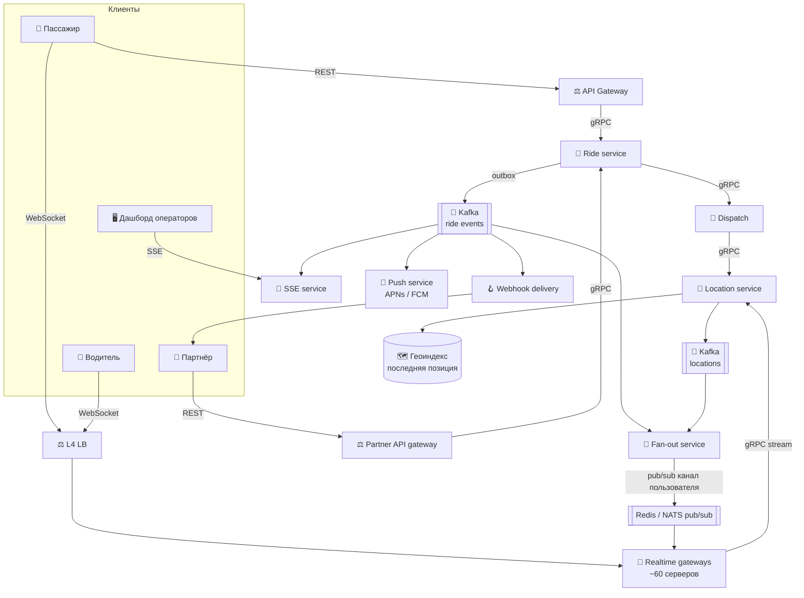
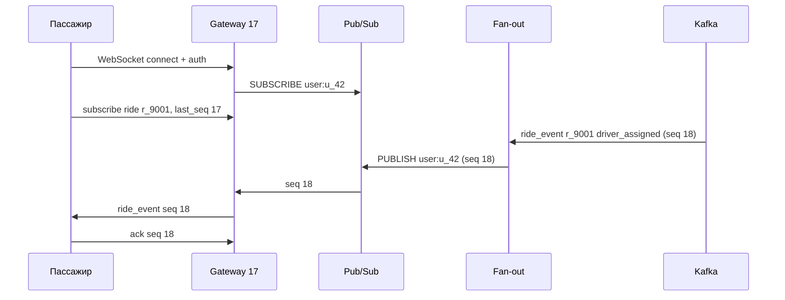
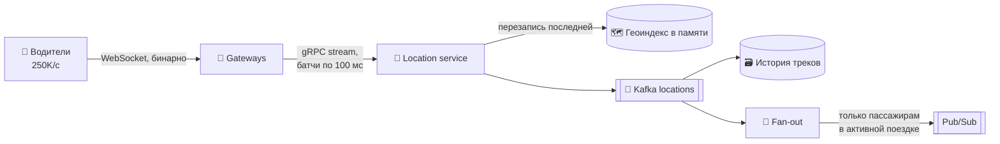
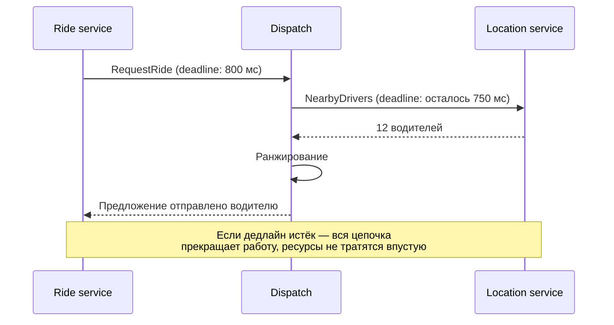
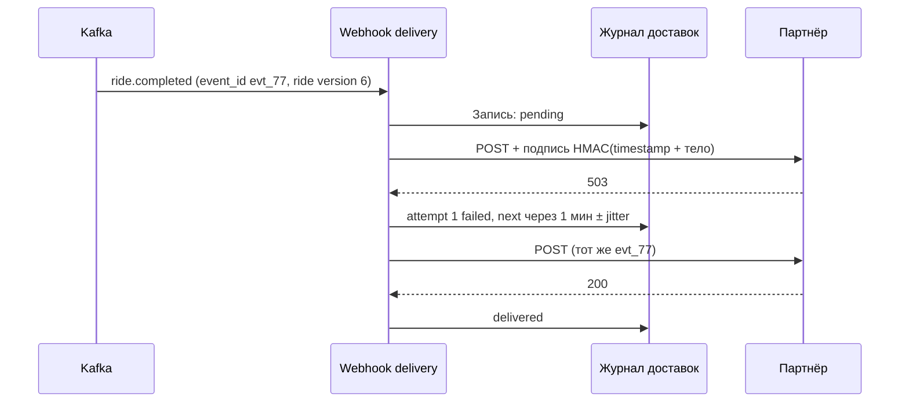

[English](INTERVIEW.md) | **Русский** · Теория: [README_RU.md](./README_RU.md)

# 12. Communication: протоколы для сервиса такси

> **Тема:** выбор протокола для каждого канала (REST, gRPC, WebSocket, SSE, push, вебхуки, брокер), масштабирование WebSocket-gateway, поток геопозиций, внутренний gRPC, публичный API для партнёров, мобильная сеть и reconnect storm
> **Уровень:** Medium–Hard · **Время на интервью:** 45 мин · **Время на разбор:** ~4–5 ч
> **Где спрашивают:** «Спроектируй Uber / доставку / чат — как клиенты и сервисы общаются?», а также как deep dive в любой real-time задаче

---

## 🗺️ Как читать этот разбор

| Значок | Что значит |
|:------:|:-----------|
| 🎤 | Реплика интервьюера |
| 🗣️ | Что говорю вслух я (кандидат) |
| ✏️ | Что рисую на доске |
| ⏱️ | Сколько времени тратить на шаг |

Блоки **TIP** — хороший приём, **WARNING** — ловушка, **IMPORTANT** — сигнал для уровня Senior+.

---

## 📑 Содержание

1. [Условие задачи](#1-условие-задачи)
2. [Уточняющие вопросы и требования](#2-уточняющие-вопросы-и-требования)
3. [Оценки нагрузки](#3-оценки-нагрузки)
4. [Каналы и выбор протокола](#4-каналы-и-выбор-протокола)
5. [API](#5-api)
6. [High-level дизайн](#6-high-level-дизайн)
7. [Deep dive 1: WebSocket-gateway](#7-deep-dive-1-websocket-gateway)
8. [Deep dive 2: поток геопозиций водителей](#8-deep-dive-2-поток-геопозиций-водителей)
9. [Deep dive 3: внутренние вызовы на gRPC](#9-deep-dive-3-внутренние-вызовы-на-grpc)
10. [Deep dive 4: публичный API и вебхуки для партнёров](#10-deep-dive-4-публичный-api-и-вебхуки-для-партнёров)
11. [Deep dive 5: мобильная сеть, фон и reconnect storm](#11-deep-dive-5-мобильная-сеть-фон-и-reconnect-storm)
12. [Узкие места и сценарии сбоев](#12-узкие-места-и-сценарии-сбоев)
13. [Что изменится при росте в 10 раз](#13-что-изменится-при-росте-в-10-раз)
14. [Вопросы интервьюера с ответами](#14-вопросы-интервьюера-с-ответами)
15. [Типичные ошибки](#15-типичные-ошибки)
16. [Шпаргалка и самопроверка](#16-шпаргалка-и-самопроверка)

---

## 1. Условие задачи

> 🎤 «Мы строим сервис такси. Пассажир заказывает поездку и видит машину на карте в реальном времени, водитель получает заказы и отправляет свою позицию. Корпоративные клиенты бронируют поездки через наш API и хотят узнавать о статусе. Спроектируй, как всё это взаимодействует: клиенты, сервисы, партнёры».

**План по времени:**

| Шаг | ⏱️ |
|:----|:--:|
| Требования | 5 мин |
| Оценки | 3 мин |
| Каналы и протоколы | 7 мин |
| API и high-level | 7 мин |
| Deep dives | 18 мин |
| Сбои и итоги | 5 мин |

> [!TIP]
> Главная мысль этой задачи — **разные каналы требуют разных протоколов**. Начни с таблицы каналов: кто с кем говорит, в какую сторону, как часто, что будет при потере сообщения. Это сразу структурирует ответ.

---

## 2. Уточняющие вопросы и требования

⏱️ 5 мин

| Мой вопрос | Ответ интервьюера | Что это меняет |
|:-----------|:------------------|:---------------|
| Как часто водитель отправляет позицию? | Раз в 4 секунды, пока онлайн | Огромный поток мелких сообщений |
| Насколько быстро пассажир должен видеть машину? | Задержка до 1–2 секунд | Push от сервера, не polling |
| Что если приложение пассажира свёрнуто? | Должен получить уведомление «машина подъехала» | Push-уведомления, а не только WebSocket |
| Можно ли терять обновления позиции? | Да, важна только последняя | At-most-once для позиций, отбрасывать устаревшее |
| Можно ли терять события поездки (назначен водитель, поездка завершена)? | Нет | Надёжная доставка с подтверждением и досылкой |
| Какой API у партнёров? | Публичный, для их разработчиков | REST + вебхуки, документация, версионирование |
| Есть ли веб-дашборд для операторов? | Да, живая карта города и метрики | Поток только от сервера → SSE |

### Функциональные требования

1. Пассажир: заказать поездку, видеть статус и машину на карте, получать уведомления.
2. Водитель: быть онлайн, отправлять позицию, получать и принимать заказы.
3. Партнёры: создавать поездки через API, получать события о статусе.
4. Операторы: живой дашборд города.

### Нефункциональные требования

| Требование | Цель |
|:-----------|:-----|
| Задержка позиции машины у пассажира | p99 < 2 с |
| Задержка предложения заказа водителю | p99 < 1 с |
| Надёжность событий поездки | Ни одного потерянного события; дубли допустимы (идемпотентная обработка) |
| Мобильная сеть | Корректная работа при обрывах, смене сети, фоновом режиме |
| Доступность | Сбой одного gateway не прерывает поездки |

---

## 3. Оценки нагрузки

⏱️ 3 мин

✏️

```
Водителей онлайн        = 1M         → позиция раз в 4 с → 250 000 сообщений/с
Пассажиров с открытым
приложением             = 3M
Постоянных соединений   ≈ 4M (водители + пассажиры)
Активных поездок        = 500K       → пассажир получает позицию раз в 4 с → 125 000 сообщений/с наружу
Размер обновления       ≈ 60–100 Б в бинарном виде (против ~300 Б в JSON)
Входящий трафик         ≈ 250 000 × 100 Б ≈ 25 МБ/с

Соединений на gateway   ≈ 100 000 (с запасом)  → ~40 серверов + резерв ≈ 60
```

🗣️ **Выводы:**
- **4 миллиона постоянных соединений** — нужен отдельный слой серверов соединений.
- **250 000 обновлений позиции в секунду** — это не запросы к базе: обновления идут в поток, а в геоиндекс пишется только последняя позиция.
- **Бинарный формат** для позиций экономит примерно втрое трафика и батареи по сравнению с JSON.

---

## 4. Каналы и выбор протокола

⏱️ 7 мин

| Канал | Направление | Частота | Потеря допустима? | Протокол | Почему |
|:------|:------------|:--------|:-----------------:|:---------|:-------|
| Пассажир: заказ, профиль, история, оплата | Клиент → сервер | Редко | Нет | **REST** (HTTP/2) | Простой CRUD, кэширование, idempotency key |
| Пассажир: статус поездки и машина на карте | Сервер → клиент | Часто (каждые 4 с) | Позиции — да, события — нет | **WebSocket** | Нужен и поток вниз, и мелкие сообщения вверх (подписка, подтверждения) |
| Водитель: позиция | Клиент → сервер | Каждые 4 с | Да | **WebSocket** (то же соединение) | Одно постоянное соединение вместо HTTP-запроса каждые 4 с |
| Водитель: предложение заказа | Сервер → клиент | Иногда, срочно | Нет | **WebSocket** + подтверждение | Задержка < 1 с, водитель должен ответить |
| Приложение в фоне | Сервер → клиент | Редко | Нет | **Push (APNs, FCM)** | ОС закрывает соединения свёрнутых приложений |
| Сервис ↔ сервис | Внутри | Очень часто | Нет | **gRPC** | Контракт, низкая задержка, дедлайны, стриминг |
| Асинхронные события (поездка создана, завершена) | Внутри | Часто | Нет | **Kafka** | Развязка, много потребителей, история |
| Партнёры: создание поездок | Партнёр → нам | Средне | Нет | **REST** + OpenAPI | Публичный API, понятный любым разработчикам |
| Партнёры: статусы поездок | Мы → партнёр | Средне | Нет | **Вебхуки** | Push между серверами, ретраи |
| Дашборд операторов | Сервер → браузер | Часто | Да | **SSE** | Только поток вниз, автоматическое переподключение |

> [!IMPORTANT]
> **Сигнал Senior+:** раздели сообщения в одном WebSocket-соединении на **два класса**: позиции (at-most-once, важна только последняя, можно отбрасывать) и события поездки (at-least-once, с номером и подтверждением, досылаются после переподключения). Это разные гарантии в одном канале.

---

## 5. API

⏱️ 4 мин

### REST для клиентов

```http
POST /v1/rides                    Idempotency-Key: <uuid>
     { pickup, dropoff, ride_type, payment_method_id }
     → 201 { ride_id, status: "searching" }
GET  /v1/rides/{ride_id}          → { status, driver?, eta?, price }
POST /v1/rides/{ride_id}/cancel
GET  /v1/users/me/rides?cursor=…  → история с курсорной пагинацией
```

### WebSocket-протокол

```
Подключение: wss://rt.taxi.example/v1/connect   (токен в первом сообщении или заголовке)

Клиент → сервер
  { "t": "subscribe", "ride_id": "r_9001", "last_seq": 17 }
  { "t": "loc", "lat": 52.23, "lng": 21.01, "ts": 1732000000123 }   ← водитель, бинарно в проде
  { "t": "offer_ack", "offer_id": "o_55", "accept": true }
  { "t": "ack", "seq": 18 }

Сервер → клиент
  { "t": "ride_event", "seq": 18, "ride_id": "r_9001", "type": "driver_assigned", ... }
  { "t": "driver_loc", "ride_id": "r_9001", "lat": ..., "lng": ..., "ts": ... }   ← без seq, только последнее
  { "t": "offer", "offer_id": "o_55", "pickup": ..., "expires_in": 15 }
  { "t": "ping" }
```

### Внутренний gRPC (фрагмент)

```protobuf
service LocationService {
  rpc IngestLocations (stream LocationUpdate) returns (IngestAck);   // от gateway
  rpc NearbyDrivers (NearbyRequest) returns (NearbyResponse);        // для диспетчеризации
}
service DispatchService {
  rpc RequestRide (RideRequest) returns (RideAccepted);
}
```

### Партнёрский API

```http
POST /partner/v1/rides            Idempotency-Key, Authorization: Bearer <client_credentials token>
GET  /partner/v1/rides/{id}
Вебхуки: POST {partner_url}  ride.driver_assigned | ride.completed | ride.cancelled
         Webhook-Id, Webhook-Timestamp, Webhook-Signature
```

---

## 6. High-level дизайн

⏱️ 3 мин

✏️



🗣️ «Ключевые решения:
- **Realtime gateways** — отдельный stateful-слой: держат WebSocket, ничего не знают о бизнес-логике;
- **бизнес-сервисы** общаются по gRPC и остаются stateless;
- **события** идут через Kafka (из outbox Ride service);
- **fan-out** доставляет события в gateway через pub/sub, в push-уведомления, во вебхуки партнёров и в SSE для дашборда».

---

## 7. Deep dive 1: WebSocket-gateway

> 🎤 «Пассажир подключён к gateway 17, а событие «водитель назначен» возникло в Ride service. Как оно дойдёт?»



### Ключевые решения

| Тема | Решение |
|:-----|:--------|
| **Маршрутизация** | Gateway подписывается на канал `user:{id}` при подключении; fan-out публикует в канал пользователя. Нет нужды знать, на каком gateway пользователь |
| **Балансировка** | L4 с least connections; idle-таймаут на LB больше интервала heartbeat |
| **Heartbeat** | Ping каждые 25 с; нет pong за 2 интервала → соединение закрыто |
| **Надёжные события** | Номер `seq` на поездку; клиент подтверждает; при переподключении присылает `last_seq`, gateway досылает пропущенное из хранилища событий поездки |
| **Позиции** | Без `seq` и подтверждений; при медленном клиенте в буфере держится только **последняя** позиция |
| **Состояние gateway** | Только соединения и подписки; при падении клиенты переподключаются к другому и досылают пропущенное по `last_seq` |
| **Деплой** | Drain: gateway перестаёт принимать новые соединения и закрывает старые порциями с кодом «переподключись», растянуто на минуты |

> [!WARNING]
> Не клади бизнес-логику в gateway. Иначе каждый его деплой — это обрыв миллиона соединений из-за изменения в бизнес-правилах. Gateway должен меняться редко.

---

## 8. Deep dive 2: поток геопозиций водителей

> 🎤 «250 000 позиций в секунду. Куда они идут и что с ними происходит?»

🗣️ «Позиции — это **поток**, а не транзакции. Принципы:

| Принцип | Реализация |
|:--------|:-----------|
| Одно постоянное соединение | Водитель шлёт позицию по своему WebSocket, а не новым HTTP-запросом |
| Бинарный компактный формат | Protobuf или собственный бинарный формат: ~60–100 байт |
| Батчинг на gateway | Gateway собирает позиции и отправляет в Location service gRPC-стримом пачками раз в ~100 мс |
| Только последняя позиция в геоиндексе | Геоиндекс (например, по H3-ячейкам в памяти) хранит одну позицию на водителя — запись перезаписывает |
| История — отдельно | Поток в Kafka → хранилище треков для аналитики и споров по поездкам |
| At-most-once | Потеря одной позиции не важна: через 4 секунды придёт следующая |
| Отбрасывать устаревшее | Сообщение с `ts` старше уже сохранённого игнорируется (сеть может доставить не по порядку) |



🗣️ «Пассажиру позиция пересылается, только если у этого водителя есть активная поездка. Fan-out держит в памяти соответствие «водитель → пассажир» для активных поездок, поэтому 125 000 сообщений наружу в секунду — это ровно активные поездки, а не все водители».

> [!TIP]
> Хорошая оптимизация батареи: **адаптивная частота**. Водитель без заказа на стоянке шлёт позицию реже (раз в 10–15 с), водитель в поездке — чаще. Это сокращает поток без ущерба для пользователей.

---

## 9. Deep dive 3: внутренние вызовы на gRPC

> 🎤 «Почему gRPC внутри, а не REST?»

🗣️

| Требование | Как gRPC помогает |
|:-----------|:------------------|
| Строгий контракт между десятками команд | `.proto` + кодогенерация, ломающие изменения видны на этапе сборки |
| Низкая задержка (диспетчеризация < 1 с с несколькими вызовами) | Бинарный формат, HTTP/2, постоянные соединения |
| Стриминг позиций от gateway | Client streaming |
| Каскадные таймауты | **Дедлайны** передаются по цепочке: если у диспетчеризации осталось 300 мс, Location service знает об этом |

### Подводные камни и решения

| Проблема | Решение |
|:---------|:--------|
| Долгоживущие HTTP/2-соединения → перекос нагрузки за L4-балансировщиком | Client-side балансировка (через service mesh или xDS) или L7-прокси (Envoy) с балансировкой по запросам |
| Ретраи на нескольких уровнях | Ретраи только идемпотентных методов, в одном месте (mesh), с бюджетом |
| Эволюция схем | Только добавление полей, `reserved` для удалённых, проверка совместимости в CI |
| Отладка | gRPC reflection, grpcurl, трассировка (OpenTelemetry) |



---

## 10. Deep dive 4: публичный API и вебхуки для партнёров

> 🎤 «Корпоративный партнёр создаёт поездки для сотрудников. Как спроектировать API и уведомления?»

### REST API

| Тема | Решение |
|:-----|:--------|
| Формат | REST + JSON, OpenAPI-спецификация, SDK для популярных языков |
| Аутентификация | OAuth 2.0 client credentials, токены с ограниченными правами (scopes) |
| Идемпотентность | `Idempotency-Key` обязателен для `POST /rides` |
| Версионирование | `/partner/v1/`; новые поля без смены версии; ломающие изменения — v2 с периодом поддержки v1 |
| Лимиты | Rate limit на партнёра; `429` + `Retry-After`; заголовки остатка лимита |
| Ошибки | RFC 9457 Problem Details |
| Списки | Курсорная пагинация |

### Вебхуки



| Правило | Зачем |
|:--------|:------|
| `event_id` + версия поездки в каждом событии | Дедупликация и порядок на стороне партнёра |
| Подпись HMAC с timestamp | Подлинность и защита от повторного воспроизведения |
| Таймаут 5 с, ретраи с backoff + jitter до 24 ч | Медленный партнёр не тормозит доставку остальным |
| **Отдельная очередь на партнёра** | Сломанный эндпоинт одного партнёра не задерживает вебхуки другим |
| Журнал доставок в кабинете партнёра + ручной повтор | Самообслуживание |
| Отключение эндпоинта после суток ошибок + письмо | Не тратить ресурсы |
| API для получения пропущенных событий | Партнёр может догнать, если его эндпоинт лежал |

---

## 11. Deep dive 5: мобильная сеть, фон и reconnect storm

> 🎤 «Пассажир едет в метро, связь пропадает и появляется. Приложение свёрнуто. А ещё у нас упал целый gateway. Что происходит?»

### Обрывы связи

| Ситуация | Поведение |
|:---------|:----------|
| Соединение оборвалось | Клиент переподключается с exponential backoff + jitter (начиная с ~1 с) |
| Переподключился | Отправляет `subscribe` с `last_seq` → получает пропущенные события поездки; позиция — просто последняя |
| Смена Wi-Fi → LTE | Новое соединение (для REST-запросов помогает HTTP/3 с миграцией соединения) |
| Сеть плохая долго | UI показывает «нет связи», последняя известная позиция машины помечена как устаревшая |

### Приложение в фоне

🗣️ «iOS и Android закрывают соединения свёрнутых приложений. Поэтому важные события (водитель назначен, машина подъехала, поездка завершена) дублируются **push-уведомлениями** через APNs и FCM. Push не гарантирует доставку и порядок, поэтому при открытии приложение всё равно синхронизирует состояние через REST или WebSocket с `last_seq`».

### Reconnect storm

🗣️ «Gateway с 100 000 соединений упал. Все 100 000 клиентов одновременно переподключаются → нагрузка на LB, TLS-рукопожатия, аутентификацию и досылку пропущенного.

| Защита | Как |
|:-------|:----|
| Jitter на клиенте | Переподключения растягиваются на десятки секунд |
| Ограничение скорости приёма соединений | Gateway принимает новые соединения с лимитом в секунду; лишним — отказ с `Retry-After` |
| TLS session resumption | Дешевле повторное рукопожатие |
| Дешёвая аутентификация | Проверка подписи JWT локально, без похода в сервис авторизации |
| Запас ёмкости | Оставшиеся gateway выдерживают +20% соединений |
| Досылка из быстрого хранилища | Последние события поездок — в Redis или в памяти fan-out, а не из основной базы |

> [!WARNING]
> Самый опасный сценарий — **региональный сбой сети** у мобильного оператора: миллионы клиентов переподключаются одновременно, когда сеть возвращается. Без jitter это выглядит как DDoS собственных пользователей.

---

## 12. Узкие места и сценарии сбоев

| Сценарий | Что произойдёт | Как защищаемся |
|:---------|:---------------|:---------------|
| Падение gateway | 100 000 соединений оборвались | Переподключение с jitter к другим gateway, досылка по `last_seq`, лимит скорости приёма |
| Pub/sub недоступен | События не доходят до gateway | Кластер pub/sub с репликами; клиенты при переподключении досылают по `last_seq`; push дублирует важное |
| Медленный клиент | Буфер gateway растёт | Для позиций — только последняя; для событий — ограниченный буфер, иначе закрыть соединение (клиент дошлёт после переподключения) |
| gRPC-перекос нагрузки | Один экземпляр Location service перегружен | L7 / client-side балансировка |
| Каскадные таймауты | Цепочка висит дольше нужного | Дедлайны в gRPC |
| Эндпоинт партнёра лежит | Вебхуки копятся | Отдельная очередь на партнёра, ретраи, журнал, API догоняния |
| Push не дошёл | Пассажир не узнал о подъезде машины | При открытии приложения — синхронизация состояния; SMS для критичных случаев |
| Деплой gateway | Массовые обрывы | Drain постепенно, по частям |
| Позиции пришли не по порядку | Машина «прыгает назад» | Игнорировать позиции со старым `ts` |

---

## 13. Что изменится при росте в 10 раз

> 🎤 «40 миллионов соединений и десятки городов на разных континентах?»

🗣️ «Что меняется:
1. **Региональные gateway** рядом с пользователями (Anycast или GeoDNS); соединение заканчивается в ближайшем регионе.
2. **Шардирование pub/sub** по пользователю или городу; fan-out в каждом регионе.
3. **Location и Dispatch — по городам**: позиции и диспетчеризация локальны, межрегиональный трафик минимален.
4. **Протокол поверх QUIC/HTTP/3** для мобильных клиентов — меньше переподключений при смене сети (WebTransport или собственный протокол поверх QUIC, как делают некоторые крупные приложения).
5. **Адаптивная частота и сжатие** позиций, дельта-кодирование».

---

## 14. Вопросы интервьюера с ответами

<details>
<summary><b>Почему WebSocket для пассажира, а не SSE?</b></summary>

Пассажиру нужен в основном поток от сервера, и SSE справился бы. Но в том же приложении нужны и сообщения вверх (подписка с last_seq, подтверждения событий), а водителю — частая отправка позиций. Один протокол для обоих приложений упрощает gateway. Если бы было только приложение пассажира, SSE был бы хорошим и более простым выбором.
</details>

<details>
<summary><b>Почему не gRPC-стриминг прямо с мобильного клиента?</b></summary>

Можно: gRPC работает на мобильных платформах, и некоторые компании так делают. Но WebSocket проще проходит через прокси и балансировщики, его легче отлаживать, и он одинаково работает в веб-версии. gRPC-стриминг с клиента — разумная альтернатива, если команда уже использует gRPC и нет веб-клиента.
</details>

<details>
<summary><b>А MQTT для позиций водителей?</b></summary>

MQTT создан для устройств на ненадёжных сетях: лёгкий, с уровнями QoS и сохранением сессии, и некоторые сервисы такси и доставки его используют. Это хороший вариант для водительского приложения. Минусы — отдельный брокер и стек, плохая поддержка в браузерах. На интервью стоит назвать как альтернативу с этими компромиссами.
</details>

<details>
<summary><b>Почему не GraphQL для мобильного приложения?</b></summary>

Можно использовать GraphQL в BFF для экранов с агрегацией данных (главный экран: сохранённые места, промо, тарифы рядом). Для основного потока (заказ, статус, позиции) он не даёт преимуществ: REST и WebSocket проще. Решение зависит от того, насколько разнообразны экраны и клиенты.
</details>

<details>
<summary><b>Как гарантировать, что пассажир не пропустит «поездка завершена»?</b></summary>

Событие с номером в рамках поездки, подтверждение от клиента, досылка по last_seq после переподключения, дублирование push-уведомлением, а при открытии приложения — синхронизация состояния через `GET /rides/{id}`. Источник правды — сервер, а не доставленное сообщение.
</details>

<details>
<summary><b>Зачем отдельная очередь вебхуков на каждого партнёра?</b></summary>

Если у одного партнёра эндпоинт медленный или недоступен, его ретраи не должны занимать воркеры и задерживать доставку другим. Изоляция по партнёрам — это bulkhead для вебхуков.
</details>

---

## 15. Типичные ошибки

| ❌ Ошибка | ✅ Как правильно |
|:---------|:----------------|
| Один протокол на всё | Таблица каналов и протокол для каждого |
| HTTP-запрос на каждую позицию водителя | Постоянное соединение, бинарный формат, батчинг |
| Одинаковые гарантии для позиций и событий | Позиции — at-most-once, последняя; события — seq, ack, досылка |
| Полагаться на WebSocket для приложения в фоне | Push-уведомления + синхронизация при открытии |
| Бизнес-логика в gateway | Gateway только держит соединения |
| gRPC за L4 без учёта HTTP/2 | Client-side или L7-балансировка |
| Переподключение без jitter | Backoff + jitter, лимит приёма соединений |
| Вебхуки в общей очереди без подписи | Очередь на партнёра, HMAC, event_id, ретраи |
| Писать каждую позицию в основную базу | Геоиндекс в памяти (последняя), история — в поток |

---

## 16. Шпаргалка и самопроверка

### Ответ за 30 секунд

> Протокол для каждого канала. Клиентский CRUD и партнёрский API — REST с idempotency key, курсорами и `429`. Real-time для пассажира и водителя — WebSocket через отдельный слой gateway (~60 серверов на 4 млн соединений), маршрутизация через pub/sub-каналы пользователей. В одном соединении два класса сообщений: позиции (at-most-once, только последняя, бинарно) и события поездки (seq, ack, досылка по last_seq). Позиции батчатся в gRPC-стрим к Location service, в геоиндексе — только последняя. Внутри — gRPC с дедлайнами и client-side балансировкой. В фоне — push, при открытии — синхронизация. Партнёрам — подписанные вебхуки с отдельной очередью на партнёра. Дашборду — SSE. Переподключения — с jitter и лимитом приёма.

### Самопроверка

- [ ] Могу составить таблицу каналов с направлением, частотой и гарантиями
- [ ] Могу объяснить, почему WebSocket здесь, а SSE для дашборда
- [ ] Могу нарисовать доставку события через pub/sub на нужный gateway
- [ ] Могу объяснить разные гарантии для позиций и событий в одном соединении
- [ ] Могу описать поток геопозиций от водителя до пассажира
- [ ] Могу объяснить проблему балансировки gRPC и дедлайны
- [ ] Могу спроектировать надёжные вебхуки для партнёров
- [ ] Могу объяснить reconnect storm и защиту от него

### Что почитать

- Теория по теме: [README_RU.md](./README_RU.md)
- RFC 6455 (WebSocket)
- Документация gRPC: deadlines, load balancing
- Standard Webhooks (standardwebhooks.com)
- Документация APNs и FCM: ограничения фонового режима