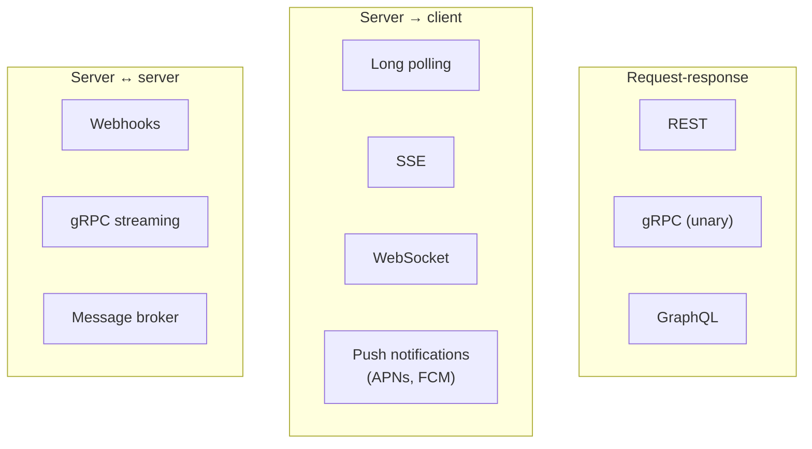
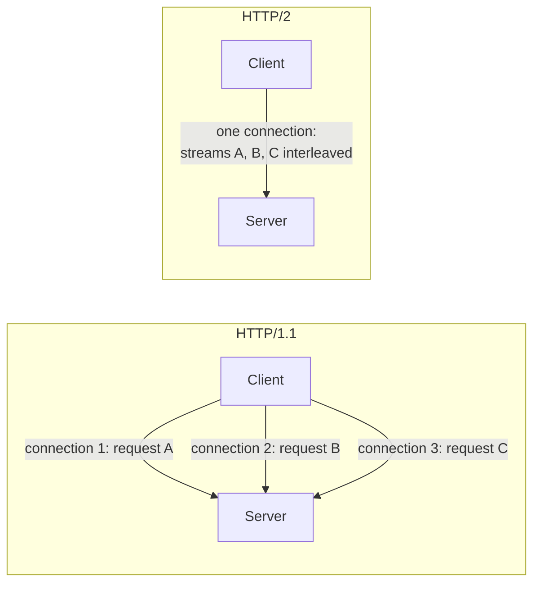
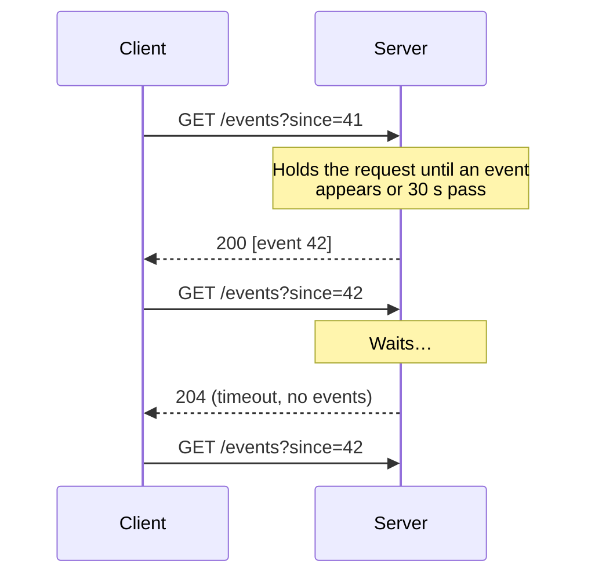
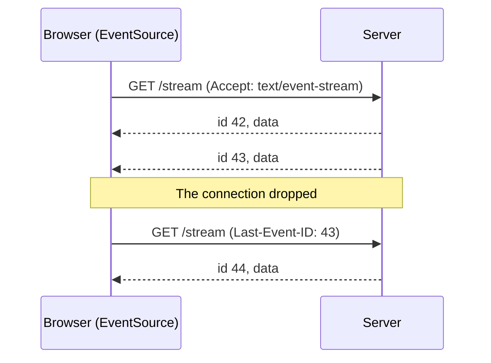
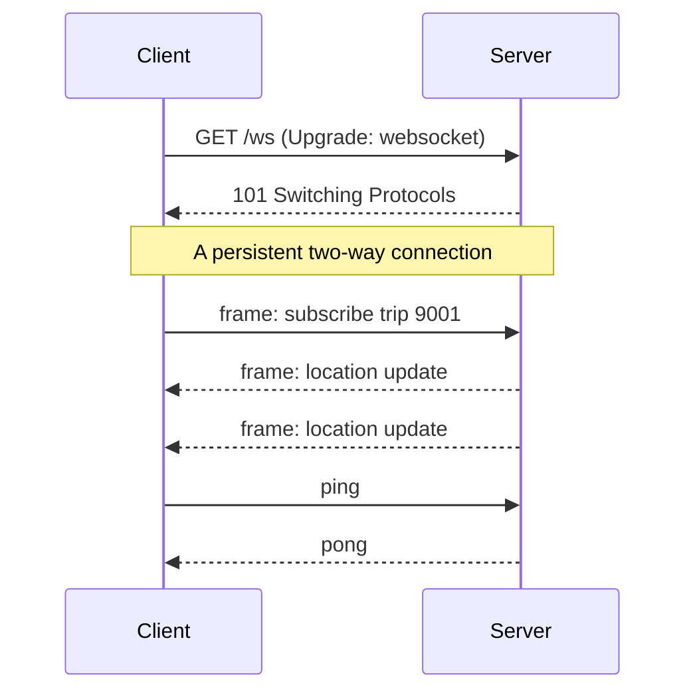
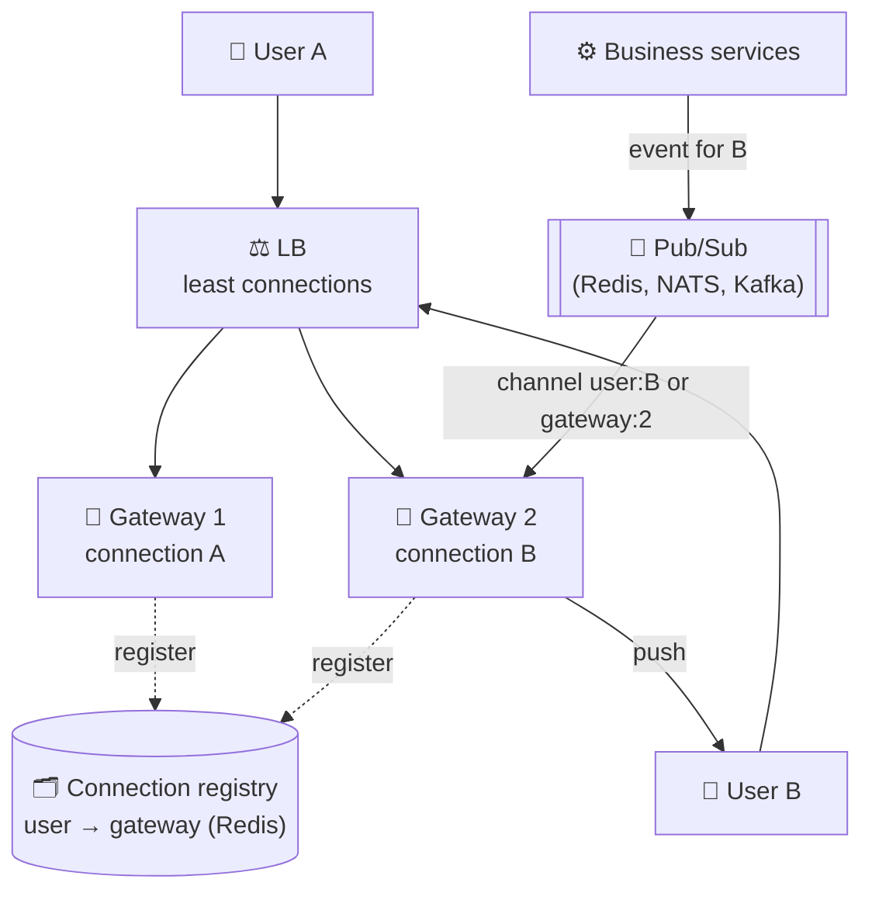
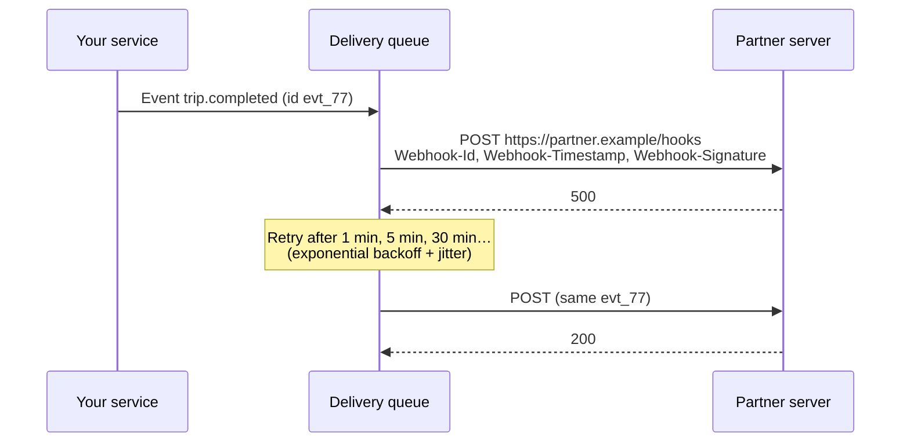
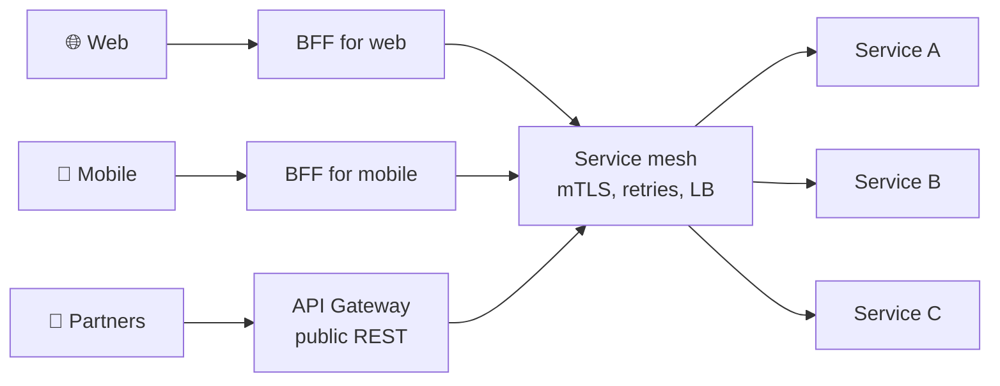

**English** | [Русский](README_RU.md)

# 12. Communication Protocols

> **Covers:** HTTP/1.1, HTTP/2, HTTP/3, REST, gRPC, GraphQL, polling, long polling, SSE, WebSocket, webhooks, serialization formats, API gateways and BFFs, scaling WebSockets, how to choose a protocol for the job
> **Study time:** ~4–5 h · **Needed for:** every problem — each has an API; especially chat, real-time, mobile clients, microservices, public APIs
> **Practice:** interview-style walkthrough — [INTERVIEW.md](./INTERVIEW.md)
> **Related topics:** [01-scaling-basics](../01-scaling-basics/README.md#7-l4-vs-l7) (L4/L7), [09-messaging](../09-messaging/README.md), [10-idempotency](../10-idempotency/README.md)

---

## 📑 Contents

1. [Map of Communication Styles](#1-map-of-communication-styles)
2. [HTTP/1.1, HTTP/2, HTTP/3](#2-http11-http2-http3)
3. [REST](#3-rest)
4. [gRPC](#4-grpc)
5. [GraphQL](#5-graphql)
6. [REST vs gRPC vs GraphQL](#6-rest-vs-grpc-vs-graphql)
7. [Server → Client: Polling, Long Polling, SSE, WebSocket](#7-server--client-polling-long-polling-sse-websocket)
8. [Scaling WebSockets](#8-scaling-websockets)
9. [Webhooks](#9-webhooks)
10. [Serialization Formats](#10-serialization-formats)
11. [API Gateway, BFF and Service Mesh](#11-api-gateway-bff-and-service-mesh)
12. [API Design: Cross-Cutting Concerns](#12-api-design-cross-cutting-concerns)
13. [How to Choose](#13-how-to-choose)
14. [How to Talk About This in an Interview](#14-how-to-talk-about-this-in-an-interview)
15. [Self-Check Questions](#15-self-check-questions)
16. [Glossary and Resources](#16-glossary-and-resources)

---

## 1. Map of Communication Styles

| Dimension | Options |
|:----------|:--------|
| **Who initiates** | The client asks (pull) / the server sends (push) / both |
| **Synchrony** | Request-response / a stream / async messages via a broker |
| **Who's involved** | Browser/mobile client ↔ server / service ↔ service / server ↔ another company's server |
| **Format** | Text (JSON) / binary (Protobuf) |



> [!TIP]
> In an interview you almost always need **several** protocols: REST for the public API and CRUD, gRPC between services, WebSocket or SSE for real-time, webhooks for partners, a broker for async events. The choice is made per **channel**, not once for the whole system.

---

## 2. HTTP/1.1, HTTP/2, HTTP/3

| | HTTP/1.1 | HTTP/2 | HTTP/3 |
|:-|:---------|:-------|:-------|
| Transport | TCP | TCP | **QUIC over UDP** |
| Concurrent requests per connection | One (pipelining is barely used) | **Many streams** (multiplexing) | Many streams |
| Head-of-line blocking | At the HTTP and TCP levels | Only at the TCP level: a lost packet stalls every stream | **None**: streams are independent |
| Header compression | None | HPACK | QPACK |
| Connection setup | TCP + TLS | TCP + TLS | A combined QUIC+TLS 1.3 handshake, 0-RTT possible |
| Network switch (Wi-Fi → LTE) | A new connection | A new connection | **Connection migration** by connection ID |
| Format | Text | Binary frames | Binary frames |



**What matters for system design:**
- HTTP/2 underpins gRPC; one long-lived connection carries many requests, so **L4 load balancing distributes poorly** (see [01-scaling-basics](../01-scaling-basics/README.md#7-l4-vs-l7)).
- HTTP/3 especially helps **mobile clients**: packet loss and network switches hurt latency less.
- Keep-alive and connection pools are a must: a TLS handshake per request is expensive.

---

## 3. REST

**REST** (Representational State Transfer, Roy Fielding, 2000) is an architectural style over HTTP: **resources** with addresses (URLs) acted on by standard **methods**.

```http
GET    /v1/users/42/orders?status=paid&limit=20&cursor=abc   ← a list
GET    /v1/orders/9001                                        ← one resource
POST   /v1/orders                                             ← create
PUT    /v1/orders/9001                                        ← replace
PATCH  /v1/orders/9001                                        ← partial update
DELETE /v1/orders/9001                                        ← delete
```

### Principles and practices

| Topic | Practice |
|:------|:---------|
| **Resources** | Plural nouns: `/orders`, `/users/42/orders` |
| **Methods** | Follow HTTP semantics; remember which are idempotent (see [10-idempotency](../10-idempotency/README.md#2-what-idempotency-is)) |
| **Status codes** | `200`, `201 Created`, `202 Accepted`, `204`, `400`, `401`, `403`, `404`, `409`, `422`, `429`, `5xx` |
| **Errors** | A uniform format, e.g. RFC 9457 "Problem Details": `type`, `title`, `status`, `detail` |
| **Stateless** | Each request is self-contained (a token in a header) — easy to scale horizontally |
| **Caching** | `Cache-Control`, `ETag` / `If-None-Match` → `304` |
| **Pagination** | Cursor-based (`cursor`, `next_cursor`), not offset, for large lists |
| **Filtering and field selection** | `?status=paid`, `?fields=id,total` |
| **Versioning** | In the path (`/v1/`), in a header, or by date (`Stripe-Version: 2024-06-20`) |
| **Idempotency** | `Idempotency-Key` for `POST` |

| ✅ Pros | ❌ Cons |
|:-------|:-------|
| Simple, supported everywhere, easy to debug (curl, a browser) | **Over-fetching**: you get more fields than you need |
| HTTP caching and CDNs out of the box | **Under-fetching**: one screen needs several requests |
| Loose client-server coupling | No strict contract by default (solved by OpenAPI) |
| The best choice for public APIs | JSON is text, heavier than binary formats |

---

## 4. gRPC

**gRPC** is Google's RPC framework over **HTTP/2** with a **Protocol Buffers** contract.

```protobuf
syntax = "proto3";

service OrderService {
  rpc GetOrder (GetOrderRequest) returns (Order);                      // unary
  rpc ListOrders (ListOrdersRequest) returns (stream Order);           // server streaming
  rpc UploadEvents (stream Event) returns (UploadSummary);             // client streaming
  rpc Chat (stream ChatMessage) returns (stream ChatMessage);          // bidirectional
}

message Order {
  int64  id     = 1;
  string status = 2;
  int64  total_cents = 3;
  // Field numbers must never be reused: that's how version compatibility is preserved
}
```

### Four call types

| Type | Example |
|:-----|:--------|
| **Unary** | An ordinary request-response |
| **Server streaming** | A stream of results or updates from the server |
| **Client streaming** | Uploading a stream of events (telemetry) |
| **Bidirectional streaming** | Chat, sync, games |

### Specifics

| Topic | What to know |
|:------|:-------------|
| **Contract and code generation** | Clients and servers are generated from `.proto` for many languages; type safety |
| **Schema evolution** | You can add fields; you can't change existing numbers or types; mark removed numbers `reserved` |
| **Deadlines** | The client sets a deadline, which propagates down the call chain |
| **Status codes** | Its own: `OK`, `DEADLINE_EXCEEDED`, `UNAVAILABLE`, `NOT_FOUND`, `RESOURCE_EXHAUSTED`... |
| **Interceptors** | Middleware for auth, logging, metrics, retries |
| **Load balancing** | Long-lived HTTP/2 connections → you need per-request L7 balancing or client-side LB (lookaside, xDS); otherwise load lands on one backend |
| **Browsers** | Not supported directly → gRPC-Web via a proxy (Envoy) or Connect |

| ✅ Pros | ❌ Cons |
|:-------|:-------|
| Compact binary format, low latency | Worse for public APIs and browsers |
| A strict contract, code generation | Unreadable without tooling (no plain curl) |
| Streaming in both directions | HTTP caching and CDNs don't work |
| Deadlines and standardized errors | Needs proper load balancing |

**Where:** microservice communication, mobile clients (sometimes), high-throughput internal APIs. Alternatives: Apache Thrift, Twirp, Connect.

---

## 5. GraphQL

**GraphQL** (Facebook, 2015) is a query language for APIs: one endpoint, and the client describes **which fields** it needs.

```graphql
query RiderHome($id: ID!) {
  user(id: $id) {
    name
    savedPlaces { label address }
    recentTrips(first: 3) {
      edges { node { id destination price } }
    }
  }
  promotions(city: "Warsaw") { title discount }
}
```

| Operation | Purpose |
|:----------|:--------|
| **Query** | Reads |
| **Mutation** | Writes |
| **Subscription** | A stream of updates (usually over WebSocket) |

### Pitfalls

| Problem | Solution |
|:--------|:---------|
| **N+1 queries in resolvers** (100 orders → 100 queries for users) | **DataLoader**: batching and caching within a request |
| **Expensive queries** (deep nesting, huge lists) | Depth and cost limits, timeouts, **persisted queries** (only pre-registered queries allowed) |
| **HTTP caching doesn't work** (everything is `POST /graphql`) | Persisted queries via `GET`, client-side caches (Apollo, Relay) and resolver caches |
| **Errors** | Responses are often `200` with an `errors` array — monitoring must account for it |
| **Authorization** | At the field and resolver level, not the endpoint |
| **Many teams and services** | Federation: a shared graph composed of subgraphs from different services |

| ✅ Pros | ❌ Cons |
|:-------|:-------|
| No over/under-fetching: one request per screen | Harder caching, rate limiting, monitoring |
| A strict schema, introspection, good tooling | Risk of expensive client queries |
| Convenient for many clients with different needs | More complexity on the server |

**Where:** a BFF layer for web and mobile clients that aggregates data from many services.

---

## 6. REST vs gRPC vs GraphQL

| | REST | gRPC | GraphQL |
|:-|:-----|:-----|:--------|
| Transport | HTTP/1.1, HTTP/2 | HTTP/2 | HTTP (usually `POST`) |
| Format | JSON (usually) | Protobuf (binary) | JSON |
| Contract | Optional (OpenAPI) | Required (`.proto`) | Required (schema) |
| Field selection | No (or `?fields=`) | No | ✅ The client chooses |
| Streaming | No (SSE separately) | ✅ All directions | Subscriptions |
| HTTP cache / CDN | ✅ | ❌ | ⚠️ With persisted queries |
| Browser | ✅ | ⚠️ gRPC-Web | ✅ |
| Performance | Medium | High | Medium |
| Best for | Public APIs, CRUD, simplicity | Service ↔ service, low latency, streaming | Aggregating data for UIs, many different clients |

> [!IMPORTANT]
> **Senior+ signal:** not "gRPC is better than REST" but "**REST** for the public API — simplicity, caching, compatibility; **gRPC** internally — contracts, speed, deadlines, streaming; **GraphQL** in a BFF for mobile and web — one request per screen."

---

## 7. Server → Client: Polling, Long Polling, SSE, WebSocket

HTTP is built as "the client asks — the server answers". When the server needs to **tell** the client about an event, there are several approaches.

### Short polling

The client asks every N seconds: "anything new?".
- ✅ As simple as it gets.
- ❌ Up to N seconds of delay; most requests are empty — wasted load.

### Long polling



- ✅ Near-instant delivery, works everywhere (plain HTTP).
- ❌ Each event is a new request; the server holds many hanging requests.

### SSE (Server-Sent Events)



- A **one-way** stream from server to client over plain HTTP.
- ✅ The browser's built-in `EventSource` with **automatic reconnection** and `Last-Event-ID`; works through proxies and over HTTP/2.
- ❌ Text only, server → client only; over HTTP/1.1 browsers limit connections per domain (with HTTP/2 the issue goes away).

### WebSocket



- A **full-duplex** connection over TCP (RFC 6455) that starts with an HTTP Upgrade.
- ✅ Two-way exchange with minimal overhead, text and binary data.
- ❌ A **stateful** connection: harder to scale and balance; reconnection and recovering missed messages are up to you; some corporate proxies interfere.

### Comparison

| | Short polling | Long polling | SSE | WebSocket |
|:-|:--------------|:-------------|:----|:----------|
| Direction | Client → server | Client → server (the response waits for an event) | Server → client | Both |
| Delivery latency | Up to the polling interval | Low | Low | Minimal |
| Overhead | High | Medium | Low | Minimal |
| Protocol | HTTP | HTTP | HTTP | WS over TCP |
| Reconnection | Not needed | Not needed | ✅ Built in | Manual |
| Binary data | ✅ | ✅ | ❌ | ✅ |
| Scaling | Easy | Medium | Medium | Harder (state) |
| When | Rare updates, simplicity | A fallback, restricted environments | Feeds, notifications, progress, dashboards, streaming LLM responses | Chat, games, collaborative editing, live maps |

> [!TIP]
> If data flows **only from server** to client, start with **SSE**: simpler than WebSocket, works on the ordinary HTTP stack and reconnects by itself. WebSocket is for frequent **two-way** exchange. For a mobile app in the background, neither works — you need **push notifications** (APNs, FCM).

---

## 8. Scaling WebSockets

A WebSocket connection is **bound to a specific server**. If an event for a user arises on a different server, it must be delivered to wherever the connection lives.



| Topic | Practice |
|:------|:---------|
| **A separate gateway tier** | Connection servers hold no business logic; business services stay stateless |
| **Routing** | Pub/sub channels per user or topic that the gateway holding the connection subscribes to; or a "user → gateway" registry and targeted delivery |
| **Load balancing** | Least connections; L4 or L7 with WebSocket support; longer idle timeouts on load balancers |
| **Heartbeats** | Ping/pong every 20–30 s: detect dead connections and stop proxies from closing "idle" ones |
| **Reconnection** | Exponential backoff + **jitter** (otherwise millions of clients reconnect at once after an outage — a reconnect storm) |
| **Recovering missed messages** | Number every event; on reconnect the client reports the last number, and the server resends from a buffer or store |
| **Deploys** | Graceful drain: stop accepting new connections, ask clients to reconnect gradually |
| **Slow clients** | A bounded buffer per connection; when full — drop stale data (for location only the latest matters) or close the connection |
| **Capacity** | Hundreds of thousands of connections per server with OS tuning (file descriptor limits, per-connection memory) |
| **Authentication** | A token at connection setup; periodic re-checks or reconnection on expiry |

---

## 9. Webhooks

A **webhook** is an HTTP request **your** server sends to a **client's** URL (usually another company's) when an event happens. It's push between servers.



### The sender

| Rule | Why |
|:-----|:----|
| A unique `event_id` | The receiver deduplicates |
| An **HMAC signature** of body + timestamp | The receiver verifies authenticity; the timestamp guards against replay |
| Retries with backoff + jitter for hours or days | At-least-once delivery |
| A short timeout (a few seconds) | Don't wait on a slow receiver |
| A delivery log and manual resend | The partner can inspect and resend |
| Disabling an endpoint after prolonged failures + a notification | Don't waste resources |
| The object's version in the event | Ordering isn't guaranteed |
| A small body, or a "thin" event + an API to fetch details | Security and size |

There's an open specification, **Standard Webhooks**, that defines headers and signatures.

### The receiver

- Verify the signature and timestamp.
- Respond `2xx` quickly, process asynchronously.
- Deduplicate by `event_id` (see [10-idempotency](../10-idempotency/README.md#10-idempotency-in-workflows-and-webhooks)).
- Don't rely on ordering.

---

## 10. Serialization Formats

| Format | Type | Schema | Size and speed | Evolution | Where |
|:-------|:-----|:-------|:---------------|:----------|:------|
| **JSON** | Text | Optional (JSON Schema) | Larger, slower | Flexible but no guarantees | Public APIs, browsers |
| **Protocol Buffers** | Binary | Required | Compact, fast | Field numbers, backward and forward compatibility | gRPC, internal services |
| **Avro** | Binary | Required, shipped separately (registry) | Compact | Compatibility rules with a schema registry | Kafka, data pipelines |
| **MessagePack / CBOR** | Binary | None | More compact than JSON | Like JSON | When you want "binary JSON" |
| **Thrift** | Binary | Required | Compact | Like Protobuf | Historically at Facebook and others |

> [!TIP]
> For mobile clients sending frequent small messages (location), a binary format noticeably saves bandwidth and battery. For a public API, JSON's readability usually matters more.

---

## 11. API Gateway, BFF and Service Mesh



| Component | What it does |
|:----------|:-------------|
| **API Gateway** | A single entry point: authentication, rate limiting, routing, versioning, transformation, TLS |
| **BFF (Backend for Frontend)** | A dedicated backend for a specific client: aggregates data from many services into responses for specific screens; can be REST or GraphQL |
| **Service mesh** (Istio, Linkerd) | A sidecar proxy next to each service: mTLS, load balancing, retries, timeouts, metrics — with no code in the service |

> [!WARNING]
> Retries in the mesh, the gateway and the service code **multiply** (see [10-idempotency](../10-idempotency/README.md#7-when-and-where-to-retry)). Configure them deliberately, at one layer.

---

## 12. API Design: Cross-Cutting Concerns

| Topic | Practice |
|:------|:---------|
| **Versioning** | Breaking changes — a new version; support the old one with a sunset date; adding fields doesn't need a new version |
| **Pagination** | Cursor-based for large, changing lists |
| **Timeouts and deadlines** | On every call; pass the remaining time down the chain |
| **Idempotency** | `Idempotency-Key` for `POST` |
| **Rate limiting** | Per-client limits; `429` + `Retry-After`; headers showing remaining quota |
| **Authentication** | OAuth 2.0 / OIDC for users, short-lived JWTs, mTLS or tokens for services |
| **Compression** | gzip, Brotli for text responses |
| **Observability** | A `request_id` / trace context (W3C Trace Context) on every request |
| **Backward compatibility** | Clients ignore unknown fields; the server doesn't remove or rename fields without a new version |

---

## 13. How to Choose

| Scenario | Choice | Why |
|:---------|:-------|:----|
| A public API for developers | REST + JSON, OpenAPI, webhooks | Simplicity, compatibility, caching |
| Service ↔ service within a company | gRPC | Contracts, speed, deadlines, streaming |
| A mobile/web client with many screens | REST or GraphQL via a BFF | One request per screen |
| Notifications, a feed, job progress, streaming LLM responses | SSE | Server → client only, simple |
| Chat, collaborative editing, games, live maps | WebSocket | Frequent two-way exchange |
| A mobile app in the background | Push notifications (APNs, FCM) | The OS closes background connections |
| Telling a partner about an event | Webhooks | Push between servers |
| Async events between services | A broker (Kafka, SQS) | Decoupling, buffering (see [09-messaging](../09-messaging/README.md)) |
| IoT device telemetry | MQTT | A lightweight protocol for unreliable networks and weak devices |

---

## 14. How to Talk About This in an Interview

### 30-second answer

> "I choose a protocol per channel. The public API and the mobile client's CRUD — REST with JSON, cursor pagination, an idempotency key, and `429` with `Retry-After`. Between services — gRPC: a Protobuf contract, deadlines, streaming; I balance per request at L7 or on the client, because HTTP/2 connections are long-lived. For real-time: server-only — SSE; both ways — WebSocket through a separate gateway tier with pub/sub routing, heartbeats, reconnection with jitter, and resending missed messages by event number. In the background — push notifications. For partners — webhooks with signatures, retries and an event_id."

### Questions to ask

1. Who's the client: a browser, a mobile app, another service, an external company?
2. Who initiates the exchange, and how often do messages flow?
3. What delivery latency is needed?
4. What happens when the connection drops — can messages be lost?
5. Do you need a strict contract and code generation?

### Common mistakes

- One protocol for everything.
- WebSocket where SSE or even polling would do.
- gRPC behind an L4 load balancer without accounting for long-lived connections.
- GraphQL without protection against expensive queries and without DataLoader.
- WebSocket without heartbeats, jittered reconnection and missed-message recovery.
- Business logic in connection servers.
- Webhooks without signatures, retries and an event_id.
- Offset pagination in a public API.

---

## 15. Self-Check Questions

<details>
<summary><b>1. What does HTTP/2 give over HTTP/1.1, and what problem does HTTP/3 solve?</b></summary>

HTTP/2 multiplexes many streams over one TCP connection and compresses headers, removing head-of-line blocking at the HTTP level. But a lost TCP packet still stalls every stream. HTTP/3 runs over QUIC (UDP), where streams are independent, and adds a fast handshake and connection migration on network changes.
</details>

<details>
<summary><b>2. Why does gRPC balance poorly at L4?</b></summary>

gRPC uses long-lived HTTP/2 connections, each carrying many requests. An L4 load balancer distributes connections, not requests, so all of a client's requests go to one backend. You need per-request L7 balancing or client-side load balancing.
</details>

<details>
<summary><b>3. What are over-fetching and under-fetching, and how does GraphQL solve them?</b></summary>

Over-fetching is receiving unneeded fields; under-fetching is needing several requests for one screen. In GraphQL the client requests exactly the needed fields from several related objects in one query.
</details>

<details>
<summary><b>4. What's GraphQL's main server-side performance problem, and how is it solved?</b></summary>

N+1: a resolver makes a separate query for each list item. The fix is DataLoader, which collects keys within a request and loads them in one batch. Plus query depth and cost limits.
</details>

<details>
<summary><b>5. When do you choose SSE and when WebSocket?</b></summary>

SSE — when data flows only from server to client (feeds, notifications, progress, streaming responses): it works over plain HTTP and reconnects by itself. WebSocket — when you need frequent two-way exchange (chat, games, collaborative editing).
</details>

<details>
<summary><b>6. How do you deliver a message to a user whose WebSocket connection is on another server?</b></summary>

Through pub/sub: the gateway holding the connection subscribes to the user's channel (or its own), and the business service publishes the event to that channel. The alternative is a "user → gateway" registry and targeted delivery to the right server.
</details>

<details>
<summary><b>7. What is a reconnect storm and how do you avoid it?</b></summary>

After an outage (a gateway restart, a network failure), millions of clients try to reconnect at once and overload the system. It's avoided with exponential backoff and jitter on the client, gradual draining during deploys, and rate-limiting new connections.
</details>

<details>
<summary><b>8. How should a webhook receiver handle a webhook?</b></summary>

Verify the signature and timestamp, respond 2xx quickly, process asynchronously, deduplicate by event_id and not rely on ordering (check the object's version or fetch the current state).
</details>

<details>
<summary><b>9. How is a BFF different from an API gateway?</b></summary>

An API gateway is a shared entry point with authentication, limits and routing. A BFF is a dedicated backend for a specific client type that aggregates data from many services into responses for specific screens.
</details>

<details>
<summary><b>10. How do you evolve a Protobuf schema without breaking clients?</b></summary>

Add new fields with new numbers; don't change existing numbers or types; mark removed fields `reserved` so their numbers aren't reused. Old clients ignore unknown fields; new clients get default values for missing ones.
</details>

---

## 16. Glossary and Resources

### Glossary

| Term | Meaning |
|:-----|:--------|
| REST | An architectural style: resources and standard HTTP methods |
| gRPC | An RPC framework over HTTP/2 with a Protobuf contract |
| GraphQL | A query language where the client chooses the fields it needs |
| Multiplexing | Several streams in one connection |
| Head-of-line blocking | Every request delayed by one stuck request |
| QUIC | A transport over UDP; the basis of HTTP/3 |
| Long polling | A request the server holds until an event appears |
| SSE | Server-Sent Events: a one-way stream from the server over HTTP |
| WebSocket | A full-duplex connection over TCP |
| Webhook | An HTTP request from your server to a client's URL about an event |
| BFF | Backend for Frontend: a backend for a specific client |
| Service mesh | A network of sidecar proxies for service-to-service communication |
| DataLoader | Batching resolver queries in GraphQL |
| Persisted query | A pre-registered GraphQL query |
| Deadline | The absolute time by which a call must complete |

### Resources

- Roy Fielding, *Architectural Styles and the Design of Network-based Software Architectures* (dissertation, 2000)
- RFC 9110 (HTTP Semantics), RFC 9113 (HTTP/2), RFC 9114 (HTTP/3), RFC 9000 (QUIC)
- RFC 6455 (WebSocket); HTML Living Standard — Server-Sent Events
- RFC 9457 (Problem Details for HTTP APIs)
- gRPC and Protocol Buffers documentation (schema evolution rules)
- The GraphQL specification; DataLoader documentation
- Google API Design Guide and AIPs (API Improvement Proposals)
- Standard Webhooks (standardwebhooks.com); Stripe's webhook documentation
- Sam Newman, *Building Microservices* (2nd ed., 2021) — chapters on communication and BFFs