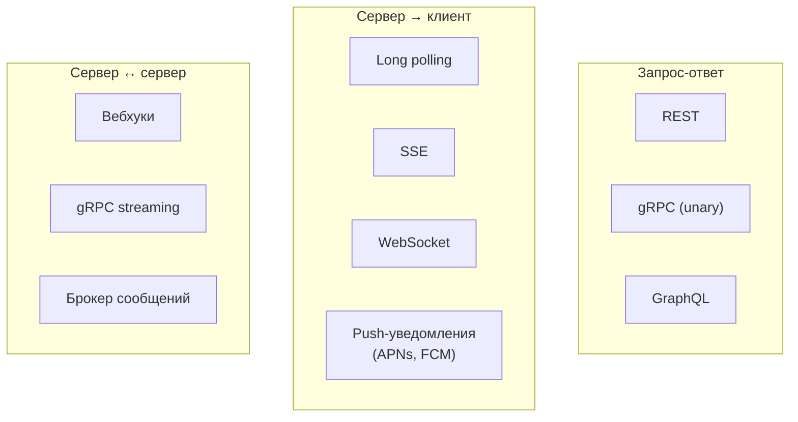
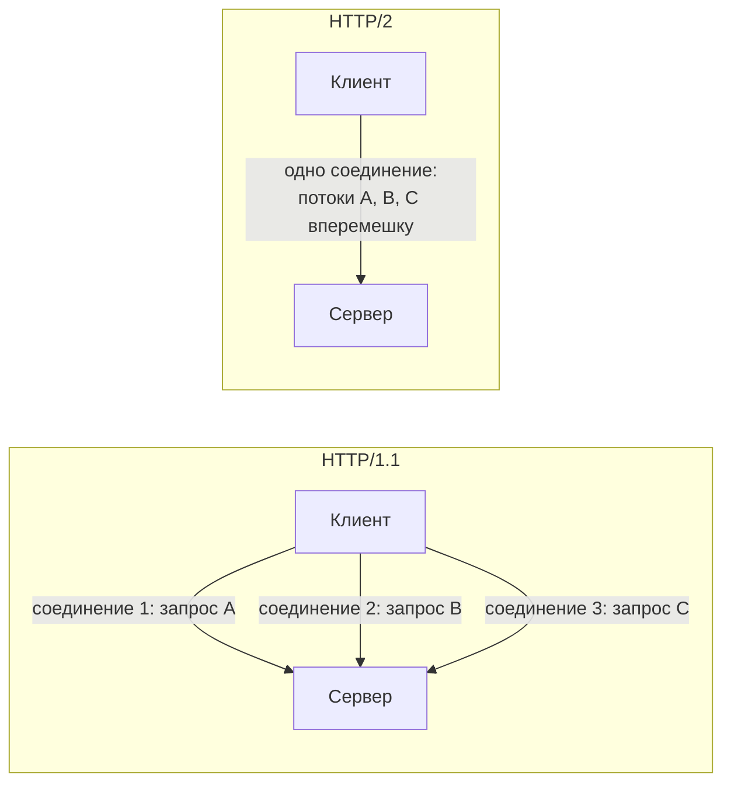
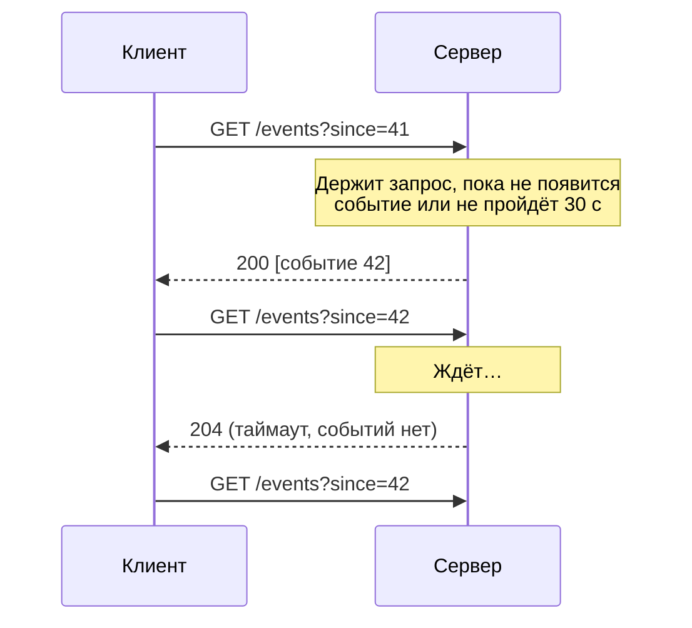
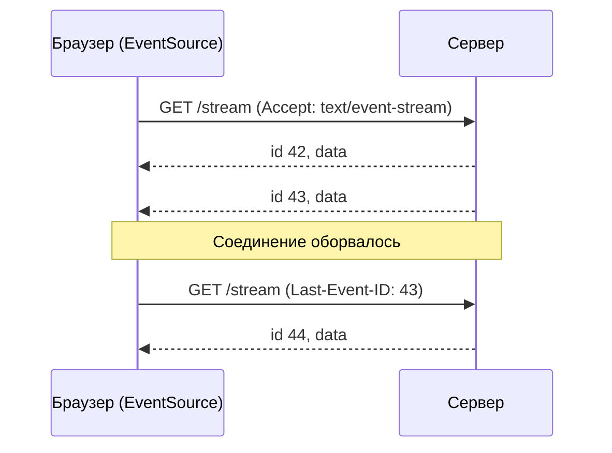
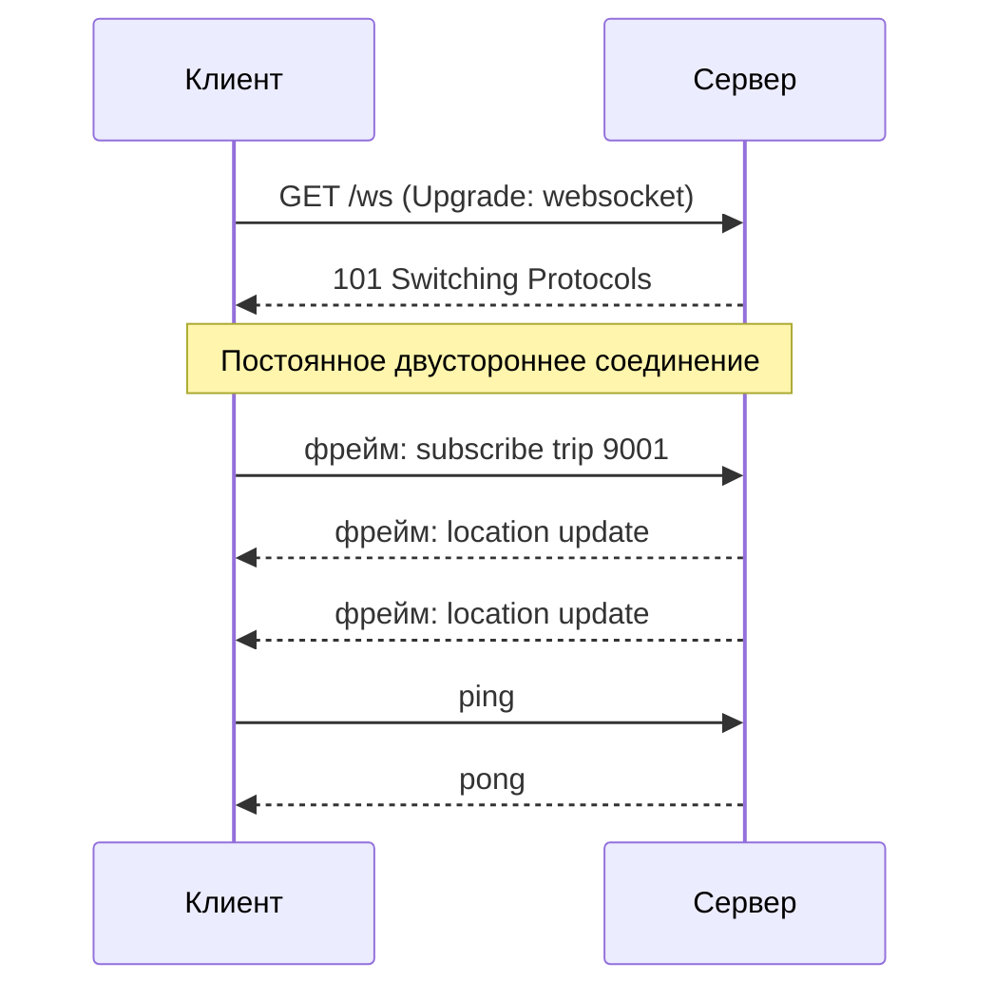
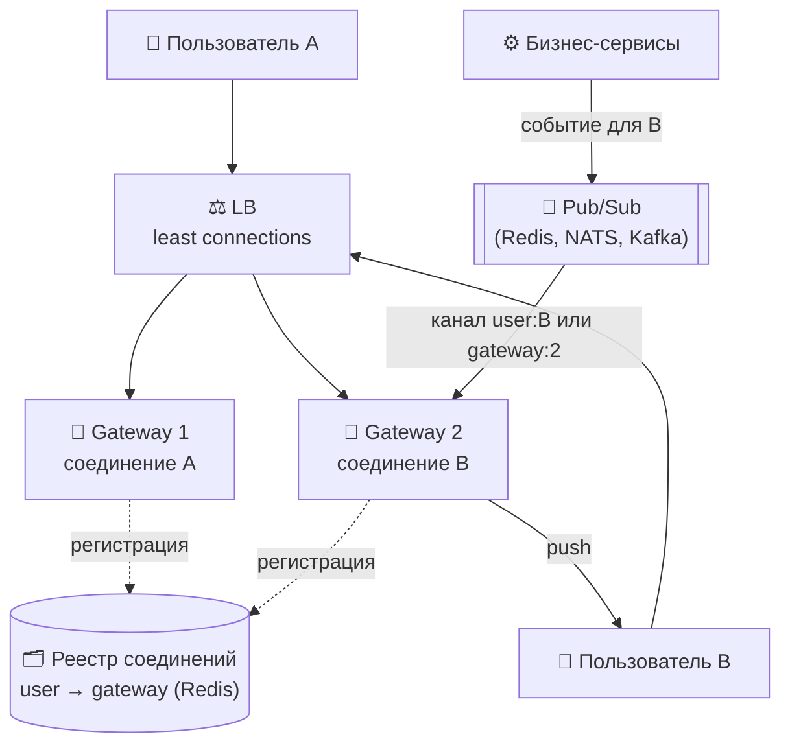
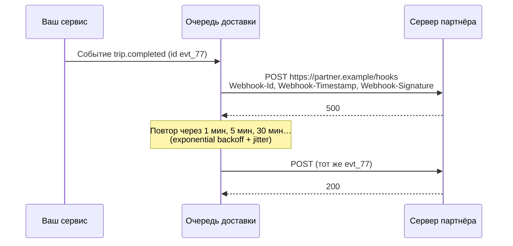
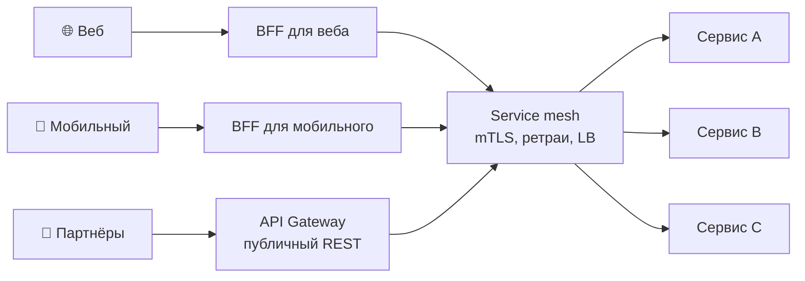

[English](README.md) | **Русский**

# 12. Протоколы взаимодействия

> **Что внутри:** HTTP/1.1, HTTP/2, HTTP/3, REST, gRPC, GraphQL, polling, long polling, SSE, WebSocket, вебхуки, форматы сериализации, API gateway и BFF, масштабирование WebSocket, как выбрать протокол под задачу
> **Время на изучение:** ~4–5 ч · **Нужно для:** любой задачи — в каждой есть API; особенно чаты, real-time, мобильные клиенты, микросервисы, публичные API
> **Практика:** разбор в формате интервью — [INTERVIEW_RU.md](./INTERVIEW_RU.md)
> **Связанные темы:** [01-scaling-basics](../01-scaling-basics/README_RU.md#7-l4-vs-l7) (L4/L7), [09-messaging](../09-messaging/README_RU.md), [10-idempotency](../10-idempotency/README_RU.md)

---

## 📑 Содержание

1. [Карта способов взаимодействия](#1-карта-способов-взаимодействия)
2. [HTTP/1.1, HTTP/2, HTTP/3](#2-http11-http2-http3)
3. [REST](#3-rest)
4. [gRPC](#4-grpc)
5. [GraphQL](#5-graphql)
6. [REST vs gRPC vs GraphQL](#6-rest-vs-grpc-vs-graphql)
7. [Сервер → клиент: polling, long polling, SSE, WebSocket](#7-сервер--клиент-polling-long-polling-sse-websocket)
8. [Масштабирование WebSocket](#8-масштабирование-websocket)
9. [Вебхуки](#9-вебхуки)
10. [Форматы сериализации](#10-форматы-сериализации)
11. [API gateway, BFF и service mesh](#11-api-gateway-bff-и-service-mesh)
12. [Проектирование API: сквозные темы](#12-проектирование-api-сквозные-темы)
13. [Как выбрать](#13-как-выбрать)
14. [Как говорить об этом на интервью](#14-как-говорить-об-этом-на-интервью)
15. [Вопросы для самопроверки](#15-вопросы-для-самопроверки)
16. [Глоссарий и ресурсы](#16-глоссарий-и-ресурсы)

---

## 1. Карта способов взаимодействия

| Измерение | Варианты |
|:----------|:---------|
| **Кто инициирует** | Клиент спрашивает (pull) / сервер присылает (push) / обе стороны |
| **Синхронность** | Запрос-ответ / поток / асинхронные сообщения через брокер |
| **Кто участвует** | Браузер/мобильный клиент ↔ сервер / сервис ↔ сервис / сервер ↔ сервер другой компании |
| **Формат** | Текст (JSON) / бинарный (Protobuf) |



> [!TIP]
> На интервью почти всегда нужно **несколько** протоколов: REST для публичного API и CRUD, gRPC между сервисами, WebSocket или SSE для real-time, вебхуки для партнёров, брокер для асинхронных событий. Выбор — для каждого **канала**, а не один на всю систему.

---

## 2. HTTP/1.1, HTTP/2, HTTP/3

| | HTTP/1.1 | HTTP/2 | HTTP/3 |
|:-|:---------|:-------|:-------|
| Транспорт | TCP | TCP | **QUIC поверх UDP** |
| Запросов на соединение одновременно | Один (pipelining почти не используется) | **Много потоков** (мультиплексирование) | Много потоков |
| Head-of-line blocking | На уровне HTTP и TCP | Только на уровне TCP: потеря пакета тормозит все потоки | **Нет**: потоки независимы |
| Сжатие заголовков | Нет | HPACK | QPACK |
| Установка соединения | TCP + TLS | TCP + TLS | Объединённое рукопожатие QUIC+TLS 1.3, возможен 0-RTT |
| Смена сети (Wi-Fi → LTE) | Новое соединение | Новое соединение | **Миграция соединения** по connection ID |
| Формат | Текстовый | Бинарные фреймы | Бинарные фреймы |



**Что важно для system design:**
- HTTP/2 — основа gRPC; одно долгоживущее соединение несёт много запросов, поэтому **L4-балансировка распределяет плохо** (см. [01-scaling-basics](../01-scaling-basics/README_RU.md#7-l4-vs-l7)).
- HTTP/3 особенно полезен **мобильным клиентам**: потери пакетов и смена сети меньше бьют по задержке.
- Keep-alive и пулы соединений обязательны: TLS-рукопожатие на каждый запрос стоит дорого.

---

## 3. REST

**REST** (Representational State Transfer, Рой Филдинг, 2000) — архитектурный стиль поверх HTTP: **ресурсы** с адресами (URL), над которыми выполняются стандартные **методы**.

```http
GET    /v1/users/42/orders?status=paid&limit=20&cursor=abc   ← список
GET    /v1/orders/9001                                        ← один ресурс
POST   /v1/orders                                             ← создать
PUT    /v1/orders/9001                                        ← заменить
PATCH  /v1/orders/9001                                        ← частично изменить
DELETE /v1/orders/9001                                        ← удалить
```

### Принципы и практики

| Тема | Практика |
|:-----|:---------|
| **Ресурсы** | Существительные во множественном числе: `/orders`, `/users/42/orders` |
| **Методы** | По семантике HTTP; помнить, какие идемпотентны (см. [10-idempotency](../10-idempotency/README_RU.md#2-что-такое-идемпотентность)) |
| **Статус-коды** | `200`, `201 Created`, `202 Accepted`, `204`, `400`, `401`, `403`, `404`, `409`, `422`, `429`, `5xx` |
| **Ошибки** | Единый формат, например RFC 9457 «Problem Details»: `type`, `title`, `status`, `detail` |
| **Без состояния** | Каждый запрос самодостаточен (токен в заголовке) — легко масштабировать горизонтально |
| **Кэширование** | `Cache-Control`, `ETag` / `If-None-Match` → `304` |
| **Пагинация** | Курсорная (`cursor`, `next_cursor`), а не offset для больших списков |
| **Фильтрация и выбор полей** | `?status=paid`, `?fields=id,total` |
| **Версионирование** | В пути (`/v1/`), в заголовке или датой (`Stripe-Version: 2024-06-20`) |
| **Идемпотентность** | `Idempotency-Key` для `POST` |

| ✅ Плюсы | ❌ Минусы |
|:--------|:---------|
| Простота, везде поддерживается, легко отлаживать (curl, браузер) | **Over-fetching**: получаешь больше полей, чем нужно |
| HTTP-кэширование и CDN из коробки | **Under-fetching**: для одного экрана нужно несколько запросов |
| Слабая связанность клиента и сервера | Нет строгого контракта по умолчанию (решается OpenAPI) |
| Лучший выбор для публичных API | JSON — текстовый, тяжелее бинарных форматов |

---

## 4. gRPC

**gRPC** — RPC-фреймворк от Google поверх **HTTP/2** с контрактом на **Protocol Buffers**.

```protobuf
syntax = "proto3";

service OrderService {
  rpc GetOrder (GetOrderRequest) returns (Order);                      // unary
  rpc ListOrders (ListOrdersRequest) returns (stream Order);           // server streaming
  rpc UploadEvents (stream Event) returns (UploadSummary);             // client streaming
  rpc Chat (stream ChatMessage) returns (stream ChatMessage);          // bidirectional
}

message Order {
  int64  id     = 1;
  string status = 2;
  int64  total_cents = 3;
  // Номера полей нельзя переиспользовать: так обеспечивается совместимость версий
}
```

### Четыре типа вызовов

| Тип | Пример |
|:----|:-------|
| **Unary** | Обычный запрос-ответ |
| **Server streaming** | Поток результатов или обновлений от сервера |
| **Client streaming** | Загрузка потока событий (телеметрия) |
| **Bidirectional streaming** | Чат, синхронизация, игры |

### Особенности

| Тема | Что знать |
|:-----|:----------|
| **Контракт и кодогенерация** | Клиенты и серверы генерируются из `.proto` для многих языков; типобезопасность |
| **Эволюция схемы** | Можно добавлять поля; нельзя менять номера и типы существующих; удалённые номера помечать `reserved` |
| **Deadlines** | Клиент задаёт дедлайн, он передаётся дальше по цепочке вызовов |
| **Статус-коды** | Свои: `OK`, `DEADLINE_EXCEEDED`, `UNAVAILABLE`, `NOT_FOUND`, `RESOURCE_EXHAUSTED`... |
| **Interceptors** | Middleware для аутентификации, логов, метрик, ретраев |
| **Балансировка** | Долгоживущие HTTP/2-соединения → нужна L7-балансировка по запросам или client-side LB (lookaside, xDS), иначе нагрузка ложится на один бэкенд |
| **Браузеры** | Напрямую не поддерживаются → gRPC-Web через прокси (Envoy) или Connect |

| ✅ Плюсы | ❌ Минусы |
|:--------|:---------|
| Компактный бинарный формат, низкая задержка | Хуже для публичных API и браузеров |
| Строгий контракт, кодогенерация | Нечитаемо без инструментов (нельзя просто curl) |
| Стриминг в обе стороны | HTTP-кэширование и CDN не работают |
| Дедлайны и стандартизированные ошибки | Нужна правильная балансировка |

**Где:** взаимодействие микросервисов, мобильные клиенты (иногда), высоконагруженные внутренние API. Альтернативы: Apache Thrift, Twirp, Connect.

---

## 5. GraphQL

**GraphQL** (Facebook, 2015) — язык запросов к API: один эндпоинт, клиент сам описывает, **какие поля** ему нужны.

```graphql
query RiderHome($id: ID!) {
  user(id: $id) {
    name
    savedPlaces { label address }
    recentTrips(first: 3) {
      edges { node { id destination price } }
    }
  }
  promotions(city: "Warsaw") { title discount }
}
```

| Операция | Назначение |
|:---------|:-----------|
| **Query** | Чтение |
| **Mutation** | Изменение |
| **Subscription** | Поток обновлений (обычно поверх WebSocket) |

### Подводные камни

| Проблема | Решение |
|:---------|:--------|
| **N+1 запросов в резолверах** (для 100 заказов — 100 запросов за пользователем) | **DataLoader**: батчинг и кэширование в рамках запроса |
| **Дорогие запросы** (глубокая вложенность, огромные списки) | Ограничение глубины и стоимости, таймауты, **persisted queries** (разрешены только заранее зарегистрированные запросы) |
| **HTTP-кэширование не работает** (всё через `POST /graphql`) | Persisted queries через `GET`, кэш на уровне клиента (Apollo, Relay) и резолверов |
| **Ошибки** | Ответ часто `200` с массивом `errors` — мониторинг должен это учитывать |
| **Авторизация** | На уровне полей и резолверов, а не эндпоинта |
| **Много команд и сервисов** | Federation: общий граф из подграфов разных сервисов |

| ✅ Плюсы | ❌ Минусы |
|:--------|:---------|
| Нет over/under-fetching: один запрос на экран | Сложнее кэширование, rate limiting, мониторинг |
| Строгая схема, интроспекция, хорошие инструменты | Риск дорогих запросов от клиента |
| Удобно для многих клиентов с разными потребностями | Больше сложности на сервере |

**Где:** BFF-слой для веб- и мобильных клиентов, агрегирующий данные многих сервисов.

---

## 6. REST vs gRPC vs GraphQL

| | REST | gRPC | GraphQL |
|:-|:-----|:-----|:--------|
| Транспорт | HTTP/1.1, HTTP/2 | HTTP/2 | HTTP (обычно `POST`) |
| Формат | JSON (обычно) | Protobuf (бинарный) | JSON |
| Контракт | Опционально (OpenAPI) | Обязателен (`.proto`) | Обязателен (схема) |
| Выбор полей | Нет (или `?fields=`) | Нет | ✅ Клиент выбирает |
| Стриминг | Нет (SSE отдельно) | ✅ Во все стороны | Subscriptions |
| HTTP-кэш / CDN | ✅ | ❌ | ⚠️ С persisted queries |
| Браузер | ✅ | ⚠️ gRPC-Web | ✅ |
| Производительность | Средняя | Высокая | Средняя |
| Лучше всего для | Публичные API, CRUD, простота | Сервис ↔ сервис, низкая задержка, стриминг | Агрегация данных для UI, много разных клиентов |

> [!IMPORTANT]
> **Сигнал Senior+:** не «gRPC лучше REST», а «**REST** для публичного API — простота, кэширование, совместимость; **gRPC** внутри — контракт, скорость, дедлайны, стриминг; **GraphQL** в BFF для мобильного и веб-клиента — один запрос на экран».

---

## 7. Сервер → клиент: polling, long polling, SSE, WebSocket

HTTP устроен как «клиент спрашивает — сервер отвечает». Если серверу нужно **сообщить** клиенту о событии, есть несколько подходов.

### Short polling

Клиент спрашивает каждые N секунд: «есть новое?».
- ✅ Максимально просто.
- ❌ Задержка до N секунд; большинство запросов пустые — лишняя нагрузка.

### Long polling



- ✅ Почти мгновенная доставка, работает везде (обычный HTTP).
- ❌ Каждое событие — новый запрос; сервер держит много висящих запросов.

### SSE (Server-Sent Events)



- **Односторонний** поток от сервера к клиенту поверх обычного HTTP.
- ✅ Встроенный в браузер `EventSource` с **автоматическим переподключением** и `Last-Event-ID`; работает через прокси и HTTP/2.
- ❌ Только текст, только сервер → клиент; в HTTP/1.1 браузер ограничивает число соединений на домен (с HTTP/2 проблема уходит).

### WebSocket



- **Полнодуплексное** соединение поверх TCP (RFC 6455), начинается с HTTP Upgrade.
- ✅ Двусторонний обмен с минимальными накладными расходами, текст и бинарные данные.
- ❌ Соединение **с состоянием**: сложнее масштабировать и балансировать; переподключение и восстановление пропущенного нужно делать самому; некоторые корпоративные прокси мешают.

### Сравнение

| | Short polling | Long polling | SSE | WebSocket |
|:-|:--------------|:-------------|:----|:----------|
| Направление | Клиент → сервер | Клиент → сервер (ответ ждёт события) | Сервер → клиент | В обе стороны |
| Задержка доставки | До интервала опроса | Низкая | Низкая | Минимальная |
| Накладные расходы | Высокие | Средние | Низкие | Минимальные |
| Протокол | HTTP | HTTP | HTTP | WS поверх TCP |
| Переподключение | Не нужно | Не нужно | ✅ Встроено | Вручную |
| Бинарные данные | ✅ | ✅ | ❌ | ✅ |
| Масштабирование | Просто | Средне | Средне | Сложнее (состояние) |
| Когда | Редкие обновления, простота | Fallback, ограниченные среды | Ленты, уведомления, прогресс, дашборды, стриминг ответа LLM | Чаты, игры, совместное редактирование, живые карты |

> [!TIP]
> Если данные идут **только от сервера** к клиенту — начни с **SSE**: проще WebSocket, работает поверх обычного HTTP-стека и переподключается сам. WebSocket — когда нужен частый обмен **в обе стороны**. Для мобильного приложения в фоне ни то, ни другое не работает — нужны **push-уведомления** (APNs, FCM).

---

## 8. Масштабирование WebSocket

WebSocket-соединение **привязано к конкретному серверу**. Если событие для пользователя возникло на другом сервере, его нужно доставить туда, где висит соединение.



| Тема | Практика |
|:-----|:---------|
| **Отдельный слой gateway** | Серверы соединений не содержат бизнес-логики; бизнес-сервисы остаются stateless |
| **Маршрутизация** | Pub/sub-каналы по пользователю или теме, на которые подписан gateway с соединением; либо реестр «пользователь → gateway» и адресная доставка |
| **Балансировка** | Least connections; L4 или L7 с поддержкой WebSocket; увеличенные idle-таймауты на балансировщиках |
| **Heartbeat** | Ping/pong каждые 20–30 с: обнаружить мёртвые соединения и не дать прокси закрыть «простаивающее» |
| **Переподключение** | Exponential backoff + **jitter** (иначе после сбоя миллионы клиентов переподключатся одновременно — reconnect storm) |
| **Восстановление пропущенного** | Каждое событие с номером; клиент при переподключении сообщает последний номер, сервер досылает из буфера или хранилища |
| **Деплой** | Graceful drain: перестать принимать новые соединения, попросить клиентов переподключиться постепенно |
| **Медленные клиенты** | Ограниченный буфер на соединение; при переполнении — отбрасывать устаревшее (для геопозиции нужна только последняя) или закрывать соединение |
| **Ёмкость** | Сотни тысяч соединений на сервер при настройке ОС (лимиты файловых дескрипторов, память на соединение) |
| **Аутентификация** | Токен при установке соединения; периодическая проверка или переподключение при истечении |

---

## 9. Вебхуки

**Вебхук** — HTTP-запрос, который **ваш** сервер отправляет на URL **клиента** (обычно другой компании), когда происходит событие. Это push между серверами.



### Отправитель

| Правило | Зачем |
|:--------|:------|
| Уникальный `event_id` | Получатель дедуплицирует |
| **Подпись HMAC** тела + timestamp | Получатель проверяет подлинность; timestamp защищает от повторного воспроизведения (replay) |
| Ретраи с backoff + jitter часами или сутками | Доставка at-least-once |
| Короткий таймаут (несколько секунд) | Не ждать медленного получателя |
| Журнал доставок и ручной повтор | Партнёр может посмотреть и переотправить |
| Отключение эндпоинта после долгих ошибок + уведомление | Не тратить ресурсы впустую |
| Версия объекта в событии | Порядок не гарантирован |
| Небольшое тело или «тонкое» событие + API для получения деталей | Безопасность и размер |

Есть открытая спецификация **Standard Webhooks**, описывающая заголовки и подписи.

### Получатель

- Проверить подпись и timestamp.
- Быстро ответить `2xx`, обработать асинхронно.
- Дедуплицировать по `event_id` (см. [10-idempotency](../10-idempotency/README_RU.md#10-идемпотентность-в-процессах-и-вебхуках)).
- Не полагаться на порядок.

---

## 10. Форматы сериализации

| Формат | Тип | Схема | Размер и скорость | Эволюция | Где |
|:-------|:----|:------|:------------------|:---------|:----|
| **JSON** | Текст | Опционально (JSON Schema) | Больше, медленнее | Гибко, но без гарантий | Публичные API, браузеры |
| **Protocol Buffers** | Бинарный | Обязательна | Компактно, быстро | Номера полей, обратная и прямая совместимость | gRPC, внутренние сервисы |
| **Avro** | Бинарный | Обязательна, передаётся отдельно (registry) | Компактно | Правила совместимости со schema registry | Kafka, data pipelines |
| **MessagePack / CBOR** | Бинарный | Нет | Компактнее JSON | Как у JSON | Когда нужен «бинарный JSON» |
| **Thrift** | Бинарный | Обязательна | Компактно | Как у Protobuf | Исторически в Facebook и других |

> [!TIP]
> Для мобильных клиентов с частыми мелкими сообщениями (геопозиция) бинарный формат заметно экономит трафик и батарею. Для публичного API читаемость JSON обычно важнее.

---

## 11. API gateway, BFF и service mesh



| Компонент | Что делает |
|:----------|:-----------|
| **API Gateway** | Единая точка входа: аутентификация, rate limiting, маршрутизация, версионирование, трансформация, TLS |
| **BFF (Backend for Frontend)** | Отдельный бэкенд под конкретный клиент: агрегирует данные многих сервисов в ответ под конкретный экран; может быть REST или GraphQL |
| **Service mesh** (Istio, Linkerd) | Sidecar-прокси рядом с каждым сервисом: mTLS, балансировка, ретраи, таймауты, метрики — без кода в сервисе |

> [!WARNING]
> Ретраи в mesh, в gateway и в коде сервиса **перемножаются** (см. [10-idempotency](../10-idempotency/README_RU.md#7-когда-и-где-ретраить)). Настраивай их осознанно и на одном уровне.

---

## 12. Проектирование API: сквозные темы

| Тема | Практика |
|:-----|:---------|
| **Версионирование** | Ломающие изменения — новая версия; поддерживать старую с датой отключения; добавлять поля — без новой версии |
| **Пагинация** | Курсорная для больших и меняющихся списков |
| **Таймауты и дедлайны** | На каждом вызове; передача оставшегося времени вниз по цепочке |
| **Идемпотентность** | `Idempotency-Key` для `POST` |
| **Rate limiting** | Лимиты на клиента; ответ `429` + `Retry-After`; заголовки с остатком лимита |
| **Аутентификация** | OAuth 2.0 / OIDC для пользователей, короткоживущие JWT, mTLS или токены для сервисов |
| **Сжатие** | gzip, Brotli для текстовых ответов |
| **Наблюдаемость** | `request_id` / trace context (W3C Trace Context) в каждом запросе |
| **Обратная совместимость** | Клиенты игнорируют неизвестные поля; сервер не удаляет и не переименовывает поля без новой версии |

---

## 13. Как выбрать

| Сценарий | Выбор | Почему |
|:---------|:------|:-------|
| Публичный API для разработчиков | REST + JSON, OpenAPI, вебхуки | Простота, совместимость, кэширование |
| Сервис ↔ сервис внутри компании | gRPC | Контракт, скорость, дедлайны, стриминг |
| Мобильный/веб-клиент с множеством экранов | REST или GraphQL через BFF | Один запрос на экран |
| Уведомления, лента, прогресс задачи, стриминг ответа LLM | SSE | Только сервер → клиент, простота |
| Чат, совместное редактирование, игры, живые карты | WebSocket | Частый двусторонний обмен |
| Мобильное приложение в фоне | Push-уведомления (APNs, FCM) | Соединения в фоне закрываются ОС |
| Сообщить партнёру о событии | Вебхуки | Push между серверами |
| Асинхронные события между сервисами | Брокер (Kafka, SQS) | Развязка, буферизация (см. [09-messaging](../09-messaging/README_RU.md)) |
| Телеметрия IoT-устройств | MQTT | Лёгкий протокол для ненадёжных сетей и слабых устройств |

---

## 14. Как говорить об этом на интервью

### Ответ за 30 секунд

> «Выбираю протокол для каждого канала. Публичный API и CRUD мобильного клиента — REST с JSON, курсорной пагинацией, idempotency key и `429` с `Retry-After`. Между сервисами — gRPC: контракт на Protobuf, дедлайны, стриминг; балансирую по запросам на L7 или на клиенте, потому что HTTP/2-соединения долгоживущие. Для real-time: только от сервера — SSE, в обе стороны — WebSocket через отдельный слой gateway с pub/sub-маршрутизацией, heartbeat, переподключением с jitter и досылкой пропущенного по номеру события. В фоне — push-уведомления. Партнёрам — вебхуки с подписью, ретраями и event_id».

### Вопросы, которые стоит задать

1. Кто клиент: браузер, мобильное приложение, другой сервис, внешняя компания?
2. Кто инициирует обмен и как часто идут сообщения?
3. Какая задержка доставки нужна?
4. Что будет при обрыве соединения — можно ли потерять сообщения?
5. Нужен ли строгий контракт и кодогенерация?

### Типичные ошибки

- Один протокол на всё.
- WebSocket там, где хватает SSE или даже polling.
- gRPC за L4-балансировщиком без учёта долгоживущих соединений.
- GraphQL без защиты от дорогих запросов и без DataLoader.
- WebSocket без heartbeat, переподключения с jitter и восстановления пропущенного.
- Бизнес-логика в серверах соединений.
- Вебхуки без подписи, ретраев и event_id.
- Offset-пагинация в публичном API.

---

## 15. Вопросы для самопроверки

<details>
<summary><b>1. Что даёт HTTP/2 по сравнению с HTTP/1.1 и какую проблему решает HTTP/3?</b></summary>

HTTP/2 мультиплексирует много потоков в одном TCP-соединении и сжимает заголовки, убирая head-of-line blocking на уровне HTTP. Но потеря TCP-пакета по-прежнему тормозит все потоки. HTTP/3 работает поверх QUIC (UDP), где потоки независимы, и добавляет быстрое рукопожатие и миграцию соединения при смене сети.
</details>

<details>
<summary><b>2. Почему gRPC плохо балансируется на L4?</b></summary>

gRPC использует долгоживущие HTTP/2-соединения, в каждом из которых много запросов. L4-балансировщик распределяет соединения, а не запросы, поэтому все запросы клиента идут на один бэкенд. Нужна L7-балансировка по запросам или client-side балансировка.
</details>

<details>
<summary><b>3. Что такое over-fetching и under-fetching и как GraphQL их решает?</b></summary>

Over-fetching — получение лишних полей; under-fetching — необходимость нескольких запросов для одного экрана. В GraphQL клиент одним запросом указывает ровно нужные поля из нескольких связанных объектов.
</details>

<details>
<summary><b>4. Какая главная проблема производительности GraphQL на сервере и как её решают?</b></summary>

N+1: резолвер для каждого элемента списка делает отдельный запрос. Решение — DataLoader, который собирает ключи в рамках запроса и загружает их одним батчем. Плюс ограничение глубины и стоимости запросов.
</details>

<details>
<summary><b>5. Когда выбрать SSE, а когда WebSocket?</b></summary>

SSE — когда данные идут только от сервера к клиенту (ленты, уведомления, прогресс, стриминг ответа): он работает поверх обычного HTTP и сам переподключается. WebSocket — когда нужен частый обмен в обе стороны (чат, игры, совместное редактирование).
</details>

<details>
<summary><b>6. Как доставить сообщение пользователю, если его WebSocket-соединение на другом сервере?</b></summary>

Через pub/sub: gateway с соединением подписан на канал пользователя (или свой канал), бизнес-сервис публикует событие в этот канал. Альтернатива — реестр «пользователь → gateway» и адресная отправка на нужный сервер.
</details>

<details>
<summary><b>7. Что такое reconnect storm и как его избежать?</b></summary>

После сбоя (перезапуск gateway, сбой сети) миллионы клиентов одновременно пытаются переподключиться и перегружают систему. Избегают exponential backoff с jitter на клиенте, постепенным drain при деплое и ограничением скорости приёма новых соединений.
</details>

<details>
<summary><b>8. Как получатель вебхука должен его обрабатывать?</b></summary>

Проверить подпись и timestamp, быстро ответить 2xx, обработать асинхронно, дедуплицировать по event_id и не полагаться на порядок (сверяться с версией объекта или запрашивать актуальное состояние).
</details>

<details>
<summary><b>9. Чем BFF отличается от API gateway?</b></summary>

API gateway — общая точка входа с аутентификацией, лимитами и маршрутизацией. BFF — отдельный бэкенд под конкретный тип клиента, который агрегирует данные многих сервисов в ответы под конкретные экраны.
</details>

<details>
<summary><b>10. Как эволюционировать Protobuf-схему без поломки клиентов?</b></summary>

Добавлять новые поля с новыми номерами; не менять номера и типы существующих; удалённые поля помечать `reserved`, чтобы их номера не переиспользовали. Старые клиенты игнорируют неизвестные поля, новые получают значения по умолчанию для отсутствующих.
</details>

---

## 16. Глоссарий и ресурсы

### Глоссарий

| Термин | Значение |
|:-------|:---------|
| REST | Архитектурный стиль: ресурсы и стандартные методы HTTP |
| gRPC | RPC-фреймворк поверх HTTP/2 с контрактом на Protobuf |
| GraphQL | Язык запросов, где клиент выбирает нужные поля |
| Multiplexing | Несколько потоков в одном соединении |
| Head-of-line blocking | Задержка всех запросов из-за одного застрявшего |
| QUIC | Транспорт поверх UDP, основа HTTP/3 |
| Long polling | Запрос, который сервер держит до появления события |
| SSE | Server-Sent Events: односторонний поток от сервера по HTTP |
| WebSocket | Полнодуплексное соединение поверх TCP |
| Вебхук | HTTP-запрос от вашего сервера на URL клиента о событии |
| BFF | Backend for Frontend: бэкенд под конкретный клиент |
| Service mesh | Сеть sidecar-прокси для межсервисного взаимодействия |
| DataLoader | Батчинг запросов в резолверах GraphQL |
| Persisted query | Заранее зарегистрированный запрос GraphQL |
| Deadline | Абсолютный срок, к которому вызов должен завершиться |

### Ресурсы

- Roy Fielding, *Architectural Styles and the Design of Network-based Software Architectures* (диссертация, 2000)
- RFC 9110 (HTTP Semantics), RFC 9113 (HTTP/2), RFC 9114 (HTTP/3), RFC 9000 (QUIC)
- RFC 6455 (WebSocket); HTML Living Standard — Server-Sent Events
- RFC 9457 (Problem Details for HTTP APIs)
- Документация gRPC и Protocol Buffers (правила эволюции схем)
- Спецификация GraphQL; документация DataLoader
- Google API Design Guide и AIP (API Improvement Proposals)
- Standard Webhooks (standardwebhooks.com); документация Stripe по вебхукам
- Sam Newman, *Building Microservices* (2-е изд., 2021) — главы о взаимодействии и BFF