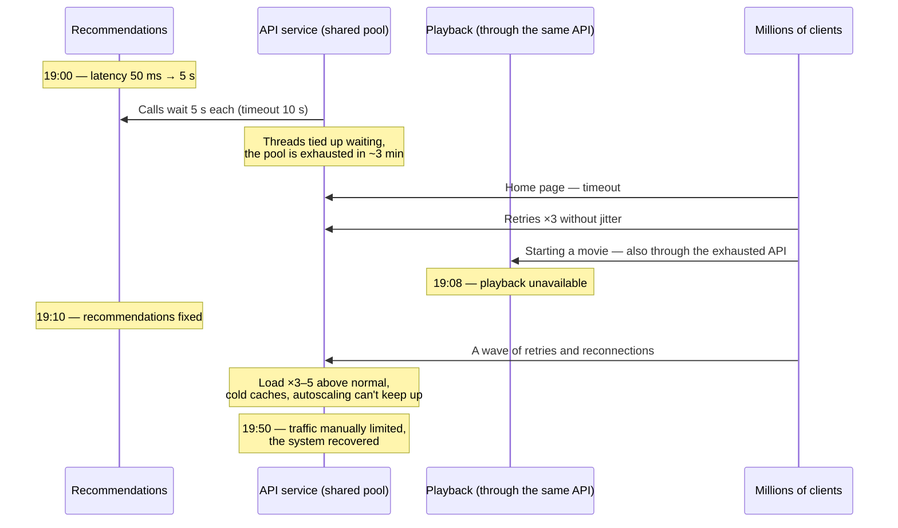
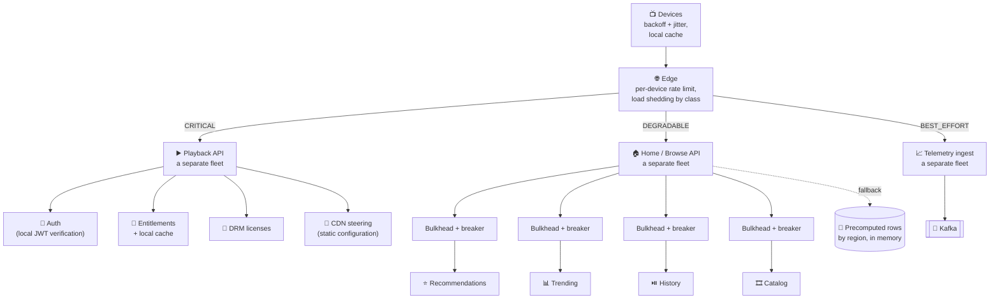
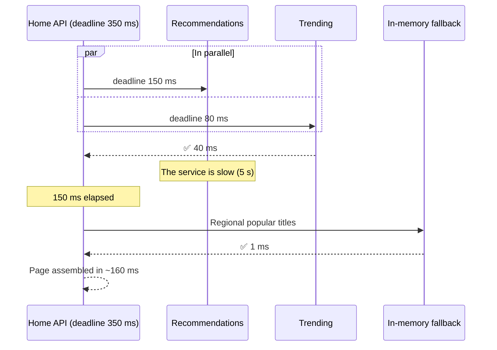
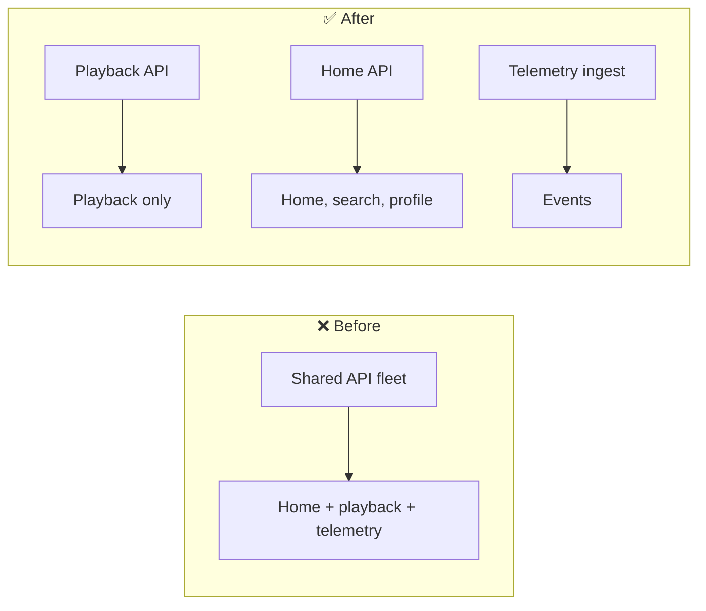
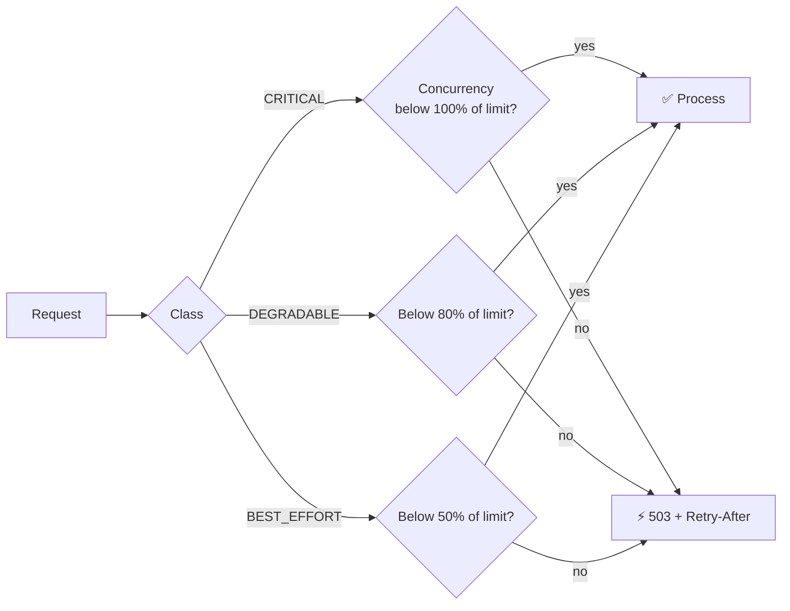
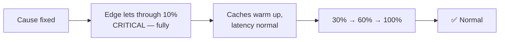

**English** | [Русский](INTERVIEW.ru.md) · Theory: [README.md](./README.md)

# 13. Reliability Patterns: Making a Video Streaming Service Resilient

> **Topic:** analyzing a cascading incident, the critical path and degradation, timeouts and request budgets, bulkheads, circuit breakers with fallbacks, priority load shedding, retry storms and metastable failure, static stability for playback, cells, chaos experiments
> **Level:** Hard · **Interview time:** 45 min · **Study time:** ~5 h
> **Where it's asked:** "How do you make a service resilient to dependency failures?", "walk through an incident", and as a deep dive in almost any Senior+ problem

---

## 🗺️ How to Read This Walkthrough

| Icon | Meaning |
|:----:|:--------|
| 🎤 | Interviewer |
| 🗣️ | What I (the candidate) say out loud |
| ✏️ | What I draw on the whiteboard |
| ⏱️ | Time budget for the step |

Callouts: **TIP** — a good technique, **WARNING** — a trap, **IMPORTANT** — a Senior+ signal.

---

## 📑 Contents

1. [Problem Statement](#1-problem-statement)
2. [Analyzing the Incident](#2-analyzing-the-incident)
3. [Requirements](#3-requirements)
4. [Estimates and the Availability Budget](#4-estimates-and-the-availability-budget)
5. [The Critical Path and Request Classes](#5-the-critical-path-and-request-classes)
6. [High-Level Design](#6-high-level-design)
7. [Deep Dive 1: Timeouts and the Home Page Budget](#7-deep-dive-1-timeouts-and-the-home-page-budget)
8. [Deep Dive 2: Bulkheads and Separate Fleets](#8-deep-dive-2-bulkheads-and-separate-fleets)
9. [Deep Dive 3: Circuit Breakers and Fallbacks](#9-deep-dive-3-circuit-breakers-and-fallbacks)
10. [Deep Dive 4: Priority Load Shedding](#10-deep-dive-4-priority-load-shedding)
11. [Deep Dive 5: Retry Storms and Escaping a Metastable Failure](#11-deep-dive-5-retry-storms-and-escaping-a-metastable-failure)
12. [Deep Dive 6: Static Stability for Playback](#12-deep-dive-6-static-stability-for-playback)
13. [Deep Dive 7: Blast Radius and Verification](#13-deep-dive-7-blast-radius-and-verification)
14. [Bottlenecks and Failure Scenarios](#14-bottlenecks-and-failure-scenarios)
15. [Interviewer Questions with Answers](#15-interviewer-questions-with-answers)
16. [Common Mistakes](#16-common-mistakes)
17. [Cheat Sheet and Self-Check](#17-cheat-sheet-and-self-check)

---

## 1. Problem Statement

> 🎤 "We run a video streaming service. On Friday evening, the recommendations service started responding in 5 seconds instead of 50 ms. Three minutes later the home page stopped loading, and five minutes after that users couldn't even start movies they'd already been watching. Recommendations were fixed in 10 minutes, but the service stayed down for another 40. Walk through what happened and design things so it doesn't happen again."

**Time plan:**

| Step | ⏱️ |
|:-----|:--:|
| Incident analysis | 6 min |
| Requirements and estimates | 5 min |
| Critical path and request classes | 5 min |
| High-level design | 4 min |
| Deep dives | 20 min |
| Wrap-up | 5 min |

> [!TIP]
> The prompt contains three hints: "a slow, not dead, dependency", "things that don't depend on it went down" and "after the fix it stayed down for 40 minutes". That's a **cascade** through shared resources and a **metastable** failure. Name them explicitly — it shows your level immediately.

---

## 2. Analyzing the Incident

⏱️ 6 min

🗣️ "Let me reconstruct the likely chain of events":



| Problem | Why it led to failure |
|:--------|:----------------------|
| A 10 s timeout to recommendations against a normal 50 ms | Each call held a thread 100× longer than usual |
| **A shared thread pool** for every dependency and every endpoint | Slow recommendations took resources from playback |
| No circuit breaker | The API kept sending requests to a clearly failing service |
| The home page **waited** for recommendations | No partial response and no fallback |
| Playback went through the same API fleet | A non-critical feature took down a critical one |
| Client retries without backoff or jitter | Load grew several-fold |
| After the fix — no mechanism to reduce load | A **metastable failure**: retries and cold caches sustained the outage |

> [!IMPORTANT]
> **Senior+ signal:** the root cause isn't "slow recommendations" (that will always happen sometimes) but **missing isolation**: a non-critical feature was able to take resources from a critical one. The right postmortem question is "why could a recommendations failure stop playback?".

---

## 3. Requirements

⏱️ 3 min

### Functional (what must work during failures)

1. **Playback** (starting and continuing to watch) works when any non-critical dependency fails.
2. The **home page** always opens; during failures, in a simplified form.
3. Search, profile, history work and tolerate degradation.

### Non-functional

| Requirement | Target |
|:------------|:-------|
| Playback start availability | 99.99% |
| Home page availability | 99.95% (counting the degraded mode as "available") |
| Home page latency | p99 < 400 ms, even if one dependency is slow |
| Blast radius | A non-critical service failure doesn't affect playback; a bad deploy affects ≤ 5% of users |
| Recovery | The system returns to normal automatically within minutes after the cause is fixed |

---

## 4. Estimates and the Availability Budget

⏱️ 2 min

✏️

```
Peak concurrent devices              ≈ 50M
Home page                            ≈ 50,000 requests/s
Playback start                       ≈ 30,000 requests/s
Telemetry and prefetching            ≈ 200,000 requests/s
Home page fan-out                    ≈ 15 services → 750,000 internal calls/s

Playback start availability budget (99.99%):
  5 synchronous dependencies at 99.95%  →  0.9995⁵ ≈ 99.75%   ❌ not enough
  2 synchronous dependencies at 99.99% + the rest from cache   →  ≈ 99.98%   ✅ close
```

🗣️ "The conclusion: the playback critical path must have **as few synchronous dependencies as possible**. Everything else is cached, async or has a fallback. Otherwise the math doesn't work."

---

## 5. The Critical Path and Request Classes

⏱️ 5 min

### Dependencies of the home page and playback

| Feature | Dependencies | Criticality | On failure |
|:--------|:-------------|:------------|:-----------|
| **Playback start** | Auth, content entitlements, DRM license, CDN steering | 🔴 Critical | Must work |
| Continue watching (position) | Viewing history | 🟡 Degradable | Start from the beginning or a locally saved position |
| Home page rows | Recommendations, trending, "continue watching", promos | 🟡 Degradable | Regional popular titles from cache |
| Artwork and metadata | Catalog | 🟡 Degradable | Cache / CDN |
| Search | Search service | 🟡 Degradable | "Search temporarily unavailable" |
| Trailer prefetching | Media | ⚪ Background | Skip |
| Telemetry | Event collection | ⚪ Background | Buffer on the client, drop under overload |

### Request classes

| Class | What's included | Behavior under overload |
|:------|:----------------|:------------------------|
| **CRITICAL** | Starting and continuing playback, login | Dropped last |
| **DEGRADABLE** | Home page, search, profile | Simplified responses, or dropped under heavy overload |
| **BEST_EFFORT** | Telemetry, prefetching, background updates | Dropped first |

🗣️ "The request class is set by the client (or determined at the edge by endpoint) and propagated through the whole chain in a header. Every service uses it for load shedding."

---

## 6. High-Level Design

⏱️ 4 min

✏️



🗣️ "Key decisions:
- **Fleets separated** by criticality: no home page failure can take resources from playback;
- in the Home API — a **bulkhead, timeout and circuit breaker per dependency**, and a **fallback from memory**;
- the **edge** rate-limits each device and sheds traffic by class under overload;
- the Playback API depends minimally on synchronous services: tokens are verified locally, entitlements are cached."

---

## 7. Deep Dive 1: Timeouts and the Home Page Budget

> 🎤 "The home page is assembled from 15 services. How do you stay within 400 ms if one of them is slow?"

🗣️ "The home page is a **parallel fan-out** with a shared deadline and a **partial response**:

| Rule | Implementation |
|:-----|:---------------|
| Overall budget | 350 ms for assembly (out of 400 ms p99) |
| Calls in parallel | Every row is requested at the same time |
| A timeout per dependency | From its normal p99.9, but within the budget: recommendations — 150 ms, trending — 80 ms, history — 100 ms |
| The deadline propagates down | The recommendations service knows it has 150 ms and doesn't start a heavy computation it can't finish |
| A partial response | A row that misses the deadline is replaced by a fallback; the rest are served as is |
| Row priority | "Continue watching" matters more than "New releases" — its fallback (local history on the device) is ready too |



> [!WARNING]
> Before: a 10 s timeout to recommendations — each call held a thread 200× longer than normal. **Default** timeouts in HTTP clients are often tens of seconds or infinite. Check every client.

---

## 8. Deep Dive 2: Bulkheads and Separate Fleets

> 🎤 "Okay, the timeouts are short. Is that enough?"

🗣️ "No. Even with a 150 ms timeout at 50,000 requests per second, a slow dependency holds **7,500 concurrent calls** (50,000 × 0.15 s) versus 2,500 normally (50,000 × 0.05 s). If the pool is shared, it can take resources from the other dependencies. So — isolation at two levels.

### Level 1: inside the Home API

| Dependency | Concurrency limit per instance | When exceeded |
|:-----------|:------------------------------:|:--------------|
| Recommendations | 60 | Fallback immediately, no waiting |
| Trending | 30 | Fallback immediately |
| History | 40 | Fallback from the device |
| Catalog | 80 | Cache |

The limit is a **semaphore**: if 60 calls to recommendations are already in flight, the 61st doesn't wait — it gets the fallback immediately.

### Level 2: different fleets



| Fleet | Why separate |
|:------|:-------------|
| Playback API | The critical path: its own autoscaling and limits, deployed less often and more carefully |
| Home API | Many dependencies, frequent changes, tolerates degradation |
| Telemetry | Huge volume, can be dropped |

🗣️ "Even if the Home API falls over completely, the Playback API keeps starting movies. That's the main fix from the incident."

---

## 9. Deep Dive 3: Circuit Breakers and Fallbacks

> 🎤 "What does the circuit breaker do, and what do you return when it's open?"

🗣️ "A breaker per Home API dependency:

| Parameter | Value |
|:----------|:------|
| Window | 10 s |
| Minimum calls | 100 |
| Opening | > 50% errors **or** > 50% of calls slower than 100 ms |
| In the open state | 30 s, then half-open with 10 probe calls |
| Timeouts and concurrency-limit rejections | Count as errors |

### A fallback for each row

| Row | Fallback | Where from |
|:----|:---------|:-----------|
| Recommendations | Popular titles by region and the profile's maturity rating | Precomputed every 15 min, held **in memory** on every Home API instance |
| Trending | The last successful response | A local cache; up to an hour stale is fine |
| Continue watching | History from the device | The device stores recent positions locally |
| Promos | An empty row | — |
| Metadata and artwork | CDN and cache | Almost never change |

> [!WARNING]
> A bad fallback: "if recommendations are unavailable, compute popular titles with a query to the viewing database". During the outage every instance hits that database at once and takes it down. A fallback must be **ready in advance** and not depend on other services.

### Exercising the fallback

- A regular chaos experiment: force the recommendations breaker open for 1% of users and check the metrics (assembly time, errors, engagement).
- Fallback data has its own monitoring: its age and presence in every region.

---

## 10. Deep Dive 4: Priority Load Shedding

> 🎤 "What if the overload is general — say, a hit series premieres and traffic triples?"

🗣️ "Then we drop the **non-critical first**, and **as early as possible**:

| Level | Mechanism |
|:------|:----------|
| Device | Defers telemetry and prefetching when it gets a `503` |
| Edge | Watches fleet health; under overload drops BEST_EFFORT, then part of DEGRADABLE; CRITICAL — last |
| Service | An **adaptive concurrency limit**: when latency rises, the limit shrinks; requests over the limit are rejected immediately with `503` + `Retry-After` |
| Queues | Bounded; requests that waited longer than their deadline are dropped without processing |



🗣️ "The thresholds differ: BEST_EFFORT starts being dropped at 50% of the limit, DEGRADABLE at 80%, CRITICAL only when the limit is fully exhausted. So as load rises, telemetry disappears first, then the home page simplifies, and playback keeps working to the end."

> [!TIP]
> A rejection **at the entry** costs almost nothing. A rejection after the request has gone halfway through the chain wastes the resources of every service it passed through. So load shedding goes as close to the edge as possible.

---

## 11. Deep Dive 5: Retry Storms and Escaping a Metastable Failure

> 🎤 "Why was the service down for another 40 minutes after recommendations were fixed?"

🗣️ "A metastable failure. The loops that sustained the outage:

| Loop | Mechanism |
|:-----|:----------|
| Retries | Devices retried each request 3 times immediately → load ×3–4 |
| Synchronization | Without jitter, millions of devices retried at once — in waves |
| Cold caches | Caches expired during the outage → misses → database load |
| Autoscaling | New instances started slowly and immediately got full load |
| App restarts | Users restarted apps → a full home page load instead of a refresh |

### Fixes

| Where | What |
|:------|:-----|
| Device SDK | Exponential backoff + full jitter, at most 2 retries, a **retry budget** (no more than 10% of requests are retries), honoring `Retry-After` |
| Edge | A per-device rate limit (token bucket); on `503` the device gets a `Retry-After` with spread |
| Services | Retry budgets for internal calls; retries at one layer only |
| Recovery | **Gradually reopening traffic**: the edge lets through 10% → 30% → 60% → 100% while caches warm up |
| New instances | Slow start: their share of traffic ramps up gradually |
| A manual "breaker switch" | A way to quickly cut non-critical traffic classes to zero |



> [!IMPORTANT]
> **Senior+ signal:** you **can't escape a metastable failure just by fixing the cause** — you have to break the loop: cut load below normal, then raise it gradually. The mechanism for this (an edge switch, gradual reopening) must exist **before** the incident.

---

## 12. Deep Dive 6: Static Stability for Playback

> 🎤 "Starting playback depends on auth, entitlements and licenses. What if the entitlements service goes down?"

🗣️ "I make playback **statically stable** — able to keep working without its control services:

| Dependency | How I take it off the synchronous path |
|:-----------|:---------------------------------------|
| Auth | The JWT is verified **locally** by signature; the auth service is needed only for login and token refresh |
| Entitlements (subscription, region) | Cached in the Playback API and in the device's signed token with a TTL of ~1 h; if the service is unavailable — a **grace period**: use the last known state |
| DRM licenses | The license service has replicas in every region; the device caches the license for a movie already started |
| CDN steering | A static configuration updated asynchronously; on failure — the last known one |
| Playback position | The device remembers it locally |

| Risk | Resolution |
|:-----|:-----------|
| A user cancelled their subscription, but the grace period is still active | Acceptable: an hour of access is cheaper than playback failing for everyone |
| The entitlements cache is stale | TTL and async updates on events (CDC) |

> [!NOTE]
> This is a deliberate **availability vs accuracy** trade-off — and for streaming it's the right one: one user's brief free access costs far less than an hour of unavailability for millions.

---

## 13. Deep Dive 7: Blast Radius and Verification

> 🎤 "How do you make sure a bad deploy doesn't take everyone down?"

### Blast radius

| Mechanism | How |
|:----------|:----|
| **Cells** | The Playback API is deployed in independent cells of ~5% of users each; a user is pinned to a cell |
| **Staged deploys** | Canary 1% → one cell → one zone → a region → everyone, with automatic rollback on metrics |
| **Config staged too** | Config changes and feature flags roll out the same way as code |
| **Shuffle sharding** for partner devices | Device models with buggy retry logic land on random pairs of edge nodes — they can't take everyone down |

### Verification

| Practice | Example |
|:---------|:--------|
| Fault injection | A 5 s delay on 1% of recommendation calls — verify the home page assembles within 400 ms |
| Chaos experiments | Killing instances and a whole zone; opening breakers |
| Game day | Scenario "the entitlements service is down for 30 min" — does playback continue? |
| Load tests | Traffic ×3 — do prioritization and load shedding work |
| Recovery drills | Gradually reopening traffic after an artificial overload |

---

## 14. Bottlenecks and Failure Scenarios

| Scenario | What happens | How we protect |
|:---------|:-------------|:---------------|
| Recommendations are slow | The "Recommendations" row misses the deadline | A 150 ms timeout, bulkhead, breaker, in-memory fallback; the home page in ~160 ms |
| The Home API is completely down | The home page doesn't open | The device shows a cached home page; playback works (a separate fleet) |
| The entitlements service is down | Subscriptions can't be checked | Cache and a grace period; playback continues |
| Traffic ×3 | Overload | Load shedding by class; telemetry is dropped first |
| A retry storm after an outage | A metastable state | Backoff + jitter, retry budget, rate limits, gradual traffic reopening |
| A bad Playback API deploy | Playback errors | Canary, cells, automatic rollback |
| A zone outage | Minus a third of capacity | N+1 across zones, capacity provisioned in advance (static stability) |
| Fallback data is stale or missing | Empty rows | Monitoring of fallback age; several fallback levels |
| A cold cache after a restart | Database load | Warm-up before taking traffic, slow start |

---

## 15. Interviewer Questions with Answers

<details>
<summary><b>Why not just make the thread pool bigger?</b></summary>

A bigger pool only delays exhaustion: the slow dependency takes it too, while memory and context switching grow. The dependency itself also gets even more concurrent requests. What's needed is isolation (separate limits per dependency), short timeouts and fast rejection — so resources don't pile up waiting.
</details>

<details>
<summary><b>Won't the circuit breaker open on random error spikes?</b></summary>

That's what the minimum number of calls in the window and the percentage threshold are for: 3 errors out of 5 calls won't open a breaker with a minimum of 100. Plus half-open: if the dependency is fine, the probe calls quickly close it. The parameters are tuned from real metrics and verified with chaos experiments.
</details>

<details>
<summary><b>How is load shedding different from autoscaling — why not just scale out?</b></summary>

Autoscaling reacts in minutes, while overload builds in seconds. Also, if the bottleneck is a dependency (a database, an external service), adding instances only finishes it off. Load shedding is instant protection while autoscaling or people fix the situation; they complement each other.
</details>

<details>
<summary><b>How does a device know to retry less?</b></summary>

From the server's responses: `503` and `429` with `Retry-After`, which the device must honor, plus a retry budget built into the SDK. For old devices that can't be updated — a per-device rate limit at the edge and shuffle sharding, which limits their impact on others.
</details>

<details>
<summary><b>Isn't an entitlements grace period dangerous?</b></summary>

It's a deliberate trade-off: in the worst case a user with an expired subscription watches for up to an hour for free. That's far cheaper than playback failing for millions during an entitlements outage. For content with strict licensing requirements (e.g. live events with regional restrictions), the grace period can be made shorter.
</details>

<details>
<summary><b>Which metrics would have shown the problem earlier?</b></summary>

Dependency latency (p99, not the average), bulkhead limit saturation, breaker states, the share of fallback responses, the share of dropped requests by class, the share of retries in traffic. A rising retry share is an early sign of an approaching retry storm.
</details>

---

## 16. Common Mistakes

| ❌ Mistake | ✅ Do this instead |
|:----------|:------------------|
| "The root cause is slow recommendations" | The root cause is missing isolation between critical and non-critical |
| Long timeouts "just in case" | At p99.9 and within the request budget |
| A shared pool for every dependency | A concurrency limit per dependency |
| One API fleet for everything | Separate fleets by criticality class |
| A breaker without a fallback | A fallback prepared in advance, in memory |
| A fallback via another service or database | Local precomputed data |
| Dropping requests randomly | Load shedding by class, early, at the edge |
| Retries without backoff, jitter and a budget | All three + `Retry-After` |
| "We fixed the cause — it'll recover by itself" | Gradual traffic reopening, an edge switch |
| Playback depends on 5 synchronous services | Local token verification, cached entitlements, a grace period |
| Mechanisms never tested | Fault injection, chaos, game days |

---

## 17. Cheat Sheet and Self-Check

### 30-second answer

> The incident was a cascade through a shared thread pool plus a metastable failure from retries. Fixes: separate fleets by criticality (playback apart from the home page and telemetry); in the Home API — a parallel fan-out with a 350 ms deadline, a p99.9 timeout, a concurrency limit, a circuit breaker and an in-memory fallback per dependency; partial responses. At the edge — a per-device rate limit and load shedding by class (telemetry first, then the home page, playback last). On devices — backoff, jitter, a retry budget, `Retry-After`. Recovery — gradual traffic reopening. Playback is statically stable: local JWT verification, cached entitlements with a grace period. The blast radius is limited by cells and staged deploys; everything is verified by fault injection and game days.

### Self-check

- [ ] I can reconstruct the cascade and name the real root cause
- [ ] I can explain why the service didn't recover by itself (metastability)
- [ ] I can compute the availability budget for the critical path
- [ ] I can split requests into classes and explain how they're used
- [ ] I can design home page assembly with a deadline and partial responses
- [ ] I can explain bulkheads at two levels: limits and fleets
- [ ] I can choose a good fallback and explain why a bad one is dangerous
- [ ] I can describe static stability for playback and its trade-off

### Further reading

- Theory for this topic: [README.md](./README.md)
- Google SRE Book — "Addressing Cascading Failures"
- Bronson et al., *Metastable Failures in Distributed Systems*
- Amazon Builders' Library: *Using load shedding to avoid overload*
- Netflix Tech Blog: *Performance Under Load*