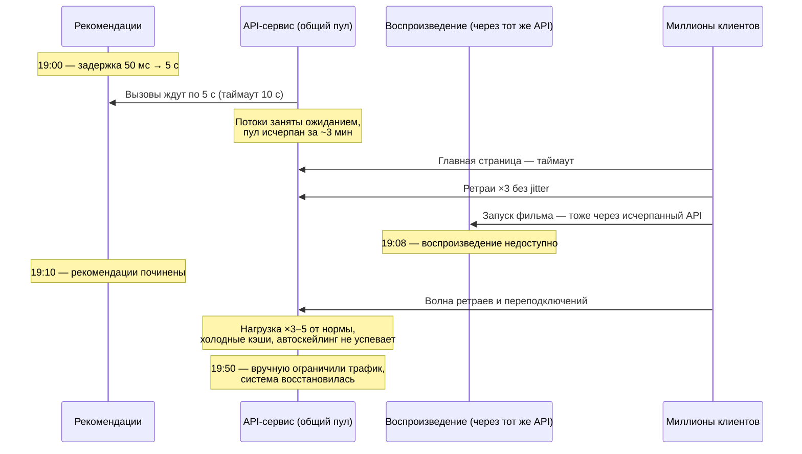
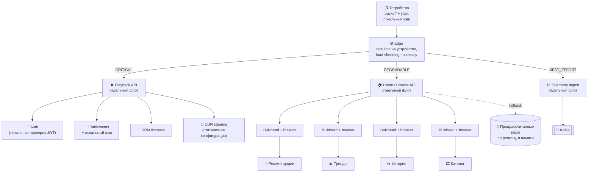
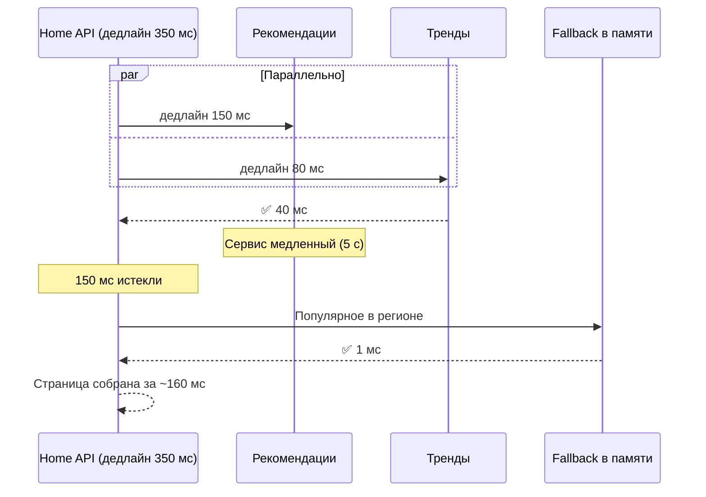
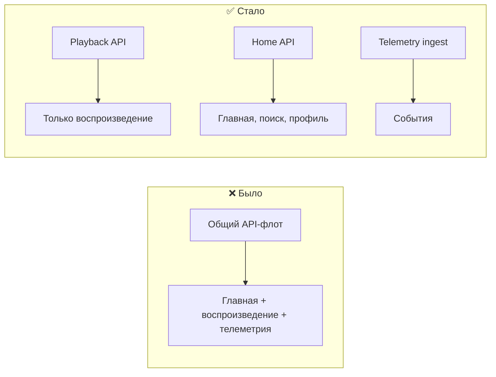
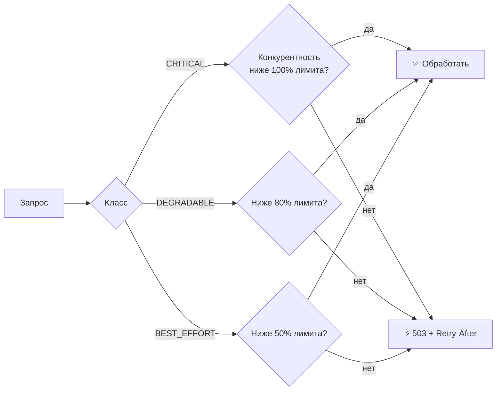

[English](INTERVIEW.md) | **Русский** · Теория: [README_RU.md](./README.ru.md)

# 13. Reliability Patterns: устойчивость видеостримингового сервиса

> **Тема:** разбор каскадного инцидента, критичный путь и деградация, таймауты и бюджет запроса, bulkhead, circuit breaker с fallback, load shedding по приоритету, retry storm и метастабильный сбой, статическая стабильность воспроизведения, cells, хаос-эксперименты
> **Уровень:** Hard · **Время на интервью:** 45 мин · **Время на разбор:** ~5 ч
> **Где спрашивают:** «Как сделать сервис устойчивым к сбоям зависимостей?», «разберите инцидент», а также как deep dive почти в любой задаче уровня Senior+

---

## 🗺️ Как читать этот разбор

| Значок | Что значит |
|:------:|:-----------|
| 🎤 | Реплика интервьюера |
| 🗣️ | Что говорю вслух я (кандидат) |
| ✏️ | Что рисую на доске |
| ⏱️ | Сколько времени тратить на шаг |

Блоки **TIP** — хороший приём, **WARNING** — ловушка, **IMPORTANT** — сигнал для уровня Senior+.

---

## 📑 Содержание

1. [Условие задачи](#1-условие-задачи)
2. [Разбор инцидента](#2-разбор-инцидента)
3. [Требования](#3-требования)
4. [Оценки и бюджет доступности](#4-оценки-и-бюджет-доступности)
5. [Критичный путь и классы запросов](#5-критичный-путь-и-классы-запросов)
6. [High-level дизайн](#6-high-level-дизайн)
7. [Deep dive 1: таймауты и бюджет главной страницы](#7-deep-dive-1-таймауты-и-бюджет-главной-страницы)
8. [Deep dive 2: bulkheads и разделение флотов](#8-deep-dive-2-bulkheads-и-разделение-флотов)
9. [Deep dive 3: circuit breakers и fallback](#9-deep-dive-3-circuit-breakers-и-fallback)
10. [Deep dive 4: load shedding по приоритету](#10-deep-dive-4-load-shedding-по-приоритету)
11. [Deep dive 5: retry storm и выход из метастабильного сбоя](#11-deep-dive-5-retry-storm-и-выход-из-метастабильного-сбоя)
12. [Deep dive 6: статическая стабильность воспроизведения](#12-deep-dive-6-статическая-стабильность-воспроизведения)
13. [Deep dive 7: радиус поражения и проверка](#13-deep-dive-7-радиус-поражения-и-проверка)
14. [Узкие места и сценарии сбоев](#14-узкие-места-и-сценарии-сбоев)
15. [Вопросы интервьюера с ответами](#15-вопросы-интервьюера-с-ответами)
16. [Типичные ошибки](#16-типичные-ошибки)
17. [Шпаргалка и самопроверка](#17-шпаргалка-и-самопроверка)

---

## 1. Условие задачи

> 🎤 «У нас видеостриминговый сервис. В пятницу вечером сервис рекомендаций начал отвечать за 5 секунд вместо 50 мс. Через 3 минуты перестала открываться главная страница, а ещё через 5 — пользователи не могли запустить даже фильмы, которые уже смотрели. Рекомендации починили за 10 минут, но сервис лежал ещё 40 минут. Разбери, что произошло, и спроектируй так, чтобы это не повторилось».

**План по времени:**

| Шаг | ⏱️ |
|:----|:--:|
| Разбор инцидента | 6 мин |
| Требования и оценки | 5 мин |
| Критичный путь и классы запросов | 5 мин |
| High-level дизайн | 4 мин |
| Deep dives | 20 мин |
| Итоги | 5 мин |

> [!TIP]
> В условии три подсказки: «медленная, а не упавшая зависимость», «упало то, что от неё не зависит» и «после починки лежали ещё 40 минут». Это **каскад** через общие ресурсы и **метастабильный** сбой. Назови их явно — это сразу показывает уровень.

---

## 2. Разбор инцидента

⏱️ 6 мин

🗣️ «Восстановлю вероятную цепочку событий»:



| Проблема | Почему привела к отказу |
|:---------|:------------------------|
| Таймаут к рекомендациям 10 с при норме 50 мс | Каждый вызов держал поток в 100 раз дольше обычного |
| **Общий пул** потоков для всех зависимостей и всех эндпоинтов | Медленные рекомендации забрали ресурсы у воспроизведения |
| Нет circuit breaker | API продолжал слать запросы в явно неисправный сервис |
| Главная страница **ждала** рекомендации | Нет частичного ответа и fallback |
| Воспроизведение шло через тот же API-флот | Некритичная функция положила критичную |
| Ретраи клиентов без backoff и jitter | Нагрузка выросла в разы |
| После починки — нет механизма снижения нагрузки | **Метастабильный сбой**: ретраи и холодные кэши удерживали отказ |

> [!IMPORTANT]
> **Сигнал Senior+:** корневая причина — не «медленные рекомендации» (такое будет случаться всегда), а **отсутствие изоляции**: некритичная функция смогла забрать ресурсы критичной. Правильный вопрос постмортема — «почему сбой рекомендаций смог остановить воспроизведение?».

---

## 3. Требования

⏱️ 3 мин

### Функциональные (что должно работать при сбоях)

1. **Воспроизведение** (запуск и продолжение просмотра) — работает при сбое любой некритичной зависимости.
2. **Главная страница** — открывается всегда; при сбоях — в упрощённом виде.
3. Поиск, профиль, история — работают, допускают деградацию.

### Нефункциональные

| Требование | Цель |
|:-----------|:-----|
| Доступность запуска воспроизведения | 99,99% |
| Доступность главной страницы | 99,95% (с учётом деградированного режима как «доступно») |
| Задержка главной страницы | p99 < 400 мс, даже если одна зависимость медленная |
| Радиус поражения | Сбой некритичного сервиса не влияет на воспроизведение; плохой деплой затрагивает ≤ 5% пользователей |
| Восстановление | Система возвращается в норму автоматически за минуты после устранения причины |

---

## 4. Оценки и бюджет доступности

⏱️ 2 мин

✏️

```
Пиковые одновременные устройства      ≈ 50M
Главная страница                      ≈ 50 000 запросов/с
Запуск воспроизведения                ≈ 30 000 запросов/с
Телеметрия и предзагрузка             ≈ 200 000 запросов/с
Fan-out главной страницы              ≈ 15 сервисов → 750 000 внутренних вызовов/с

Бюджет доступности запуска (99,99%):
  5 синхронных зависимостей по 99,95%  →  0,9995⁵ ≈ 99,75%   ❌ не хватает
  2 синхронные зависимости по 99,99% + остальное из кэша   →  ≈ 99,98%   ✅ близко
```

🗣️ «Вывод: на критичном пути воспроизведения должно быть **как можно меньше синхронных зависимостей**. Всё остальное — кэшировано, асинхронно или с fallback. Иначе математика не сходится».

---

## 5. Критичный путь и классы запросов

⏱️ 5 мин

### Зависимости главной страницы и воспроизведения

| Функция | Зависимости | Критичность | При сбое |
|:--------|:------------|:-----------|:---------|
| **Запуск воспроизведения** | Авторизация, права на контент, лицензия DRM, выбор CDN | 🔴 Критичная | Должно работать |
| Продолжить просмотр (позиция) | История просмотра | 🟡 Деградируемая | Начать с начала или с локально сохранённой позиции |
| Ряды главной страницы | Рекомендации, тренды, «продолжить просмотр», промо | 🟡 Деградируемая | Популярное по региону из кэша |
| Обложки и метаданные | Каталог | 🟡 Деградируемая | Кэш / CDN |
| Поиск | Поисковый сервис | 🟡 Деградируемая | «Поиск временно недоступен» |
| Предзагрузка трейлеров | Медиа | ⚪ Фоновая | Пропустить |
| Телеметрия | Сбор событий | ⚪ Фоновая | Буферизовать на клиенте, сбросить при перегрузке |

### Классы запросов

| Класс | Что входит | Поведение при перегрузке |
|:------|:-----------|:-------------------------|
| **CRITICAL** | Запуск и продолжение воспроизведения, вход | Отбрасывается последним |
| **DEGRADABLE** | Главная страница, поиск, профиль | Отвечаем упрощённо или отбрасываем при сильной перегрузке |
| **BEST_EFFORT** | Телеметрия, предзагрузка, обновления в фоне | Отбрасываются первыми |

🗣️ «Класс запроса указывается клиентом (или определяется на edge по эндпоинту) и передаётся по всей цепочке в заголовке. Каждый сервис использует его для load shedding».

---

## 6. High-level дизайн

⏱️ 4 мин

✏️



🗣️ «Ключевые решения:
- **Разделённые флоты** по классам критичности: никакой сбой главной страницы не может забрать ресурсы воспроизведения;
- в Home API — **bulkhead, таймаут и circuit breaker на каждую зависимость** и **fallback из памяти**;
- **edge** ограничивает каждое устройство и отбрасывает трафик по классу при перегрузке;
- Playback API минимально зависит от синхронных сервисов: токены проверяются локально, права на контент кэшируются».

---

## 7. Deep dive 1: таймауты и бюджет главной страницы

> 🎤 «Главная страница собирается из 15 сервисов. Как уложиться в 400 мс, если один из них медленный?»

🗣️ «Главная страница — это **параллельный fan-out** с общим дедлайном и **частичным ответом**:

| Правило | Реализация |
|:--------|:-----------|
| Общий бюджет | 350 мс на сборку (из 400 мс p99) |
| Вызовы параллельные | Все ряды запрашиваются одновременно |
| Таймаут на каждую зависимость | По её p99.9 в норме, но не больше бюджета: рекомендации — 150 мс, тренды — 80 мс, история — 100 мс |
| Дедлайн передаётся вниз | Сервис рекомендаций знает, что у него 150 мс, и не начинает тяжёлый расчёт, если не успеет |
| Частичный ответ | Ряд, не успевший к дедлайну, заменяется fallback, остальные отдаются как есть |
| Порядок важности рядов | «Продолжить просмотр» важнее «Новинок» — его fallback (локальная история на устройстве) тоже готов |



> [!WARNING]
> Было: таймаут 10 с к рекомендациям — каждый вызов держал поток в 200 раз дольше нормы. Таймаут **по умолчанию** в HTTP-клиентах часто равен десяткам секунд или бесконечности. Проверь каждый клиент.

---

## 8. Deep dive 2: bulkheads и разделение флотов

> 🎤 «Хорошо, таймауты короткие. Этого достаточно?»

🗣️ «Нет. Даже с таймаутом 150 мс при 50 000 запросов в секунду медленная зависимость держит **7 500 одновременных вызовов** (50 000 × 0,15 с) вместо 2 500 в норме (50 000 × 0,05 с). Если пул общий, это может забрать ресурсы у остальных зависимостей. Поэтому изоляция на двух уровнях.

### Уровень 1: внутри Home API

| Зависимость | Лимит конкурентности на инстанс | Что при превышении |
|:------------|:-------------------------------:|:-------------------|
| Рекомендации | 60 | Сразу fallback, без ожидания |
| Тренды | 30 | Сразу fallback |
| История | 40 | Fallback из устройства |
| Каталог | 80 | Кэш |

Лимит — это **семафор**: если 60 вызовов к рекомендациям уже в полёте, 61-й не ждёт, а сразу получает fallback.

### Уровень 2: разные флоты



| Флот | Почему отдельно |
|:-----|:----------------|
| Playback API | Критичный путь: свой автоскейлинг, свои лимиты, деплоится реже и осторожнее |
| Home API | Много зависимостей, частые изменения, допускает деградацию |
| Telemetry | Огромный объём, можно отбрасывать |

🗣️ «Даже если Home API полностью упадёт, Playback API продолжит запускать фильмы. Это и есть главное исправление после инцидента».

---

## 9. Deep dive 3: circuit breakers и fallback

> 🎤 «Что делает circuit breaker и что возвращать, когда он открыт?»

🗣️ «Breaker на каждую зависимость Home API:

| Параметр | Значение |
|:---------|:---------|
| Окно | 10 с |
| Минимум вызовов | 100 |
| Открытие | > 50% ошибок **или** > 50% вызовов медленнее 100 мс |
| В открытом состоянии | 30 с, затем half-open с 10 пробными вызовами |
| Таймауты и отказы по лимиту конкурентности | Считаются ошибками |

### Fallback для каждого ряда

| Ряд | Fallback | Откуда |
|:----|:---------|:-------|
| Рекомендации | Популярное по региону и возрастному рейтингу профиля | Предрассчитывается каждые 15 мин, хранится **в памяти** каждого инстанса Home API |
| Тренды | Последний успешный ответ | Локальный кэш, устаревание до часа допустимо |
| Продолжить просмотр | История с устройства | Устройство хранит последние позиции локально |
| Промо | Пустой ряд | — |
| Метаданные и обложки | CDN и кэш | Почти никогда не меняются |

> [!WARNING]
> Плохой fallback: «если рекомендации недоступны — посчитать популярное запросом к базе просмотров». В момент сбоя все инстансы одновременно пойдут в базу и положат её. Fallback должен быть **готов заранее** и не требовать других сервисов.

### Проверка fallback

- Регулярный хаос-эксперимент: принудительно открыть breaker рекомендаций для 1% пользователей и проверить метрики (время сборки, ошибки, вовлечённость).
- Fallback-данные имеют свой мониторинг: возраст и наличие во всех регионах.

---

## 10. Deep dive 4: load shedding по приоритету

> 🎤 «Что если перегрузка общая — например, вышел популярный сериал и трафик ×3?»

🗣️ «Тогда отбрасываем **некритичное первым**, и делаем это **как можно раньше**:

| Уровень | Механизм |
|:--------|:---------|
| Устройство | Откладывает телеметрию и предзагрузку, если получает `503` |
| Edge | Следит за здоровьем флотов; при перегрузке отбрасывает BEST_EFFORT, затем часть DEGRADABLE; CRITICAL — последним |
| Сервис | **Адаптивный лимит конкурентности**: если задержка растёт — лимит снижается; запросы сверх лимита отбрасываются сразу `503` + `Retry-After` |
| Очереди | Ограниченные; запросы, которые ждали дольше своего дедлайна, отбрасываются без обработки |



🗣️ «Пороги разные: BEST_EFFORT начинает отбрасываться при 50% лимита, DEGRADABLE — при 80%, CRITICAL — только когда лимит полностью исчерпан. Так при росте нагрузки сначала исчезает телеметрия, потом упрощается главная страница, а воспроизведение работает до последнего».

> [!TIP]
> Отказ **на входе** стоит почти ноль ресурсов. Отказ после того, как запрос прошёл половину цепочки, — это потраченные ресурсы всех сервисов, через которые он прошёл. Поэтому load shedding максимально близко к краю.

---

## 11. Deep dive 5: retry storm и выход из метастабильного сбоя

> 🎤 «Почему после починки рекомендаций сервис лежал ещё 40 минут?»

🗣️ «Метастабильный сбой. Петли, которые удерживали отказ:

| Петля | Механизм |
|:------|:---------|
| Ретраи | Устройства повторяли каждый запрос 3 раза немедленно → нагрузка ×3–4 |
| Синхронизация | Без jitter миллионы устройств повторяли одновременно — волнами |
| Холодные кэши | За время сбоя кэши истекли → промахи → нагрузка на базы |
| Автоскейлинг | Новые инстансы стартовали медленно и сразу получали полную нагрузку |
| Повторный запуск приложений | Пользователи перезапускали приложения → полная загрузка главной вместо обновления |

### Исправления

| Где | Что |
|:----|:----|
| SDK устройств | Exponential backoff + full jitter, максимум 2 повтора, **retry budget** (не больше 10% запросов — повторы), уважение `Retry-After` |
| Edge | Rate limit на устройство (token bucket); при `503` устройство получает `Retry-After` с разбросом |
| Сервисы | Retry budget для внутренних вызовов; ретраи только на одном уровне |
| Восстановление | **Постепенное открытие трафика**: edge пропускает 10% → 30% → 60% → 100%, пока кэши прогреваются |
| Новые инстансы | Slow start: доля трафика растёт постепенно |
| Ручной «рубильник» | Возможность быстро сократить трафик некритичных классов до нуля |


> [!IMPORTANT]
> **Сигнал Senior+:** из метастабильного сбоя **нельзя выйти, просто устранив причину** — нужно разорвать петлю: снизить нагрузку ниже нормальной, а потом увеличивать её постепенно. Механизм для этого (рубильник на edge, постепенное открытие) должен существовать **до** инцидента.

---

## 12. Deep dive 6: статическая стабильность воспроизведения

> 🎤 «Запуск воспроизведения зависит от авторизации, прав на контент и лицензий. Что если сервис прав на контент упадёт?»

🗣️ «Делаю воспроизведение **статически стабильным** — продолжающим работать без своих управляющих сервисов:

| Зависимость | Как убираю её с синхронного пути |
|:------------|:-------------------------------|
| Авторизация | JWT проверяется **локально** по подписи; сервис авторизации нужен только для входа и обновления токена |
| Права на контент (подписка, регион) | Кэшируются в Playback API и в подписанном токене устройства с TTL ~1 ч; при недоступности сервиса — **grace period**: используем последнее известное состояние |
| Лицензии DRM | Сервис лицензий — свои реплики в каждом регионе; устройство кэширует лицензию для начатого фильма |
| Выбор CDN | Статическая конфигурация, обновляемая асинхронно; при сбое — последняя известная |
| Позиция просмотра | Устройство помнит локально |

| Риск | Решение |
|:-----|:--------|
| Пользователь отменил подписку, а grace period ещё действует | Допустимо: час доступа — дешевле, чем отказ воспроизведения для всех |
| Кэш прав устарел | TTL и асинхронное обновление по событиям (CDC) |

> [!NOTE]
> Это сознательный компромисс **доступности против точности** — и для стриминга он правильный: краткий бесплатный доступ одного пользователя стоит намного меньше, чем час недоступности для миллионов.

---

## 13. Deep dive 7: радиус поражения и проверка

> 🎤 «Как сделать так, чтобы плохой деплой не положил всех?»

### Радиус поражения

| Механизм | Как |
|:---------|:----|
| **Cells** | Playback API развёрнут в независимых cells по ~5% пользователей; пользователь закреплён за cell |
| **Поэтапный деплой** | Canary 1% → одна cell → одна зона → регион → все, с автоматическим откатом по метрикам |
| **Конфигурация — тоже поэтапно** | Изменения конфигурации и feature flags раскатываются так же, как код |
| **Shuffle sharding** для партнёрских устройств | Модели устройств с некорректной логикой ретраев попадают на случайные пары узлов edge — не кладут всех |

### Проверка

| Практика | Пример |
|:---------|:-------|
| Fault injection | Задержка 5 с для 1% вызовов рекомендаций — проверить, что главная собирается за 400 мс |
| Chaos-эксперименты | Отключение экземпляров и целой зоны; открытие breakers |
| Game day | Сценарий «сервис прав на контент недоступен 30 мин» — воспроизведение продолжается? |
| Нагрузочные тесты | Трафик ×3 — работает ли приоритизация и load shedding |
| Учения по восстановлению | Постепенное открытие трафика после искусственной перегрузки |

---

## 14. Узкие места и сценарии сбоев

| Сценарий | Что произойдёт | Как защищаемся |
|:---------|:---------------|:---------------|
| Рекомендации медленные | Ряд «Рекомендации» не успевает | Таймаут 150 мс, bulkhead, breaker, fallback из памяти; главная за ~160 мс |
| Home API полностью упал | Главная не открывается | Устройство показывает закэшированную главную; воспроизведение работает (отдельный флот) |
| Сервис прав на контент упал | Нельзя проверить подписку | Кэш и grace period; воспроизведение продолжается |
| Трафик ×3 | Перегрузка | Load shedding по классам; телеметрия отбрасывается первой |
| Retry storm после сбоя | Метастабильное состояние | Backoff + jitter, retry budget, rate limit, постепенное открытие трафика |
| Плохой деплой Playback API | Ошибки воспроизведения | Canary, cells, автоматический откат |
| Сбой зоны | Минус треть ёмкости | N+1 по зонам, запас ёмкости заранее (статическая стабильность) |
| Fallback-данные устарели или отсутствуют | Пустые ряды | Мониторинг возраста fallback; несколько уровней fallback |
| Холодный кэш после рестарта | Нагрузка на базы | Прогрев перед включением трафика, slow start |

---

## 15. Вопросы интервьюера с ответами

<details>
<summary><b>Почему не просто увеличить пул потоков?</b></summary>

Больший пул только отложит исчерпание: медленная зависимость заберёт и его, а память и переключения контекста вырастут. К тому же сама зависимость получит ещё больше одновременных запросов. Нужны изоляция (отдельные лимиты на зависимость), короткие таймауты и быстрый отказ — тогда ресурсы не копятся в ожидании.
</details>

<details>
<summary><b>Не будет ли circuit breaker открываться из-за случайных всплесков ошибок?</b></summary>

Для этого есть минимальное число вызовов в окне и порог в процентах: 3 ошибки из 5 вызовов не откроют breaker с минимумом 100. Плюс half-open: если зависимость в порядке, пробные вызовы быстро закроют его. Параметры подбираются по реальным метрикам и проверяются хаос-экспериментами.
</details>

<details>
<summary><b>Чем load shedding отличается от автоскейлинга — может, просто масштабироваться?</b></summary>

Автоскейлинг реагирует за минуты, а перегрузка нарастает за секунды. Кроме того, если узкое место — зависимость (база, внешний сервис), добавление инстансов её только добьёт. Load shedding — мгновенная защита на время, пока автоскейлинг или люди не исправят ситуацию; они дополняют друг друга.
</details>

<details>
<summary><b>Как устройство узнаёт, что нужно меньше ретраить?</b></summary>

Через ответы сервера: `503` и `429` с `Retry-After`, которые устройство обязано уважать, плюс встроенный retry budget в SDK. Для старых устройств, которые нельзя обновить, — rate limit на edge по устройству и shuffle sharding, ограничивающий их влияние на остальных.
</details>

<details>
<summary><b>Не опасен ли grace period для прав на контент?</b></summary>

Это осознанный компромисс: в худшем случае пользователь с истёкшей подпиской смотрит до часа бесплатно. Это намного дешевле, чем отказ воспроизведения для миллионов во время сбоя сервиса прав. Для контента с жёсткими лицензионными требованиями (например, прямые трансляции с ограничениями по региону) grace period можно сделать короче.
</details>

<details>
<summary><b>Какие метрики показали бы проблему раньше?</b></summary>

Задержка зависимостей (p99, а не среднее), заполненность bulkhead-лимитов, состояние breakers, доля fallback-ответов, доля отброшенных запросов по классам, доля ретраев в трафике. Рост доли ретраев — ранний признак надвигающегося retry storm.
</details>

---

## 16. Типичные ошибки

| ❌ Ошибка | ✅ Как правильно |
|:---------|:----------------|
| «Корневая причина — медленные рекомендации» | Корневая причина — отсутствие изоляции критичного от некритичного |
| Длинные таймауты «на всякий случай» | По p99.9 и в рамках бюджета запроса |
| Общий пул на все зависимости | Лимит конкурентности на каждую зависимость |
| Один API-флот для всего | Отдельные флоты по классам критичности |
| Breaker без fallback | Fallback, подготовленный заранее, в памяти |
| Fallback через другой сервис или базу | Локальные предрассчитанные данные |
| Случайное отбрасывание запросов | Load shedding по классам, рано, на edge |
| Ретраи без backoff, jitter и бюджета | Всё три + `Retry-After` |
| «Починили причину — само восстановится» | Постепенное открытие трафика, рубильник на edge |
| Воспроизведение зависит от 5 синхронных сервисов | Локальная проверка токенов, кэш прав, grace period |
| Механизмы никогда не проверялись | Fault injection, chaos, game days |

---

## 17. Шпаргалка и самопроверка

### Ответ за 30 секунд

> Инцидент — каскад через общий пул потоков и метастабильный сбой из-за ретраев. Исправления: разделить флоты по критичности (воспроизведение отдельно от главной и телеметрии); в Home API — параллельный fan-out с дедлайном 350 мс, таймаут по p99.9, лимит конкурентности, circuit breaker и fallback из памяти на каждую зависимость; частичный ответ. На edge — rate limit на устройство и load shedding по классам (сначала телеметрия, потом главная, воспроизведение последним). На устройствах — backoff, jitter, retry budget, `Retry-After`. Восстановление — постепенным открытием трафика. Воспроизведение статически стабильно: локальная проверка JWT, кэш прав с grace period. Радиус поражения ограничен cells и поэтапными деплоями; всё проверяется fault injection и game days.

### Самопроверка

- [ ] Могу восстановить цепочку каскадного сбоя и назвать настоящую корневую причину
- [ ] Могу объяснить, почему сервис не восстановился сам (метастабильность)
- [ ] Могу посчитать бюджет доступности для критичного пути
- [ ] Могу разделить запросы на классы и объяснить, как они используются
- [ ] Могу спроектировать сборку главной страницы с дедлайном и частичным ответом
- [ ] Могу объяснить bulkhead на двух уровнях: лимиты и флоты
- [ ] Могу выбрать хороший fallback и объяснить, почему плохой опасен
- [ ] Могу описать статическую стабильность воспроизведения и её компромисс

### Что почитать

- Теория по теме: [README_RU.md](./README.ru.md)
- Google SRE Book — «Addressing Cascading Failures»
- Bronson et al., *Metastable Failures in Distributed Systems*
- Amazon Builders' Library: *Using load shedding to avoid overload*
- Netflix Tech Blog: *Performance Under Load*